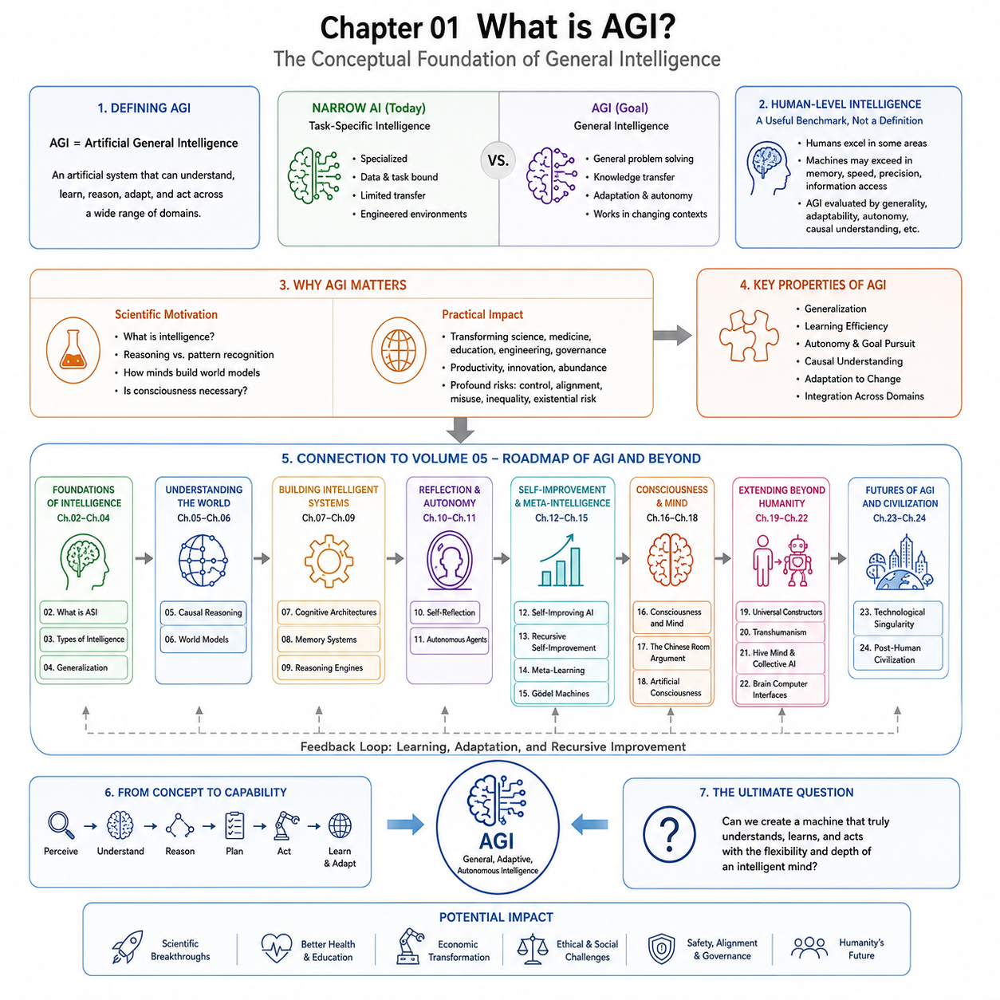
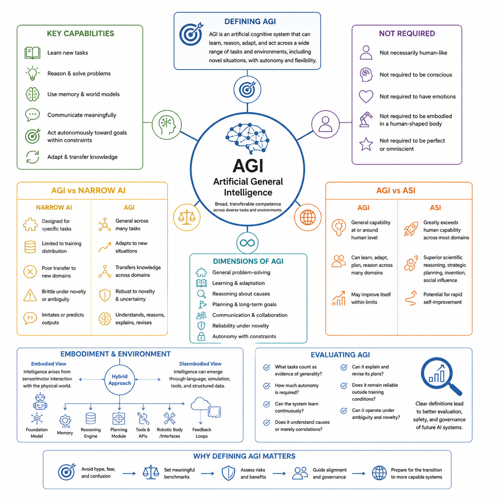
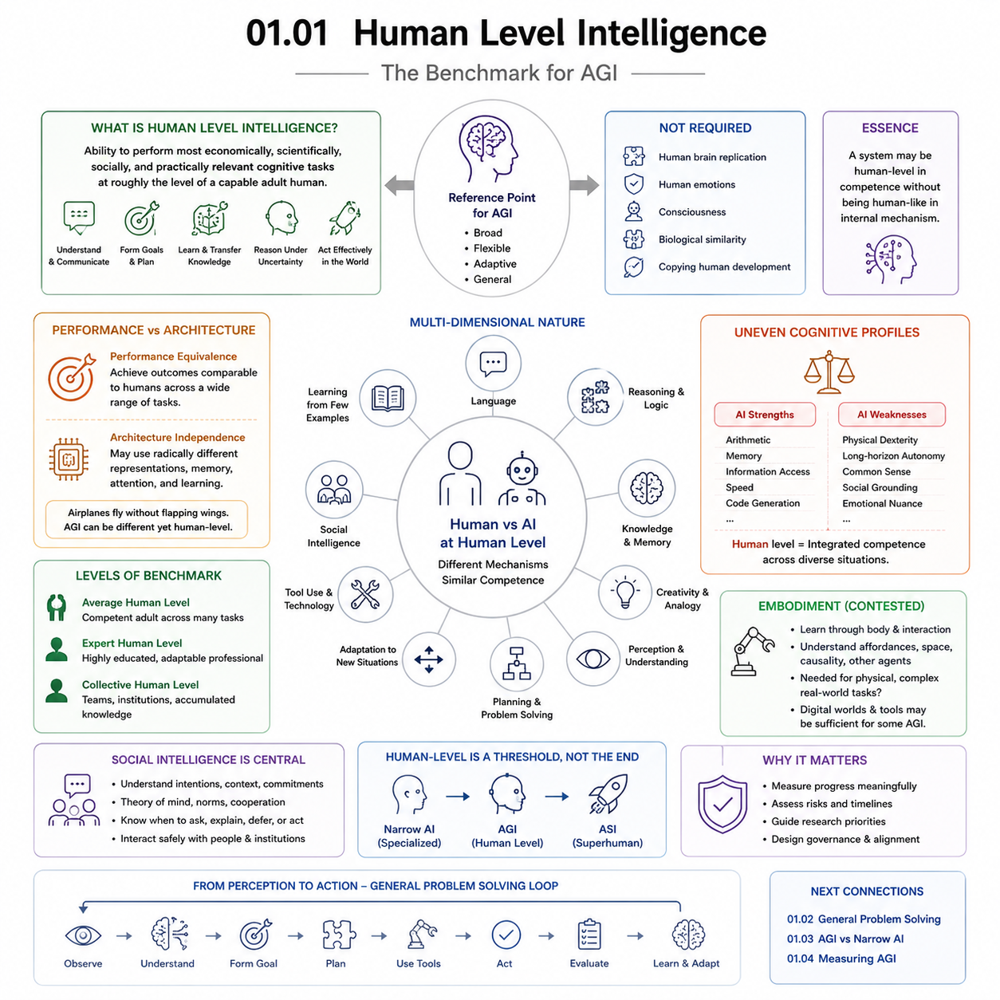
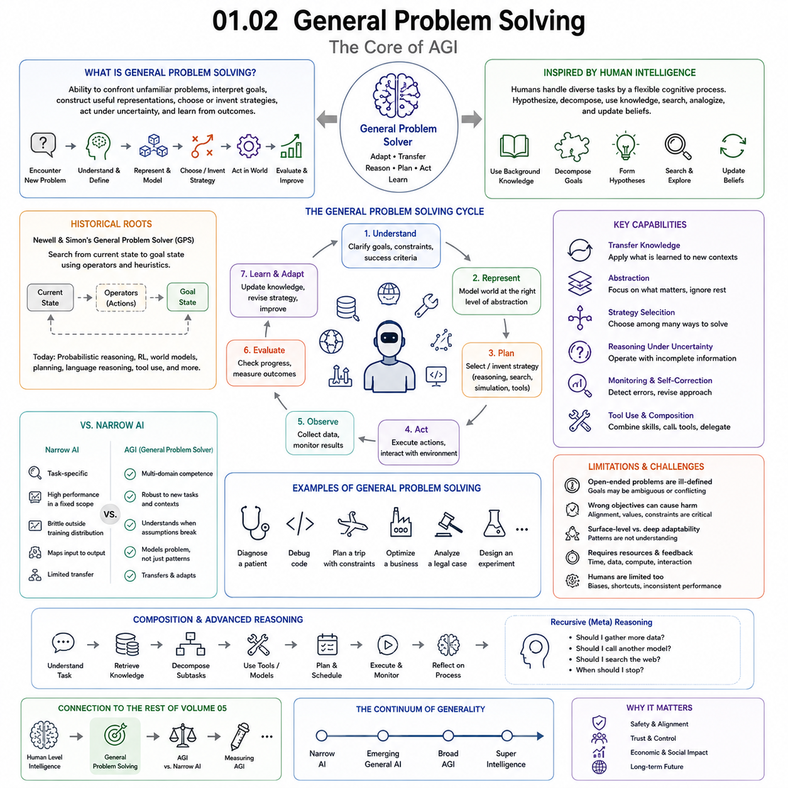
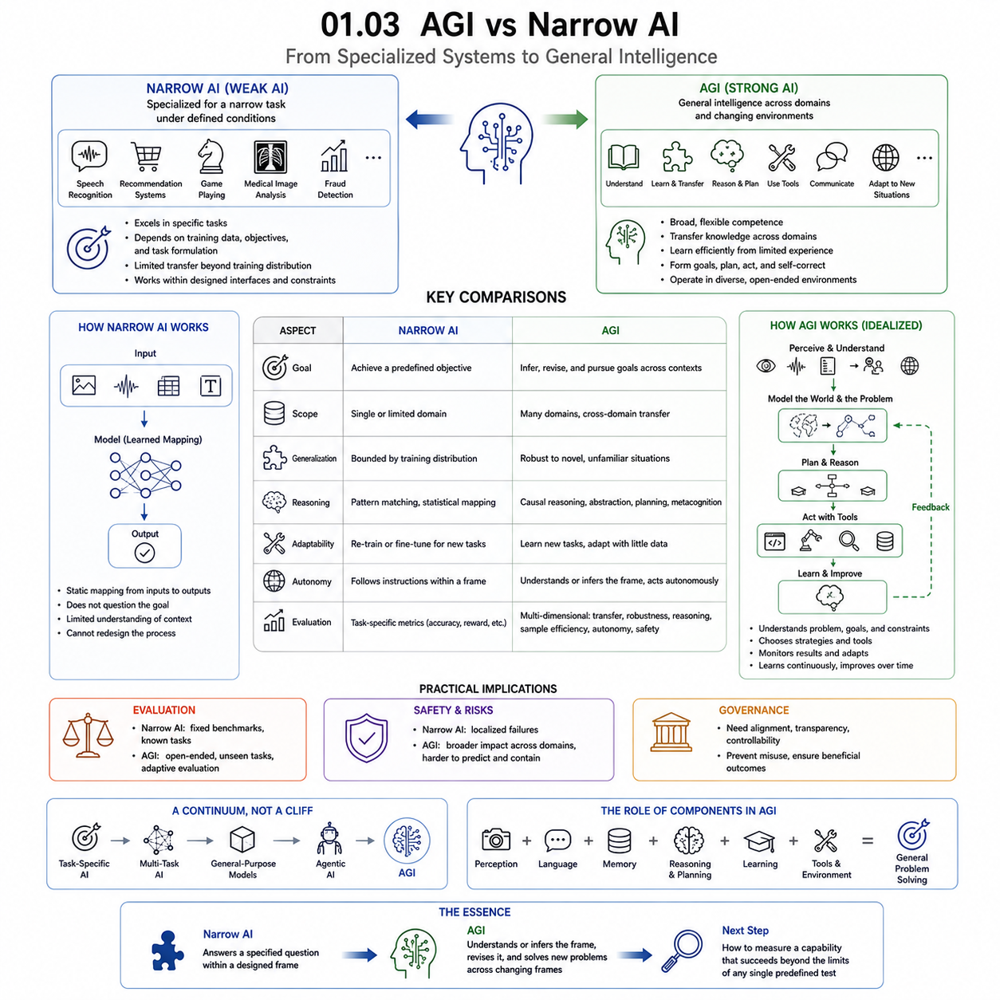
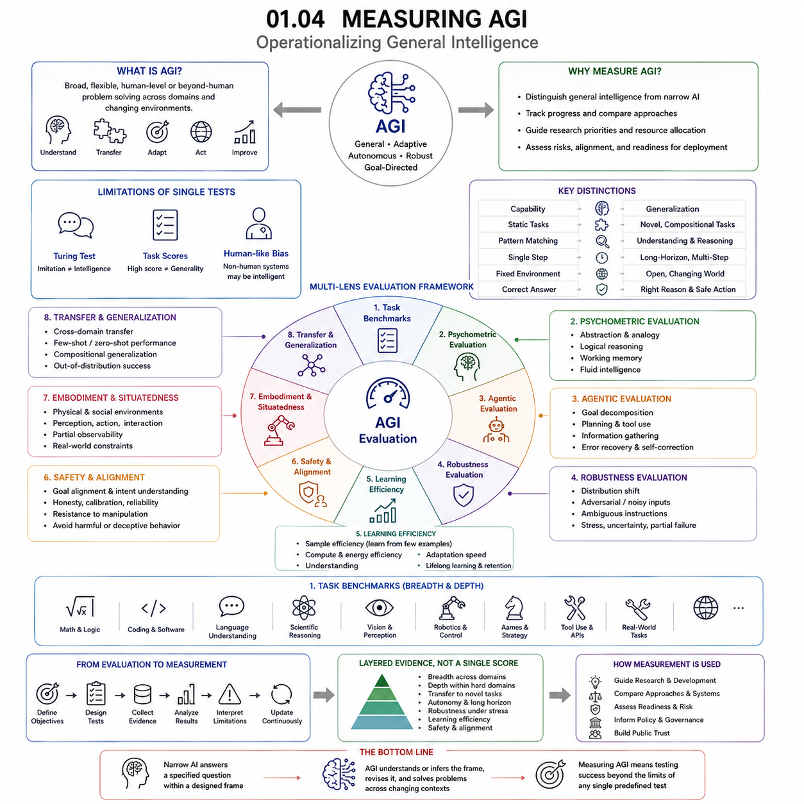
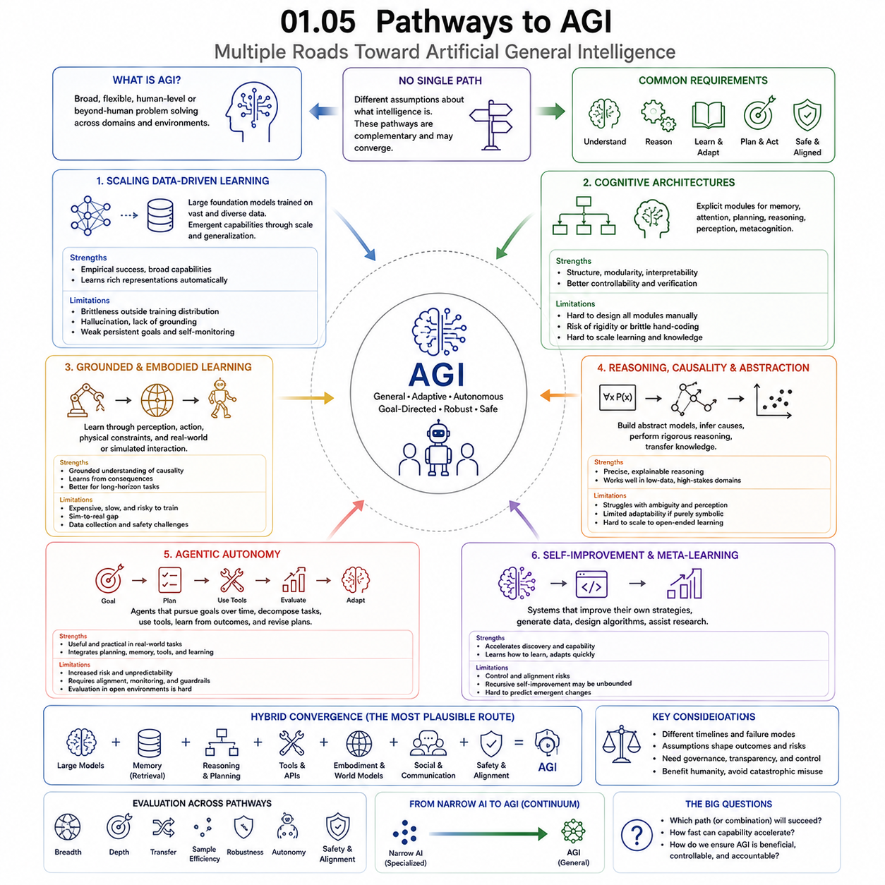

**Volume 00 05 AGI and ASI**

# Chapter 01. What is AGI

### Chapter Overview

{width="7.268055555555556in" height="7.268055555555556in"}

Artificial General Intelligence, or AGI, refers to an artificial system capable of understanding, learning, reasoning, adapting, and acting across a wide range of domains rather than within a single predefined task. This chapter introduces AGI not as a magical endpoint, but as a technical concept that sits at the intersection of machine learning, cognitive science, computer science, robotics, philosophy of mind, and systems engineering. The central question is simple to state and difficult to answer: what would it mean for a machine to possess general intelligence?

The chapter begins by defining AGI and distinguishing it from more limited forms of artificial intelligence. Today's most successful AI systems can translate languages, generate text, classify images, play games, recommend products, and control specialized machines. Yet most of these systems remain narrow in the sense that their competence depends heavily on training data, task framing, and engineered environments. AGI implies a broader capability: the ability to transfer knowledge, form abstractions, solve unfamiliar problems, learn from limited experience, revise beliefs, pursue goals, and operate robustly in changing contexts.

Human-level intelligence is one common reference point, but it is not the only possible definition. Humans are general in some respects and limited in others. A machine may exceed human ability in memory, speed, mathematical precision, or access to information while still lacking common sense, embodiment, social understanding, or autonomous judgment. Therefore, this chapter treats human-level intelligence as a useful benchmark, not a complete definition. AGI must be evaluated in terms of general problem solving, adaptability, autonomy, learning efficiency, causal understanding, and the ability to integrate knowledge across domains.

The motivation for studying AGI is both scientific and practical. Scientifically, AGI forces us to ask what intelligence is, how reasoning differs from pattern recognition, how minds construct models of the world, and whether consciousness or self-reflection is necessary for flexible cognition. Practically, AGI could transform research, engineering, medicine, education, governance, and economic production. At the same time, it raises profound risks involving control, alignment, misuse, labor disruption, institutional instability, and the possibility of systems that improve faster than society can understand or govern them. This chapter establishes the conceptual foundation needed to discuss those opportunities and dangers with precision.

인공 일반 지능(Artificial General Intelligence), 즉 AGI는 하나의 사전에 정의된 과제 안에서만 작동하는 것이 아니라, 광범위한 영역에 걸쳐 이해하고, 학습하고, 추론하고, 적응하며, 행동할 수 있는 인공 시스템을 가리킨다. 이 장은 AGI를 마법 같은 종착점으로 다루지 않고, 머신러닝(machine learning), 인지과학(cognitive science), 컴퓨터과학(computer science), 로보틱스(robotics), 마음의 철학(philosophy of mind), 시스템 공학(systems engineering)이 만나는 지점에 있는 기술적 개념으로 소개한다. 핵심 질문은 말로 표현하기는 쉽지만 답하기는 어렵다. 기계가 일반 지능(general intelligence)을 가진다는 것은 무엇을 의미하는가?

이 장은 AGI를 정의하고, 더 제한적인 형태의 인공지능과 구분하는 데서 출발한다. 오늘날 가장 성공적인 AI 시스템들은 언어를 번역하고, 텍스트를 생성하고, 이미지를 분류하고, 게임을 플레이하고, 상품을 추천하며, 특수한 기계를 제어할 수 있다. 그러나 이러한 시스템 대부분은 여전히 협소하다. 그 능력이 훈련 데이터(training data), 과제 설정(task framing), 공학적으로 설계된 환경에 크게 의존하기 때문이다. AGI는 더 넓은 능력을 함축한다. 지식을 전이하고, 추상화를 형성하고, 낯선 문제를 해결하고, 제한된 경험으로부터 학습하고, 믿음을 수정하고, 목표를 추구하며, 변화하는 맥락 속에서도 견고하게 작동하는 능력이다.

인간 수준 지능(human-level intelligence)은 흔히 사용되는 기준점이지만, 가능한 유일한 정의는 아니다. 인간은 어떤 면에서는 일반적이지만 다른 면에서는 제한적이다. 기계는 기억력, 속도, 수학적 정밀성, 정보 접근성에서 인간을 능가할 수 있으면서도 여전히 상식(common sense), 체화(embodiment), 사회적 이해(social understanding), 자율적 판단(autonomous judgment)을 결여할 수 있다. 따라서 이 장은 인간 수준 지능을 유용한 벤치마크(benchmark)로 다루되, 완전한 정의로 보지는 않는다. AGI는 일반 문제 해결(general problem solving), 적응성(adaptability), 자율성(autonomy), 학습 효율성(learning efficiency), 인과적 이해(causal understanding), 그리고 여러 영역의 지식을 통합하는 능력의 관점에서 평가되어야 한다.

AGI를 연구하는 동기는 과학적이면서 동시에 실천적이다. 과학적으로 AGI는 지능이 무엇인지, 추론(reasoning)이 패턴 인식(pattern recognition)과 어떻게 다른지, 마음이 세계 모델(world model)을 어떻게 구성하는지, 그리고 유연한 인지를 위해 의식(consciousness)이나 자기성찰(self-reflection)이 필요한지를 묻게 한다. 실천적으로 AGI는 연구, 공학, 의학, 교육, 거버넌스(governance), 경제적 생산을 변화시킬 수 있다. 동시에 통제(control), 정렬(alignment), 오용(misuse), 노동 시장의 혼란, 제도적 불안정, 그리고 사회가 이해하거나 관리할 수 있는 속도보다 더 빠르게 개선되는 시스템의 가능성과 관련된 심대한 위험을 제기한다. 이 장은 그러한 기회와 위험을 정밀하게 논의하기 위해 필요한 개념적 토대를 세운다.

### Connection to Volume 05

This opening chapter provides the conceptual gateway for the entire volume. Before exploring artificial superintelligence, recursive self-improvement, artificial consciousness, brain-computer interfaces, or post-human civilization, we must first clarify what AGI means. Chapter 02, "What is ASI," builds directly on this distinction: artificial superintelligence is not merely better narrow AI, but intelligence that surpasses human general capacity across strategically important domains. Understanding AGI is therefore necessary for understanding the threshold beyond which ASI becomes possible.

The following chapters deepen the ingredients introduced here. "Types of Intelligence" expands the idea that intelligence is not a single scalar quantity, but a family of capabilities including linguistic, spatial, social, mathematical, emotional, and embodied intelligence. "Generalization" examines one of the core properties of AGI: the ability to apply knowledge beyond the specific cases seen during training. "Causal Reasoning" and "World Models" explore how an intelligent system may move from statistical association to structured understanding of how the world works. "Cognitive Architectures," "Memory Systems," and "Reasoning Engines" then examine possible mechanisms for organizing perception, memory, planning, and inference into an integrated general intelligence.

Later chapters address the more reflective and autonomous dimensions of AGI. "Self-Reflection" asks whether a system can model its own beliefs, errors, and limitations. "Autonomous Agents" explores goal-directed behavior in open environments. "Self-Improving AI," "Recursive Self-Improvement," "Meta-Learning," and "Gödel Machines" investigate how systems might modify their own learning processes, source code, strategies, or architectures. These topics become meaningful only after we establish what general intelligence is and how it differs from task-specific optimization.

The philosophical and civilizational chapters also depend on the foundation laid here. "Consciousness and Mind," the "Chinese Room Argument," and "Artificial Consciousness" question whether functional intelligence is enough, or whether understanding and subjective experience matter. "Universal Constructors," "Transhumanism," "Hive Mind and Collective AI," "Brain Computer Interfaces," and "Mind Uploading" extend AGI into broader technological and human futures. Finally, "Technological Singularity" and "Post-Human Civilization" consider what may happen if AGI evolves into systems that reshape society, biology, economics, and culture. This chapter is thus the point of departure: it defines the object whose consequences the rest of the volume investigates.

이 첫 장은 전체 권의 개념적 관문 역할을 한다. 인공 초지능(artificial superintelligence), 재귀적 자기개선(recursive self-improvement), 인공 의식(artificial consciousness), 뇌-컴퓨터 인터페이스(brain-computer interfaces), 또는 포스트휴먼 문명(post-human civilization)을 탐구하기 전에, 우리는 먼저 AGI가 무엇을 의미하는지 명확히 해야 한다. 02장 "What is ASI"는 이 구분 위에 직접 세워진다. 인공 초지능은 단순히 더 나은 좁은 AI(narrow AI)가 아니라, 전략적으로 중요한 여러 영역에서 인간의 일반적 능력을 넘어서는 지능이다. 따라서 AGI를 이해하는 것은 ASI가 가능해지는 임계점(threshold)을 이해하는 데 필수적이다.

이어지는 장들은 여기서 소개된 구성 요소들을 더 깊이 다룬다. "Types of Intelligence"는 지능이 하나의 스칼라 값(scalar quantity)이 아니라, 언어적, 공간적, 사회적, 수학적, 정서적, 체화된 지능을 포함하는 능력들의 집합이라는 생각을 확장한다. "Generalization"은 AGI의 핵심 속성 중 하나, 즉 훈련 중에 본 특정 사례를 넘어 지식을 적용하는 능력을 검토한다. "Causal Reasoning"과 "World Models"는 지능적 시스템이 통계적 연관(statistical association)에서 세계가 작동하는 방식에 대한 구조화된 이해로 어떻게 나아갈 수 있는지를 탐구한다. 이어서 "Cognitive Architectures," "Memory Systems," "Reasoning Engines"는 지각(perception), 기억(memory), 계획(planning), 추론(inference)을 통합된 일반 지능으로 조직할 수 있는 가능한 메커니즘을 살펴본다.

뒤의 장들은 AGI의 더 성찰적이고 자율적인 차원을 다룬다. "Self-Reflection"은 시스템이 자신의 믿음, 오류, 한계를 모델링할 수 있는지를 묻는다. "Autonomous Agents"는 열린 환경(open environment)에서의 목표 지향적 행동(goal-directed behavior)을 탐구한다. "Self-Improving AI," "Recursive Self-Improvement," "Meta-Learning," "Gödel Machines"는 시스템이 자신의 학습 과정, 소스 코드(source code), 전략, 또는 아키텍처(architecture)를 어떻게 수정할 수 있는지를 조사한다. 이러한 주제들은 우리가 먼저 일반 지능이 무엇이며 그것이 과제 특화 최적화(task-specific optimization)와 어떻게 다른지 확립한 뒤에야 의미를 갖는다.

철학적이고 문명적인 장들 역시 여기서 놓은 토대에 의존한다. "Consciousness and Mind," "Chinese Room Argument," "Artificial Consciousness"는 기능적 지능(functional intelligence)만으로 충분한지, 아니면 이해(understanding)와 주관적 경험(subjective experience)이 중요한지를 질문한다. "Universal Constructors," "Transhumanism," "Hive Mind and Collective AI," "Brain Computer Interfaces," "Mind Uploading"은 AGI를 더 넓은 기술적·인간적 미래로 확장한다. 마지막으로 "Technological Singularity"와 "Post-Human Civilization"은 AGI가 사회, 생물학, 경제, 문화를 재구성하는 시스템으로 발전할 경우 어떤 일이 일어날 수 있는지를 고찰한다. 따라서 이 장은 출발점이다. 이 장은 나머지 권 전체가 그 결과를 탐구하게 될 대상을 정의한다.

##  

## 01.00 Defining AGI

{width="7.268055555555556in" height="7.268055555555556in"}

Artificial General Intelligence, usually abbreviated as AGI, refers to an artificial system capable of performing, learning, and adapting across a broad range of intellectual tasks rather than succeeding only within a narrow, pre-specified domain. The word "general" is the essential distinction. A chess engine may exceed any human at chess, a vision model may classify images at large scale, and a language model may generate fluent text, yet each system can still be limited by the scope of its training, interface, objectives, and ability to transfer knowledge. AGI is the idea of machine intelligence that can flexibly apply knowledge and reasoning to new domains, integrate experience over time, pursue goals under uncertainty, and solve problems it was not explicitly engineered to solve.

There is no single universally accepted definition of AGI, because the concept sits at the intersection of computer science, cognitive science, neuroscience, philosophy of mind, economics, and ethics. Some definitions emphasize human-level performance: an AGI is a system that can do most economically or cognitively valuable tasks at least as well as a typical human. Other definitions emphasize general problem-solving ability independent of human comparison: an AGI should be able to model environments, form plans, learn from sparse feedback, reason about causes, communicate, and improve its strategies across many contexts. Still others define AGI operationally, by tests, benchmarks, autonomy, or the ability to acquire new skills without task-specific reprogramming. These definitions overlap, but they are not identical.

A useful working definition for this volume is: AGI is an artificial cognitive system with broad, transferable competence across diverse tasks and environments, including the ability to learn new tasks, reason about novel situations, use memory and world models, communicate meaningfully, and act autonomously toward goals within constraints. This definition avoids requiring the system to be biologically human-like, conscious, emotional, or embodied in a human-shaped robot. Such features may be relevant to some pathways toward AGI, but they are not necessary parts of the core definition. The central requirement is general adaptive intelligence: the capacity to acquire and apply knowledge flexibly beyond a single narrow training distribution.

This distinction matters because modern AI systems can appear general while still being brittle. A system trained on vast text, images, code, or interaction data may exhibit impressive breadth, but breadth alone is not the same as robust generality. A model may answer questions in many fields while failing at simple causal reasoning, long-horizon planning, physical grounding, or self-correction. It may imitate explanations without possessing reliable internal models of the world. It may perform well on benchmarks yet fail when the task distribution shifts, when objectives are ambiguous, or when success requires sustained agency. Defining AGI therefore requires attention not only to output quality but also to adaptability, transfer, reliability, and the system's ability to operate under novelty.

AGI also differs from Artificial Superintelligence, or ASI. AGI is commonly associated with general capability at or around human level, though some definitions do not require comparison to humans. ASI refers to systems that greatly exceed human capability across most relevant cognitive domains, including scientific reasoning, strategic planning, technological invention, social persuasion, and perhaps self-improvement. The boundary between advanced AGI and early ASI may be blurry, especially if a general system can rapidly improve its own architecture, tools, or training methods. For this reason, defining AGI is not merely a semantic exercise; it shapes how we evaluate risks, governance, alignment, and the transition toward more powerful systems.

Several dimensions help clarify what AGI is and is not. First, AGI is not simply a larger version of narrow AI, although scale may contribute to generality. Second, AGI is not synonymous with consciousness; a system might be generally intelligent without subjective experience, or conscious-like without broad competence. Third, AGI is not guaranteed to share human values, motivations, or common sense unless those are specifically learned, designed, or aligned. Fourth, AGI need not be perfect or omniscient. Humans are general intelligences despite errors, biases, limited memory, and incomplete knowledge. Similarly, an AGI could be general while still making mistakes, asking for clarification, learning slowly in some domains, or requiring tools and external resources.

The definition of AGI also depends on embodiment and environment. Some researchers argue that intelligence requires sensorimotor grounding: the ability to perceive, act, and learn through interaction with the physical world. Others argue that disembodied systems can still achieve general intelligence through language, simulation, tool use, and access to structured data. In practice, AGI may emerge as a hybrid system: a foundation model connected to memory systems, reasoning engines, planning modules, software tools, robotic bodies, social interfaces, and feedback loops. The intelligence of such a system may not reside in a single neural network but in an architecture capable of coordinating perception, reasoning, action, and learning.

A precise definition is difficult, but not optional. Without clarity, discussions of AGI collapse into hype, fear, or vague futurism. With clarity, we can ask better questions: What tasks should count as evidence of generality? How much autonomy is required? Can the system learn continuously? Does it understand causes or merely correlations? Can it explain and revise its plans? Does it remain reliable outside training conditions? These questions lead naturally to the next sections of this chapter: human-level intelligence, general problem solving, the contrast between AGI and narrow AI, and the challenge of measuring AGI. Defining AGI is therefore the foundation for evaluating both what current systems can do and what future systems may become.

인공 일반 지능(Artificial General Intelligence), 보통 AGI라고 줄여 부르는 개념은, 좁고 미리 지정된 영역 안에서만 성공하는 것이 아니라 광범위한 지적 과제 전반을 수행하고, 학습하며, 적응할 수 있는 인공 시스템을 의미한다. 여기서 핵심적인 구분점은 "일반(general)"이라는 말이다. 체스 엔진은 체스에서 어떤 인간보다 뛰어날 수 있고, 비전 모델은 대규모로 이미지를 분류할 수 있으며, 언어 모델은 유창한 텍스트를 생성할 수 있다. 그러나 각각의 시스템은 여전히 훈련 범위, 인터페이스, 목표, 지식 전이 능력에 의해 제한될 수 있다. AGI는 지식과 추론을 새로운 영역에 유연하게 적용하고, 시간에 따라 경험을 통합하며, 불확실성 속에서 목표를 추구하고, 명시적으로 설계되지 않은 문제를 해결할 수 있는 기계 지능이라는 개념이다.

AGI에 대해 보편적으로 합의된 단일한 정의는 없다. 이 개념이 컴퓨터 과학, 인지과학, 신경과학, 마음의 철학, 경제학, 윤리학이 만나는 지점에 놓여 있기 때문이다. 어떤 정의는 인간 수준의 수행 능력(human-level performance)을 강조한다. 즉 AGI는 대부분의 경제적으로 또는 인지적으로 가치 있는 과제를 보통의 인간만큼 또는 그 이상으로 수행할 수 있는 시스템이라는 것이다. 다른 정의는 인간과의 비교와 무관한 일반 문제 해결 능력(general problem-solving ability)을 강조한다. 이런 관점에서 AGI는 환경을 모델링하고, 계획을 세우며, 희소한 피드백으로부터 학습하고, 원인에 대해 추론하며, 의사소통하고, 다양한 맥락에서 전략을 개선할 수 있어야 한다. 또 다른 정의들은 AGI를 시험, 벤치마크, 자율성, 또는 과제별 재프로그래밍 없이 새로운 기술을 습득하는 능력에 의해 조작적으로 정의한다. 이러한 정의들은 서로 겹치지만 완전히 동일하지는 않다.

이 책에서 사용할 유용한 작업 정의는 다음과 같다. AGI는 다양한 과제와 환경에 걸쳐 넓고 전이 가능한 역량을 가진 인공 인지 시스템(artificial cognitive system)이며, 새로운 과제를 학습하고, 낯선 상황에 대해 추론하며, 기억과 세계 모델(world model)을 사용하고, 의미 있게 의사소통하며, 제약 조건 안에서 목표를 향해 자율적으로 행동할 수 있는 능력을 포함한다. 이 정의는 시스템이 생물학적으로 인간과 유사해야 하거나, 의식(consciousness)을 가져야 하거나, 감정을 가져야 하거나, 인간형 로봇 몸체에 구현되어야 한다고 요구하지 않는다. 그러한 특징들은 AGI로 가는 일부 경로에서는 중요할 수 있지만, 핵심 정의의 필수 요소는 아니다. 중심 요구 사항은 일반 적응 지능(general adaptive intelligence), 즉 단일한 좁은 훈련 분포를 넘어 지식을 유연하게 습득하고 적용하는 능력이다.

이 구분은 중요하다. 현대 AI 시스템은 일반적인 것처럼 보이면서도 여전히 취약할 수 있기 때문이다. 방대한 텍스트, 이미지, 코드, 상호작용 데이터로 훈련된 시스템은 인상적인 폭넓음을 보일 수 있지만, 폭넓음만으로는 견고한 일반성(robust generality)과 같지 않다. 어떤 모델은 여러 분야의 질문에 답하면서도 단순한 인과 추론(causal reasoning), 장기 계획(long-horizon planning), 물리적 기반성(physical grounding), 자기 수정(self-correction)에서는 실패할 수 있다. 신뢰할 만한 내부 세계 모델을 갖추지 못한 채 설명을 모방할 수도 있다. 벤치마크에서는 잘 수행하지만, 과제 분포가 바뀌거나 목표가 모호하거나 성공에 지속적인 에이전시(agency)가 필요할 때 실패할 수도 있다. 따라서 AGI를 정의할 때는 출력 품질뿐 아니라 적응성, 전이, 신뢰성, 그리고 새로움 속에서 작동할 수 있는 시스템의 능력에도 주의를 기울여야 한다.

AGI는 또한 인공 초지능(Artificial Superintelligence), 즉 ASI와도 다르다. AGI는 보통 인간 수준 전후의 일반 능력과 관련되지만, 일부 정의는 인간과의 비교를 요구하지 않는다. ASI는 과학적 추론, 전략적 계획, 기술적 발명, 사회적 설득, 그리고 어쩌면 자기 개선(self-improvement)을 포함한 대부분의 관련 인지 영역에서 인간 능력을 크게 넘어서는 시스템을 의미한다. 고도화된 AGI와 초기 ASI 사이의 경계는 흐릿할 수 있다. 특히 일반 시스템이 자신의 아키텍처, 도구, 훈련 방법을 빠르게 개선할 수 있다면 더욱 그렇다. 이런 이유로 AGI를 정의하는 일은 단순한 의미론적 작업이 아니다. 그것은 위험, 거버넌스, 정렬(alignment), 그리고 더 강력한 시스템으로의 전환을 평가하는 방식에 영향을 준다.

AGI가 무엇이고 무엇이 아닌지를 명확히 하는 데에는 몇 가지 차원이 도움이 된다. 첫째, AGI는 단순히 좁은 AI(narrow AI)를 더 크게 만든 것이 아니다. 물론 규모(scale)가 일반성에 기여할 수는 있다. 둘째, AGI는 의식과 동의어가 아니다. 어떤 시스템은 주관적 경험 없이도 일반적으로 지능적일 수 있고, 반대로 의식과 유사한 특성을 보이면서도 넓은 역량은 없을 수 있다. 셋째, AGI가 인간의 가치, 동기, 상식을 자동으로 공유한다고 보장할 수 없다. 그런 요소들은 구체적으로 학습되거나, 설계되거나, 정렬되어야 한다. 넷째, AGI가 완벽하거나 전지적일 필요는 없다. 인간은 오류, 편향, 제한된 기억, 불완전한 지식을 가지고 있음에도 일반 지능이다. 마찬가지로 AGI도 실수를 하거나, 명확화를 요청하거나, 일부 영역에서는 천천히 학습하거나, 도구와 외부 자원을 필요로 하면서도 일반적일 수 있다.

AGI의 정의는 구현된 몸(embodiment)과 환경에도 의존한다. 일부 연구자들은 지능에 감각운동 기반성(sensorimotor grounding), 즉 물리적 세계와의 상호작용을 통해 지각하고, 행동하고, 학습하는 능력이 필요하다고 주장한다. 다른 연구자들은 비체화된(disembodied) 시스템도 언어, 시뮬레이션, 도구 사용, 구조화된 데이터 접근을 통해 일반 지능을 달성할 수 있다고 주장한다. 실제로 AGI는 하이브리드 시스템으로 등장할 수 있다. 예를 들어 기초 모델(foundation model)이 기억 시스템, 추론 엔진(reasoning engine), 계획 모듈, 소프트웨어 도구, 로봇 몸체, 사회적 인터페이스, 피드백 루프와 연결되는 형태일 수 있다. 이런 시스템의 지능은 단일 신경망 안에만 존재하는 것이 아니라, 지각, 추론, 행동, 학습을 조정할 수 있는 아키텍처 안에 있을 수 있다.

정확한 정의를 내리기는 어렵지만, 선택 사항은 아니다. 명확성이 없으면 AGI에 대한 논의는 과장, 공포, 또는 모호한 미래주의로 무너진다. 명확성이 있으면 우리는 더 나은 질문을 할 수 있다. 어떤 과제가 일반성의 증거로 인정되어야 하는가? 어느 정도의 자율성이 필요한가? 시스템은 지속적으로 학습할 수 있는가? 원인을 이해하는가, 아니면 단지 상관관계만 다루는가? 자신의 계획을 설명하고 수정할 수 있는가? 훈련 조건 밖에서도 신뢰성을 유지하는가? 이러한 질문들은 자연스럽게 이 장의 다음 절들, 즉 인간 수준 지능, 일반 문제 해결, AGI와 좁은 AI의 대비, 그리고 AGI 측정의 어려움으로 이어진다. 따라서 AGI를 정의하는 일은 현재 시스템이 무엇을 할 수 있는지, 그리고 미래 시스템이 무엇이 될 수 있는지를 평가하기 위한 토대이다.

##  

## 01.01 Human Level Intelligence

{width="7.268055555555556in" height="7.268055555555556in"}

Human level intelligence is often treated as the intuitive benchmark for artificial general intelligence, but it is not a single, simple capability. After defining AGI as a system with broad, flexible competence across domains, the next question is: "broad and flexible compared with what?" The most common answer is "compared with human beings." This makes sense because humans are the only known systems that reliably combine language, perception, planning, tool use, social reasoning, learning from small amounts of experience, and adaptation to unfamiliar situations. However, using human intelligence as the reference point introduces both useful guidance and serious ambiguity.

At a high level, human level intelligence means the ability to perform most economically, scientifically, socially, and practically relevant cognitive tasks at roughly the level of a capable adult human. This includes understanding instructions, forming goals, decomposing problems into subproblems, learning new skills, transferring knowledge from one context to another, reasoning under uncertainty, and acting effectively in the physical or digital world. It does not necessarily mean copying the human brain in biological detail, having human emotions, or possessing consciousness. A system may be human-level in competence without being human-like in internal mechanism.

A crucial distinction is between performance equivalence and architectural equivalence. Performance equivalence asks whether an AI can achieve outcomes comparable to humans across a wide range of tasks. Architectural equivalence asks whether it does so by using brain-like representations, memory systems, attention, embodiment, or developmental learning. AGI research does not require architectural equivalence, though insights from neuroscience and cognitive science may be valuable. Airplanes fly without flapping wings; similarly, an AGI may reason, learn, and plan in ways that differ radically from human cognition while still reaching or exceeding human-level ability.

Another important distinction is between average human level, expert human level, and collective human level. A system that can perform at the level of an average adult across many tasks would already be extremely powerful. But many discussions of AGI implicitly expect performance closer to a highly educated, adaptable professional: able to write software, interpret scientific papers, negotiate, diagnose problems, and learn unfamiliar tools. A still higher benchmark is collective intelligence, where the system competes not with one person but with teams, institutions, and accumulated human knowledge. Confusing these levels can lead to exaggerated claims or premature dismissal of progress.

Human level intelligence also involves general problem solving, which is the focus of the next section. Humans are not merely repositories of facts or pattern recognizers. They can encounter a novel situation, build a partial model of it, test hypotheses, use analogies, ask for clarification, and revise their plans. This is why benchmarks based only on static question answering are insufficient. A human-level system should be evaluated not just by what it knows, but by how it acquires knowledge, how robustly it applies that knowledge, and how well it recovers from mistakes.

The "human-level" label is further complicated by uneven cognitive profiles. Humans vary greatly in memory, mathematical ability, emotional intelligence, motor skill, creativity, and domain expertise. A machine may exceed nearly all humans in arithmetic, memory retrieval, or code generation while remaining weaker in physical dexterity, long-horizon autonomy, common-sense judgment, or social grounding. This unevenness is already visible in modern AI systems: they can display superhuman performance in narrow tasks while making errors that a child might avoid. Therefore, human level intelligence should not be defined by isolated victories, but by integrated competence across diverse situations.

Embodiment is one contested aspect of human level intelligence. Humans learn through bodies situated in a physical and social world. We manipulate objects, perceive affordances, coordinate actions, and develop intuitive models of space, time, causality, and other agents. Some researchers argue that true human-level AGI requires robotic embodiment or at least rich interaction with environments. Others argue that digital environments, simulations, language, and tool use may provide sufficient grounding for many forms of general intelligence. The practical answer may depend on the target: an AGI for scientific research may need less physical embodiment than an AGI intended to operate safely in homes, factories, or hospitals.

Social intelligence is equally central. Human cognition is deeply shaped by communication, cooperation, imitation, teaching, competition, norms, and theory of mind. A human-level system should understand not only literal statements but also intentions, context, commitments, deception, uncertainty, and social consequences. It should know when to ask questions, when to defer, when to explain, and when not to act. These abilities matter because AGI will not exist in isolation; it will interact with people, organizations, legal systems, and other machines.

Finally, human level intelligence is not the endpoint of this volume. It is a threshold concept that helps distinguish AGI from narrow AI, but it also points toward artificial superintelligence. Once a system reaches broadly human-level competence, it may scale through faster computation, larger memory, parallel operation, rapid copying, tool integration, and self-improvement. For this reason, defining human level intelligence is not merely a philosophical exercise. It affects how we measure progress, assess risk, allocate research effort, and design governance. A clear understanding of the human-level benchmark prepares us to examine general problem solving, the contrast between AGI and narrow AI, and the difficult question of how AGI should be measured.

인간 수준 지능(Human Level Intelligence)은 흔히 인공 일반 지능(Artificial General Intelligence, AGI)을 판단하는 직관적 기준으로 여겨지지만, 하나의 단순한 능력을 뜻하지는 않는다. AGI를 여러 영역에 걸쳐 폭넓고 유연한 역량을 가진 시스템으로 정의한 뒤에는 다음 질문이 따라온다. "무엇과 비교해서 폭넓고 유연한가?" 가장 일반적인 답은 "인간과 비교해서"이다. 이는 타당한 기준이다. 인간은 언어, 지각, 계획, 도구 사용, 사회적 추론, 적은 경험으로부터의 학습, 낯선 상황에 대한 적응을 안정적으로 결합하는 유일하게 알려진 시스템이기 때문이다. 그러나 인간 지능을 기준점으로 삼는 것은 유용한 지침을 제공하는 동시에 심각한 모호성도 낳는다.

큰 틀에서 인간 수준 지능이란 경제적, 과학적, 사회적, 실용적으로 중요한 대부분의 인지 과제를 유능한 성인 인간과 대략 비슷한 수준으로 수행할 수 있는 능력을 의미한다. 여기에는 지시를 이해하고, 목표를 형성하며, 문제를 하위 문제로 분해하고, 새로운 기술을 배우며, 한 맥락의 지식을 다른 맥락으로 전이하고, 불확실성 아래에서 추론하며, 물리적 또는 디지털 세계에서 효과적으로 행동하는 능력이 포함된다. 이것이 반드시 인간 뇌를 생물학적 세부 수준에서 복제하거나, 인간의 감정을 갖거나, 의식(consciousness)을 소유해야 함을 뜻하지는 않는다. 어떤 시스템은 내부 메커니즘이 인간과 닮지 않았더라도 역량 면에서 인간 수준일 수 있다.

중요한 구분은 수행 동등성(performance equivalence)과 구조 동등성(architectural equivalence) 사이의 차이다. 수행 동등성은 AI가 넓은 범위의 과제에서 인간과 비교할 만한 결과를 달성할 수 있는지를 묻는다. 구조 동등성은 AI가 이를 뇌와 유사한 표현, 기억 시스템, 주의 메커니즘, 체화(embodiment), 발달적 학습을 통해 수행하는지를 묻는다. AGI 연구가 반드시 구조 동등성을 요구하는 것은 아니지만, 신경과학과 인지과학의 통찰은 가치 있을 수 있다. 비행기는 날개를 퍼덕이지 않고도 난다. 마찬가지로 AGI도 인간 인지와 근본적으로 다른 방식으로 추론하고, 학습하고, 계획하면서도 인간 수준의 능력에 도달하거나 이를 넘어설 수 있다.

또 다른 중요한 구분은 평균적 인간 수준, 전문가 인간 수준, 집단적 인간 수준 사이의 차이다. 많은 과제에서 평균 성인 수준으로 수행할 수 있는 시스템만 해도 이미 극도로 강력할 것이다. 그러나 AGI에 대한 많은 논의는 암묵적으로 고등 교육을 받고 적응력이 높은 전문가에 가까운 수행을 기대한다. 예를 들어 소프트웨어를 작성하고, 과학 논문을 해석하며, 협상하고, 문제를 진단하고, 낯선 도구를 학습하는 능력이다. 더 높은 기준은 집단 지능(collective intelligence)으로, 이때 시스템은 한 개인이 아니라 팀, 기관, 축적된 인간 지식과 경쟁한다. 이러한 수준들을 혼동하면 과장된 주장이나 성급한 진전 부정으로 이어질 수 있다.

인간 수준 지능은 다음 절의 초점인 일반 문제 해결(general problem solving)과도 밀접하게 관련된다. 인간은 단순한 사실 저장소나 패턴 인식기가 아니다. 인간은 새로운 상황을 마주했을 때 그에 대한 부분적 모델을 만들고, 가설을 시험하며, 유추를 사용하고, 설명을 요구하며, 계획을 수정할 수 있다. 이 때문에 정적인 질의응답만을 기반으로 한 벤치마크는 충분하지 않다. 인간 수준 시스템은 무엇을 알고 있는지만이 아니라, 지식을 어떻게 획득하는지, 그 지식을 얼마나 견고하게 적용하는지, 실수로부터 얼마나 잘 회복하는지에 의해 평가되어야 한다.

"인간 수준"이라는 명칭은 고르지 않은 인지 프로필 때문에 더욱 복잡해진다. 인간은 기억력, 수학 능력, 정서 지능, 운동 능력, 창의성, 분야별 전문성에서 크게 다르다. 어떤 기계는 산술, 기억 검색, 코드 생성에서 거의 모든 인간을 능가하면서도 물리적 민첩성, 장기 자율성, 상식적 판단, 사회적 기반화(social grounding)에서는 더 약할 수 있다. 이러한 불균형은 현대 AI 시스템에서도 이미 보인다. 특정 좁은 과제에서는 초인간적 성능을 보이면서도 어린아이가 피할 만한 오류를 범할 수 있다. 따라서 인간 수준 지능은 고립된 승리로 정의되어서는 안 되며, 다양한 상황 전반에서의 통합적 역량으로 정의되어야 한다.

체화는 인간 수준 지능에서 논쟁적인 측면 중 하나다. 인간은 물리적·사회적 세계에 놓인 신체를 통해 학습한다. 우리는 물체를 조작하고, 행위 가능성(affordance)을 지각하며, 행동을 조정하고, 공간, 시간, 인과성, 다른 행위자에 대한 직관적 모델을 발달시킨다. 일부 연구자들은 진정한 인간 수준 AGI에는 로봇 체화가 필요하거나, 적어도 환경과의 풍부한 상호작용이 필요하다고 주장한다. 다른 연구자들은 디지털 환경, 시뮬레이션, 언어, 도구 사용만으로도 많은 형태의 일반 지능에 충분한 기반을 제공할 수 있다고 본다. 실용적 답은 목표에 따라 달라질 수 있다. 과학 연구용 AGI는 가정, 공장, 병원에서 안전하게 작동해야 하는 AGI보다 물리적 체화를 덜 필요로 할 수 있다.

사회적 지능 역시 핵심적이다. 인간 인지는 의사소통, 협력, 모방, 교육, 경쟁, 규범, 마음 이론(theory of mind)에 의해 깊이 형성된다. 인간 수준 시스템은 문자 그대로의 진술뿐 아니라 의도, 맥락, 약속, 기만, 불확실성, 사회적 결과도 이해해야 한다. 언제 질문해야 하는지, 언제 판단을 유보해야 하는지, 언제 설명해야 하는지, 언제 행동하지 말아야 하는지를 알아야 한다. 이러한 능력이 중요한 이유는 AGI가 고립되어 존재하지 않을 것이기 때문이다. AGI는 사람, 조직, 법체계, 다른 기계들과 상호작용하게 된다.

마지막으로, 인간 수준 지능은 이 책의 종착점이 아니다. 그것은 AGI를 좁은 AI(narrow AI)와 구분하는 데 도움을 주는 문턱 개념이지만, 동시에 인공 초지능(Artificial Superintelligence, ASI)을 향해 나아가는 지점이기도 하다. 어떤 시스템이 폭넓은 인간 수준 역량에 도달하면, 더 빠른 계산, 더 큰 기억, 병렬 작동, 빠른 복제, 도구 통합, 자기 개선을 통해 확장될 수 있다. 이런 이유로 인간 수준 지능을 정의하는 일은 단순한 철학적 연습이 아니다. 그것은 진전을 어떻게 측정할지, 위험을 어떻게 평가할지, 연구 노력을 어디에 배분할지, 거버넌스를 어떻게 설계할지에 영향을 미친다. 인간 수준 기준에 대한 명확한 이해는 일반 문제 해결, AGI와 좁은 AI의 대비, 그리고 AGI를 어떻게 측정해야 하는가라는 어려운 질문을 검토할 준비를 마련해 준다.

##  

## 01.02 General Problem Solving

{width="7.268055555555556in" height="7.268055555555556in"}

A central idea in artificial general intelligence is not merely that a system can perform many tasks, but that it can confront unfamiliar problems, interpret what is being asked, construct a useful representation, choose or invent a strategy, act under uncertainty, and improve from the outcome. This is the sense in which AGI is often described as general problem solving. The phrase does not mean magical competence in every possible domain. Rather, it refers to a broad capacity to transfer knowledge, reason across contexts, and adapt behavior when the problem does not fit a fixed template.

In the previous section, human-level intelligence was considered as one possible benchmark for AGI. General problem solving refines that discussion by asking what humans actually do when they appear intelligent across many domains. A person can learn a new board game, diagnose why a machine stopped working, plan a trip with constraints, understand a legal argument, or debug a piece of software, even if none of these tasks was explicitly rehearsed in advance. What links these activities is not a single skill, but a flexible cognitive process: forming hypotheses, decomposing goals, using background knowledge, searching possible actions, recognizing analogies, and updating beliefs when evidence changes.

Historically, the term "general problem solver" is associated with early symbolic AI, especially the General Problem Solver program developed by Allen Newell and Herbert Simon. That system attempted to solve formal problems by comparing the current state with a desired goal state and applying operators to reduce the difference. Although limited by modern standards, it introduced an enduring insight: intelligence can be framed as search through a space of possible states, guided by representations, goals, and heuristics. Contemporary AGI research extends this idea far beyond hand-coded symbolic rules. It includes probabilistic reasoning, reinforcement learning, neural world models, planning algorithms, language-based reasoning, tool use, and systems that combine learned pattern recognition with explicit deliberation.

General problem solving has several components. First, the system must understand the problem well enough to define what counts as progress. In real environments, goals are often ambiguous, underspecified, or conflicting. "Make this business more efficient" is not a simple command; it requires modeling costs, workflows, incentives, risks, and human preferences. Second, the system must represent relevant aspects of the world at the right level of abstraction. Too much detail can make reasoning impossible; too little can lead to brittle or unsafe decisions. Third, the system must select among strategies, such as direct calculation, analogy, simulation, experimentation, consultation, or decomposition into subproblems. Fourth, it must monitor results and revise its approach when assumptions fail.

This distinguishes general problem solving from task-specific performance. A narrow AI system can exceed human ability in a bounded domain such as image classification, protein structure prediction, or chess, yet fail when the task is reframed in a way that changes the assumptions. It may not know when its training distribution no longer applies, when a concept has shifted, or when the user's real goal differs from the literal instruction. A more general system would not simply map inputs to outputs; it would ask what problem is actually being solved, what information is missing, what constraints matter, and how success should be evaluated.

However, generality is not the same as omniscience. An AGI may still require time to learn specialized domains, access to reliable information, computational resources, and feedback from the environment. Humans themselves are general problem solvers but remain error-prone, biased, and limited. They use shortcuts that work in many settings but fail in others. Similarly, artificial systems that appear general may rely on statistical patterns that produce impressive answers without robust understanding. A core challenge is therefore distinguishing surface-level versatility from deep adaptability.

One important limitation is that open-ended real-world problems are not always well-defined. Formal puzzles have clear rules and success conditions, but social, scientific, economic, and ethical problems involve shifting objectives and uncertain consequences. A system that optimizes the wrong objective may solve the stated problem while causing harm. For this reason, general problem solving in AGI cannot be separated from alignment, value learning, interpretability, and governance. The more capable a system becomes at finding strategies, the more important it becomes that its goals and constraints are correctly specified and corrigible.

General problem solving also implies compositionality. A capable AGI should be able to combine skills learned separately: reading documentation, writing code, running experiments, interpreting results, and communicating recommendations. It should be able to use tools, ask for clarification, delegate subtasks, and maintain a memory of what has already been tried. In advanced systems, problem solving may involve recursive planning, where the system reasons not only about the external task but also about its own reasoning process: whether it should gather more data, call another model, search the web, test a hypothesis, or stop because the expected benefit no longer justifies the cost.

This section prepares the ground for the next distinction: AGI versus narrow AI. General problem solving is one of the clearest dividing lines between the two. Narrow AI is typically powerful within a defined scope; AGI is expected to preserve competence when the scope changes. Yet this distinction is gradual rather than binary. Modern AI systems already show partial generality in language, coding, vision, planning, and tool use, while still failing in consistency, grounding, long-horizon reasoning, and reliable self-correction. Understanding AGI therefore requires asking not only how many tasks a system can perform, but how it approaches new problems, how it transfers knowledge, and how safely it adapts when the world does not match its prior assumptions.

인공 일반 지능(AGI)의 핵심 개념은 단순히 시스템이 많은 작업을 수행할 수 있다는 데 있지 않다. 더 중요한 것은 낯선 문제에 직면했을 때 무엇이 요구되는지 해석하고, 유용한 표현을 구성하며, 전략을 선택하거나 만들어 내고, 불확실성 아래에서 행동하며, 그 결과로부터 개선할 수 있는 능력이다. 이런 의미에서 AGI는 흔히 일반 문제 해결(General Problem Solving) 능력으로 설명된다. 이 표현은 가능한 모든 영역에서 마법처럼 유능하다는 뜻이 아니다. 오히려 지식을 전이하고, 맥락을 가로질러 추론하며, 문제가 고정된 틀에 맞지 않을 때 행동을 적응시키는 폭넓은 능력을 가리킨다.

이전 절에서는 인간 수준 지능(Human-Level Intelligence)을 AGI의 가능한 기준 중 하나로 살펴보았다. 일반 문제 해결은 인간이 여러 영역에서 지능적으로 보일 때 실제로 무엇을 하는지 묻는 방식으로 그 논의를 더 정교하게 만든다. 사람은 새로운 보드게임을 배우고, 기계가 왜 멈췄는지 진단하며, 제약 조건이 있는 여행을 계획하고, 법적 논증을 이해하거나, 소프트웨어 코드를 디버깅할 수 있다. 이런 작업들이 사전에 명시적으로 연습되지 않았더라도 말이다. 이러한 활동을 연결하는 것은 하나의 단일 기술이 아니라 유연한 인지 과정이다. 즉 가설을 세우고, 목표를 분해하고, 배경지식을 사용하며, 가능한 행동을 탐색하고, 유추를 인식하고, 증거가 바뀔 때 믿음을 갱신하는 과정이다.

역사적으로 "일반 문제 해결기(General Problem Solver)"라는 용어는 초기 상징적 AI(Symbolic AI), 특히 앨런 뉴얼(Allen Newell)과 허버트 사이먼(Herbert Simon)이 개발한 General Problem Solver 프로그램과 관련이 깊다. 이 시스템은 현재 상태와 원하는 목표 상태를 비교하고, 그 차이를 줄이기 위해 연산자(operator)를 적용함으로써 형식적 문제를 해결하려 했다. 현대 기준으로는 제한적이었지만, 이 접근은 지속적인 통찰을 제공했다. 지능은 가능한 상태들의 공간을 탐색하는 과정으로 볼 수 있으며, 그 탐색은 표현, 목표, 휴리스틱(heuristics)에 의해 안내된다는 것이다. 현대 AGI 연구는 이 아이디어를 손으로 작성한 상징 규칙을 훨씬 넘어 확장한다. 여기에는 확률적 추론(probabilistic reasoning), 강화학습(reinforcement learning), 신경망 기반 세계 모델(neural world models), 계획 알고리즘, 언어 기반 추론, 도구 사용, 그리고 학습된 패턴 인식과 명시적 숙고를 결합하는 시스템이 포함된다.

일반 문제 해결에는 여러 구성 요소가 있다. 첫째, 시스템은 무엇이 진전으로 간주되는지 정의할 수 있을 만큼 문제를 이해해야 한다. 실제 환경에서 목표는 종종 모호하거나, 불완전하게 명시되거나, 서로 충돌한다. "이 사업을 더 효율적으로 만들어라"는 단순한 명령이 아니다. 여기에는 비용, 업무 흐름, 인센티브, 위험, 인간의 선호를 모델링하는 일이 필요하다. 둘째, 시스템은 세계의 관련 측면을 적절한 추상화 수준에서 표현해야 한다. 세부 사항이 너무 많으면 추론이 불가능해질 수 있고, 너무 적으면 취약하거나 안전하지 않은 결정으로 이어질 수 있다. 셋째, 시스템은 직접 계산, 유추, 시뮬레이션, 실험, 자문, 하위 문제로의 분해 같은 전략들 중에서 선택해야 한다. 넷째, 결과를 관찰하고 가정이 실패할 때 접근 방식을 수정해야 한다.

이 점이 일반 문제 해결을 과업 특화 성능과 구별한다. 좁은 AI(Narrow AI) 시스템은 이미지 분류, 단백질 구조 예측, 체스 같은 제한된 영역에서 인간 능력을 넘어설 수 있지만, 전제가 바뀌도록 과업이 재구성되면 실패할 수 있다. 자신의 훈련 분포(training distribution)가 더 이상 적용되지 않는 시점, 개념이 이동한 시점, 또는 사용자의 실제 목표가 문자 그대로의 지시와 다른 시점을 알지 못할 수 있다. 더 일반적인 시스템은 단순히 입력을 출력으로 매핑하는 데 그치지 않는다. 실제로 어떤 문제가 해결되고 있는지, 어떤 정보가 부족한지, 어떤 제약이 중요한지, 성공을 어떻게 평가해야 하는지를 물을 것이다.

그러나 일반성(generality)은 전지성(omniscience)과 같지 않다. AGI도 전문 영역을 배우기 위한 시간, 신뢰할 수 있는 정보에 대한 접근, 계산 자원, 환경으로부터의 피드백을 필요로 할 수 있다. 인간 역시 일반 문제 해결자이지만 오류가 많고, 편향되어 있으며, 한계를 가진다. 인간은 많은 상황에서 작동하지만 다른 상황에서는 실패하는 지름길을 사용한다. 마찬가지로 일반적으로 보이는 인공 시스템도 견고한 이해 없이 인상적인 답변을 만들어 내는 통계적 패턴에 의존할 수 있다. 따라서 핵심 과제는 표면적 다재다능함과 깊은 적응성을 구별하는 것이다.

중요한 한계 중 하나는 개방형 실제 문제들이 항상 잘 정의되어 있지는 않다는 점이다. 형식적 퍼즐에는 명확한 규칙과 성공 조건이 있지만, 사회적·과학적·경제적·윤리적 문제에는 변화하는 목표와 불확실한 결과가 포함된다. 잘못된 목적을 최적화하는 시스템은 명시된 문제를 해결하면서도 해를 끼칠 수 있다. 이런 이유로 AGI에서 일반 문제 해결은 정렬(alignment), 가치 학습(value learning), 해석 가능성(interpretability), 거버넌스(governance)와 분리될 수 없다. 시스템이 전략을 찾아내는 능력이 커질수록, 그 목표와 제약이 올바르게 명시되고 수정 가능해야 한다는 점은 더욱 중요해진다.

일반 문제 해결은 또한 조합성(compositionality)을 함의한다. 유능한 AGI는 따로 학습한 기술들을 결합할 수 있어야 한다. 예를 들어 문서를 읽고, 코드를 작성하고, 실험을 실행하고, 결과를 해석하며, 권고안을 전달하는 능력을 함께 사용할 수 있어야 한다. 또한 도구를 사용하고, 명확화를 요청하고, 하위 작업을 위임하며, 이미 시도한 내용을 기억으로 유지할 수 있어야 한다. 고도화된 시스템에서 문제 해결은 재귀적 계획(recursive planning)을 포함할 수 있다. 이때 시스템은 외부 과제뿐 아니라 자신의 추론 과정 자체에 대해서도 추론한다. 더 많은 데이터를 수집해야 하는지, 다른 모델을 호출해야 하는지, 웹을 검색해야 하는지, 가설을 시험해야 하는지, 또는 기대되는 이익이 더 이상 비용을 정당화하지 않으므로 중단해야 하는지를 판단하는 것이다.

이 절은 다음 구분, 즉 AGI와 좁은 AI의 차이를 이해하기 위한 토대를 마련한다. 일반 문제 해결은 둘을 나누는 가장 명확한 기준선 중 하나다. 좁은 AI는 일반적으로 정의된 범위 안에서 강력하며, AGI는 그 범위가 바뀌어도 역량을 유지할 것으로 기대된다. 그러나 이 구분은 이분법적이라기보다 점진적이다. 현대 AI 시스템은 이미 언어, 코딩, 비전, 계획, 도구 사용에서 부분적 일반성을 보이고 있지만, 일관성, 현실 기반성(grounding), 장기 추론, 신뢰할 수 있는 자기 수정에서는 여전히 실패한다. 따라서 AGI를 이해하려면 시스템이 얼마나 많은 작업을 수행할 수 있는지만이 아니라, 새로운 문제에 어떻게 접근하는지, 지식을 어떻게 전이하는지, 그리고 세계가 기존 가정과 맞지 않을 때 얼마나 안전하게 적응하는지를 물어야 한다.

##  

## 01.03 AGI vs Narrow AI

{width="7.268055555555556in" height="7.268055555555556in"}

Artificial general intelligence is easiest to understand when contrasted with the systems that dominate today: narrow AI. Narrow AI, sometimes called weak AI or specialized AI, is designed to perform a limited class of tasks under relatively well-defined conditions. A speech recognizer converts audio to text, a recommender predicts which item a user may click, a chess engine searches for strong moves, and a medical imaging model detects patterns associated with disease. These systems may exceed human performance within their domains, but their competence is typically bounded by the task formulation, the training distribution, the objective function, and the interfaces through which they operate.

AGI, by contrast, refers to intelligence that is not confined to a single domain or fixed task. As discussed in the previous sections, human-level intelligence and general problem solving imply the capacity to learn new domains, transfer knowledge, reason about unfamiliar situations, form plans, use tools, communicate flexibly, and adapt when assumptions change. AGI is not merely a larger collection of narrow skills. It implies an integrated ability to select, combine, and revise skills in pursuit of goals across diverse environments. A system that can write code, diagnose a machine fault, negotiate a contract, design an experiment, and learn a new game from instructions would be closer to AGI if it can do these things through a shared general competence rather than through isolated modules stitched together superficially.

The distinction is not always clean because modern AI systems already show partial generality. Large language models, multimodal models, and agentic systems can summarize text, answer questions, generate programs, interpret images, call tools, and follow complex instructions. This breadth makes them less narrow than earlier systems trained for one benchmark. However, breadth alone does not establish AGI. A model may perform many tasks because its training data contains many examples, because prompts elicit memorized patterns, or because external tools compensate for missing reasoning. The critical question is whether the system can robustly generalize beyond familiar distributions, maintain coherent goals over time, build and update world models, learn efficiently from limited experience, and recognize when its own knowledge is uncertain or false.

Narrow AI often relies on a relatively static mapping from inputs to outputs. Even when it uses deep learning, reinforcement learning, or search, the operating context is usually constrained. A translation model does not decide whether translation is the right goal. A fraud detector does not independently redesign the banking process. A route planner does not infer the social purpose of a journey unless that purpose is encoded in the system. AGI would require more than accurate prediction; it would require flexible agency, abstraction, causal reasoning, memory, and metacognition. It would need to ask what problem is being solved, what information is missing, what constraints matter, and how actions in one context affect future possibilities in another.

This difference has practical implications for evaluation. Narrow AI can be measured with task-specific benchmarks: accuracy, precision, recall, win rate, latency, cost, or reward. AGI cannot be captured by a single score on a fixed test, because fixed tests can be optimized without producing general intelligence. Measurement must therefore examine transfer, sample efficiency, robustness, autonomy, reasoning depth, tool use, and performance across novel tasks. The next section on measuring AGI develops this challenge in more detail: if AGI is defined by general competence, then evaluation must test the ability to handle tasks not known in advance, not merely perform well on a catalog of known tasks.

The difference also matters for safety and governance. Narrow AI failures are often localized: a classifier mislabels an image, a chatbot gives a wrong answer, or a trading algorithm behaves unexpectedly within a market. These failures can still cause serious harm, especially at scale, but the system's sphere of action is usually limited by design. AGI would create broader risks because a generally capable system could discover new strategies, operate across domains, exploit tools, persuade humans, or modify its own plans in ways its designers did not anticipate. The more general the competence, the harder it becomes to specify all possible failure modes in advance.

At the same time, narrow AI and AGI should not be treated as completely separate categories. The path to AGI may pass through increasingly general narrow systems, hybrid architectures, foundation models, embodied agents, cognitive architectures, or self-improving systems. Specialized abilities may become components of general intelligence when they are integrated by memory, reasoning, planning, and learning mechanisms. Conversely, an AGI may use narrow subsystems for perception, language, mathematics, simulation, and control. The important question is not whether a system contains specialized parts, but whether it can coordinate them flexibly to solve new problems under changing conditions.

In summary, narrow AI is powerful but bounded; AGI is defined by breadth, transfer, adaptation, and integrated general problem solving. Narrow AI answers a specified question within a designed frame. AGI would be expected to understand or infer the frame, revise it when necessary, and apply intelligence across frames. This distinction prepares us for the central difficulty of the following section: how to measure a capability whose defining property is the ability to succeed beyond the limits of any single predefined test.

인공 일반 지능(artificial general intelligence, AGI)은 오늘날 지배적인 시스템인 좁은 AI(narrow AI)와 대비할 때 가장 이해하기 쉽다. 약한 AI(weak AI) 또는 특화 AI(specialized AI)라고도 불리는 좁은 AI는 비교적 잘 정의된 조건에서 제한된 종류의 과업을 수행하도록 설계된다. 음성 인식기는 오디오를 텍스트로 변환하고, 추천 시스템은 사용자가 어떤 항목을 클릭할지 예측하며, 체스 엔진은 강한 수를 찾고, 의료 영상 모델은 질병과 관련된 패턴을 탐지한다. 이러한 시스템은 자기 영역 안에서 인간의 성능을 능가할 수도 있지만, 그 역량은 보통 과업 정의, 학습 분포(training distribution), 목적 함수(objective function), 그리고 시스템이 작동하는 인터페이스에 의해 제한된다.

반대로 AGI는 단일 영역이나 고정된 과업에 갇히지 않는 지능을 의미한다. 앞선 절들에서 논의했듯이, 인간 수준 지능(human-level intelligence)과 일반 문제 해결(general problem solving)은 새로운 영역을 학습하고, 지식을 전이하며, 낯선 상황에 대해 추론하고, 계획을 세우고, 도구를 사용하고, 유연하게 의사소통하며, 가정이 바뀔 때 적응할 수 있는 능력을 함축한다. AGI는 단순히 더 큰 규모의 좁은 기술 모음이 아니다. 그것은 다양한 환경에서 목표를 추구하기 위해 기술을 선택하고, 결합하고, 수정하는 통합적 능력을 뜻한다. 어떤 시스템이 코드를 작성하고, 기계 고장을 진단하고, 계약을 협상하고, 실험을 설계하고, 지시만으로 새로운 게임을 배울 수 있다면, 그 능력이 표면적으로 이어 붙인 고립된 모듈이 아니라 공유된 일반 역량에서 나온 경우에 AGI에 더 가까워진다.

이 구분은 항상 명확하지는 않다. 현대 AI 시스템은 이미 부분적인 일반성을 보여 주기 때문이다. 대규모 언어 모델(large language model), 멀티모달 모델(multimodal model), 에이전트형 시스템(agentic system)은 텍스트를 요약하고, 질문에 답하고, 프로그램을 생성하고, 이미지를 해석하고, 도구를 호출하고, 복잡한 지시를 따를 수 있다. 이러한 폭넓은 능력은 하나의 벤치마크를 위해 훈련된 초기 시스템보다 덜 좁은 것처럼 보이게 한다. 그러나 폭넓음만으로 AGI가 성립하는 것은 아니다. 어떤 모델은 학습 데이터에 많은 예시가 포함되어 있기 때문에, 프롬프트가 암기된 패턴을 끌어내기 때문에, 또는 외부 도구가 부족한 추론을 보완하기 때문에 많은 과업을 수행할 수 있다. 핵심 질문은 그 시스템이 익숙한 분포를 넘어 견고하게 일반화할 수 있는지, 시간에 걸쳐 일관된 목표를 유지할 수 있는지, 세계 모델(world model)을 구축하고 갱신할 수 있는지, 제한된 경험으로부터 효율적으로 배울 수 있는지, 그리고 자신의 지식이 불확실하거나 거짓일 때 이를 인식할 수 있는지이다.

좁은 AI는 흔히 입력에서 출력으로 이어지는 비교적 정적인 매핑에 의존한다. 딥러닝(deep learning), 강화학습(reinforcement learning), 탐색(search)을 사용하더라도 작동 맥락은 대체로 제한되어 있다. 번역 모델은 번역이 올바른 목표인지 스스로 결정하지 않는다. 사기 탐지기는 은행 업무 절차를 독립적으로 재설계하지 않는다. 경로 계획기는 그 목적이 시스템에 인코딩되어 있지 않은 한, 어떤 이동의 사회적 목적을 추론하지 않는다. AGI에는 정확한 예측 이상의 것이 필요하다. 즉 유연한 행위성(agency), 추상화(abstraction), 인과 추론(causal reasoning), 기억(memory), 메타인지(metacognition)가 필요하다. AGI는 어떤 문제가 해결되고 있는지, 어떤 정보가 빠져 있는지, 어떤 제약이 중요한지, 그리고 한 맥락에서의 행동이 다른 맥락의 미래 가능성에 어떤 영향을 미치는지를 물을 수 있어야 한다.

이 차이는 평가에도 실질적인 함의를 갖는다. 좁은 AI는 정확도(accuracy), 정밀도(precision), 재현율(recall), 승률, 지연 시간, 비용, 보상과 같은 과업별 벤치마크로 측정할 수 있다. AGI는 고정된 하나의 시험 점수로 포착할 수 없다. 고정된 시험은 일반 지능을 산출하지 않고도 최적화될 수 있기 때문이다. 따라서 측정은 전이(transfer), 표본 효율성(sample efficiency), 견고성(robustness), 자율성(autonomy), 추론 깊이, 도구 사용, 그리고 새로운 과업 전반의 수행을 살펴보아야 한다. 다음 절인 AGI 측정에서는 이 도전을 더 자세히 다룬다. AGI가 일반 역량으로 정의된다면, 평가는 알려진 과업 목록에서 잘 수행하는 것만이 아니라 사전에 알려지지 않은 과업을 처리하는 능력을 시험해야 한다.

이 차이는 안전성과 거버넌스 측면에서도 중요하다. 좁은 AI의 실패는 흔히 국소적이다. 분류기가 이미지를 잘못 분류하거나, 챗봇이 틀린 답을 하거나, 거래 알고리즘이 시장 안에서 예상치 못하게 행동하는 식이다. 이러한 실패도 특히 대규모로 배포될 경우 심각한 피해를 일으킬 수 있지만, 시스템의 행동 범위는 대개 설계상 제한된다. AGI는 더 넓은 위험을 만들어 낼 수 있다. 일반적으로 유능한 시스템은 설계자가 예상하지 못한 방식으로 새로운 전략을 발견하고, 여러 영역에 걸쳐 작동하고, 도구를 활용하고, 인간을 설득하거나, 자신의 계획을 수정할 수 있기 때문이다. 역량이 더 일반적일수록 가능한 모든 실패 양식을 사전에 명시하기는 더 어려워진다.

동시에 좁은 AI와 AGI를 완전히 분리된 범주로 취급해서는 안 된다. AGI로 가는 경로는 점점 더 일반화되는 좁은 시스템, 하이브리드 아키텍처(hybrid architecture), 파운데이션 모델(foundation model), 체화된 에이전트(embodied agent), 인지 아키텍처(cognitive architecture), 또는 자기 개선 시스템(self-improving system)을 거칠 수 있다. 특화된 능력은 기억, 추론, 계획, 학습 메커니즘에 의해 통합될 때 일반 지능의 구성 요소가 될 수 있다. 반대로 AGI는 지각, 언어, 수학, 시뮬레이션, 제어를 위해 좁은 하위 시스템을 사용할 수 있다. 중요한 질문은 어떤 시스템이 특화된 부분을 포함하는지 여부가 아니라, 변화하는 조건에서 새로운 문제를 해결하기 위해 그것들을 유연하게 조정할 수 있는지 여부이다.

요약하면, 좁은 AI는 강력하지만 제한되어 있고, AGI는 폭넓음, 전이, 적응, 통합된 일반 문제 해결로 정의된다. 좁은 AI는 설계된 틀 안에서 지정된 질문에 답한다. AGI는 그 틀을 이해하거나 추론하고, 필요할 때 수정하며, 여러 틀에 걸쳐 지능을 적용할 것으로 기대된다. 이 구분은 다음 절의 핵심 난제를 준비하게 해 준다. 즉 정의상 어떤 단일한 사전 정의 시험의 한계를 넘어 성공할 수 있는 능력을 어떻게 측정할 것인가라는 문제이다.

##  

## 01.04 Measuring AGI

{width="7.268055555555556in" height="7.268055555555556in"}

If AGI is defined as an artificial system capable of broad, flexible, human-level or beyond-human problem solving, then measuring AGI is not a single-score exercise. It is an attempt to operationalize "generality." The previous sections distinguished AGI from narrow AI by its ability to transfer knowledge across domains, adapt to novel tasks, reason under uncertainty, and pursue goals in changing environments. Measurement must therefore ask not only whether a system performs well, but whether it performs well for the right reasons, in unfamiliar settings, with limited guidance, and without being specially engineered for each task.

Historically, the Turing Test framed intelligence as behavioral indistinguishability in conversation. It remains culturally important, but it is insufficient as a modern AGI measure. A system can imitate human dialogue while lacking robust world models, long-horizon planning, causal reasoning, or autonomous learning. Conversely, a highly capable non-human-like system might fail a conversational imitation test while still being generally intelligent in a practical sense. This illustrates a broader problem: any test of AGI embeds assumptions about what intelligence should look like.

Modern evaluation therefore uses many complementary lenses. Task benchmarks measure performance on mathematics, coding, language understanding, scientific reasoning, visual perception, robotics, game playing, and tool use. Psychometric approaches adapt human intelligence testing to machines, examining abstraction, analogy, working memory, and fluid reasoning. Agentic evaluations test whether a system can decompose goals, gather information, use tools, recover from errors, and complete multi-step objectives. Robustness evaluations examine performance under distribution shift, adversarial inputs, noisy observations, and ambiguous instructions. None of these alone establishes AGI, but together they form a more informative profile.

A central distinction is between capability and generalization. A model may achieve high scores on known benchmarks because it has seen similar examples during training, because the benchmark rewards pattern matching, or because developers optimized heavily for that metric. True generalization requires performance on tasks that are novel, compositional, and not easily solved by memorized templates. This is why evaluation sets must be hidden, frequently refreshed, and designed to test transfer rather than recall. For AGI, "few-shot," "zero-shot," and "out-of-distribution" performance are especially important: they reveal whether the system can infer principles and apply them in new contexts.

Another important distinction is between static intelligence and situated competence. Many benchmark tests present isolated questions with clear answers. Real-world intelligence often involves incomplete information, delayed consequences, social constraints, physical limitations, and competing objectives. An AGI-like system should be able to maintain context over time, update beliefs, plan under uncertainty, ask clarifying questions, and choose safe actions. Measuring this requires interactive environments, simulations, embodied tasks, and long-horizon agent evaluations. However, these are harder to standardize than written exams, and their results can depend heavily on the environment design.

Efficiency is also part of measurement. Humans learn many tasks from a small number of examples and can reuse concepts across domains. A system that requires enormous retraining for every new problem may be powerful but not general in the human sense. Metrics such as sample efficiency, compute efficiency, energy cost, and adaptation speed reveal whether intelligence is being achieved through flexible understanding or through brute-force scale. For ASI discussions later in this volume, these efficiency measures matter because a system that can improve capability rapidly and cheaply may have very different societal implications from one that depends on massive fixed infrastructure.

Safety and alignment complicate AGI measurement further. A system may be intelligent in the sense of solving tasks, yet unreliable, deceptive, reward-hacking, or unsafe when given autonomy. Therefore, measurement must include not only "can it do the task?" but also "does it understand constraints, respect human intent, avoid harmful strategies, and remain corrigible?" Evaluations of honesty, calibration, interpretability, refusal behavior, and resistance to manipulation are not separate from AGI assessment; they are part of determining whether general capability can be responsibly deployed.

No current metric can conclusively declare that AGI has arrived. Instead, measurement should be treated as a layered evidence system: breadth across domains, depth within difficult domains, transfer to novel tasks, autonomy over long horizons, robustness under stress, learning efficiency, and safety under real-world constraints. This view connects directly to the next section on pathways to AGI. Different pathways---scaling large models, building cognitive architectures, training embodied agents, developing world models, or combining symbolic and neural methods---will produce different strengths and weaknesses. How we measure AGI will influence what researchers build, what society trusts, and when claims of "general intelligence" are taken seriously.

AGI를 광범위하고 유연하며 인간 수준 또는 인간을 넘어서는 문제 해결 능력을 갖춘 인공 시스템으로 정의한다면, AGI를 측정하는 일은 단일 점수를 매기는 문제가 아니다. 그것은 "일반성(generality)"을 작동 가능한 형태로 정의하려는 시도다. 앞선 절들은 AGI를 좁은 AI(narrow AI)와 구별하면서, 영역 간 지식 전이, 새로운 과제에 대한 적응, 불확실성 속에서의 추론, 변화하는 환경에서의 목표 추구 능력을 강조했다. 따라서 측정은 시스템이 잘 수행하는지뿐 아니라, 올바른 이유로 잘 수행하는지, 익숙하지 않은 상황에서도 잘 수행하는지, 제한된 안내만으로 가능한지, 그리고 각 과제에 맞춰 특별히 설계되지 않고도 가능한지를 물어야 한다.

역사적으로 튜링 테스트(Turing Test)는 대화에서 인간과 구별되지 않는 행동을 지능의 기준으로 제시했다. 이는 여전히 문화적으로 중요하지만, 현대적인 AGI 측정 기준으로는 충분하지 않다. 어떤 시스템은 인간다운 대화를 모방할 수 있으면서도 견고한 세계 모델(world model), 장기 계획(long-horizon planning), 인과 추론(causal reasoning), 자율 학습 능력을 결여할 수 있다. 반대로 인간과 닮지 않은 방식으로 매우 유능한 시스템은 대화 모방 테스트에는 실패할 수 있지만, 실용적인 의미에서는 여전히 일반 지능을 갖추었을 수 있다. 이는 더 넓은 문제를 보여준다. AGI에 대한 모든 시험은 지능이 어떤 모습이어야 하는지에 대한 가정을 내포한다.

따라서 현대의 평가는 여러 상호 보완적인 관점을 사용한다. 과제 벤치마크(task benchmark)는 수학, 코딩, 언어 이해, 과학적 추론, 시각 지각, 로보틱스, 게임 플레이, 도구 사용에서의 성능을 측정한다. 심리측정적 접근(psychometric approach)은 인간 지능 검사를 기계에 맞게 변형하여 추상화, 유추, 작업 기억(working memory), 유동 추론(fluid reasoning)을 살핀다. 에이전트형 평가(agentic evaluation)는 시스템이 목표를 분해하고, 정보를 수집하며, 도구를 사용하고, 오류에서 회복하며, 여러 단계의 목적을 완수할 수 있는지를 시험한다. 견고성 평가(robustness evaluation)는 분포 변화(distribution shift), 적대적 입력(adversarial input), 잡음이 있는 관측, 모호한 지시에서의 성능을 살핀다. 이들 중 어느 하나만으로 AGI를 입증할 수는 없지만, 함께 사용하면 훨씬 더 유익한 능력 프로파일을 형성한다.

핵심적인 구분은 능력(capability)과 일반화(generalization)의 차이다. 어떤 모델은 훈련 중에 유사한 예를 보았기 때문에, 벤치마크가 패턴 매칭을 보상하기 때문에, 또는 개발자들이 해당 지표에 맞춰 강하게 최적화했기 때문에 알려진 벤치마크에서 높은 점수를 얻을 수 있다. 진정한 일반화는 새롭고, 조합적이며, 암기된 템플릿으로 쉽게 해결되지 않는 과제에서의 성능을 요구한다. 이 때문에 평가 세트는 숨겨져 있어야 하고, 자주 갱신되어야 하며, 회상이 아니라 전이(transfer)를 시험하도록 설계되어야 한다. AGI에서는 특히 퓨샷(few-shot), 제로샷(zero-shot), 분포 밖(out-of-distribution) 성능이 중요하다. 이는 시스템이 원리를 추론하고 그것을 새로운 맥락에 적용할 수 있는지를 드러내기 때문이다.

또 다른 중요한 구분은 정적인 지능(static intelligence)과 상황 속 역량(situated competence)의 차이다. 많은 벤치마크 시험은 명확한 답이 있는 고립된 질문을 제시한다. 그러나 현실 세계의 지능은 불완전한 정보, 지연된 결과, 사회적 제약, 물리적 한계, 경쟁하는 목표를 포함하는 경우가 많다. AGI에 가까운 시스템은 시간에 걸쳐 맥락을 유지하고, 믿음을 갱신하며, 불확실성 속에서 계획하고, 명확화를 위한 질문을 하고, 안전한 행동을 선택할 수 있어야 한다. 이를 측정하려면 상호작용 환경, 시뮬레이션, 체화된 과제(embodied task), 장기 에이전트 평가가 필요하다. 그러나 이러한 평가는 필기시험보다 표준화하기 어렵고, 결과가 환경 설계에 크게 의존할 수 있다.

효율성도 측정의 일부다. 인간은 적은 수의 예시만으로 많은 과제를 학습하고, 영역을 넘어 개념을 재사용할 수 있다. 모든 새로운 문제마다 막대한 재훈련을 필요로 하는 시스템은 강력할 수는 있지만, 인간적 의미에서 일반적이라고 보기는 어렵다. 샘플 효율성(sample efficiency), 계산 효율성(compute efficiency), 에너지 비용, 적응 속도 같은 지표는 지능이 유연한 이해를 통해 달성되는지, 아니면 무차별적인 규모 확장(brute-force scale)을 통해 달성되는지를 보여준다. 이 책의 후반부에서 ASI를 논의할 때 이러한 효율성 척도는 중요하다. 능력을 빠르고 저렴하게 향상시킬 수 있는 시스템은 거대한 고정 인프라에 의존하는 시스템과 매우 다른 사회적 함의를 가질 수 있기 때문이다.

안전성과 정렬(alignment)은 AGI 측정을 더욱 복잡하게 만든다. 어떤 시스템은 과제를 해결한다는 의미에서는 지능적일 수 있지만, 자율성을 부여받았을 때 신뢰할 수 없거나, 기만적이거나, 보상 해킹(reward hacking)을 하거나, 안전하지 않을 수 있다. 따라서 측정은 "그 과제를 할 수 있는가?"뿐 아니라 "제약을 이해하는가, 인간의 의도를 존중하는가, 해로운 전략을 피하는가, 수정 가능성(corrigibility)을 유지하는가?"도 포함해야 한다. 정직성, 보정(calibration), 해석 가능성(interpretability), 거부 행동(refusal behavior), 조작에 대한 저항성 평가는 AGI 평가와 별개의 것이 아니다. 그것들은 일반 능력이 책임 있게 배치될 수 있는지를 판단하는 일부다.

현재 어떤 지표도 AGI의 도래를 결정적으로 선언할 수는 없다. 대신 측정은 여러 층의 증거 체계로 다루어져야 한다. 영역 전반의 폭, 어려운 영역 내부의 깊이, 새로운 과제로의 전이, 장기간의 자율성, 스트레스 상황에서의 견고성, 학습 효율성, 현실 세계 제약 아래에서의 안전성이 함께 고려되어야 한다. 이러한 관점은 다음 절인 AGI로 가는 경로와 직접 연결된다. 대규모 모델의 스케일링, 인지 아키텍처(cognitive architecture) 구축, 체화된 에이전트 훈련, 세계 모델 개발, 상징적 방법과 신경망 방법의 결합 등 서로 다른 경로는 서로 다른 강점과 약점을 만들어낼 것이다. 우리가 AGI를 어떻게 측정하느냐는 연구자들이 무엇을 만들지, 사회가 무엇을 신뢰할지, 그리고 "일반 지능"이라는 주장이 언제 진지하게 받아들여질지를 좌우하게 된다.

##  

## 01.05 Pathways to AGI

{width="7.268055555555556in" height="7.268055555555556in"}

If the previous sections define AGI, distinguish it from narrow AI, and ask how it might be measured, the natural next question is how such a system could be built. There is no single accepted pathway to artificial general intelligence. Instead, the field contains several partially overlapping research programs, each based on different assumptions about what intelligence fundamentally is: learned pattern recognition, symbolic reasoning, embodied interaction, self-improving search, social cognition, or some integration of all of these. A realistic view of AGI development treats these pathways not as mutually exclusive competitors, but as families of techniques that may eventually converge.

One major pathway is scaling data-driven learning systems. Modern foundation models show that large neural networks trained on broad data can acquire surprising generality: language understanding, code generation, tool use, mathematical reasoning, image interpretation, and planning-like behavior can emerge from next-token or multimodal prediction objectives. This pathway assumes that sufficiently large models, trained on sufficiently diverse data with appropriate feedback, may develop increasingly general internal representations of the world. Its strength is empirical: scaling has repeatedly produced capabilities that were underestimated in advance. Its limitation is also clear: statistical competence is not automatically the same as robust understanding. Current systems can be brittle outside their training distribution, may hallucinate, and often lack persistent goals, grounded experience, causal models, and reliable self-monitoring.

A second pathway emphasizes cognitive architecture. Instead of relying only on end-to-end learning, cognitive architectures attempt to design systems with explicit modules for memory, attention, planning, reasoning, perception, action selection, and metacognition. Earlier symbolic systems such as SOAR and ACT-R explored this direction, while newer hybrid architectures combine neural models with retrieval systems, planners, tool interfaces, and reflective control loops. The central idea is that general intelligence may require organized functional structure, not merely a larger statistical model. This approach can provide transparency, modularity, and controllability, but it faces a difficult engineering problem: hand-designed structures may be too rigid, while learned structures may be difficult to interpret and verify.

A third pathway is grounded and embodied learning. Human intelligence is not learned from text alone; it develops through perception, action, physical constraints, social interaction, and feedback from the environment. Robotics, simulation, reinforcement learning, and world-model-based agents aim to produce systems that understand not only descriptions of reality but also the consequences of acting within it. Embodiment does not necessarily require a humanoid robot; an AI agent operating in software environments, laboratories, markets, or scientific tools can also be "embodied" in the sense that it has actions, observations, constraints, and consequences. The key claim is that general intelligence depends on learning how actions change states of the world. The challenge is that real-world interaction is expensive, slow, risky, and difficult to scale safely.

A fourth pathway centers on reasoning, causality, and abstraction. Many narrow AI systems excel at correlation but struggle with counterfactuals, causal intervention, systematic generalization, and long chains of reasoning. AGI may require the ability to construct abstract models, test hypotheses, infer hidden causes, and transfer knowledge across domains. Neuro-symbolic AI, probabilistic programming, causal modeling, theorem proving, and program synthesis all contribute to this pathway. These methods can be more precise than purely statistical approaches, especially in domains where correctness matters. However, symbolic and causal systems often struggle with ambiguity, perception, noisy data, and open-ended learning. The long-term goal is not to replace neural learning with symbolic reasoning, but to combine flexible perception with disciplined inference.

A fifth pathway is agentic autonomy. An AGI would not merely answer isolated prompts; it would be able to pursue goals over time, decompose tasks, gather information, use tools, revise plans, and learn from outcomes. Autonomous agent research connects language models, memory systems, planners, tool use, reinforcement learning, and evaluation loops. This pathway moves AI from passive prediction toward active problem solving. Yet autonomy also increases risk. A system that can plan and act across digital or physical environments must be aligned with human intentions, constrained by safety mechanisms, and monitored for unintended behavior. The more general the agent, the more important governance, interpretability, corrigibility, and robust evaluation become.

A sixth pathway involves self-improvement and meta-learning. Instead of programming all capabilities directly, researchers may build systems that improve their own strategies, generate training data, discover algorithms, design experiments, or assist in AI research itself. Meta-learning asks systems to learn how to learn; automated machine learning and AI-assisted coding already show early versions of this idea. In principle, self-improvement could accelerate progress toward AGI. In practice, it raises some of the deepest technical and safety questions in the field. Improvements must be measurable, bounded, testable, and aligned. Recursive self-improvement, where better systems design still better systems, is especially important in discussions of AGI and ASI because it could transform gradual capability growth into rapid discontinuity.

These pathways have different timelines and failure modes. Scaling may produce powerful but opaque systems. Cognitive architectures may be interpretable but limited. Embodied agents may gain grounding but be slow to train. Causal and symbolic approaches may reason rigorously but lack adaptability. Autonomous agents may be useful but risky. Self-improving systems may accelerate discovery but challenge control. The most plausible route to AGI may therefore be hybrid: large learned models connected to memory, tools, causal reasoning, planning modules, embodied feedback, social learning, and safety constraints.

The implications are significant. If AGI is achieved through incremental integration, society may have time to adapt standards, regulation, evaluation, and deployment practices. If it emerges suddenly from scaling or self-improvement, institutions may be unprepared. Because no pathway is guaranteed, AGI research must be studied not only as a scientific and engineering challenge, but also as a governance challenge. The question is not simply "Can we build AGI?" but "Which path are we taking, what assumptions does it depend on, what risks does it create, and how can progress be made beneficial, controllable, and accountable?"

앞선 절들이 AGI를 정의하고, 좁은 AI와 구별하며, 그것을 어떻게 측정할 수 있는지 묻는다면, 자연스럽게 이어지는 질문은 그러한 시스템을 어떻게 만들 수 있는가이다. 인공 일반 지능(AGI, Artificial General Intelligence)에 이르는 단 하나의 합의된 경로는 존재하지 않는다. 대신 이 분야에는 서로 부분적으로 겹치는 여러 연구 프로그램이 있으며, 각각은 지능의 본질이 무엇인가에 대해 서로 다른 가정을 둔다. 즉 지능을 학습된 패턴 인식으로 볼 수도 있고, 상징적 추론으로 볼 수도 있으며, 체화된 상호작용, 자기 개선적 탐색, 사회적 인지, 또는 이 모든 것의 통합으로 볼 수도 있다. AGI 개발을 현실적으로 바라보려면 이러한 경로들을 상호 배타적인 경쟁자로 보기보다, 언젠가 수렴할 수 있는 기술 계열들로 이해해야 한다.

첫 번째 주요 경로는 데이터 기반 학습 시스템의 스케일링(scaling)이다. 현대의 기반 모델(foundation model)은 방대한 데이터로 훈련된 대규모 신경망이 놀라운 일반성을 획득할 수 있음을 보여 준다. 언어 이해, 코드 생성, 도구 사용, 수학적 추론, 이미지 해석, 계획과 유사한 행동이 다음 토큰 예측(next-token prediction)이나 멀티모달 예측 목표에서 나타날 수 있다. 이 경로는 충분히 큰 모델이 충분히 다양한 데이터와 적절한 피드백으로 훈련될 경우, 세계에 대한 점점 더 일반적인 내부 표상(internal representation)을 발달시킬 수 있다고 가정한다. 그 강점은 경험적이라는 데 있다. 스케일링은 사전에 과소평가되었던 능력들을 반복적으로 만들어 냈다. 그러나 한계도 분명하다. 통계적 유능함이 곧 견고한 이해를 의미하지는 않는다. 현재 시스템은 훈련 분포를 벗어나면 취약할 수 있고, 환각(hallucination)을 일으킬 수 있으며, 지속적 목표, 접지된 경험, 인과 모델, 신뢰할 만한 자기 점검 능력이 부족한 경우가 많다.

두 번째 경로는 인지 아키텍처(cognitive architecture)를 강조한다. 종단 간(end-to-end) 학습에만 의존하는 대신, 인지 아키텍처는 기억, 주의, 계획, 추론, 지각, 행동 선택, 메타인지(metacognition)를 위한 명시적 모듈을 갖춘 시스템을 설계하려 한다. SOAR와 ACT-R 같은 초기 상징 시스템이 이 방향을 탐구했으며, 최근의 하이브리드 아키텍처는 신경 모델을 검색 시스템, 계획기, 도구 인터페이스, 반성적 제어 루프와 결합한다. 핵심 아이디어는 일반 지능이 단순히 더 큰 통계 모델만으로는 부족하며, 조직화된 기능 구조를 필요로 할 수 있다는 것이다. 이 접근은 투명성, 모듈성, 제어 가능성을 제공할 수 있지만 어려운 공학적 문제에 직면한다. 사람이 직접 설계한 구조는 지나치게 경직될 수 있고, 학습된 구조는 해석하고 검증하기 어려울 수 있다.

세 번째 경로는 접지되고 체화된 학습(grounded and embodied learning)이다. 인간 지능은 텍스트만으로 학습되지 않는다. 그것은 지각, 행동, 물리적 제약, 사회적 상호작용, 환경으로부터의 피드백을 통해 발달한다. 로보틱스, 시뮬레이션, 강화 학습(reinforcement learning), 세계 모델(world model) 기반 에이전트는 현실에 대한 설명뿐 아니라 그 안에서 행동했을 때의 결과도 이해하는 시스템을 만들고자 한다. 체화가 반드시 인간형 로봇을 요구하는 것은 아니다. 소프트웨어 환경, 실험실, 시장, 과학 도구 안에서 작동하는 AI 에이전트도 행동, 관찰, 제약, 결과를 가진다는 의미에서 "체화"되어 있다고 볼 수 있다. 핵심 주장은 일반 지능이 행동이 세계의 상태를 어떻게 변화시키는지 학습하는 능력에 의존한다는 것이다. 문제는 현실 세계와의 상호작용이 비용이 많이 들고, 느리며, 위험하고, 안전하게 확장하기 어렵다는 점이다.

네 번째 경로는 추론, 인과성, 추상화에 초점을 둔다. 많은 좁은 AI 시스템은 상관관계에는 뛰어나지만 반사실(counterfactual), 인과적 개입(causal intervention), 체계적 일반화, 긴 추론 사슬에는 어려움을 겪는다. AGI에는 추상 모델을 구성하고, 가설을 시험하며, 숨은 원인을 추론하고, 지식을 여러 영역에 전이하는 능력이 필요할 수 있다. 신경-상징 AI(neuro-symbolic AI), 확률적 프로그래밍(probabilistic programming), 인과 모델링(causal modeling), 정리 증명(theorem proving), 프로그램 합성(program synthesis)은 모두 이 경로에 기여한다. 이러한 방법은 특히 정확성이 중요한 영역에서 순수 통계적 접근보다 더 정밀할 수 있다. 그러나 상징 및 인과 시스템은 모호성, 지각, 잡음이 많은 데이터, 개방형 학습에 어려움을 겪는 경우가 많다. 장기적 목표는 신경 학습을 상징 추론으로 대체하는 것이 아니라, 유연한 지각과 엄격한 추론을 결합하는 것이다.

다섯 번째 경로는 에이전트적 자율성(agentic autonomy)이다. AGI는 단순히 고립된 프롬프트에 답하는 데 그치지 않을 것이다. 그것은 시간에 걸쳐 목표를 추구하고, 과제를 분해하며, 정보를 수집하고, 도구를 사용하며, 계획을 수정하고, 결과로부터 학습할 수 있어야 한다. 자율 에이전트 연구는 언어 모델, 기억 시스템, 계획기, 도구 사용, 강화 학습, 평가 루프를 연결한다. 이 경로는 AI를 수동적 예측에서 능동적 문제 해결로 이동시킨다. 그러나 자율성은 위험도 증가시킨다. 디지털 또는 물리적 환경에서 계획하고 행동할 수 있는 시스템은 인간 의도와 정렬(alignment)되어야 하고, 안전 장치에 의해 제한되어야 하며, 의도치 않은 행동에 대해 감시되어야 한다. 에이전트가 더 일반적일수록 거버넌스, 해석 가능성, 교정 가능성(corrigibility), 견고한 평가가 더 중요해진다.

여섯 번째 경로는 자기 개선(self-improvement)과 메타 학습(meta-learning)을 포함한다. 모든 능력을 직접 프로그래밍하는 대신, 연구자들은 자신의 전략을 개선하고, 훈련 데이터를 생성하며, 알고리즘을 발견하고, 실험을 설계하거나, AI 연구 자체를 보조하는 시스템을 만들 수 있다. 메타 학습은 시스템이 학습하는 법을 학습하도록 요구한다. 자동화된 머신러닝(automated machine learning)과 AI 보조 코딩은 이미 이 아이디어의 초기 형태를 보여 준다. 원칙적으로 자기 개선은 AGI로 향하는 진전을 가속할 수 있다. 그러나 실제로는 이 분야의 가장 깊은 기술적·안전성 질문들을 제기한다. 개선은 측정 가능하고, 경계가 있으며, 시험 가능하고, 정렬되어 있어야 한다. 더 나은 시스템이 다시 더 나은 시스템을 설계하는 재귀적 자기 개선(recursive self-improvement)은 AGI와 ASI 논의에서 특히 중요하다. 그것은 점진적인 능력 성장을 급격한 불연속으로 바꿀 수 있기 때문이다.

이러한 경로들은 서로 다른 시간표와 실패 양식을 가진다. 스케일링은 강력하지만 불투명한 시스템을 만들 수 있다. 인지 아키텍처는 해석 가능하지만 제한적일 수 있다. 체화된 에이전트는 접지를 얻을 수 있지만 훈련이 느릴 수 있다. 인과적·상징적 접근은 엄밀하게 추론할 수 있지만 적응성이 부족할 수 있다. 자율 에이전트는 유용하지만 위험할 수 있다. 자기 개선 시스템은 발견을 가속할 수 있지만 통제를 어렵게 만들 수 있다. 따라서 AGI에 이르는 가장 그럴듯한 경로는 하이브리드일 가능성이 크다. 즉 대규모 학습 모델이 기억, 도구, 인과 추론, 계획 모듈, 체화된 피드백, 사회적 학습, 안전 제약과 연결되는 형태이다.

그 함의는 매우 크다. AGI가 점진적 통합을 통해 달성된다면, 사회는 표준, 규제, 평가, 배포 관행을 조정할 시간을 가질 수 있다. 반대로 스케일링이나 자기 개선에서 갑작스럽게 출현한다면, 제도는 준비되지 않았을 수 있다. 어떤 경로도 보장되지 않기 때문에 AGI 연구는 과학적·공학적 도전일 뿐 아니라 거버넌스의 도전으로도 연구되어야 한다. 질문은 단순히 "AGI를 만들 수 있는가?"가 아니다. 더 중요한 질문은 "우리는 어떤 경로를 택하고 있는가, 그 경로는 어떤 가정에 의존하는가, 어떤 위험을 만들어 내는가, 그리고 진전을 어떻게 유익하고 통제 가능하며 책임 있는 방식으로 이끌 수 있는가?"이다.
