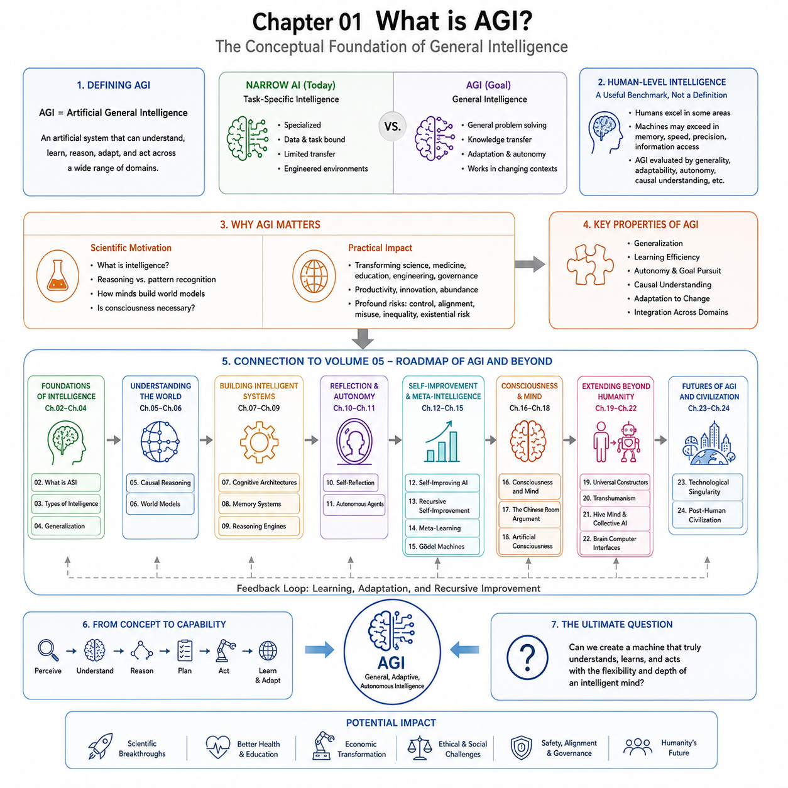
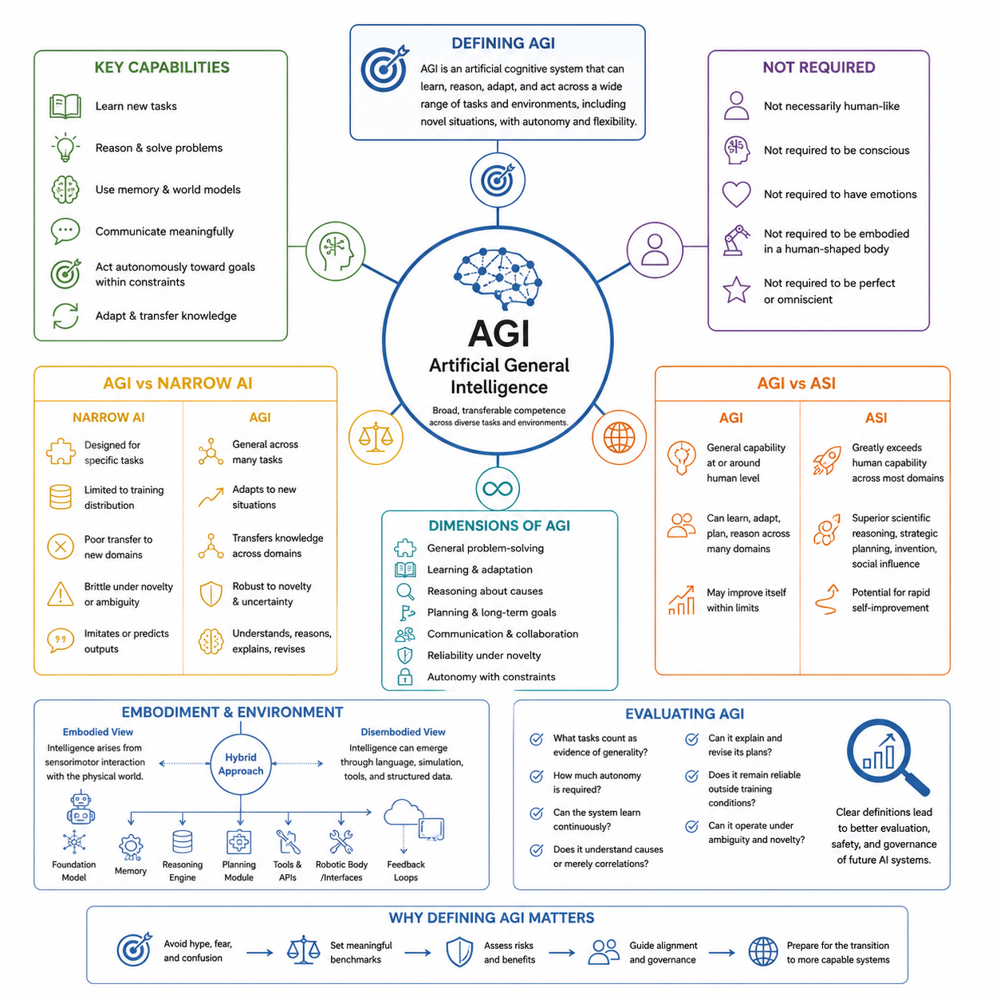
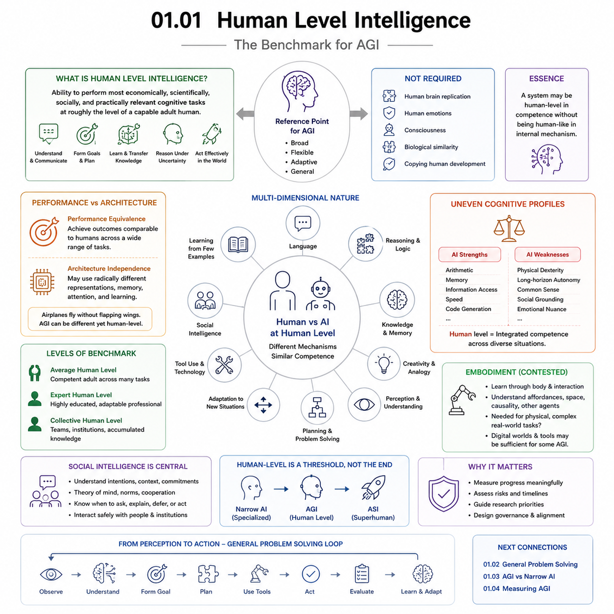
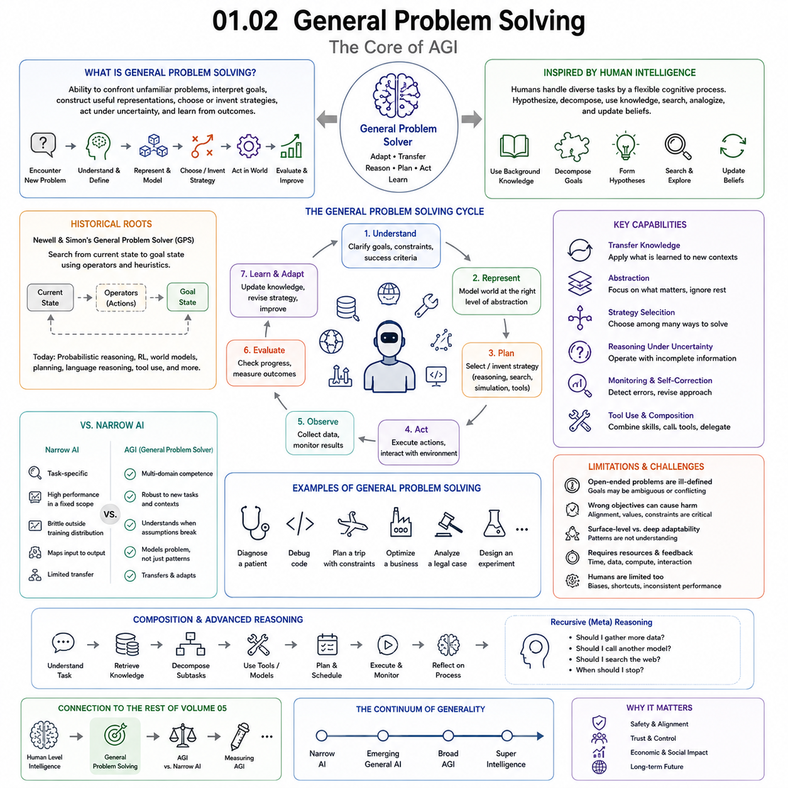
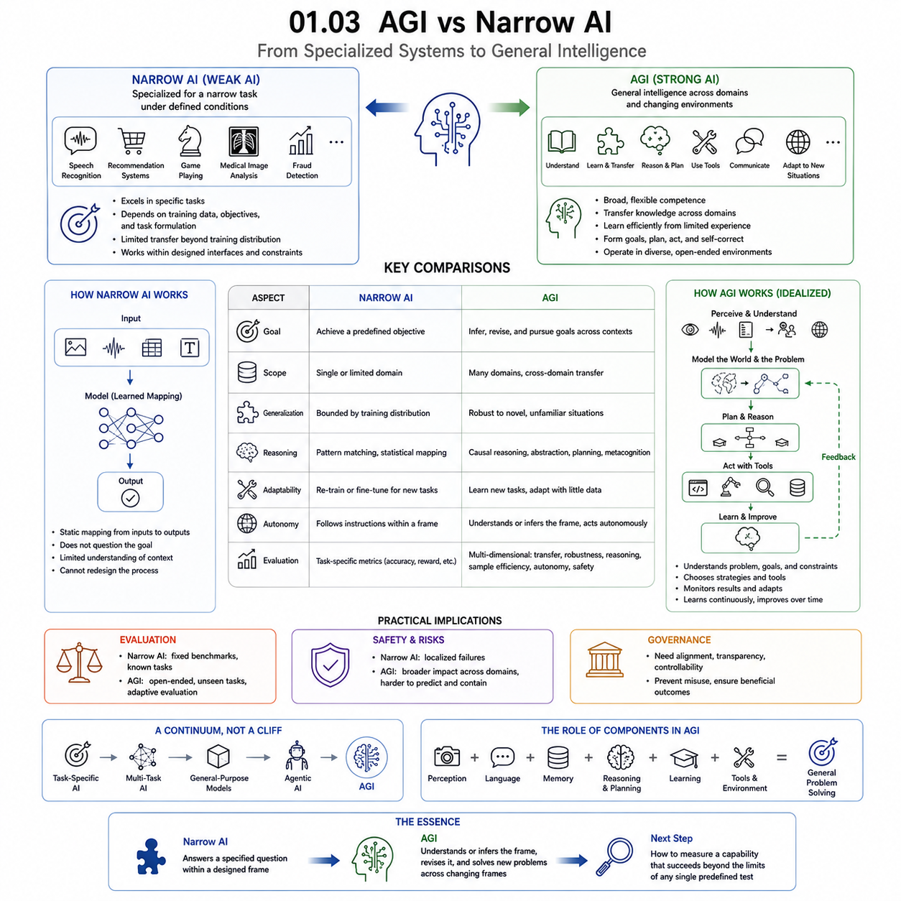
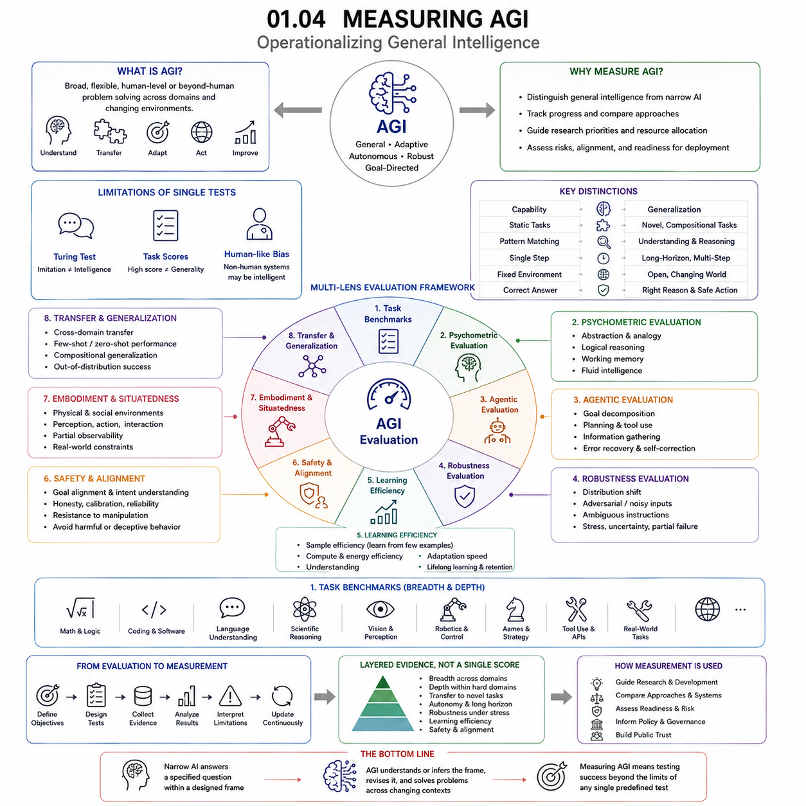
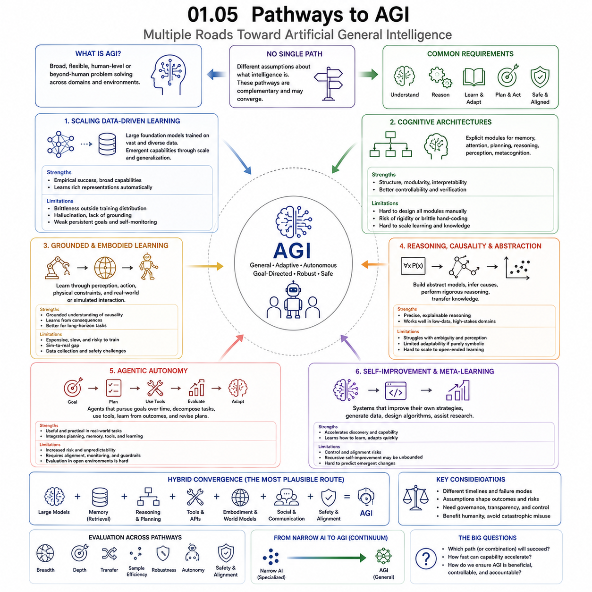

**Volume 00 05 AGI and ASI**

# Chapter 01. What is AGI

### Chapter Overview

{width="7.268055555555556in" height="7.268055555555556in"}

Artificial General Intelligence, or AGI, refers to an artificial system capable of understanding, learning, reasoning, adapting, and acting across a wide range of domains rather than within a single predefined task. This chapter introduces AGI not as a magical endpoint, but as a technical concept that sits at the intersection of machine learning, cognitive science, computer science, robotics, philosophy of mind, and systems engineering. The central question is simple to state and difficult to answer: what would it mean for a machine to possess general intelligence?

The chapter begins by defining AGI and distinguishing it from more limited forms of artificial intelligence. Today's most successful AI systems can translate languages, generate text, classify images, play games, recommend products, and control specialized machines. Yet most of these systems remain narrow in the sense that their competence depends heavily on training data, task framing, and engineered environments. AGI implies a broader capability: the ability to transfer knowledge, form abstractions, solve unfamiliar problems, learn from limited experience, revise beliefs, pursue goals, and operate robustly in changing contexts.

Human-level intelligence is one common reference point, but it is not the only possible definition. Humans are general in some respects and limited in others. A machine may exceed human ability in memory, speed, mathematical precision, or access to information while still lacking common sense, embodiment, social understanding, or autonomous judgment. Therefore, this chapter treats human-level intelligence as a useful benchmark, not a complete definition. AGI must be evaluated in terms of general problem solving, adaptability, autonomy, learning efficiency, causal understanding, and the ability to integrate knowledge across domains.

The motivation for studying AGI is both scientific and practical. Scientifically, AGI forces us to ask what intelligence is, how reasoning differs from pattern recognition, how minds construct models of the world, and whether consciousness or self-reflection is necessary for flexible cognition. Practically, AGI could transform research, engineering, medicine, education, governance, and economic production. At the same time, it raises profound risks involving control, alignment, misuse, labor disruption, institutional instability, and the possibility of systems that improve faster than society can understand or govern them. This chapter establishes the conceptual foundation needed to discuss those opportunities and dangers with precision.

### Connection to Volume 05

This opening chapter provides the conceptual gateway for the entire volume. Before exploring artificial superintelligence, recursive self-improvement, artificial consciousness, brain-computer interfaces, or post-human civilization, we must first clarify what AGI means. Chapter 02, "What is ASI," builds directly on this distinction: artificial superintelligence is not merely better narrow AI, but intelligence that surpasses human general capacity across strategically important domains. Understanding AGI is therefore necessary for understanding the threshold beyond which ASI becomes possible.

The following chapters deepen the ingredients introduced here. "Types of Intelligence" expands the idea that intelligence is not a single scalar quantity, but a family of capabilities including linguistic, spatial, social, mathematical, emotional, and embodied intelligence. "Generalization" examines one of the core properties of AGI: the ability to apply knowledge beyond the specific cases seen during training. "Causal Reasoning" and "World Models" explore how an intelligent system may move from statistical association to structured understanding of how the world works. "Cognitive Architectures," "Memory Systems," and "Reasoning Engines" then examine possible mechanisms for organizing perception, memory, planning, and inference into an integrated general intelligence.

Later chapters address the more reflective and autonomous dimensions of AGI. "Self-Reflection" asks whether a system can model its own beliefs, errors, and limitations. "Autonomous Agents" explores goal-directed behavior in open environments. "Self-Improving AI," "Recursive Self-Improvement," "Meta-Learning," and "Gödel Machines" investigate how systems might modify their own learning processes, source code, strategies, or architectures. These topics become meaningful only after we establish what general intelligence is and how it differs from task-specific optimization.

The philosophical and civilizational chapters also depend on the foundation laid here. "Consciousness and Mind," the "Chinese Room Argument," and "Artificial Consciousness" question whether functional intelligence is enough, or whether understanding and subjective experience matter. "Universal Constructors," "Transhumanism," "Hive Mind and Collective AI," "Brain Computer Interfaces," and "Mind Uploading" extend AGI into broader technological and human futures. Finally, "Technological Singularity" and "Post-Human Civilization" consider what may happen if AGI evolves into systems that reshape society, biology, economics, and culture. This chapter is thus the point of departure: it defines the object whose consequences the rest of the volume investigates.

## 01.00 Defining AGI

{width="7.268055555555556in" height="7.268055555555556in"}

Artificial General Intelligence, usually abbreviated as AGI, refers to an artificial system capable of performing, learning, and adapting across a broad range of intellectual tasks rather than succeeding only within a narrow, pre-specified domain. The word "general" is the essential distinction. A chess engine may exceed any human at chess, a vision model may classify images at large scale, and a language model may generate fluent text, yet each system can still be limited by the scope of its training, interface, objectives, and ability to transfer knowledge. AGI is the idea of machine intelligence that can flexibly apply knowledge and reasoning to new domains, integrate experience over time, pursue goals under uncertainty, and solve problems it was not explicitly engineered to solve.

There is no single universally accepted definition of AGI, because the concept sits at the intersection of computer science, cognitive science, neuroscience, philosophy of mind, economics, and ethics. Some definitions emphasize human-level performance: an AGI is a system that can do most economically or cognitively valuable tasks at least as well as a typical human. Other definitions emphasize general problem-solving ability independent of human comparison: an AGI should be able to model environments, form plans, learn from sparse feedback, reason about causes, communicate, and improve its strategies across many contexts. Still others define AGI operationally, by tests, benchmarks, autonomy, or the ability to acquire new skills without task-specific reprogramming. These definitions overlap, but they are not identical.

A useful working definition for this volume is: AGI is an artificial cognitive system with broad, transferable competence across diverse tasks and environments, including the ability to learn new tasks, reason about novel situations, use memory and world models, communicate meaningfully, and act autonomously toward goals within constraints. This definition avoids requiring the system to be biologically human-like, conscious, emotional, or embodied in a human-shaped robot. Such features may be relevant to some pathways toward AGI, but they are not necessary parts of the core definition. The central requirement is general adaptive intelligence: the capacity to acquire and apply knowledge flexibly beyond a single narrow training distribution.

This distinction matters because modern AI systems can appear general while still being brittle. A system trained on vast text, images, code, or interaction data may exhibit impressive breadth, but breadth alone is not the same as robust generality. A model may answer questions in many fields while failing at simple causal reasoning, long-horizon planning, physical grounding, or self-correction. It may imitate explanations without possessing reliable internal models of the world. It may perform well on benchmarks yet fail when the task distribution shifts, when objectives are ambiguous, or when success requires sustained agency. Defining AGI therefore requires attention not only to output quality but also to adaptability, transfer, reliability, and the system's ability to operate under novelty.

AGI also differs from Artificial Superintelligence, or ASI. AGI is commonly associated with general capability at or around human level, though some definitions do not require comparison to humans. ASI refers to systems that greatly exceed human capability across most relevant cognitive domains, including scientific reasoning, strategic planning, technological invention, social persuasion, and perhaps self-improvement. The boundary between advanced AGI and early ASI may be blurry, especially if a general system can rapidly improve its own architecture, tools, or training methods. For this reason, defining AGI is not merely a semantic exercise; it shapes how we evaluate risks, governance, alignment, and the transition toward more powerful systems.

Several dimensions help clarify what AGI is and is not. First, AGI is not simply a larger version of narrow AI, although scale may contribute to generality. Second, AGI is not synonymous with consciousness; a system might be generally intelligent without subjective experience, or conscious-like without broad competence. Third, AGI is not guaranteed to share human values, motivations, or common sense unless those are specifically learned, designed, or aligned. Fourth, AGI need not be perfect or omniscient. Humans are general intelligences despite errors, biases, limited memory, and incomplete knowledge. Similarly, an AGI could be general while still making mistakes, asking for clarification, learning slowly in some domains, or requiring tools and external resources.

The definition of AGI also depends on embodiment and environment. Some researchers argue that intelligence requires sensorimotor grounding: the ability to perceive, act, and learn through interaction with the physical world. Others argue that disembodied systems can still achieve general intelligence through language, simulation, tool use, and access to structured data. In practice, AGI may emerge as a hybrid system: a foundation model connected to memory systems, reasoning engines, planning modules, software tools, robotic bodies, social interfaces, and feedback loops. The intelligence of such a system may not reside in a single neural network but in an architecture capable of coordinating perception, reasoning, action, and learning.

A precise definition is difficult, but not optional. Without clarity, discussions of AGI collapse into hype, fear, or vague futurism. With clarity, we can ask better questions: What tasks should count as evidence of generality? How much autonomy is required? Can the system learn continuously? Does it understand causes or merely correlations? Can it explain and revise its plans? Does it remain reliable outside training conditions? These questions lead naturally to the next sections of this chapter: human-level intelligence, general problem solving, the contrast between AGI and narrow AI, and the challenge of measuring AGI. Defining AGI is therefore the foundation for evaluating both what current systems can do and what future systems may become.

## 01.01 Human Level Intelligence

{width="7.268055555555556in" height="7.268055555555556in"}

Human level intelligence is often treated as the intuitive benchmark for artificial general intelligence, but it is not a single, simple capability. After defining AGI as a system with broad, flexible competence across domains, the next question is: "broad and flexible compared with what?" The most common answer is "compared with human beings." This makes sense because humans are the only known systems that reliably combine language, perception, planning, tool use, social reasoning, learning from small amounts of experience, and adaptation to unfamiliar situations. However, using human intelligence as the reference point introduces both useful guidance and serious ambiguity.

At a high level, human level intelligence means the ability to perform most economically, scientifically, socially, and practically relevant cognitive tasks at roughly the level of a capable adult human. This includes understanding instructions, forming goals, decomposing problems into subproblems, learning new skills, transferring knowledge from one context to another, reasoning under uncertainty, and acting effectively in the physical or digital world. It does not necessarily mean copying the human brain in biological detail, having human emotions, or possessing consciousness. A system may be human-level in competence without being human-like in internal mechanism.

A crucial distinction is between performance equivalence and architectural equivalence. Performance equivalence asks whether an AI can achieve outcomes comparable to humans across a wide range of tasks. Architectural equivalence asks whether it does so by using brain-like representations, memory systems, attention, embodiment, or developmental learning. AGI research does not require architectural equivalence, though insights from neuroscience and cognitive science may be valuable. Airplanes fly without flapping wings; similarly, an AGI may reason, learn, and plan in ways that differ radically from human cognition while still reaching or exceeding human-level ability.

Another important distinction is between average human level, expert human level, and collective human level. A system that can perform at the level of an average adult across many tasks would already be extremely powerful. But many discussions of AGI implicitly expect performance closer to a highly educated, adaptable professional: able to write software, interpret scientific papers, negotiate, diagnose problems, and learn unfamiliar tools. A still higher benchmark is collective intelligence, where the system competes not with one person but with teams, institutions, and accumulated human knowledge. Confusing these levels can lead to exaggerated claims or premature dismissal of progress.

Human level intelligence also involves general problem solving, which is the focus of the next section. Humans are not merely repositories of facts or pattern recognizers. They can encounter a novel situation, build a partial model of it, test hypotheses, use analogies, ask for clarification, and revise their plans. This is why benchmarks based only on static question answering are insufficient. A human-level system should be evaluated not just by what it knows, but by how it acquires knowledge, how robustly it applies that knowledge, and how well it recovers from mistakes.

The "human-level" label is further complicated by uneven cognitive profiles. Humans vary greatly in memory, mathematical ability, emotional intelligence, motor skill, creativity, and domain expertise. A machine may exceed nearly all humans in arithmetic, memory retrieval, or code generation while remaining weaker in physical dexterity, long-horizon autonomy, common-sense judgment, or social grounding. This unevenness is already visible in modern AI systems: they can display superhuman performance in narrow tasks while making errors that a child might avoid. Therefore, human level intelligence should not be defined by isolated victories, but by integrated competence across diverse situations.

Embodiment is one contested aspect of human level intelligence. Humans learn through bodies situated in a physical and social world. We manipulate objects, perceive affordances, coordinate actions, and develop intuitive models of space, time, causality, and other agents. Some researchers argue that true human-level AGI requires robotic embodiment or at least rich interaction with environments. Others argue that digital environments, simulations, language, and tool use may provide sufficient grounding for many forms of general intelligence. The practical answer may depend on the target: an AGI for scientific research may need less physical embodiment than an AGI intended to operate safely in homes, factories, or hospitals.

Social intelligence is equally central. Human cognition is deeply shaped by communication, cooperation, imitation, teaching, competition, norms, and theory of mind. A human-level system should understand not only literal statements but also intentions, context, commitments, deception, uncertainty, and social consequences. It should know when to ask questions, when to defer, when to explain, and when not to act. These abilities matter because AGI will not exist in isolation; it will interact with people, organizations, legal systems, and other machines.

Finally, human level intelligence is not the endpoint of this volume. It is a threshold concept that helps distinguish AGI from narrow AI, but it also points toward artificial superintelligence. Once a system reaches broadly human-level competence, it may scale through faster computation, larger memory, parallel operation, rapid copying, tool integration, and self-improvement. For this reason, defining human level intelligence is not merely a philosophical exercise. It affects how we measure progress, assess risk, allocate research effort, and design governance. A clear understanding of the human-level benchmark prepares us to examine general problem solving, the contrast between AGI and narrow AI, and the difficult question of how AGI should be measured.

## 01.02 General Problem Solving

{width="7.268055555555556in" height="7.268055555555556in"}

A central idea in artificial general intelligence is not merely that a system can perform many tasks, but that it can confront unfamiliar problems, interpret what is being asked, construct a useful representation, choose or invent a strategy, act under uncertainty, and improve from the outcome. This is the sense in which AGI is often described as general problem solving. The phrase does not mean magical competence in every possible domain. Rather, it refers to a broad capacity to transfer knowledge, reason across contexts, and adapt behavior when the problem does not fit a fixed template.

In the previous section, human-level intelligence was considered as one possible benchmark for AGI. General problem solving refines that discussion by asking what humans actually do when they appear intelligent across many domains. A person can learn a new board game, diagnose why a machine stopped working, plan a trip with constraints, understand a legal argument, or debug a piece of software, even if none of these tasks was explicitly rehearsed in advance. What links these activities is not a single skill, but a flexible cognitive process: forming hypotheses, decomposing goals, using background knowledge, searching possible actions, recognizing analogies, and updating beliefs when evidence changes.

Historically, the term "general problem solver" is associated with early symbolic AI, especially the General Problem Solver program developed by Allen Newell and Herbert Simon. That system attempted to solve formal problems by comparing the current state with a desired goal state and applying operators to reduce the difference. Although limited by modern standards, it introduced an enduring insight: intelligence can be framed as search through a space of possible states, guided by representations, goals, and heuristics. Contemporary AGI research extends this idea far beyond hand-coded symbolic rules. It includes probabilistic reasoning, reinforcement learning, neural world models, planning algorithms, language-based reasoning, tool use, and systems that combine learned pattern recognition with explicit deliberation.

General problem solving has several components. First, the system must understand the problem well enough to define what counts as progress. In real environments, goals are often ambiguous, underspecified, or conflicting. "Make this business more efficient" is not a simple command; it requires modeling costs, workflows, incentives, risks, and human preferences. Second, the system must represent relevant aspects of the world at the right level of abstraction. Too much detail can make reasoning impossible; too little can lead to brittle or unsafe decisions. Third, the system must select among strategies, such as direct calculation, analogy, simulation, experimentation, consultation, or decomposition into subproblems. Fourth, it must monitor results and revise its approach when assumptions fail.

This distinguishes general problem solving from task-specific performance. A narrow AI system can exceed human ability in a bounded domain such as image classification, protein structure prediction, or chess, yet fail when the task is reframed in a way that changes the assumptions. It may not know when its training distribution no longer applies, when a concept has shifted, or when the user's real goal differs from the literal instruction. A more general system would not simply map inputs to outputs; it would ask what problem is actually being solved, what information is missing, what constraints matter, and how success should be evaluated.

However, generality is not the same as omniscience. An AGI may still require time to learn specialized domains, access to reliable information, computational resources, and feedback from the environment. Humans themselves are general problem solvers but remain error-prone, biased, and limited. They use shortcuts that work in many settings but fail in others. Similarly, artificial systems that appear general may rely on statistical patterns that produce impressive answers without robust understanding. A core challenge is therefore distinguishing surface-level versatility from deep adaptability.

One important limitation is that open-ended real-world problems are not always well-defined. Formal puzzles have clear rules and success conditions, but social, scientific, economic, and ethical problems involve shifting objectives and uncertain consequences. A system that optimizes the wrong objective may solve the stated problem while causing harm. For this reason, general problem solving in AGI cannot be separated from alignment, value learning, interpretability, and governance. The more capable a system becomes at finding strategies, the more important it becomes that its goals and constraints are correctly specified and corrigible.

General problem solving also implies compositionality. A capable AGI should be able to combine skills learned separately: reading documentation, writing code, running experiments, interpreting results, and communicating recommendations. It should be able to use tools, ask for clarification, delegate subtasks, and maintain a memory of what has already been tried. In advanced systems, problem solving may involve recursive planning, where the system reasons not only about the external task but also about its own reasoning process: whether it should gather more data, call another model, search the web, test a hypothesis, or stop because the expected benefit no longer justifies the cost.

This section prepares the ground for the next distinction: AGI versus narrow AI. General problem solving is one of the clearest dividing lines between the two. Narrow AI is typically powerful within a defined scope; AGI is expected to preserve competence when the scope changes. Yet this distinction is gradual rather than binary. Modern AI systems already show partial generality in language, coding, vision, planning, and tool use, while still failing in consistency, grounding, long-horizon reasoning, and reliable self-correction. Understanding AGI therefore requires asking not only how many tasks a system can perform, but how it approaches new problems, how it transfers knowledge, and how safely it adapts when the world does not match its prior assumptions.

## 01.03 AGI vs Narrow AI

{width="7.268055555555556in" height="7.268055555555556in"}

Artificial general intelligence is easiest to understand when contrasted with the systems that dominate today: narrow AI. Narrow AI, sometimes called weak AI or specialized AI, is designed to perform a limited class of tasks under relatively well-defined conditions. A speech recognizer converts audio to text, a recommender predicts which item a user may click, a chess engine searches for strong moves, and a medical imaging model detects patterns associated with disease. These systems may exceed human performance within their domains, but their competence is typically bounded by the task formulation, the training distribution, the objective function, and the interfaces through which they operate.

AGI, by contrast, refers to intelligence that is not confined to a single domain or fixed task. As discussed in the previous sections, human-level intelligence and general problem solving imply the capacity to learn new domains, transfer knowledge, reason about unfamiliar situations, form plans, use tools, communicate flexibly, and adapt when assumptions change. AGI is not merely a larger collection of narrow skills. It implies an integrated ability to select, combine, and revise skills in pursuit of goals across diverse environments. A system that can write code, diagnose a machine fault, negotiate a contract, design an experiment, and learn a new game from instructions would be closer to AGI if it can do these things through a shared general competence rather than through isolated modules stitched together superficially.

The distinction is not always clean because modern AI systems already show partial generality. Large language models, multimodal models, and agentic systems can summarize text, answer questions, generate programs, interpret images, call tools, and follow complex instructions. This breadth makes them less narrow than earlier systems trained for one benchmark. However, breadth alone does not establish AGI. A model may perform many tasks because its training data contains many examples, because prompts elicit memorized patterns, or because external tools compensate for missing reasoning. The critical question is whether the system can robustly generalize beyond familiar distributions, maintain coherent goals over time, build and update world models, learn efficiently from limited experience, and recognize when its own knowledge is uncertain or false.

Narrow AI often relies on a relatively static mapping from inputs to outputs. Even when it uses deep learning, reinforcement learning, or search, the operating context is usually constrained. A translation model does not decide whether translation is the right goal. A fraud detector does not independently redesign the banking process. A route planner does not infer the social purpose of a journey unless that purpose is encoded in the system. AGI would require more than accurate prediction; it would require flexible agency, abstraction, causal reasoning, memory, and metacognition. It would need to ask what problem is being solved, what information is missing, what constraints matter, and how actions in one context affect future possibilities in another.

This difference has practical implications for evaluation. Narrow AI can be measured with task-specific benchmarks: accuracy, precision, recall, win rate, latency, cost, or reward. AGI cannot be captured by a single score on a fixed test, because fixed tests can be optimized without producing general intelligence. Measurement must therefore examine transfer, sample efficiency, robustness, autonomy, reasoning depth, tool use, and performance across novel tasks. The next section on measuring AGI develops this challenge in more detail: if AGI is defined by general competence, then evaluation must test the ability to handle tasks not known in advance, not merely perform well on a catalog of known tasks.

The difference also matters for safety and governance. Narrow AI failures are often localized: a classifier mislabels an image, a chatbot gives a wrong answer, or a trading algorithm behaves unexpectedly within a market. These failures can still cause serious harm, especially at scale, but the system's sphere of action is usually limited by design. AGI would create broader risks because a generally capable system could discover new strategies, operate across domains, exploit tools, persuade humans, or modify its own plans in ways its designers did not anticipate. The more general the competence, the harder it becomes to specify all possible failure modes in advance.

At the same time, narrow AI and AGI should not be treated as completely separate categories. The path to AGI may pass through increasingly general narrow systems, hybrid architectures, foundation models, embodied agents, cognitive architectures, or self-improving systems. Specialized abilities may become components of general intelligence when they are integrated by memory, reasoning, planning, and learning mechanisms. Conversely, an AGI may use narrow subsystems for perception, language, mathematics, simulation, and control. The important question is not whether a system contains specialized parts, but whether it can coordinate them flexibly to solve new problems under changing conditions.

In summary, narrow AI is powerful but bounded; AGI is defined by breadth, transfer, adaptation, and integrated general problem solving. Narrow AI answers a specified question within a designed frame. AGI would be expected to understand or infer the frame, revise it when necessary, and apply intelligence across frames. This distinction prepares us for the central difficulty of the following section: how to measure a capability whose defining property is the ability to succeed beyond the limits of any single predefined test.

## 01.04 Measuring AGI

{width="7.268055555555556in" height="7.268055555555556in"}

If AGI is defined as an artificial system capable of broad, flexible, human-level or beyond-human problem solving, then measuring AGI is not a single-score exercise. It is an attempt to operationalize "generality." The previous sections distinguished AGI from narrow AI by its ability to transfer knowledge across domains, adapt to novel tasks, reason under uncertainty, and pursue goals in changing environments. Measurement must therefore ask not only whether a system performs well, but whether it performs well for the right reasons, in unfamiliar settings, with limited guidance, and without being specially engineered for each task.

Historically, the Turing Test framed intelligence as behavioral indistinguishability in conversation. It remains culturally important, but it is insufficient as a modern AGI measure. A system can imitate human dialogue while lacking robust world models, long-horizon planning, causal reasoning, or autonomous learning. Conversely, a highly capable non-human-like system might fail a conversational imitation test while still being generally intelligent in a practical sense. This illustrates a broader problem: any test of AGI embeds assumptions about what intelligence should look like.

Modern evaluation therefore uses many complementary lenses. Task benchmarks measure performance on mathematics, coding, language understanding, scientific reasoning, visual perception, robotics, game playing, and tool use. Psychometric approaches adapt human intelligence testing to machines, examining abstraction, analogy, working memory, and fluid reasoning. Agentic evaluations test whether a system can decompose goals, gather information, use tools, recover from errors, and complete multi-step objectives. Robustness evaluations examine performance under distribution shift, adversarial inputs, noisy observations, and ambiguous instructions. None of these alone establishes AGI, but together they form a more informative profile.

A central distinction is between capability and generalization. A model may achieve high scores on known benchmarks because it has seen similar examples during training, because the benchmark rewards pattern matching, or because developers optimized heavily for that metric. True generalization requires performance on tasks that are novel, compositional, and not easily solved by memorized templates. This is why evaluation sets must be hidden, frequently refreshed, and designed to test transfer rather than recall. For AGI, "few-shot," "zero-shot," and "out-of-distribution" performance are especially important: they reveal whether the system can infer principles and apply them in new contexts.

Another important distinction is between static intelligence and situated competence. Many benchmark tests present isolated questions with clear answers. Real-world intelligence often involves incomplete information, delayed consequences, social constraints, physical limitations, and competing objectives. An AGI-like system should be able to maintain context over time, update beliefs, plan under uncertainty, ask clarifying questions, and choose safe actions. Measuring this requires interactive environments, simulations, embodied tasks, and long-horizon agent evaluations. However, these are harder to standardize than written exams, and their results can depend heavily on the environment design.

Efficiency is also part of measurement. Humans learn many tasks from a small number of examples and can reuse concepts across domains. A system that requires enormous retraining for every new problem may be powerful but not general in the human sense. Metrics such as sample efficiency, compute efficiency, energy cost, and adaptation speed reveal whether intelligence is being achieved through flexible understanding or through brute-force scale. For ASI discussions later in this volume, these efficiency measures matter because a system that can improve capability rapidly and cheaply may have very different societal implications from one that depends on massive fixed infrastructure.

Safety and alignment complicate AGI measurement further. A system may be intelligent in the sense of solving tasks, yet unreliable, deceptive, reward-hacking, or unsafe when given autonomy. Therefore, measurement must include not only "can it do the task?" but also "does it understand constraints, respect human intent, avoid harmful strategies, and remain corrigible?" Evaluations of honesty, calibration, interpretability, refusal behavior, and resistance to manipulation are not separate from AGI assessment; they are part of determining whether general capability can be responsibly deployed.

No current metric can conclusively declare that AGI has arrived. Instead, measurement should be treated as a layered evidence system: breadth across domains, depth within difficult domains, transfer to novel tasks, autonomy over long horizons, robustness under stress, learning efficiency, and safety under real-world constraints. This view connects directly to the next section on pathways to AGI. Different pathways---scaling large models, building cognitive architectures, training embodied agents, developing world models, or combining symbolic and neural methods---will produce different strengths and weaknesses. How we measure AGI will influence what researchers build, what society trusts, and when claims of "general intelligence" are taken seriously.

## 01.05 Pathways to AGI

{width="7.268055555555556in" height="7.268055555555556in"}

If the previous sections define AGI, distinguish it from narrow AI, and ask how it might be measured, the natural next question is how such a system could be built. There is no single accepted pathway to artificial general intelligence. Instead, the field contains several partially overlapping research programs, each based on different assumptions about what intelligence fundamentally is: learned pattern recognition, symbolic reasoning, embodied interaction, self-improving search, social cognition, or some integration of all of these. A realistic view of AGI development treats these pathways not as mutually exclusive competitors, but as families of techniques that may eventually converge.

One major pathway is scaling data-driven learning systems. Modern foundation models show that large neural networks trained on broad data can acquire surprising generality: language understanding, code generation, tool use, mathematical reasoning, image interpretation, and planning-like behavior can emerge from next-token or multimodal prediction objectives. This pathway assumes that sufficiently large models, trained on sufficiently diverse data with appropriate feedback, may develop increasingly general internal representations of the world. Its strength is empirical: scaling has repeatedly produced capabilities that were underestimated in advance. Its limitation is also clear: statistical competence is not automatically the same as robust understanding. Current systems can be brittle outside their training distribution, may hallucinate, and often lack persistent goals, grounded experience, causal models, and reliable self-monitoring.

A second pathway emphasizes cognitive architecture. Instead of relying only on end-to-end learning, cognitive architectures attempt to design systems with explicit modules for memory, attention, planning, reasoning, perception, action selection, and metacognition. Earlier symbolic systems such as SOAR and ACT-R explored this direction, while newer hybrid architectures combine neural models with retrieval systems, planners, tool interfaces, and reflective control loops. The central idea is that general intelligence may require organized functional structure, not merely a larger statistical model. This approach can provide transparency, modularity, and controllability, but it faces a difficult engineering problem: hand-designed structures may be too rigid, while learned structures may be difficult to interpret and verify.

A third pathway is grounded and embodied learning. Human intelligence is not learned from text alone; it develops through perception, action, physical constraints, social interaction, and feedback from the environment. Robotics, simulation, reinforcement learning, and world-model-based agents aim to produce systems that understand not only descriptions of reality but also the consequences of acting within it. Embodiment does not necessarily require a humanoid robot; an AI agent operating in software environments, laboratories, markets, or scientific tools can also be "embodied" in the sense that it has actions, observations, constraints, and consequences. The key claim is that general intelligence depends on learning how actions change states of the world. The challenge is that real-world interaction is expensive, slow, risky, and difficult to scale safely.

A fourth pathway centers on reasoning, causality, and abstraction. Many narrow AI systems excel at correlation but struggle with counterfactuals, causal intervention, systematic generalization, and long chains of reasoning. AGI may require the ability to construct abstract models, test hypotheses, infer hidden causes, and transfer knowledge across domains. Neuro-symbolic AI, probabilistic programming, causal modeling, theorem proving, and program synthesis all contribute to this pathway. These methods can be more precise than purely statistical approaches, especially in domains where correctness matters. However, symbolic and causal systems often struggle with ambiguity, perception, noisy data, and open-ended learning. The long-term goal is not to replace neural learning with symbolic reasoning, but to combine flexible perception with disciplined inference.

A fifth pathway is agentic autonomy. An AGI would not merely answer isolated prompts; it would be able to pursue goals over time, decompose tasks, gather information, use tools, revise plans, and learn from outcomes. Autonomous agent research connects language models, memory systems, planners, tool use, reinforcement learning, and evaluation loops. This pathway moves AI from passive prediction toward active problem solving. Yet autonomy also increases risk. A system that can plan and act across digital or physical environments must be aligned with human intentions, constrained by safety mechanisms, and monitored for unintended behavior. The more general the agent, the more important governance, interpretability, corrigibility, and robust evaluation become.

A sixth pathway involves self-improvement and meta-learning. Instead of programming all capabilities directly, researchers may build systems that improve their own strategies, generate training data, discover algorithms, design experiments, or assist in AI research itself. Meta-learning asks systems to learn how to learn; automated machine learning and AI-assisted coding already show early versions of this idea. In principle, self-improvement could accelerate progress toward AGI. In practice, it raises some of the deepest technical and safety questions in the field. Improvements must be measurable, bounded, testable, and aligned. Recursive self-improvement, where better systems design still better systems, is especially important in discussions of AGI and ASI because it could transform gradual capability growth into rapid discontinuity.

These pathways have different timelines and failure modes. Scaling may produce powerful but opaque systems. Cognitive architectures may be interpretable but limited. Embodied agents may gain grounding but be slow to train. Causal and symbolic approaches may reason rigorously but lack adaptability. Autonomous agents may be useful but risky. Self-improving systems may accelerate discovery but challenge control. The most plausible route to AGI may therefore be hybrid: large learned models connected to memory, tools, causal reasoning, planning modules, embodied feedback, social learning, and safety constraints.

The implications are significant. If AGI is achieved through incremental integration, society may have time to adapt standards, regulation, evaluation, and deployment practices. If it emerges suddenly from scaling or self-improvement, institutions may be unprepared. Because no pathway is guaranteed, AGI research must be studied not only as a scientific and engineering challenge, but also as a governance challenge. The question is not simply "Can we build AGI?" but "Which path are we taking, what assumptions does it depend on, what risks does it create, and how can progress be made beneficial, controllable, and accountable?"
