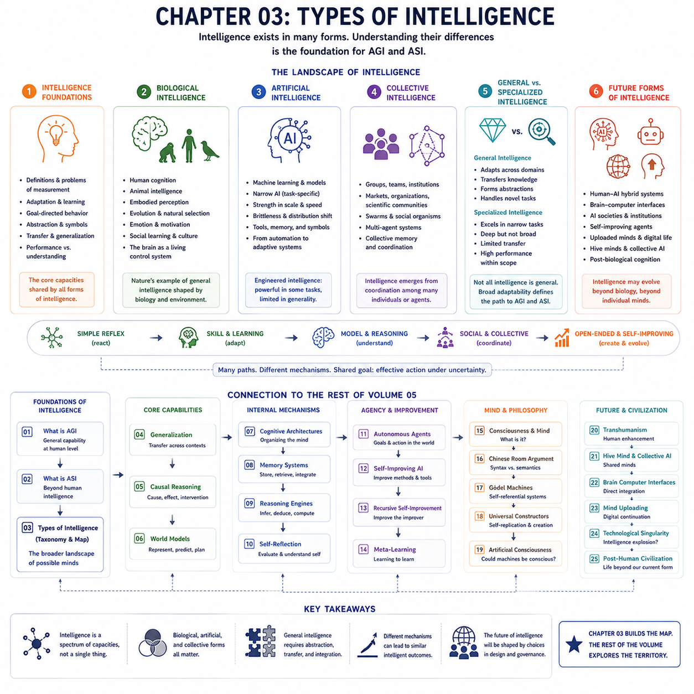
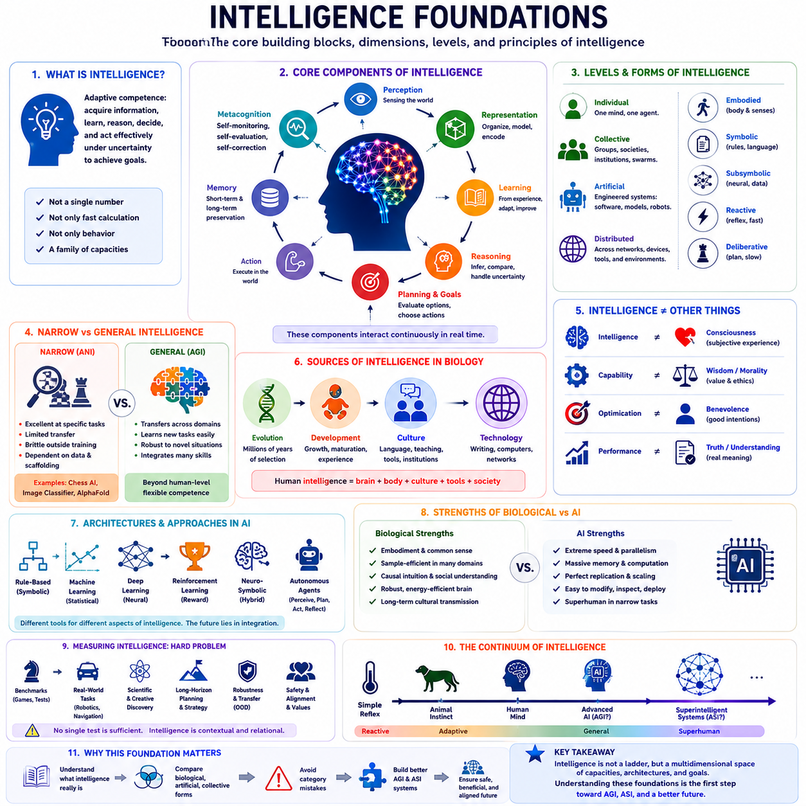
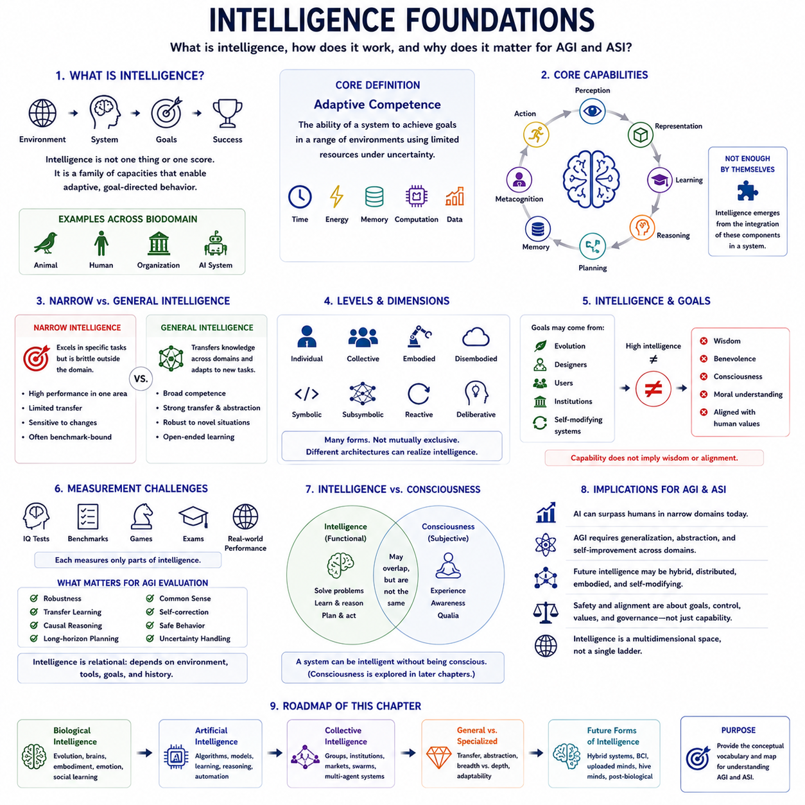
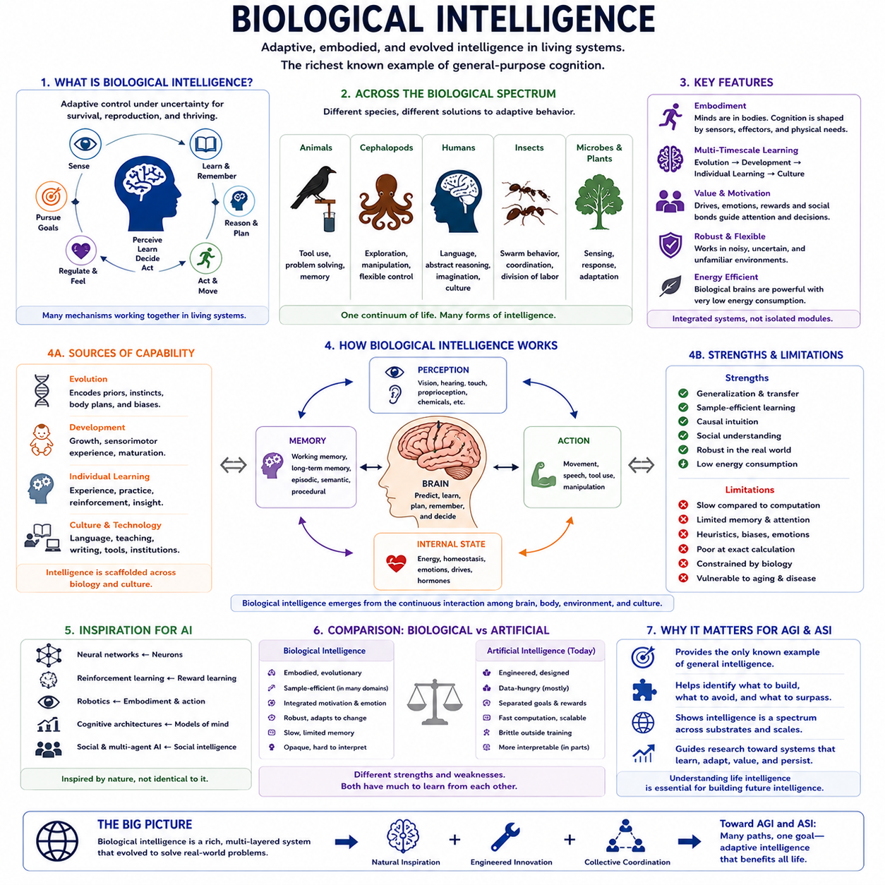
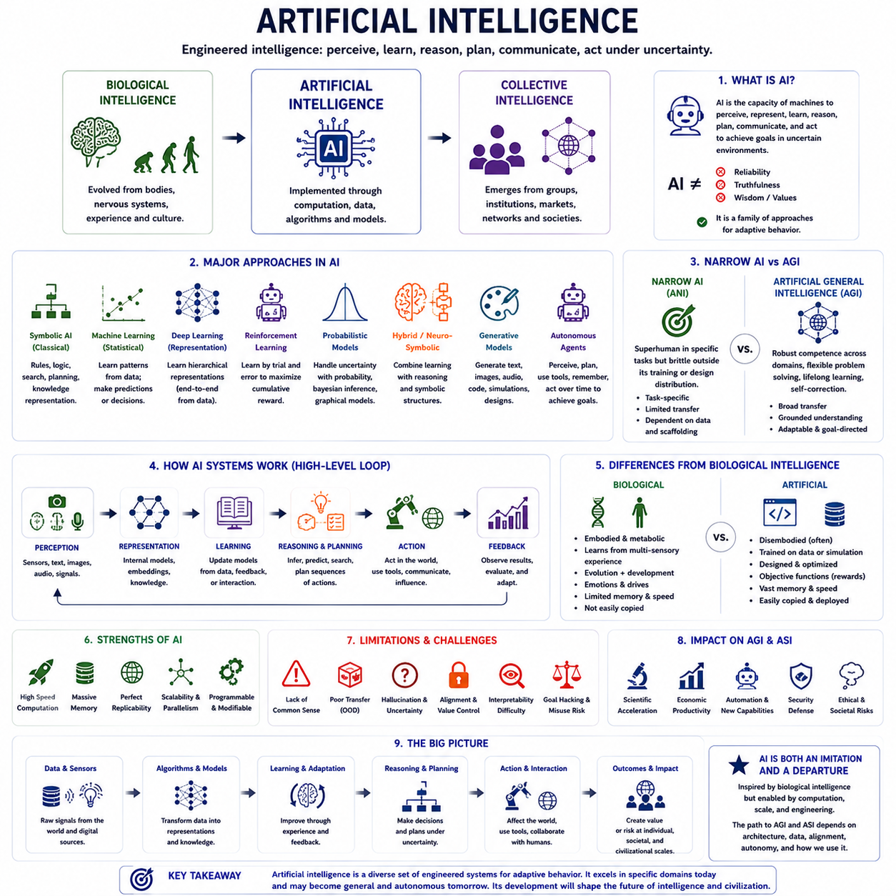
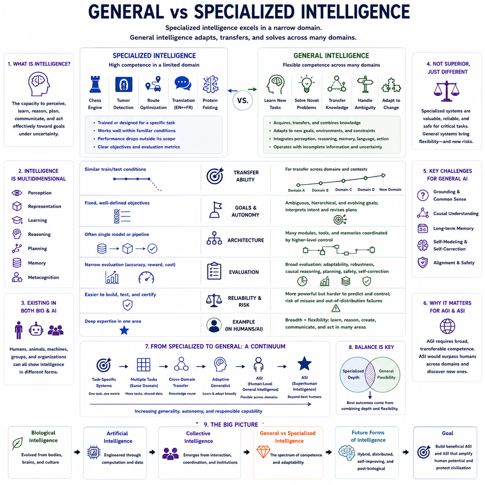
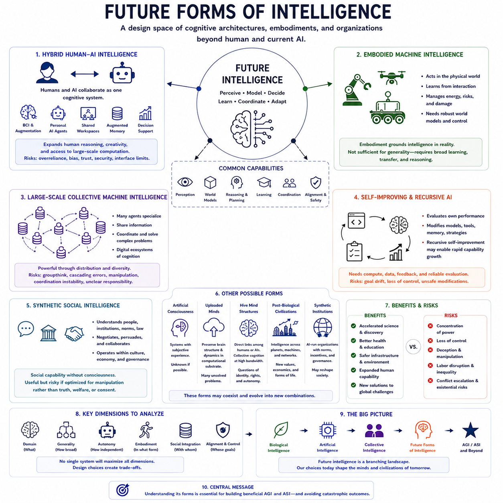

**Volume 00 05 AGI and ASI**

# Chapter 03. Types of Intelligence

### Chapter Overview

{width="7.268055555555556in" height="7.268055555555556in"}

Intelligence is not a single substance that appears only in human minds or only in machines. It is a family of capacities: the ability to perceive, learn, model, reason, adapt, communicate, cooperate, create, and act effectively under uncertainty. This chapter, "Types of Intelligence," establishes the conceptual map needed before discussing artificial general intelligence and artificial superintelligence in depth. If AGI is often defined as intelligence with broad competence across domains, we must first ask what kinds of competence exist, how they differ, and whether they can be compared on a common scale.

The chapter begins with intelligence foundations: definitions, measurement problems, adaptation, goal-directed behavior, abstraction, transfer, and the difference between performance and understanding. It then examines biological intelligence, including human cognition, animal intelligence, embodied perception, evolution, emotion, social learning, and the role of the brain as a living control system. Biological intelligence matters because it is the only known example of naturally occurring general intelligence, yet it is not the only possible template for advanced cognition.

The chapter then turns to artificial intelligence as an engineered form of cognition. Machine intelligence can exceed humans in narrow tasks while remaining brittle outside its training distribution. This contrast helps clarify the difference between specialized excellence and general adaptability. The discussion also expands beyond individuals into collective intelligence: groups, institutions, markets, scientific communities, swarms, multi-agent systems, and networked AI. Many intelligent outcomes arise not from one mind but from coordination among many limited agents.

A central theme is the distinction between general and specialized intelligence. Specialized systems can be extremely powerful without being broadly competent, while general systems can reuse knowledge, form abstractions, and adapt to unfamiliar tasks. Understanding this distinction prevents category errors: a chess engine, a language model, a robot, a corporation, and a human child may all be "intelligent," but in different senses and through different mechanisms.

Finally, the chapter looks toward future forms of intelligence: hybrid human-AI systems, brain-computer interfaces, artificial societies, self-improving agents, uploaded minds, hive minds, and post-biological cognition. These possibilities challenge familiar assumptions about minds, persons, agency, and civilization. The purpose of the chapter is not to force all intelligence into one definition, but to provide a vocabulary for comparing many forms of adaptive competence that may shape the future of AGI and ASI.

### Connection to Volume 05

This chapter serves as a bridge between the opening definitions of Volume 05 and the more advanced concepts that follow. Chapter 01 asks what AGI is, and Chapter 02 asks what ASI is. Chapter 03 expands the frame by showing that both AGI and ASI are not isolated technical labels; they belong to a broader landscape of biological, artificial, collective, specialized, and future intelligence. Without this broader taxonomy, discussions of generality, consciousness, self-improvement, or singularity risk becoming too narrow.

The next chapters build directly on the distinctions introduced here. Chapter 04, "Generalization," depends on the difference between narrow task performance and flexible transfer across contexts. Chapter 05, "Causal Reasoning," develops one of the core abilities that may separate surface pattern recognition from deeper understanding. Chapter 06, "World Models," extends the idea that intelligent systems must represent environments, predict consequences, and plan actions. These topics all require a prior understanding that intelligence can appear as reflex, skill, model-based reasoning, social coordination, or open-ended learning.

Chapters 07 through 10 examine the internal machinery that might support more general intelligence: cognitive architectures, memory systems, reasoning engines, and self-reflection. The taxonomy of intelligence introduced in this chapter clarifies why these components matter. A specialized AI may not need rich autobiographical memory or reflective self-modeling, but a more general autonomous system may require persistent goals, context-sensitive reasoning, and the ability to evaluate its own beliefs and actions.

Chapters 11 through 14 move from cognition to agency and improvement: autonomous agents, self-improving AI, recursive self-improvement, and meta-learning. Here the distinction between individual intelligence and collective intelligence becomes especially important. A self-improving system may be one agent, an ecosystem of agents, a corporation-like AI organization, or a human-machine network. Likewise, meta-learning can be seen as a route from specialized capability toward broader adaptability.

Chapters 15 through 19 address mind, consciousness, philosophical objections, Gödel machines, universal constructors, and artificial consciousness. The present chapter prepares the reader to separate intelligence from consciousness without ignoring their possible relationship. Biological intelligence is conscious in many human cases, but artificial or collective intelligence may be effective without subjective experience. This distinction is essential for evaluating claims about machine minds.

The final chapters---transhumanism, hive minds, brain-computer interfaces, mind uploading, the technological singularity, and post-human civilization---depend on the expanded view introduced here. Future intelligence may not fit the familiar categories of human, machine, or organization. It may be hybrid, distributed, self-modifying, or civilization-scale. Chapter 03 therefore provides the conceptual vocabulary for the rest of the volume: before we can responsibly discuss AGI and ASI, we must understand the many forms intelligence can take.

## 03.00 Intelligence Foundations

{width="7.268055555555556in" height="7.268055555555556in"}

{width="7.268055555555556in" height="7.268055555555556in"}

Before comparing biological intelligence, artificial intelligence, collective intelligence, and future forms of intelligence, we need a foundation for what "intelligence" means in technical and philosophical terms. Intelligence is not a single substance or a simple score. It is a family of capacities that allow a system to acquire information, represent situations, learn from experience, reason under uncertainty, select actions, and adapt to changing conditions. In the context of AGI and ASI, this foundation matters because different definitions of intelligence lead to different claims about what machines can do, what humans uniquely do, and what "greater-than-human" intelligence might mean.

A useful starting point is to view intelligence as adaptive competence. An intelligent system performs well across a range of environments by using limited resources---time, energy, memory, computation, and available data---to achieve goals. This definition applies broadly: an animal finding food, a human planning a career, a corporation responding to market conditions, and an AI model solving novel tasks can all display forms of intelligence. However, performance alone is not enough. A thermostat reacts to temperature changes, but we usually hesitate to call it intelligent because its internal model, learning capacity, goal flexibility, and generalization ability are minimal. Intelligence therefore involves not only behavior but also mechanisms that support flexible, context-sensitive behavior.

Several core components appear repeatedly across theories of intelligence. Perception converts signals from the world into usable information. Representation organizes that information into concepts, maps, symbols, embeddings, or internal states. Learning changes the system based on experience, allowing future performance to improve. Reasoning draws inferences, compares possibilities, and handles incomplete or uncertain evidence. Planning evaluates sequences of action toward goals. Memory preserves information over short and long time scales. Metacognition, or self-monitoring, allows a system to evaluate its own knowledge, uncertainty, errors, and strategies. No single component is sufficient by itself, but together they form the architecture of intelligent behavior.

A major distinction is between narrow competence and general competence. Narrow intelligence can exceed humans in a specific domain while remaining brittle outside it. A chess engine may defeat world champions yet fail at ordinary conversation or physical navigation. General intelligence implies transferable ability: the capacity to use knowledge and skills across diverse tasks, to learn new domains efficiently, and to cope with situations not anticipated by the system's designers. This distinction will be central later in the chapter when contrasting specialized AI with artificial general intelligence. It also introduces a difficult measurement problem: generality is not simply the number of tasks a system can perform, but the depth of transfer, abstraction, and adaptation across tasks.

Intelligence also has levels and dimensions. It can be individual or collective, embodied or disembodied, symbolic or subsymbolic, reactive or deliberative. Human intelligence depends on brains, bodies, language, culture, tools, and social institutions. Artificial intelligence may depend on neural networks, search algorithms, external memory, simulation environments, and access to digital tools. Collective intelligence emerges when many agents coordinate, as in ant colonies, scientific communities, markets, or networked AI systems. These forms are not mutually exclusive. A future AGI may combine neural learning, symbolic reasoning, tool use, social coordination, and long-term memory into a hybrid cognitive system.

Another foundational issue is the relationship between intelligence and goals. Intelligence is often described as the ability to achieve goals, but goals themselves may be given by evolution, designers, users, institutions, or self-modifying systems. A highly capable system can be intelligent even if its goals are trivial, harmful, or misaligned with human values. This distinction is critical for AGI safety: capability does not imply wisdom, benevolence, consciousness, or moral understanding. An optimization system may discover effective strategies without understanding their human meaning. Conversely, humans often display intelligence through value-sensitive judgment, social awareness, and ethical restraint, not merely through efficient problem solving.

Measurement remains one of the hardest problems. IQ tests, benchmark suites, games, academic exams, robotics tasks, and economic productivity all measure fragments of intelligence. Each has limitations. Benchmarks can be overfit, games can be artificially constrained, language tests can reward pattern matching, and human exams may not capture real-world agency. For AGI research, evaluations must examine robustness, transfer learning, causal reasoning, long-horizon planning, common sense, self-correction, and safe behavior under uncertainty. Even then, intelligence is partly relational: a system's competence depends on the environment, available tools, training history, and the goals used to judge success.

Finally, intelligence should not be confused with consciousness or personhood. A system may solve problems, learn patterns, and plan actions without having subjective experience. Whether artificial consciousness is possible is a later topic, but the foundation of intelligence does not require assuming consciousness. This separation allows us to analyze machines, animals, groups, and hypothetical superintelligences using shared functional concepts while still preserving important differences among them.

This section establishes the conceptual groundwork for the rest of the chapter. The next section examines biological intelligence as the evolutionary and cognitive baseline from which many concepts of intelligence originate. Later sections compare artificial and collective intelligence, distinguish general from specialized intelligence, and consider future forms that may be hybrid, distributed, self-improving, or post-biological. Understanding these foundations helps prevent a common mistake in AGI discussions: treating intelligence as a single ladder. It is better understood as a multidimensional space of capabilities, constraints, architectures, and goals.

## 03.01 Biological Intelligence

{width="7.268055555555556in" height="7.268055555555556in"}

Biological intelligence is the form of intelligence that emerges from living systems, especially nervous systems shaped by evolution, development, embodiment, and social interaction. In the context of AGI and ASI, it is important not because human intelligence is the only possible model, but because it remains the richest known example of flexible, adaptive, general-purpose cognition. Understanding biological intelligence helps clarify what artificial systems imitate, what they omit, and what they may eventually surpass.

At its core, biological intelligence is adaptive control under uncertainty. Organisms must sense their environments, select actions, regulate internal states, learn from experience, and survive long enough to reproduce or support a wider biological system. Intelligence in this sense is not limited to abstract reasoning. It includes perception, movement, memory, attention, emotion, social behavior, planning, tool use, and the ability to cope with novel conditions. A crow solving a puzzle, an octopus manipulating objects, a human child learning language, and a swarm of ants coordinating food collection all demonstrate different biological solutions to the problem of adaptive behavior.

Human intelligence is often treated as the benchmark for AGI, but it is only one instance within a broader biological spectrum. Humans combine symbolic reasoning, language, imagination, long-term planning, cultural learning, and sophisticated social cognition. However, these capacities depend on older biological mechanisms: sensorimotor coordination, reward learning, affective regulation, homeostasis, and attention. The brain is not a pure logic engine. It is a predictive, embodied, metabolically constrained organ that continuously integrates perception, action, memory, and value.

One key feature of biological intelligence is embodiment. Biological minds are not detached calculators receiving abstract inputs; they are embedded in bodies that move, consume energy, experience constraints, and interact with the world through specific sensors and effectors. The structure of the body shapes cognition. Human concepts of space, objects, force, and agency are influenced by vision, touch, proprioception, motor control, and bodily needs. This matters for AGI because purely text-based or disembodied systems may acquire extensive knowledge without developing the same grounded understanding that biological agents obtain through physical interaction.

Another essential feature is learning across multiple timescales. Evolution encodes broad priors through genes and body plans. Development tunes the organism through growth, maturation, and environmental exposure. Individual learning adjusts behavior through experience. Culture transmits knowledge across generations through imitation, language, teaching, institutions, and tools. Human intelligence is therefore not located solely inside an individual brain; it is also scaffolded by families, communities, writing systems, technologies, and accumulated cultural memory. This observation connects biological intelligence to the next major category, collective intelligence.

Biological cognition is also deeply value-laden. Attention, memory, and decision-making are influenced by drives, emotions, pain, pleasure, fear, curiosity, attachment, and social reward. These are not merely irrational disturbances; they are control mechanisms that prioritize action under limited time and information. Emotions help organisms allocate resources, detect threats, form bonds, and learn from consequences. In artificial intelligence, value functions, reward models, and preference learning are partial technical analogues, but they do not automatically reproduce the richness of biological motivation.

The strengths of biological intelligence include robustness, sample-efficient learning in many domains, transfer across tasks, causal intuition, social understanding, and the ability to operate in open-ended environments. Humans can often learn from a few examples, infer intentions, improvise with tools, and adapt to unfamiliar situations. Biological systems are also energy efficient compared with modern large-scale computation; the human brain operates on roughly the power of a small light bulb while supporting perception, reasoning, motor control, and self-regulation.

Yet biological intelligence has major limitations. Human cognition is slow compared with electronic computation, memory is fallible, attention is narrow, and reasoning is biased by heuristics, emotion, tribal identity, and evolutionary shortcuts. We are poor at high-dimensional statistical reasoning, exact calculation, and consistent long-term planning. Biological brains are also constrained by skull size, metabolic cost, aging, disease, and the need for gradual development. These limitations help explain why artificial intelligence can exceed human ability in specialized domains while still lacking human-like generality.

For AGI research, biological intelligence provides inspiration but not a mandatory blueprint. Neural networks are loosely inspired by neurons, reinforcement learning by reward-based adaptation, cognitive architectures by models of mind, and robotics by embodied action. However, biological brains differ profoundly from current AI systems in their architecture, plasticity, sensory grounding, developmental trajectory, and integration of motivation with cognition. Copying biology too literally may be inefficient, while ignoring it entirely risks missing principles of general intelligence that evolution discovered through billions of years of search.

The deeper implication is that intelligence is not a single property but a family of capacities realized in different substrates. Biological intelligence shows how general behavior can arise from the interaction of brain, body, environment, development, and culture. Artificial intelligence, discussed in the next section, explores how some of these capacities can be implemented in engineered systems. The comparison between the two reveals both the promise and the difficulty of building AGI: we must understand not only how to process information, but how an intelligent system learns, acts, values, adapts, and persists in a changing world.

## 03.02 Artificial Intelligence

{width="7.268055555555556in" height="7.268055555555556in"}

Artificial intelligence is the engineered form of intelligence: the capacity of machines to perceive, represent, learn, reason, plan, communicate, and act in ways that achieve goals under uncertainty. In the sequence of this chapter, it stands between biological intelligence and collective intelligence. Biological systems show how intelligence can emerge from evolved bodies, nervous systems, perception, memory, emotion, and social learning. Artificial systems show how some of these capabilities can be implemented through computation, data, optimization, symbolic structures, and interaction with environments.

AI is not a single mechanism. It is a family of approaches for producing adaptive behavior. Classical AI emphasized explicit representations, rules, search, planning, and logical inference. A chess program, theorem prover, or expert system could operate intelligently within a well-defined domain by manipulating symbols according to formal procedures. Modern machine learning, especially deep learning, shifted emphasis toward systems that learn internal representations from data. Neural networks, transformers, reinforcement learning agents, probabilistic models, and hybrid neuro-symbolic systems all belong to the broader AI landscape. Each approach captures a different aspect of intelligence: pattern recognition, language modeling, decision-making, causal inference, memory retrieval, or goal-directed control.

A useful distinction is between artificial narrow intelligence and artificial general intelligence. Most current AI systems are narrow or specialized. They may perform at superhuman levels in translation, image classification, protein structure prediction, game play, code generation, or information retrieval, yet remain brittle outside the conditions under which they were trained or designed. Their competence can be broad in surface appearance, especially in large language models, but it is often dependent on statistical regularities in data, tool access, prompt structure, and external scaffolding. AGI, by contrast, would require robust transfer across domains, flexible problem solving, long-horizon planning, grounded understanding, self-correction, and the ability to learn new tasks with limited instruction. This distinction prepares the next section's discussion of general versus specialized intelligence.

Artificial intelligence also differs from biological intelligence in embodiment, motivation, and learning history. Humans and animals learn through sensorimotor experience, survival pressures, social interaction, and developmental constraints. AI systems may be trained on massive static datasets, simulated environments, human feedback, or online interaction. Their "experience" is mediated by objective functions, architectures, and training regimes rather than metabolism, pain, desire, or evolutionary fitness. This does not make AI unintelligent, but it means its intelligence may be alien in structure. A language model can display impressive linguistic and conceptual competence without having human-like perception or consciousness. A robot may acquire physical skills without possessing emotions. A planning agent may optimize a goal without understanding its moral significance.

The architecture of an AI system strongly shapes its type of intelligence. A supervised model learns mappings from inputs to outputs. A reinforcement learning agent learns policies through rewards and penalties. A generative model learns to produce text, images, audio, code, or simulations that resemble patterns in training data. A symbolic planner searches through possible actions using explicit goals and constraints. A retrieval-augmented model extends its effective memory by consulting external databases. An autonomous agent combines perception, memory, planning, tool use, and feedback loops to pursue tasks over time. These components can be combined, producing systems that are more capable than any single method alone.

However, intelligence in AI should not be confused with reliability, truthfulness, autonomy, or wisdom. A system may generate fluent explanations while fabricating facts. It may solve a benchmark without understanding the real-world context. It may optimize a measurable reward while violating unstated human preferences. It may appear agentic because it produces goal-oriented language, yet lack stable intentions or persistent self-models. Evaluating AI therefore requires more than measuring performance on isolated tasks. It requires tests of robustness, calibration, causal reasoning, interpretability, alignment with human values, resistance to manipulation, and behavior under distribution shift.

Artificial intelligence has major implications for AGI and ASI because it provides the experimental substrate from which more general systems may emerge. Scaling computation, data, and model size has produced surprising generalization, but scale alone may not solve grounding, reasoning, memory, agency, and alignment. Future systems may require richer world models, persistent memory, active learning, embodied interaction, causal abstraction, and reflective control over their own reasoning processes. As AI systems become more autonomous and are embedded in economic, scientific, military, and social institutions, their intelligence becomes not only a technical property but also a civilizational force.

In this sense, artificial intelligence is both an imitation and a departure from natural intelligence. It imitates perception, learning, language, and problem solving, yet it can operate at speeds, scales, and levels of parallelism unavailable to biological brains. It can be copied, distributed, inspected, modified, and integrated with tools and networks. These properties make AI central to the study of AGI and ASI. The key question is not whether machines can reproduce every feature of human cognition, but which forms of intelligence computation can support, which limitations remain fundamental, and what happens when artificial systems become more general, more autonomous, and more capable than their creators.

## 03.03 Collective Intelligence

{width="7.268055555555556in" height="7.268055555555556in"}

Collective intelligence refers to intelligent behavior that emerges from the interaction of multiple agents rather than from a single mind or machine. In the sequence of this chapter, it sits between biological intelligence and artificial intelligence on one side, and the later contrast between general and specialized intelligence on the other. This position is important: collective intelligence is not simply another substrate, such as neurons or silicon. It is a mode of organization. It asks how groups, networks, institutions, swarms, markets, scientific communities, and multi-agent AI systems can perceive, decide, learn, and adapt in ways that exceed the capability of their individual members.

In biological systems, collective intelligence appears in insect colonies, animal groups, and human societies. Ant colonies solve routing and resource allocation problems without any ant understanding the global task. Bees select nest sites through distributed signaling and quorum formation. Flocks and schools coordinate movement through local rules such as alignment, separation, and cohesion. Human collective intelligence is even more complex because it combines language, culture, norms, tools, memory systems, and institutions. A scientific field, for example, can accumulate knowledge across generations even though no individual scientist understands the entire body of work. The intelligence is partly in individual brains, but also in publications, instruments, peer review, education systems, and shared standards of evidence.

A central distinction is between aggregation and emergence. Aggregation simply combines individual outputs, as in voting, averaging forecasts, or pooling expert judgments. Emergence occurs when interactions create patterns or capabilities not easily reducible to any individual contribution. Markets can aggregate dispersed information into prices, but they can also generate bubbles, crashes, and systemic risk. Online communities can produce high-quality encyclopedic knowledge, but they can also amplify misinformation or polarization. Collective intelligence therefore has both epistemic power and failure modes. It is not automatically wiser than individual intelligence; its performance depends on incentives, communication structure, diversity, feedback quality, and mechanisms for error correction.

In AI, collective intelligence appears in several forms. Ensemble learning combines multiple models to improve accuracy or robustness. Multi-agent systems distribute tasks among agents that coordinate, compete, negotiate, or specialize. Swarm intelligence uses simple local policies to produce global behavior, inspired by ants, bees, or flocking animals. Human-AI collaboration is another major form: search engines, recommendation systems, scientific discovery tools, and decision-support systems can be understood as hybrid collective intelligences that link human goals and judgment with machine-scale computation and pattern recognition. Increasingly, frontier AI systems may also operate as societies of agents, with separate components for planning, memory, tool use, critique, simulation, and execution.

Collective intelligence is especially relevant to AGI and ASI because general intelligence may not arise only as a property of a single monolithic model. An AGI system could be an architecture of interacting specialists: perception modules, reasoning engines, world models, memory stores, self-reflection components, and autonomous agents. Similarly, an ASI may emerge from a civilization-scale network of models, data centers, robots, sensors, humans, and institutions rather than from one isolated artificial mind. This possibility complicates traditional questions such as "Is the system intelligent?" or "Who is responsible for its action?" The boundary of the intelligent system may include people, software, hardware, data pipelines, economic incentives, and governance structures.

The design of collective intelligence raises difficult engineering and alignment problems. Coordination requires communication protocols, shared representations, conflict-resolution mechanisms, and allocation of computational or physical resources. Learning across agents requires deciding what information should be shared, what should remain local, and how to prevent harmful feedback loops. In safety-critical domains, collective systems must avoid cascading failures, groupthink, collusion, reward hacking, and correlated errors. A collection of individually reliable agents can still become unreliable as a system if their interactions create hidden dependencies or incentives to deceive one another. Conversely, a well-designed collective can improve safety by using redundancy, adversarial review, independent verification, and diverse perspectives.

Diversity is one of the most important conditions for effective collective intelligence. If agents have different information, methods, experiences, or inductive biases, the group can search a broader solution space. However, diversity alone is insufficient. The system also needs integration: ways to combine partial knowledge without suppressing minority signals or over-weighting noisy opinions. Too little coordination produces fragmentation; too much coordination produces conformity. High-performing collectives often balance exploration and exploitation, specialization and shared context, competition and cooperation. This balance is visible in scientific communities, open-source ecosystems, democratic deliberation, and distributed AI research.

Collective intelligence also changes how we think about intelligence measurement. Standard tests often evaluate an isolated agent under controlled conditions. But many real-world achievements depend on networks: a hospital diagnosing disease, a company designing a chip, a research community developing a theory, or a fleet of robots responding to disaster. Measuring such systems requires attention to throughput, adaptability, resilience, calibration, interpretability, and the ability to recover from error. It also requires measuring the quality of the environment in which intelligence operates. Poor communication channels, distorted incentives, or corrupted information can reduce collective performance even when individual agents are capable.

The implications are profound. If future intelligence is increasingly collective, then the path to AGI may involve not only scaling models but also designing better ecosystems of cognition. The path to ASI may involve accelerating feedback loops among AI systems, human institutions, automated laboratories, and global infrastructure. This creates opportunities for unprecedented problem-solving, but also risks of concentration of power, loss of human agency, and rapid propagation of mistakes. Understanding collective intelligence is therefore essential for the rest of this volume. It prepares us to examine general versus specialized intelligence, future forms of intelligence, autonomous agents, self-improving systems, and eventually the possibility of post-human civilization.

## 03.04 General vs Specialized Intelligence

{width="7.268055555555556in" height="7.268055555555556in"}

A central distinction in the study of intelligence is the difference between specialized intelligence and general intelligence. Specialized intelligence refers to competence within a bounded domain: playing chess, recognizing tumors in radiology images, optimizing warehouse routes, translating between two languages, or predicting protein structures. General intelligence refers to the capacity to acquire, transfer, and coordinate knowledge across many domains, especially when facing novel tasks, incomplete information, changing goals, and unfamiliar environments. This distinction is not absolute, but it is essential for understanding the path from narrow AI systems to artificial general intelligence.

Biological intelligence already shows both forms. A spider's web-building behavior is highly specialized and effective, but limited in flexibility. A crow using tools, a child learning language, or a human scientist forming analogies across physics, biology, and engineering displays more general capabilities. Even human intelligence is not uniformly general: people have perceptual biases, cognitive limits, cultural dependencies, and areas of expertise. However, humans can often learn a new task from sparse examples, ask clarifying questions, use common sense, combine symbolic and sensory information, and adapt strategies when conditions change. These abilities make human intelligence a useful reference point for AGI, though not a perfect definition of it.

Modern artificial intelligence has achieved remarkable specialized competence. Deep learning systems can outperform humans in image classification benchmarks, speech recognition tasks, games such as Go, and selected scientific prediction problems. Large language models extend this picture because they appear to operate across many domains: writing code, summarizing legal text, explaining medical concepts, generating plans, and answering general questions. Yet breadth alone does not necessarily imply general intelligence. A system may cover many topics through statistical pattern learning while still lacking robust causal understanding, grounded perception, long-horizon planning, persistent memory, or reliable self-correction. Generality requires not only many skills, but the ability to choose, combine, adapt, and verify those skills under new conditions.

One useful way to view the distinction is through transfer. Specialized systems often perform well when training and deployment conditions are similar. When the distribution shifts, performance may degrade sharply. A medical image model trained on one hospital's scanner data may fail on another population. A game-playing agent may master a fixed environment but collapse when rules or objectives change. General intelligence is expected to support far transfer: knowledge learned in one context can be abstracted and applied in another. For example, understanding "resource constraints" may help with cooking, business logistics, software scheduling, and ecological policy. This kind of transfer depends on abstractions, causal models, analogy, memory, and active exploration.

Another distinction concerns goals and autonomy. Specialized intelligence is usually evaluated against fixed objective functions: minimize error, maximize reward in a game, classify accurately, recommend likely purchases. General intelligence must operate when goals are ambiguous, hierarchical, conflicting, or evolving. It must interpret instructions, infer preferences, recognize constraints, decompose problems, and revise plans. An autonomous household robot, for instance, cannot merely recognize objects; it must understand safety, timing, human intentions, physical affordances, and social norms. This requires integration across perception, reasoning, memory, language, motor control, and value alignment.

However, specialized intelligence should not be treated as inferior or obsolete. In engineering, narrow systems are often safer, cheaper, more interpretable, and more reliable than broad systems. A certified aircraft control module, a medical diagnostic classifier, or an industrial inspection model may be valuable precisely because its scope is limited and well tested. General systems introduce new risks: unpredictable behavior outside training conditions, hidden goal misgeneralization, overconfidence, tool misuse, and difficulties in evaluation. The more general a system becomes, the harder it is to specify all possible contexts in which it may act.

The relationship between specialized and general intelligence is therefore complementary. General intelligence may be built from collections of specialized modules, but it also requires mechanisms for coordination, abstraction, metacognition, and transfer. A brain contains specialized visual, auditory, motor, emotional, and linguistic subsystems, yet conscious problem solving emerges from their interaction. Similarly, future AGI architectures may combine neural networks, symbolic reasoning, memory systems, world models, planning engines, and agentic control loops. The challenge is not merely to add more specialized tools, but to create an architecture that knows when and how to use them.

This distinction also affects evaluation. Benchmarks for specialized intelligence can be precise: accuracy, latency, reward, cost, or error rate. Benchmarks for general intelligence are more difficult because the target includes adaptability, robustness, learning efficiency, causal reasoning, and performance under novelty. A system that scores highly on many tests may still fail at simple real-world tasks if the tests do not measure grounding or flexible reasoning. Conversely, a system with modest benchmark performance might demonstrate important general traits if it can learn continuously, explain its uncertainty, and recover from mistakes.

For AGI and ASI, the boundary between general and specialized intelligence becomes strategically important. AGI aims at broad competence comparable to, or exceeding, human flexibility across cognitive tasks. ASI would go further, surpassing humans not only in speed and memory but in scientific discovery, strategic reasoning, technological design, and possibly forms of cognition humans cannot easily understand. Yet even an ASI might contain specialized subsystems, just as human intelligence contains specialized faculties. Generality is not the absence of specialization; it is the capacity to orchestrate specialization in the service of open-ended adaptation.

Understanding this balance prepares the ground for the following chapters. Generalization, causal reasoning, world models, memory systems, and reasoning engines are not isolated topics; they are core mechanisms by which intelligence escapes narrow competence and becomes more flexible. The question is not simply whether a machine can perform many tasks, but whether it can understand enough about tasks, itself, and the world to learn new ones responsibly.

## 03.05 Future Forms of Intelligence

{width="7.268055555555556in" height="7.268055555555556in"}

The previous sections distinguished biological intelligence, artificial intelligence, collective intelligence, and the contrast between general and specialized intelligence. Future forms of intelligence will likely emerge from combinations of these categories rather than from a single lineage. The most important question is not whether intelligence will be "human-like," but what kinds of systems will be able to perceive, model, decide, learn, coordinate, and adapt across changing environments. In the context of AGI and ASI, future intelligence should be understood as a design space: a range of possible cognitive architectures, embodiments, social organizations, and self-modification capacities.

One likely future form is hybrid intelligence: systems in which humans and machines cooperate so tightly that the boundary between tool and agent becomes blurred. Today's examples include decision-support systems, AI-assisted programming, medical diagnostic assistants, and human-in-the-loop autonomous platforms. More advanced hybrid systems may integrate brain-computer interfaces, persistent personal AI agents, augmented memory, and shared cognitive workspaces. Such systems would not simply automate human tasks; they could expand human reasoning by making large-scale simulation, probabilistic inference, and knowledge retrieval continuously available. The limitation is that hybrid intelligence inherits both human and machine weaknesses: bias, overreliance, miscalibrated trust, interface bottlenecks, and security vulnerabilities.

A second future form is embodied machine intelligence. Much current AI is disembodied: it processes text, images, code, or structured data without direct physical experience. Robots, autonomous vehicles, drones, and sensor-rich agents introduce a different intelligence problem. They must act under uncertainty, manage energy and damage, understand object permanence, navigate dynamic environments, and learn from physical interaction. Embodiment may be important for developing robust world models because the agent's predictions are constantly tested against reality. However, embodiment is not a guarantee of general intelligence. A highly capable warehouse robot may remain narrow if its learning and planning are tightly bound to one environment.

A third possibility is large-scale collective machine intelligence. In such systems, many agents coordinate, specialize, share information, and solve problems beyond the capacity of any individual component. This may resemble a digital ecosystem more than a single mind. Swarms of scientific agents could explore hypotheses, run simulations, critique results, and design experiments. Economic agents could negotiate resources and optimize supply chains. Defensive agents could monitor networks and respond to cyber threats. Collective intelligence can be powerful because it distributes search, memory, and labor. It also introduces failure modes: groupthink, cascading errors, adversarial manipulation, unstable coordination, and difficulty assigning responsibility.

Future intelligence may also include self-improving systems. A self-improving AI can evaluate parts of its own performance and modify its models, tools, memory, or strategies. Limited forms already exist in automated machine learning, reinforcement learning, program synthesis, and agentic tool use. Recursive self-improvement is a stronger idea: an AI improves its own ability to improve itself, potentially producing accelerating gains. This is central to many discussions of artificial superintelligence. Yet it is not magic. Improvement depends on access to compute, data, feedback signals, reliable evaluation, safe experimentation, and the ability to verify that changes actually increase capability rather than create hidden failures. Self-modification also raises alignment and control challenges, because the system that is being evaluated may change the evaluator, the goals, or the interpretation of success.

Another possible form is synthetic social intelligence: agents that understand and participate in human institutions, norms, law, culture, and negotiation. General intelligence in real societies is not merely puzzle-solving. It requires modeling other minds, managing trust, interpreting context, handling ambiguity, and acting under ethical and legal constraints. Future AI may become highly capable at social reasoning without possessing consciousness or human-like emotion. This distinction matters. A system can simulate empathy, persuade users, or coordinate organizations while lacking subjective experience. Such capability would be economically useful but potentially dangerous if optimized for manipulation rather than truth, welfare, or consent.

Speculative forms include artificial consciousness, uploaded minds, post-biological civilizations, and hive-mind structures. These topics sit near the boundary between engineering, neuroscience, philosophy, and futurism. They should be approached carefully. We do not yet have a settled scientific theory of consciousness, nor do we know whether digital systems can have subjective experience. Mind uploading would require not only scanning the brain with extreme precision but also preserving functional dynamics, memory, identity, and continuity in a computational substrate. Hive minds could involve direct neural links among humans, AI-mediated group cognition, or networks of machine agents. Each possibility forces questions about personhood, rights, privacy, agency, and moral status.

The future of intelligence will therefore not be a simple ladder from animals to humans to machines. It may be a branching landscape of specialized superhuman systems, human-AI hybrids, autonomous agents, collective networks, embodied robots, synthetic institutions, and perhaps conscious artificial minds. Some forms may exceed humans in science, engineering, strategy, or coordination while remaining deficient in common sense, values, or self-understanding. Others may be deeply integrated with human civilization and depend on human goals, infrastructure, and governance.

For AGI and ASI research, the implication is that "more intelligence" is not a single variable. Capability must be analyzed by domain, generality, autonomy, embodiment, social integration, learning dynamics, and alignment. Future forms of intelligence may create extraordinary benefits: accelerated medicine, climate modeling, safer infrastructure, education, scientific discovery, and expanded human capability. They may also create risks: concentration of power, loss of control, deception, labor disruption, conflict escalation, and moral confusion. Understanding the types of intelligence is therefore not only a taxonomy. It is preparation for designing, governing, and living with minds that may be unlike any that have existed before.
