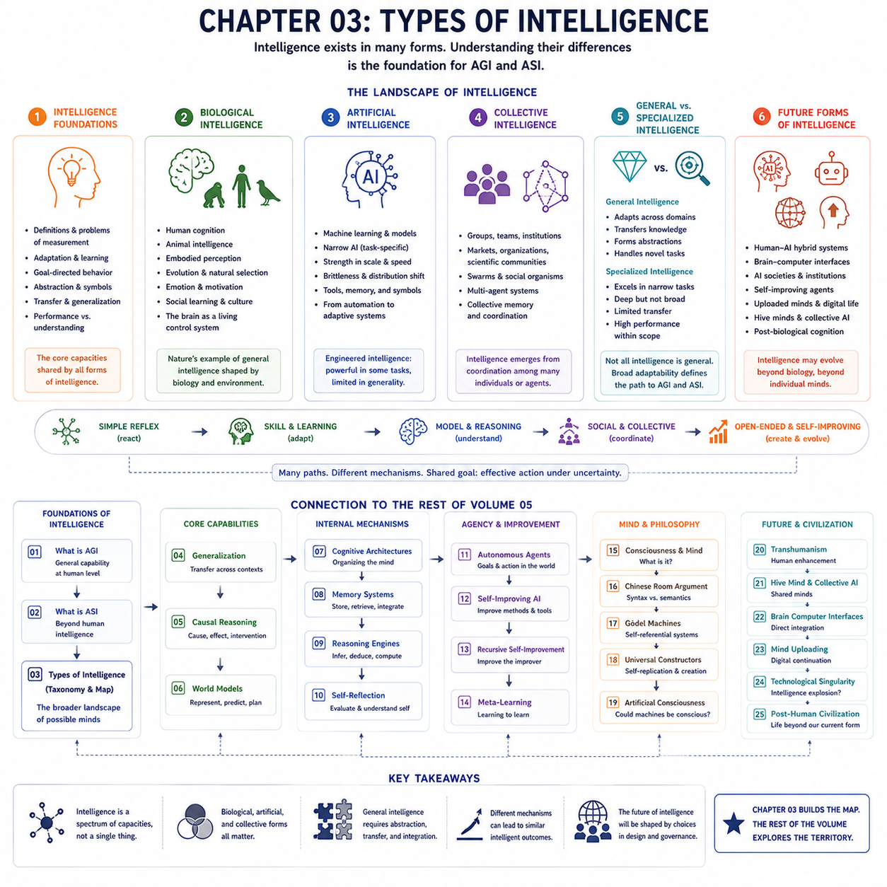
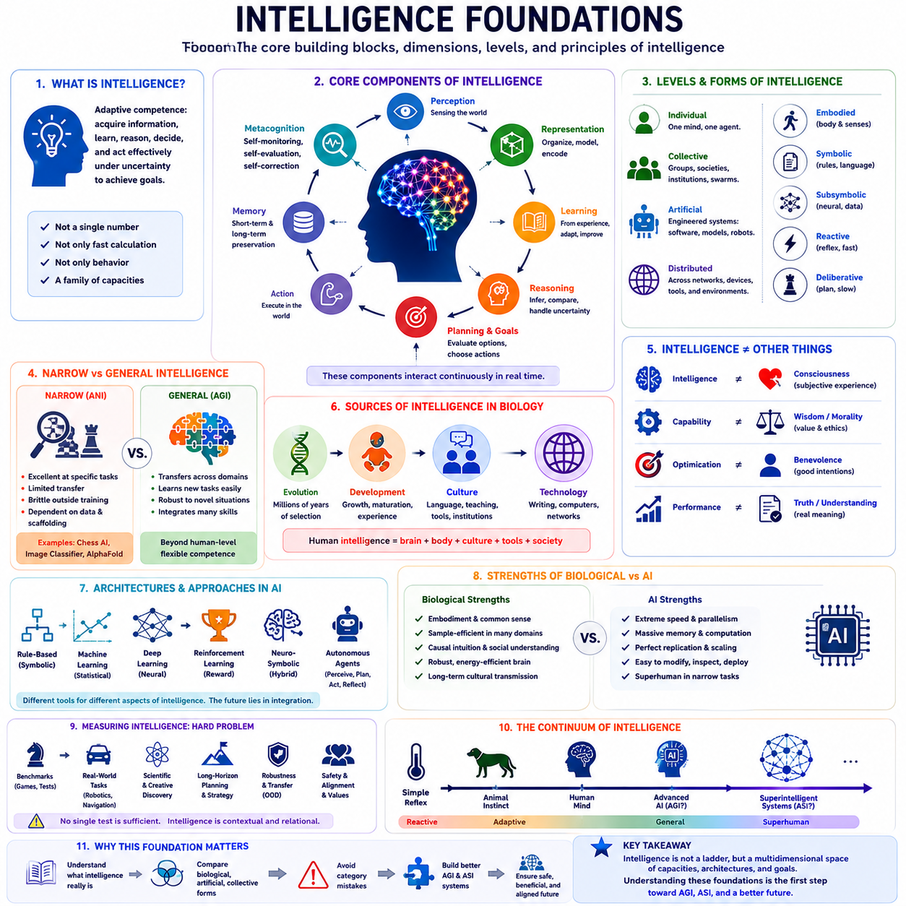
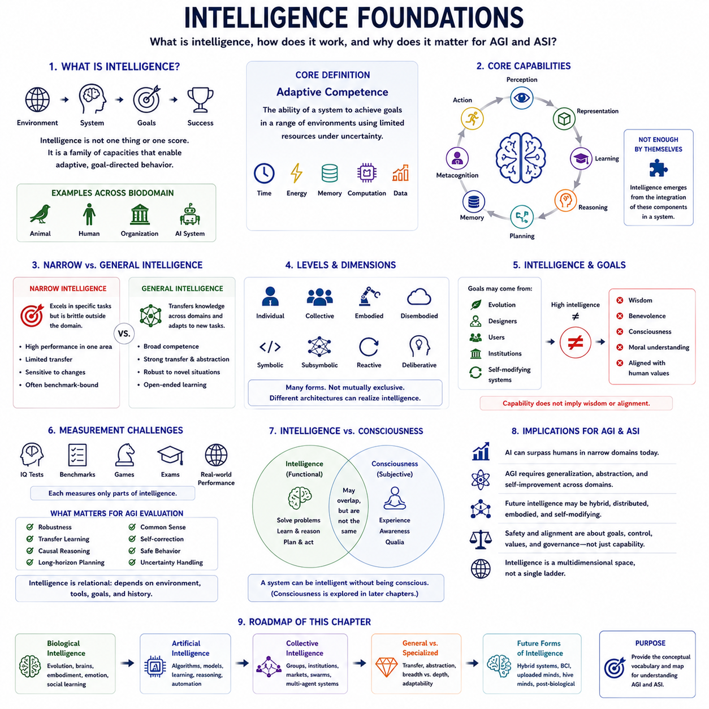
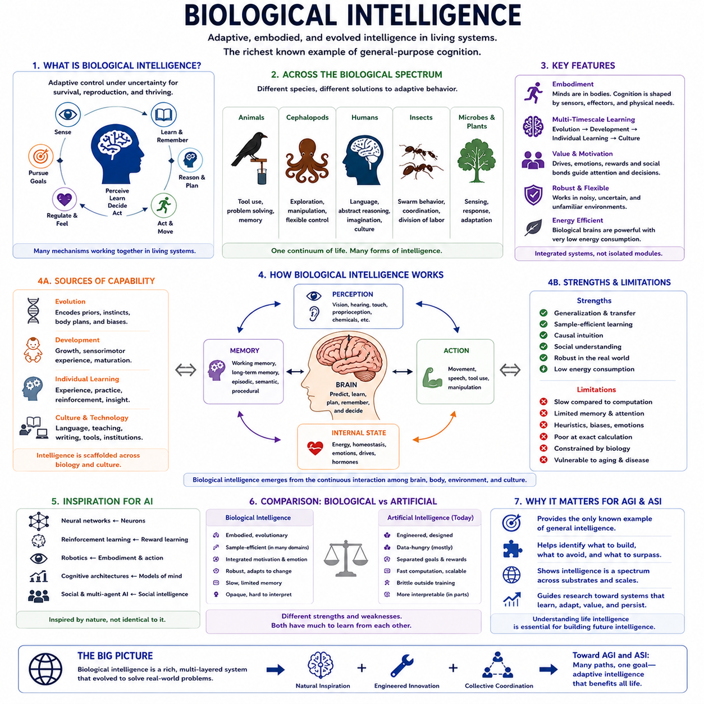
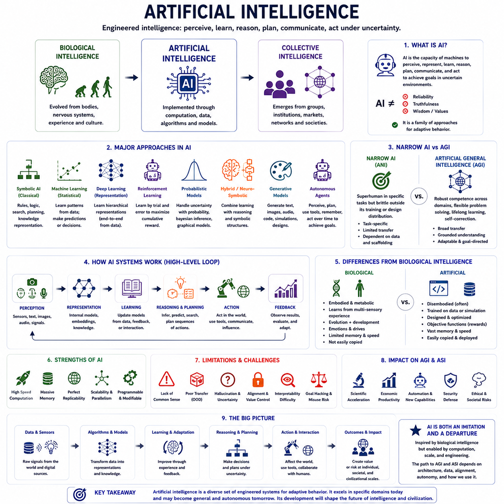
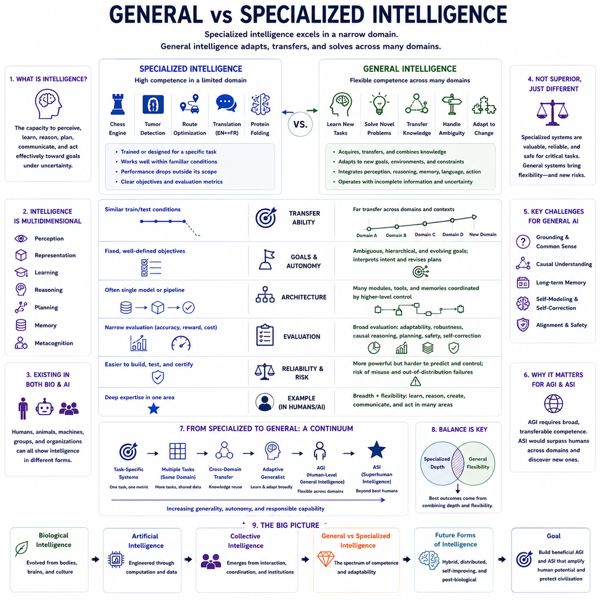
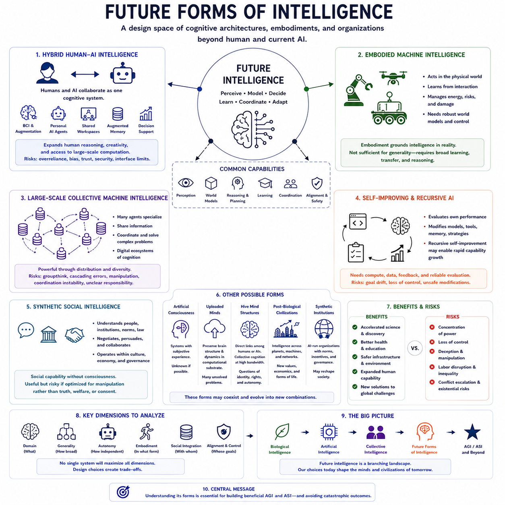

**Volume 00 05 AGI and ASI**

# Chapter 03. Types of Intelligence

### Chapter Overview

{width="7.268055555555556in" height="7.268055555555556in"}

지능(Intelligence)은 인간의 마음에만 존재하거나 기계에만 나타나는 단일한 실체가 아니다. 지능은 지각하고, 학습하고, 모형화하고, 추론하고, 적응하고, 의사소통하고, 협력하고, 창조하며, 불확실성 속에서 효과적으로 행동하는 능력들의 집합이다. 이 장, "지능의 유형(Types of Intelligence)"은 인공 일반 지능(AGI)과 인공 초지능(ASI)을 본격적으로 논의하기 전에 필요한 개념적 지도를 제공한다. AGI가 여러 영역에서 폭넓은 역량을 보이는 지능으로 정의된다면, 먼저 어떤 종류의 역량이 존재하는지, 그것들이 어떻게 다른지, 그리고 공통의 척도 위에서 비교될 수 있는지를 물어야 한다.

이 장은 지능의 기초에서 출발한다. 여기에는 정의, 측정의 문제, 적응, 목표 지향적 행동, 추상화, 전이, 그리고 수행(performance)과 이해(understanding)의 차이가 포함된다. 이어서 인간 인지, 동물 지능, 체화된 지각, 진화, 감정, 사회적 학습, 살아 있는 제어 시스템으로서의 뇌를 포함하는 생물학적 지능(Biological Intelligence)을 살펴본다. 생물학적 지능이 중요한 이유는 그것이 자연적으로 발생한 일반 지능의 유일하게 알려진 사례이기 때문이다. 그러나 그것이 고도 인지의 유일한 가능한 설계도라는 뜻은 아니다.

다음으로 이 장은 공학적으로 구현된 인지 형태인 인공 지능(Artificial Intelligence)을 다룬다. 기계 지능은 좁은 과제에서는 인간을 능가할 수 있지만, 훈련 분포를 벗어나면 취약할 수 있다. 이 대비는 특수화된 탁월함과 일반적 적응성의 차이를 분명하게 해 준다. 논의는 또한 개인을 넘어 집단 지능(Collective Intelligence)으로 확장된다. 집단, 제도, 시장, 과학 공동체, 군집, 다중 에이전트 시스템, 네트워크화된 AI가 여기에 포함된다. 많은 지능적 결과는 하나의 마음에서가 아니라 제한된 여러 행위자들의 조정에서 발생한다.

이 장의 핵심 주제는 일반 지능(General Intelligence)과 특수 지능(Specialized Intelligence)의 구분이다. 특수화된 시스템은 폭넓은 역량이 없어도 매우 강력할 수 있는 반면, 일반 시스템은 지식을 재사용하고, 추상화를 형성하며, 낯선 과제에 적응할 수 있다. 이 구분을 이해하면 범주 오류를 피할 수 있다. 체스 엔진, 언어 모델, 로봇, 기업, 인간 아이는 모두 어떤 의미에서는 "지능적"일 수 있지만, 그 의미와 작동 메커니즘은 서로 다르다.

마지막으로 이 장은 미래의 지능 형태를 바라본다. 인간-AI 하이브리드 시스템, 뇌-컴퓨터 인터페이스(Brain-Computer Interfaces), 인공 사회, 자기 개선 에이전트, 업로드된 마음, 하이브 마인드(Hive Mind), 탈생물학적 인지(post-biological cognition)가 그 예다. 이러한 가능성은 마음, 인격, 행위성, 문명에 대한 익숙한 가정을 흔든다. 이 장의 목적은 모든 지능을 하나의 정의 안에 억지로 넣는 것이 아니라, AGI와 ASI의 미래를 형성할 수 있는 다양한 적응적 역량을 비교하기 위한 어휘를 제공하는 데 있다.

### Connection to Volume 05

이 장은 Volume 05의 도입부 정의들과 이후의 더 고급 개념들을 이어 주는 다리 역할을 한다. 01장은 AGI가 무엇인지 묻고, 02장은 ASI가 무엇인지 묻는다. 03장은 AGI와 ASI가 고립된 기술적 용어가 아니라 생물학적 지능, 인공 지능, 집단 지능, 특수 지능, 미래 지능을 포함하는 더 넓은 지형 속에 있음을 보여 줌으로써 논의의 틀을 확장한다. 이러한 더 넓은 분류가 없다면 일반성, 의식, 자기 개선, 특이점에 대한 논의는 지나치게 좁아질 위험이 있다.

다음 장들은 여기서 소개한 구분들 위에 직접적으로 세워진다. 04장 "일반화(Generalization)"는 좁은 과제 수행과 맥락을 가로지르는 유연한 전이의 차이에 의존한다. 05장 "인과 추론(Causal Reasoning)"은 표면적 패턴 인식과 더 깊은 이해를 구분할 수 있는 핵심 능력 중 하나를 발전시킨다. 06장 "세계 모델(World Models)"은 지능적 시스템이 환경을 표상하고, 결과를 예측하며, 행동을 계획해야 한다는 생각을 확장한다. 이 주제들은 모두 지능이 반사, 기술, 모델 기반 추론, 사회적 조정, 개방형 학습의 형태로 나타날 수 있다는 사전 이해를 필요로 한다.

07장부터 10장까지는 더 일반적인 지능을 지탱할 수 있는 내부 장치를 검토한다. 여기에는 인지 아키텍처(Cognitive Architectures), 기억 시스템(Memory Systems), 추론 엔진(Reasoning Engines), 자기 성찰(Self-Reflection)이 포함된다. 이 장에서 제시한 지능의 분류는 이러한 구성 요소들이 왜 중요한지를 분명하게 해 준다. 특수화된 AI는 풍부한 자전적 기억이나 반성적 자기 모델링을 필요로 하지 않을 수 있지만, 더 일반적인 자율 시스템은 지속적 목표, 맥락 민감적 추론, 자신의 믿음과 행동을 평가하는 능력을 필요로 할 수 있다.

11장부터 14장까지는 인지에서 행위성과 개선으로 이동한다. 주제는 자율 에이전트(Autonomous Agents), 자기 개선 AI(Self-Improving AI), 재귀적 자기 개선(Recursive Self-Improvement), 메타 학습(Meta-Learning)이다. 여기서는 개인 지능과 집단 지능의 차이가 특히 중요해진다. 자기 개선 시스템은 하나의 에이전트일 수도 있고, 에이전트들의 생태계일 수도 있으며, 기업과 유사한 AI 조직이나 인간-기계 네트워크일 수도 있다. 마찬가지로 메타 학습은 특수 역량에서 더 넓은 적응성으로 나아가는 경로로 볼 수 있다.

15장부터 19장까지는 마음, 의식, 철학적 반론, 괴델 머신(Gödel Machines), 보편 구성자(Universal Constructors), 인공 의식(Artificial Consciousness)을 다룬다. 본 장은 독자가 지능과 의식을 분리해 생각하되, 둘 사이의 가능한 관계를 무시하지 않도록 준비시킨다. 생물학적 지능은 많은 인간 사례에서 의식을 동반하지만, 인공 지능이나 집단 지능은 주관적 경험 없이도 효과적일 수 있다. 이 구분은 기계의 마음에 관한 주장을 평가하는 데 필수적이다.

마지막 장들인 트랜스휴머니즘(Transhumanism), 하이브 마인드와 집단 AI, 뇌-컴퓨터 인터페이스, 마음 업로딩(Mind Uploading), 기술적 특이점(Technological Singularity), 포스트휴먼 문명(Post-Human Civilization)은 여기서 제시한 확장된 관점에 의존한다. 미래의 지능은 인간, 기계, 조직이라는 익숙한 범주에 맞지 않을 수 있다. 그것은 하이브리드형, 분산형, 자기 수정형, 또는 문명 규모의 지능일 수 있다. 따라서 03장은 이 책 나머지 부분을 위한 개념적 어휘를 제공한다. AGI와 ASI를 책임 있게 논의하려면, 먼저 지능이 취할 수 있는 다양한 형태를 이해해야 한다.

## 03.00 Intelligence Foundations

{width="7.268055555555556in" height="7.268055555555556in"}

{width="7.268055555555556in" height="7.268055555555556in"}

생물학적 지능, 인공지능, 집단 지능, 그리고 미래의 지능 형태를 비교하기 전에, "지능(intelligence)"이 기술적·철학적으로 무엇을 의미하는지에 대한 기초가 필요하다. 지능은 하나의 단일한 실체나 단순한 점수가 아니다. 지능은 어떤 시스템이 정보를 획득하고, 상황을 표현하며, 경험으로부터 학습하고, 불확실성 아래에서 추론하며, 행동을 선택하고, 변화하는 조건에 적응할 수 있게 하는 능력들의 집합이다. AGI와 ASI의 맥락에서 이러한 기초는 중요하다. 지능을 어떻게 정의하느냐에 따라 기계가 무엇을 할 수 있는지, 인간만이 고유하게 무엇을 하는지, 그리고 "인간을 넘어선" 지능이 무엇을 의미하는지에 대한 주장이 달라지기 때문이다.

유용한 출발점은 지능을 적응적 역량(adaptive competence)으로 보는 것이다. 지능적인 시스템은 시간, 에너지, 기억, 계산 능력, 이용 가능한 데이터와 같은 제한된 자원을 사용하여 목표를 달성하면서 다양한 환경에서 좋은 성과를 낸다. 이 정의는 폭넓게 적용된다. 먹이를 찾는 동물, 직업 경로를 계획하는 인간, 시장 상황에 대응하는 기업, 새로운 과제를 해결하는 AI 모델은 모두 지능의 어떤 형태를 보여줄 수 있다. 그러나 성과만으로는 충분하지 않다. 온도 조절기는 온도 변화에 반응하지만, 우리는 보통 그것을 지능적이라고 부르기를 주저한다. 그 내부 모델, 학습 능력, 목표의 유연성, 일반화 능력이 매우 제한적이기 때문이다. 따라서 지능은 행동만이 아니라 유연하고 맥락에 민감한 행동을 가능하게 하는 메커니즘까지 포함한다.

지능 이론 전반에서 반복적으로 등장하는 몇 가지 핵심 구성 요소가 있다. 지각(perception)은 세계로부터 오는 신호를 사용할 수 있는 정보로 변환한다. 표현(representation)은 그 정보를 개념, 지도, 기호, 임베딩(embedding), 또는 내부 상태로 조직화한다. 학습(learning)은 경험에 따라 시스템을 변화시켜 향후 성과가 개선되도록 한다. 추론(reasoning)은 추론 결과를 도출하고, 가능성을 비교하며, 불완전하거나 불확실한 증거를 다룬다. 계획(planning)은 목표를 향한 행동의 연속을 평가한다. 기억(memory)은 정보를 짧은 시간과 긴 시간 규모에 걸쳐 보존한다. 메타인지(metacognition), 즉 자기 점검은 시스템이 자신의 지식, 불확실성, 오류, 전략을 평가할 수 있게 한다. 어떤 하나의 구성 요소만으로는 충분하지 않지만, 이들이 함께 지능적 행동의 구조를 형성한다.

중요한 구분 중 하나는 좁은 역량(narrow competence)과 일반 역량(general competence)의 차이다. 좁은 지능은 특정 영역에서 인간을 능가할 수 있지만, 그 영역 밖에서는 취약할 수 있다. 체스 엔진은 세계 챔피언을 이길 수 있어도 평범한 대화나 물리적 이동에는 실패할 수 있다. 일반 지능(general intelligence)은 전이 가능한 능력을 의미한다. 즉 다양한 과제에 걸쳐 지식과 기술을 사용할 수 있고, 새로운 영역을 효율적으로 학습하며, 시스템 설계자가 예상하지 못한 상황에 대처할 수 있는 능력이다. 이 구분은 이후 전문화된 AI와 인공 일반 지능(artificial general intelligence)을 대비할 때 핵심이 된다. 또한 일반성은 단순히 시스템이 수행할 수 있는 과제의 수가 아니라, 과제들 사이에서 얼마나 깊이 전이하고, 추상화하며, 적응할 수 있는가라는 어려운 측정 문제를 제기한다.

지능에는 수준과 차원도 있다. 지능은 개별적일 수도 있고 집단적일 수도 있으며, 체화된(embodied) 형태일 수도 있고 비체화된(disembodied) 형태일 수도 있다. 또한 기호적(symbolic)일 수도 있고 하위기호적(subsymbolic)일 수도 있으며, 반응적(reactive)일 수도 있고 숙고적(deliberative)일 수도 있다. 인간 지능은 뇌, 신체, 언어, 문화, 도구, 사회 제도에 의존한다. 인공지능은 신경망(neural networks), 탐색 알고리즘, 외부 기억, 시뮬레이션 환경, 디지털 도구 접근에 의존할 수 있다. 집단 지능(collective intelligence)은 개미 군집, 과학 공동체, 시장, 또는 네트워크화된 AI 시스템처럼 여러 행위자가 조정될 때 나타난다. 이러한 형태들은 서로 배타적이지 않다. 미래의 AGI는 신경 학습, 기호 추론, 도구 사용, 사회적 조정, 장기 기억을 하나의 하이브리드 인지 시스템으로 결합할 수 있다.

또 다른 기초적 쟁점은 지능과 목표의 관계다. 지능은 종종 목표를 달성하는 능력으로 설명되지만, 목표 자체는 진화, 설계자, 사용자, 제도, 또는 자기 수정 시스템에 의해 주어질 수 있다. 매우 유능한 시스템은 그 목표가 사소하거나 해롭거나 인간 가치와 정렬되지 않았더라도 지능적일 수 있다. 이 구분은 AGI 안전성에서 매우 중요하다. 능력(capability)이 지혜, 선의, 의식, 또는 도덕적 이해를 의미하지는 않기 때문이다. 최적화 시스템은 그 전략이 인간에게 어떤 의미를 갖는지 이해하지 못한 채 효과적인 전략을 발견할 수 있다. 반대로 인간은 단순히 효율적인 문제 해결을 통해서만이 아니라 가치에 민감한 판단, 사회적 인식, 윤리적 자제를 통해 지능을 보여주는 경우가 많다.

측정은 여전히 가장 어려운 문제 중 하나다. IQ 검사, 벤치마크 모음, 게임, 학업 시험, 로봇 과제, 경제적 생산성은 모두 지능의 일부만을 측정한다. 각각에는 한계가 있다. 벤치마크는 과적합(overfitting)될 수 있고, 게임은 인위적으로 제한될 수 있으며, 언어 시험은 패턴 매칭에 보상을 줄 수 있고, 인간 시험은 현실 세계의 행위성(agency)을 포착하지 못할 수 있다. AGI 연구를 위해서는 평가가 견고성(robustness), 전이 학습(transfer learning), 인과 추론(causal reasoning), 장기 계획(long-horizon planning), 상식(common sense), 자기 수정(self-correction), 불확실성 아래에서의 안전한 행동을 검토해야 한다. 그럼에도 지능은 부분적으로 관계적이다. 시스템의 역량은 환경, 사용 가능한 도구, 학습 이력, 성공을 판단하는 데 사용되는 목표에 따라 달라진다.

마지막으로, 지능을 의식(consciousness)이나 인격성(personhood)과 혼동해서는 안 된다. 어떤 시스템은 주관적 경험 없이도 문제를 해결하고, 패턴을 학습하며, 행동을 계획할 수 있다. 인공 의식(artificial consciousness)이 가능한지는 이후의 주제이지만, 지능의 기초는 의식을 가정할 필요가 없다. 이러한 분리는 기계, 동물, 집단, 가상의 초지능을 공통된 기능적 개념으로 분석할 수 있게 하면서도, 그들 사이의 중요한 차이를 보존할 수 있게 한다.

이 절은 장의 나머지 부분을 위한 개념적 토대를 마련한다. 다음 절은 많은 지능 개념의 출발점이 되는 진화적·인지적 기준선으로서 생물학적 지능을 살펴본다. 이후의 절들은 인공지능과 집단 지능을 비교하고, 일반 지능과 전문화된 지능을 구분하며, 하이브리드형, 분산형, 자기 개선형, 또는 탈생물학적 형태일 수 있는 미래 지능을 검토한다. 이러한 기초를 이해하면 AGI 논의에서 흔히 발생하는 오류, 즉 지능을 하나의 사다리처럼 취급하는 실수를 피할 수 있다. 지능은 능력, 제약, 아키텍처, 목표로 이루어진 다차원적 공간으로 이해하는 편이 더 적절하다.

## 03.01 Biological Intelligence

{width="7.268055555555556in" height="7.268055555555556in"}

생물학적 지능(Biological Intelligence)은 살아 있는 시스템, 특히 진화, 발달, 체화, 사회적 상호작용에 의해 형성된 신경계에서 나타나는 지능의 형태이다. AGI와 ASI의 맥락에서 생물학적 지능이 중요한 이유는 인간 지능이 가능한 유일한 모델이기 때문이 아니라, 유연하고 적응적이며 범용적인 인지의 가장 풍부한 알려진 사례이기 때문이다. 생물학적 지능을 이해하면 인공 시스템이 무엇을 모방하고, 무엇을 생략하며, 결국 무엇을 넘어설 수 있는지 명확히 볼 수 있다.

생물학적 지능의 핵심은 불확실성 속에서의 적응적 제어(adaptive control)이다. 유기체는 환경을 감지하고, 행동을 선택하며, 내부 상태를 조절하고, 경험으로부터 학습하며, 번식하거나 더 넓은 생물학적 시스템을 지원할 만큼 오래 생존해야 한다. 이런 의미에서 지능은 추상적 추론에만 국한되지 않는다. 지능은 지각, 움직임, 기억, 주의, 감정, 사회적 행동, 계획, 도구 사용, 새로운 조건에 대처하는 능력을 포함한다. 퍼즐을 푸는 까마귀, 물체를 조작하는 문어, 언어를 배우는 인간 아동, 먹이 수집을 조율하는 개미 군집은 모두 적응적 행동이라는 문제에 대한 서로 다른 생물학적 해법을 보여준다.

인간 지능은 종종 AGI의 기준으로 여겨지지만, 그것은 더 넓은 생물학적 스펙트럼 안의 한 사례일 뿐이다. 인간은 상징적 추론(symbolic reasoning), 언어, 상상력, 장기 계획, 문화적 학습, 정교한 사회적 인지를 결합한다. 그러나 이러한 능력은 더 오래된 생물학적 메커니즘, 즉 감각운동 조정(sensorimotor coordination), 보상 학습, 정서적 조절, 항상성(homeostasis), 주의에 의존한다. 뇌는 순수한 논리 엔진이 아니다. 뇌는 지각, 행동, 기억, 가치를 끊임없이 통합하는 예측적이고, 체화되어 있으며, 대사적으로 제약된 기관이다.

생물학적 지능의 중요한 특징 중 하나는 체화(embodiment)이다. 생물학적 마음은 추상적 입력을 받는 분리된 계산기가 아니라, 움직이고, 에너지를 소비하며, 제약을 경험하고, 특정한 감각기관과 효과기(effectors)를 통해 세계와 상호작용하는 몸 안에 자리한다. 몸의 구조는 인지를 형성한다. 인간의 공간, 물체, 힘, 행위성에 대한 개념은 시각, 촉각, 고유수용감각(proprioception), 운동 제어, 신체적 필요의 영향을 받는다. 이는 AGI에 중요하다. 순수하게 텍스트 기반이거나 비체화된 시스템은 방대한 지식을 얻을 수는 있지만, 생물학적 행위자가 물리적 상호작용을 통해 획득하는 것과 같은 기반 있는 이해(grounded understanding)를 발달시키지 못할 수 있기 때문이다.

또 다른 본질적 특징은 여러 시간 규모에 걸친 학습이다. 진화는 유전자와 신체 구조를 통해 넓은 사전 지식(priors)을 부호화한다. 발달은 성장, 성숙, 환경 노출을 통해 유기체를 조정한다. 개체 학습은 경험을 통해 행동을 조절한다. 문화는 모방, 언어, 교육, 제도, 도구를 통해 세대를 넘어 지식을 전달한다. 따라서 인간 지능은 개인의 뇌 안에만 위치하지 않는다. 그것은 가족, 공동체, 문자 체계, 기술, 축적된 문화적 기억에 의해 지지된다. 이 관찰은 생물학적 지능을 다음 주요 범주인 집단 지능(collective intelligence)과 연결한다.

생물학적 인지는 또한 깊이 가치 지향적이다. 주의, 기억, 의사결정은 욕구, 감정, 고통, 쾌락, 두려움, 호기심, 애착, 사회적 보상의 영향을 받는다. 이것들은 단순한 비합리적 방해 요소가 아니다. 제한된 시간과 정보 속에서 행동의 우선순위를 정하는 제어 메커니즘이다. 감정은 유기체가 자원을 배분하고, 위협을 감지하며, 유대를 형성하고, 결과로부터 배우도록 돕는다. 인공지능에서 가치 함수(value functions), 보상 모델(reward models), 선호 학습(preference learning)은 부분적인 기술적 대응물이지만, 생물학적 동기의 풍부함을 자동으로 재현하지는 않는다.

생물학적 지능의 강점에는 견고성, 많은 영역에서의 표본 효율적 학습(sample-efficient learning), 과제 간 전이, 인과적 직관, 사회적 이해, 개방형 환경에서 작동하는 능력이 포함된다. 인간은 종종 몇 가지 사례만으로 학습하고, 의도를 추론하며, 도구를 즉흥적으로 사용하고, 낯선 상황에 적응할 수 있다. 생물학적 시스템은 현대의 대규모 계산과 비교해 에너지 효율도 높다. 인간의 뇌는 작은 전구 정도의 전력으로 지각, 추론, 운동 제어, 자기 조절을 지원한다.

그러나 생물학적 지능에는 큰 한계도 있다. 인간 인지는 전자적 계산에 비해 느리고, 기억은 오류가 많으며, 주의는 좁고, 추론은 휴리스틱(heuristics), 감정, 부족적 정체성, 진화적 지름길에 의해 편향된다. 우리는 고차원 통계 추론, 정확한 계산, 일관된 장기 계획에 약하다. 생물학적 뇌는 두개골 크기, 대사 비용, 노화, 질병, 점진적 발달의 필요성에도 제약된다. 이러한 한계는 인공지능이 특수 영역에서는 인간 능력을 능가할 수 있지만, 여전히 인간과 같은 일반성을 결여할 수 있는 이유를 설명한다.

AGI 연구에서 생물학적 지능은 영감을 제공하지만 반드시 따라야 할 청사진은 아니다. 신경망(neural networks)은 뉴런에서 느슨하게 영감을 받았고, 강화학습(reinforcement learning)은 보상 기반 적응에서, 인지 아키텍처(cognitive architectures)는 마음의 모델에서, 로보틱스는 체화된 행동에서 영감을 받았다. 그러나 생물학적 뇌는 구조, 가소성(plasticity), 감각적 기반, 발달 경로, 동기와 인지의 통합 방식에서 현재의 AI 시스템과 근본적으로 다르다. 생물학을 지나치게 문자 그대로 복제하는 것은 비효율적일 수 있으며, 반대로 완전히 무시하면 진화가 수십억 년의 탐색을 통해 발견한 일반 지능의 원리를 놓칠 위험이 있다.

더 깊은 함의는 지능이 하나의 단일한 속성이 아니라 서로 다른 기질(substrates)에서 구현되는 능력들의 계열이라는 점이다. 생물학적 지능은 뇌, 몸, 환경, 발달, 문화의 상호작용에서 어떻게 일반적인 행동이 나타날 수 있는지를 보여준다. 다음 절에서 다룰 인공지능(artificial intelligence)은 이러한 능력 중 일부가 공학적 시스템에서 어떻게 구현될 수 있는지를 탐구한다. 두 지능의 비교는 AGI 구축의 가능성과 어려움을 동시에 드러낸다. 우리는 정보를 처리하는 방법뿐 아니라, 지능적 시스템이 어떻게 학습하고, 행동하며, 가치를 부여하고, 적응하고, 변화하는 세계 속에서 지속되는지도 이해해야 한다.

## 03.02 Artificial Intelligence

{width="7.268055555555556in" height="7.268055555555556in"}

인공지능(Artificial Intelligence)은 공학적으로 구현된 지능의 형태이다. 즉 기계가 불확실성 아래에서 목표를 달성하기 위해 지각하고, 표상하고, 학습하고, 추론하고, 계획하고, 의사소통하며, 행동할 수 있는 능력을 말한다. 이 장의 흐름에서 인공지능은 생물학적 지능(Biological Intelligence)과 집단 지능(Collective Intelligence) 사이에 위치한다. 생물학적 시스템은 진화한 신체, 신경계, 지각, 기억, 감정, 사회적 학습을 통해 지능이 어떻게 출현할 수 있는지를 보여 준다. 반면 인공 시스템은 이러한 능력의 일부가 계산, 데이터, 최적화, 기호 구조, 환경과의 상호작용을 통해 어떻게 구현될 수 있는지를 보여 준다.

AI는 하나의 단일한 메커니즘이 아니다. 그것은 적응적 행동을 만들어 내기 위한 여러 접근법의 집합이다. 고전적 AI(Classical AI)는 명시적 표상, 규칙, 탐색, 계획, 논리적 추론을 강조했다. 체스 프로그램, 정리 증명기(theorem prover), 전문가 시스템(expert system)은 잘 정의된 영역 안에서 형식적 절차에 따라 기호를 조작함으로써 지능적으로 작동할 수 있었다. 현대의 머신러닝(Machine Learning), 특히 딥러닝(Deep Learning)은 데이터로부터 내부 표상을 학습하는 시스템으로 강조점을 옮겼다. 신경망(neural network), 트랜스포머(transformer), 강화학습 에이전트(reinforcement learning agent), 확률 모델(probabilistic model), 하이브리드 신경-기호 시스템(neuro-symbolic system)은 모두 넓은 AI 지형에 속한다. 각 접근법은 패턴 인식, 언어 모델링, 의사결정, 인과 추론, 기억 검색, 목표 지향적 제어와 같은 지능의 서로 다른 측면을 포착한다.

중요한 구분은 인공 협소 지능(Artificial Narrow Intelligence)과 인공 일반 지능(Artificial General Intelligence) 사이에 있다. 현재 대부분의 AI 시스템은 협소하거나 특화된 시스템이다. 이들은 번역, 이미지 분류, 단백질 구조 예측, 게임 플레이, 코드 생성, 정보 검색에서 초인간적 수준의 성능을 보일 수 있지만, 훈련되거나 설계된 조건을 벗어나면 취약해지는 경우가 많다. 특히 대규모 언어 모델(Large Language Model)에서는 표면적으로 폭넓은 능력처럼 보일 수 있지만, 그 역량은 흔히 데이터의 통계적 규칙성, 도구 접근, 프롬프트 구조, 외부 보조 장치에 의존한다. 반면 AGI는 영역 간의 견고한 전이, 유연한 문제 해결, 장기 계획, 기반을 갖춘 이해(grounded understanding), 자기 수정, 제한된 지시만으로 새로운 과제를 학습하는 능력을 요구한다. 이러한 구분은 다음 절의 일반 지능과 특화 지능 논의를 준비한다.

인공지능은 구현 방식, 동기, 학습 이력에서도 생물학적 지능과 다르다. 인간과 동물은 감각운동 경험, 생존 압력, 사회적 상호작용, 발달적 제약을 통해 학습한다. AI 시스템은 대규모 정적 데이터셋, 시뮬레이션 환경, 인간 피드백, 온라인 상호작용을 통해 훈련될 수 있다. AI의 "경험"은 대사, 고통, 욕망, 진화적 적합도보다는 목적 함수(objective function), 아키텍처(architecture), 훈련 방식(training regime)에 의해 매개된다. 이것이 AI가 지능적이지 않다는 뜻은 아니지만, 그 지능의 구조가 인간에게 낯선 방식일 수 있음을 의미한다. 언어 모델은 인간과 같은 지각이나 의식 없이도 인상적인 언어적·개념적 능력을 보일 수 있다. 로봇은 감정을 갖지 않고도 물리적 기술을 습득할 수 있다. 계획 에이전트는 어떤 목표의 도덕적 의미를 이해하지 못한 채 그 목표를 최적화할 수 있다.

AI 시스템의 아키텍처는 그 지능의 유형을 강하게 형성한다. 지도학습 모델(supervised model)은 입력에서 출력으로의 대응 관계를 학습한다. 강화학습 에이전트는 보상과 처벌을 통해 정책(policy)을 학습한다. 생성 모델(generative model)은 훈련 데이터의 패턴과 유사한 텍스트, 이미지, 오디오, 코드, 시뮬레이션을 생성하도록 학습한다. 기호적 계획기(symbolic planner)는 명시적 목표와 제약을 사용해 가능한 행동들을 탐색한다. 검색 증강 모델(retrieval-augmented model)은 외부 데이터베이스를 참조함으로써 유효 기억을 확장한다. 자율 에이전트(autonomous agent)는 지각, 기억, 계획, 도구 사용, 피드백 루프를 결합하여 시간에 걸쳐 과제를 추구한다. 이러한 구성 요소들은 결합될 수 있으며, 단일 방법만으로는 얻기 어려운 더 강력한 시스템을 만들어 낸다.

그러나 AI에서의 지능을 신뢰성, 진실성, 자율성, 지혜와 혼동해서는 안 된다. 어떤 시스템은 유창한 설명을 생성하면서도 사실을 날조할 수 있다. 벤치마크는 해결하지만 실제 세계의 맥락은 이해하지 못할 수 있다. 측정 가능한 보상을 최적화하면서도 명시되지 않은 인간의 선호를 위반할 수 있다. 목표 지향적 언어를 생성하기 때문에 행위자처럼 보일 수 있지만, 안정적인 의도나 지속적인 자기 모델을 갖지 않을 수도 있다. 따라서 AI를 평가하려면 고립된 과제의 성능을 측정하는 것만으로는 부족하다. 견고성(robustness), 보정(calibration), 인과 추론(causal reasoning), 해석 가능성(interpretability), 인간 가치와의 정렬(alignment), 조작에 대한 저항성, 분포 이동(distribution shift) 상황에서의 행동을 함께 시험해야 한다.

인공지능은 AGI와 ASI에 중대한 함의를 갖는다. 더 일반적인 시스템이 출현할 수 있는 실험적 기반을 제공하기 때문이다. 계산량, 데이터, 모델 규모의 확장은 놀라운 일반화(generalization)를 만들어 냈지만, 규모만으로 기반화(grounding), 추론, 기억, 행위성, 정렬 문제가 해결되지는 않을 수 있다. 미래의 시스템은 더 풍부한 세계 모델(world model), 지속적 기억, 능동 학습(active learning), 체화된 상호작용(embodied interaction), 인과적 추상화(causal abstraction), 자신의 추론 과정에 대한 반성적 제어를 필요로 할 수 있다. AI 시스템이 더 자율적으로 변하고 경제, 과학, 군사, 사회 제도에 내장될수록, 그 지능은 단순한 기술적 속성이 아니라 문명적 힘이 된다.

이런 의미에서 인공지능은 자연 지능의 모방이면서 동시에 이탈이다. 인공지능은 지각, 학습, 언어, 문제 해결을 모방하지만, 생물학적 두뇌가 사용할 수 없는 속도, 규모, 병렬성 수준에서 작동할 수 있다. 또한 복사되고, 분산되고, 검사되고, 수정되며, 도구와 네트워크에 통합될 수 있다. 이러한 속성 때문에 AI는 AGI와 ASI 연구의 중심에 놓인다. 핵심 질문은 기계가 인간 인지의 모든 특징을 재현할 수 있는지가 아니라, 계산이 어떤 형태의 지능을 지탱할 수 있는지, 어떤 한계가 여전히 근본적인지, 그리고 인공 시스템이 창조자보다 더 일반적이고 더 자율적이며 더 강력해질 때 어떤 일이 발생하는지이다.

## 03.03 Collective Intelligence

{width="7.268055555555556in" height="7.268055555555556in"}

집단 지능(Collective intelligence)은 하나의 마음이나 하나의 기계에서가 아니라, 여러 행위자(agent)의 상호작용에서 나타나는 지능적 행동을 의미한다. 이 장의 흐름에서 집단 지능은 한편으로는 생물학적 지능과 인공지능 사이에 놓이고, 다른 한편으로는 뒤이어 다룰 일반 지능과 특화 지능의 대비로 이어지는 위치에 있다. 이 위치는 중요하다. 집단 지능은 뉴런이나 실리콘 같은 또 하나의 기질(substrate)이 아니다. 그것은 조직 방식(mode of organization)이다. 집단, 네트워크, 제도, 군집, 시장, 과학 공동체, 다중 에이전트 AI 시스템이 어떻게 개별 구성원의 능력을 넘어서는 방식으로 지각하고, 결정하고, 학습하고, 적응할 수 있는지를 묻는다.

생물학적 시스템에서 집단 지능은 곤충 군체, 동물 집단, 인간 사회에서 나타난다. 개미 군체는 어떤 개미도 전체 과제를 이해하지 못한 채 경로 탐색과 자원 배분 문제를 해결한다. 벌은 분산된 신호 전달과 정족수 형성(quorum formation)을 통해 새 둥지 위치를 선택한다. 새 떼와 물고기 떼는 정렬(alignment), 분리(separation), 응집(cohesion)과 같은 국소 규칙을 통해 움직임을 조정한다. 인간의 집단 지능은 언어, 문화, 규범, 도구, 기억 시스템, 제도를 결합하기 때문에 훨씬 더 복잡하다. 예를 들어 하나의 과학 분야는 어떤 개별 과학자도 전체 연구 성과를 모두 이해하지 못하더라도 세대를 넘어 지식을 축적할 수 있다. 지능은 부분적으로 개인의 두뇌 안에 있지만, 동시에 논문, 도구, 동료 평가, 교육 시스템, 공유된 증거 기준 속에도 존재한다.

핵심적인 구분은 집계(aggregation)와 창발(emergence) 사이의 구분이다. 집계는 투표, 예측 평균, 전문가 판단의 결합처럼 개인의 출력을 단순히 결합하는 것이다. 창발은 상호작용이 어떤 개인의 기여로도 쉽게 환원되지 않는 패턴이나 능력을 만들어낼 때 발생한다. 시장은 분산된 정보를 가격으로 집계할 수 있지만, 거품, 붕괴, 시스템적 위험도 만들어낼 수 있다. 온라인 공동체는 고품질의 백과사전식 지식을 생산할 수 있지만, 동시에 허위 정보나 양극화를 증폭할 수도 있다. 따라서 집단 지능은 인식론적 힘과 실패 양식을 모두 가진다. 그것은 자동으로 개인 지능보다 더 현명한 것이 아니다. 그 성능은 인센티브, 의사소통 구조, 다양성, 피드백 품질, 오류 수정 메커니즘에 달려 있다.

AI에서 집단 지능은 여러 형태로 나타난다. 앙상블 학습(ensemble learning)은 여러 모델을 결합하여 정확도나 견고성(robustness)을 높인다. 다중 에이전트 시스템(multi-agent systems)은 협조, 경쟁, 협상, 전문화를 수행하는 에이전트들 사이에 과제를 분산한다. 군집 지능(swarm intelligence)은 개미, 벌, 떼를 지어 움직이는 동물에서 영감을 받아 단순한 국소 정책으로 전역적 행동을 만들어낸다. 인간-AI 협업도 중요한 형태이다. 검색 엔진, 추천 시스템, 과학적 발견 도구, 의사결정 지원 시스템은 인간의 목표와 판단을 기계 규모의 계산 및 패턴 인식과 연결하는 하이브리드 집단 지능(hybrid collective intelligence)으로 이해할 수 있다. 점점 더 최전선의 AI 시스템도 계획, 기억, 도구 사용, 비판, 시뮬레이션, 실행을 담당하는 별도 구성 요소들이 이루는 에이전트 사회처럼 작동할 수 있다.

집단 지능은 AGI와 ASI와 특히 관련이 깊다. 일반 지능이 하나의 단일한 거대 모델의 속성으로만 발생하지 않을 수 있기 때문이다. AGI 시스템은 지각 모듈, 추론 엔진, 세계 모델(world models), 기억 저장소, 자기 성찰 구성 요소, 자율 에이전트들이 상호작용하는 아키텍처일 수 있다. 마찬가지로 ASI는 고립된 하나의 인공 정신에서가 아니라 모델, 데이터 센터, 로봇, 센서, 인간, 제도로 이루어진 문명 규모의 네트워크에서 나타날 수도 있다. 이러한 가능성은 "그 시스템은 지능적인가?" 또는 "그 행동에 대한 책임은 누구에게 있는가?"와 같은 전통적 질문을 복잡하게 만든다. 지능적 시스템의 경계에는 사람, 소프트웨어, 하드웨어, 데이터 파이프라인, 경제적 인센티브, 거버넌스 구조가 포함될 수 있다.

집단 지능의 설계는 어려운 공학적 문제와 정렬(alignment) 문제를 제기한다. 조정에는 의사소통 프로토콜, 공유 표상(shared representations), 갈등 해결 메커니즘, 계산 자원이나 물리적 자원의 배분이 필요하다. 에이전트 간 학습에는 어떤 정보를 공유해야 하는지, 무엇을 지역적으로 유지해야 하는지, 해로운 피드백 루프를 어떻게 방지할지를 결정해야 한다. 안전이 중요한 영역에서 집단 시스템은 연쇄 실패(cascading failures), 집단사고(groupthink), 공모(collusion), 보상 해킹(reward hacking), 상관된 오류(correlated errors)를 피해야 한다. 개별적으로 신뢰할 수 있는 에이전트들의 모음도, 그 상호작용이 숨은 의존성이나 서로를 속일 유인을 만들어낸다면 시스템으로서는 신뢰할 수 없게 될 수 있다. 반대로 잘 설계된 집단은 중복성, 적대적 검토(adversarial review), 독립 검증, 다양한 관점을 활용해 안전성을 높일 수 있다.

다양성은 효과적인 집단 지능을 위한 가장 중요한 조건 중 하나이다. 에이전트들이 서로 다른 정보, 방법, 경험, 귀납적 편향(inductive biases)을 가지고 있다면, 집단은 더 넓은 해 공간(solution space)을 탐색할 수 있다. 그러나 다양성만으로는 충분하지 않다. 시스템에는 통합도 필요하다. 즉 부분적 지식을 결합하되 소수 신호를 억누르거나 잡음이 많은 의견에 과도한 가중치를 주지 않는 방식이 필요하다. 조정이 너무 적으면 파편화가 생기고, 조정이 너무 많으면 동조(conformity)가 생긴다. 성능이 높은 집단은 흔히 탐색(exploration)과 활용(exploitation), 전문화와 공유 맥락, 경쟁과 협력 사이의 균형을 맞춘다. 이러한 균형은 과학 공동체, 오픈소스 생태계, 민주적 숙의, 분산형 AI 연구에서 볼 수 있다.

집단 지능은 지능 측정에 대한 생각도 바꾼다. 표준 시험은 흔히 통제된 조건에서 고립된 에이전트를 평가한다. 그러나 현실 세계의 많은 성취는 네트워크에 의존한다. 질병을 진단하는 병원, 칩을 설계하는 기업, 이론을 발전시키는 연구 공동체, 재난에 대응하는 로봇 함대가 그 예이다. 이러한 시스템을 측정하려면 처리량(throughput), 적응성, 회복탄력성(resilience), 보정(calibration), 해석 가능성(interpretability), 오류로부터 회복하는 능력에 주의를 기울여야 한다. 또한 지능이 작동하는 환경의 품질도 측정해야 한다. 의사소통 채널이 열악하거나, 인센티브가 왜곡되어 있거나, 정보가 오염되어 있다면 개별 에이전트들이 유능하더라도 집단 성능은 낮아질 수 있다.

그 함의는 매우 크다. 미래의 지능이 점점 더 집단적이라면, AGI로 가는 길은 단순히 모델을 확장하는 것뿐 아니라 더 나은 인지 생태계(ecosystems of cognition)를 설계하는 것을 포함할 수 있다. ASI로 가는 길은 AI 시스템, 인간 제도, 자동화된 실험실, 글로벌 인프라 사이의 피드백 루프를 가속하는 것을 포함할 수 있다. 이는 전례 없는 문제 해결의 기회를 만들지만, 동시에 권력 집중, 인간 행위성(human agency)의 상실, 실수의 빠른 전파라는 위험도 만든다. 따라서 집단 지능을 이해하는 것은 이 책의 나머지 내용을 위해 필수적이다. 이는 일반 지능과 특화 지능, 미래의 지능 형태, 자율 에이전트, 자기 개선 시스템, 그리고 궁극적으로 포스트휴먼 문명의 가능성을 검토하기 위한 토대를 제공한다.

## 03.04 General vs Specialized Intelligence

{width="7.268055555555556in" height="7.268055555555556in"}

지능 연구에서 핵심적인 구분 중 하나는 특수 지능(specialized intelligence)과 일반 지능(general intelligence)의 차이다. 특수 지능은 제한된 영역 안에서의 능숙함을 뜻한다. 예를 들어 체스를 두거나, 방사선 영상에서 종양을 인식하거나, 창고 이동 경로를 최적화하거나, 두 언어 사이를 번역하거나, 단백질 구조를 예측하는 능력이 이에 해당한다. 일반 지능은 여러 영역에 걸쳐 지식을 습득하고, 전이하며, 조정하는 능력을 의미한다. 특히 새로운 과제, 불완전한 정보, 변화하는 목표, 낯선 환경에 직면했을 때 이러한 능력이 중요해진다. 이 구분은 절대적인 것은 아니지만, 좁은 AI 시스템에서 인공 일반 지능(AGI)으로 나아가는 경로를 이해하는 데 필수적이다.

생물학적 지능(biological intelligence)도 이미 두 형태를 모두 보여 준다. 거미의 거미줄 짓기 행동은 매우 특수화되어 있고 효과적이지만, 유연성은 제한적이다. 반면 도구를 사용하는 까마귀, 언어를 배우는 아이, 물리학·생물학·공학 사이에서 유추를 형성하는 인간 과학자는 더 일반적인 능력을 보여 준다. 인간 지능조차도 완전히 균일하게 일반적인 것은 아니다. 인간에게는 지각 편향, 인지적 한계, 문화적 의존성, 전문 분야의 차이가 있다. 그러나 인간은 대체로 적은 예시만으로 새로운 과제를 배울 수 있고, 명확화를 위한 질문을 하며, 상식을 사용하고, 상징 정보와 감각 정보를 결합하며, 조건이 변할 때 전략을 조정할 수 있다. 이러한 능력 때문에 인간 지능은 AGI를 생각할 때 유용한 기준점이 되지만, AGI의 완전한 정의는 아니다.

현대 인공지능(artificial intelligence)은 특수화된 능력에서 놀라운 성과를 이루었다. 딥러닝(deep learning) 시스템은 이미지 분류 벤치마크, 음성 인식 과제, 바둑과 같은 게임, 일부 과학적 예측 문제에서 인간을 능가할 수 있다. 대규모 언어 모델(large language model)은 이 그림을 확장한다. 이들은 코드 작성, 법률 문서 요약, 의학 개념 설명, 계획 생성, 일반 질문 응답 등 여러 영역에서 작동하는 것처럼 보이기 때문이다. 그러나 폭넓음만으로 일반 지능이 있다고 볼 수는 없다. 어떤 시스템은 통계적 패턴 학습을 통해 많은 주제를 다룰 수 있으면서도, 견고한 인과 이해(causal understanding), 현실에 기반한 지각(grounded perception), 장기 계획(long-horizon planning), 지속적 기억(persistent memory), 신뢰할 수 있는 자기 수정(self-correction)을 결여할 수 있다. 일반성은 많은 기술을 갖는 것만이 아니라, 새로운 조건 아래에서 그 기술들을 선택하고, 결합하고, 적응시키고, 검증하는 능력을 요구한다.

이 구분을 이해하는 유용한 방법 중 하나는 전이(transfer)를 보는 것이다. 특수화된 시스템은 훈련 조건과 실제 배치 조건이 비슷할 때 대체로 잘 작동한다. 그러나 분포가 변하는 분포 이동(distribution shift)이 발생하면 성능이 급격히 저하될 수 있다. 한 병원의 스캐너 데이터로 훈련된 의료 영상 모델이 다른 인구 집단에서는 실패할 수 있다. 게임 에이전트는 고정된 환경을 완전히 익힐 수 있지만, 규칙이나 목표가 바뀌면 무너질 수 있다. 일반 지능은 원거리 전이(far transfer)를 지원할 것으로 기대된다. 한 맥락에서 배운 지식을 추상화하여 다른 맥락에 적용할 수 있다는 뜻이다. 예를 들어 "자원 제약(resource constraints)"을 이해하는 것은 요리, 비즈니스 물류, 소프트웨어 일정 관리, 생태 정책 모두에 도움이 될 수 있다. 이러한 전이는 추상화, 인과 모델, 유추, 기억, 능동적 탐색에 의존한다.

또 다른 차이는 목표와 자율성에 있다. 특수 지능은 보통 고정된 목적 함수(objective function)에 따라 평가된다. 오류를 최소화하고, 게임에서 보상을 최대화하며, 정확히 분류하고, 구매 가능성이 높은 상품을 추천하는 식이다. 일반 지능은 목표가 모호하거나, 계층적이거나, 충돌하거나, 진화하는 상황에서도 작동해야 한다. 지시를 해석하고, 선호를 추론하며, 제약을 인식하고, 문제를 분해하고, 계획을 수정해야 한다. 예를 들어 자율 가정용 로봇은 단순히 물체를 인식하는 데 그칠 수 없다. 안전, 시간, 인간의 의도, 물리적 행위 가능성(affordance), 사회적 규범을 이해해야 한다. 이는 지각, 추론, 기억, 언어, 운동 제어, 가치 정렬(value alignment)의 통합을 요구한다.

그러나 특수 지능을 열등하거나 시대에 뒤처진 것으로 보아서는 안 된다. 공학에서 좁은 범위의 시스템은 넓은 범위의 시스템보다 더 안전하고, 저렴하며, 해석 가능하고, 신뢰할 수 있는 경우가 많다. 인증된 항공기 제어 모듈, 의료 진단 분류기, 산업 검사 모델은 바로 그 범위가 제한되어 있고 충분히 시험되었기 때문에 가치가 있을 수 있다. 일반 시스템은 새로운 위험을 도입한다. 훈련 조건 밖에서의 예측 불가능한 행동, 숨겨진 목표 오일반화(goal misgeneralization), 과신, 도구 오용, 평가의 어려움이 그 예다. 시스템이 더 일반적이 될수록, 그 시스템이 행동할 수 있는 모든 가능한 맥락을 명시하기는 더 어려워진다.

따라서 특수 지능과 일반 지능의 관계는 상호 보완적이다. 일반 지능은 특수화된 모듈들의 집합으로부터 구축될 수 있지만, 동시에 조정, 추상화, 메타인지(metacognition), 전이를 위한 메커니즘을 필요로 한다. 뇌에는 시각, 청각, 운동, 감정, 언어와 관련된 특수화된 하위 시스템이 있지만, 의식적 문제 해결은 이들의 상호작용에서 나타난다. 마찬가지로 미래의 AGI 아키텍처는 신경망(neural network), 상징 추론(symbolic reasoning), 기억 시스템(memory system), 세계 모델(world model), 계획 엔진(planning engine), 에이전트적 제어 루프(agentic control loop)를 결합할 수 있다. 과제는 단순히 더 많은 특수 도구를 추가하는 것이 아니라, 언제 어떻게 그것들을 사용할지 아는 아키텍처를 만드는 것이다.

이 구분은 평가에도 영향을 준다. 특수 지능의 벤치마크는 정확도, 지연 시간, 보상, 비용, 오류율처럼 정밀하게 정의될 수 있다. 일반 지능의 벤치마크는 더 어렵다. 목표가 적응성, 견고성, 학습 효율, 인과 추론, 새로움 속에서의 수행까지 포함하기 때문이다. 여러 시험에서 높은 점수를 얻는 시스템이라도, 그 시험들이 현실 기반성이나 유연한 추론을 측정하지 않는다면 단순한 실제 과제에서 실패할 수 있다. 반대로 벤치마크 성능이 보통 수준인 시스템이라도, 지속적으로 학습하고, 자신의 불확실성을 설명하며, 실수에서 회복할 수 있다면 중요한 일반적 특성을 보여 줄 수 있다.

AGI와 ASI의 관점에서 일반 지능과 특수 지능의 경계는 전략적으로 중요해진다. AGI는 인지 과제 전반에서 인간의 유연성에 견줄 만하거나 이를 넘어서는 폭넓은 능력을 목표로 한다. ASI는 더 나아가 속도와 기억뿐 아니라 과학적 발견, 전략적 추론, 기술 설계, 그리고 인간이 쉽게 이해할 수 없는 형태의 인지에서 인간을 능가할 것이다. 그러나 ASI조차도 인간 지능이 특수화된 기능들을 포함하듯 특수화된 하위 시스템을 포함할 수 있다. 일반성은 특수화의 부재가 아니다. 일반성은 열린 적응(open-ended adaptation)을 위해 특수화를 조율하는 능력이다.

이 균형을 이해하는 것은 다음 장들을 위한 기반을 마련한다. 일반화(generalization), 인과 추론(causal reasoning), 세계 모델, 기억 시스템, 추론 엔진(reasoning engine)은 고립된 주제가 아니다. 그것들은 지능이 좁은 능력을 벗어나 더 유연해지는 핵심 메커니즘이다. 중요한 질문은 단순히 기계가 많은 과제를 수행할 수 있는지가 아니라, 새로운 과제를 책임 있게 배우기 위해 과제와 자기 자신, 그리고 세계에 대해 충분히 이해할 수 있는지이다.

## 03.05 Future Forms of Intelligence

{width="7.268055555555556in" height="7.268055555555556in"}

이전 절들에서는 생물학적 지능(biological intelligence), 인공지능(artificial intelligence), 집단 지능(collective intelligence), 그리고 일반 지능과 특화 지능의 차이를 구분했다. 미래의 지능 형태는 하나의 계보에서 단독으로 등장하기보다는 이러한 범주들이 결합된 방식으로 나타날 가능성이 크다. 가장 중요한 질문은 지능이 "인간과 비슷한가"가 아니라, 어떤 시스템이 변화하는 환경 속에서 지각하고, 모델링하고, 결정하고, 학습하고, 조정하고, 적응할 수 있는가이다. AGI와 ASI의 맥락에서 미래 지능은 하나의 고정된 형태가 아니라 설계 공간(design space), 즉 가능한 인지 아키텍처, 신체화 방식, 사회적 조직, 자기 수정 능력의 범위로 이해해야 한다.

유력한 미래 형태 중 하나는 하이브리드 지능(hybrid intelligence)이다. 이는 인간과 기계가 매우 밀접하게 협력하여 도구와 행위자의 경계가 흐려지는 시스템을 뜻한다. 오늘날의 예로는 의사결정 지원 시스템, AI 보조 프로그래밍, 의료 진단 보조 도구, 인간 참여형(human-in-the-loop) 자율 플랫폼이 있다. 더 발전된 하이브리드 시스템은 뇌-컴퓨터 인터페이스(brain-computer interface), 지속적으로 작동하는 개인 AI 에이전트, 증강 기억, 공유 인지 작업 공간을 통합할 수 있다. 이러한 시스템은 단순히 인간의 작업을 자동화하는 데 그치지 않는다. 대규모 시뮬레이션, 확률적 추론(probabilistic inference), 지식 검색을 지속적으로 제공함으로써 인간의 사고 능력을 확장할 수 있다. 다만 하이브리드 지능은 인간과 기계의 약점을 모두 물려받는다. 편향, 과도한 의존, 잘못 조정된 신뢰, 인터페이스 병목, 보안 취약성이 그 한계가 될 수 있다.

두 번째 미래 형태는 신체화된 기계 지능(embodied machine intelligence)이다. 현재의 많은 AI는 비신체적이다. 즉, 물리적 경험 없이 텍스트, 이미지, 코드, 구조화된 데이터를 처리한다. 로봇, 자율주행차, 드론, 풍부한 센서를 갖춘 에이전트는 전혀 다른 지능 문제를 제기한다. 이들은 불확실성 아래에서 행동하고, 에너지와 손상을 관리하며, 객체 영속성(object permanence)을 이해하고, 동적인 환경을 탐색하며, 물리적 상호작용을 통해 학습해야 한다. 신체화는 견고한 세계 모델(world model)을 개발하는 데 중요할 수 있다. 에이전트의 예측이 현실과 지속적으로 대조되기 때문이다. 그러나 신체화가 일반 지능을 보장하는 것은 아니다. 매우 뛰어난 창고 로봇도 학습과 계획이 특정 환경에 강하게 묶여 있다면 여전히 협소한 지능에 머무를 수 있다.

세 번째 가능성은 대규모 집단 기계 지능(collective machine intelligence)이다. 이러한 시스템에서는 많은 에이전트가 조정하고, 전문화하고, 정보를 공유하며, 어떤 개별 구성 요소도 혼자서는 해결할 수 없는 문제를 푼다. 이는 하나의 마음이라기보다 디지털 생태계에 가까울 수 있다. 과학 에이전트들의 군집은 가설을 탐색하고, 시뮬레이션을 실행하고, 결과를 비판하고, 실험을 설계할 수 있다. 경제 에이전트는 자원을 협상하고 공급망을 최적화할 수 있다. 방어 에이전트는 네트워크를 감시하고 사이버 위협에 대응할 수 있다. 집단 지능은 탐색, 기억, 노동을 분산하기 때문에 강력하다. 동시에 집단사고, 연쇄 오류, 적대적 조작, 불안정한 조정, 책임 귀속의 어려움이라는 실패 양식도 도입한다.

미래 지능에는 자기 개선 시스템(self-improving system)도 포함될 수 있다. 자기 개선 AI는 자신의 성능 일부를 평가하고 모델, 도구, 기억, 전략을 수정할 수 있다. 제한된 형태는 이미 자동화된 기계학습(automated machine learning), 강화학습(reinforcement learning), 프로그램 합성(program synthesis), 에이전트형 도구 사용에서 나타난다. 재귀적 자기 개선(recursive self-improvement)은 더 강한 개념이다. AI가 자기 자신을 개선하는 능력 자체를 개선하여, 잠재적으로 가속적인 성능 향상을 만들어내는 것이다. 이는 인공 초지능(artificial superintelligence)에 관한 많은 논의의 중심에 있다. 그러나 이것은 마법이 아니다. 개선은 연산 자원, 데이터, 피드백 신호, 신뢰할 수 있는 평가, 안전한 실험, 그리고 변경이 실제로 능력을 증가시키며 숨은 실패를 만들지 않는지 검증할 수 있는 능력에 달려 있다. 자기 수정은 정렬(alignment)과 통제의 문제도 제기한다. 평가받는 시스템이 평가자, 목표, 성공의 해석 자체를 바꿀 수 있기 때문이다.

또 다른 가능성은 합성 사회 지능(synthetic social intelligence)이다. 이는 인간의 제도, 규범, 법, 문화, 협상을 이해하고 그 안에서 참여할 수 있는 에이전트를 말한다. 실제 사회에서의 일반 지능은 단순한 퍼즐 풀이가 아니다. 다른 마음을 모델링하고, 신뢰를 관리하고, 맥락을 해석하고, 모호성을 다루며, 윤리적·법적 제약 아래에서 행동해야 한다. 미래 AI는 의식이나 인간과 유사한 감정을 갖지 않고도 사회적 추론에 매우 능숙해질 수 있다. 이 구분은 중요하다. 어떤 시스템은 주관적 경험이 없더라도 공감을 시뮬레이션하고, 사용자를 설득하고, 조직을 조정할 수 있다. 이러한 능력은 경제적으로 유용하겠지만, 진실, 복지, 동의가 아니라 조작을 목표로 최적화된다면 위험할 수 있다.

더 사변적인 형태로는 인공 의식(artificial consciousness), 업로드된 마음(uploaded mind), 탈생물학적 문명(post-biological civilization), 하이브 마인드(hive mind) 구조가 있다. 이러한 주제는 공학, 신경과학, 철학, 미래학의 경계에 놓여 있다. 따라서 신중하게 접근해야 한다. 우리는 아직 의식에 대한 확립된 과학 이론을 갖고 있지 않으며, 디지털 시스템이 주관적 경험을 가질 수 있는지도 알지 못한다. 마인드 업로딩(mind uploading)은 극도로 정밀하게 뇌를 스캔하는 것뿐 아니라 기능적 동역학, 기억, 정체성, 연속성을 계산 기질(computational substrate) 안에 보존해야 한다. 하이브 마인드는 인간들 사이의 직접적인 신경 연결, AI가 매개하는 집단 인지, 또는 기계 에이전트들의 네트워크를 포함할 수 있다. 각각의 가능성은 인격성, 권리, 프라이버시, 행위성, 도덕적 지위에 관한 질문을 강제한다.

따라서 지능의 미래는 동물에서 인간으로, 다시 기계로 이어지는 단순한 사다리가 아닐 것이다. 그것은 특화된 초인간적 시스템, 인간-AI 하이브리드, 자율 에이전트, 집단 네트워크, 신체화된 로봇, 합성 제도, 그리고 어쩌면 의식을 가진 인공 마음으로 갈라지는 분기형 지형일 수 있다. 어떤 형태는 과학, 공학, 전략, 조정에서 인간을 능가하면서도 상식, 가치, 자기 이해에서는 결핍을 보일 수 있다. 또 다른 형태는 인간 문명과 깊이 통합되어 인간의 목표, 인프라, 거버넌스에 의존할 수 있다.

AGI와 ASI 연구에 대한 함의는 "더 많은 지능"이 하나의 단일 변수가 아니라는 점이다. 능력은 영역, 일반성, 자율성, 신체화, 사회적 통합, 학습 동역학, 정렬의 관점에서 분석되어야 한다. 미래의 지능 형태는 의학의 가속, 기후 모델링, 더 안전한 인프라, 교육, 과학적 발견, 인간 능력의 확장과 같은 막대한 이익을 만들어낼 수 있다. 동시에 권력 집중, 통제 상실, 기만, 노동 붕괴, 갈등의 고조, 도덕적 혼란이라는 위험도 만들 수 있다. 그러므로 지능의 유형을 이해하는 일은 단순한 분류 작업이 아니다. 그것은 이전에 존재한 적 없는 마음들을 설계하고, 통치하고, 함께 살아가기 위한 준비이다.
