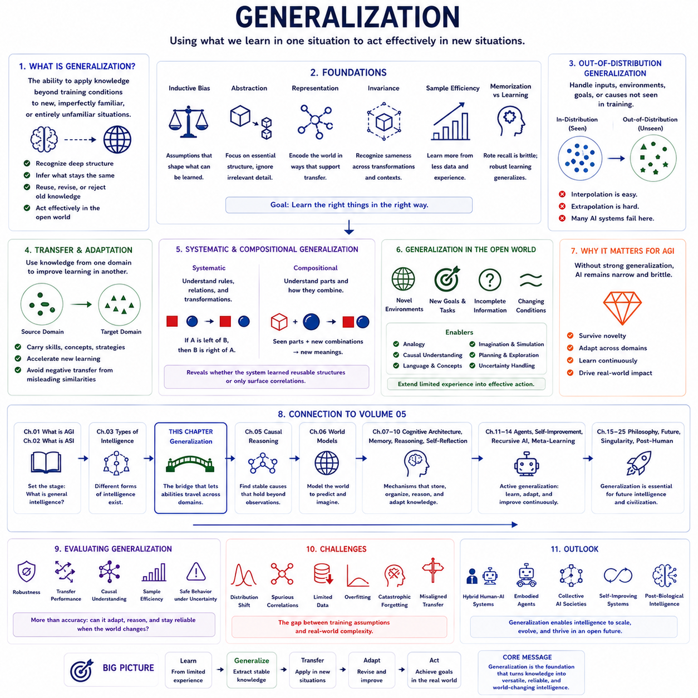
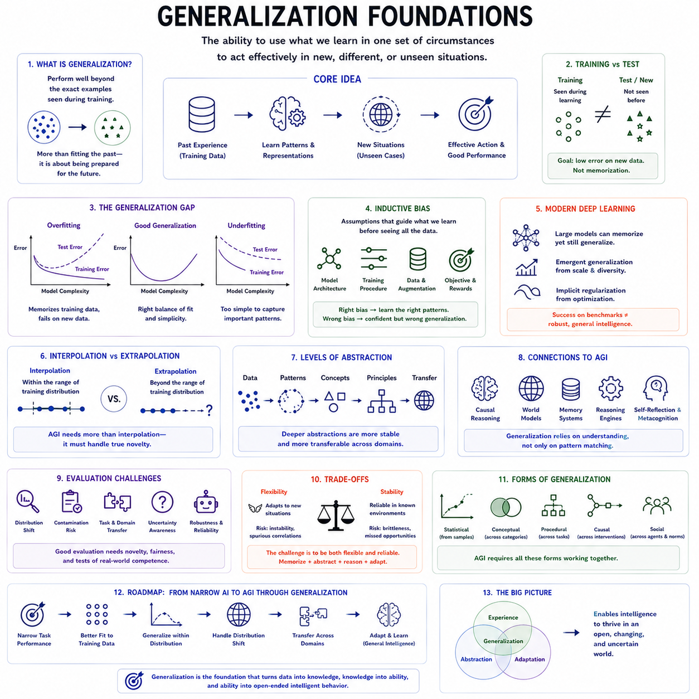
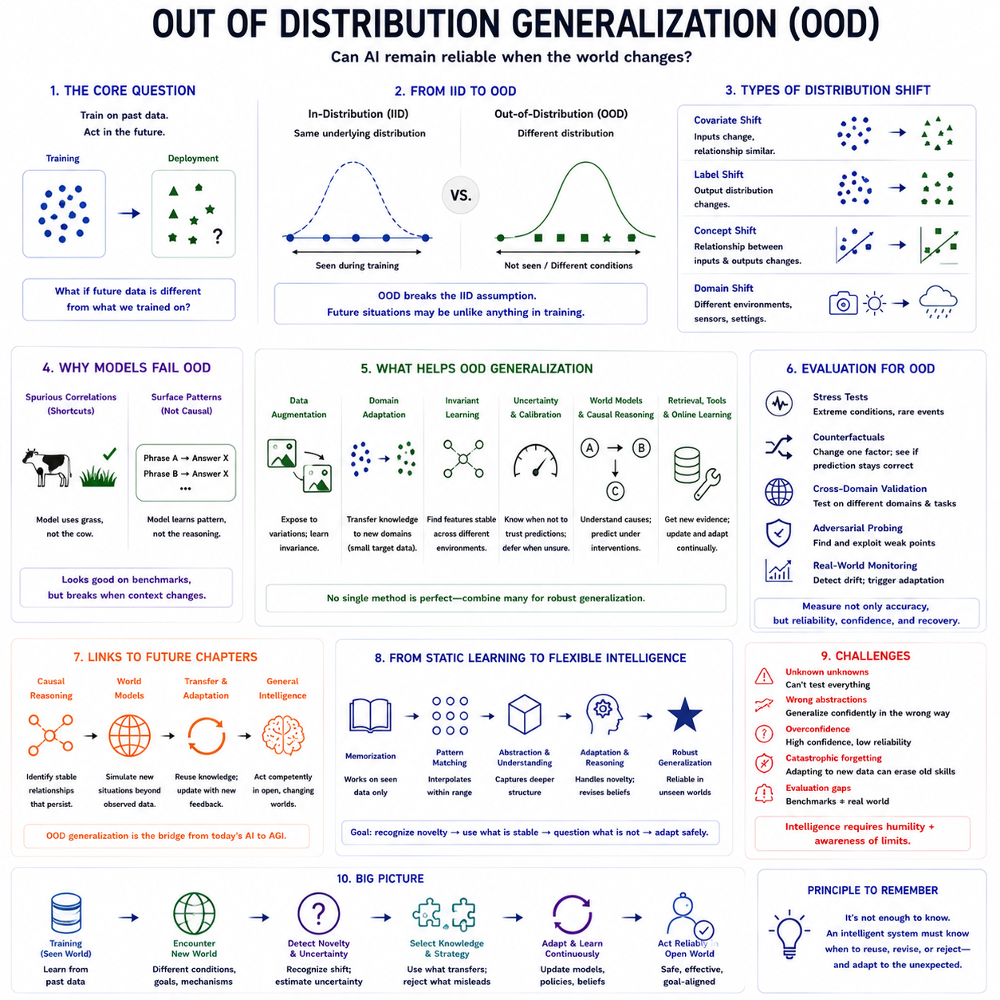
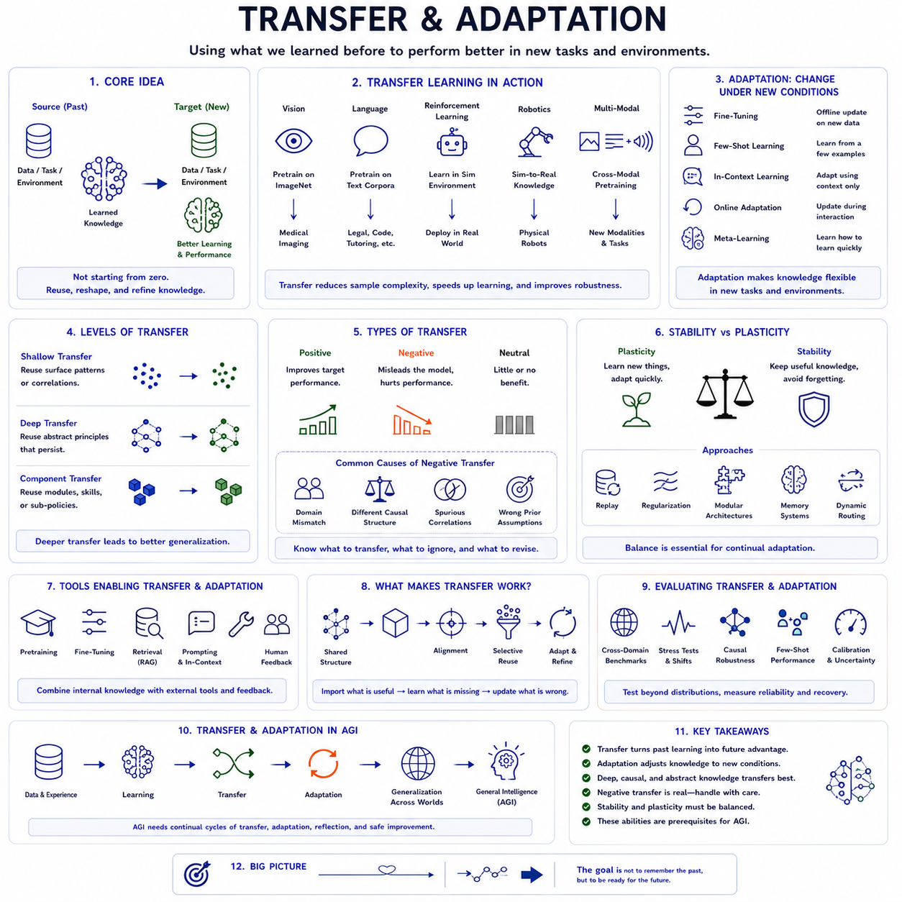
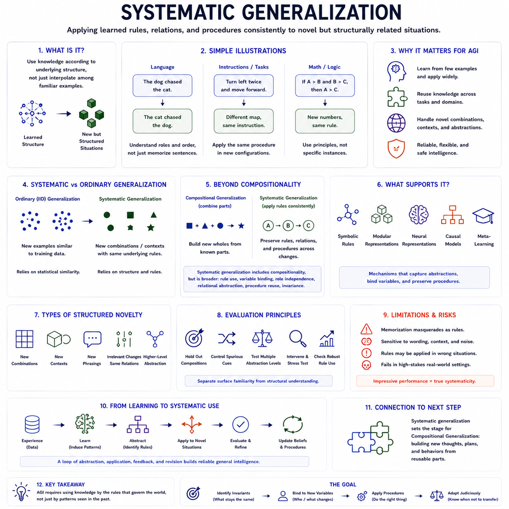
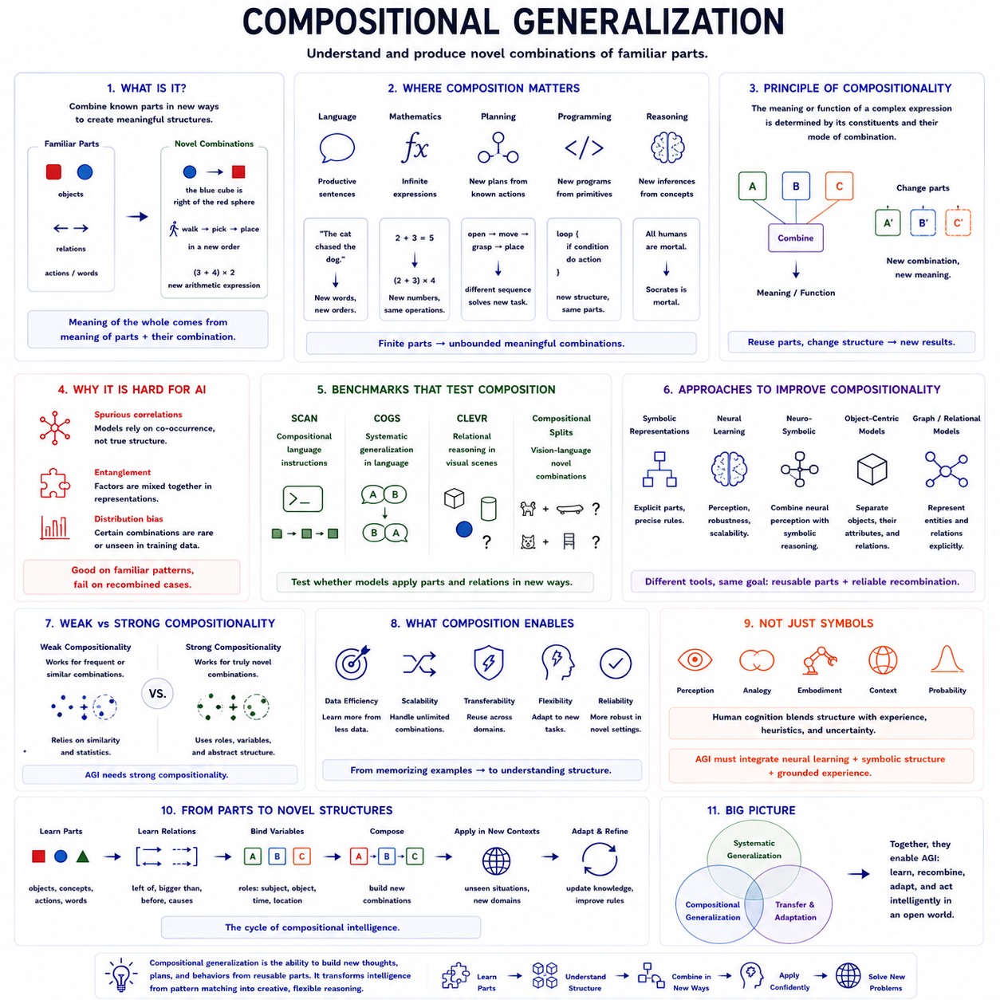
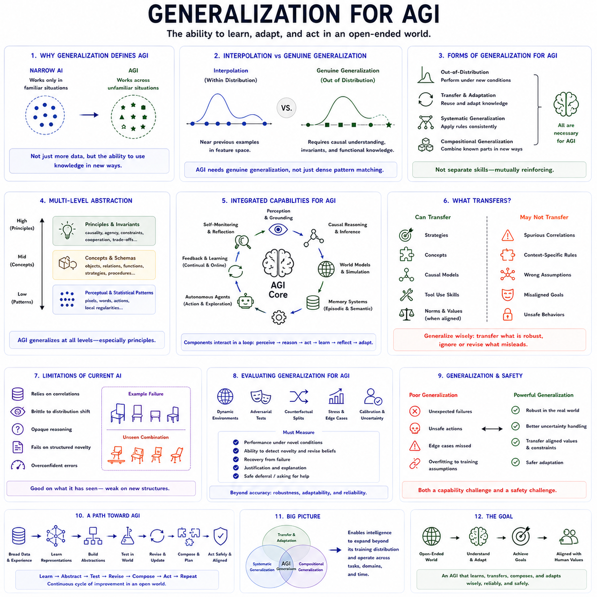

**Volume 00 05 AGI and ASI**

# Chapter 04. Generalization

### Chapter Overview

{width="7.268055555555556in" height="7.268055555555556in"}

Generalization is the capacity of an intelligent system to use what it has learned in one set of circumstances to act effectively in new, imperfectly familiar, or entirely unfamiliar situations. In narrow machine learning, generalization often means performing well on held-out samples drawn from the same distribution as the training data. For AGI, this definition is too small. A generally intelligent system must recognize deep structure beneath surface variation, infer what remains stable when context changes, and decide when old knowledge should be reused, revised, or rejected. Generalization is therefore not merely a statistical property of a model; it is a foundation of flexible cognition.

This chapter examines generalization as one of the central bridges between today's AI systems and artificial general intelligence. It begins with the foundations: inductive bias, abstraction, representation, invariance, sample efficiency, and the difference between memorization and robust learning. It then turns to out-of-distribution generalization, where systems face inputs, environments, goals, or causal conditions that differ from their training experience. This is where many impressive AI systems fail: they can interpolate within familiar patterns but collapse when the world changes in ways their data did not anticipate.

The chapter also explores transfer and adaptation, showing how knowledge from one domain can accelerate learning in another. Transfer is essential because an AGI cannot relearn the world from scratch for every new problem. It must carry skills, concepts, strategies, and models across tasks while avoiding harmful transfer from misleading similarities. Systematic generalization and compositional generalization deepen this discussion. A system that understands "the red cube is left of the blue sphere" should also understand "the blue sphere is left of the red cube," even if that exact sentence or scene was never encountered before. Such abilities reveal whether an AI has learned reusable structures or only surface correlations.

Ultimately, generalization for AGI concerns the ability to act competently in an open world. Human intelligence is powerful partly because it can extend limited experience into new cases through analogy, causal understanding, language, imagination, and planning. AGI will require similar, though not necessarily human-identical, mechanisms. Without strong generalization, an AI may be useful, impressive, and economically valuable, but it remains bounded by the assumptions of its training regime. With strong generalization, it begins to approach the adaptive breadth that makes intelligence truly general.

### Connection to Volume 05

This chapter builds directly on the opening chapters of Volume 05. After "What is AGI" and "What is ASI," generalization becomes one of the first technical tests of whether a system is merely specialized or genuinely general. The chapter on types of intelligence identifies different dimensions of cognitive ability, but generalization explains how those abilities travel across domains. A system may reason, perceive, speak, or plan within one environment; the question is whether it can carry those capacities into environments it has never explicitly been trained to master.

Generalization also prepares the reader for the chapters on causal reasoning and world models. Out-of-distribution performance cannot be reliably achieved through pattern matching alone. When conditions change, systems need some understanding of what causes what, what variables matter, and which relationships remain stable under intervention. Causal reasoning offers one route to this stability, while world models provide internal representations that allow an agent to simulate possibilities beyond immediate experience. Generalization is the reason these capabilities matter: they enable intelligence to move beyond stored examples and reason about unseen states of the world.

The later chapters on cognitive architectures, memory systems, reasoning engines, and self-reflection all extend the generalization problem into system design. Memory helps an agent retain experiences, but generalization determines whether those experiences become reusable knowledge. Reasoning engines manipulate abstractions, but their value depends on whether the abstractions apply beyond the original context. Self-reflection allows an AI to inspect its own failures and adapt its strategies, making generalization an active process rather than a passive outcome of training. Autonomous agents, self-improving AI, recursive self-improvement, and meta-learning all depend on this active form of generalization, because an agent that changes itself must know which lessons remain valid after the change.

The philosophical and long-term chapters also depend on the concept. Debates about consciousness, the Chinese Room argument, artificial consciousness, and mind uploading often turn on whether behavior reflects genuine understanding or only sophisticated symbol manipulation. Generalization provides one empirical lens on that question: can a system use concepts flexibly when surface cues are altered? Discussions of Gödel machines, universal constructors, transhumanism, hive minds, brain-computer interfaces, the technological singularity, and post-human civilization all presume increasingly capable systems operating in complex, evolving environments. In such futures, generalization is not a minor benchmark. It is the condition that allows intelligence to survive novelty, scale across domains, and become a driver of civilization-level transformation.

## 04.00 Generalization Foundations

{width="7.268055555555556in" height="7.268055555555556in"}

Generalization is the ability of a learning system to perform well beyond the exact examples on which it was trained. In narrow machine learning, this often means achieving low error on a held-out test set drawn from the same distribution as the training data. In the context of AGI, however, the idea is much broader: an intelligent system must use past experience, abstractions, and models of the world to act competently in new tasks, new environments, and new combinations of familiar elements. Generalization is therefore not a minor evaluation detail; it is one of the central bridges between pattern recognition and intelligence.

The classical foundation of generalization begins with the distinction between training performance and test performance. A model that memorizes its training examples may achieve very low training loss, yet fail on new cases. This failure is called overfitting. Conversely, a model that is too simple to capture important structure in the data may underfit. The practical goal is not to remember every observed instance, but to learn representations and rules that remain useful when the system encounters unseen examples. Statistical learning theory formalizes this problem in terms such as hypothesis spaces, inductive bias, sample complexity, and generalization error. A learner cannot generalize from finite data without assumptions; the assumptions built into the model, training procedure, data selection, and objective function shape what kinds of patterns it can discover.

Inductive bias is especially important for AGI. It refers to the preferences or constraints that make some explanations more likely than others before all possible evidence has been observed. In neural networks, inductive biases may come from architecture, such as convolutional networks favoring local spatial patterns, transformers favoring attention-based relational structure, or recurrent systems favoring temporal continuity. They may also come from training regimes, data augmentation, pretraining corpora, or reinforcement learning objectives. A system with no useful inductive bias would be unable to choose between infinitely many interpretations of the same data. A system with the wrong bias may generalize confidently but incorrectly.

Modern deep learning has complicated older intuitions about generalization. Very large models often contain enough parameters to memorize massive datasets, yet they can still generalize well in practice. This phenomenon has led to ideas such as implicit regularization, double descent, scaling laws, and representation learning. Optimization methods like stochastic gradient descent do not merely find any function that fits the data; they tend to find functions with particular structural properties. Large pretrained models also learn internal representations that can be reused across many tasks, suggesting that generalization can emerge from broad exposure to diverse data combined with suitable architectures and objectives. Still, success on benchmark distributions should not be mistaken for robust intelligence.

A crucial distinction is interpolation versus extrapolation. Interpolation occurs when a model handles new examples that lie within the range of patterns covered by its training distribution. Extrapolation requires competent behavior outside that range. Many impressive systems are strong interpolators: they can produce fluent language, classify images, or solve common programming tasks when the new case resembles many prior cases. AGI requires more than this. It must recognize when a situation is novel, infer which prior knowledge remains relevant, revise beliefs when assumptions fail, and sometimes construct new concepts. This is why the next section, out-of-distribution generalization, is a natural continuation of the foundations discussed here.

Generalization also depends on the level of abstraction. A model may generalize at the surface level, such as recognizing a dog in a new photograph, without understanding causal structure, goals, or physical constraints. Deeper generalization involves learning abstract relationships that remain stable across contexts. For example, understanding that containers can hold objects, that unsupported objects tend to fall, or that agents act according to beliefs and goals can support flexible reasoning across many domains. These abstractions connect generalization to later chapters on causal reasoning, world models, memory systems, and reasoning engines. An AGI-level system would need not only statistical associations but also reusable conceptual structures.

Evaluation is one of the hardest parts of generalization research. If a test set is too similar to training data, it may measure memorization or shallow pattern matching. If it is too different, failure may reflect missing knowledge rather than poor generalization. Benchmarks can also become contaminated when models are trained on data that includes or resembles the test material. For AGI, evaluation must consider systematic novelty, transfer to new domains, robustness under distribution shift, and the ability to ask for information when uncertainty is high. A model that knows when it does not know may be safer and more intelligent than one that always produces a confident answer.

There are also trade-offs. A highly flexible system may adapt quickly but become unstable or vulnerable to spurious correlations. A highly constrained system may be reliable in familiar settings but brittle in new ones. Memorization itself is not always bad; humans memorize facts, episodes, and skills, but combine them with abstraction and reasoning. The challenge is to build systems that can use memory without being trapped by it, learn patterns without confusing correlation for causation, and adapt without erasing prior knowledge. These issues lead naturally into transfer, adaptation, systematic generalization, and compositional generalization.

In AGI research, generalization is not a single capability but a layered family of capabilities. It includes statistical generalization from samples, conceptual generalization across categories, procedural generalization across tasks, causal generalization across interventions, and social generalization across agents and norms. Progress toward AGI will depend on integrating these forms rather than optimizing one benchmark metric. The foundation is simple to state---learn from the past in a way that remains useful in the future---but extremely difficult to realize in open-ended environments. The rest of this chapter examines increasingly demanding forms of generalization and why they are indispensable for artificial general intelligence.

## 04.01 Out of Distribution Generalization

{width="7.268055555555556in" height="7.268055555555556in"}

Generalization foundations describe how a system performs well beyond the exact examples it has seen. Out of distribution generalization, often abbreviated OOD generalization, asks a sharper question: can an AI system remain reliable when the data it encounters at deployment differs meaningfully from the data distribution used during training? This distinction is central to AGI because intelligence in open worlds cannot assume that future situations are merely more samples from the same statistical source. A household robot, scientific assistant, legal analyst, or autonomous planner will constantly face new contexts, rare events, changing goals, and combinations of factors that were not represented in its training set.

In standard machine learning, the training and test data are often assumed to be independent and identically distributed, or IID. Under the IID assumption, examples are drawn from the same underlying probability distribution, so success on a held-out test set is a reasonable estimate of future performance. OOD settings break this assumption. The shift may involve new environments, new populations, new sensors, new languages, new causal mechanisms, or new adversarial pressures. For example, a vision model trained mostly on clear daytime road images may fail in snow, at night, or under unusual camera artifacts. A language model trained on common patterns of human writing may produce confident but incorrect answers when asked about a newly emerging technical domain or an intentionally misleading prompt.

Several kinds of distribution shift are important to distinguish. Covariate shift occurs when the input distribution changes but the relationship between inputs and outputs remains largely stable, such as medical images from a new hospital scanner. Label shift occurs when the frequency of output classes changes, such as a disease becoming more common in a specific region. Concept shift is more severe: the meaning of the prediction target or the input-output relationship itself changes, as when legal categories are redefined or user behavior changes after a new policy. Domain shift refers broadly to changes between source and target environments. In AGI-relevant systems, multiple shifts may occur simultaneously, and the system may not receive a clear signal that a shift has happened.

OOD generalization is difficult because modern AI systems can learn shortcuts, also called spurious correlations. A model may appear competent because it relies on surface features that happen to correlate with correct answers in training data, rather than on robust structure. An image classifier may associate cows with green grass rather than animal shape; a text model may associate certain phrases with a conclusion without understanding the causal argument; a recommender may exploit historical bias rather than user preference. These shortcuts often survive ordinary benchmarks but break when background conditions change. For AGI, this is a serious limitation: broad intelligence requires not only pattern recognition, but the ability to separate stable, causally relevant features from accidental regularities.

OOD robustness is closely related to causal reasoning and world models, the topics that follow in this volume. A causal model can help an agent infer which relationships are likely to persist under intervention or environmental change. A world model can provide a structured representation of objects, agents, dynamics, constraints, and goals, allowing the system to simulate unfamiliar situations rather than merely interpolate between familiar examples. However, causal and world-model approaches are not automatic solutions. They require correct abstractions, reliable grounding, and mechanisms for updating beliefs when evidence contradicts prior assumptions. A wrong causal model can generalize confidently in the wrong direction.

Researchers use several strategies to improve OOD performance. Data augmentation exposes models to controlled variations, encouraging invariance to irrelevant changes. Domain adaptation attempts to transfer knowledge from a source distribution to a target distribution, sometimes using a small amount of target data. Invariant risk minimization and related methods try to identify features whose predictive relationship remains stable across multiple environments. Uncertainty estimation and calibration help systems recognize when they may be outside their competence. Retrieval, tool use, and online learning can allow a system to obtain fresh evidence instead of relying entirely on stored parameters. Yet each method has limitations. Augmentations may not cover the real shift, adaptation may fail under severe mismatch, invariance may be hard to identify, uncertainty estimates may be overconfident, and online learning may introduce instability or security risks.

Evaluation is also challenging. A model can perform well on one OOD benchmark while failing on another, because "out of distribution" is not a single property but a relation between training conditions and deployment conditions. Robust evaluation requires stress tests, counterfactual examples, temporal splits, cross-domain validation, adversarial probing, and real-world monitoring. For safety-critical AGI, it is not enough to measure average performance. We must understand failure modes, confidence behavior, recovery mechanisms, and whether the system can ask for help or defer action when uncertainty is high.

OOD generalization connects naturally to transfer and adaptation, the next section. Transfer asks how knowledge acquired in one context can be reused in another; adaptation asks how a system changes when the new context provides feedback. OOD generalization is the bridge between static learning and flexible intelligence. It demands that an AI system recognize novelty, preserve useful abstractions, reject misleading correlations, and remain corrigible under surprise. A future AGI will not be judged only by how much it knows, but by how gracefully it behaves when the world stops matching its training data.

## 04.02 Transfer and Adaptation

{width="7.268055555555556in" height="7.268055555555556in"}

Transfer and adaptation are central mechanisms by which an intelligent system turns past learning into future competence. In the previous section, out-of-distribution generalization emphasized the difficulty of performing well when test conditions differ from training conditions. Transfer and adaptation address the same gap from a more constructive angle: how can knowledge acquired in one task, domain, embodiment, language, or environment be reused and reshaped to improve performance in another?

Transfer learning occurs when representations, skills, or policies learned in a source setting improve learning or performance in a target setting. In modern machine learning, this is visible in large pretrained models whose general-purpose representations are fine-tuned for specialized applications. A vision model trained on broad image corpora may transfer edge, texture, object, and spatial features to medical imaging. A language model trained on diverse text may transfer grammar, factual associations, reasoning patterns, and discourse conventions to legal drafting, code generation, or tutoring. In reinforcement learning, a navigation policy learned in one simulated environment may provide a useful starting point for a related physical robot. The essential claim is that not all learning must begin from zero; prior structure can reduce sample complexity, accelerate convergence, and improve robustness.

Adaptation is closely related but emphasizes change under new conditions. A system adapts when it modifies its behavior, internal state, parameters, prompts, memory, or strategy in response to a new task or environment. Some adaptation is slow and offline, such as fine-tuning a model on a curated dataset. Some is fast and online, such as an agent updating its plan after observing that a tool fails or that a user's preference differs from expectation. Few-shot learning, in-context learning, continual learning, test-time adaptation, and meta-learning are all different forms of adaptation. For AGI, adaptation cannot be limited to a narrow training pipeline; it must operate across perception, reasoning, action, communication, and self-monitoring.

A key distinction is between shallow transfer and deep transfer. Shallow transfer reuses surface-level features or statistical regularities. It can be powerful, but it often fails when the target domain differs in causal structure rather than appearance. Deep transfer involves abstractions that remain useful across contexts: object permanence, agency, containment, quantity, hierarchy, goal-directed action, social intention, and causal intervention. A system that has learned "objects can block movement" in a game may transfer that principle to robotics more effectively than a system that only memorized pixel patterns. This connects transfer to the next sections on systematic and compositional generalization: the most valuable knowledge is often not a complete solution, but a reusable component that can be recombined with other components.

Transfer can be positive, negative, or neutral. Positive transfer improves target performance. Negative transfer occurs when prior knowledge misleads the system, causing inappropriate assumptions or brittle behavior. A medical model pretrained on adult populations may transfer poorly to pediatrics. A conversational agent trained on internet discourse may import unsafe social biases into professional settings. A robot trained in simulation may rely on physical simplifications that do not hold in the real world, a problem known as the sim-to-real gap. Neutral transfer offers little benefit because the source and target share too little relevant structure. Determining what should transfer, what should be ignored, and what should be revised is therefore as important as transfer itself.

Adaptation also raises the stability-plasticity dilemma. An intelligent system must remain plastic enough to learn from new evidence, yet stable enough to preserve useful knowledge and avoid catastrophic forgetting. Continual learning research addresses this through replay, regularization, modular architectures, parameter isolation, memory systems, and dynamic routing. Humans manage this partly through episodic memory, abstraction, sleep-related consolidation, and social correction. Future AGI systems may need analogous mechanisms: long-term memory for accumulated experience, working memory for current context, metacognitive monitoring for uncertainty, and safeguards that prevent harmful self-modification.

In foundation models, transfer and adaptation appear in several practical forms. Pretraining creates broad latent representations. Fine-tuning specializes behavior. Retrieval-augmented generation adapts responses by consulting external knowledge. Prompting and in-context learning allow temporary task adaptation without changing model weights. Tool use extends adaptation into the environment, allowing the system to compensate for internal limitations by invoking calculators, databases, simulators, or human feedback. Agentic systems combine these methods, adapting not only what they answer but also how they search, plan, verify, and act.

However, successful transfer is not equivalent to AGI. A model can transfer impressively across benchmarks while lacking grounded understanding, reliable causal reasoning, long-horizon autonomy, or self-correction. Transfer performance may reflect overlap between training and evaluation distributions rather than genuine abstraction. Adaptation may also be superficial, producing outputs that fit a prompt without robustly updating the system's beliefs or policies. For this reason, evaluating transfer requires carefully designed tasks that separate memorization from abstraction, correlation from causation, and local flexibility from general competence.

For AGI, transfer and adaptation are not optional enhancements; they are prerequisites. A generally intelligent system must enter unfamiliar situations, identify relevant similarities and differences, import prior knowledge selectively, learn what is missing, and revise its models as evidence accumulates. It must transfer across modalities, timescales, goals, cultures, tools, and physical conditions. It must also know when not to transfer. The path from narrow AI to AGI therefore depends not only on larger models or more data, but on architectures and training regimes that support reusable abstractions, continual adaptation, causal grounding, and reflective control over learning itself.

## 04.03 Systematic Generalization

{width="7.268055555555556in" height="7.268055555555556in"}

Systematic generalization is the ability of an intelligent system to apply learned rules, relations, and procedures in a consistent way to novel but structurally related situations. In the previous section, transfer and adaptation emphasized moving knowledge across tasks, domains, or distributions. Systematic generalization is more specific: it asks whether a system can use what it has learned according to the underlying structure of a problem, rather than merely interpolating among familiar examples. It is one of the central tests for whether an AI system is learning reusable principles or only exploiting statistical regularities in its training data.

A simple illustration comes from language. If a model understands the sentence "the dog chased the cat," it should also be able to understand "the cat chased the dog," even if that exact sentence was rare or absent in training. The meaning changes systematically with word order and grammatical roles. Similarly, if an agent learns to "turn left twice and move forward" in one environment, it should be able to execute the same instruction in a new configuration, provided the relevant concepts remain the same. The key issue is not novelty alone, but structured novelty: new combinations, new contexts, or new instances that preserve an underlying rule system.

This distinguishes systematic generalization from ordinary in-distribution generalization. A classifier that recognizes unseen photographs of cats may generalize well because the new examples resemble training examples in a high-dimensional statistical sense. By contrast, systematic generalization often requires applying an abstract rule outside the exact combinations observed during training. Benchmarks such as SCAN, COGS, and various relational reasoning tasks were designed to expose this distinction. Models may perform well on random train-test splits but fail when the test set deliberately withholds certain compositions, syntactic structures, or relational patterns. Such failures reveal that impressive performance can coexist with shallow pattern matching.

Systematic generalization is closely related to, but not identical with, compositional generalization, which is addressed in the next section. Compositional generalization focuses on combining known parts into new wholes: for example, understanding "jump twice after walking" after learning "jump," "walk," "twice," and "after." Systematic generalization is broader. It includes compositionality, but also covers rule-like consistency, variable binding, role-filler independence, relational abstraction, and the ability to preserve procedures across changes in surface form. A system can be compositional in a narrow domain yet still fail to apply a rule systematically across contexts.

Human cognition appears to rely heavily on systematicity. People can learn a rule from a small number of examples and apply it across many cases. If a child learns that "blicket" refers to a kind of object, the child can often infer plural forms, properties, and relations involving blickets without seeing every possible usage. In mathematics, once a learner understands that addition is commutative, the principle applies to indefinitely many pairs of numbers. In planning, if an agent understands that keys open matching locks, it can reason about new keys and locks it has never seen before. This flexibility is a major reason systematic generalization is viewed as a prerequisite for artificial general intelligence.

Modern deep learning systems show mixed results. Large neural networks can exhibit surprising systematic behavior when trained on sufficiently broad data, especially when language, code, and tool use provide many examples of abstract procedures. Transformers can learn patterns resembling algorithmic rules, and large language models can often solve tasks that require variable substitution, analogy, or stepwise reasoning. However, their success is uneven. They may generalize correctly in one phrasing and fail under a slight rewording; they may apply a rule in familiar semantic contexts but not in artificial or adversarial ones; and they may rely on memorized templates rather than stable abstractions. Scale improves coverage, but it does not automatically guarantee systematicity.

Several mechanisms may support systematic generalization. Symbolic systems achieve it by representing variables, rules, and operations explicitly. A rule such as "if X is larger than Y and Y is larger than Z, then X is larger than Z" can apply regardless of the specific objects involved. Neural systems, in contrast, typically represent knowledge as distributed patterns of activation, making variable binding and rule reuse less transparent. Hybrid approaches attempt to combine neural perception and learning with symbolic or program-like structures. Other research directions include modular networks, attention-based binding, object-centric representations, causal models, program induction, meta-learning, and training curricula designed to reward extrapolation rather than memorization.

Evaluation remains difficult. A benchmark may claim to test systematic generalization, but models can exploit unintended cues or distributional artifacts. Conversely, overly artificial benchmarks may underestimate useful forms of generalization that emerge in realistic environments. Good evaluation should separate surface familiarity from structural understanding, test multiple levels of abstraction, and include interventions that change irrelevant features while preserving relevant relations. It should also distinguish one-shot rule application from robust repeated use under noise, ambiguity, and competing goals.

The limitations of systematic generalization matter for safety and reliability. An AI system that performs well in standard tests may fail when a familiar rule must be applied in an unfamiliar operational context. A medical assistant might know a guideline but fail to apply it when patient descriptions are phrased differently. A robot might learn a manipulation routine but not recognize when the same causal structure appears with new objects. In high-stakes domains, such failures are not mere edge cases; they indicate that the system lacks a stable grasp of the procedure it appears to perform.

For AGI, systematic generalization is not optional. A generally intelligent system must reuse knowledge across tasks without requiring exhaustive retraining for every possible combination of circumstances. It must recognize that the same relation can appear under different names, sensory appearances, social contexts, or levels of abstraction. It must also know when a rule should not transfer, because systematicity without contextual judgment becomes rigidity. Thus, the goal is not blind rule application, but structured flexibility: the capacity to identify relevant invariants, bind them to new variables, and adapt procedures while preserving their functional logic. This idea leads naturally into compositional generalization, where the focus narrows to how intelligent systems build new thoughts, plans, and behaviors from reusable parts.

## 04.04 Compositional Generalization

{width="7.268055555555556in" height="7.268055555555556in"}

Compositional generalization is the ability to understand and produce novel combinations of familiar parts. If systematic generalization concerns whether a system applies learned rules consistently across related cases, compositional generalization focuses on how learned elements can be recombined into new structures. A human who understands "the red cube is left of the blue sphere" can usually understand "the blue cube is right of the red sphere," even if that exact sentence and scene have never been encountered. The meaning of the whole is built from the meanings of the parts and the relations among them.

This idea is central to language, mathematics, planning, program synthesis, and everyday reasoning. Natural language is productive because a finite vocabulary and grammar can generate an unbounded number of meaningful expressions. Arithmetic generalizes because operations such as addition, multiplication, and comparison can be applied to new numbers and nested expressions. Planning generalizes when an agent can combine known actions---open, move, grasp, place---into a new sequence that solves a new task. In each case, intelligence depends not merely on recognizing patterns seen during training, but on assembling reusable components into configurations that may be statistically rare or absent in the training distribution.

Compositional generalization is often discussed through the principle of compositionality: the meaning or function of a complex expression is determined by its constituents and their mode of combination. In AI systems, this principle may appear as symbolic variables and operators, structured representations, object-centric models, modular neural networks, graph-based reasoning, or latent spaces that disentangle factors such as object identity, attributes, relations, and actions. A model that treats "red," "cube," and "left of" as reusable factors can generalize more robustly than one that memorizes every observed red-cube configuration as an unrelated pattern.

Modern deep learning has achieved impressive forms of interpolation and transfer, yet compositional generalization remains difficult. Neural networks trained on large datasets may succeed on examples close to the training distribution while failing on deliberately recombined cases. A vision-language model may recognize "a dog riding a skateboard" and "a cat sitting on a chair," but struggle with an unusual combination such as "a chair riding a dog" unless its architecture, data, or training objective supports relational understanding rather than surface co-occurrence. Similarly, a language model can produce fluent text while still confusing nested logical relations, variable binding, or multi-step transformations when the required structure deviates from common patterns.

Benchmarks such as SCAN, COGS, CLEVR, and compositional splits in vision-language tasks were designed to expose this gap. They test whether systems can apply known words, rules, objects, or relations in new combinations. However, these benchmarks also reveal a limitation of evaluation itself: a system can sometimes solve a benchmark by exploiting artifacts in the data, while still lacking broad compositional competence. True compositional generalization is not simply high accuracy on a test set; it is the capacity to preserve meaning, roles, and constraints across changes in surface form, context, scale, and domain.

Several technical approaches attempt to improve compositionality. Symbolic AI represents entities and rules explicitly, which supports precise recombination but can be brittle in noisy, ambiguous environments. Neural approaches provide perception, robustness, and learning from data, but may entangle factors in ways that make systematic recombination unreliable. Neuro-symbolic systems aim to combine the strengths of both: neural modules perceive and encode the world, while symbolic or structured components support variable binding, rule application, and explicit reasoning. Other approaches include object-centric learning, attention mechanisms that separate entities and relations, modular architectures, program induction, graph neural networks, and training curricula that deliberately expose models to structured recombinations.

A crucial distinction is between weak and strong compositionality. Weak compositionality may allow a model to handle many familiar combinations through statistical similarity. Strong compositionality requires the model to apply abstract roles and operations independently of the specific fillers. For example, understanding "Alice gives Bob the book" requires tracking giver, recipient, and object; strong compositionality allows the same relational structure to apply when the names, objects, or modality change. This is closely related to variable binding, role-filler independence, and causal abstraction: the system must know what changes and what remains invariant.

For AGI, compositional generalization is not an optional enhancement; it is a core requirement. An artificial general intelligence must operate in open-ended environments where new tasks are built from known and unknown elements. It must combine concepts across domains, use tools in novel ways, infer rules from small samples, and transfer structured knowledge from one situation to another. Without compositionality, a system remains dependent on massive coverage of examples. With it, learning becomes more data-efficient, reasoning becomes more scalable, and adaptation becomes more reliable.

At the same time, compositional generalization should not be confused with purely symbolic manipulation. Human cognition blends compositional structure with analogy, perception, embodiment, context sensitivity, and probabilistic expectation. People do not always reason compositionally; they use heuristics, prototypes, and background knowledge. The challenge for AGI is therefore not to choose between neural pattern learning and symbolic composition, but to build systems in which reusable parts, relational structures, and grounded experience interact. This prepares the transition to the next section: generalization for AGI, where compositionality becomes part of a broader architecture for robust intelligence.

## 04.05 Generalization for AGI

{width="7.268055555555556in" height="7.268055555555556in"}

Generalization is not merely a desirable property of artificial general intelligence; it is one of its defining requirements. A system that performs well only on tasks drawn from the same distribution as its training data may be highly useful, but it remains narrow in an important sense. AGI implies the ability to operate across unfamiliar situations, reinterpret old knowledge in new contexts, form abstractions that transfer across domains, and recover when prior assumptions fail. The preceding sections described out-of-distribution generalization, transfer and adaptation, systematic generalization, and compositional generalization. For AGI, these are not separate capabilities but mutually reinforcing dimensions of a broader competence: the ability to keep learning and acting coherently in an open-ended world.

A central distinction is between interpolation and genuine generalization. Many modern systems succeed by learning dense statistical regularities over very large datasets. This can create impressive behavior, including fluency, pattern completion, and even limited forms of reasoning. However, AGI requires robustness when the relevant situation is not simply "near" previous examples in feature space. It must generalize by identifying causal structure, goals, constraints, affordances, and invariants. For example, an AGI-like system should not merely recognize chairs from many images; it should understand that chairs are artifacts designed to support sitting, that their shapes vary across cultures and materials, and that a flat stable object may function as a chair in an improvised setting. This kind of functional and causal abstraction is closer to human-like generalization than surface similarity alone.

Generalization for AGI also requires the integration of multiple forms of knowledge. Perceptual learning supports recognition and grounding. Causal reasoning supports prediction under intervention. World models support simulation and planning. Memory systems preserve episodic experience and reusable semantic structure. Reasoning engines manipulate symbolic, probabilistic, and learned representations. Autonomous agents test hypotheses through action and feedback. In isolation, each component may generalize only weakly; in combination, they can support more flexible adaptation. An agent that can ask "What changed?", "Which assumptions no longer hold?", and "What policy would work under this new constraint?" is closer to general intelligence than one that only maps inputs to outputs.

Another important issue is the level of abstraction at which generalization occurs. Low-level generalization detects recurring visual, linguistic, or motor patterns. Higher-level generalization transfers strategies, concepts, and problem-solving schemas. The most AGI-relevant forms occur at the level of principles: conservation, agency, causality, cooperation, competition, resource limits, uncertainty, and trade-offs. A system that learns a game should be able to transfer ideas such as exploration, opponent modeling, delayed reward, and strategic deception to other domains where those principles apply. This does not mean that all domains are the same; rather, AGI requires mechanisms for discovering which abstractions are portable and which are domain-specific.

The limitation of current approaches is not that they cannot generalize at all, but that their generalization is often brittle, opaque, and difficult to guarantee. Large models may solve novel problems while failing on simple variations, may produce plausible but false explanations, or may rely on correlations that disappear under distribution shift. Fine-tuning and prompting can improve performance, but they do not by themselves ensure stable understanding. Benchmarks are also imperfect: once tasks become part of the training ecosystem, success may reflect memorization, contamination, or shallow heuristics rather than durable competence. Evaluating generalization for AGI therefore requires dynamic, adversarial, and interactive environments in which the system must learn new rules, revise beliefs, and justify actions under uncertainty.

Generalization is also tied to safety. An AGI system deployed in the real world will face novel edge cases, conflicting objectives, incomplete information, and human values that are context-sensitive. Poor generalization can produce unsafe behavior even when training performance appears excellent. Conversely, powerful generalization can amplify risk if a system transfers capabilities to harmful domains or finds unexpected strategies for achieving misaligned goals. Thus, AGI research must study not only whether a system generalizes, but what it generalizes: goals, constraints, norms, causal models, tool-use strategies, or reward-seeking behavior.

A plausible path toward AGI involves combining data-driven learning with structured reasoning, grounded interaction, continual learning, and self-monitoring. The goal is not to replace statistical learning with symbolic rules, nor to assume that scale alone will solve generality. The more likely requirement is an architecture that can build representations at multiple levels, test them against experience, revise them when they fail, and compose them in new ways. Generalization for AGI is therefore both a technical benchmark and a conceptual lens: it asks whether intelligence is trapped inside its training distribution or capable of expanding beyond it while remaining coherent, reliable, and aligned.
