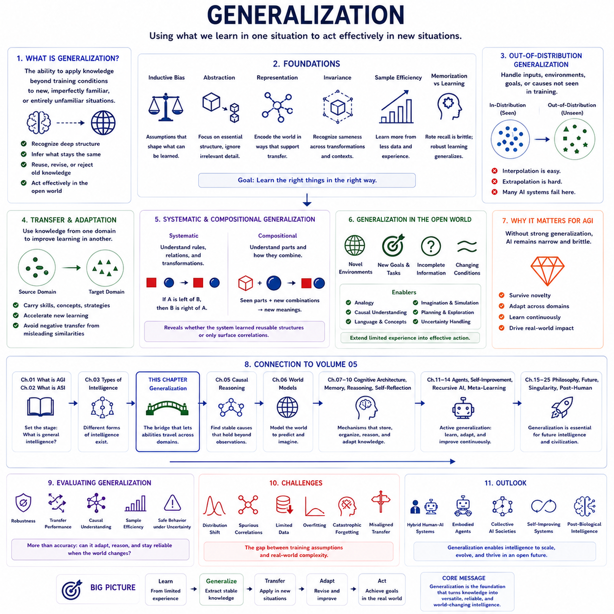
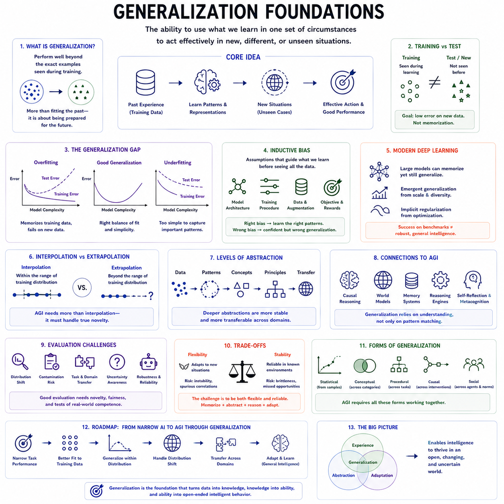
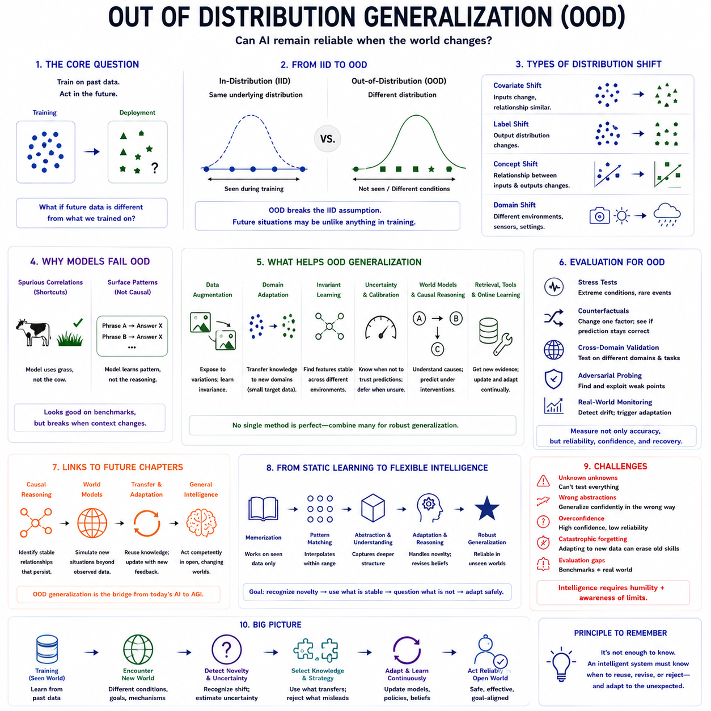
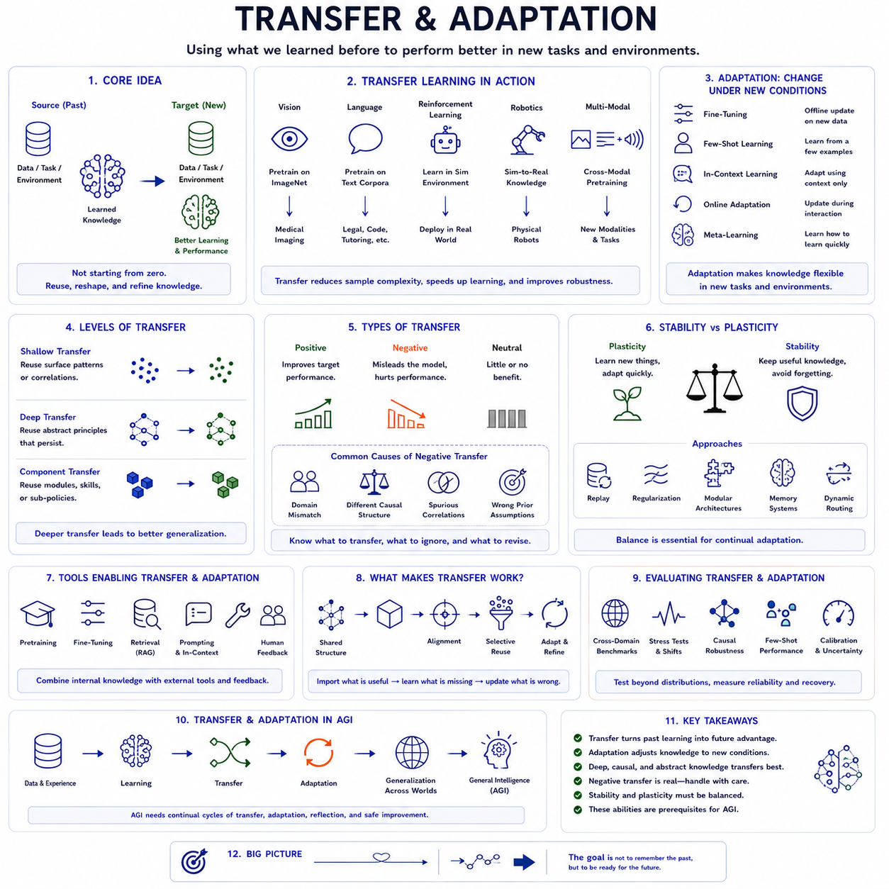
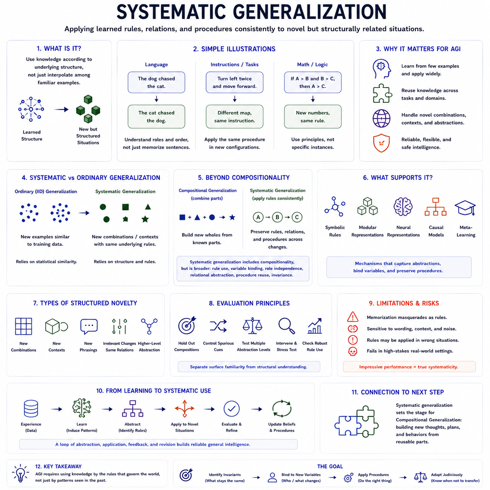
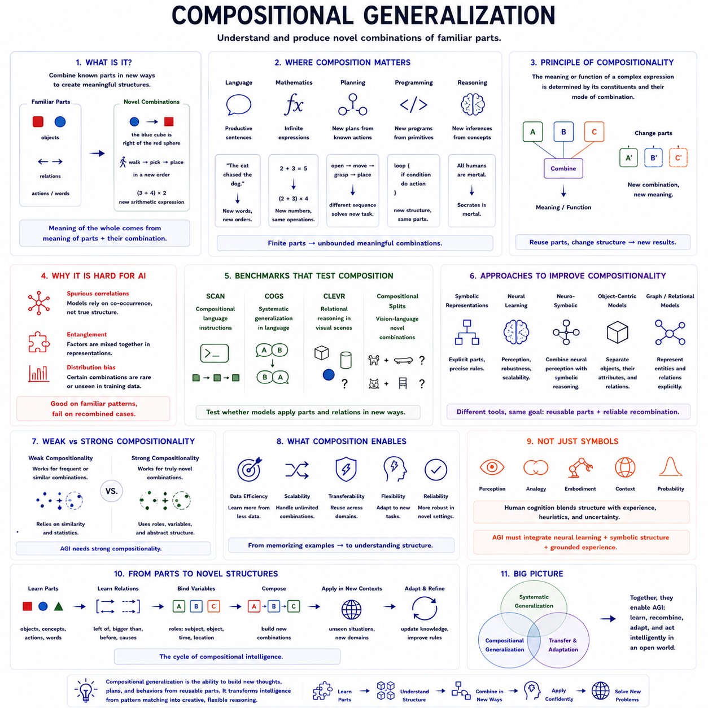
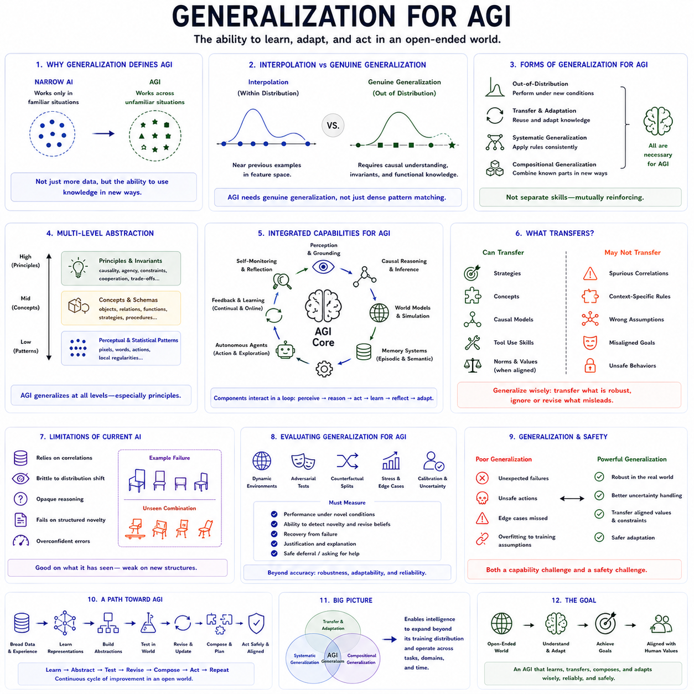

**Volume 00 05 AGI and ASI**

# Chapter 04. Generalization

### Chapter Overview

{width="7.268055555555556in" height="7.268055555555556in"}

일반화(Generalization)는 지능 시스템이 어떤 상황에서 학습한 것을 새롭거나, 완전히 익숙하지 않거나, 부분적으로만 익숙한 상황에서도 효과적으로 활용할 수 있는 능력이다. 좁은 의미의 머신러닝(machine learning)에서 일반화는 보통 훈련 데이터와 같은 분포에서 추출된 보류 표본(held-out samples)에 대해 좋은 성능을 내는 것을 뜻한다. 그러나 AGI의 관점에서는 이 정의가 너무 제한적이다. 일반 지능 시스템은 표면적 변화 아래에 있는 깊은 구조를 인식하고, 맥락이 바뀌어도 무엇이 안정적으로 유지되는지 추론하며, 기존 지식을 언제 재사용하고, 수정하고, 폐기해야 하는지 판단해야 한다. 따라서 일반화는 단순히 모델의 통계적 속성이 아니라 유연한 인지의 토대다.

이 장은 일반화를 오늘날의 AI 시스템과 인공 일반 지능(artificial general intelligence)을 잇는 핵심 다리 중 하나로 다룬다. 먼저 귀납적 편향(inductive bias), 추상화(abstraction), 표현(representation), 불변성(invariance), 표본 효율성(sample efficiency), 암기와 견고한 학습의 차이 같은 기초 개념에서 출발한다. 이어서 시스템이 훈련 경험과 다른 입력, 환경, 목표, 인과 조건을 마주하는 분포 밖 일반화(out-of-distribution generalization)를 살펴본다. 바로 이 지점에서 많은 인상적인 AI 시스템이 실패한다. 익숙한 패턴 안에서는 보간(interpolation)을 잘하지만, 데이터가 예상하지 못한 방식으로 세계가 변하면 무너질 수 있기 때문이다.

이 장은 또한 전이와 적응(transfer and adaptation)을 탐구하며, 한 영역의 지식이 다른 영역의 학습을 어떻게 가속할 수 있는지 보여준다. AGI는 새로운 문제마다 세계를 처음부터 다시 배울 수 없기 때문에 전이는 필수적이다. AGI는 기술, 개념, 전략, 모델을 과제들 사이에서 옮겨야 하며, 동시에 겉보기 유사성이 만들어내는 해로운 전이(harmful transfer)를 피해야 한다. 체계적 일반화(systematic generalization)와 구성적 일반화(compositional generalization)는 이 논의를 더 깊게 만든다. "빨간 정육면체가 파란 구의 왼쪽에 있다"를 이해하는 시스템이라면, 그 정확한 문장이나 장면을 한 번도 본 적이 없더라도 "파란 구가 빨간 정육면체의 왼쪽에 있다"도 이해할 수 있어야 한다. 이러한 능력은 AI가 재사용 가능한 구조를 학습했는지, 아니면 표면적 상관관계만 학습했는지를 드러낸다.

궁극적으로 AGI를 위한 일반화는 열린 세계(open world)에서 유능하게 행동하는 능력과 관련된다. 인간 지능이 강력한 이유 중 하나는 제한된 경험을 유추(analogy), 인과적 이해(causal understanding), 언어, 상상, 계획을 통해 새로운 사례로 확장할 수 있기 때문이다. AGI도 인간과 동일할 필요는 없지만 유사한 기능을 수행하는 메커니즘을 필요로 할 것이다. 강한 일반화가 없다면 AI는 유용하고 인상적이며 경제적으로 가치 있을 수는 있지만, 여전히 자신의 훈련 체제가 전제한 한계 안에 머문다. 강한 일반화가 있을 때 AI는 지능을 진정으로 일반적이게 만드는 적응적 폭에 가까워지기 시작한다.

### Connection to Volume 05

이 장은 Volume 05의 앞부분 장들과 직접 연결된다. "AGI란 무엇인가"와 "ASI란 무엇인가" 이후, 일반화는 어떤 시스템이 단지 전문화된 것인지 아니면 진정으로 일반적인 것인지를 판별하는 첫 번째 기술적 시험대 중 하나가 된다. 지능의 유형을 다루는 장은 인지 능력의 여러 차원을 식별하지만, 일반화는 그러한 능력이 영역을 넘어 어떻게 이동하는지를 설명한다. 어떤 시스템이 하나의 환경 안에서 추론하고, 지각하고, 말하고, 계획할 수는 있다. 핵심 질문은 그 능력을 명시적으로 훈련받지 않은 환경으로도 가져갈 수 있는가이다.

일반화는 또한 인과 추론(causal reasoning)과 세계 모델(world models)을 다루는 장을 준비시킨다. 분포 밖 성능은 패턴 매칭만으로는 안정적으로 달성될 수 없다. 조건이 바뀌면 시스템은 무엇이 무엇을 일으키는지, 어떤 변수가 중요한지, 개입(intervention) 아래에서도 어떤 관계가 안정적으로 유지되는지를 어느 정도 이해해야 한다. 인과 추론은 이러한 안정성으로 가는 한 경로를 제공하고, 세계 모델은 에이전트가 즉각적 경험을 넘어 가능한 상황을 시뮬레이션할 수 있게 하는 내부 표현을 제공한다. 일반화는 이러한 능력들이 왜 중요한지를 설명한다. 그것들은 지능이 저장된 예시를 넘어 보이지 않는 세계 상태에 대해 추론하게 만든다.

뒤이어 나오는 인지 아키텍처(cognitive architectures), 기억 시스템(memory systems), 추론 엔진(reasoning engines), 자기 성찰(self-reflection)에 관한 장들은 모두 일반화 문제를 시스템 설계의 차원으로 확장한다. 기억은 에이전트가 경험을 보존하도록 돕지만, 그 경험이 재사용 가능한 지식이 되는지는 일반화가 결정한다. 추론 엔진은 추상화를 조작하지만, 그 가치는 그 추상화가 원래의 맥락을 넘어 적용될 수 있는지에 달려 있다. 자기 성찰은 AI가 자신의 실패를 점검하고 전략을 조정하게 하며, 일반화를 훈련의 수동적 결과가 아니라 능동적 과정으로 만든다. 자율 에이전트(autonomous agents), 자기 개선 AI(self-improving AI), 재귀적 자기 개선(recursive self-improvement), 메타러닝(meta-learning)은 모두 이러한 능동적 일반화에 의존한다. 자기 자신을 변화시키는 에이전트는 변화 이후에도 어떤 교훈이 여전히 유효한지 알아야 하기 때문이다.

철학적 장들과 장기 미래를 다루는 장들도 이 개념에 의존한다. 의식(consciousness), 중국어 방 논증(Chinese Room argument), 인공 의식(artificial consciousness), 마인드 업로딩(mind uploading)에 관한 논쟁은 종종 행동이 진정한 이해를 반영하는지, 아니면 정교한 기호 조작에 불과한지를 둘러싸고 전개된다. 일반화는 이 질문을 살펴보는 하나의 경험적 렌즈를 제공한다. 표면 단서가 바뀌어도 시스템이 개념을 유연하게 사용할 수 있는가? 괴델 머신(Gödel machines), 보편 구성자(universal constructors), 트랜스휴머니즘(transhumanism), 하이브 마인드(hive minds), 뇌-컴퓨터 인터페이스(brain-computer interfaces), 기술적 특이점(technological singularity), 포스트휴먼 문명(post-human civilization)에 관한 논의는 모두 복잡하고 진화하는 환경에서 작동하는 점점 더 유능한 시스템을 전제로 한다. 그러한 미래에서 일반화는 사소한 벤치마크가 아니다. 그것은 지능이 새로움 속에서 살아남고, 영역을 넘어 확장되며, 문명적 규모의 변화를 이끄는 조건이다.

## 04.00 Generalization Foundations

{width="7.268055555555556in" height="7.268055555555556in"}

일반화(Generalization)는 학습 시스템이 훈련에 사용된 정확한 예시를 넘어선 상황에서도 잘 수행하는 능력이다. 좁은 의미의 기계학습에서는 이것이 보통 훈련 데이터와 같은 분포(distribution)에서 추출된 별도의 테스트 세트에서 낮은 오류를 달성하는 것을 뜻한다. 그러나 AGI의 맥락에서 이 개념은 훨씬 더 넓다. 지능적 시스템은 과거 경험, 추상화, 세계에 대한 모델을 사용하여 새로운 과제, 새로운 환경, 익숙한 요소들의 새로운 조합 속에서도 유능하게 행동해야 한다. 따라서 일반화는 단순한 평가상의 세부 항목이 아니라, 패턴 인식(pattern recognition)과 지능(intelligence)을 연결하는 핵심 다리 중 하나다.

일반화의 고전적 기초는 훈련 성능(training performance)과 테스트 성능(test performance)의 구분에서 시작된다. 훈련 예시를 암기한 모델은 훈련 손실(training loss)을 매우 낮게 만들 수 있지만, 새로운 사례에서는 실패할 수 있다. 이러한 실패를 과적합(overfitting)이라고 한다. 반대로 모델이 데이터의 중요한 구조를 포착하기에 너무 단순하면 과소적합(underfitting)이 발생한다. 실제 목표는 관찰된 모든 사례를 기억하는 것이 아니라, 시스템이 보지 못한 예시를 만났을 때도 유용하게 남아 있는 표현(representation)과 규칙을 학습하는 것이다. 통계적 학습 이론(statistical learning theory)은 이 문제를 가설 공간(hypothesis space), 귀납적 편향(inductive bias), 표본 복잡도(sample complexity), 일반화 오류(generalization error) 같은 용어로 정식화한다. 학습자는 유한한 데이터만으로는 어떤 가정도 없이 일반화할 수 없다. 모델, 훈련 절차, 데이터 선택, 목적 함수에 내장된 가정들이 어떤 종류의 패턴을 발견할 수 있는지를 형성한다.

귀납적 편향은 AGI에서 특히 중요하다. 이는 가능한 모든 증거가 관찰되기 전에 어떤 설명을 다른 설명보다 더 그럴듯하게 만드는 선호나 제약을 의미한다. 신경망에서는 귀납적 편향이 구조에서 올 수 있다. 예를 들어 합성곱 신경망(convolutional network)은 국소적인 공간 패턴을 선호하고, 트랜스포머(transformer)는 어텐션(attention)에 기반한 관계적 구조를 선호하며, 순환 시스템(recurrent system)은 시간적 연속성을 선호한다. 또한 훈련 방식, 데이터 증강(data augmentation), 사전학습 말뭉치(pretraining corpus), 강화학습 목적(reinforcement learning objective)에서도 올 수 있다. 유용한 귀납적 편향이 전혀 없는 시스템은 같은 데이터에 대한 무한히 많은 해석 중 하나를 선택할 수 없다. 반대로 잘못된 편향을 가진 시스템은 자신 있게, 그러나 틀리게 일반화할 수 있다.

현대 딥러닝(deep learning)은 일반화에 관한 오래된 직관을 복잡하게 만들었다. 매우 큰 모델은 방대한 데이터셋을 암기할 수 있을 만큼 많은 매개변수를 가지고 있지만, 실제로는 잘 일반화하는 경우가 많다. 이 현상은 암묵적 정규화(implicit regularization), 이중 하강(double descent), 스케일링 법칙(scaling laws), 표현 학습(representation learning) 같은 아이디어로 이어졌다. 확률적 경사 하강법(stochastic gradient descent)과 같은 최적화 방법은 데이터를 맞추는 아무 함수나 찾는 것이 아니라, 특정한 구조적 속성을 가진 함수를 찾는 경향이 있다. 대규모 사전학습 모델은 여러 과제에서 재사용될 수 있는 내부 표현도 학습한다. 이는 다양한 데이터에 대한 폭넓은 노출이 적절한 구조와 목적과 결합될 때 일반화가 나타날 수 있음을 시사한다. 그러나 벤치마크 분포에서의 성공을 견고한 지능으로 착각해서는 안 된다.

중요한 구분은 보간(interpolation)과 외삽(extrapolation)이다. 보간은 모델이 훈련 분포가 포괄하는 패턴 범위 안에 있는 새로운 예시를 처리할 때 발생한다. 외삽은 그 범위 밖에서도 유능하게 행동할 것을 요구한다. 많은 인상적인 시스템들은 강력한 보간기(interpolator)다. 새로운 사례가 많은 이전 사례와 비슷할 때, 유창한 언어를 생성하거나 이미지를 분류하거나 흔한 프로그래밍 과제를 풀 수 있다. AGI는 이 이상을 요구한다. 상황이 새롭다는 것을 인식하고, 어떤 기존 지식이 여전히 관련 있는지 추론하며, 가정이 실패할 때 믿음을 수정하고, 때로는 새로운 개념을 구성해야 한다. 이것이 다음 절인 분포 밖 일반화(out-of-distribution generalization)가 여기서 논의한 기초의 자연스러운 연장선이 되는 이유다.

일반화는 추상화(abstraction)의 수준에도 의존한다. 모델은 새로운 사진 속의 개를 인식하는 것처럼 표면 수준에서 일반화할 수 있지만, 인과 구조(causal structure), 목표, 물리적 제약을 이해하지 못할 수도 있다. 더 깊은 일반화는 맥락이 바뀌어도 안정적으로 유지되는 추상적 관계를 학습하는 것을 포함한다. 예를 들어 용기(container)가 물체를 담을 수 있다는 것, 지지되지 않는 물체는 떨어지는 경향이 있다는 것, 행위자(agent)는 믿음과 목표에 따라 행동한다는 것을 이해하면 여러 영역에서 유연한 추론을 지원할 수 있다. 이러한 추상화는 일반화를 이후 장의 인과 추론(causal reasoning), 세계 모델(world model), 기억 시스템(memory system), 추론 엔진(reasoning engine)과 연결한다. AGI 수준의 시스템은 통계적 연관성뿐 아니라 재사용 가능한 개념 구조도 필요로 한다.

평가는 일반화 연구에서 가장 어려운 부분 중 하나다. 테스트 세트가 훈련 데이터와 너무 비슷하면 암기나 얕은 패턴 맞추기를 측정할 수 있다. 너무 다르면 실패가 일반화 부족이 아니라 필요한 지식의 부재를 반영할 수도 있다. 모델이 테스트 자료를 포함하거나 그와 유사한 데이터로 훈련될 때 벤치마크 오염(benchmark contamination)도 발생할 수 있다. AGI의 경우 평가는 체계적인 새로움, 새로운 영역으로의 전이(transfer), 분포 변화(distribution shift)에서의 견고성, 불확실성이 높을 때 정보를 요청하는 능력을 고려해야 한다. 자신이 모른다는 것을 아는 모델은 항상 확신에 찬 답을 내놓는 모델보다 더 안전하고 더 지능적일 수 있다.

또한 일반화에는 여러 상충관계가 있다. 매우 유연한 시스템은 빠르게 적응할 수 있지만 불안정해지거나 허위 상관(spurious correlation)에 취약해질 수 있다. 강하게 제약된 시스템은 익숙한 환경에서는 신뢰할 수 있지만 새로운 환경에서는 취약할 수 있다. 암기 자체가 항상 나쁜 것은 아니다. 인간도 사실, 사건, 기술을 암기하지만, 그것들을 추상화와 추론과 결합한다. 과제는 기억을 사용하되 기억에 갇히지 않고, 패턴을 학습하되 상관관계를 인과관계로 혼동하지 않으며, 적응하되 이전 지식을 지우지 않는 시스템을 만드는 것이다. 이러한 문제들은 자연스럽게 전이, 적응, 체계적 일반화(systematic generalization), 구성적 일반화(compositional generalization)로 이어진다.

AGI 연구에서 일반화는 하나의 단일 능력이 아니라 층을 이룬 능력들의 집합이다. 여기에는 표본으로부터의 통계적 일반화(statistical generalization), 범주를 가로지르는 개념적 일반화(conceptual generalization), 과제를 가로지르는 절차적 일반화(procedural generalization), 개입을 가로지르는 인과적 일반화(causal generalization), 행위자와 규범을 가로지르는 사회적 일반화(social generalization)가 포함된다. AGI를 향한 진전은 하나의 벤치마크 지표를 최적화하는 것이 아니라 이러한 형태들을 통합하는 데 달려 있다. 기초 명제는 단순하다. 과거로부터 배워 미래에도 유용하게 남도록 하라. 그러나 열린 환경에서 이를 실현하는 것은 극도로 어렵다. 이 장의 나머지 부분은 점점 더 까다로운 일반화의 형태들과 그것들이 인공 일반 지능에 왜 필수적인지를 검토한다.

## 04.01 Out of Distribution Generalization

{width="7.268055555555556in" height="7.268055555555556in"}

일반화의 기초는 시스템이 자신이 본 정확한 예시를 넘어 얼마나 잘 수행하는지를 설명한다. 분포 밖 일반화(Out of Distribution generalization), 흔히 OOD 일반화라고 부르는 개념은 더 날카로운 질문을 던진다. AI 시스템이 배포 시점에 마주치는 데이터가 훈련에 사용된 데이터 분포와 의미 있게 달라질 때에도 신뢰성을 유지할 수 있는가? 이 구분은 AGI에 핵심적이다. 열린 세계에서의 지능은 미래 상황이 단지 같은 통계적 원천에서 나온 더 많은 표본일 것이라고 가정할 수 없기 때문이다. 가정용 로봇, 과학 보조자, 법률 분석가, 자율 계획 시스템은 훈련 집합에 표현되지 않았던 새로운 맥락, 드문 사건, 변화하는 목표, 요인들의 새로운 조합을 계속 마주하게 된다.

표준적인 기계학습에서는 훈련 데이터와 테스트 데이터가 독립적이고 동일한 분포(independent and identically distributed), 즉 IID라고 가정되는 경우가 많다. IID 가정에서는 예시들이 같은 기저 확률분포에서 추출되므로, 따로 보류한 테스트 집합에서의 성공이 미래 성능을 추정하는 합리적인 지표가 된다. OOD 환경은 이 가정을 깨뜨린다. 변화는 새로운 환경, 새로운 인구집단, 새로운 센서, 새로운 언어, 새로운 인과 메커니즘, 또는 새로운 적대적 압력의 형태로 나타날 수 있다. 예를 들어 주로 맑은 낮의 도로 이미지로 훈련된 비전 모델은 눈, 밤, 또는 특이한 카메라 아티팩트가 있는 상황에서 실패할 수 있다. 인간 글쓰기의 일반적 패턴으로 훈련된 언어 모델은 새롭게 등장한 기술 분야나 의도적으로 오도하는 프롬프트에 대해 질문받을 때 확신에 찬 잘못된 답을 생성할 수 있다.

구분해야 할 중요한 분포 변화에는 여러 종류가 있다. 공변량 변화(covariate shift)는 입력 분포가 바뀌지만 입력과 출력 사이의 관계는 대체로 안정적으로 유지되는 경우로, 예를 들어 새로운 병원 스캐너에서 나온 의료 영상이 이에 해당한다. 라벨 변화(label shift)는 출력 클래스의 빈도가 바뀌는 경우로, 특정 지역에서 어떤 질병이 더 흔해지는 상황을 들 수 있다. 개념 변화(concept shift)는 더 심각하다. 법적 범주가 재정의되거나 새로운 정책 이후 사용자 행동이 바뀌는 경우처럼, 예측 대상의 의미나 입력-출력 관계 자체가 변한다. 도메인 변화(domain shift)는 원천 환경과 목표 환경 사이의 변화를 넓게 가리킨다. AGI와 관련된 시스템에서는 여러 변화가 동시에 발생할 수 있으며, 시스템이 변화가 일어났다는 명확한 신호를 받지 못할 수도 있다.

OOD 일반화가 어려운 이유는 현대 AI 시스템이 지름길(shortcut), 즉 허위 상관(spurious correlation)을 학습할 수 있기 때문이다. 모델은 훈련 데이터에서 정답과 우연히 상관된 표면적 특징에 의존하기 때문에 유능해 보일 수 있지만, 실제로는 견고한 구조를 학습한 것이 아닐 수 있다. 이미지 분류기는 소의 형태가 아니라 푸른 풀을 소와 연관 지을 수 있고, 텍스트 모델은 인과적 논증을 이해하지 못한 채 특정 문구를 특정 결론과 연관 지을 수 있으며, 추천 시스템은 사용자 선호가 아니라 역사적 편향을 이용할 수 있다. 이러한 지름길은 보통의 벤치마크에서는 살아남지만 배경 조건이 바뀌면 무너지는 경우가 많다. AGI에 이것은 심각한 한계다. 폭넓은 지능에는 패턴 인식뿐 아니라 안정적이고 인과적으로 관련 있는 특징을 우연한 규칙성과 구별하는 능력이 필요하기 때문이다.

OOD 강건성(robustness)은 이 책의 다음 주제인 인과 추론(causal reasoning) 및 세계 모델(world model)과 밀접하게 관련되어 있다. 인과 모델은 에이전트가 개입이나 환경 변화 속에서도 어떤 관계가 지속될 가능성이 높은지 추론하는 데 도움을 줄 수 있다. 세계 모델은 객체, 행위자, 동역학, 제약, 목표에 대한 구조화된 표현을 제공하여 시스템이 익숙한 예시 사이를 단순히 보간(interpolation)하는 대신 낯선 상황을 시뮬레이션할 수 있게 한다. 그러나 인과적 접근과 세계 모델 접근이 자동적인 해결책은 아니다. 이들은 올바른 추상화, 신뢰할 수 있는 접지(grounding), 그리고 증거가 기존 가정과 충돌할 때 믿음을 갱신하는 메커니즘을 필요로 한다. 잘못된 인과 모델은 잘못된 방향으로 확신에 찬 일반화를 수행할 수 있다.

연구자들은 OOD 성능을 개선하기 위해 여러 전략을 사용한다. 데이터 증강(data augmentation)은 모델을 통제된 변형에 노출시켜 관련 없는 변화에 대해 불변성(invariance)을 갖도록 유도한다. 도메인 적응(domain adaptation)은 원천 분포의 지식을 목표 분포로 이전하려 하며, 때로는 소량의 목표 데이터를 사용한다. 불변 위험 최소화(invariant risk minimization)와 관련 방법들은 여러 환경에서 예측 관계가 안정적으로 유지되는 특징을 식별하려 한다. 불확실성 추정(uncertainty estimation)과 보정(calibration)은 시스템이 자신의 능력 범위 밖에 있을 수 있음을 인식하도록 돕는다. 검색, 도구 사용, 온라인 학습은 시스템이 저장된 매개변수에만 의존하지 않고 새로운 증거를 얻을 수 있게 한다. 하지만 각 방법에는 한계가 있다. 증강은 실제 변화를 포괄하지 못할 수 있고, 적응은 심한 불일치에서 실패할 수 있으며, 불변성은 식별하기 어려울 수 있고, 불확실성 추정은 과신할 수 있으며, 온라인 학습은 불안정성이나 보안 위험을 도입할 수 있다.

평가 또한 어렵다. 어떤 모델이 하나의 OOD 벤치마크에서는 잘 수행하면서 다른 벤치마크에서는 실패할 수 있다. "분포 밖"이라는 것은 단일한 속성이 아니라 훈련 조건과 배포 조건 사이의 관계이기 때문이다. 강건한 평가에는 스트레스 테스트, 반사실적 예시(counterfactual example), 시간 분할(temporal split), 교차 도메인 검증, 적대적 탐색, 실제 환경 모니터링이 필요하다. 안전이 중요한 AGI에서는 평균 성능을 측정하는 것만으로 충분하지 않다. 우리는 실패 양상, 신뢰도 행동, 복구 메커니즘, 그리고 불확실성이 높을 때 시스템이 도움을 요청하거나 행동을 유보할 수 있는지를 이해해야 한다.

OOD 일반화는 다음 절인 전이와 적응(transfer and adaptation)으로 자연스럽게 이어진다. 전이는 한 맥락에서 획득한 지식이 다른 맥락에서 어떻게 재사용될 수 있는지를 묻고, 적응은 새로운 맥락이 피드백을 제공할 때 시스템이 어떻게 변화하는지를 묻는다. OOD 일반화는 정적인 학습과 유연한 지능 사이의 다리다. 이것은 AI 시스템이 새로움을 인식하고, 유용한 추상화를 보존하며, 오도하는 상관관계를 거부하고, 예상 밖의 상황에서도 수정 가능성(corrigibility)을 유지할 것을 요구한다. 미래의 AGI는 얼마나 많은 것을 알고 있는지만이 아니라, 세계가 자신의 훈련 데이터와 더 이상 일치하지 않을 때 얼마나 우아하게 행동하는지로 평가될 것이다.

## 04.02 Transfer and Adaptation

{width="7.268055555555556in" height="7.268055555555556in"}

전이와 적응(Transfer and Adaptation)은 지능적 시스템이 과거의 학습을 미래의 역량으로 바꾸는 핵심 메커니즘이다. 이전 절에서 분포 밖 일반화(out-of-distribution generalization)는 시험 조건이 학습 조건과 다를 때 좋은 성능을 내는 어려움을 강조했다. 전이와 적응은 같은 간극을 더 구성적인 관점에서 다룬다. 즉 한 과제, 도메인, 신체화된 환경, 언어, 또는 환경에서 얻은 지식을 어떻게 다른 상황에서 재사용하고 재구성하여 성능을 향상시킬 수 있는가의 문제다.

전이 학습(transfer learning)은 원천 설정(source setting)에서 학습한 표현, 기술, 정책이 목표 설정(target setting)의 학습이나 수행을 향상시킬 때 발생한다. 현대 기계학습에서는 범용 표현을 가진 대규모 사전학습 모델(pretrained model)을 특정 응용에 맞게 미세조정(fine-tuning)하는 방식에서 이를 볼 수 있다. 광범위한 이미지 말뭉치에서 학습한 비전 모델은 경계, 질감, 객체, 공간 특징을 의료 영상으로 전이할 수 있다. 다양한 텍스트로 학습한 언어 모델은 문법, 사실적 연관, 추론 패턴, 담화 관습을 법률 문서 작성, 코드 생성, 교육 보조로 전이할 수 있다. 강화학습(reinforcement learning)에서는 하나의 시뮬레이션 환경에서 학습한 내비게이션 정책이 관련된 물리적 로봇의 유용한 출발점이 될 수 있다. 핵심 주장은 모든 학습이 처음부터 시작될 필요는 없다는 것이다. 선행 구조는 표본 복잡도(sample complexity)를 줄이고, 수렴을 가속하며, 강건성(robustness)을 향상시킬 수 있다.

적응(adaptation)은 이와 밀접하게 관련되지만 새로운 조건 아래에서의 변화를 더 강조한다. 시스템은 새로운 과제나 환경에 대응하여 자신의 행동, 내부 상태, 매개변수, 프롬프트, 메모리, 전략을 수정할 때 적응한다. 어떤 적응은 선별된 데이터셋으로 모델을 미세조정하는 것처럼 느리고 오프라인으로 이루어진다. 어떤 적응은 도구가 실패한다는 사실이나 사용자의 선호가 예상과 다르다는 사실을 관찰한 뒤 에이전트가 계획을 갱신하는 것처럼 빠르고 온라인으로 이루어진다. 소수샷 학습(few-shot learning), 문맥 내 학습(in-context learning), 지속 학습(continual learning), 시험 시점 적응(test-time adaptation), 메타학습(meta-learning)은 모두 서로 다른 형태의 적응이다. AGI에서 적응은 좁은 학습 파이프라인에 제한될 수 없으며, 지각, 추론, 행동, 의사소통, 자기 모니터링 전반에서 작동해야 한다.

중요한 구분은 얕은 전이(shallow transfer)와 깊은 전이(deep transfer) 사이에 있다. 얕은 전이는 표면적 특징이나 통계적 규칙성을 재사용한다. 이는 강력할 수 있지만, 목표 도메인이 외형이 아니라 인과 구조에서 다를 때 자주 실패한다. 깊은 전이는 맥락을 넘어 유용하게 유지되는 추상화를 포함한다. 예를 들어 객체 영속성(object permanence), 행위자성(agency), 포함 관계(containment), 수량(quantity), 계층(hierarchy), 목표지향적 행동(goal-directed action), 사회적 의도(social intention), 인과적 개입(causal intervention) 등이 있다. 게임에서 "객체는 움직임을 막을 수 있다"는 원리를 학습한 시스템은 단순히 픽셀 패턴을 암기한 시스템보다 그 원리를 로보틱스에 더 효과적으로 전이할 수 있다. 이는 다음 절들인 체계적 일반화(systematic generalization)와 조합적 일반화(compositional generalization)로 자연스럽게 이어진다. 가장 가치 있는 지식은 완성된 해답이 아니라 다른 구성요소와 재조합될 수 있는 재사용 가능한 구성요소인 경우가 많기 때문이다.

전이는 긍정적일 수도, 부정적일 수도, 중립적일 수도 있다. 긍정적 전이(positive transfer)는 목표 성능을 향상시킨다. 부정적 전이(negative transfer)는 선행 지식이 시스템을 오도하여 부적절한 가정이나 취약한 행동을 유발할 때 발생한다. 성인 인구를 대상으로 사전학습된 의료 모델은 소아과 영역으로 잘 전이되지 않을 수 있다. 인터넷 담화로 학습한 대화형 에이전트는 전문적 환경에 안전하지 않은 사회적 편향을 가져올 수 있다. 시뮬레이션에서 학습한 로봇은 실제 세계에서는 성립하지 않는 물리적 단순화에 의존할 수 있는데, 이를 시뮬레이션-현실 간극(sim-to-real gap)이라고 한다. 중립적 전이는 원천과 목표가 관련 구조를 너무 적게 공유하여 거의 이득을 제공하지 못하는 경우다. 따라서 무엇을 전이해야 하는지, 무엇을 무시해야 하는지, 무엇을 수정해야 하는지를 판단하는 것은 전이 자체만큼이나 중요하다.

적응은 또한 안정성-가소성 딜레마(stability-plasticity dilemma)를 제기한다. 지능적 시스템은 새로운 증거에서 배울 만큼 충분히 가소적이어야 하지만, 유용한 지식을 보존하고 치명적 망각(catastrophic forgetting)을 피할 만큼 안정적이어야 한다. 지속 학습 연구는 재현(replay), 정규화(regularization), 모듈형 아키텍처(modular architecture), 매개변수 분리(parameter isolation), 메모리 시스템, 동적 라우팅(dynamic routing)을 통해 이 문제를 다룬다. 인간은 이를 부분적으로 일화 기억(episodic memory), 추상화, 수면 관련 공고화(consolidation), 사회적 교정을 통해 관리한다. 미래의 AGI 시스템에도 이와 유사한 메커니즘이 필요할 수 있다. 축적된 경험을 위한 장기 기억, 현재 맥락을 위한 작업 기억, 불확실성을 위한 메타인지적 모니터링, 해로운 자기수정을 막는 안전장치가 그 예다.

기반 모델(foundation model)에서 전이와 적응은 여러 실용적 형태로 나타난다. 사전학습은 넓은 잠재 표현(latent representation)을 만든다. 미세조정은 행동을 전문화한다. 검색 증강 생성(retrieval-augmented generation)은 외부 지식을 참조하여 응답을 적응시킨다. 프롬프팅(prompting)과 문맥 내 학습은 모델 가중치를 바꾸지 않고 일시적인 과제 적응을 가능하게 한다. 도구 사용(tool use)은 적응을 환경으로 확장하여 시스템이 계산기, 데이터베이스, 시뮬레이터, 인간 피드백을 호출함으로써 내부 한계를 보완하게 한다. 에이전트형 시스템(agentic system)은 이러한 방법들을 결합하여 무엇을 답할지만이 아니라 어떻게 탐색하고, 계획하고, 검증하고, 행동할지를 적응시킨다.

그러나 성공적인 전이가 곧 AGI를 의미하지는 않는다. 모델은 벤치마크 전반에서 인상적으로 전이할 수 있으면서도, grounded understanding(기반 이해), 신뢰할 수 있는 인과 추론, 장기적 자율성, 자기교정을 결여할 수 있다. 전이 성능은 진정한 추상화가 아니라 학습 분포와 평가 분포 사이의 중첩을 반영할 수도 있다. 적응 역시 피상적일 수 있으며, 시스템의 믿음이나 정책을 강건하게 갱신하지 않고 프롬프트에 맞는 출력만 만들어낼 수 있다. 이런 이유로 전이를 평가하려면 암기와 추상화, 상관관계와 인과관계, 국소적 유연성과 일반 역량을 분리하는 세심하게 설계된 과제가 필요하다.

AGI에서 전이와 적응은 선택적 향상 기능이 아니라 필수 조건이다. 일반 지능 시스템은 익숙하지 않은 상황에 들어가 관련된 유사성과 차이를 식별하고, 선행 지식을 선택적으로 가져오며, 무엇이 빠져 있는지 학습하고, 증거가 축적됨에 따라 자신의 모델을 수정해야 한다. 또한 양식(modality), 시간 규모, 목표, 문화, 도구, 물리적 조건을 가로질러 전이해야 한다. 동시에 언제 전이하지 말아야 하는지도 알아야 한다. 따라서 좁은 AI에서 AGI로 가는 길은 더 큰 모델이나 더 많은 데이터에만 달려 있지 않다. 재사용 가능한 추상화, 지속적 적응, 인과적 기반화(causal grounding), 그리고 학습 자체에 대한 반성적 통제(reflective control)를 지원하는 아키텍처와 학습 체제에 달려 있다.

## 04.03 Systematic Generalization

{width="7.268055555555556in" height="7.268055555555556in"}

체계적 일반화(Systematic generalization)는 지능 시스템이 학습한 규칙, 관계, 절차를 새롭지만 구조적으로 관련된 상황에 일관되게 적용하는 능력이다. 앞 절에서 전이와 적응(transfer and adaptation)은 과제, 도메인, 분포를 가로질러 지식을 옮기는 문제를 강조했다. 체계적 일반화는 더 구체적이다. 이는 시스템이 익숙한 사례들 사이를 단순히 보간(interpolation)하는 것이 아니라, 문제의 기저 구조에 따라 배운 것을 사용할 수 있는지를 묻는다. 따라서 AI 시스템이 재사용 가능한 원리를 학습하고 있는지, 아니면 훈련 데이터의 통계적 규칙성만 활용하고 있는지를 가르는 핵심 시험대 중 하나다.

간단한 예는 언어에서 찾을 수 있다. 모델이 "the dog chased the cat"이라는 문장을 이해한다면, 훈련 중에 "the cat chased the dog"이라는 정확한 문장이 드물었거나 없었더라도 이를 이해할 수 있어야 한다. 의미는 어순과 문법적 역할에 따라 체계적으로 달라진다. 마찬가지로 에이전트가 어떤 환경에서 "왼쪽으로 두 번 돌고 앞으로 이동하라"는 명령을 학습했다면, 관련 개념이 동일하게 유지되는 한 새로운 배치에서도 같은 명령을 수행할 수 있어야 한다. 핵심은 단순한 새로움이 아니라 구조화된 새로움이다. 즉 기저의 규칙 체계를 보존하는 새로운 조합, 새로운 맥락, 새로운 사례가 문제다.

이 점은 체계적 일반화를 일반적인 동일분포 내 일반화(in-distribution generalization)와 구별한다. 고양이 사진 분류기가 보지 못한 고양이 사진을 인식할 수 있다면, 새 예시가 고차원 통계적 의미에서 훈련 예시와 유사하기 때문에 잘 일반화할 수 있다. 반면 체계적 일반화는 종종 훈련에서 관찰된 정확한 조합을 벗어나 추상적 규칙을 적용해야 한다. SCAN, COGS, 여러 관계 추론(relational reasoning) 과제와 같은 벤치마크는 이 구분을 드러내기 위해 설계되었다. 모델은 무작위 훈련-시험 분할에서는 좋은 성능을 보일 수 있지만, 시험 집합에서 특정 합성, 구문 구조, 관계 패턴을 의도적으로 제외하면 실패할 수 있다. 이러한 실패는 인상적인 성능이 얕은 패턴 매칭과 공존할 수 있음을 보여준다.

체계적 일반화는 다음 절에서 다룰 구성적 일반화(compositional generalization)와 밀접하게 관련되어 있지만 동일하지는 않다. 구성적 일반화는 알려진 부분들을 결합해 새로운 전체를 만드는 데 초점을 둔다. 예를 들어 "jump," "walk," "twice," "after"를 학습한 뒤 "jump twice after walking"을 이해하는 것이다. 체계적 일반화는 더 넓다. 여기에는 구성성이 포함되지만, 규칙과 같은 일관성, 변수 바인딩(variable binding), 역할-충전 요소 독립성(role-filler independence), 관계 추상화(relational abstraction), 표면 형태가 바뀌어도 절차를 보존하는 능력도 포함된다. 어떤 시스템은 좁은 도메인에서는 구성적일 수 있지만, 여전히 맥락을 가로질러 규칙을 체계적으로 적용하지 못할 수 있다.

인간 인지는 체계성(systematicity)에 크게 의존하는 것으로 보인다. 사람은 적은 수의 예시에서 규칙을 배우고 이를 많은 사례에 적용할 수 있다. 아이가 "blicket"이 어떤 종류의 물체를 가리킨다는 것을 배우면, 가능한 모든 사용 사례를 보지 않고도 blicket의 복수형, 속성, 관계를 상당 부분 추론할 수 있다. 수학에서는 학습자가 덧셈의 교환법칙을 이해하면, 그 원리는 무한히 많은 수의 쌍에 적용된다. 계획 수립에서는 에이전트가 열쇠가 대응하는 자물쇠를 연다는 것을 이해하면, 이전에 본 적 없는 새로운 열쇠와 자물쇠에 대해서도 추론할 수 있다. 이러한 유연성은 체계적 일반화가 인공 일반 지능(AGI)의 전제 조건으로 여겨지는 중요한 이유다.

현대 딥러닝 시스템은 엇갈린 결과를 보인다. 대규모 신경망은 충분히 폭넓은 데이터로 훈련될 때 놀라운 체계적 행동을 보일 수 있으며, 특히 언어, 코드, 도구 사용이 추상적 절차의 많은 예시를 제공할 때 그렇다. 트랜스포머(Transformers)는 알고리즘적 규칙과 유사한 패턴을 학습할 수 있고, 대규모 언어 모델은 변수 치환, 유추, 단계적 추론이 필요한 과제를 종종 해결한다. 그러나 성공은 고르지 않다. 한 표현에서는 올바르게 일반화하지만 약간의 재표현에서는 실패할 수 있고, 익숙한 의미 맥락에서는 규칙을 적용하지만 인공적이거나 적대적인 맥락에서는 적용하지 못할 수 있으며, 안정적인 추상화보다 암기된 템플릿에 의존할 수도 있다. 규모 확장은 적용 범위를 넓히지만, 자동으로 체계성을 보장하지는 않는다.

체계적 일반화를 뒷받침할 수 있는 여러 메커니즘이 있다. 상징 시스템(symbolic systems)은 변수, 규칙, 연산을 명시적으로 표현함으로써 이를 달성한다. "X가 Y보다 크고 Y가 Z보다 크면 X는 Z보다 크다"와 같은 규칙은 관련된 구체적 대상과 무관하게 적용될 수 있다. 반면 신경망 시스템은 일반적으로 지식을 분산된 활성화 패턴으로 표현하므로, 변수 바인딩과 규칙 재사용이 덜 투명하다. 하이브리드 접근법은 신경망 기반 지각과 학습을 상징적 또는 프로그램 유사 구조와 결합하려 한다. 다른 연구 방향으로는 모듈형 네트워크(modular networks), 주의 기반 바인딩(attention-based binding), 객체 중심 표현(object-centric representations), 인과 모델(causal models), 프로그램 귀납(program induction), 메타러닝(meta-learning), 암기가 아니라 외삽(extrapolation)에 보상을 주도록 설계된 훈련 커리큘럼이 있다.

평가는 여전히 어렵다. 어떤 벤치마크가 체계적 일반화를 시험한다고 주장하더라도, 모델은 의도치 않은 단서나 분포상의 인공물(distributional artifacts)을 활용할 수 있다. 반대로 지나치게 인공적인 벤치마크는 현실적 환경에서 나타나는 유용한 형태의 일반화를 과소평가할 수 있다. 좋은 평가는 표면적 친숙성과 구조적 이해를 분리하고, 여러 추상화 수준을 시험하며, 관련 관계는 보존하면서 무관한 특징을 바꾸는 개입(interventions)을 포함해야 한다. 또한 한 번의 규칙 적용과, 잡음, 모호성, 경쟁 목표가 있는 상황에서 반복적으로 견고하게 사용하는 능력을 구분해야 한다.

체계적 일반화의 한계는 안전성과 신뢰성에 중요하다. 표준 시험에서 잘 수행하는 AI 시스템도 익숙한 규칙을 낯선 운영 맥락에 적용해야 할 때 실패할 수 있다. 의료 보조 시스템은 지침을 알고 있어도 환자 설명이 다르게 표현되면 이를 적용하지 못할 수 있다. 로봇은 조작 루틴을 학습했지만 새로운 물체에서 동일한 인과 구조가 나타난다는 것을 인식하지 못할 수 있다. 고위험 도메인에서 이러한 실패는 단순한 예외 사례가 아니다. 그것은 시스템이 수행하는 것처럼 보이는 절차를 안정적으로 파악하지 못하고 있음을 나타낸다.

AGI에게 체계적 일반화는 선택 사항이 아니다. 일반 지능 시스템은 가능한 모든 상황 조합마다 exhaustive retraining, 즉 철저한 재훈련을 요구하지 않고도 과제를 가로질러 지식을 재사용해야 한다. 동일한 관계가 서로 다른 이름, 감각적 외양, 사회적 맥락, 추상화 수준 아래에서도 나타날 수 있음을 인식해야 한다. 또한 규칙이 언제 전이되어서는 안 되는지도 알아야 한다. 맥락적 판단이 없는 체계성은 경직성으로 변하기 때문이다. 따라서 목표는 맹목적인 규칙 적용이 아니라 구조화된 유연성(structured flexibility)이다. 이는 관련 불변량(invariants)을 식별하고, 그것들을 새로운 변수에 바인딩하며, 기능적 논리를 보존하면서 절차를 적응시키는 능력이다. 이 생각은 지능 시스템이 재사용 가능한 부분들로부터 새로운 생각, 계획, 행동을 어떻게 구성하는지에 초점을 좁히는 구성적 일반화로 자연스럽게 이어진다.

## 04.04 Compositional Generalization

{width="7.268055555555556in" height="7.268055555555556in"}

합성적 일반화(Compositional Generalization)는 익숙한 부분들을 새롭게 조합한 것을 이해하고 생성하는 능력이다. 체계적 일반화(Systematic Generalization)가 학습된 규칙을 관련된 사례 전반에 일관되게 적용할 수 있는지를 다룬다면, 합성적 일반화는 학습된 요소들이 어떻게 새로운 구조로 재결합될 수 있는지에 초점을 둔다. 인간은 "빨간 정육면체가 파란 구의 왼쪽에 있다"를 이해하면, 그 정확한 문장과 장면을 이전에 본 적이 없더라도 대개 "파란 정육면체가 빨간 구의 오른쪽에 있다"도 이해할 수 있다. 전체의 의미는 부분들의 의미와 그들 사이의 관계로부터 구성된다.

이 개념은 언어, 수학, 계획 수립, 프로그램 합성, 일상적 추론의 핵심이다. 자연어가 생산적인 이유는 유한한 어휘와 문법이 무한히 많은 의미 있는 표현을 생성할 수 있기 때문이다. 산술이 일반화되는 이유는 덧셈, 곱셈, 비교 같은 연산이 새로운 숫자와 중첩된 표현에 적용될 수 있기 때문이다. 계획 수립은 에이전트가 열기, 이동하기, 잡기, 놓기와 같은 알려진 행동들을 새롭게 조합하여 새로운 과제를 해결할 때 일반화된다. 각각의 경우 지능은 단순히 훈련 중 본 패턴을 인식하는 데 그치지 않고, 재사용 가능한 구성요소를 훈련 분포에서 통계적으로 드물거나 아예 없을 수 있는 구성으로 조립하는 데 의존한다.

합성적 일반화는 종종 합성성의 원리(principle of compositionality)를 통해 논의된다. 이는 복잡한 표현의 의미나 기능이 그 구성요소와 결합 방식에 의해 결정된다는 원리이다. AI 시스템에서 이 원리는 상징적 변수와 연산자, 구조화된 표현, 객체 중심 모델(object-centric models), 모듈형 신경망, 그래프 기반 추론, 또는 객체 정체성, 속성, 관계, 행동 같은 요인을 분리하는 잠재 공간(latent spaces)의 형태로 나타날 수 있다. "빨간색", "정육면체", "왼쪽에 있음"을 재사용 가능한 요인으로 다루는 모델은 관측된 모든 빨간 정육면체 구성을 서로 무관한 패턴으로 암기하는 모델보다 더 견고하게 일반화할 수 있다.

현대 딥러닝은 인상적인 형태의 보간(interpolation)과 전이(transfer)를 달성했지만, 합성적 일반화는 여전히 어렵다. 대규모 데이터셋으로 훈련된 신경망은 훈련 분포에 가까운 예시에서는 성공할 수 있지만, 의도적으로 재조합된 사례에서는 실패할 수 있다. 시각-언어 모델은 "스케이트보드를 타는 개"와 "의자에 앉아 있는 고양이"를 인식할 수 있지만, 구조, 데이터, 또는 훈련 목표가 표면적 동시출현이 아니라 관계적 이해를 지원하지 않는다면 "개를 타고 있는 의자"처럼 특이한 조합에서는 어려움을 겪을 수 있다. 마찬가지로 언어 모델은 유창한 문장을 생성할 수 있으면서도, 요구되는 구조가 흔한 패턴에서 벗어나면 중첩된 논리 관계, 변수 결합(variable binding), 다단계 변환을 혼동할 수 있다.

SCAN, COGS, CLEVR, 그리고 시각-언어 과제의 합성적 분할(compositional splits) 같은 벤치마크들은 이러한 간극을 드러내기 위해 설계되었다. 이들은 시스템이 알려진 단어, 규칙, 객체, 관계를 새로운 조합에 적용할 수 있는지를 시험한다. 그러나 이러한 벤치마크들은 평가 자체의 한계도 보여준다. 시스템은 데이터의 인공적 단서나 편향을 이용해 벤치마크를 해결할 수 있지만, 여전히 폭넓은 합성 능력은 결여할 수 있다. 진정한 합성적 일반화는 단순히 테스트셋에서 높은 정확도를 얻는 것이 아니다. 그것은 표면 형태, 맥락, 규모, 도메인이 변해도 의미, 역할, 제약을 보존하는 능력이다.

합성성을 향상시키기 위한 여러 기술적 접근이 있다. 상징적 AI(Symbolic AI)는 개체와 규칙을 명시적으로 표현하므로 정밀한 재결합을 지원하지만, 잡음이 많고 모호한 환경에서는 취약할 수 있다. 신경망 접근은 지각, 견고성, 데이터로부터의 학습을 제공하지만, 요인들을 뒤얽히게 표현하여 체계적인 재조합을 불안정하게 만들 수 있다. 신경-상징 시스템(Neuro-symbolic systems)은 두 접근의 장점을 결합하려 한다. 신경 모듈이 세계를 지각하고 인코딩하는 동안, 상징적 또는 구조화된 구성요소가 변수 결합, 규칙 적용, 명시적 추론을 지원한다. 다른 접근으로는 객체 중심 학습, 개체와 관계를 분리하는 주의 메커니즘(attention mechanisms), 모듈형 아키텍처, 프로그램 귀납(program induction), 그래프 신경망(graph neural networks), 그리고 모델을 구조적 재조합에 의도적으로 노출시키는 훈련 커리큘럼이 있다.

중요한 구분은 약한 합성성과 강한 합성성 사이에 있다. 약한 합성성은 통계적 유사성을 통해 모델이 많은 익숙한 조합을 처리하게 할 수 있다. 반면 강한 합성성은 모델이 특정한 채움 요소와 독립적으로 추상적 역할과 연산을 적용할 것을 요구한다. 예를 들어 "앨리스가 밥에게 책을 준다"를 이해하려면 주는 사람, 받는 사람, 객체를 추적해야 한다. 강한 합성성은 이름, 객체, 또는 양식이 바뀌어도 동일한 관계 구조가 적용되게 한다. 이는 변수 결합, 역할-채움 독립성(role-filler independence), 인과적 추상화(causal abstraction)와 밀접하게 관련된다. 시스템은 무엇이 변하고 무엇이 불변으로 남는지를 알아야 한다.

AGI에게 합성적 일반화는 선택적 개선 사항이 아니라 핵심 요구사항이다. 인공 일반 지능(Artificial General Intelligence)은 새로운 과제가 알려진 요소와 알려지지 않은 요소로 구성되는 개방형 환경에서 작동해야 한다. 그것은 도메인을 가로질러 개념을 결합하고, 도구를 새로운 방식으로 사용하며, 적은 표본에서 규칙을 추론하고, 한 상황의 구조화된 지식을 다른 상황으로 전이해야 한다. 합성성이 없다면 시스템은 방대한 예시의 포괄적 수집에 의존하게 된다. 합성성이 있다면 학습은 더 데이터 효율적이 되고, 추론은 더 확장 가능해지며, 적응은 더 신뢰할 수 있게 된다.

동시에 합성적 일반화를 순수한 상징 조작과 혼동해서는 안 된다. 인간 인지는 합성적 구조를 유추, 지각, 체화(embodiment), 맥락 민감성, 확률적 기대와 결합한다. 사람들은 항상 합성적으로 추론하지 않는다. 그들은 휴리스틱, 원형(prototypes), 배경지식을 사용한다. 따라서 AGI의 과제는 신경망적 패턴 학습과 상징적 합성 중 하나를 선택하는 것이 아니라, 재사용 가능한 부분, 관계적 구조, 접지된 경험(grounded experience)이 상호작용하는 시스템을 구축하는 것이다. 이는 다음 절인 AGI를 위한 일반화로 자연스럽게 이어지며, 그곳에서 합성성은 견고한 지능을 위한 더 넓은 아키텍처의 일부가 된다.

## 04.05 Generalization for AGI

{width="7.268055555555556in" height="7.268055555555556in"}

일반화(Generalization)는 인공일반지능(AGI)의 바람직한 속성에 그치지 않고, AGI를 정의하는 핵심 요구 조건 중 하나다. 어떤 시스템이 훈련 데이터와 같은 분포에서 나온 과제에 대해서만 잘 수행한다면 매우 유용할 수는 있지만, 중요한 의미에서는 여전히 좁은 지능에 머문다. AGI는 낯선 상황 전반에서 작동하고, 기존 지식을 새로운 맥락에서 재해석하며, 여러 영역으로 전이되는 추상화를 형성하고, 이전 가정이 실패했을 때 회복할 수 있는 능력을 함의한다. 앞선 절들에서는 분포 밖 일반화(out-of-distribution generalization), 전이와 적응(transfer and adaptation), 체계적 일반화(systematic generalization), 조합적 일반화(compositional generalization)를 다루었다. AGI에서 이들은 별개의 능력이 아니라, 열린 세계에서 계속 학습하고 일관되게 행동하는 더 넓은 역량의 상호 보강적인 차원들이다.

중요한 구분은 보간(interpolation)과 진정한 일반화 사이에 있다. 많은 현대 시스템은 매우 큰 데이터셋에서 조밀한 통계적 규칙성을 학습함으로써 성공한다. 이는 유창성, 패턴 완성, 제한적인 형태의 추론까지 포함하는 인상적인 행동을 만들어낼 수 있다. 그러나 AGI는 관련 상황이 특징 공간에서 과거 사례와 단순히 "가까운" 경우가 아닐 때에도 견고해야 한다. AGI는 인과 구조(causal structure), 목표, 제약, 행위 가능성(affordance), 불변성(invariant)을 식별함으로써 일반화해야 한다. 예를 들어 AGI에 가까운 시스템은 많은 이미지에서 의자를 인식하는 데 그치지 않아야 한다. 의자가 앉는 것을 지지하도록 설계된 인공물이며, 그 형태는 문화와 재료에 따라 달라지고, 즉흥적인 상황에서는 평평하고 안정적인 물체가 의자로 기능할 수 있음을 이해해야 한다. 이러한 기능적·인과적 추상화는 표면적 유사성만으로 이루어지는 일반화보다 인간과 유사한 일반화에 더 가깝다.

AGI를 위한 일반화는 여러 형태의 지식을 통합할 것도 요구한다. 지각 학습(perceptual learning)은 인식과 접지(grounding)를 지원한다. 인과 추론(causal reasoning)은 개입(intervention) 하에서의 예측을 지원한다. 세계 모델(world model)은 시뮬레이션과 계획을 지원한다. 기억 시스템(memory system)은 일화적 경험과 재사용 가능한 의미 구조를 보존한다. 추론 엔진(reasoning engine)은 기호적, 확률적, 학습된 표현을 조작한다. 자율 에이전트(autonomous agent)는 행동과 피드백을 통해 가설을 시험한다. 각각의 구성 요소는 고립되어 있을 때 약하게만 일반화할 수 있지만, 결합될 때 더 유연한 적응을 지원할 수 있다. "무엇이 바뀌었는가?", "어떤 가정이 더 이상 성립하지 않는가?", "이 새로운 제약 아래에서 어떤 정책이 작동할 것인가?"라고 물을 수 있는 에이전트는 입력을 출력에 매핑하기만 하는 시스템보다 일반지능에 더 가깝다.

또 다른 중요한 문제는 일반화가 일어나는 추상화의 수준이다. 낮은 수준의 일반화는 반복되는 시각, 언어, 운동 패턴을 감지한다. 더 높은 수준의 일반화는 전략, 개념, 문제 해결 스키마(schema)를 전이한다. AGI와 가장 관련이 깊은 형태는 원리의 수준에서 발생한다. 보존, 행위성(agency), 인과성, 협력, 경쟁, 자원 제약, 불확실성, 트레이드오프가 그 예다. 어떤 시스템이 게임을 학습했다면 탐색(exploration), 상대 모델링(opponent modeling), 지연 보상(delayed reward), 전략적 기만(strategic deception) 같은 아이디어를 그러한 원리가 적용되는 다른 영역으로 전이할 수 있어야 한다. 이것은 모든 영역이 동일하다는 뜻이 아니다. 오히려 AGI에는 어떤 추상화가 이동 가능하고 어떤 추상화가 영역 특수적인지를 발견하는 메커니즘이 필요하다는 뜻이다.

현재 접근법의 한계는 전혀 일반화하지 못한다는 데 있지 않고, 그 일반화가 종종 취약하고 불투명하며 보장하기 어렵다는 데 있다. 대형 모델은 새로운 문제를 풀면서도 단순한 변형에서 실패할 수 있고, 그럴듯하지만 거짓인 설명을 생성할 수 있으며, 분포 변화(distribution shift) 아래에서 사라지는 상관관계에 의존할 수 있다. 미세조정(fine-tuning)과 프롬프팅(prompting)은 성능을 향상시킬 수 있지만, 그 자체로 안정적인 이해를 보장하지는 않는다. 벤치마크 역시 불완전하다. 과제가 훈련 생태계의 일부가 되면, 성공은 지속적인 역량이 아니라 암기, 데이터 오염(contamination), 얕은 휴리스틱(heuristic)을 반영할 수 있다. 따라서 AGI를 위한 일반화 평가는 시스템이 새로운 규칙을 학습하고, 믿음을 수정하며, 불확실성 아래에서 행동을 정당화해야 하는 동적이고 적대적이며 상호작용적인 환경을 요구한다.

일반화는 안전성과도 연결되어 있다. 현실 세계에 배치된 AGI 시스템은 새로운 예외 사례, 충돌하는 목표, 불완전한 정보, 맥락에 민감한 인간 가치를 마주하게 된다. 훈련 성능이 뛰어나 보이더라도 잘못된 일반화는 안전하지 않은 행동을 낳을 수 있다. 반대로 강력한 일반화는 시스템이 능력을 해로운 영역으로 전이하거나, 정렬되지 않은 목표를 달성하기 위한 예상치 못한 전략을 발견할 경우 위험을 증폭할 수 있다. 그러므로 AGI 연구는 시스템이 일반화하는지 여부뿐 아니라 무엇을 일반화하는지도 연구해야 한다. 목표, 제약, 규범, 인과 모델, 도구 사용 전략, 보상 추구 행동 중 무엇이 일반화되는지가 중요하다.

AGI를 향한 그럴듯한 경로는 데이터 기반 학습(data-driven learning)을 구조화된 추론(structured reasoning), 접지된 상호작용(grounded interaction), 지속 학습(continual learning), 자기 점검(self-monitoring)과 결합하는 것이다. 목표는 통계적 학습을 기호적 규칙으로 대체하는 것도 아니고, 규모만으로 일반성이 해결될 것이라고 가정하는 것도 아니다. 더 가능성이 높은 요구 조건은 여러 수준에서 표현을 구축하고, 그것을 경험에 비추어 시험하며, 실패할 때 수정하고, 새로운 방식으로 조합할 수 있는 아키텍처다. 따라서 AGI를 위한 일반화는 기술적 벤치마크이자 개념적 렌즈다. 그것은 지능이 훈련 분포 안에 갇혀 있는지, 아니면 일관성 있고 신뢰 가능하며 정렬된 상태를 유지하면서 그 밖으로 확장할 수 있는지를 묻는다.
