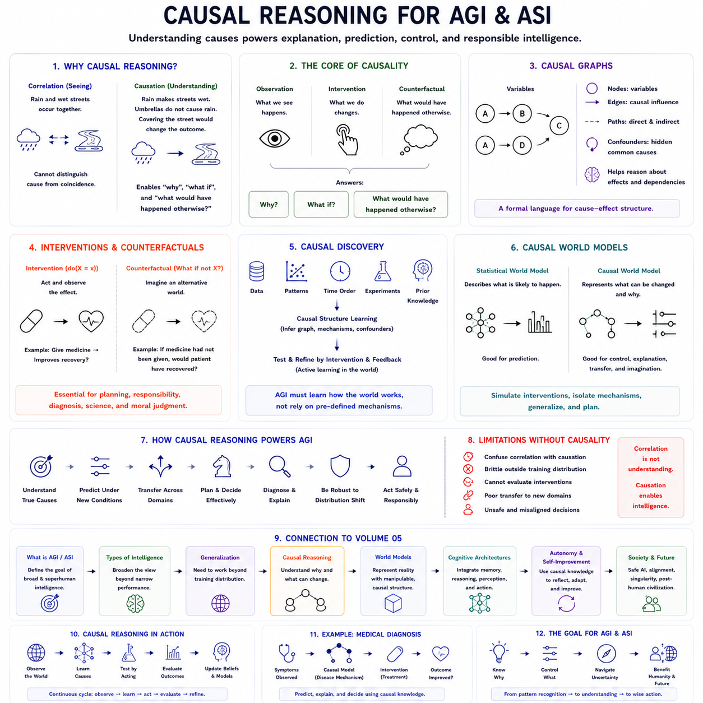
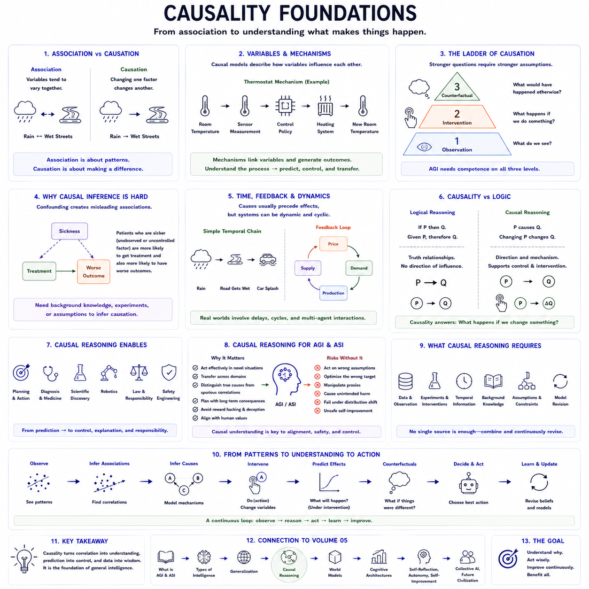
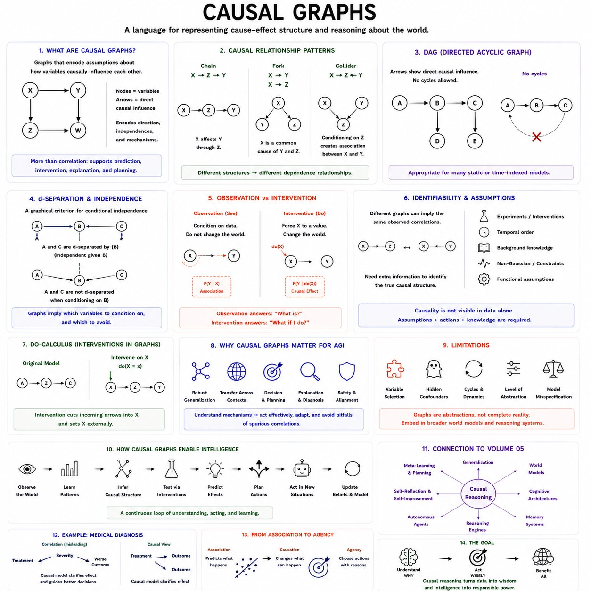
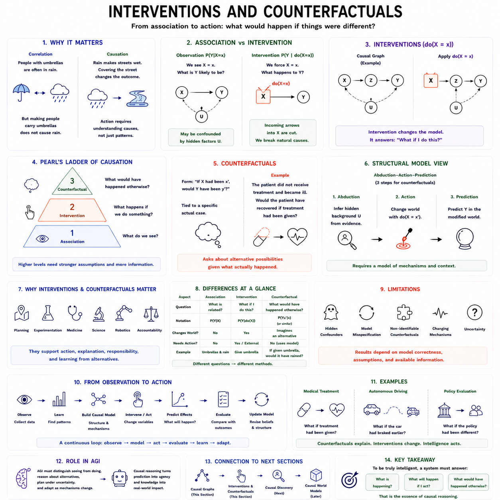
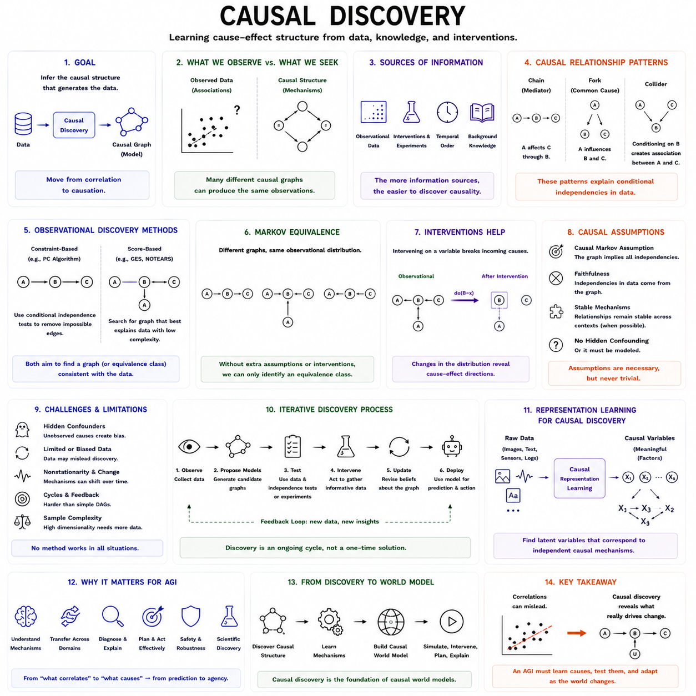
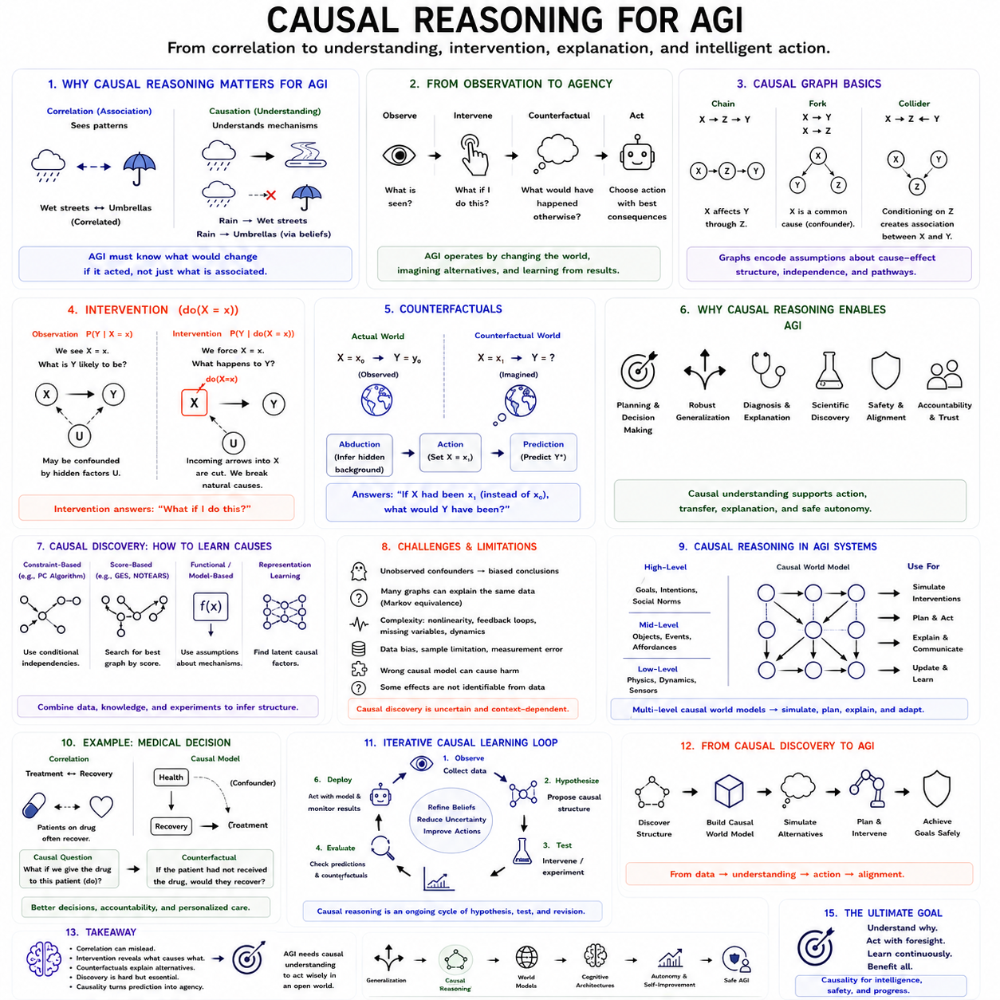
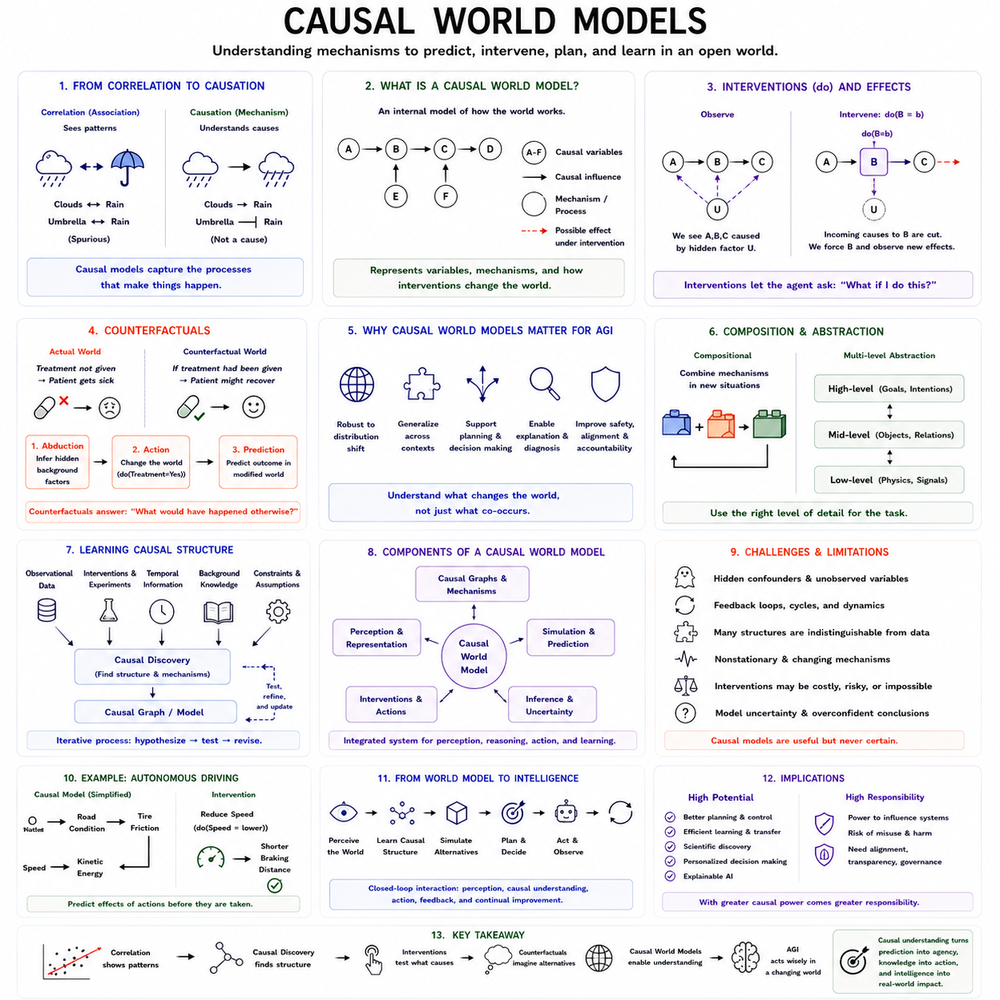

**Volume 00 05 AGI and ASI**

# Chapter 05. Causal Reasoning

### Chapter Overview

{width="7.268055555555556in" height="7.268055555555556in"}

Causal reasoning is the capacity to understand not merely that events are associated, but that some events produce, prevent, enable, or modify others. For AGI and ASI, this distinction is fundamental. A system that only detects correlations can predict that rain and wet streets occur together; a system with causal reasoning can infer that rain makes streets wet, that umbrellas do not cause rain, and that covering the street would change the outcome. This chapter examines causality as a core ingredient of general intelligence: the ability to answer "why," "what if," and "what would have happened otherwise."

The chapter begins with causality foundations, introducing the difference between observation, intervention, and counterfactual imagination. It explains why causal knowledge is not reducible to statistical pattern recognition, even when statistical learning is powerful. Causal graphs then provide a formal language for representing dependencies among variables, mechanisms, and hidden confounders. These graphs make it possible to reason about direct and indirect effects, causal pathways, and the conditions under which a conclusion is justified.

Interventions and counterfactuals form the operational heart of causal reasoning. An intelligent agent must know what will happen if it acts, not only what tends to happen in passively observed data. It must also be able to compare reality with alternative possibilities: if the medicine had not been given, would the patient have recovered? If the robot had chosen another path, would the collision have been avoided? Such reasoning is essential for planning, responsibility, diagnosis, scientific explanation, and moral judgment.

The chapter also introduces causal discovery: the attempt to infer causal structure from data, experiments, temporal ordering, constraints, and background knowledge. For AGI, causal discovery is especially important because a general intelligence cannot rely on human engineers to predefine every mechanism in its environment. It must learn how the world works, identify stable regularities, test hypotheses through action, and revise its models when evidence changes.

Finally, the chapter connects causal reasoning to causal world models. A world model that only compresses sensory inputs may support prediction, but a causal world model supports control, explanation, transfer, and imagination. It lets an agent simulate interventions, isolate mechanisms, generalize across environments, and distinguish superficial features from deep structure. In this sense, causality is one of the bridges between machine learning and genuine agency: it turns pattern recognition into understanding and prediction into purposeful action.

### Connection to Volume 05

This chapter follows naturally from the earlier discussion of intelligence, generalization, and the requirements for AGI. "What is AGI" and "What is ASI" establish the goal: systems that can act competently across domains and, in the case of ASI, exceed human capabilities. "Types of Intelligence" broadens the lens beyond narrow task performance, while "Generalization" asks how an intelligent system can succeed outside its training distribution. Causal reasoning is a key answer to that question. Correlations often fail when the context changes; causal mechanisms are more likely to remain stable. An AGI that understands causes can transfer knowledge from one domain to another because it grasps the underlying structure rather than memorizing surface patterns.

The chapter also prepares the reader for "World Models," where internal representations of reality become central. Causal reasoning gives those models direction and manipulability. A world model without causality can describe what is likely; a causal world model can represent what an agent can change. This distinction becomes crucial in "Cognitive Architectures," "Memory Systems," and "Reasoning Engines," where AGI is treated as an integrated system. Memory must store not only facts but explanatory relationships. Reasoning engines must combine deduction, induction, abduction, and causal inference. Cognitive architectures must coordinate perception, action, planning, and model revision in ways that respect cause and effect.

Causality is equally important for later chapters on self-reflection, autonomy, and self-improvement. A self-reflective system must reason about the causes of its own successes, failures, beliefs, and limitations. An autonomous agent must evaluate the likely consequences of its actions before acting. A self-improving AI, and especially a recursively self-improving system, must understand which modifications to its architecture or training process will actually improve performance rather than merely correlate with past success. Without causal reasoning, self-modification becomes blind optimization; with it, self-improvement can become hypothesis-driven engineering.

The connection also extends to meta-learning, consciousness, and philosophical debates. Meta-learning depends on identifying which learning strategies work under which causal conditions. Discussions of consciousness and artificial mind often turn on whether a system merely produces appropriate outputs or possesses an internal model of reasons, intentions, and consequences. The Chinese Room argument, Gödel machines, and universal constructors all raise questions about symbol manipulation, self-reference, construction, and agency; causal reasoning helps clarify what it means for a system to understand and act upon the world rather than merely transform inputs into outputs.

In the later chapters on collective AI, brain-computer interfaces, mind uploading, technological singularity, and post-human civilization, causal reasoning becomes a matter of safety and governance. Advanced systems embedded in society will influence economies, biology, infrastructure, politics, and human cognition. The more powerful the intelligence, the more important it becomes to distinguish prediction from control, persuasion from manipulation, and intended effects from unintended consequences. Causal reasoning is therefore not only a technical capability for AGI; it is also a prerequisite for alignment, accountability, scientific progress, and responsible navigation of the path from artificial general intelligence to artificial superintelligence.

## 05.00 Causality Foundations

{width="7.268055555555556in" height="7.268055555555556in"}

Causal reasoning is the study of how and why events, states, and actions produce consequences. For artificial general intelligence, causality matters because intelligent behavior is not merely the ability to notice patterns, but the ability to understand which changes would make a difference. A system that only predicts from correlations may perform well in stable environments, yet fail when the environment changes, when it must choose actions, or when it must reason about alternatives that did not occur. Causality provides the conceptual bridge from passive observation to active agency.

The central distinction is between association and causation. Association means that two variables tend to vary together: rain and wet streets, education and income, fever and infection. Causation claims something stronger: changing one factor would change another, under appropriate conditions. Wet streets are associated with rain, but turning streets wet with a hose does not cause rain. This difference is crucial for AGI because action is intervention. An agent must know not only what is likely to happen, but what would happen if it acted.

Modern causal reasoning often begins with variables and mechanisms. A variable represents some aspect of the world that can take different values, such as temperature, battery charge, market price, or a human belief. A mechanism is a process by which some variables influence others. For example, a thermostat mechanism links room temperature, a temperature sensor, a control policy, and a heating system. Causal understanding means modeling these mechanisms well enough to predict the effects of changes, diagnose failures, and transfer knowledge across related situations.

A useful formal distinction is captured by the "ladder of causation." The first level is observation: seeing that one thing is statistically related to another. The second level is intervention: asking what will happen if an agent forces a variable to take a particular value. The third level is counterfactual reasoning: asking what would have happened in a specific past situation if something had been different. Each level requires stronger assumptions than the previous one. Large-scale machine learning systems are often powerful at the observational level, but AGI requires robust competence at all three levels.

Causal claims depend on assumptions, and this is both a strength and a limitation. Data alone rarely proves causation without background knowledge, experimental design, temporal information, or structural constraints. If a medical dataset shows that patients receiving a treatment have worse outcomes, the treatment may be harmful, or the treated patients may have been sicker to begin with. This is the problem of confounding: an unobserved or uncontrolled factor influences both the apparent cause and the apparent effect. Causal reasoning therefore requires careful attention to what has been measured, what has been omitted, and what interventions are possible.

Time is related to causality but is not identical to it. Causes usually precede effects, yet temporal order alone is insufficient. A rooster may crow before sunrise, but it does not cause the sun to rise. Conversely, some systems involve feedback loops, where variables influence each other over time: economic demand affects price, price affects demand, and both affect production. AGI systems operating in the real world must reason about dynamic causal processes, delayed effects, cycles, and multi-agent interactions in which the consequences of an action unfold over many steps.

Causal reasoning also differs from purely logical reasoning. Logic can determine whether conclusions follow from premises, but causality asks how the world would change under manipulation. The statement "if the alarm is on, the light is red" is not the same as "turning the light red turns the alarm on." Causal models encode directionality and mechanisms, not merely truth conditions. This makes them essential for planning, scientific discovery, robotics, medicine, economics, law, and safety engineering.

For AGI and ASI, causality has deep implications for alignment and control. A capable agent that optimizes goals must anticipate the causal consequences of its strategies, including indirect and unintended effects. If its causal model is wrong, it may choose actions that appear beneficial in prediction but are harmful in reality. If its model of human preferences is shallow, it may manipulate proxies rather than satisfy underlying values. Causal reasoning helps distinguish achieving an outcome from merely producing evidence that the outcome has occurred, a distinction central to avoiding reward hacking and deceptive behavior.

The foundations introduced here prepare the ground for the next sections. Causal graphs provide a compact language for representing variables and directed dependencies. Interventions and counterfactuals formalize the questions an agent must ask when choosing actions and learning from imagined alternatives. Causal discovery studies how causal structure can be inferred from data, experiments, and constraints. Finally, causal reasoning for AGI and causal world models examine how these ideas can become part of general-purpose intelligence rather than isolated statistical tools. The key lesson is that intelligence requires more than prediction: it requires understanding what makes things happen.

## 05.01 Causal Graphs

{width="7.268055555555556in" height="7.268055555555556in"}

Causal graphs provide a compact language for representing how parts of a system influence one another. In the previous section, causality was introduced as more than statistical association: to say that X causes Y is to make a claim about what would happen to Y if X were changed by an intervention. Causal graphs make such claims explicit. They do not merely show that variables are correlated; they encode assumptions about direction, independence, mechanisms, and possible pathways of influence.

The most common formalism is the directed acyclic graph, or DAG. In a DAG, nodes represent variables, and directed edges represent direct causal influence. If an arrow points from X to Y, the graph asserts that X is a direct cause of Y relative to the other variables included in the model. "Direct" is important: it means that the effect is not fully mediated through another represented variable. The graph is acyclic because one cannot follow arrows and return to the same node. This restriction simplifies inference and is appropriate for many static or time-indexed models, though real systems often contain feedback loops that must be represented by dynamic graphs or by unfolding time into successive stages.

A causal graph separates several relations that are often confused. A chain X → Z → Y indicates that X may affect Y through mediator Z. A fork X → Y and X → Z indicates a common cause: Y and Z may be correlated even if neither causes the other. A collider X → Z ← Y has the opposite behavior: X and Y may be independent marginally, but conditioning on Z can create a spurious association between them. These three patterns explain why causal reasoning cannot be reduced to ordinary correlation or even to conditional correlation. What matters is not only which variables are observed together, but how information flows through the graph under observation and intervention.

This leads to the concept of d-separation, a graphical criterion for determining conditional independence relationships implied by a DAG. If two variables are d-separated by a set of observed variables, the graph predicts that they should be statistically independent conditional on that set, assuming the model is faithful to the data-generating process. D-separation is one reason causal graphs are powerful: they connect qualitative structural assumptions with quantitative probability distributions. A graph can tell us which variables should be controlled for, which should not, and which causal effects are identifiable from available data.

However, causal graphs are not discovered by looking at arrows in the data. The direction of causation is not usually visible in raw observations. Many different graphs can imply the same set of conditional independencies, forming an equivalence class. Additional assumptions, experimental interventions, temporal information, non-Gaussian noise, functional constraints, or domain knowledge may be needed to orient edges. This limitation is central for AGI: an intelligent system cannot simply infer causality from passive observation without assumptions. It must combine statistical learning with exploration, experimentation, prior knowledge, and model criticism.

Causal graphs also define the vocabulary for interventions. In Pearl's do-calculus, an intervention do(X = x) is represented by cutting the incoming arrows into X and setting X externally. This distinguishes seeing X from doing X. Observing that people carrying umbrellas are more likely to be in wet streets does not imply that umbrellas cause rain or wet pavement; intervening to give people umbrellas would not produce rain. In a graph, this distinction becomes formal. Interventions modify the causal model, while observations merely condition within it. This difference prepares the ground for the next section on interventions and counterfactuals.

For AGI, causal graphs are valuable because they support robust generalization. A purely predictive model may learn that certain features co-occur in a training environment, but fail when the environment changes. A causal model aims to represent stable mechanisms: how actions change states, how hidden causes generate observations, and how consequences propagate. If an agent understands that a door opens because a latch is released, it can adapt when the door color, lighting, or background changes. The causal structure supports transfer across contexts because mechanisms are often more invariant than surface correlations.

Still, causal graphs are abstractions, not complete descriptions of reality. Choosing the variables is itself a modeling decision. If an important common cause is omitted, the graph may produce biased conclusions. If variables are too coarse, genuine mechanisms may be hidden; if too fine-grained, the graph may become computationally unmanageable. Many real-world systems include cycles, continuous time, multiple levels of description, strategic agents, and changing causal mechanisms. Causal graphs must therefore be embedded in broader world models, memory systems, and reasoning engines rather than treated as a final solution.

In advanced AI systems, causal graphs may appear explicitly as symbolic structures or implicitly as learned latent causal models. A robot might use a graph to reason about actions, objects, forces, and goals. A scientific AI might generate competing causal hypotheses and design experiments to distinguish them. A language model-based agent might use causal graph reasoning to avoid confusing narrative association with mechanism. In each case, the graph is not merely a diagram; it is a computational object used to predict, intervene, explain, and plan.

Causal graphs occupy a central position in the path from narrow pattern recognition to general intelligence. They provide a bridge between data and agency: from "what tends to happen together" to "what would happen if I acted differently." This bridge is essential for autonomous agents, self-improving systems, and eventually AGI-level world models. The next sections build on this foundation by examining interventions, counterfactuals, and the difficult problem of discovering causal structure from experience.

## 05.02 Interventions and Counterfactuals

{width="7.268055555555556in" height="7.268055555555556in"}

Causal graphs describe how variables are connected, but the real power of causal reasoning appears when an intelligent system asks what would happen if it acted. In ordinary statistical learning, a model estimates patterns such as "people who take a medication recover more often." In causal reasoning, the more important question is "what would happen if we forced a particular patient to take the medication?" This distinction is central to AGI because a generally intelligent agent must not only predict observations; it must choose actions, evaluate alternatives, and learn from imagined outcomes that were never directly observed.

An intervention is an operation that changes a variable by external action. In Pearl's notation, this is often written as do(X = x), meaning that X is set to x by intervention rather than merely observed to have value x. The difference between observing X and intervening on X is subtle but crucial. Observing that people carry umbrellas is correlated with rain, but forcing people to carry umbrellas does not cause rain. An intervention cuts the normal causal inputs into the intervened variable and replaces them with an external setting. In a causal graph, this corresponds to removing the incoming arrows into X and fixing its value. The resulting distribution, P(Y \| do(X = x)), answers a different question from the observational distribution P(Y \| X = x).

This distinction explains why correlation alone is insufficient for action. If a robot learns that low battery levels are associated with returning to a charging station, it should not infer that making its battery sensor report "low" will create energy. A causal model must represent the mechanism by which battery charge affects behavior and how charging affects future charge. Interventions allow the agent to simulate actions in the world rather than simply extrapolate from passive data. For AGI, this ability is foundational: planning, experimentation, tool use, scientific reasoning, medicine, economics, and social interaction all require estimating the consequences of interventions.

Counterfactuals go one step further. They ask what would have happened under a different condition, given that a particular event actually occurred. A counterfactual question has the form: "The patient did not receive treatment and became ill; would the patient have recovered if they had received treatment?" Unlike an intervention, which asks about a population or possible scenario, a counterfactual is tied to a specific observed case. It requires reasoning about an alternative branch of reality while holding fixed the relevant background facts that generated the actual outcome.

In structural causal models, counterfactual reasoning is often described in three stages: abduction, action, and prediction. First, the system uses the observed evidence to infer likely values of hidden background factors. Second, it modifies the model by applying an intervention, such as do(treatment = true). Third, it predicts the outcome in this modified model for the same inferred background circumstances. This procedure captures why counterfactuals are harder than ordinary predictions: they require a model of the underlying mechanisms, not merely a mapping from inputs to outputs.

The difference among association, intervention, and counterfactual reasoning is sometimes called Pearl's ladder of causation. Association asks, "What is related to what?" Intervention asks, "What happens if I do this?" Counterfactual reasoning asks, "What would have happened if I had acted differently?" Many current machine learning systems operate primarily on the first rung. Reinforcement learning introduces interventions through actions, but often without explicit causal abstraction. Human-like intelligence appears to depend strongly on the higher rungs: children learn by trying things, imagining alternatives, and assigning responsibility when outcomes differ from expectations.

Interventions also clarify the role of experimentation. A randomized controlled trial is powerful because random assignment breaks confounding links between treatment choice and patient characteristics. In graph terms, randomization approximates an intervention on the treatment variable. However, AGI systems will often operate in environments where randomized experimentation is costly, unsafe, unethical, or impossible. A self-driving car cannot test every dangerous maneuver; a medical AI cannot freely experiment on patients; a social AI cannot manipulate communities merely to collect data. Therefore, causal reasoning must combine limited interventions, observational evidence, domain knowledge, simulation, and uncertainty estimation.

Counterfactuals are especially important for explanation and accountability. To explain why a system made a decision, we often ask which change would have altered the outcome. "The loan was denied because income was below the threshold" is meaningful if increasing income, while holding other relevant factors fixed, would have changed the decision. In safety-critical AGI, counterfactual analysis can help identify failure causes: Would the robot have avoided collision if its visual sensor had not been occluded? Would the agent still have chosen a harmful action if its reward model had represented human preferences correctly? Such questions are essential for debugging, auditing, and aligning intelligent systems.

There are, however, important limitations. Counterfactuals depend on the correctness of the causal model. If the graph omits a hidden common cause, misrepresents a mechanism, or assumes an invalid independence relation, the resulting counterfactual may be misleading. Some counterfactuals are not identifiable from available data, meaning that no amount of passive observation can determine the answer without additional assumptions. Even interventions can fail to generalize across contexts if mechanisms change. A policy that works in a laboratory, a simulator, or one culture may not work in another environment because the causal structure differs.

For AGI, the challenge is not merely to store causal graphs but to build adaptive causal world models. Such models must represent actions as interventions, distinguish seeing from doing, reason about unobserved alternatives, and update when mechanisms change. They must also manage uncertainty over multiple possible causal structures rather than assuming a single perfect model. This connects directly to the next sections: causal discovery concerns how an agent learns causal structure from data and interaction, while causal world models concern how causal mechanisms become part of an agent's broader understanding of reality.

Interventions and counterfactuals therefore mark a transition from prediction to agency. A system that only predicts may appear intelligent in stable environments, but an AGI must ask what its actions will cause and what different actions would have caused. This is not an optional philosophical refinement; it is a practical requirement for robust planning, responsibility, scientific learning, and safe autonomy.

## 05.03 Causal Discovery

{width="7.268055555555556in" height="7.268055555555556in"}

Causal discovery is the problem of learning causal structure from data, background knowledge, and sometimes limited interventions. In the previous sections, causal graphs gave us a language for representing assumptions, while interventions and counterfactuals showed why causality is not reducible to prediction. This section asks how an intelligent system might acquire those causal graphs in the first place. For AGI, this question is central: an agent that must operate in unfamiliar environments cannot rely only on correlations observed in a fixed training distribution. It must infer which variables produce changes in other variables, which relationships are stable across contexts, and where intervention would be effective.

The simplest setting is observational causal discovery: the system receives measurements of variables without controlling them and tries to infer a directed causal graph. Classical constraint-based methods, such as the PC algorithm, use conditional independence tests to eliminate impossible structures. If two variables become independent after conditioning on a third, that pattern can suggest a mediator, common cause, or collider, depending on the broader graph. Score-based methods search over possible graphs and choose those that best balance data fit and model complexity. Functional causal model approaches add assumptions about the form of mechanisms, such as additive noise or nonlinear relationships, to orient edges that would otherwise be ambiguous.

A major challenge is that many different causal graphs can imply the same observational probability distribution. These graphs are Markov equivalent: they agree on the conditional independencies visible in the data, even though they assign different causal directions. For example, observing that ice cream sales and drowning both increase in summer does not establish that one causes the other; temperature may be a hidden common cause. Without intervention, temporal ordering, domain knowledge, or additional assumptions, causal discovery often returns an equivalence class rather than a single true graph. This is not a defect of a specific algorithm but a fundamental identifiability limitation.

Interventional data can reduce ambiguity. If an agent changes one variable while holding others fixed, it can observe downstream effects and distinguish cause from consequence. Randomized controlled trials are the gold standard in science because randomization breaks many confounding pathways. In artificial agents, interventions may include actions in a simulator, experiments in a laboratory, code changes in a software system, or policy changes in a social environment. However, interventions are costly, risky, and sometimes impossible. A medical AI cannot freely manipulate every biological variable in a patient; a planetary-scale system cannot experiment recklessly with climate or economies. Therefore, practical causal discovery must combine passive observation, careful experimentation, and prior knowledge.

Modern machine learning adds both opportunities and hazards. Deep models can learn high-dimensional representations from images, text, sensors, and logs, making it possible to discover causal variables that are not explicitly labeled. Yet representation learning can also entangle causes, effects, and confounders in opaque latent spaces. A model may discover a feature that predicts well but has no stable causal meaning. Causal representation learning attempts to solve this by identifying latent variables corresponding to independent mechanisms in the world. This is especially relevant for AGI, because an agent's raw sensory input is rarely organized into clean variables like "force," "intention," "price," or "trust." The agent must construct useful causal abstractions before it can reason effectively.

Causal discovery also depends on assumptions about time. In time series, causes usually precede effects, so temporal order provides valuable evidence. Methods related to Granger causality ask whether past values of one variable improve prediction of another, though predictive precedence is not identical to true causation. Feedback loops, delayed effects, and adaptive agents complicate the picture. In economic, biological, and social systems, variables may influence each other over time, producing cyclic causal structures rather than simple directed acyclic graphs. AGI systems will need causal discovery methods that handle dynamics, nonstationarity, and multi-agent interaction.

The implications for AGI are profound. A system with strong causal discovery capabilities can form hypotheses, design experiments, transfer knowledge across domains, and diagnose failures. It can ask: "What would change if I acted here?" rather than merely "What usually happens after patterns like this?" This ability supports planning, scientific reasoning, robust generalization, and safe autonomy. At the same time, causal discovery is fragile when data are biased, variables are missing, interventions are poorly defined, or the model class excludes the true structure. A confident but incorrect causal graph can be more dangerous than an acknowledged uncertainty, because it may justify harmful interventions.

For this reason, causal discovery should be viewed not as a one-time extraction of truth from data, but as an iterative process of model building, testing, revision, and uncertainty management. It bridges the earlier machinery of causal graphs with the later goal of causal world models. An AGI-grade causal system would not simply store a static graph; it would maintain competing hypotheses, seek informative interventions, update its beliefs when mechanisms shift, and know when its causal knowledge is insufficient. In this sense, causal discovery is one of the foundations of machine intelligence that can learn not only what is observed, but what makes the observed world change.

## 05.04 Causal Reasoning for AGI

{width="7.268055555555556in" height="7.268055555555556in"}

Artificial general intelligence requires more than the ability to detect statistical regularities. A system that merely learns correlations may perform impressively inside a fixed distribution, yet fail when the environment changes, when an action alters the data-generating process, or when it must reason about events that did not occur. Causal reasoning is therefore a central capability for AGI: it allows an intelligent system to ask not only "What is associated with what?" but "What would happen if I intervened?", "Why did this outcome occur?", and "How would the world have been different under another choice?"

The previous sections introduced causal foundations, causal graphs, interventions, counterfactuals, and causal discovery. In the context of AGI, these ideas become operational requirements. An AGI must act in open-ended environments, form plans over long horizons, learn from limited experience, transfer knowledge across domains, and explain its behavior to humans. Each of these abilities depends on representing stable cause-effect structure rather than surface-level patterns. If a robot learns that wet streets are correlated with people carrying umbrellas, it may predict umbrellas from wet streets. But an AGI must understand that rain can cause both, that opening an umbrella does not cause the street to become wet, and that spraying water on the street would not make people carry umbrellas unless it changed their beliefs about rain.

This distinction matters because intelligent action is inherently interventionist. An agent is not a passive observer of data; it changes the world. Reinforcement learning partially addresses this by learning policies through interaction, but standard reinforcement learning often treats the environment as a black-box transition function. Causal reasoning adds structure to this interaction. It helps the agent distinguish actions that directly influence outcomes from variables that merely signal them. It also supports off-policy reasoning: estimating the effect of actions not taken, using knowledge of causal mechanisms rather than requiring exhaustive trial and error.

For AGI, causal reasoning also supports compositional generalization. A causal mechanism can remain stable across many contexts even when the distribution of observations changes. For example, the physical relation between force, mass, and acceleration remains useful across tasks involving tools, vehicles, or falling objects. An AGI equipped with causal models can recombine known mechanisms in new situations. This is essential for robust generalization: the system can infer what should still hold under changed circumstances and what may no longer apply.

Counterfactual reasoning is especially important for reflective intelligence. A capable AGI should be able to evaluate past decisions by considering alternatives: "If I had chosen a different route, would the package have arrived earlier?" or "If the warning had been issued sooner, would the failure have been avoided?" Such reasoning is central to learning from mistakes, assigning responsibility, improving plans, and communicating explanations. Counterfactuals also allow an agent to simulate consequences without actually causing potentially harmful outcomes.

Causal reasoning further contributes to alignment and safety. Many AI failures arise when systems optimize proxy objectives that correlate with human goals during training but diverge from them in deployment. A causal perspective encourages designers to ask whether an objective captures the true cause of desired outcomes or only an observable proxy. It also helps identify side effects, hidden confounders, and causal pathways through which an agent's actions may produce unintended harm. In high-stakes settings, causal models can make decisions more interpretable because they express assumptions about how variables influence one another.

However, causal reasoning for AGI remains difficult. First, causal structure is rarely given directly. It must be learned from a mixture of observation, intervention, prior knowledge, and experimentation. Purely observational data often cannot uniquely identify causal direction because multiple causal graphs may imply the same statistical distribution. Second, real-world causal systems are complex, nonlinear, partially observed, and dynamic. Variables may be latent, mechanisms may change over time, and feedback loops may violate the assumptions of simple acyclic causal graphs. Third, causal models can be wrong. A system that acts confidently on an incorrect causal theory may be more dangerous than one that merely admits uncertainty.

There is also a representational challenge. Human causal reasoning combines symbolic abstraction, intuitive physics, social inference, probabilistic uncertainty, and embodied interaction. A practical AGI may need hybrid causal representations: structural causal models for explicit reasoning, neural world models for perception and prediction, probabilistic programs for uncertainty, and planning systems for action selection. The goal is not to replace statistical learning with causality, but to integrate them. Statistical learning provides pattern recognition and scalable approximation; causal modeling provides invariance, intervention semantics, and explanatory structure.

A mature AGI system would likely maintain causal world models at multiple levels of abstraction. At a low level, it might model physical interactions such as contact, motion, and energy transfer. At a higher level, it might represent goals, incentives, institutions, and social norms. It would update these models when evidence contradicts them, actively seek interventions that reduce uncertainty, and choose actions by simulating their causal consequences. Such a system would not merely predict the next observation; it would understand how its actions could reshape the future.

Causal reasoning is therefore a bridge between intelligence as prediction and intelligence as agency. It connects perception to planning, learning to explanation, and knowledge to control. For AGI, this bridge is indispensable. Without causal reasoning, an agent may imitate intelligent behavior while remaining brittle, confused by distribution shifts, and unable to justify its choices. With causal reasoning, it gains the possibility of robust adaptation, deliberate experimentation, and meaningful understanding. The next section extends this idea into causal world models, where causal structure is embedded in the agent's broader representation of reality.

## 05.05 Causal World Models

{width="7.268055555555556in" height="7.268055555555556in"}

A world model is an internal representation that allows an intelligent system to predict, plan, and interpret events beyond its immediate observations. In contemporary AI, world models often mean learned latent-state models that compress sensory input and forecast future observations or rewards. A causal world model goes further: it represents not only what tends to follow what, but what variables produce changes in other variables, how mechanisms remain stable across contexts, and what would happen under deliberate intervention. This distinction is central for AGI because a generally intelligent agent must act in the world, not merely observe correlations within a fixed dataset.

The previous sections introduced causal graphs, interventions, counterfactuals, and causal discovery. Causal world models integrate these ideas into an agent's operating model of reality. Instead of learning "clouds are correlated with rain," a causal model attempts to encode mechanisms such as evaporation, pressure systems, condensation, and precipitation, at whatever level of abstraction is useful for action. The model need not be a perfect physics simulator. It may be hierarchical and approximate: high-level causal variables such as "object is fragile," "agent is distracted," or "market liquidity is low" can be more useful than microscopic detail. The key requirement is that the model supports reasoning about actions: if I intervene on this variable, what downstream effects should I expect?

A major advantage of causal world models is robustness under distribution shift. Purely statistical predictors often fail when the environment changes because they rely on surface regularities that are not stable. A causal model aims to separate invariant mechanisms from accidental correlations. For example, an autonomous medical assistant should not infer that a treatment causes recovery merely because healthier patients were more likely to receive it. It must model confounding variables, treatment assignment, biological mechanisms, and possible side effects. Likewise, a robot trained in one kitchen should generalize to another by understanding that cups fall because of gravity and contact dynamics, not because of the pixel pattern of a particular countertop.

Causal world models also enable counterfactual reasoning, which is essential for learning from mistakes and for planning. An agent can ask: if I had taken a different route, would the collision have been avoided? If the user's goal were different, would this explanation still be appropriate? If a component fails, what alternative path achieves the same objective? These questions require more than next-token prediction or passive forecasting. They require a model that distinguishes the observed trajectory from possible trajectories generated by different interventions.

For AGI, causal world models are closely connected to agency. An agent must choose actions that change the world, monitor the consequences, update beliefs, and revise plans. This creates a feedback loop between perception, action, and causal learning. Active experimentation can reveal causal structure more efficiently than passive observation, but it also raises safety and ethical constraints. A child can learn that dropping a glass causes it to break, but an artificial agent operating in a hospital, financial system, or power grid cannot freely experiment with harmful interventions. Therefore, safe causal learning may require simulation, uncertainty estimation, human oversight, constrained exploration, and careful distinction between epistemic actions that gather information and instrumental actions that pursue goals.

A useful causal world model is usually compositional. It represents objects, agents, processes, and rules as interacting components whose mechanisms can be recombined in novel situations. This compositionality supports transfer learning: knowledge about support, containment, ownership, incentives, or biological feedback can be applied in new domains. It also supports abstraction. The same event can be modeled at multiple levels: a thermostat turns on because temperature falls below a threshold; at a lower level, sensors, circuits, and heating elements interact; at a higher level, the system maintains comfort. AGI-level systems will likely need to move flexibly among such levels, selecting the causal abstraction that is relevant to the task.

There are several technical paths toward causal world models. Structural causal models provide a formal language of variables, mechanisms, and interventions. Probabilistic graphical models represent uncertainty and dependence. Model-based reinforcement learning learns transition models for planning, and can be extended with causal structure to improve generalization. Neural networks can learn rich representations, while causal constraints may encourage those representations to align with stable mechanisms rather than spurious features. Hybrid systems may combine symbolic causal graphs with neural perception and simulation-based reasoning. None of these approaches alone is sufficient today, but each contributes tools for representing and using causal knowledge.

Important limitations remain. Causal variables are not always obvious, especially in high-dimensional sensory data. Many causal structures are statistically indistinguishable without interventions or strong assumptions. Real-world systems often contain feedback loops, hidden confounders, nonstationary mechanisms, and multi-agent interactions. Human concepts of causality are also context-sensitive: what counts as "the cause" of an event depends on purpose, norm, and level of description. A causal world model for AGI must therefore manage uncertainty about its own causal assumptions and avoid overconfident explanations.

The implications are profound. Systems with causal world models could become better scientists, engineers, physicians, negotiators, and autonomous agents because they could reason about mechanisms, not just patterns. They could diagnose failures, design interventions, and adapt to new environments with less data. At the same time, stronger causal reasoning increases the power to manipulate environments and people. Alignment, interpretability, and governance become more important when an AI can identify leverage points in complex systems. Thus, causal world models are not merely an efficiency improvement; they are a foundational step toward machines that understand action, consequence, responsibility, and the structure of possible worlds.
