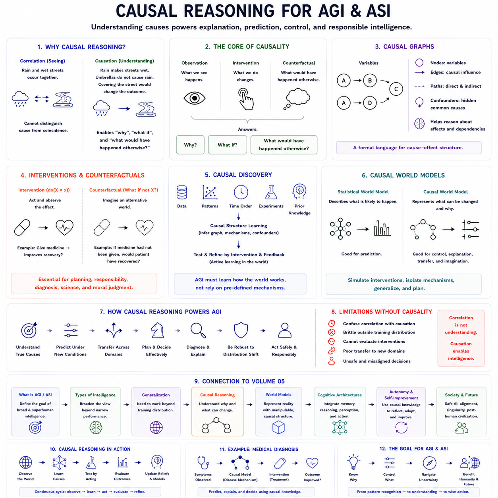
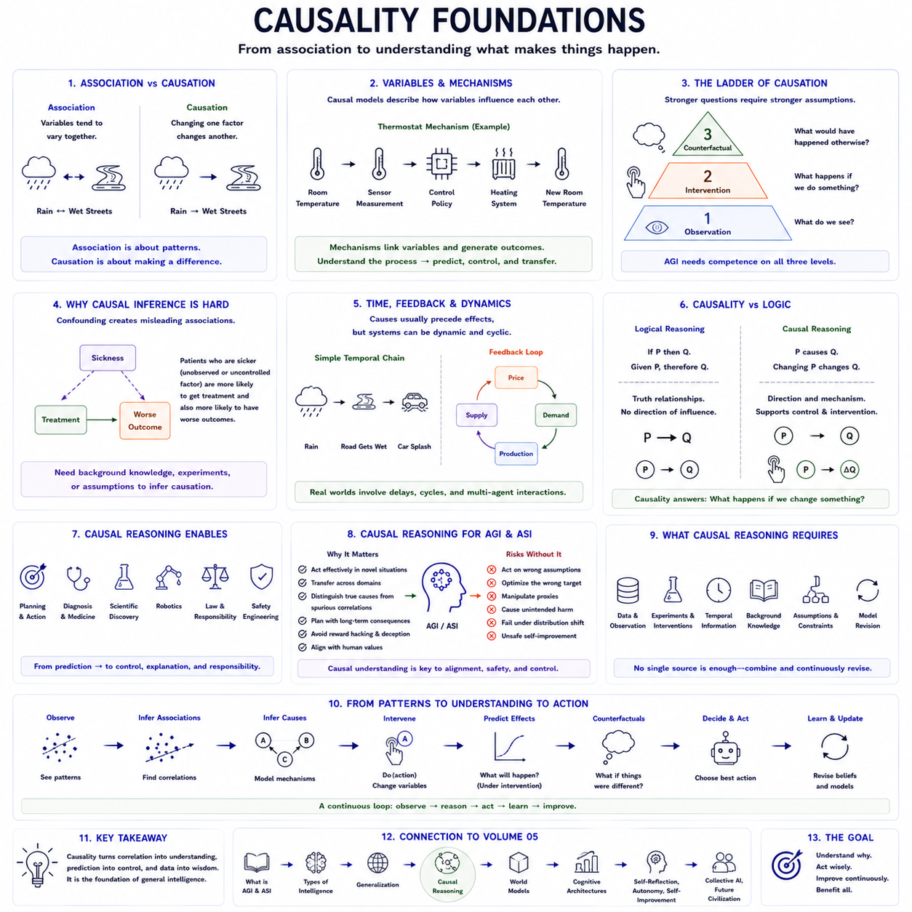
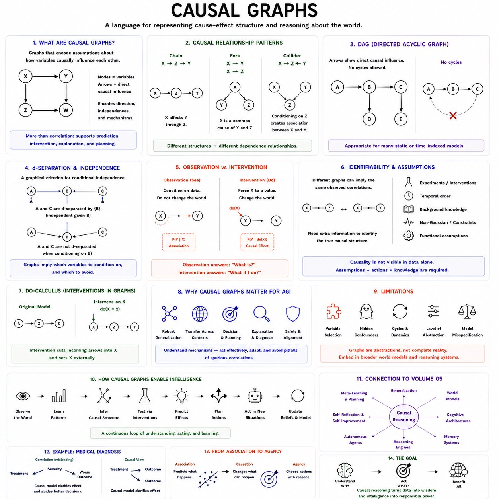
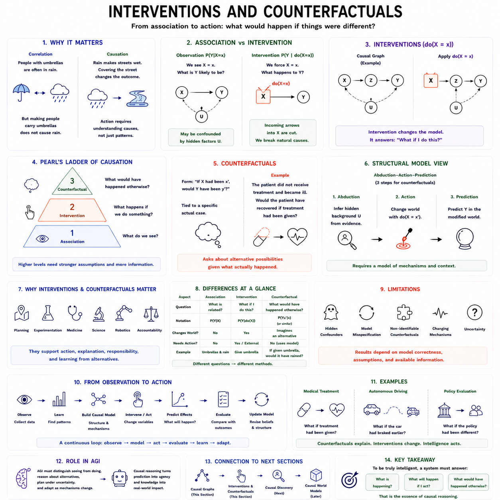
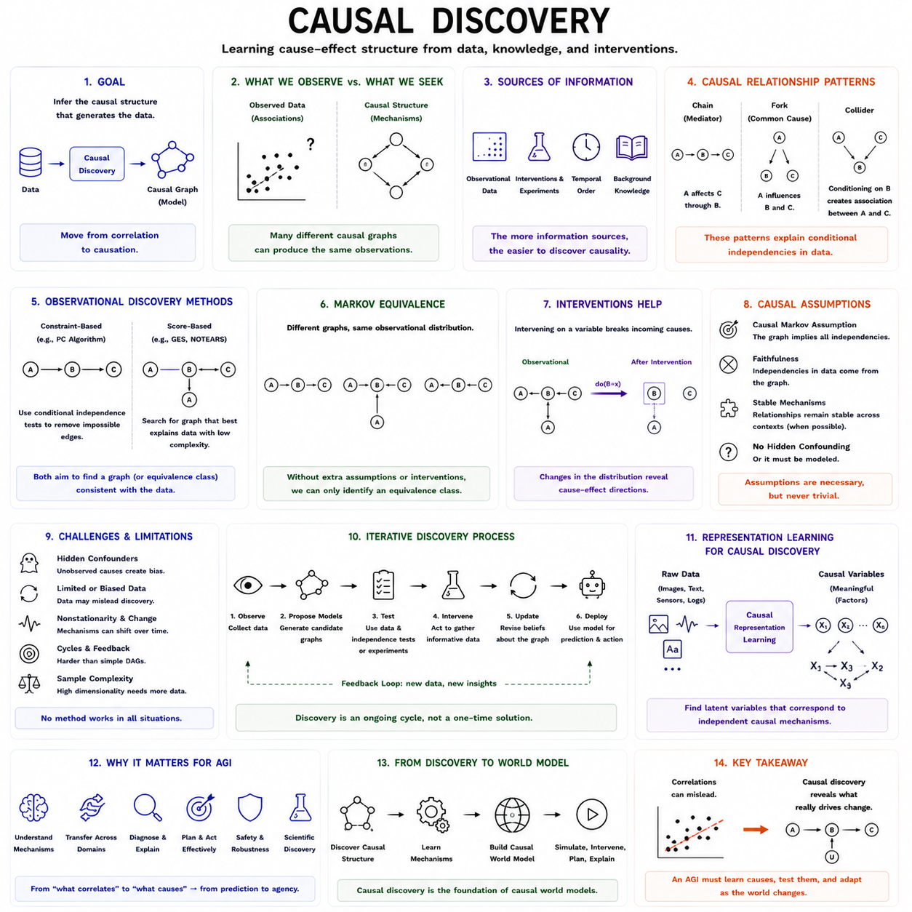
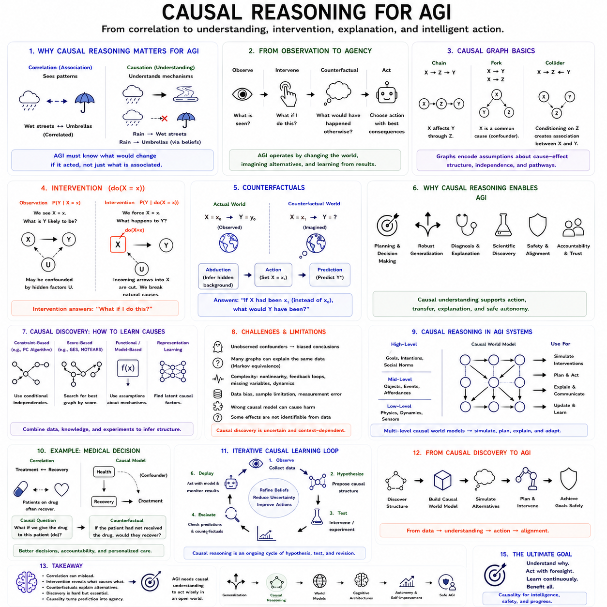
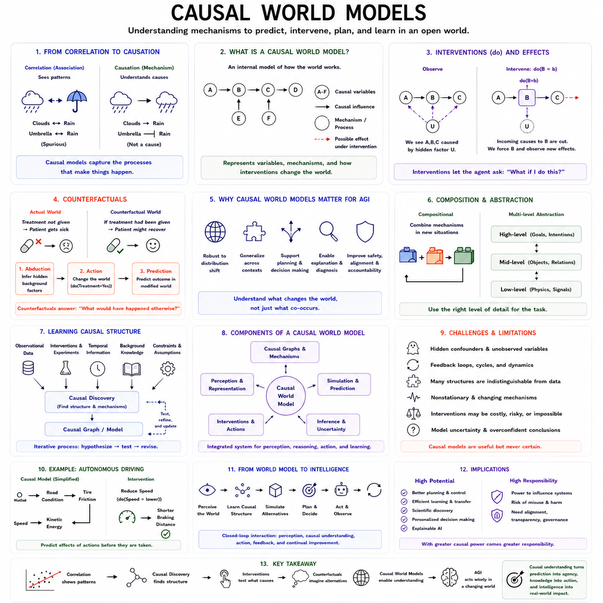

**Volume 00 05 AGI and ASI**

# Chapter 05. Causal Reasoning

### Chapter Overview

{width="7.268055555555556in" height="7.268055555555556in"}

인과 추론(Causal reasoning)은 사건들이 단순히 함께 나타난다는 사실을 넘어서, 어떤 사건이 다른 사건을 만들어 내고, 막고, 가능하게 하며, 변화시킨다는 관계를 이해하는 능력이다. AGI와 ASI에게 이 구분은 근본적이다. 상관관계만 탐지하는 시스템은 비와 젖은 도로가 함께 나타난다고 예측할 수 있다. 그러나 인과 추론을 갖춘 시스템은 비가 도로를 젖게 만들고, 우산이 비를 일으키는 것은 아니며, 도로를 덮으면 결과가 달라질 수 있음을 추론할 수 있다. 이 장은 일반 지능의 핵심 요소로서 인과성을 다룬다. 즉 "왜 그런가", "무엇을 하면 어떻게 되는가", "다르게 했더라면 어떻게 되었을까"라는 질문에 답하는 능력을 살펴본다.

이 장은 인과성의 기초(Causality foundations)에서 출발하여 관찰(observation), 개입(intervention), 반사실적 상상(counterfactual imagination)의 차이를 소개한다. 통계적 학습이 아무리 강력하더라도 인과 지식이 통계적 패턴 인식으로 환원될 수 없는 이유를 설명한다. 이어서 인과 그래프(Causal graphs)는 변수, 메커니즘, 숨은 교란 요인(hidden confounders) 사이의 의존 관계를 표현하는 형식 언어를 제공한다. 이러한 그래프를 통해 직접 효과와 간접 효과, 인과 경로, 그리고 어떤 결론이 정당화될 수 있는 조건을 추론할 수 있다.

개입과 반사실(counterfactuals)은 인과 추론의 작동적 핵심이다. 지능형 에이전트는 수동적으로 관찰된 데이터에서 어떤 일이 자주 일어나는지만 알아서는 안 되며, 자신이 행동하면 어떤 일이 일어날지를 알아야 한다. 또한 현실과 대안적 가능성을 비교할 수 있어야 한다. 약을 투여하지 않았더라면 환자는 회복했을까? 로봇이 다른 경로를 선택했더라면 충돌을 피할 수 있었을까? 이러한 추론은 계획, 책임, 진단, 과학적 설명, 도덕적 판단에 필수적이다.

이 장은 또한 인과 발견(Causal discovery)을 소개한다. 이는 데이터, 실험, 시간적 순서, 제약 조건, 배경지식으로부터 인과 구조를 추론하려는 시도이다. AGI에게 인과 발견은 특히 중요하다. 일반 지능은 인간 엔지니어가 환경의 모든 메커니즘을 미리 정의해 주는 데 의존할 수 없기 때문이다. AGI는 세계가 어떻게 작동하는지 학습하고, 안정적인 규칙성을 식별하며, 행동을 통해 가설을 검증하고, 증거가 바뀌면 자신의 모델을 수정해야 한다.

마지막으로 이 장은 인과 추론을 인과적 세계 모델(Causal world models)과 연결한다. 감각 입력을 압축하기만 하는 세계 모델은 예측을 지원할 수 있지만, 인과적 세계 모델은 제어, 설명, 전이, 상상을 지원한다. 그것은 에이전트가 개입을 시뮬레이션하고, 메커니즘을 분리하며, 환경을 넘어 일반화하고, 표면적 특징과 깊은 구조를 구별하게 해 준다. 이런 의미에서 인과성은 머신러닝과 진정한 행위성(agency)을 잇는 다리 중 하나이다. 인과성은 패턴 인식을 이해로 바꾸고, 예측을 목적 있는 행동으로 바꾼다.

### Connection to Volume 05

이 장은 앞선 지능, 일반화, AGI의 요건에 대한 논의에서 자연스럽게 이어진다. "What is AGI"와 "What is ASI"는 여러 영역에서 유능하게 행동할 수 있는 시스템, 그리고 ASI의 경우 인간 능력을 넘어서는 시스템이라는 목표를 설정한다. "Types of Intelligence"는 좁은 과제 수행을 넘어 시야를 넓히고, "Generalization"은 지능형 시스템이 훈련 분포를 벗어난 상황에서도 어떻게 성공할 수 있는지 묻는다. 인과 추론은 그 질문에 대한 핵심 답변 중 하나이다. 상관관계는 맥락이 바뀌면 자주 무너진다. 반면 인과 메커니즘은 더 안정적으로 유지될 가능성이 크다. 원인을 이해하는 AGI는 표면적 패턴을 암기하는 것이 아니라 underlying structure, 즉 근본 구조를 파악하기 때문에 한 영역에서 다른 영역으로 지식을 전이할 수 있다.

이 장은 또한 내부 현실 표상이 중심이 되는 "World Models"를 위한 준비가 된다. 인과 추론은 그러한 모델에 방향성과 조작 가능성을 부여한다. 인과성이 없는 세계 모델은 무엇이 일어날 가능성이 높은지를 묘사할 수 있다. 그러나 인과적 세계 모델은 에이전트가 무엇을 바꿀 수 있는지를 표현할 수 있다. 이 구분은 "Cognitive Architectures", "Memory Systems", "Reasoning Engines"에서 AGI를 통합 시스템으로 다룰 때 결정적으로 중요해진다. 기억은 사실뿐 아니라 설명적 관계를 저장해야 한다. 추론 엔진은 연역(deduction), 귀납(induction), 가추(abduction), 인과 추론을 결합해야 한다. 인지 아키텍처는 지각, 행동, 계획, 모델 수정을 원인과 결과를 존중하는 방식으로 조정해야 한다.

인과성은 이후의 자기 성찰, 자율성, 자기 개선에 관한 장들에서도 똑같이 중요하다. 자기 성찰적 시스템은 자신의 성공, 실패, 믿음, 한계의 원인을 추론해야 한다. 자율 에이전트는 행동하기 전에 자신의 행동이 가져올 가능성 있는 결과를 평가해야 한다. 자기 개선 AI, 특히 재귀적 자기 개선(recursive self-improvement) 시스템은 자신의 아키텍처나 훈련 과정에 대한 어떤 수정이 과거의 성공과 단지 상관되어 있는 것이 아니라 실제로 성능을 향상시키는지 이해해야 한다. 인과 추론이 없다면 자기 수정은 맹목적 최적화가 된다. 인과 추론이 있다면 자기 개선은 가설에 기반한 공학이 될 수 있다.

이 연결은 메타러닝, 의식, 철학적 논쟁으로도 확장된다. 메타러닝(Meta-learning)은 어떤 학습 전략이 어떤 인과적 조건에서 작동하는지 식별하는 데 의존한다. 의식과 인공 마음에 대한 논의는 종종 시스템이 단지 적절한 출력을 만들어 내는지, 아니면 이유, 의도, 결과에 대한 내부 모델을 갖는지의 문제로 이어진다. 중국어 방 논변(Chinese Room argument), 괴델 머신(Gödel machines), 보편 구성자(Universal constructors)는 모두 기호 조작, 자기 참조, 구성, 행위성에 관한 질문을 제기한다. 인과 추론은 시스템이 단지 입력을 출력으로 변환하는 것이 아니라 세계를 이해하고 그 세계에 작용한다는 것이 무엇을 의미하는지 명확히 하는 데 도움을 준다.

후반부의 집단 AI, 뇌-컴퓨터 인터페이스(Brain-computer interfaces), 마인드 업로딩(Mind uploading), 기술적 특이점(Technological singularity), 포스트휴먼 문명(Post-human civilization)에 관한 장들에서 인과 추론은 안전과 거버넌스의 문제가 된다. 사회에 내장된 고도화된 시스템은 경제, 생물학, 인프라, 정치, 인간 인지에 영향을 미칠 것이다. 지능이 강력해질수록 예측과 제어, 설득과 조작, 의도한 효과와 의도하지 않은 결과를 구별하는 일이 더 중요해진다. 따라서 인과 추론은 AGI를 위한 기술적 능력일 뿐 아니라 정렬(alignment), 책임성(accountability), 과학적 진보, 그리고 인공 일반 지능에서 인공 초지능으로 나아가는 경로를 책임 있게 항해하기 위한 전제 조건이다.

## 05.00 Causality Foundations

{width="7.268055555555556in" height="7.268055555555556in"}

인과 추론(Causal reasoning)은 사건, 상태, 행동이 어떻게 그리고 왜 결과를 만들어 내는지를 연구하는 분야이다. 인공 일반 지능(AGI)에서 인과성이 중요한 이유는 지능적 행동이 단순히 패턴을 알아차리는 능력이 아니라, 어떤 변화가 실제로 차이를 만들어 낼지를 이해하는 능력이기 때문이다. 상관관계만으로 예측하는 시스템은 안정적인 환경에서는 잘 작동할 수 있지만, 환경이 바뀌거나, 스스로 행동을 선택해야 하거나, 실제로 일어나지 않은 대안을 추론해야 할 때 실패할 수 있다. 인과성은 수동적 관찰에서 능동적 행위성(agency)으로 넘어가는 개념적 다리를 제공한다.

핵심적인 구분은 연관(association)과 인과(causation)의 차이다. 연관이란 두 변수가 함께 변하는 경향이 있다는 뜻이다. 예를 들어 비와 젖은 거리, 교육과 소득, 발열과 감염이 그렇다. 인과는 그보다 더 강한 주장을 한다. 적절한 조건에서 한 요인을 바꾸면 다른 요인이 바뀐다는 주장이다. 젖은 거리는 비와 연관되어 있지만, 호스로 거리를 적신다고 해서 비가 오지는 않는다. 이 차이는 AGI에 결정적으로 중요하다. 행동은 곧 개입(intervention)이기 때문이다. 에이전트는 무엇이 일어날 가능성이 높은지만이 아니라, 자신이 행동한다면 무엇이 일어날지를 알아야 한다.

현대의 인과 추론은 흔히 변수(variables)와 메커니즘(mechanisms)에서 출발한다. 변수는 온도, 배터리 충전량, 시장 가격, 인간의 믿음처럼 서로 다른 값을 가질 수 있는 세계의 어떤 측면을 나타낸다. 메커니즘은 어떤 변수들이 다른 변수들에 영향을 미치는 과정이다. 예를 들어 온도 조절기 메커니즘은 실내 온도, 온도 센서, 제어 정책, 난방 시스템을 연결한다. 인과적 이해란 이러한 메커니즘을 충분히 잘 모델링하여 변화의 효과를 예측하고, 실패를 진단하며, 관련된 상황들 사이에서 지식을 전이할 수 있음을 의미한다.

유용한 형식적 구분은 "인과의 사다리(ladder of causation)"로 설명된다. 첫 번째 수준은 관찰(observation)이다. 즉 어떤 것이 다른 것과 통계적으로 관련되어 있음을 보는 것이다. 두 번째 수준은 개입(intervention)이다. 에이전트가 어떤 변수를 특정 값으로 강제로 설정하면 무엇이 일어날지를 묻는 것이다. 세 번째 수준은 반사실적 추론(counterfactual reasoning)이다. 특정한 과거 상황에서 무언가가 달랐다면 무엇이 일어났을지를 묻는 것이다. 각 수준은 이전 수준보다 더 강한 가정을 요구한다. 대규모 머신러닝 시스템은 관찰 수준에서 강력한 경우가 많지만, AGI는 세 수준 모두에서 견고한 능력을 필요로 한다.

인과적 주장은 가정에 의존하며, 이것은 강점이자 한계이기도 하다. 데이터만으로는 배경 지식, 실험 설계, 시간 정보, 구조적 제약 없이 인과성을 입증하기 어려운 경우가 많다. 어떤 의료 데이터셋에서 치료를 받은 환자들이 더 나쁜 결과를 보였다고 하자. 이때 치료가 해로웠을 수도 있지만, 애초에 치료를 받은 환자들이 더 심하게 아팠을 수도 있다. 이것이 교란(confounding)의 문제이다. 관찰되지 않았거나 통제되지 않은 요인이 겉보기 원인과 겉보기 결과 모두에 영향을 미치는 것이다. 따라서 인과 추론은 무엇이 측정되었고, 무엇이 누락되었으며, 어떤 개입이 가능한지에 세심한 주의를 요구한다.

시간은 인과성과 관련되어 있지만 동일한 것은 아니다. 원인은 대체로 결과보다 앞서지만, 시간적 순서만으로는 충분하지 않다. 수탉은 해가 뜨기 전에 울 수 있지만, 그것이 해를 뜨게 하는 것은 아니다. 반대로 어떤 시스템은 변수가 시간에 걸쳐 서로에게 영향을 미치는 피드백 루프(feedback loops)를 포함한다. 경제적 수요는 가격에 영향을 주고, 가격은 수요에 영향을 주며, 둘 다 생산에 영향을 준다. 현실 세계에서 작동하는 AGI 시스템은 동적 인과 과정, 지연된 효과, 순환 구조, 그리고 행동의 결과가 여러 단계에 걸쳐 펼쳐지는 다중 에이전트 상호작용을 추론해야 한다.

인과 추론은 순수한 논리적 추론과도 다르다. 논리는 결론이 전제로부터 따라오는지를 판단할 수 있지만, 인과성은 조작(manipulation) 아래에서 세계가 어떻게 변할지를 묻는다. "알람이 켜져 있으면 불빛은 빨간색이다"라는 명제는 "불빛을 빨간색으로 바꾸면 알람이 켜진다"와 같지 않다. 인과 모델은 단순한 진리 조건이 아니라 방향성과 메커니즘을 인코딩한다. 이 때문에 인과 모델은 계획 수립, 과학적 발견, 로보틱스, 의학, 경제학, 법, 안전 공학에 필수적이다.

AGI와 ASI에서 인과성은 정렬(alignment)과 제어(control)에 깊은 함의를 가진다. 목표를 최적화하는 유능한 에이전트는 간접적이고 의도하지 않은 효과를 포함하여 자신의 전략이 낳을 인과적 결과를 예측해야 한다. 인과 모델이 틀리면, 예측상으로는 유익해 보이지만 실제로는 해로운 행동을 선택할 수 있다. 인간 선호에 대한 모델이 피상적이면, 근본적인 가치를 만족시키기보다 대리 지표(proxy)를 조작할 수 있다. 인과 추론은 어떤 결과를 실제로 달성하는 것과 그 결과가 발생한 것처럼 보이는 증거만 만들어 내는 것을 구분하게 해 주며, 이는 보상 해킹(reward hacking)과 기만적 행동을 피하는 데 핵심적인 구분이다.

여기서 소개한 기초는 다음 절들을 위한 토대를 마련한다. 인과 그래프(Causal graphs)는 변수와 방향성 있는 의존성을 표현하는 간결한 언어를 제공한다. 개입과 반사실은 에이전트가 행동을 선택하고 상상된 대안으로부터 학습할 때 던져야 하는 질문을 형식화한다. 인과 발견(Causal discovery)은 데이터, 실험, 제약으로부터 인과 구조를 어떻게 추론할 수 있는지를 연구한다. 마지막으로 AGI를 위한 인과 추론과 인과적 세계 모델(causal world models)은 이러한 아이디어가 고립된 통계 도구가 아니라 범용 지능의 일부가 될 수 있는 방식을 검토한다. 핵심 교훈은 지능에는 예측 이상의 것이 필요하다는 점이다. 지능에는 무엇이 일을 일어나게 하는지를 이해하는 능력이 필요하다.

## 05.01 Causal Graphs

{width="7.268055555555556in" height="7.268055555555556in"}

인과 그래프(Causal graph)는 한 시스템의 부분들이 서로 어떻게 영향을 미치는지를 표현하는 압축적인 언어를 제공한다. 앞 절에서는 인과성(causality)을 단순한 통계적 연관(statistical association) 이상의 것으로 소개했다. X가 Y의 원인이라고 말한다는 것은, 개입(intervention)을 통해 X가 바뀌었을 때 Y에 어떤 일이 일어날지에 대한 주장을 하는 것이다. 인과 그래프는 이러한 주장을 명시적으로 만든다. 그것은 변수들이 상관되어 있음을 보여주는 데 그치지 않고, 방향성, 독립성, 메커니즘, 가능한 영향 경로에 대한 가정을 인코딩한다.

가장 일반적인 형식은 방향성 비순환 그래프(DAG, directed acyclic graph)이다. DAG에서 노드(node)는 변수를 나타내고, 방향이 있는 간선(edge)은 직접적인 인과 영향을 나타낸다. X에서 Y로 화살표가 향한다면, 그 그래프는 모델에 포함된 다른 변수들을 기준으로 X가 Y의 직접 원인이라는 것을 주장한다. 여기서 "직접"이라는 말이 중요하다. 이는 그 효과가 모델에 표현된 다른 변수를 통해 완전히 매개되는 것이 아니라는 뜻이다. 그래프가 비순환적이라는 것은 화살표를 따라가다가 같은 노드로 다시 돌아올 수 없다는 의미다. 이러한 제한은 추론을 단순화하며 많은 정적 모델이나 시간 색인(time-indexed) 모델에 적합하다. 다만 실제 시스템에는 피드백 루프(feedback loop)가 자주 존재하므로, 이를 표현하려면 동적 그래프(dynamic graph)를 사용하거나 시간을 연속 단계로 펼쳐 나타내야 한다.

인과 그래프는 흔히 혼동되는 여러 관계를 구분한다. 사슬(chain) X → Z → Y는 X가 매개 변수(mediator) Z를 통해 Y에 영향을 줄 수 있음을 나타낸다. 갈래(fork) X → Y 및 X → Z는 공통 원인(common cause)을 나타낸다. 이 경우 Y와 Z는 서로가 서로를 원인으로 만들지 않아도 상관될 수 있다. 충돌자(collider) X → Z ← Y는 반대의 행동을 보인다. X와 Y는 주변적으로는 독립일 수 있지만, Z에 조건을 걸면 둘 사이에 허위 연관(spurious association)이 생길 수 있다. 이 세 가지 패턴은 왜 인과 추론(causal reasoning)이 일반적인 상관관계나 조건부 상관관계로 환원될 수 없는지를 설명한다. 중요한 것은 어떤 변수들이 함께 관찰되는가뿐 아니라, 관찰과 개입 아래에서 정보가 그래프를 통해 어떻게 흐르는가이다.

이는 d-분리(d-separation)라는 개념으로 이어진다. d-분리는 DAG가 함의하는 조건부 독립 관계를 판정하기 위한 그래프적 기준이다. 두 변수가 어떤 관찰된 변수 집합에 의해 d-분리되어 있다면, 모델이 데이터 생성 과정에 충실하다는 가정하에 그래프는 그 두 변수가 그 집합을 조건으로 통계적으로 독립이어야 한다고 예측한다. d-분리는 인과 그래프가 강력한 이유 중 하나다. 그것은 질적인 구조적 가정과 정량적인 확률 분포를 연결한다. 그래프는 어떤 변수를 통제해야 하는지, 어떤 변수를 통제하면 안 되는지, 그리고 사용 가능한 데이터로부터 어떤 인과 효과가 식별 가능한지를 알려줄 수 있다.

그러나 인과 그래프는 데이터 속의 화살표를 눈으로 보고 발견되는 것이 아니다. 인과의 방향은 보통 원시 관찰(raw observation) 안에 직접 드러나지 않는다. 여러 다른 그래프가 동일한 조건부 독립성 집합을 함의할 수 있으며, 이들은 동치류(equivalence class)를 형성한다. 간선의 방향을 정하기 위해서는 추가 가정, 실험적 개입, 시간 정보, 비가우시안 잡음(non-Gaussian noise), 함수적 제약(functional constraint), 또는 분야 지식(domain knowledge)이 필요할 수 있다. 이 한계는 AGI에서 핵심적이다. 지능형 시스템은 가정 없이 수동적 관찰만으로 인과성을 단순히 추론할 수 없다. 그것은 통계적 학습을 탐색, 실험, 사전 지식, 모델 비판과 결합해야 한다.

인과 그래프는 개입의 어휘도 정의한다. Pearl의 do-계산(do-calculus)에서 개입 do(X = x)는 X로 들어오는 화살표를 잘라내고 X를 외부에서 설정하는 것으로 표현된다. 이는 X를 보는 것(seeing X)과 X를 하는 것(doing X)을 구별한다. 우산을 든 사람들이 젖은 거리에 있을 가능성이 더 높다는 관찰은 우산이 비나 젖은 포장도로의 원인이라는 뜻이 아니다. 사람들에게 우산을 주는 개입을 한다고 해서 비가 생기지는 않는다. 그래프에서는 이 차이가 형식화된다. 개입은 인과 모델을 수정하는 반면, 관찰은 그 모델 안에서 조건화할 뿐이다. 이 차이는 다음 절의 개입과 반사실(counterfactual)에 대한 논의를 준비한다.

AGI에 대해 인과 그래프가 가치 있는 이유는 그것이 강건한 일반화(robust generalization)를 지원하기 때문이다. 순수 예측 모델은 훈련 환경에서 특정 특징들이 함께 나타난다는 것을 학습할 수 있지만, 환경이 바뀌면 실패할 수 있다. 인과 모델은 안정적인 메커니즘을 표현하려고 한다. 즉 행동이 어떻게 상태를 바꾸는지, 숨은 원인이 어떻게 관찰을 생성하는지, 결과가 어떻게 전파되는지를 나타낸다. 에이전트가 걸쇠가 풀리기 때문에 문이 열린다는 것을 이해한다면, 문 색깔, 조명, 배경이 바뀌어도 적응할 수 있다. 인과 구조는 표면적 상관보다 메커니즘이 더 불변적인 경우가 많기 때문에 맥락 간 전이를 지원한다.

그럼에도 인과 그래프는 현실의 완전한 기술이 아니라 추상화다. 변수를 선택하는 것 자체가 모델링 결정이다. 중요한 공통 원인이 누락되면 그래프는 편향된 결론을 낼 수 있다. 변수가 너무 거칠면 실제 메커니즘이 숨겨질 수 있고, 너무 세밀하면 그래프가 계산적으로 다루기 어려워질 수 있다. 많은 현실 시스템은 순환, 연속 시간, 여러 수준의 기술, 전략적 행위자, 변화하는 인과 메커니즘을 포함한다. 따라서 인과 그래프는 최종 해답으로 취급되기보다는 더 넓은 세계 모델(world model), 기억 시스템(memory system), 추론 엔진(reasoning engine) 안에 내장되어야 한다.

고급 AI 시스템에서 인과 그래프는 명시적인 기호 구조(symbolic structure)로 나타날 수도 있고, 학습된 잠재 인과 모델(latent causal model)로 암묵적으로 나타날 수도 있다. 로봇은 행동, 물체, 힘, 목표에 대해 추론하기 위해 그래프를 사용할 수 있다. 과학 AI는 경쟁하는 인과 가설을 생성하고 그것들을 구별하기 위한 실험을 설계할 수 있다. 언어 모델 기반 에이전트는 서사적 연관(narrative association)을 메커니즘과 혼동하지 않기 위해 인과 그래프 추론을 사용할 수 있다. 각 경우에 그래프는 단순한 그림이 아니라 예측하고, 개입하고, 설명하고, 계획하는 데 쓰이는 계산적 객체다.

인과 그래프는 좁은 패턴 인식에서 일반 지능으로 나아가는 경로에서 중심적인 위치를 차지한다. 그것은 데이터와 행위성(agency) 사이의 다리를 제공한다. 즉 "무엇이 함께 일어나는 경향이 있는가"에서 "내가 다르게 행동했다면 무엇이 일어났을까"로 이동하게 한다. 이 다리는 자율 에이전트, 자기 개선 시스템, 그리고 궁극적으로 AGI 수준의 세계 모델에 필수적이다. 다음 절들은 이 토대 위에서 개입, 반사실, 그리고 경험으로부터 인과 구조를 발견하는 어려운 문제를 검토한다.

## 05.02 Interventions and Counterfactuals

{width="7.268055555555556in" height="7.268055555555556in"}

인과 그래프(causal graph)는 변수들이 어떻게 연결되어 있는지를 설명하지만, 인과 추론(causal reasoning)의 진정한 힘은 지능 시스템이 "내가 행동하면 무슨 일이 일어날까?"라고 물을 때 드러난다. 일반적인 통계 학습에서 모델은 "약을 복용한 사람들이 더 자주 회복된다"와 같은 패턴을 추정한다. 반면 인과 추론에서 더 중요한 질문은 "특정 환자에게 그 약을 복용하도록 강제한다면 무슨 일이 일어날까?"이다. 이 구분은 AGI에 핵심적이다. 일반 지능 에이전트는 관측을 예측하는 데 그치지 않고, 행동을 선택하고, 대안을 평가하며, 직접 관측하지 못한 상상된 결과로부터도 배워야 하기 때문이다.

개입(intervention)은 외부 행동을 통해 어떤 변수를 변화시키는 조작이다. Pearl의 표기법에서는 이를 흔히 do(X = x)라고 쓰며, 이는 X가 단순히 x라는 값으로 관측된 것이 아니라 개입에 의해 x로 설정되었음을 뜻한다. X를 관측하는 것과 X에 개입하는 것의 차이는 미묘하지만 결정적이다. 사람들이 우산을 들고 다니는 것을 관측하면 비와 상관관계가 있지만, 사람들에게 우산을 강제로 들게 한다고 해서 비가 오지는 않는다. 개입은 개입된 변수로 들어오는 정상적인 인과 입력을 끊고, 이를 외부 설정으로 대체한다. 인과 그래프에서는 X로 들어오는 화살표를 제거하고 그 값을 고정하는 것에 해당한다. 그 결과 분포인 P(Y \| do(X = x))는 관측 분포 P(Y \| X = x)와 다른 질문에 답한다.

이 구분은 왜 상관관계만으로는 행동에 충분하지 않은지를 설명한다. 로봇이 낮은 배터리 수준이 충전소로 돌아가는 행동과 관련되어 있음을 학습했다고 해서, 배터리 센서가 "낮음"이라고 보고하도록 만들면 에너지가 생긴다고 추론해서는 안 된다. 인과 모델은 배터리 충전량이 행동에 어떤 메커니즘으로 영향을 미치는지, 그리고 충전이 미래의 충전량에 어떻게 영향을 미치는지를 표현해야 한다. 개입은 에이전트가 수동 데이터로부터 단순히 외삽하는 것이 아니라, 세계 안에서의 행동을 시뮬레이션할 수 있게 한다. AGI에게 이 능력은 기초적이다. 계획, 실험, 도구 사용, 과학적 추론, 의학, 경제, 사회적 상호작용은 모두 개입의 결과를 추정해야 하기 때문이다.

반사실(counterfactual)은 한 걸음 더 나아간다. 반사실은 특정 사건이 실제로 일어났다는 조건에서, 다른 조건이었다면 무슨 일이 일어났을지를 묻는다. 반사실 질문은 다음과 같은 형식을 갖는다. "그 환자는 치료를 받지 않았고 병이 악화되었다. 만약 치료를 받았다면 회복했을까?" 개입이 집단이나 가능한 시나리오에 대한 질문이라면, 반사실은 특정한 관측 사례에 묶여 있다. 반사실은 실제 결과를 생성한 관련 배경 사실들을 고정한 채, 현실의 대안적 가지를 추론해야 한다.

구조적 인과 모델(structural causal model)에서 반사실 추론은 흔히 세 단계로 설명된다. 귀추(abduction), 행동(action), 예측(prediction)이다. 첫째, 시스템은 관측된 증거를 사용해 숨겨진 배경 요인의 가능한 값을 추론한다. 둘째, do(treatment = true)와 같은 개입을 적용하여 모델을 수정한다. 셋째, 같은 추론된 배경 조건에서 수정된 모델의 결과를 예측한다. 이 절차는 왜 반사실이 일반 예측보다 어려운지를 보여준다. 반사실은 단순한 입력-출력 매핑이 아니라, 기저 메커니즘의 모델을 필요로 하기 때문이다.

연관, 개입, 반사실 추론의 차이는 때때로 Pearl의 인과 사다리(ladder of causation)라고 불린다. 연관은 "무엇이 무엇과 관련되어 있는가?"를 묻는다. 개입은 "내가 이것을 하면 무슨 일이 일어나는가?"를 묻는다. 반사실 추론은 "내가 다르게 행동했다면 무슨 일이 일어났을까?"를 묻는다. 오늘날 많은 기계 학습 시스템은 주로 첫 번째 단계에서 작동한다. 강화 학습(reinforcement learning)은 행동을 통해 개입을 도입하지만, 명시적인 인과 추상화를 갖지 않는 경우가 많다. 인간과 유사한 지능은 더 높은 단계에 강하게 의존하는 것으로 보인다. 아이들은 시도해 보고, 대안을 상상하며, 결과가 기대와 다를 때 책임을 부여하면서 학습한다.

개입은 실험의 역할도 명확히 한다. 무작위 대조 시험(randomized controlled trial)은 무작위 배정이 치료 선택과 환자 특성 사이의 교란(confounding) 연결을 끊기 때문에 강력하다. 그래프 관점에서 무작위화는 치료 변수에 대한 개입을 근사한다. 그러나 AGI 시스템은 무작위 실험이 비용이 많이 들거나, 안전하지 않거나, 비윤리적이거나, 불가능한 환경에서 작동하는 경우가 많을 것이다. 자율주행차는 모든 위험한 기동을 시험할 수 없고, 의료 AI는 환자에게 자유롭게 실험할 수 없으며, 사회적 AI는 단지 데이터를 수집하기 위해 공동체를 조작할 수 없다. 따라서 인과 추론은 제한된 개입, 관측 증거, 영역 지식, 시뮬레이션, 불확실성 추정을 결합해야 한다.

반사실은 설명과 책임성(accountability)에 특히 중요하다. 시스템이 왜 어떤 결정을 내렸는지 설명하려면, 어떤 변화가 결과를 바꾸었을지를 묻는 경우가 많다. "소득이 기준치보다 낮아서 대출이 거절되었다"라는 설명은 다른 관련 요인을 고정한 채 소득을 높였을 때 결정이 바뀌었을 경우에 의미가 있다. 안전이 중요한 AGI에서는 반사실 분석이 실패 원인을 식별하는 데 도움을 줄 수 있다. 시각 센서가 가려지지 않았다면 로봇이 충돌을 피했을까? 보상 모델이 인간 선호를 올바르게 표현했다면 에이전트가 여전히 해로운 행동을 선택했을까? 이러한 질문은 지능 시스템의 디버깅, 감사, 정렬(alignment)에 필수적이다.

그러나 중요한 한계도 있다. 반사실은 인과 모델의 정확성에 의존한다. 그래프가 숨겨진 공통 원인을 누락하거나, 메커니즘을 잘못 표현하거나, 유효하지 않은 독립성 관계를 가정하면, 그 결과로 나온 반사실은 오도될 수 있다. 어떤 반사실은 이용 가능한 데이터로는 식별 가능(identifiable)하지 않다. 즉, 추가 가정 없이는 아무리 많은 수동 관측을 해도 답을 결정할 수 없다. 개입조차도 메커니즘이 바뀌는 맥락에서는 일반화에 실패할 수 있다. 실험실, 시뮬레이터, 또는 한 문화에서 작동하는 정책이 다른 환경에서는 작동하지 않을 수 있는데, 이는 인과 구조가 다르기 때문이다.

AGI에게 과제는 단지 인과 그래프를 저장하는 것이 아니라, 적응적인 인과 세계 모델(causal world model)을 구축하는 것이다. 그러한 모델은 행동을 개입으로 표현하고, 보는 것과 하는 것을 구별하며, 관측되지 않은 대안을 추론하고, 메커니즘이 변할 때 갱신되어야 한다. 또한 단일한 완벽한 모델을 가정하는 대신, 여러 가능한 인과 구조에 대한 불확실성을 관리해야 한다. 이는 다음 절들과 직접 연결된다. 인과 발견(causal discovery)은 에이전트가 데이터와 상호작용을 통해 인과 구조를 어떻게 학습하는지를 다루고, 인과 세계 모델은 인과 메커니즘이 에이전트의 더 넓은 현실 이해의 일부가 되는 방식을 다룬다.

따라서 개입과 반사실은 예측에서 행위성(agency)으로 넘어가는 전환점을 표시한다. 단지 예측만 하는 시스템은 안정적인 환경에서는 지능적으로 보일 수 있지만, AGI는 자신의 행동이 무엇을 초래할지, 그리고 다른 행동이 무엇을 초래했을지를 물어야 한다. 이는 선택적인 철학적 세부 사항이 아니라, 견고한 계획, 책임, 과학적 학습, 안전한 자율성을 위한 실질적 요구사항이다.

## 05.03 Causal Discovery

{width="7.268055555555556in" height="7.268055555555556in"}

인과 발견(Causal discovery)은 데이터, 배경 지식, 때로는 제한적인 개입(intervention)으로부터 인과 구조(causal structure)를 학습하는 문제이다. 앞선 절에서 인과 그래프(causal graph)는 가정을 표현하는 언어를 제공했고, 개입과 반사실(counterfactual)은 인과성이 예측으로 환원될 수 없음을 보여 주었다. 이 절은 지능 시스템이 애초에 그러한 인과 그래프를 어떻게 획득할 수 있는지를 묻는다. AGI에게 이 질문은 핵심적이다. 낯선 환경에서 작동해야 하는 에이전트는 고정된 훈련 분포에서 관찰된 상관관계(correlation)에만 의존할 수 없다. 어떤 변수가 다른 변수의 변화를 만들어 내는지, 어떤 관계가 맥락을 넘어 안정적인지, 어디에 개입해야 효과가 있는지를 추론해야 한다.

가장 단순한 설정은 관찰적 인과 발견(observational causal discovery)이다. 시스템은 변수를 통제하지 않은 상태에서 측정값을 받고, 방향성이 있는 인과 그래프를 추론하려고 한다. PC 알고리즘과 같은 고전적인 제약 기반 방법(constraint-based method)은 조건부 독립성 검정(conditional independence test)을 사용해 불가능한 구조를 제거한다. 두 변수가 세 번째 변수에 조건화했을 때 독립이 된다면, 그 패턴은 더 넓은 그래프에 따라 매개 변수(mediator), 공통 원인(common cause), 또는 충돌점(collider)을 시사할 수 있다. 점수 기반 방법(score-based method)은 가능한 그래프들을 탐색하고, 데이터 적합도와 모델 복잡도의 균형이 가장 좋은 구조를 선택한다. 함수적 인과 모델(functional causal model) 접근은 가산 잡음(additive noise)이나 비선형 관계 같은 메커니즘의 형태에 대한 가정을 추가하여, 그렇지 않으면 모호하게 남을 간선의 방향을 정한다.

중대한 난점은 서로 다른 많은 인과 그래프가 동일한 관찰 확률분포를 함의할 수 있다는 점이다. 이러한 그래프들은 마르코프 동치(Markov equivalent)이다. 즉 데이터에서 보이는 조건부 독립성에는 일치하지만, 서로 다른 인과 방향을 부여한다. 예를 들어 아이스크림 판매량과 익사 사고가 모두 여름에 증가한다는 관찰은 어느 하나가 다른 하나를 원인으로 한다는 것을 입증하지 않는다. 기온이 숨겨진 공통 원인(hidden common cause)일 수 있다. 개입, 시간적 순서, 도메인 지식, 또는 추가 가정이 없으면 인과 발견은 종종 단일한 참 그래프가 아니라 동치류(equivalence class)를 반환한다. 이는 특정 알고리즘의 결함이 아니라 근본적인 식별 가능성(identifiability)의 한계이다.

개입 데이터(interventional data)는 모호성을 줄일 수 있다. 에이전트가 다른 변수들을 고정한 채 하나의 변수를 변화시키면, 하위 효과(downstream effect)를 관찰하고 원인과 결과를 구별할 수 있다. 무작위 대조 시험(randomized controlled trial)이 과학에서 표준으로 여겨지는 이유는 무작위화가 많은 교란 경로(confounding pathway)를 끊기 때문이다. 인공 에이전트에서 개입은 시뮬레이터 안의 행동, 실험실의 실험, 소프트웨어 시스템의 코드 변경, 또는 사회적 환경의 정책 변경을 포함할 수 있다. 그러나 개입은 비용이 크고 위험하며 때로는 불가능하다. 의료 AI는 환자 안의 모든 생물학적 변수를 자유롭게 조작할 수 없고, 행성 규모의 시스템은 기후나 경제를 무모하게 실험할 수 없다. 따라서 실용적인 인과 발견은 수동적 관찰, 신중한 실험, 사전 지식을 결합해야 한다.

현대 머신러닝은 기회와 위험을 모두 더한다. 딥 모델은 이미지, 텍스트, 센서, 로그에서 고차원 표현(representation)을 학습할 수 있으므로 명시적으로 라벨링되지 않은 인과 변수(causal variable)를 발견할 가능성을 제공한다. 그러나 표현 학습(representation learning)은 원인, 결과, 교란 변수를 불투명한 잠재 공간(latent space) 안에 뒤얽히게 만들 수도 있다. 모델은 예측은 잘하지만 안정적인 인과적 의미가 없는 특징을 발견할 수 있다. 인과 표현 학습(causal representation learning)은 세계의 독립적인 메커니즘에 대응하는 잠재 변수를 식별함으로써 이 문제를 해결하려 한다. 이는 AGI와 특히 관련이 깊다. 에이전트의 원시 감각 입력은 대개 "힘", "의도", "가격", "신뢰" 같은 깔끔한 변수로 조직되어 있지 않기 때문이다. 에이전트는 효과적으로 추론하기 전에 유용한 인과적 추상화(causal abstraction)를 구성해야 한다.

인과 발견은 시간에 대한 가정에도 의존한다. 시계열(time series)에서는 원인이 보통 결과에 앞서므로 시간적 순서가 중요한 증거를 제공한다. 그레인저 인과성(Granger causality)과 관련된 방법들은 한 변수의 과거 값이 다른 변수의 예측을 향상시키는지를 묻지만, 예측적 선행성이 참된 인과성과 동일한 것은 아니다. 피드백 루프(feedback loop), 지연 효과(delayed effect), 적응적 에이전트(adaptive agent)는 상황을 복잡하게 만든다. 경제, 생물학, 사회 시스템에서는 변수들이 시간에 따라 서로에게 영향을 주어, 단순한 방향성 비순환 그래프(directed acyclic graph)가 아니라 순환적 인과 구조(cyclic causal structure)를 만들 수 있다. AGI 시스템에는 동역학(dynamics), 비정상성(nonstationarity), 다중 에이전트 상호작용을 처리하는 인과 발견 방법이 필요할 것이다.

AGI에 대한 함의는 깊다. 강력한 인과 발견 능력을 갖춘 시스템은 가설을 형성하고, 실험을 설계하며, 도메인을 가로질러 지식을 전이하고, 실패를 진단할 수 있다. 그것은 단지 "이런 패턴 뒤에는 보통 무엇이 일어나는가?"라고 묻는 것이 아니라 "내가 여기서 행동하면 무엇이 바뀔 것인가?"라고 물을 수 있다. 이 능력은 계획(planning), 과학적 추론(scientific reasoning), 견고한 일반화(robust generalization), 안전한 자율성(safe autonomy)을 뒷받침한다. 동시에 인과 발견은 데이터가 편향되어 있거나, 변수가 누락되어 있거나, 개입이 잘 정의되지 않았거나, 모델 클래스가 참 구조를 배제할 때 취약하다. 확신에 찬 잘못된 인과 그래프는 인정된 불확실성보다 더 위험할 수 있다. 그것이 해로운 개입을 정당화할 수 있기 때문이다.

이러한 이유로 인과 발견은 데이터에서 진실을 한 번에 추출하는 작업이 아니라, 모델을 만들고 시험하고 수정하며 불확실성을 관리하는 반복적 과정으로 보아야 한다. 그것은 앞서 다룬 인과 그래프의 장치와 뒤이어 다룰 인과 세계 모델(causal world model)의 목표를 연결한다. AGI 수준의 인과 시스템은 단순히 정적인 그래프를 저장하지 않을 것이다. 경쟁하는 가설들을 유지하고, 유익한 개입을 찾으며, 메커니즘이 변화할 때 믿음을 갱신하고, 자신의 인과 지식이 언제 불충분한지를 알아야 한다. 이런 의미에서 인과 발견은 관찰된 것뿐 아니라 관찰된 세계를 변화시키는 것을 학습할 수 있는 기계 지능의 토대 중 하나이다.

## 05.04 Causal Reasoning for AGI

{width="7.268055555555556in" height="7.268055555555556in"}

인공 일반 지능(Artificial General Intelligence, AGI)은 통계적 규칙성을 감지하는 능력만으로는 충분하지 않다. 단순히 상관관계(correlation)를 학습하는 시스템은 고정된 분포 안에서는 인상적인 성능을 보일 수 있지만, 환경이 변하거나, 어떤 행동이 데이터 생성 과정 자체를 바꾸거나, 실제로 일어나지 않은 사건에 대해 추론해야 할 때 실패할 수 있다. 따라서 인과 추론(causal reasoning)은 AGI의 핵심 능력이다. 이는 지능 시스템이 "무엇이 무엇과 관련되어 있는가?"뿐 아니라 "내가 개입하면 무슨 일이 일어나는가?", "왜 이 결과가 발생했는가?", "다른 선택을 했다면 세계는 어떻게 달라졌을까?"를 묻게 해준다.

앞선 절들에서는 인과성의 기초, 인과 그래프(causal graph), 개입(intervention), 반사실(counterfactual), 인과 발견(causal discovery)을 소개했다. AGI의 맥락에서 이러한 개념들은 실제 작동을 위한 요구 사항이 된다. AGI는 개방형 환경에서 행동하고, 긴 시간 지평에 걸쳐 계획을 세우며, 제한된 경험으로부터 학습하고, 여러 영역에 걸쳐 지식을 전이하며, 자신의 행동을 인간에게 설명해야 한다. 이러한 능력은 모두 표면적인 패턴이 아니라 안정적인 원인-결과 구조를 표현하는 데 의존한다. 예를 들어 로봇이 젖은 거리와 사람들이 우산을 들고 있는 현상이 상관되어 있음을 학습했다면, 젖은 거리를 보고 우산을 예측할 수 있다. 그러나 AGI는 비가 두 현상의 공통 원인이 될 수 있고, 우산을 펴는 것이 거리를 젖게 만들지는 않으며, 거리에 물을 뿌린다고 해서 사람들이 비가 온다고 믿게 되지 않는 한 우산을 들지는 않을 것임을 이해해야 한다.

이 구분이 중요한 이유는 지능적 행동이 본질적으로 개입적이기 때문이다. 에이전트(agent)는 데이터를 수동적으로 관찰하는 존재가 아니라 세계를 변화시키는 존재다. 강화학습(reinforcement learning)은 상호작용을 통해 정책(policy)을 학습함으로써 이 문제를 부분적으로 다루지만, 표준적인 강화학습은 종종 환경을 블랙박스 전이 함수(transition function)로 취급한다. 인과 추론은 이러한 상호작용에 구조를 추가한다. 이는 에이전트가 결과에 직접 영향을 미치는 행동과 단지 결과를 신호하는 변수들을 구분하도록 돕는다. 또한 실제로 선택하지 않은 행동의 효과를 추정하는 오프-폴리시 추론(off-policy reasoning)을 가능하게 하며, 이는 모든 경우를 시행착오로 탐색하지 않고도 인과 메커니즘에 대한 지식을 활용하게 해준다.

AGI에서 인과 추론은 조합적 일반화(compositional generalization)도 지원한다. 관찰 분포가 변하더라도 인과 메커니즘은 여러 맥락에서 안정적으로 유지될 수 있다. 예를 들어 힘, 질량, 가속도 사이의 물리적 관계는 도구, 차량, 낙하 물체와 관련된 여러 과제에서 여전히 유용하다. 인과 모델(causal model)을 갖춘 AGI는 알려진 메커니즘을 새로운 상황에서 재조합할 수 있다. 이는 견고한 일반화에 필수적이다. 시스템은 상황이 바뀌었을 때 무엇이 여전히 성립해야 하는지, 무엇이 더 이상 적용되지 않을 수 있는지를 추론할 수 있다.

반사실 추론(counterfactual reasoning)은 성찰적 지능에 특히 중요하다. 유능한 AGI는 과거의 결정을 평가하면서 대안을 고려할 수 있어야 한다. 예를 들어 "다른 경로를 선택했다면 소포가 더 일찍 도착했을까?" 또는 "경고가 더 빨리 발령되었다면 고장을 피할 수 있었을까?"와 같은 질문을 할 수 있어야 한다. 이러한 추론은 실수로부터 배우고, 책임을 배분하며, 계획을 개선하고, 설명을 전달하는 데 핵심적이다. 반사실은 또한 에이전트가 잠재적으로 해로운 결과를 실제로 일으키지 않고도 그 결과를 시뮬레이션할 수 있게 한다.

인과 추론은 정렬(alignment)과 안전성(safety)에도 기여한다. 많은 AI 실패는 시스템이 훈련 중에는 인간의 목표와 상관되어 있지만 배포 환경에서는 그 목표와 어긋나는 대리 목표(proxy objective)를 최적화할 때 발생한다. 인과적 관점은 설계자가 어떤 목적 함수가 바람직한 결과의 진정한 원인을 포착하는지, 아니면 관찰 가능한 대리 지표만을 포착하는지 질문하도록 만든다. 또한 부작용, 숨은 교란 변수(hidden confounder), 에이전트의 행동이 의도치 않은 피해를 낳을 수 있는 인과 경로를 식별하는 데 도움을 준다. 고위험 환경에서는 변수들이 서로 어떻게 영향을 미치는지에 대한 가정을 표현하기 때문에, 인과 모델이 의사결정을 더 해석 가능하게 만들 수 있다.

그러나 AGI를 위한 인과 추론은 여전히 어렵다. 첫째, 인과 구조는 직접 주어지는 경우가 거의 없다. 그것은 관찰, 개입, 사전 지식, 실험의 혼합으로부터 학습되어야 한다. 순수한 관찰 데이터만으로는 인과 방향을 유일하게 식별하지 못하는 경우가 많다. 여러 인과 그래프가 동일한 통계적 분포를 함의할 수 있기 때문이다. 둘째, 현실 세계의 인과 시스템은 복잡하고 비선형적이며, 부분적으로만 관측 가능하고 동적이다. 변수는 잠재적(latent)일 수 있고, 메커니즘은 시간에 따라 변할 수 있으며, 피드백 루프(feedback loop)는 단순한 비순환 인과 그래프(acyclic causal graph)의 가정을 위반할 수 있다. 셋째, 인과 모델은 틀릴 수 있다. 잘못된 인과 이론을 바탕으로 확신을 가지고 행동하는 시스템은 단순히 불확실성을 인정하는 시스템보다 더 위험할 수 있다.

표현의 문제도 있다. 인간의 인과 추론은 상징적 추상화(symbolic abstraction), 직관 물리(intuitive physics), 사회적 추론(social inference), 확률적 불확실성(probabilistic uncertainty), 체화된 상호작용(embodied interaction)을 결합한다. 실용적인 AGI는 하이브리드 인과 표현(hybrid causal representation)을 필요로 할 수 있다. 명시적 추론을 위한 구조적 인과 모델(structural causal model), 지각과 예측을 위한 신경망 세계 모델(neural world model), 불확실성을 위한 확률적 프로그램(probabilistic program), 행동 선택을 위한 계획 시스템(planning system)이 함께 필요할 수 있다. 목표는 통계적 학습을 인과성으로 대체하는 것이 아니라 둘을 통합하는 것이다. 통계적 학습은 패턴 인식과 확장 가능한 근사를 제공하고, 인과 모델링은 불변성(invariance), 개입 의미론(intervention semantics), 설명적 구조를 제공한다.

성숙한 AGI 시스템은 여러 추상화 수준에서 인과 세계 모델(causal world model)을 유지할 가능성이 크다. 낮은 수준에서는 접촉, 운동, 에너지 전달과 같은 물리적 상호작용을 모델링할 수 있다. 더 높은 수준에서는 목표, 유인(incentive), 제도, 사회적 규범을 표현할 수 있다. 그러한 시스템은 증거가 모델과 모순될 때 이를 갱신하고, 불확실성을 줄이는 개입을 능동적으로 찾으며, 행동의 인과적 결과를 시뮬레이션하여 선택할 것이다. 이러한 시스템은 단지 다음 관찰을 예측하는 것이 아니라 자신의 행동이 미래를 어떻게 재구성할 수 있는지를 이해하게 된다.

따라서 인과 추론은 예측으로서의 지능과 행위성(agency)으로서의 지능을 잇는 다리다. 그것은 지각을 계획과, 학습을 설명과, 지식을 통제와 연결한다. AGI에게 이 다리는 필수적이다. 인과 추론이 없다면 에이전트는 지능적 행동을 모방할 수는 있어도 취약하고, 분포 변화에 혼란을 겪으며, 자신의 선택을 정당화하지 못할 수 있다. 인과 추론을 갖추면 견고한 적응, 의도적 실험, 의미 있는 이해의 가능성을 얻게 된다. 다음 절에서는 이 아이디어를 인과 세계 모델로 확장하여, 인과 구조가 에이전트의 더 넓은 현실 표현 속에 어떻게 내장되는지 살펴본다.

## 05.05 Causal World Models

{width="7.268055555555556in" height="7.268055555555556in"}

세계 모델(World model)은 지능형 시스템이 즉각적인 관찰을 넘어 사건을 예측하고, 계획하며, 해석할 수 있게 해 주는 내부 표현이다. 현대 AI에서 세계 모델은 흔히 감각 입력을 압축하고 미래의 관찰이나 보상을 예측하는 학습된 잠재 상태 모델(latent-state model)을 의미한다. 인과적 세계 모델(Causal world model)은 여기서 더 나아간다. 그것은 무엇이 무엇 뒤에 자주 나타나는지만이 아니라, 어떤 변수가 다른 변수의 변화를 만들어 내는지, 어떤 메커니즘이 맥락이 바뀌어도 안정적으로 유지되는지, 그리고 의도적 개입(intervention)이 이루어졌을 때 무엇이 일어날지를 표현한다. 이 구분은 AGI에 핵심적이다. 일반 지능 에이전트는 고정된 데이터셋 안의 상관관계를 관찰하기만 하는 것이 아니라, 세계 속에서 행동해야 하기 때문이다.

앞선 절들은 인과 그래프(causal graph), 개입, 반사실(counterfactual), 인과 발견(causal discovery)을 소개했다. 인과적 세계 모델은 이러한 아이디어들을 에이전트가 현실을 다루는 작동 모델 안에 통합한다. "구름은 비와 상관되어 있다"를 학습하는 대신, 인과 모델은 증발, 기압계, 응결, 강수와 같은 메커니즘을 행동에 유용한 추상화 수준에서 부호화하려고 한다. 그 모델이 완벽한 물리 시뮬레이터일 필요는 없다. 그것은 계층적이고 근사적일 수 있다. 예를 들어 "물체가 깨지기 쉽다", "에이전트가 산만하다", "시장 유동성이 낮다"와 같은 고수준 인과 변수는 미시적 세부 사항보다 더 유용할 수 있다. 핵심 요건은 그 모델이 행동에 관한 추론을 지원해야 한다는 것이다. 내가 이 변수에 개입하면 어떤 하위 효과를 예상해야 하는가?

인과적 세계 모델의 주요 장점은 분포 변화(distribution shift)에서의 강건성이다. 순수한 통계적 예측기는 표면적 규칙성에 의존하기 때문에 환경이 변하면 자주 실패한다. 인과 모델은 불변적인 메커니즘과 우연한 상관관계를 분리하려고 한다. 예를 들어 자율 의료 보조 시스템은 더 건강한 환자들이 특정 치료를 받을 가능성이 높았다는 이유만으로 그 치료가 회복을 유발한다고 추론해서는 안 된다. 그것은 교란 변수(confounding variable), 치료 배정, 생물학적 메커니즘, 가능한 부작용을 모델링해야 한다. 마찬가지로 한 주방에서 훈련된 로봇은 컵이 특정 조리대의 픽셀 패턴 때문이 아니라 중력과 접촉 동역학 때문에 떨어진다는 점을 이해함으로써 다른 주방으로 일반화해야 한다.

인과적 세계 모델은 또한 반사실 추론을 가능하게 하며, 이는 실수로부터 학습하고 계획을 세우는 데 필수적이다. 에이전트는 이렇게 물을 수 있다. 내가 다른 경로를 택했다면 충돌을 피할 수 있었을까? 사용자의 목표가 달랐다면 이 설명은 여전히 적절했을까? 어떤 구성 요소가 고장 난다면 같은 목적을 달성하는 대체 경로는 무엇일까? 이러한 질문은 다음 토큰 예측이나 수동적 예측만으로는 충분하지 않다. 관찰된 궤적과 서로 다른 개입에 의해 생성될 수 있는 가능한 궤적을 구분하는 모델이 필요하다.

AGI에서 인과적 세계 모델은 행위성(agency)과 밀접하게 연결된다. 에이전트는 세계를 변화시키는 행동을 선택하고, 그 결과를 관찰하며, 믿음을 갱신하고, 계획을 수정해야 한다. 이는 지각, 행동, 인과 학습 사이의 피드백 루프를 만든다. 능동적 실험은 수동적 관찰보다 인과 구조를 더 효율적으로 드러낼 수 있지만, 동시에 안전 및 윤리적 제약을 제기한다. 아이는 유리잔을 떨어뜨리면 깨진다는 것을 배울 수 있지만, 병원, 금융 시스템, 전력망에서 작동하는 인공 에이전트는 해로운 개입을 자유롭게 실험할 수 없다. 따라서 안전한 인과 학습에는 시뮬레이션, 불확실성 추정, 인간 감독, 제약된 탐색, 그리고 정보를 모으기 위한 인식적 행동(epistemic action)과 목표를 추구하는 도구적 행동(instrumental action)의 신중한 구분이 필요할 수 있다.

유용한 인과적 세계 모델은 대개 조합적(compositional)이다. 그것은 물체, 에이전트, 과정, 규칙을 서로 상호작용하는 구성 요소로 표현하며, 이들의 메커니즘은 새로운 상황에서 재조합될 수 있다. 이러한 조합성은 전이 학습(transfer learning)을 지원한다. 지지, 포함, 소유권, 유인, 생물학적 피드백에 관한 지식은 새로운 영역에 적용될 수 있다. 또한 조합성은 추상화도 지원한다. 같은 사건은 여러 수준에서 모델링될 수 있다. 온도조절기는 온도가 임계값 아래로 떨어졌기 때문에 켜진다. 더 낮은 수준에서는 센서, 회로, 발열체가 상호작용한다. 더 높은 수준에서는 시스템이 쾌적함을 유지한다. AGI 수준의 시스템은 이러한 수준들 사이를 유연하게 이동하면서 과제와 관련된 인과적 추상화를 선택해야 할 가능성이 높다.

인과적 세계 모델을 향한 기술적 경로는 여러 가지가 있다. 구조적 인과 모델(structural causal model)은 변수, 메커니즘, 개입을 위한 형식 언어를 제공한다. 확률적 그래픽 모델(probabilistic graphical model)은 불확실성과 의존성을 표현한다. 모델 기반 강화학습(model-based reinforcement learning)은 계획을 위한 전이 모델을 학습하며, 일반화를 개선하기 위해 인과 구조로 확장될 수 있다. 신경망은 풍부한 표현을 학습할 수 있고, 인과적 제약은 그러한 표현이 허위 특징(spurious feature)이 아니라 안정적인 메커니즘에 맞춰지도록 유도할 수 있다. 하이브리드 시스템은 상징적 인과 그래프와 신경망 기반 지각, 시뮬레이션 기반 추론을 결합할 수 있다. 오늘날 이 접근법들 중 어느 하나도 단독으로 충분하지는 않지만, 각각은 인과 지식을 표현하고 사용하는 도구를 제공한다.

중요한 한계도 남아 있다. 특히 고차원 감각 데이터에서는 인과 변수가 항상 명확하지 않다. 많은 인과 구조는 개입이나 강한 가정 없이는 통계적으로 구별되지 않는다. 실제 세계의 시스템은 피드백 루프, 숨은 교란 변수(hidden confounder), 비정상적 메커니즘(nonstationary mechanism), 다중 에이전트 상호작용을 포함하는 경우가 많다. 인간의 인과 개념 또한 맥락 의존적이다. 어떤 사건의 "원인"으로 간주되는 것은 목적, 규범, 설명 수준에 따라 달라진다. 따라서 AGI를 위한 인과적 세계 모델은 자기 자신의 인과적 가정에 대한 불확실성을 관리하고, 과도하게 확신하는 설명을 피해야 한다.

그 함의는 매우 크다. 인과적 세계 모델을 갖춘 시스템은 단순한 패턴이 아니라 메커니즘에 대해 추론할 수 있기 때문에 더 나은 과학자, 엔지니어, 의사, 협상가, 자율 에이전트가 될 수 있다. 그러한 시스템은 실패를 진단하고, 개입을 설계하며, 더 적은 데이터로 새로운 환경에 적응할 수 있다. 동시에 더 강한 인과 추론은 환경과 사람을 조작할 수 있는 힘을 증가시킨다. AI가 복잡한 시스템의 지렛대 지점(leverage point)을 식별할 수 있을 때, 정렬(alignment), 해석 가능성(interpretability), 거버넌스(governance)는 더욱 중요해진다. 따라서 인과적 세계 모델은 단순한 효율성 개선이 아니라, 행동, 결과, 책임, 그리고 가능한 세계들의 구조를 이해하는 기계를 향한 기초적 단계이다.
