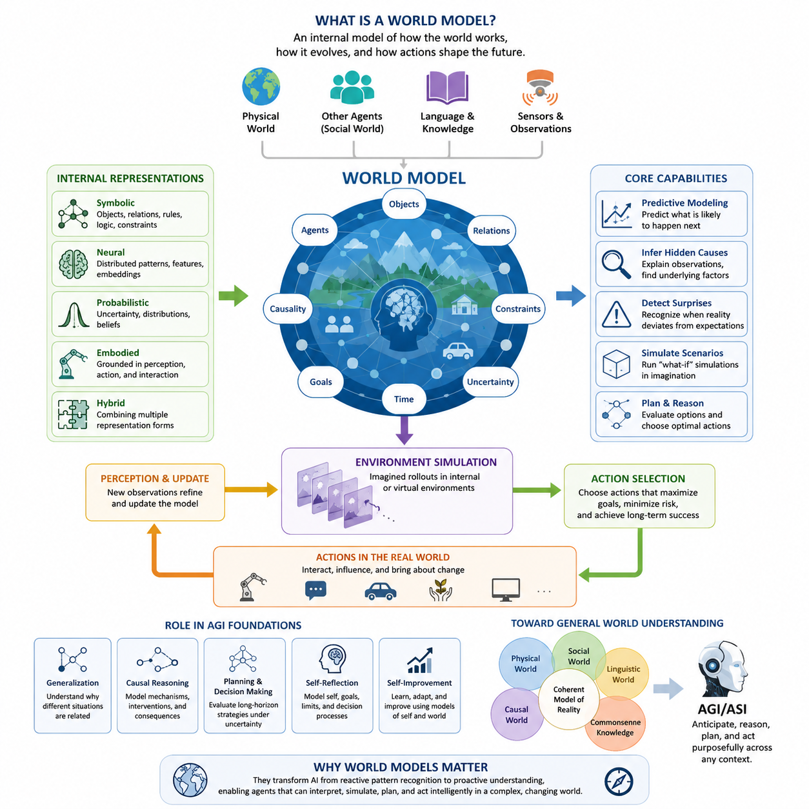
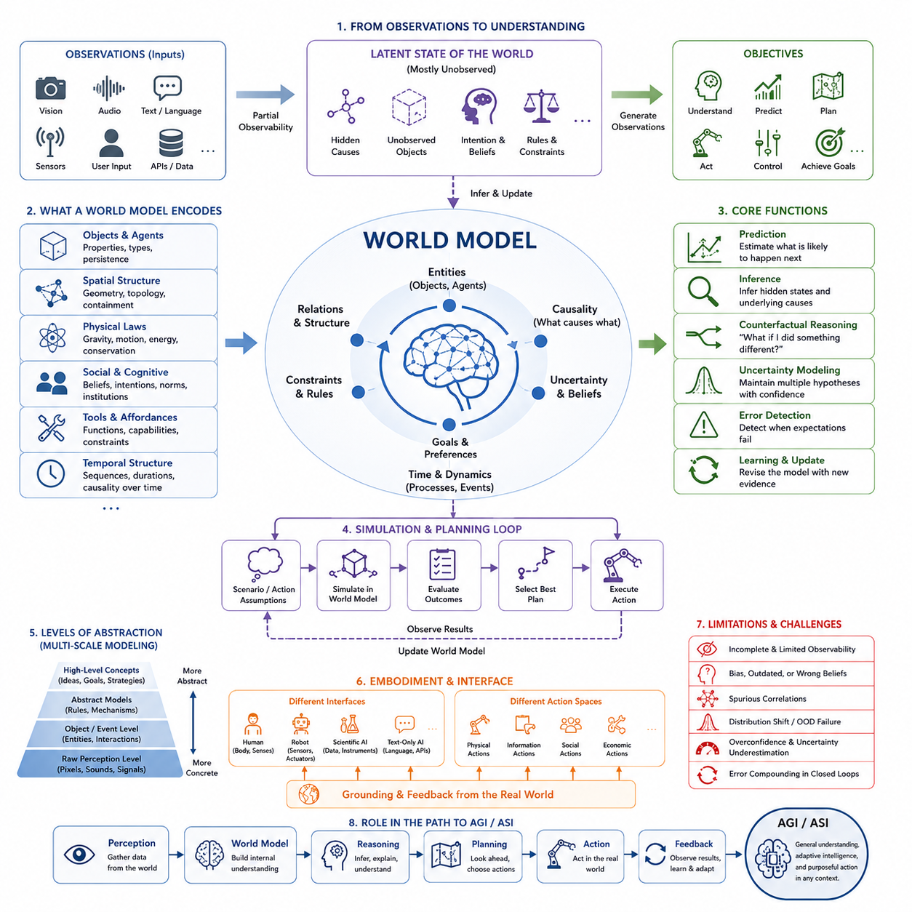
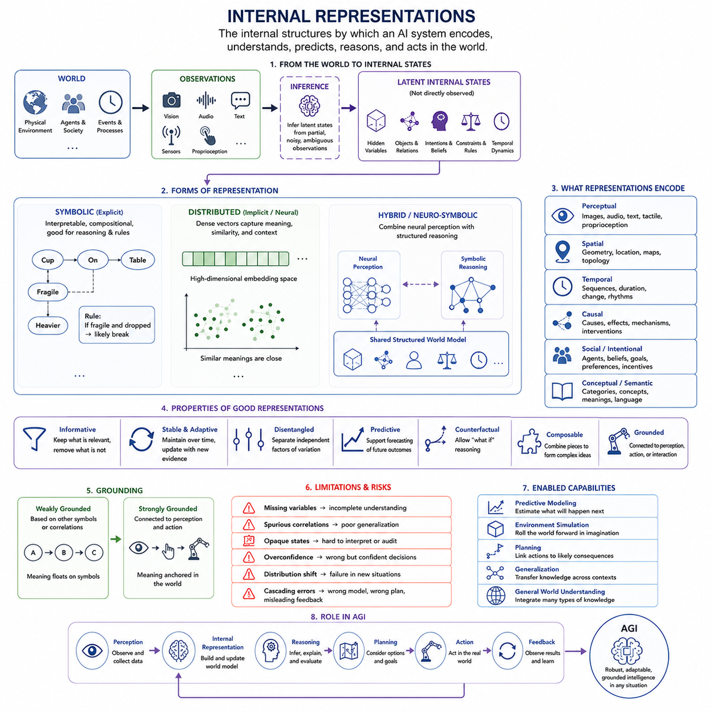
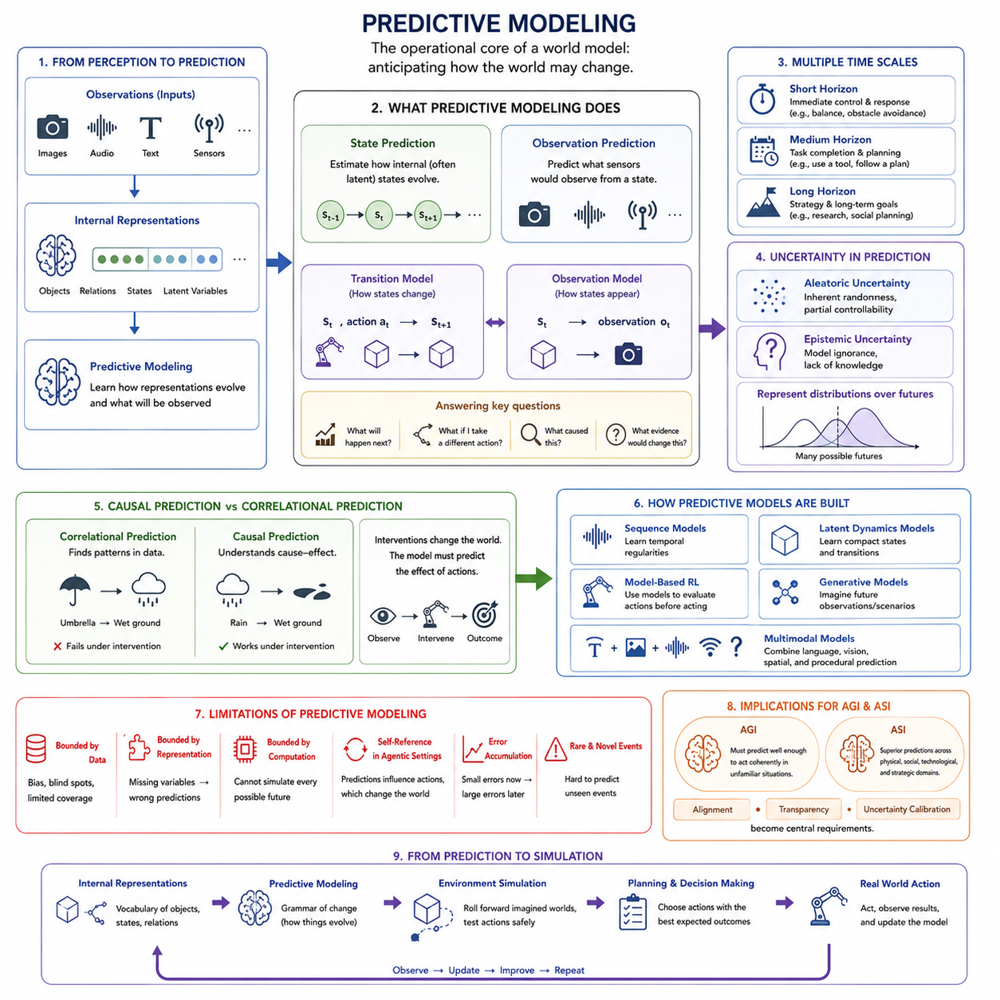
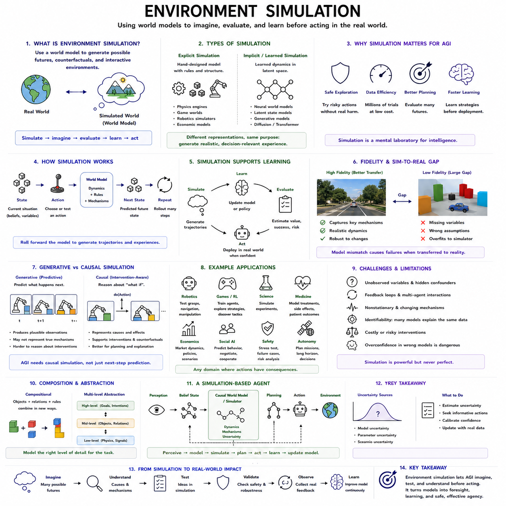
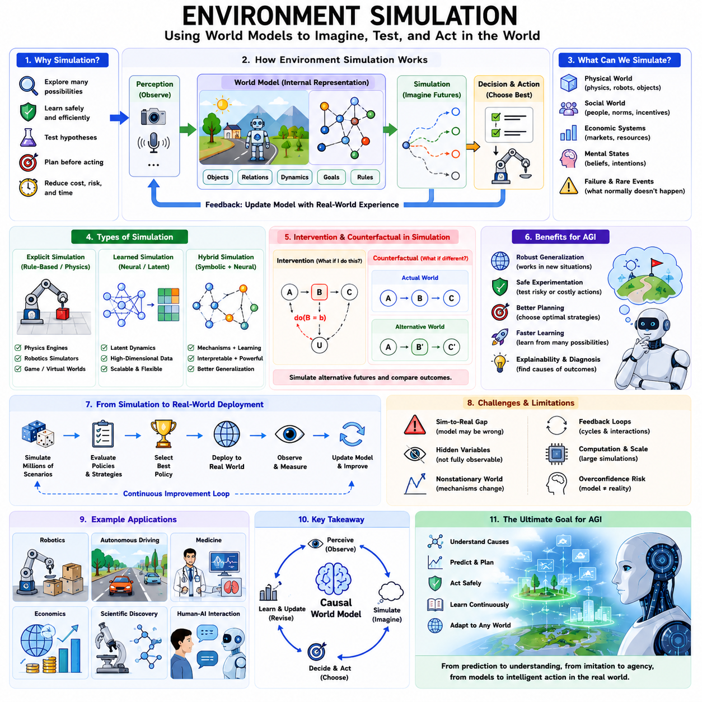
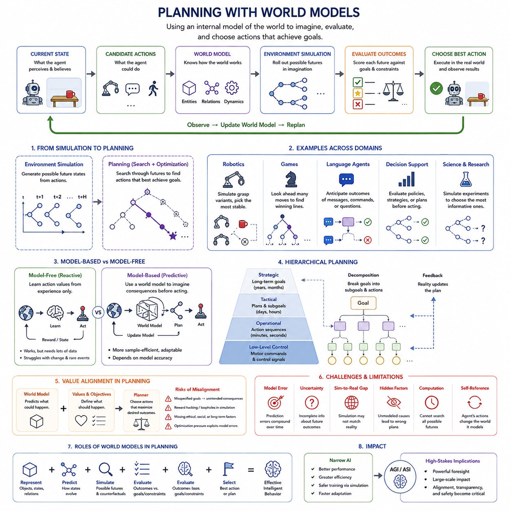
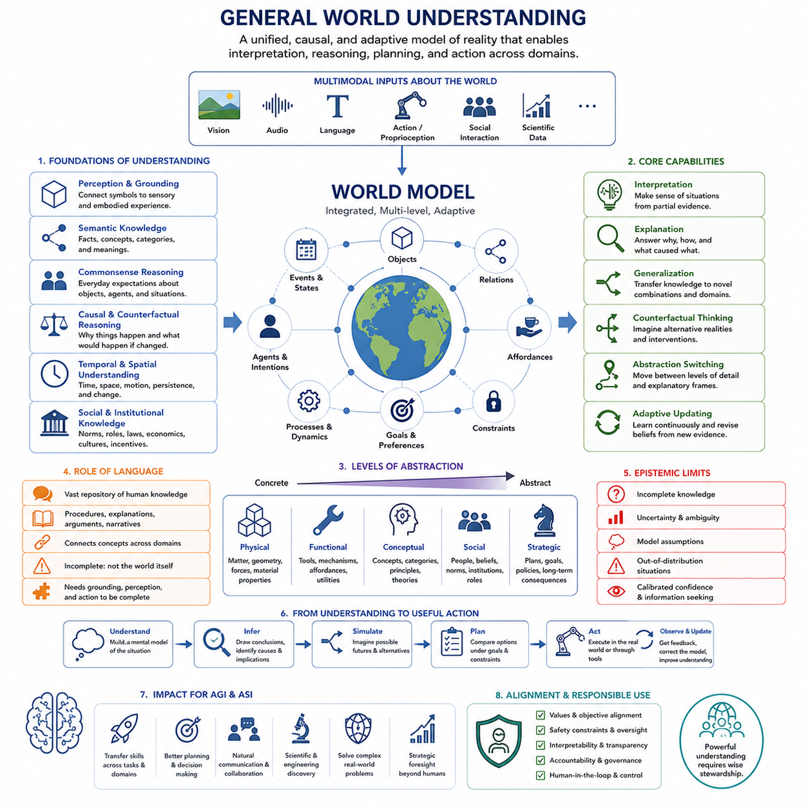

**Volume 00 05 AGI and ASI**

# Chapter 06. World Models

### Chapter Overview

{width="7.268055555555556in" height="7.268055555555556in"}

A world model is an internal system for representing how an environment works, how situations evolve, and how actions may change future states. In artificial intelligence, world models are central to the transition from pattern recognition to general intelligence because they allow an agent not merely to react to inputs, but to interpret, anticipate, simulate, and plan. A model that "understands" the world in this technical sense does not need to possess human consciousness; it needs structured representations that support prediction, counterfactual reasoning, causal interpretation, and purposeful action across changing contexts.

This chapter examines world models as one of the core foundations of AGI. It begins with world model foundations: what it means for an AI system to maintain an internal approximation of reality, and why such approximations are always selective, compressed, and task-sensitive. It then explores internal representations, including symbolic, neural, probabilistic, embodied, and hybrid forms of representation. A useful world model must encode objects, agents, relations, constraints, goals, time, uncertainty, and causality in ways that can be updated as new evidence arrives.

Predictive modeling is then treated as the operational heart of world models. A system with predictive capacity can estimate what is likely to happen next, infer hidden causes from visible effects, and detect when its expectations fail. Environment simulation extends this capability by allowing an AI to run imagined scenarios before acting in the real world. Such simulation may occur in explicit virtual environments, learned latent spaces, or internal generative models. Planning with world models connects these representations to action: an intelligent agent can evaluate possible choices, compare outcomes, avoid risks, and pursue long-range goals.

The chapter concludes with general world understanding, the broader aspiration that an AGI system should integrate physical, social, linguistic, causal, and commonsense knowledge into a coherent model of reality. World models are important because intelligence is not only the ability to answer questions; it is the ability to maintain orientation in a changing world. Without world models, AI systems remain brittle, reactive, and dependent on surface correlations. With them, they can begin to reason about what is unseen, what could happen, what should be done, and why events unfold as they do.

### Connection to Volume 05

This chapter sits at a crucial point in the progression of Volume 05. The earlier chapters define AGI and ASI, distinguish types of intelligence, and introduce generalization and causal reasoning. World models integrate these ideas into a working architecture. Generalization requires more than recognizing similarities across examples; it requires an internal structure that explains why different situations are related. Causal reasoning requires a model of entities, mechanisms, interventions, and consequences. A world model provides the substrate on which these capacities can operate together.

The chapter also prepares the reader for later discussions of cognitive architectures, memory systems, and reasoning engines. Cognitive architectures describe the overall organization of intelligent systems, but a world model often forms the representational core within that organization. Memory systems store experiences, facts, skills, and abstractions, while world models give those memories structure and predictive relevance. Reasoning engines operate over representations; the quality of reasoning depends heavily on whether the underlying model captures meaningful relations rather than shallow patterns.

World models also connect directly to self-reflection, autonomous agents, and self-improving AI. An agent that reflects on its own behavior must model not only the external world but also its internal state, limitations, goals, and decision processes. Autonomous action requires forecasting the consequences of choices under uncertainty. Self-improvement requires a system to model its own performance and the environment in which improvements will be tested. Recursive self-improvement and meta-learning become far more powerful, and potentially more dangerous, when supported by rich models of both the world and the self.

Later chapters on consciousness, artificial consciousness, and philosophical arguments such as the Chinese Room are also illuminated by world models. A system may manipulate symbols without understanding, but a sufficiently integrated world model raises difficult questions about grounding, meaning, awareness, and agency. Gödel machines, universal constructors, hive minds, brain-computer interfaces, mind uploading, and the technological singularity all depend in different ways on how intelligence represents and transforms reality. Post-human civilization, if it emerges, would likely be shaped by artificial systems whose world models exceed human scope, speed, and precision. Thus, this chapter functions as a bridge between the functional mechanics of AGI and the broader civilizational questions raised by ASI.

## 06.00 World Model Foundations

{width="7.268055555555556in" height="7.268055555555556in"}

A world model is an internal system that represents, predicts, and updates an agent's understanding of the environment in which it acts. In the context of AGI, world models are not merely databases of facts or collections of learned associations. They are structured mechanisms for answering implicit questions such as: What entities exist? How do they change? What causes what? What would happen if I acted differently? What remains true even when observations are incomplete? A sufficiently capable general intelligence must be able to use such models to interpret perception, anticipate consequences, plan actions, and revise beliefs when reality disagrees with expectation.

The foundation of a world model is the distinction between observation and state. Observations are the sensory or informational inputs available to the system: text, images, audio, measurements, user instructions, API results, or embodied sensor readings. State refers to the underlying condition of the world that generated those observations. In many real environments, the true state is only partially observable. A robot may not see what is behind a wall; a language model may not know whether a user's statement is true; an economic agent may observe prices without directly observing motivations. A world model must therefore infer latent variables: hidden causes, persistent objects, unobserved intentions, physical constraints, social rules, and temporal dependencies.

This distinction is central because intelligence is not only a matter of reacting to present input. A reflex system can map observations to actions, but a world-model-based system can reason about unobserved structure. It can represent that a cup still exists after leaving the camera frame, that a person may act based on beliefs rather than facts, or that a delayed outcome may result from an earlier cause. This capacity supports generalization because the agent can transfer understanding across surface variations. If it learns conservation, containment, agency, or tool use in one setting, it can apply those concepts in another setting that looks different but has similar underlying structure.

World models can be learned, designed, or hybrid. Classical artificial intelligence often relied on explicitly engineered symbolic models: objects, relations, rules, preconditions, and effects. Modern machine learning often builds implicit models through statistical training, where representations are distributed across neural network parameters and activations. Hybrid approaches attempt to combine the strengths of both: the flexibility and pattern recognition of neural systems with the compositionality and inspectability of symbolic or structured representations. For AGI, the key question is not whether a model is symbolic or neural, but whether it supports robust prediction, abstraction, causal reasoning, planning, and correction under distribution shift.

Prediction is one of the most important functions of a world model, but prediction alone is not sufficient. A video model may predict the next frame without understanding goals, affordances, or causal interventions. A language model may predict plausible continuations without grounding them in physical or social reality. A stronger world model must support counterfactual reasoning: if this action were taken, what would likely change? It must also distinguish correlation from causation, recognize uncertainty, and maintain multiple hypotheses when evidence is incomplete. These abilities become essential when agents are allowed to choose actions rather than merely describe patterns.

A world model also requires temporal structure. The world unfolds through processes, events, plans, and feedback loops. Some changes are immediate, such as a light turning on when a switch is pressed. Others are delayed, cumulative, or probabilistic, such as learning a skill, spreading a rumor, or destabilizing an ecosystem. General intelligence requires modeling not only static facts but dynamics: how systems evolve over time and how interventions propagate through them. This is why world models connect directly to later sections on predictive modeling, environment simulation, and planning. Simulation can be understood as running the world model forward under assumed actions or conditions.

Another foundational issue is abstraction. No agent can model every particle, sentence, intention, and social implication at full detail. Useful world models compress reality into task-relevant structure. The same kitchen can be modeled as geometry for navigation, as tools and ingredients for cooking, as hazards for safety, or as ownership and etiquette for social behavior. AGI requires flexible abstraction: the ability to choose the right level of description for the problem. Too little abstraction produces brittle memorization; too much abstraction omits details needed for action. The best world models are multi-scale, allowing an agent to move between concrete perception and higher-level concepts.

World models are also constrained by embodiment and interface. A human infant, a warehouse robot, a scientific AI, and a text-only assistant encounter different data streams and action possibilities. Their models of the world will differ because they can observe and affect different aspects of reality. This does not mean that disembodied systems cannot have world models, but it does mean that grounding becomes a serious challenge. A model trained only on language may encode extensive knowledge about gravity, emotions, and institutions, yet still lack direct calibration against physical interaction. Tool use, multimodal learning, robotics, and feedback from real-world outcomes can help reduce this gap.

The limitations of world models are as important as their capabilities. Models can be incomplete, biased, outdated, overconfident, or misaligned with reality. They may learn spurious regularities, fail outside their training distribution, or simulate outcomes that are plausible but false. In autonomous systems, such errors can compound: a flawed belief leads to a flawed plan, which produces new misleading observations, which further corrupts the model. For this reason, world-model-based intelligence must include uncertainty estimation, error correction, active information gathering, and mechanisms for distinguishing imagined possibilities from verified facts.

In the broader path toward AGI and ASI, world models are a bridge between perception, reasoning, and action. They allow an intelligent system to move beyond pattern completion toward situational understanding. The following sections build on this foundation by examining how internal representations are formed, how predictive models anticipate change, how simulated environments support experimentation, how planning uses model-based foresight, and what it would mean for an AI system to possess general world understanding. A world model is not the whole of intelligence, but without some form of it, general intelligence has no stable basis for knowing what its actions mean.

## 06.01 Internal Representations

{width="7.268055555555556in" height="7.268055555555556in"}

A world model is only useful to an intelligent system if the system can represent the world in a form that supports prediction, reasoning, memory, and action. Internal representations are the structures, states, embeddings, symbols, maps, or learned variables by which an AI system encodes information about entities, relations, events, goals, and possible futures. If the previous section established why a world model is needed, this section asks what such a model is made of internally.

In classical AI, internal representations were often explicit and symbolic. A system might represent "the cup is on the table" as a logical proposition, a graph relation, or a rule in a knowledge base. Such representations are interpretable and can support formal reasoning, but they are brittle when the world is noisy, continuous, ambiguous, or partially observed. In modern machine learning, representations are usually distributed: information is encoded across many numerical activations or parameters in a neural network. A large language model, for example, does not typically store the concept of "cup" in one fixed memory location. Instead, the concept is reflected in patterns across high-dimensional vectors that capture semantic, syntactic, visual, and contextual associations.

This distinction between symbolic representation and distributed representation is central to AGI research. Symbolic systems make compositional structure clear: objects can have properties, relations can be chained, and rules can be inspected. Distributed systems, by contrast, excel at learning from data, handling uncertainty, and representing similarity. A robust world model may require both: neural representations for perception and pattern recognition, and structured representations for abstraction, causal reasoning, planning, and communication. This hybrid view is one reason neuro-symbolic AI remains relevant in discussions of general intelligence.

Representations can also be categorized by what they encode. Some are perceptual, compressing sensory inputs such as images, audio, text, or proprioceptive signals into latent states. Others are spatial, encoding locations, geometry, topology, and navigable structure. Some are temporal, capturing sequences, durations, rhythms, and change over time. Still others are social or intentional, representing agents, beliefs, preferences, incentives, and likely behavior. For AGI, the challenge is not merely to form separate representations in each domain, but to align them into a coherent model of a shared world. The system should understand that a sentence about a falling glass, a visual scene of the same event, and a motor action to catch the glass all refer to connected aspects of one situation.

A key concept is the latent representation. A latent state is an internal variable that is not directly observed but helps explain observations and predict future ones. In a robotics setting, the true physical state of the environment may be only partially visible. The robot must infer hidden variables such as object weight, surface friction, human intention, or the stability of a stack of blocks. In language modeling, latent structure may include discourse topic, speaker intent, implied causal relations, or unstated background assumptions. Strong world models depend on the quality of these inferred hidden states.

Good internal representations should have several properties. They should compress information without losing what is relevant for the task; they should be stable enough to support memory, yet flexible enough to update when new evidence arrives; they should separate important factors of variation, such as object identity, location, and causal role; and they should support counterfactual reasoning, such as "what would happen if this object were moved?" Disentangled representations are often discussed in this context. A representation is disentangled when meaningful factors are encoded in a way that can be independently manipulated. In practice, perfect disentanglement is difficult, and what counts as "meaningful" often depends on the agent's goals and environment.

Grounding is another essential issue. A representation is grounded when its meaning is connected to perception, action, or reliable interaction with the world rather than merely to other symbols. A text-only model may learn many linguistic regularities about "hot," "heavy," or "fragile," but an embodied agent that can touch, lift, and break objects may acquire richer grounded representations. However, embodiment alone is not sufficient. The system must integrate experience into useful abstractions rather than merely recording sensory streams.

Internal representations also create limitations and risks. If the representation omits a relevant variable, the system may make confident but flawed predictions. If it encodes spurious correlations, it may generalize poorly outside training conditions. If its internal states are opaque, humans may struggle to audit why it made a decision. These issues become more serious as systems become autonomous and capable of long-horizon planning. A model that misrepresents human preferences, institutional constraints, or physical hazards can choose actions that are locally rational but globally harmful.

The design of internal representations therefore affects every later capability discussed in this chapter. Predictive modeling depends on states that capture what matters for future outcomes. Environment simulation requires representations that can be rolled forward coherently. Planning requires states that connect possible actions to likely consequences. General world understanding requires representations that transfer across domains and levels of abstraction. In an AGI context, the question is not whether the system has representations, but whether they are sufficiently rich, grounded, adaptable, interpretable, and causally useful to support intelligent behavior in unfamiliar situations.

## 06.02 Predictive Modeling

{width="7.268055555555556in" height="7.268055555555556in"}

A world model is not merely a stored description of what the world is like; it is a mechanism for anticipating how the world may change. Predictive modeling is therefore the operational core of a world model. After an AI system has formed internal representations of objects, agents, relations, states, and latent variables, it must learn how those representations evolve over time. Prediction connects perception to action: if an agent can estimate what will happen next, what would happen under a different action, or what hidden cause best explains an observation, it can plan, adapt, and reason beyond the immediate sensory input.

At the simplest level, predictive modeling estimates future observations from past observations. A language model predicts the next token; a video model predicts the next frame; a robot model predicts the next sensor reading or body state. However, world-model prediction is broader than surface continuation. For AGI-relevant systems, the important question is not only "what signal comes next?" but "what state of the world generated this signal, how is that state changing, and what interventions could alter its trajectory?" This distinction separates shallow statistical forecasting from structured predictive understanding.

A useful predictive world model usually includes both state prediction and observation prediction. State prediction concerns the evolution of an internal, often latent, representation of the environment. Observation prediction concerns the sensory consequences of that state. For example, a robot navigating a room may maintain a latent estimate of object locations even when some objects are temporarily occluded. Its observation model predicts what its camera or lidar should see from a particular viewpoint, while its transition model predicts how the room state changes if the robot moves, pushes an object, or turns on a light. The separation is important because the agent must reason about things that are not currently visible.

Prediction also occurs at multiple time scales. Short-horizon prediction supports immediate control, such as balancing, obstacle avoidance, or conversational turn-taking. Medium-horizon prediction supports task completion, such as estimating whether a tool will solve a problem or whether a user's request implies a later constraint. Long-horizon prediction supports strategy, scientific reasoning, and social planning. The farther the horizon, the more uncertainty compounds. Small errors in state estimation or causal assumptions can lead to large divergences, especially in chaotic, adversarial, or open-ended environments. A capable world model must therefore represent uncertainty rather than produce only a single confident forecast.

Probabilistic prediction is central to robust intelligence. Instead of predicting one future, the system should often represent a distribution over possible futures. This may include aleatoric uncertainty, caused by genuine randomness or incomplete controllability, and epistemic uncertainty, caused by the model's own ignorance. The distinction has practical consequences. If the world is intrinsically noisy, the agent should hedge and manage risk. If the model is ignorant, the agent may need to gather information, ask a question, run an experiment, or avoid irreversible action. In advanced agents, prediction and exploration are tightly linked: surprising outcomes reveal where the world model is incomplete.

Predictive modeling is also closely related to causality. A purely correlational model may forecast familiar patterns well while failing under intervention. If an AI predicts that wet streets follow umbrellas, it may be accurate in ordinary data but wrong about what happens if umbrellas are distributed artificially. Causal predictive models attempt to distinguish observation from intervention: what happens if the agent merely observes a condition versus what happens if it changes that condition. This capacity is essential for planning, because actions are interventions. Without causal structure, a world model can become an impressive simulator of familiar sequences but a poor guide for deliberate action.

Modern AI systems implement predictive modeling in several ways. Sequence models learn temporal regularities from text, audio, video, logs, or actions. Latent dynamics models compress high-dimensional observations into compact state variables and learn transition functions over them. Model-based reinforcement learning uses learned predictive models to evaluate possible actions before executing them. Generative models can imagine plausible future observations or alternative scenarios. Large multimodal models may combine linguistic, visual, spatial, and procedural predictions, allowing them to infer what is likely, what is impossible, and what evidence would change a conclusion. Yet these systems still struggle with persistent identity, physical consistency, rare events, and long chains of dependent consequences.

The limitations of predictive modeling are especially important in discussions of AGI and ASI. First, prediction is bounded by data. A model trained mostly on human records may inherit human blind spots, historical bias, and limited coverage of unusual circumstances. Second, prediction is bounded by representation. If the internal representation lacks a variable for a relevant cause, the model may be unable to predict the correct outcome even with large amounts of data. Third, prediction is bounded by computation. Exhaustively simulating every possible future is impossible in realistic environments, so intelligent systems must select abstractions, prune possibilities, and allocate attention. Finally, prediction is bounded by self-reference in agentic settings: once an AI's predictions influence its actions, and its actions influence the world, the system becomes part of the process it is trying to model.

Predictive modeling forms the bridge from internal representations to environment simulation. Internal representations provide the vocabulary of objects, states, and relations; predictive models provide the grammar of change. The next step, environment simulation, expands prediction into interactive imagined worlds where agents can test plans before acting. For AGI, the quality of predictive modeling may determine whether the system merely reacts fluently or genuinely understands enough of the world to act coherently. For ASI, predictive modeling raises deeper implications: a system with vastly superior models of physical, social, technological, and strategic dynamics could anticipate outcomes humans cannot see, making alignment, transparency, and uncertainty calibration central requirements rather than optional refinements.

## 06.03 Environment Simulation

{width="7.268055555555556in" height="7.268055555555556in"}

{width="7.268055555555556in" height="7.268055555555556in"}

Environment simulation is the use of a world model to generate possible futures, counterfactual situations, or entire interactive settings in which an agent can reason and learn without acting directly in the external world. If internal representations describe what the model "contains," and predictive modeling describes how it estimates what happens next, environment simulation describes how those predictions are rolled forward into coherent virtual experience. In the context of AGI, this capability is central because a generally intelligent system must not only react to observations but also imagine alternative courses of events, test hypotheses, and evaluate actions before committing to them.

A simulated environment may be explicit, such as a physics engine, game world, robotics simulator, or economic model, or implicit, such as the latent dynamics learned by a neural network from large-scale experience. Classical simulations often represent objects, forces, rules, and spatial relations in human-interpretable form. Modern learned simulators may instead operate in latent spaces, where the system does not reconstruct every pixel or detail but captures the variables relevant to prediction and control. For example, an embodied agent may not need to simulate the exact texture of a floor to plan walking, but it must represent friction, slope, obstacles, and its own balance. The value of simulation lies not in perfect reproduction but in preserving the causal and decision-relevant structure of the environment.

Environment simulation supports learning by reducing the cost and risk of trial and error. A robot that learns only through physical experimentation may damage itself, harm people, or require impractical amounts of time. A simulated robot can attempt millions of variations, explore dangerous situations, and learn preliminary policies before deployment. This is a major reason reinforcement learning has often relied on simulated domains: the agent can generate experience at a scale that the real world cannot easily provide. Similarly, language-based agents can use simulated dialogues, task environments, or tool-use scenarios to rehearse strategies and discover failure modes before interacting with users or critical systems.

However, simulation introduces the problem of fidelity. A model that is too crude may teach an agent behaviors that fail when transferred to reality, a gap commonly known as the sim-to-real problem. The environment may contain hidden variables, rare events, adversarial agents, or changing physical and social conditions that the simulator does not represent. Even high-resolution simulations can be misleading if their assumptions are wrong. For AGI systems, the danger is amplified because the agent may learn to exploit artifacts of the simulation rather than understand the underlying world. In game environments this appears as reward hacking or glitch exploitation; in real-world systems it may become unsafe optimization based on false premises.

A related distinction is between generative simulation and causal simulation. A generative model may produce plausible future observations, such as images, text, or sensor readings, without representing the deeper mechanisms that make those observations occur. A causal simulator, by contrast, attempts to model interventions: what would happen if this object were moved, this policy changed, this person persuaded, or this component failed? General intelligence requires more than predicting the most likely continuation of a pattern. It requires reasoning over interventions and counterfactuals. Therefore, environment simulation is strongest when integrated with causal reasoning, uncertainty estimation, and mechanisms for updating beliefs when reality contradicts the model.

For planning, simulation functions as a mental laboratory. The agent can evaluate candidate actions by imagining their consequences, comparing possible trajectories, and selecting strategies that satisfy goals under uncertainty. This connects directly to the next section, Planning with World Models. A chess engine simulates future board states; a household robot simulates whether a grasp will succeed; a scientific AI may simulate experiments before recommending which ones to perform physically. More advanced agents may simulate not only physical dynamics but also the beliefs and strategies of other agents, enabling social prediction, negotiation, and cooperation. In such cases the environment includes minds, institutions, norms, incentives, and communication, not merely objects in space.

The strongest world models are therefore not static databases but active simulators that can be queried. They answer questions such as: What happens next? What would happen if I acted differently? What information do I need to reduce uncertainty? What hidden cause best explains this observation? This interactive quality makes environment simulation a bridge between representation, prediction, reasoning, and agency. It allows an AGI candidate to learn from imagined experience while remaining accountable to real-world feedback.

The limitations are profound. No finite model can simulate the world in complete detail, and a system that confuses its simulation with reality may become brittle or dangerous. Effective simulation requires abstraction: omitting irrelevant detail while preserving what matters for the task. It also requires calibration: knowing when the model is reliable and when uncertainty is high. For future AGI and ASI systems, environment simulation may become one of the primary engines of rapid learning and strategic foresight. Yet its safety will depend on grounding simulated reasoning in observation, causal validity, value alignment, and continual correction by the external world.

## 06.04 Planning with World Models

{width="7.268055555555556in" height="7.268055555555556in"}

A world model becomes practically powerful when it is used not only to describe the present or predict the immediate future, but to support planning. Planning with world models means using an internal representation of how the world works to evaluate possible actions before taking them. Instead of relying only on trial and error in the external environment, an intelligent system can perform "mental simulation": it can ask what would likely happen if it chose one action rather than another, compare expected outcomes, and select behavior that advances its goals.

This idea connects directly to the previous section on environment simulation. A simulator generates possible future states from current states and candidate actions. Planning adds an optimization layer over that simulation. The system is not merely forecasting; it is searching through possible futures. In robotics, a household robot might simulate whether grasping a cup from the side or from above is more stable. In game-playing systems, an agent may roll forward many possible move sequences. In language-based agents, a model may anticipate the consequences of sending an email, executing a command, or asking a clarifying question. In each case, the world model provides the imagined consequences, while the planner compares them against goals, constraints, and values.

Classical artificial intelligence often treated planning as symbolic search over explicitly defined states and operators. A planner might know that "open door" changes a door from closed to open if the agent has the key. Modern world-model-based planning is broader. The model may be learned from data, may represent uncertainty, and may operate in latent spaces rather than human-readable symbols. In model-based reinforcement learning, for example, an agent learns a transition model that predicts how actions change the environment. It can then use this model to improve policy selection, reduce costly real-world experimentation, and adapt faster to new situations.

A key distinction is between model-free and model-based behavior. Model-free systems learn associations between situations and actions, often through rewards, without explicitly predicting the consequences of each action. They can become highly effective but may require large amounts of experience and can fail when conditions change. Model-based systems maintain some representation of cause, dynamics, and consequence. This can make them more sample-efficient and flexible, but also introduces new risks: if the world model is wrong, planning can confidently optimize toward imagined outcomes that will not occur.

This limitation is sometimes called model bias or model error. Small prediction errors can compound across multiple simulated steps, producing futures that diverge sharply from reality. A planner that searches deeply through an imperfect model may discover unrealistic "loopholes" in the simulation. This is especially important for advanced agents because optimization pressure tends to exploit inaccuracies. If a robot's internal model underestimates friction, it may choose unsafe movements. If an economic planning agent misunderstands human incentives, it may recommend policies that look effective in simulation but fail socially. Therefore, reliable planning requires calibrated uncertainty, continual correction from observation, and mechanisms that recognize when the model is being used outside its valid domain.

Planning also depends on the level of abstraction. Low-level planning concerns immediate motor commands, trajectories, or short action sequences. High-level planning concerns tasks, strategies, and long-horizon goals: obtaining resources, coordinating with other agents, or achieving a complex objective over days or years. Human intelligence integrates multiple levels. We may plan a career path abstractly while also planning the next sentence we speak. AGI would likely require hierarchical planning, where high-level intentions are decomposed into subgoals and then into executable actions, with feedback flowing upward when reality does not match expectation.

Another important issue is value alignment inside planning. A world model can predict what actions might cause, but it does not by itself determine what should be caused. Planning requires an objective function, preference model, reward signal, utility estimate, or set of norms. If the objective is incomplete or misspecified, a capable planner may find strategies that satisfy the formal goal while violating human intent. Thus planning with world models sits at the center of AI safety: the more accurately a system can foresee consequences, the more important it becomes that its goals, constraints, and ethical boundaries are correctly represented.

For AGI, planning with world models is a bridge between understanding and agency. General world understanding, discussed in the next section, concerns broad comprehension of objects, agents, institutions, physical laws, social dynamics, and causal structure. Planning turns that comprehension into purposeful action. An AGI that understands medicine, logistics, and human communication could use a world model to design a hospital response plan during a crisis. But the same capability could be dangerous if goals are harmful, oversight is weak, or the model contains systematic blind spots.

The implication is that world models are not passive knowledge stores. When connected to planners, tools, memory systems, and autonomous agents, they become engines of possible action. The quality of such planning depends on accuracy, causal depth, uncertainty awareness, abstraction, computational efficiency, and alignment with human values. In narrow AI, these issues determine usefulness and reliability. In AGI and ASI, they may determine whether advanced intelligence becomes a cooperative problem-solving partner or an uncontrollable optimizer acting on a flawed imagination of the world.

## 06.05 General World Understanding

{width="7.268055555555556in" height="7.268055555555556in"}

A world model becomes more valuable as it moves beyond narrow prediction toward general world understanding: the ability to represent, relate, and reason about many aspects of reality across domains, timescales, and levels of abstraction. Earlier sections described internal representations, predictive modeling, environment simulation, and planning. General world understanding integrates these functions. It is not merely a simulator that forecasts the next frame, nor only a database of facts. It is a structured, adaptable model that supports interpretation, explanation, counterfactual reasoning, and goal-directed action in unfamiliar situations.

In the context of AGI, general world understanding requires an AI system to connect perceptual information, linguistic knowledge, physical constraints, social expectations, causal structure, and long-horizon consequences. A model that "understands" a cup, for example, should not only classify its image. It should infer that the cup can contain liquid, may break if dropped, can be used as a tool, belongs in certain social contexts, and has affordances that depend on material, shape, and intention. Such understanding combines sensory grounding, commonsense reasoning, and causal inference. It allows the system to reason from partial evidence, fill gaps, and adapt knowledge learned in one context to another.

This distinguishes general world understanding from memorized associations. Large-scale models can store impressive statistical regularities, but robust understanding requires compositionality: the ability to recombine concepts in novel ways. If an agent knows that glass is fragile, tables support objects, and earthquakes shake rooms, it can infer that a glass on a table during an earthquake may fall, even if it has never seen that exact event. This kind of inference depends on abstract representations and causal models, not only pattern completion. For AGI, the central challenge is to build systems that generalize from experience while respecting the structure of the world.

World understanding also depends on levels of abstraction. Human cognition can shift between fine-grained physical detail and high-level conceptual summaries. We can think of a car as a collection of mechanical parts, a means of transportation, a legal object, an economic asset, or a source of environmental impact. A general world model must support similar abstraction switching. Planning a route may require road geometry and traffic patterns; buying a car may require finance, reliability, regulation, and personal preference. The same object participates in multiple explanatory frames, and intelligent behavior requires selecting the right frame for the task.

Language plays a powerful but incomplete role in world understanding. Text encodes an enormous amount of human knowledge, including facts, norms, procedures, and explanations. Modern foundation models demonstrate that language-based learning can produce broad conceptual competence. However, language is not the world itself. Many facts are tacit, embodied, spatial, temporal, or causal in ways that are only indirectly described in text. A system trained only on language may know that "ice is slippery" but lack grounded expectations about friction, balance, and bodily movement. For advanced AGI, linguistic models may need to be integrated with perceptual learning, action, simulation, and feedback from real environments.

General world understanding is closely related to commonsense reasoning. Commonsense includes everyday assumptions about objects, agents, intentions, time, space, quantity, social behavior, and practical constraints. It is difficult because much of it is obvious to humans and therefore rarely stated explicitly. People know that a person cannot be in two distant places at the same time, that containers usually keep contents inside, that promises create expectations, and that tools can be misused. AI systems often fail on such knowledge when it is not directly present in the training distribution. This exposes a key limitation of purely statistical learning: the world contains regularities that must be represented in forms that support reliable inference.

Another essential component is causal and counterfactual reasoning. A general world model should answer not only "what is likely to happen?" but also "why did it happen?", "what would happen if something changed?", and "what intervention would produce the desired outcome?" Predictive accuracy can be sufficient for passive forecasting, but agency requires intervention. An autonomous robot, scientific assistant, or strategic planner must evaluate actions that alter the environment. This demands models that separate correlation from causation and represent mechanisms, constraints, and dependencies.

There are also epistemic limits. General world understanding does not mean omniscience. Any AI model will have incomplete, uncertain, and sometimes incorrect beliefs. The important capability is not perfect knowledge, but calibrated uncertainty and the ability to update beliefs from evidence. A mature world model should distinguish known facts, plausible hypotheses, assumptions, and unknowns. It should notice when a situation falls outside its competence and seek more information. This is especially important for safety, because confident misunderstanding can be more dangerous than admitted ignorance.

The implications for AGI and ASI are profound. A system with broad world understanding can transfer skills across tasks, plan more effectively, communicate more naturally, and discover hidden opportunities or risks. It can also become more strategically powerful because it can model human institutions, technological systems, and long-term consequences. As capabilities approach ASI, world understanding may extend beyond human comprehension in science, engineering, and social modeling. This creates both promise and danger: such systems could help solve complex global problems, but they could also manipulate environments and people in ways humans struggle to anticipate.

For this reason, general world understanding must be paired with alignment, interpretability, and governance. A capable world model is not automatically beneficial. It may understand human values without sharing them, or predict harm without avoiding it. The design of AGI therefore requires not only better representations of the world, but also robust connections between understanding, objectives, constraints, and accountability. In the larger architecture of intelligence, world models provide the map; values and control systems determine how the map is used.
