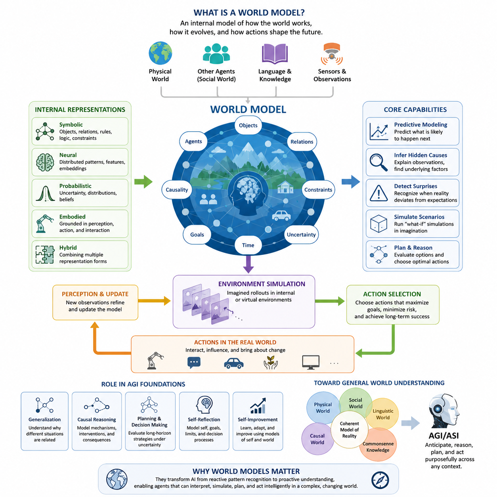
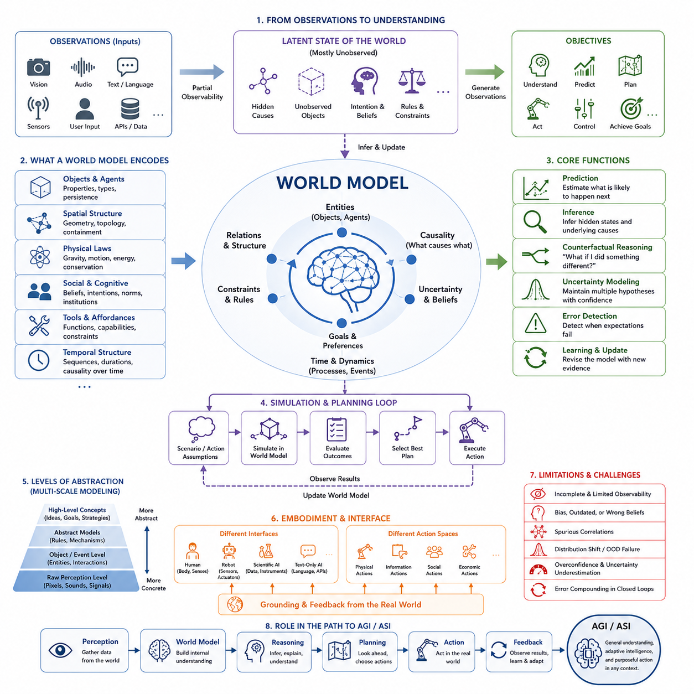
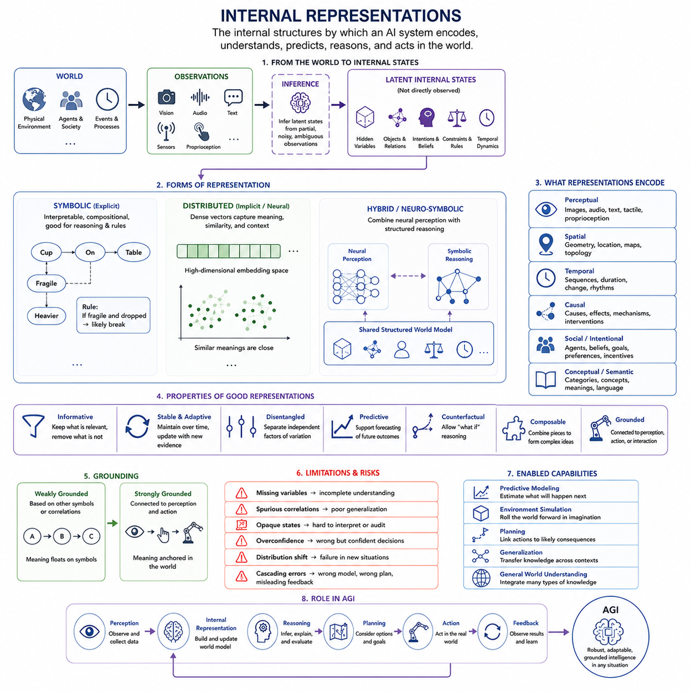
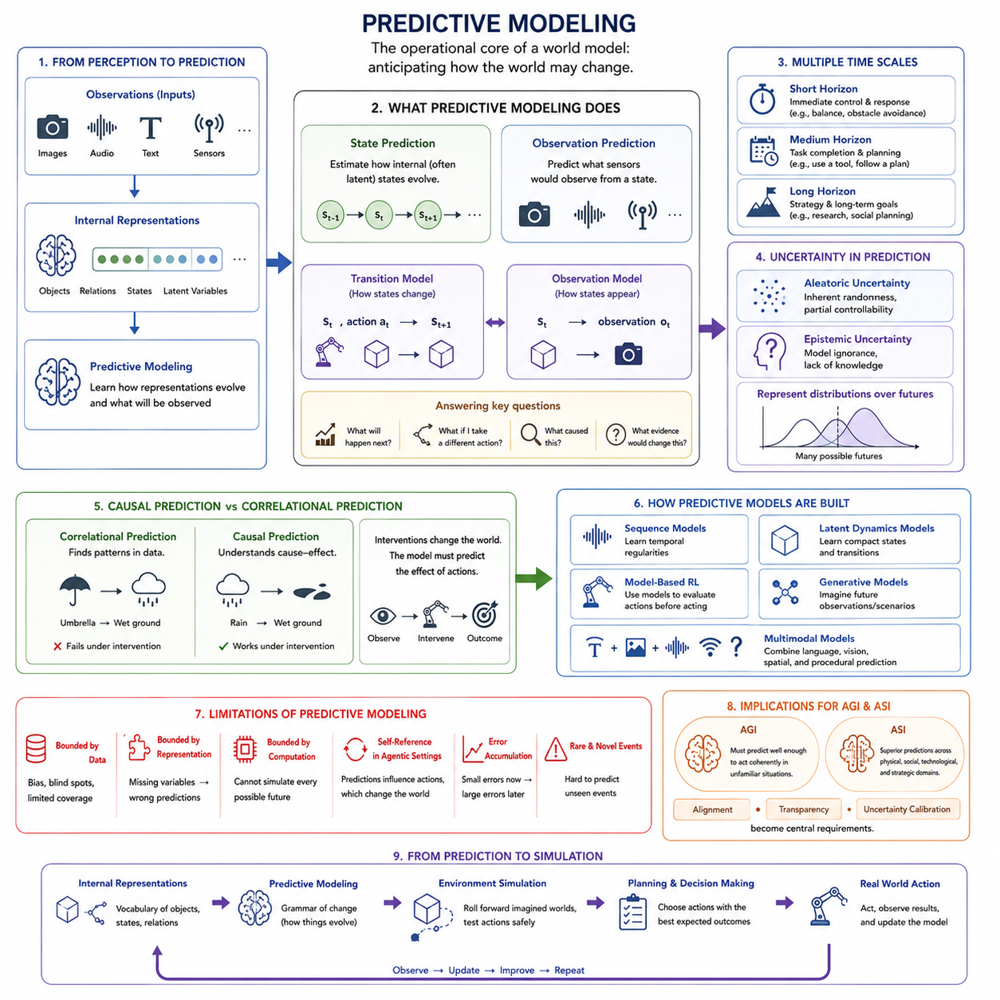
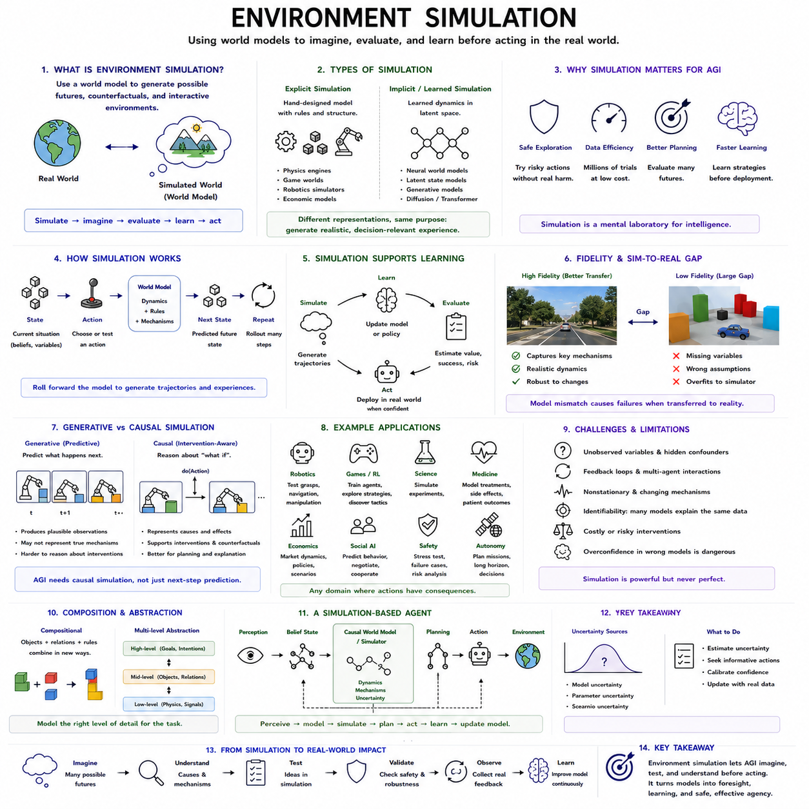
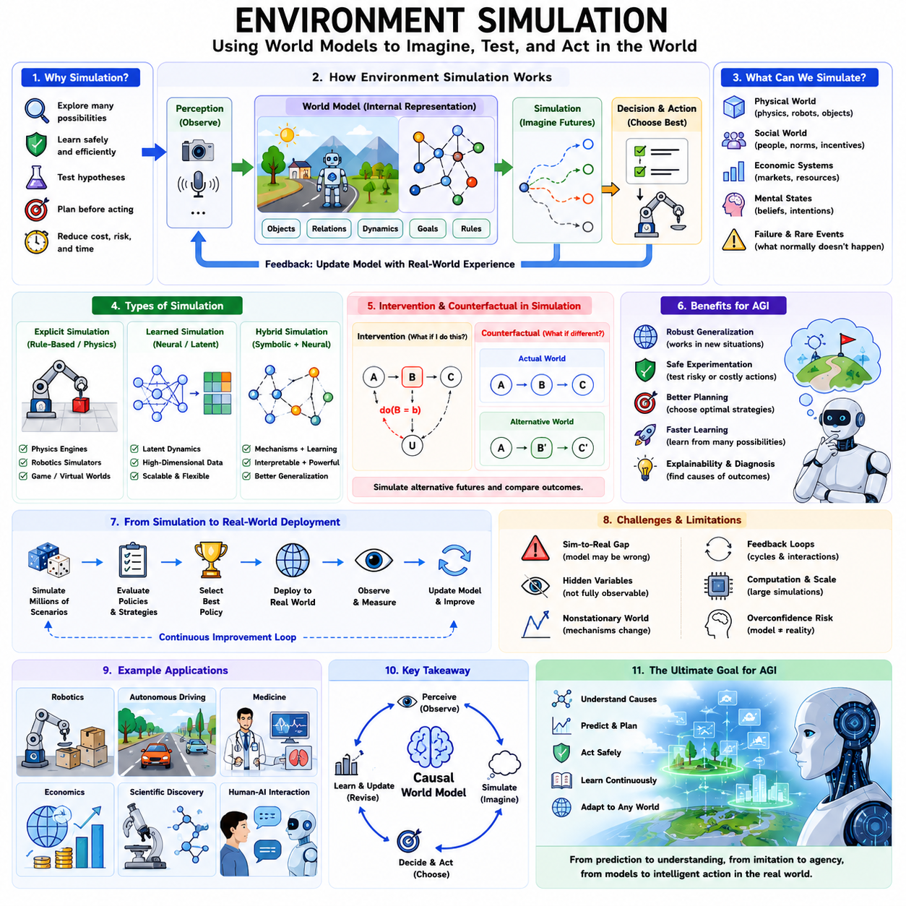
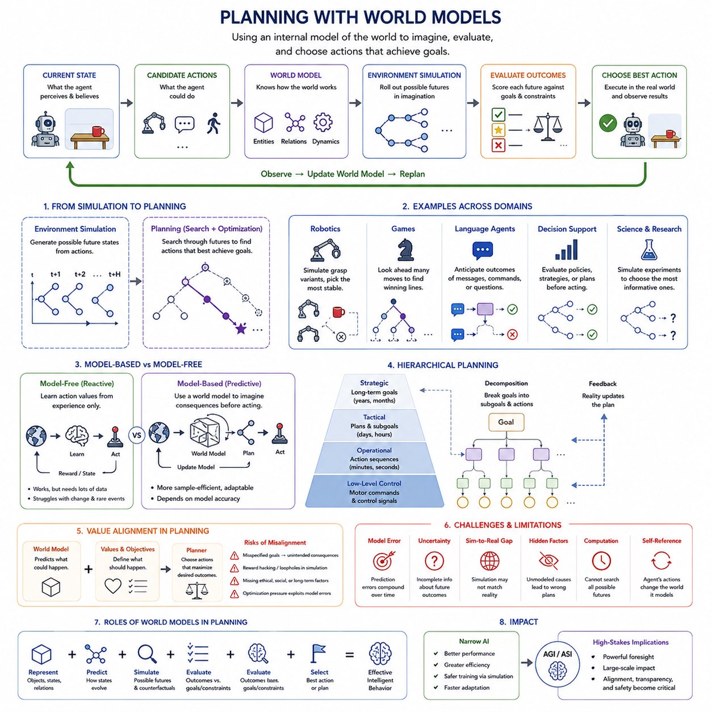
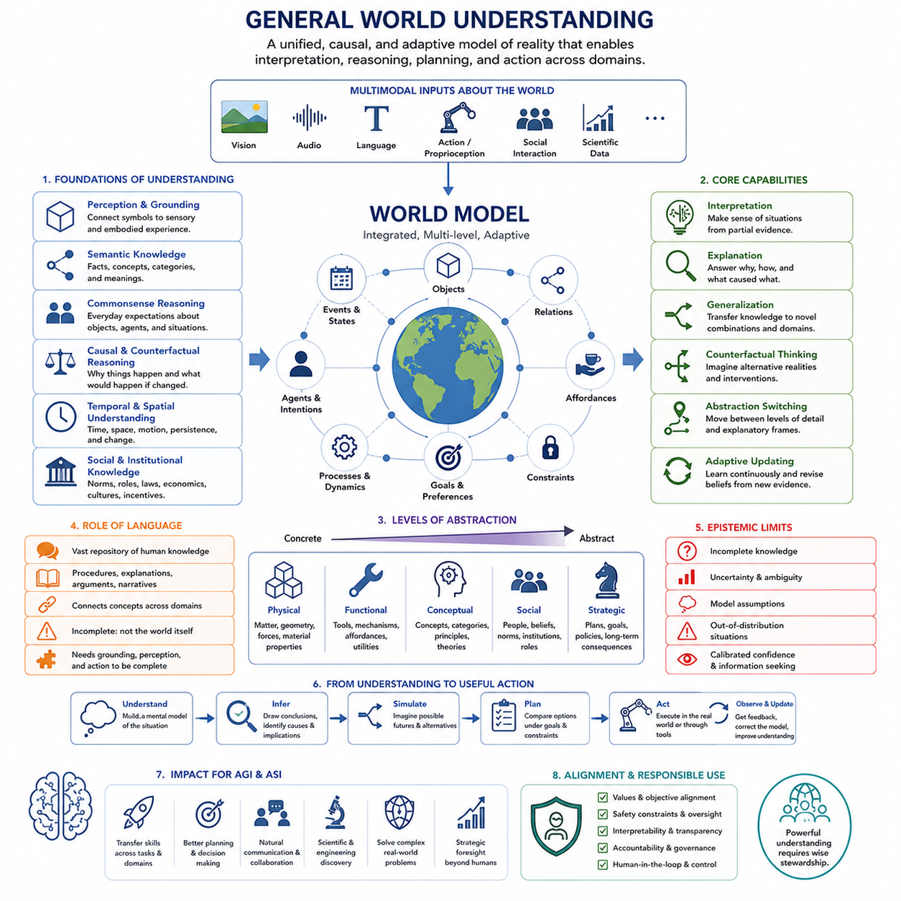

**Volume 00 05 AGI and ASI**

# Chapter 06. World Models

### Chapter Overview

{width="7.268055555555556in" height="7.268055555555556in"}

세계 모델(World Model)은 환경이 어떻게 작동하는지, 상황이 어떻게 변화하는지, 그리고 행동이 미래 상태를 어떻게 바꿀 수 있는지를 표현하는 내부 시스템이다. 인공지능에서 세계 모델은 패턴 인식에서 범용 지능으로 넘어가는 데 핵심적인 역할을 한다. 세계 모델은 에이전트가 입력에 단순히 반응하는 데 그치지 않고, 해석하고, 예측하고, 시뮬레이션하고, 계획할 수 있게 해주기 때문이다. 기술적 의미에서 세계를 "이해하는" 모델이 반드시 인간과 같은 의식(consciousness)을 가져야 하는 것은 아니다. 중요한 것은 변화하는 맥락 속에서 예측(prediction), 반사실적 추론(counterfactual reasoning), 인과적 해석(causal interpretation), 목적 지향적 행동을 가능하게 하는 구조화된 표현을 갖추는 것이다.

이 장은 세계 모델을 AGI의 핵심 기반 중 하나로 다룬다. 먼저 세계 모델의 기초를 살펴본다. AI 시스템이 현실에 대한 내부 근사 모델을 유지한다는 것이 무엇을 의미하는지, 그리고 그러한 근사가 왜 항상 선택적이고, 압축되어 있으며, 과업에 민감한지를 설명한다. 이어서 내부 표현(Internal Representations)을 탐구한다. 여기에는 기호적(symbolic), 신경망 기반(neural), 확률적(probabilistic), 체화된(embodied), 하이브리드(hybrid) 표현 방식이 포함된다. 유용한 세계 모델은 객체, 에이전트, 관계, 제약, 목표, 시간, 불확실성, 인과성을 새로운 증거가 들어올 때 갱신 가능한 방식으로 부호화해야 한다.

그다음 예측 모델링(Predictive Modeling)을 세계 모델의 작동적 핵심으로 다룬다. 예측 능력을 가진 시스템은 다음에 무엇이 일어날 가능성이 높은지 추정하고, 보이는 결과로부터 숨겨진 원인을 추론하며, 자신의 기대가 실패할 때 이를 감지할 수 있다. 환경 시뮬레이션(Environment Simulation)은 이러한 능력을 확장하여 AI가 실제 세계에서 행동하기 전에 상상된 시나리오를 실행해 볼 수 있게 한다. 이러한 시뮬레이션은 명시적 가상 환경, 학습된 잠재 공간(latent space), 또는 내부 생성 모델(generative model) 안에서 이루어질 수 있다. 세계 모델을 활용한 계획(Planning with World Models)은 이러한 표현을 행동과 연결한다. 지능형 에이전트는 가능한 선택지를 평가하고, 결과를 비교하며, 위험을 피하고, 장기 목표를 추구할 수 있다.

이 장은 일반적 세계 이해(General World Understanding)로 마무리된다. 이는 AGI 시스템이 물리적, 사회적, 언어적, 인과적, 상식적 지식을 현실에 대한 일관된 모델로 통합해야 한다는 더 넓은 지향점이다. 세계 모델이 중요한 이유는 지능이 단지 질문에 답하는 능력만이 아니기 때문이다. 지능은 변화하는 세계 속에서 방향성을 유지하는 능력이기도 하다. 세계 모델이 없다면 AI 시스템은 취약하고, 반응적이며, 표면적 상관관계에 의존하게 된다. 세계 모델이 있을 때 AI는 보이지 않는 것, 일어날 수 있는 것, 해야 할 것, 그리고 사건이 왜 그렇게 전개되는지를 추론하기 시작할 수 있다.

### Connection to Volume 05

이 장은 Volume 05의 전개에서 중요한 지점에 놓여 있다. 앞선 장들은 AGI와 ASI를 정의하고, 지능의 유형을 구분하며, 일반화(Generalization)와 인과 추론(Causal Reasoning)을 소개한다. 세계 모델은 이러한 개념들을 작동 가능한 구조로 통합한다. 일반화는 예시들 사이의 유사성을 인식하는 것 이상을 요구한다. 서로 다른 상황이 왜 관련되어 있는지를 설명하는 내부 구조가 필요하다. 인과 추론은 개체, 메커니즘, 개입, 결과에 대한 모델을 요구한다. 세계 모델은 이러한 능력들이 함께 작동할 수 있는 기반을 제공한다.

이 장은 또한 뒤이어 다룰 인지 아키텍처(Cognitive Architectures), 기억 시스템(Memory Systems), 추론 엔진(Reasoning Engines)에 대한 준비가 된다. 인지 아키텍처는 지능형 시스템의 전체 조직을 설명하지만, 세계 모델은 종종 그 조직 안에서 표현의 핵심을 이룬다. 기억 시스템은 경험, 사실, 기술, 추상 개념을 저장하며, 세계 모델은 그러한 기억에 구조와 예측적 의미를 부여한다. 추론 엔진은 표현 위에서 작동한다. 추론의 품질은 그 기반 모델이 얕은 패턴이 아니라 의미 있는 관계를 포착하고 있는지에 크게 좌우된다.

세계 모델은 자기 성찰(Self-Reflection), 자율 에이전트(Autonomous Agents), 자기 개선 AI(Self-Improving AI)와도 직접 연결된다. 자신의 행동을 성찰하는 에이전트는 외부 세계뿐 아니라 자신의 내부 상태, 한계, 목표, 의사결정 과정도 모델링해야 한다. 자율적 행동은 불확실성 속에서 선택의 결과를 예측하는 능력을 필요로 한다. 자기 개선은 시스템이 자신의 성능과 개선이 시험될 환경을 모델링할 것을 요구한다. 재귀적 자기 개선(Recursive Self-Improvement)과 메타 학습(Meta-Learning)은 세계와 자기 자신에 대한 풍부한 모델에 의해 뒷받침될 때 훨씬 더 강력해지며, 잠재적으로 더 위험해질 수도 있다.

후반부의 의식, 인공 의식(Artificial Consciousness), 그리고 중국어 방 논변(Chinese Room Argument)과 같은 철학적 논의 역시 세계 모델을 통해 더 분명하게 조명된다. 어떤 시스템은 이해 없이 기호를 조작할 수 있지만, 충분히 통합된 세계 모델은 기반화(grounding), 의미(meaning), 인식(awareness), 행위성(agency)에 관한 어려운 질문을 제기한다. 괴델 기계(Gödel Machines), 보편 구성자(Universal Constructors), 하이브 마인드(Hive Mind), 뇌-컴퓨터 인터페이스(Brain-Computer Interfaces), 마인드 업로딩(Mind Uploading), 기술적 특이점(Technological Singularity)은 모두 서로 다른 방식으로 지능이 현실을 어떻게 표현하고 변형하는가에 의존한다. 포스트휴먼 문명(Post-Human Civilization)이 등장한다면, 그것은 인간의 범위, 속도, 정밀도를 넘어서는 세계 모델을 가진 인공 시스템들에 의해 형성될 가능성이 크다. 따라서 이 장은 AGI의 기능적 메커니즘과 ASI가 제기하는 더 넓은 문명적 질문을 연결하는 다리 역할을 한다.

## 06.00 World Model Foundations

{width="7.268055555555556in" height="7.268055555555556in"}

세계 모델(World Model)은 에이전트가 자신이 행동하는 환경을 표현하고, 예측하며, 그 이해를 갱신하기 위한 내부 시스템이다. AGI의 맥락에서 세계 모델은 단순한 사실 데이터베이스나 학습된 연관성의 집합이 아니다. 그것은 다음과 같은 암묵적 질문에 답하기 위한 구조화된 메커니즘이다. 어떤 개체들이 존재하는가? 그것들은 어떻게 변하는가? 무엇이 무엇을 원인으로 만들어 내는가? 내가 다르게 행동했다면 어떤 일이 일어났을까? 관측이 불완전해도 무엇은 여전히 참인가? 충분히 유능한 일반지능은 이러한 모델을 사용해 지각을 해석하고, 결과를 예측하며, 행동을 계획하고, 현실이 기대와 다를 때 믿음을 수정할 수 있어야 한다.

세계 모델의 기초는 관측(observation)과 상태(state)의 구분이다. 관측은 시스템이 이용할 수 있는 감각적 또는 정보적 입력이다. 여기에는 텍스트, 이미지, 오디오, 측정값, 사용자 지시, API 결과, 또는 몸을 가진 시스템의 센서 입력이 포함될 수 있다. 상태는 그러한 관측을 만들어 낸 세계의 근본적인 조건을 뜻한다. 실제 환경의 많은 경우 진짜 상태는 부분적으로만 관측 가능하다. 로봇은 벽 뒤에 무엇이 있는지 보지 못할 수 있고, 언어 모델은 사용자의 진술이 참인지 알지 못할 수 있으며, 경제적 에이전트는 가격은 관측하지만 동기는 직접 관측하지 못할 수 있다. 따라서 세계 모델은 잠재 변수(latent variables)를 추론해야 한다. 숨겨진 원인, 지속되는 객체, 관측되지 않은 의도, 물리적 제약, 사회적 규칙, 시간적 의존성이 여기에 해당한다.

이 구분은 지능이 현재 입력에 반응하는 것만의 문제가 아니기 때문에 핵심적이다. 반사적 시스템은 관측을 행동에 매핑할 수 있지만, 세계 모델 기반 시스템은 관측되지 않은 구조에 대해 추론할 수 있다. 컵이 카메라 프레임 밖으로 나간 뒤에도 여전히 존재한다는 것, 사람이 사실이 아니라 믿음에 근거해 행동할 수 있다는 것, 지연된 결과가 더 이른 원인에서 비롯될 수 있다는 것을 표현할 수 있다. 이러한 능력은 일반화를 지원한다. 에이전트가 표면적 차이를 넘어 이해를 전이할 수 있기 때문이다. 한 환경에서 보존, 포함, 행위성, 도구 사용을 학습했다면, 겉모습은 다르지만 근본 구조가 유사한 다른 환경에도 그 개념을 적용할 수 있다.

세계 모델은 학습될 수도 있고, 설계될 수도 있으며, 두 방식이 결합될 수도 있다. 고전적 인공지능은 종종 명시적으로 설계된 상징적 모델에 의존했다. 객체, 관계, 규칙, 전제 조건, 효과가 그 예다. 현대 기계학습은 통계적 학습을 통해 암묵적 모델을 구성하는 경우가 많으며, 표현은 신경망의 파라미터와 활성값 전체에 분산된다. 하이브리드 접근법은 양쪽의 장점을 결합하려 한다. 즉 신경 시스템의 유연성과 패턴 인식 능력, 그리고 상징적 또는 구조화된 표현의 조합성(compositionality)과 해석 가능성을 함께 활용하려는 것이다. AGI에서 핵심 질문은 모델이 상징적인가 신경망적인가가 아니라, 분포 변화(distribution shift) 아래에서도 강건한 예측, 추상화, 인과 추론, 계획, 수정이 가능한가이다.

예측은 세계 모델의 가장 중요한 기능 중 하나지만, 예측만으로는 충분하지 않다. 비디오 모델은 목표, 행위 가능성(affordance), 인과적 개입을 이해하지 못한 채 다음 프레임을 예측할 수 있다. 언어 모델은 물리적 또는 사회적 현실에 근거하지 않고도 그럴듯한 후속 문장을 예측할 수 있다. 더 강한 세계 모델은 반사실적 추론(counterfactual reasoning)을 지원해야 한다. 즉 이 행동을 취한다면 무엇이 바뀔 가능성이 높은가를 다룰 수 있어야 한다. 또한 상관관계와 인과관계를 구분하고, 불확실성을 인식하며, 증거가 불완전할 때 여러 가설을 유지해야 한다. 이러한 능력은 에이전트가 단순히 패턴을 설명하는 것이 아니라 행동을 선택할 수 있게 될 때 필수적이 된다.

세계 모델에는 시간적 구조도 필요하다. 세계는 과정, 사건, 계획, 피드백 루프를 통해 전개된다. 스위치를 누르면 불이 켜지는 것처럼 어떤 변화는 즉각적이다. 반면 기술을 익히는 일, 소문이 퍼지는 일, 생태계가 불안정해지는 일처럼 지연되거나 누적되거나 확률적인 변화도 있다. 일반지능에는 정적인 사실뿐 아니라 동역학(dynamics), 즉 시스템이 시간에 따라 어떻게 진화하고 개입이 어떻게 전파되는지를 모델링하는 능력이 필요하다. 이것이 세계 모델이 이후의 예측 모델링, 환경 시뮬레이션, 계획에 관한 절과 직접 연결되는 이유다. 시뮬레이션은 가정된 행동이나 조건 아래에서 세계 모델을 앞으로 실행하는 것으로 이해할 수 있다.

또 하나의 기초적 쟁점은 추상화(abstraction)다. 어떤 에이전트도 모든 입자, 문장, 의도, 사회적 함의를 완전한 세부 수준으로 모델링할 수 없다. 유용한 세계 모델은 현실을 과제와 관련된 구조로 압축한다. 같은 부엌도 내비게이션을 위한 기하 구조로, 요리를 위한 도구와 재료로, 안전을 위한 위험 요소로, 또는 사회적 행동을 위한 소유권과 예절로 모델링될 수 있다. AGI에는 유연한 추상화가 필요하다. 문제에 맞는 적절한 설명 수준을 선택할 수 있어야 하기 때문이다. 추상화가 너무 부족하면 취약한 암기로 이어지고, 추상화가 지나치면 행동에 필요한 세부 정보가 누락된다. 좋은 세계 모델은 다중 스케일(multi-scale) 구조를 가지며, 에이전트가 구체적 지각과 고수준 개념 사이를 오갈 수 있게 한다.

세계 모델은 구현된 신체와 인터페이스에 의해서도 제약된다. 인간 영아, 창고 로봇, 과학 연구용 AI, 텍스트 전용 어시스턴트는 서로 다른 데이터 흐름과 행동 가능성을 접한다. 그들의 세계 모델은 서로 다를 수밖에 없다. 관측하고 영향을 미칠 수 있는 현실의 측면이 다르기 때문이다. 이것이 신체가 없는 시스템은 세계 모델을 가질 수 없다는 뜻은 아니다. 다만 접지(grounding)가 중대한 도전 과제가 된다는 뜻이다. 언어만으로 학습된 모델은 중력, 감정, 제도에 관한 방대한 지식을 인코딩할 수 있지만, 물리적 상호작용을 통한 직접적인 보정은 여전히 부족할 수 있다. 도구 사용, 멀티모달 학습, 로보틱스, 실제 세계 결과로부터의 피드백은 이러한 간극을 줄이는 데 도움이 될 수 있다.

세계 모델의 한계는 그 능력만큼이나 중요하다. 모델은 불완전하거나, 편향되어 있거나, 오래되었거나, 과신하거나, 현실과 어긋날 수 있다. 허위 상관관계를 학습할 수 있고, 훈련 분포 밖에서 실패할 수 있으며, 그럴듯하지만 거짓인 결과를 시뮬레이션할 수 있다. 자율 시스템에서는 이러한 오류가 누적될 수 있다. 잘못된 믿음이 잘못된 계획으로 이어지고, 그 계획이 새로운 오해의 소지가 있는 관측을 만들며, 이것이 다시 모델을 더 손상시킬 수 있다. 이러한 이유로 세계 모델 기반 지능에는 불확실성 추정, 오류 수정, 능동적 정보 수집, 그리고 상상된 가능성과 검증된 사실을 구분하는 메커니즘이 포함되어야 한다.

AGI와 ASI를 향한 더 넓은 경로에서 세계 모델은 지각, 추론, 행동을 연결하는 다리다. 그것은 지능형 시스템이 패턴 완성을 넘어 상황 이해로 나아가게 한다. 이어지는 절들은 이 기초 위에서 내부 표현이 어떻게 형성되는지, 예측 모델이 변화를 어떻게 예상하는지, 시뮬레이션된 환경이 실험을 어떻게 지원하는지, 계획이 모델 기반 예견을 어떻게 사용하는지, 그리고 AI 시스템이 일반적 세계 이해를 가진다는 것이 무엇을 의미하는지를 살펴본다. 세계 모델이 지능의 전부는 아니지만, 어떤 형태의 세계 모델도 없다면 일반지능은 자신의 행동이 무엇을 의미하는지 알 수 있는 안정적인 기반을 갖지 못한다.

## 06.01 Internal Representations

{width="7.268055555555556in" height="7.268055555555556in"}

세계 모델(world model)은 지능 시스템이 예측, 추론, 기억, 행동을 지원할 수 있는 형태로 세계를 표현할 수 있을 때에만 유용하다. 내부 표현(internal representations)이란 AI 시스템이 개체, 관계, 사건, 목표, 가능한 미래에 관한 정보를 부호화하는 구조, 상태, 임베딩(embeddings), 기호, 지도, 또는 학습된 변수들을 말한다. 이전 절이 세계 모델이 왜 필요한지를 설명했다면, 이 절은 그러한 모델이 내부적으로 무엇으로 구성되는지를 묻는다.

고전적 AI에서 내부 표현은 대체로 명시적이고 기호적(symbolic)이었다. 시스템은 "컵이 탁자 위에 있다"라는 사실을 논리 명제, 그래프 관계, 또는 지식 베이스의 규칙으로 표현할 수 있었다. 이러한 표현은 해석 가능하고 형식적 추론을 지원할 수 있지만, 세계가 잡음이 많고 연속적이며 모호하거나 부분적으로만 관찰될 때에는 취약하다. 현대 기계학습에서 표현은 보통 분산적(distributed)이다. 정보는 신경망의 많은 수치 활성값이나 매개변수에 걸쳐 부호화된다. 예를 들어 대규모 언어 모델은 일반적으로 "컵"이라는 개념을 하나의 고정된 기억 위치에 저장하지 않는다. 대신 그 개념은 의미적, 구문적, 시각적, 맥락적 연관을 포착하는 고차원 벡터 전반의 패턴에 반영된다.

기호적 표현(symbolic representation)과 분산 표현(distributed representation)의 이러한 구분은 AGI 연구에서 핵심적이다. 기호 시스템은 조합적 구조를 명확하게 만든다. 객체는 속성을 가질 수 있고, 관계는 연쇄될 수 있으며, 규칙은 검사될 수 있다. 반면 분산 시스템은 데이터로부터 학습하고, 불확실성을 처리하며, 유사성을 표현하는 데 뛰어나다. 강건한 세계 모델은 둘 모두를 필요로 할 수 있다. 즉 지각과 패턴 인식을 위한 신경 표현, 그리고 추상화, 인과 추론, 계획, 의사소통을 위한 구조화된 표현이 함께 필요할 수 있다. 이러한 하이브리드 관점은 신경-기호 AI(neuro-symbolic AI)가 일반지능 논의에서 여전히 중요한 이유 중 하나다.

표현은 무엇을 부호화하느냐에 따라 분류될 수도 있다. 어떤 표현은 지각적(perceptual)으로, 이미지, 오디오, 텍스트, 고유수용감각(proprioceptive) 신호 같은 감각 입력을 잠재 상태(latent states)로 압축한다. 다른 표현은 공간적(spatial)으로, 위치, 기하, 위상 구조, 이동 가능한 구조를 부호화한다. 어떤 표현은 시간적(temporal)으로, 순서, 지속 시간, 리듬, 시간에 따른 변화를 포착한다. 또 다른 표현은 사회적이거나 의도적(social or intentional)으로, 행위자, 믿음, 선호, 유인, 가능한 행동을 표현한다. AGI의 과제는 각 영역에서 별도의 표현을 형성하는 데 그치지 않고, 그것들을 공유된 하나의 세계에 대한 일관된 모델로 정렬하는 것이다. 시스템은 떨어지는 유리잔에 관한 문장, 같은 사건의 시각 장면, 그 유리잔을 잡기 위한 운동 행동이 모두 하나의 상황에서 서로 연결된 측면을 가리킨다는 점을 이해해야 한다.

핵심 개념 중 하나는 잠재 표현(latent representation)이다. 잠재 상태(latent state)는 직접 관찰되지는 않지만 관찰을 설명하고 미래 관찰을 예측하는 데 도움을 주는 내부 변수다. 로봇 환경에서 실제 물리 상태는 부분적으로만 보일 수 있다. 로봇은 물체의 무게, 표면 마찰, 인간의 의도, 블록 더미의 안정성 같은 숨은 변수를 추론해야 한다. 언어 모델링에서 잠재 구조는 담화 주제, 화자의 의도, 암묵적 인과 관계, 명시되지 않은 배경 가정을 포함할 수 있다. 강력한 세계 모델은 이렇게 추론된 숨은 상태의 품질에 의존한다.

좋은 내부 표현은 여러 속성을 가져야 한다. 과제에 관련된 것을 잃지 않으면서 정보를 압축해야 하고, 기억을 지원할 만큼 안정적이면서도 새로운 증거가 들어오면 갱신될 만큼 유연해야 한다. 또한 객체 정체성, 위치, 인과적 역할처럼 중요한 변동 요인을 분리해야 하며, "이 물체를 옮기면 무슨 일이 일어날까?"와 같은 반사실적 추론(counterfactual reasoning)을 지원해야 한다. 이 맥락에서 자주 논의되는 것이 disentangled representations, 즉 분리된 표현이다. 표현이 분리되어 있다는 것은 의미 있는 요인들이 독립적으로 조작될 수 있는 방식으로 부호화되어 있음을 뜻한다. 실제로 완벽한 분리는 어렵고, 무엇이 "의미 있는" 요인인지는 종종 행위자의 목표와 환경에 달려 있다.

접지(grounding) 역시 핵심 문제다. 표현이 접지되어 있다는 것은 그 의미가 단지 다른 기호들과 연결되는 데 그치지 않고 지각, 행동, 또는 세계와의 신뢰할 수 있는 상호작용과 연결되어 있음을 뜻한다. 텍스트만 학습한 모델은 "뜨거운," "무거운," "깨지기 쉬운" 같은 표현에 관한 많은 언어적 규칙성을 배울 수 있다. 그러나 물체를 만지고, 들어 올리고, 깨뜨릴 수 있는 체화된 행위자(embodied agent)는 더 풍부하게 접지된 표현을 획득할 수 있다. 하지만 체화만으로 충분하지는 않다. 시스템은 감각 흐름을 단순히 기록하는 것이 아니라 경험을 유용한 추상화로 통합해야 한다.

내부 표현은 한계와 위험도 만든다. 표현이 관련 변수를 누락하면 시스템은 자신 있게 그러나 잘못된 예측을 할 수 있다. 허위 상관(spurious correlations)을 부호화하면 훈련 조건 밖에서 일반화가 나빠질 수 있다. 내부 상태가 불투명하면 인간은 시스템이 왜 그런 결정을 내렸는지 감사(audit)하기 어려울 수 있다. 이러한 문제는 시스템이 자율적이 되고 장기 계획을 수행할 수 있을수록 더 심각해진다. 인간의 선호, 제도적 제약, 물리적 위험을 잘못 표현하는 모델은 국소적으로는 합리적이지만 전역적으로는 해로운 행동을 선택할 수 있다.

따라서 내부 표현의 설계는 이 장의 이후 절에서 논의되는 모든 능력에 영향을 미친다. 예측 모델링(predictive modeling)은 미래 결과에 중요한 것을 포착하는 상태에 의존한다. 환경 시뮬레이션(environment simulation)은 일관되게 앞으로 전개될 수 있는 표현을 필요로 한다. 계획(planning)은 가능한 행동을 예상 결과와 연결하는 상태를 요구한다. 일반적 세계 이해(general world understanding)는 영역과 추상화 수준을 가로질러 전이되는 표현을 필요로 한다. AGI 맥락에서 질문은 시스템이 표현을 가지고 있는지 여부가 아니라, 그 표현이 낯선 상황에서 지능적 행동을 지원할 만큼 충분히 풍부하고, 접지되어 있으며, 적응 가능하고, 해석 가능하며, 인과적으로 유용한지 여부다.

## 06.02 Predictive Modeling

{width="7.268055555555556in" height="7.268055555555556in"}

세계 모델(world model)은 단순히 세계가 어떤 모습인지 저장한 설명이 아니다. 그것은 세계가 어떻게 변할 수 있는지를 예측하는 메커니즘이다. 따라서 예측 모델링(predictive modeling)은 세계 모델의 작동상 핵심이다. AI 시스템이 객체, 행위자, 관계, 상태, 잠재 변수(latent variable)에 대한 내부 표현(internal representation)을 형성한 뒤에는, 그 표현들이 시간에 따라 어떻게 진화하는지를 학습해야 한다. 예측은 지각을 행동과 연결한다. 에이전트가 다음에 무슨 일이 일어날지, 다른 행동을 하면 어떤 일이 벌어질지, 또는 어떤 숨은 원인이 관찰을 가장 잘 설명하는지를 추정할 수 있다면, 즉각적인 감각 입력을 넘어 계획하고 적응하며 추론할 수 있다.

가장 단순한 수준에서 예측 모델링은 과거 관찰로부터 미래 관찰을 추정한다. 언어 모델은 다음 토큰(token)을 예측하고, 비디오 모델은 다음 프레임(frame)을 예측하며, 로봇 모델은 다음 센서 입력이나 신체 상태를 예측한다. 그러나 세계 모델에서의 예측은 표면적인 이어 쓰기보다 더 넓다. AGI와 관련된 시스템에서 중요한 질문은 단지 "다음 신호가 무엇인가?"가 아니라 "이 신호를 생성한 세계의 상태는 무엇이며, 그 상태는 어떻게 변하고 있고, 어떤 개입(intervention)이 그 궤적을 바꿀 수 있는가?"이다. 이 구분은 얕은 통계적 예측과 구조화된 예측적 이해를 가른다.

유용한 예측적 세계 모델은 일반적으로 상태 예측(state prediction)과 관찰 예측(observation prediction)을 모두 포함한다. 상태 예측은 환경에 대한 내부적이며 종종 잠재적인 표현이 어떻게 진화하는지에 관한 것이다. 관찰 예측은 그 상태가 감각적으로 어떤 결과를 낳는지에 관한 것이다. 예를 들어 방 안을 이동하는 로봇은 어떤 물체가 일시적으로 가려져 있더라도 물체 위치에 대한 잠재적 추정치를 유지할 수 있다. 로봇의 관찰 모델(observation model)은 특정 시점에서 카메라나 라이다(lidar)가 무엇을 보아야 하는지 예측하고, 전이 모델(transition model)은 로봇이 움직이거나 물체를 밀거나 불을 켤 때 방의 상태가 어떻게 변하는지 예측한다. 이 분리는 중요하다. 에이전트는 현재 보이지 않는 것들에 대해서도 추론해야 하기 때문이다.

예측은 또한 여러 시간 척도에서 일어난다. 단기 예측은 균형 잡기, 장애물 회피, 대화의 차례 주고받기 같은 즉각적 제어를 지원한다. 중기 예측은 도구가 문제를 해결할 수 있을지, 사용자의 요청이 이후의 제약을 함축하는지 등을 추정하는 과제 완수를 지원한다. 장기 예측은 전략, 과학적 추론, 사회적 계획을 지원한다. 예측 지평이 멀어질수록 불확실성은 누적된다. 상태 추정이나 인과적 가정의 작은 오류도 특히 혼돈적이거나 적대적이거나 개방적인 환경에서는 큰 차이로 벌어질 수 있다. 따라서 유능한 세계 모델은 단 하나의 확신에 찬 예보만 내놓는 것이 아니라 불확실성(uncertainty)을 표현해야 한다.

확률적 예측(probabilistic prediction)은 견고한 지능의 중심이다. 시스템은 하나의 미래를 예측하는 대신, 가능한 미래들에 대한 분포(distribution)를 표현해야 하는 경우가 많다. 여기에는 진정한 무작위성이나 불완전한 제어 가능성에서 비롯되는 우연적 불확실성(aleatoric uncertainty)과, 모델 자신의 무지에서 비롯되는 인식론적 불확실성(epistemic uncertainty)이 포함될 수 있다. 이 구분은 실용적 결과를 낳는다. 세계가 본질적으로 잡음이 많다면 에이전트는 위험을 분산하고 관리해야 한다. 모델이 무지하다면 에이전트는 정보를 수집하거나, 질문하거나, 실험을 실행하거나, 되돌릴 수 없는 행동을 피해야 할 수 있다. 고도화된 에이전트에서는 예측과 탐색(exploration)이 긴밀하게 연결된다. 놀라운 결과는 세계 모델이 어디에서 불완전한지를 드러낸다.

예측 모델링은 인과성(causality)과도 밀접하게 관련된다. 순전히 상관관계에 기반한 모델은 익숙한 패턴을 잘 예측할 수 있지만 개입이 일어날 때는 실패할 수 있다. AI가 젖은 거리가 우산 뒤에 따라온다고 예측한다면, 보통의 데이터에서는 정확할 수 있지만 우산이 인위적으로 배포될 때 무슨 일이 일어나는지에 대해서는 틀릴 수 있다. 인과적 예측 모델(causal predictive model)은 관찰과 개입을 구별하려 한다. 즉 에이전트가 어떤 조건을 단순히 관찰할 때 일어나는 일과, 그 조건을 바꿀 때 일어나는 일을 구별한다. 이 능력은 계획에 필수적이다. 행동은 곧 개입이기 때문이다. 인과 구조가 없다면 세계 모델은 익숙한 연쇄의 인상적인 시뮬레이터가 될 수는 있지만, 의도적 행동을 위한 형편없는 안내자가 될 수 있다.

현대 AI 시스템은 여러 방식으로 예측 모델링을 구현한다. 시퀀스 모델(sequence model)은 텍스트, 오디오, 비디오, 로그, 행동에서 시간적 규칙성을 학습한다. 잠재 동역학 모델(latent dynamics model)은 고차원 관찰을 압축된 상태 변수로 변환하고 그 위에서 전이 함수를 학습한다. 모델 기반 강화학습(model-based reinforcement learning)은 학습된 예측 모델을 사용해 가능한 행동을 실행하기 전에 평가한다. 생성 모델(generative model)은 그럴듯한 미래 관찰이나 대안적 시나리오를 상상할 수 있다. 대규모 멀티모달 모델(large multimodal model)은 언어적, 시각적, 공간적, 절차적 예측을 결합하여 무엇이 그럴듯한지, 무엇이 불가능한지, 어떤 증거가 결론을 바꿀지를 추론하게 할 수 있다. 그러나 이러한 시스템들은 여전히 지속적 정체성(persistent identity), 물리적 일관성, 희귀 사건, 그리고 의존적인 결과가 길게 이어지는 사슬에서 어려움을 겪는다.

예측 모델링의 한계는 AGI와 ASI 논의에서 특히 중요하다. 첫째, 예측은 데이터에 의해 제한된다. 주로 인간 기록으로 학습된 모델은 인간의 맹점, 역사적 편향, 특이한 상황에 대한 제한된 포괄 범위를 물려받을 수 있다. 둘째, 예측은 표현에 의해 제한된다. 내부 표현에 관련 원인을 나타내는 변수가 없다면, 모델은 대량의 데이터가 있더라도 올바른 결과를 예측하지 못할 수 있다. 셋째, 예측은 계산에 의해 제한된다. 현실적 환경에서 가능한 모든 미래를 완전히 시뮬레이션하는 것은 불가능하므로, 지능형 시스템은 추상화를 선택하고 가능성을 가지치기하며 주의를 배분해야 한다. 마지막으로, 행위자적(agentic) 설정에서 예측은 자기참조(self-reference)에 의해 제한된다. AI의 예측이 자신의 행동에 영향을 미치고, 그 행동이 세계에 영향을 미치게 되면, 시스템은 자신이 모델링하려는 과정의 일부가 된다.

예측 모델링은 내부 표현에서 환경 시뮬레이션(environment simulation)으로 이어지는 다리를 형성한다. 내부 표현은 객체, 상태, 관계라는 어휘를 제공하고, 예측 모델은 변화의 문법을 제공한다. 다음 단계인 환경 시뮬레이션은 예측을 상호작용 가능한 상상된 세계로 확장하여, 에이전트가 행동하기 전에 계획을 시험할 수 있게 한다. AGI의 경우 예측 모델링의 품질은 시스템이 단지 유창하게 반응하는지, 아니면 일관되게 행동할 만큼 세계를 실제로 이해하는지를 결정할 수 있다. ASI의 경우 예측 모델링은 더 깊은 함의를 제기한다. 물리적, 사회적, 기술적, 전략적 동역학에 대해 인간을 훨씬 능가하는 모델을 가진 시스템은 인간이 보지 못하는 결과를 예견할 수 있으며, 이로 인해 정렬(alignment), 투명성(transparency), 불확실성 보정(uncertainty calibration)은 선택적 개선이 아니라 핵심 요구사항이 된다.

## 06.03 Environment Simulation

{width="7.268055555555556in" height="7.268055555555556in"}

{width="7.268055555555556in" height="7.268055555555556in"}

환경 시뮬레이션(Environment Simulation)은 세계 모델(world model)을 사용하여 가능한 미래, 반사실적 상황(counterfactual situations), 또는 에이전트가 외부 세계에서 직접 행동하지 않고도 추론하고 학습할 수 있는 전체 상호작용 환경을 생성하는 것이다. 내부 표현(internal representations)이 모델이 무엇을 "담고 있는가"를 설명하고, 예측 모델링(predictive modeling)이 다음에 무슨 일이 일어날지 어떻게 추정하는가를 설명한다면, 환경 시뮬레이션은 그러한 예측을 앞으로 전개하여 일관된 가상 경험으로 만드는 과정을 설명한다. AGI의 맥락에서 이 능력은 핵심적이다. 일반 지능을 가진 시스템은 관찰에 반응하는 데 그치지 않고, 대안적 사건 전개를 상상하고, 가설을 시험하며, 행동을 실행하기 전에 그 결과를 평가할 수 있어야 하기 때문이다.

시뮬레이션된 환경은 물리 엔진, 게임 세계, 로봇 시뮬레이터, 경제 모델처럼 명시적일 수 있고, 대규모 경험으로부터 신경망이 학습한 잠재 동역학(latent dynamics)처럼 암묵적일 수도 있다. 고전적 시뮬레이션은 보통 객체, 힘, 규칙, 공간 관계를 사람이 해석할 수 있는 형태로 표현한다. 반면 현대의 학습된 시뮬레이터는 잠재 공간(latent space)에서 작동할 수 있으며, 이 경우 시스템은 모든 픽셀이나 세부 사항을 재구성하기보다는 예측과 제어에 관련된 변수들을 포착한다. 예를 들어 체화된 에이전트(embodied agent)는 걷기를 계획하기 위해 바닥의 정확한 질감까지 시뮬레이션할 필요는 없지만, 마찰, 경사, 장애물, 자신의 균형은 표현해야 한다. 시뮬레이션의 가치는 완벽한 복제가 아니라 환경의 인과적 구조와 의사결정에 중요한 구조를 보존하는 데 있다.

환경 시뮬레이션은 시행착오의 비용과 위험을 줄임으로써 학습을 지원한다. 물리적 실험만으로 학습하는 로봇은 스스로를 손상시키거나, 사람에게 피해를 주거나, 비현실적으로 많은 시간을 필요로 할 수 있다. 시뮬레이션된 로봇은 수백만 가지 변형을 시도하고, 위험한 상황을 탐색하며, 실제 배치 전에 예비 정책(policy)을 학습할 수 있다. 강화학습(reinforcement learning)이 종종 시뮬레이션 영역에 의존해 온 중요한 이유도 여기에 있다. 에이전트가 현실 세계에서는 쉽게 제공할 수 없는 규모의 경험을 생성할 수 있기 때문이다. 마찬가지로 언어 기반 에이전트는 시뮬레이션된 대화, 작업 환경, 도구 사용 시나리오를 통해 사용자나 중요 시스템과 상호작용하기 전에 전략을 연습하고 실패 양식을 발견할 수 있다.

그러나 시뮬레이션은 충실도(fidelity)의 문제를 도입한다. 지나치게 조잡한 모델은 현실로 이전될 때 실패하는 행동을 에이전트에게 가르칠 수 있으며, 이를 흔히 시뮬레이션-현실 격차(sim-to-real problem)라고 한다. 환경에는 시뮬레이터가 표현하지 못하는 숨은 변수, 희귀 사건, 적대적 에이전트, 변화하는 물리적·사회적 조건이 포함될 수 있다. 고해상도 시뮬레이션조차 그 가정이 잘못되어 있다면 오해를 낳을 수 있다. AGI 시스템에서는 에이전트가 근본적인 세계를 이해하기보다 시뮬레이션의 인공적 허점(artifact)을 이용하는 법을 배울 수 있기 때문에 위험이 더 커진다. 게임 환경에서는 이것이 보상 해킹(reward hacking)이나 버그 악용으로 나타나며, 현실 세계 시스템에서는 잘못된 전제에 기반한 안전하지 않은 최적화가 될 수 있다.

관련된 구분으로 생성적 시뮬레이션(generative simulation)과 인과적 시뮬레이션(causal simulation)이 있다. 생성 모델은 이미지, 텍스트, 센서 입력과 같은 그럴듯한 미래 관찰을 만들어낼 수 있지만, 그러한 관찰이 발생하게 만드는 더 깊은 메커니즘을 표현하지 않을 수도 있다. 반대로 인과적 시뮬레이터는 개입(intervention)을 모델링하려고 한다. 이 물체를 옮기면, 이 정책을 바꾸면, 이 사람을 설득하면, 이 부품이 고장 나면 무슨 일이 일어나는가를 다룬다. 일반 지능에는 패턴의 가장 그럴듯한 연속을 예측하는 것 이상의 능력이 필요하다. 개입과 반사실(counterfactual)에 대해 추론할 수 있어야 한다. 따라서 환경 시뮬레이션은 인과 추론(causal reasoning), 불확실성 추정(uncertainty estimation), 그리고 현실이 모델과 모순될 때 믿음을 갱신하는 메커니즘과 통합될 때 가장 강력하다.

계획(planning)의 관점에서 시뮬레이션은 정신적 실험실로 기능한다. 에이전트는 후보 행동의 결과를 상상하고, 가능한 궤적들을 비교하며, 불확실성 아래에서 목표를 만족하는 전략을 선택함으로써 행동을 평가할 수 있다. 이는 다음 절인 세계 모델을 통한 계획(Planning with World Models)과 직접 연결된다. 체스 엔진은 미래의 보드 상태를 시뮬레이션하고, 가정용 로봇은 물체를 잡는 동작이 성공할지 시뮬레이션하며, 과학 AI는 물리적으로 수행할 실험을 추천하기 전에 실험을 시뮬레이션할 수 있다. 더 발전된 에이전트는 물리적 동역학뿐만 아니라 다른 에이전트의 믿음과 전략까지 시뮬레이션하여 사회적 예측, 협상, 협력을 가능하게 할 수 있다. 이런 경우 환경은 단지 공간 속의 물체가 아니라 마음, 제도, 규범, 인센티브, 의사소통까지 포함한다.

따라서 가장 강력한 세계 모델은 정적인 데이터베이스가 아니라 질의할 수 있는 능동적 시뮬레이터이다. 그것은 다음과 같은 질문에 답한다. 다음에 무슨 일이 일어나는가? 내가 다르게 행동했다면 무슨 일이 일어났을까? 불확실성을 줄이기 위해 어떤 정보가 필요한가? 이 관찰을 가장 잘 설명하는 숨은 원인은 무엇인가? 이러한 상호작용적 특성은 환경 시뮬레이션을 표현, 예측, 추론, 행위성(agency)을 잇는 다리로 만든다. 그것은 AGI 후보 시스템이 상상된 경험으로부터 학습하면서도 현실 세계의 피드백에 책임 있게 연결되도록 한다.

그 한계는 매우 깊다. 어떤 유한한 모델도 세계를 완전한 세부 수준으로 시뮬레이션할 수 없으며, 자신의 시뮬레이션을 현실과 혼동하는 시스템은 취약하거나 위험해질 수 있다. 효과적인 시뮬레이션에는 추상화(abstraction)가 필요하다. 즉 과제와 무관한 세부 사항은 생략하면서 중요한 것은 보존해야 한다. 또한 보정(calibration)도 필요하다. 모델이 언제 신뢰할 수 있고 언제 불확실성이 높은지를 알아야 하기 때문이다. 미래의 AGI와 ASI 시스템에서 환경 시뮬레이션은 빠른 학습과 전략적 예측의 주요 엔진 중 하나가 될 수 있다. 그러나 그 안전성은 시뮬레이션된 추론을 관찰, 인과적 타당성, 가치 정렬(value alignment), 그리고 외부 세계에 의한 지속적 교정에 기반시킬 수 있는가에 달려 있다.

## 06.04 Planning with World Models

{width="7.268055555555556in" height="7.268055555555556in"}

세계 모델(World Model)은 현재를 설명하거나 가까운 미래를 예측하는 데 그치지 않고 계획(planning)을 지원할 때 실질적인 힘을 갖게 된다. 세계 모델을 이용한 계획이란, 세계가 어떻게 작동하는지에 대한 내부 표현(internal representation)을 사용하여 실제 행동을 하기 전에 가능한 행동들을 평가하는 것을 의미한다. 지능형 시스템은 외부 환경에서의 시행착오에만 의존하는 대신 "정신적 시뮬레이션(mental simulation)"을 수행할 수 있다. 즉, 어떤 행동을 선택했을 때 다른 행동을 선택한 경우와 비교해 어떤 일이 일어날 가능성이 높은지 묻고, 예상되는 결과를 비교하며, 자신의 목표를 진전시키는 행동을 선택할 수 있다.

이 개념은 앞 절의 환경 시뮬레이션(environment simulation)과 직접 연결된다. 시뮬레이터는 현재 상태와 후보 행동으로부터 가능한 미래 상태를 생성한다. 계획은 그 시뮬레이션 위에 최적화(optimization) 계층을 추가한다. 시스템은 단순히 예측하는 것이 아니라 가능한 미래들을 탐색(search)한다. 로봇공학에서 가정용 로봇은 컵을 옆에서 잡는 것이 더 안정적인지, 위에서 잡는 것이 더 안정적인지 시뮬레이션할 수 있다. 게임 플레이 시스템에서 에이전트(agent)는 여러 가능한 수순을 앞으로 전개해 볼 수 있다. 언어 기반 에이전트는 이메일을 보내거나, 명령을 실행하거나, 명확화를 위한 질문을 하는 것의 결과를 예상할 수 있다. 각각의 경우 세계 모델은 상상된 결과를 제공하고, 계획기는 그것을 목표, 제약, 가치와 비교한다.

고전적 인공지능(classical artificial intelligence)은 종종 계획을 명시적으로 정의된 상태(state)와 연산자(operator)에 대한 상징적 탐색(symbolic search)으로 다루었다. 예를 들어 계획기는 "문 열기"가 에이전트에게 열쇠가 있을 때 문을 닫힘 상태에서 열림 상태로 바꾼다는 것을 알 수 있다. 현대의 세계 모델 기반 계획은 이보다 더 넓다. 모델은 데이터로부터 학습될 수 있고, 불확실성(uncertainty)을 표현할 수 있으며, 사람이 읽을 수 있는 기호(symbol)가 아니라 잠재 공간(latent space)에서 작동할 수도 있다. 예를 들어 모델 기반 강화학습(model-based reinforcement learning)에서 에이전트는 행동이 환경을 어떻게 변화시키는지 예측하는 전이 모델(transition model)을 학습한다. 이후 이 모델을 사용해 정책 선택(policy selection)을 개선하고, 비용이 큰 현실 세계 실험을 줄이며, 새로운 상황에 더 빠르게 적응할 수 있다.

핵심적인 구분은 모델 프리(model-free) 행동과 모델 기반(model-based) 행동 사이에 있다. 모델 프리 시스템은 각 행동의 결과를 명시적으로 예측하지 않고, 보상을 통해 상황과 행동 사이의 연관을 학습하는 경우가 많다. 이런 시스템은 매우 효과적이 될 수 있지만, 많은 경험을 필요로 하며 조건이 바뀌면 실패할 수 있다. 모델 기반 시스템은 원인(cause), 동역학(dynamics), 결과(consequence)에 대한 어떤 표현을 유지한다. 이는 더 적은 표본으로도 효율적이고 유연하게 만들 수 있지만, 새로운 위험도 도입한다. 세계 모델이 틀렸다면, 계획은 실제로는 일어나지 않을 상상 속 결과를 향해 자신 있게 최적화될 수 있다.

이 한계는 때때로 모델 편향(model bias) 또는 모델 오류(model error)라고 불린다. 작은 예측 오류도 여러 시뮬레이션 단계를 거치며 누적되어 현실과 크게 달라지는 미래를 만들어낼 수 있다. 불완전한 모델 안에서 깊게 탐색하는 계획기는 시뮬레이션의 비현실적인 "허점(loophole)"을 발견할 수 있다. 이는 고도화된 에이전트에게 특히 중요하다. 최적화 압력(optimization pressure)은 부정확성을 이용하는 경향이 있기 때문이다. 로봇의 내부 모델이 마찰을 과소평가한다면 위험한 움직임을 선택할 수 있다. 경제 계획 에이전트가 인간의 유인을 잘못 이해한다면, 시뮬레이션에서는 효과적으로 보이지만 사회적으로는 실패하는 정책을 추천할 수 있다. 따라서 신뢰할 수 있는 계획에는 보정된 불확실성(calibrated uncertainty), 관찰을 통한 지속적 수정, 그리고 모델이 유효한 영역을 벗어나 사용되고 있음을 인식하는 메커니즘이 필요하다.

계획은 추상화(abstraction)의 수준에도 의존한다. 저수준 계획은 즉각적인 운동 명령, 궤적, 짧은 행동 순서와 관련된다. 고수준 계획은 자원 확보, 다른 에이전트와의 조정, 며칠 또는 몇 년에 걸친 복잡한 목표 달성 같은 과업, 전략, 장기 목표와 관련된다. 인간 지능은 여러 수준을 통합한다. 우리는 경력 경로를 추상적으로 계획하면서도, 동시에 다음에 말할 문장을 계획할 수 있다. AGI는 고수준 의도를 하위 목표로 분해하고, 다시 실행 가능한 행동으로 분해하며, 현실이 기대와 맞지 않을 때 피드백이 위쪽으로 흐르는 계층적 계획(hierarchical planning)을 필요로 할 가능성이 높다.

또 다른 중요한 문제는 계획 내부의 가치 정렬(value alignment)이다. 세계 모델은 어떤 행동이 무엇을 초래할 수 있는지 예측할 수 있지만, 무엇이 초래되어야 하는지를 그 자체로 결정하지는 않는다. 계획에는 목적 함수(objective function), 선호 모델(preference model), 보상 신호(reward signal), 효용 추정(utility estimate), 또는 규범(norm)의 집합이 필요하다. 목적이 불완전하거나 잘못 지정되면, 유능한 계획기는 형식적 목표를 만족하면서도 인간의 의도를 위반하는 전략을 찾아낼 수 있다. 따라서 세계 모델을 이용한 계획은 AI 안전(AI safety)의 중심에 놓인다. 시스템이 결과를 더 정확히 예견할수록, 그 목표, 제약, 윤리적 경계가 올바르게 표현되는 것이 더욱 중요해진다.

AGI에서 세계 모델을 이용한 계획은 이해(understanding)와 행위성(agency)을 잇는 다리다. 다음 절에서 다룰 일반적 세계 이해(general world understanding)는 객체, 에이전트, 제도, 물리 법칙, 사회적 역학, 인과 구조에 대한 폭넓은 이해와 관련된다. 계획은 그 이해를 목적 있는 행동으로 전환한다. 의학, 물류, 인간 의사소통을 이해하는 AGI는 세계 모델을 사용해 위기 상황에서 병원 대응 계획을 설계할 수 있다. 그러나 목표가 해롭거나, 감독이 약하거나, 모델에 체계적 맹점이 있다면 같은 능력은 위험할 수 있다.

그 함의는 세계 모델이 수동적인 지식 저장소가 아니라는 점이다. 계획기, 도구, 기억 시스템, 자율 에이전트와 연결될 때 세계 모델은 가능한 행동의 엔진이 된다. 그러한 계획의 품질은 정확성, 인과적 깊이(causal depth), 불확실성 인식, 추상화, 계산 효율성, 인간 가치와의 정렬에 달려 있다. 좁은 AI에서는 이러한 요소들이 유용성과 신뢰성을 결정한다. AGI와 ASI에서는 고도 지능이 협력적인 문제 해결 파트너가 될지, 아니면 세계에 대한 결함 있는 상상을 바탕으로 행동하는 통제 불가능한 최적화자가 될지를 결정할 수도 있다.

## 06.05 General World Understanding

{width="7.268055555555556in" height="7.268055555555556in"}

세계 모델(world model)은 좁은 예측을 넘어 일반적 세계 이해(general world understanding)로 나아갈수록 더 큰 가치를 갖는다. 일반적 세계 이해란 여러 영역, 시간 규모, 추상화 수준에 걸쳐 현실의 다양한 측면을 표현하고, 연결하며, 추론하는 능력이다. 앞선 절들에서는 내부 표현(internal representations), 예측 모델링(predictive modeling), 환경 시뮬레이션(environment simulation), 세계 모델을 이용한 계획(planning with world models)을 다루었다. 일반적 세계 이해는 이러한 기능들을 통합한다. 그것은 단순히 다음 프레임을 예측하는 시뮬레이터도 아니고, 사실을 저장한 데이터베이스만도 아니다. 그것은 낯선 상황에서 해석, 설명, 반사실적 추론(counterfactual reasoning), 목표 지향적 행동을 지원하는 구조화되고 적응적인 모델이다.

AGI의 맥락에서 일반적 세계 이해는 AI 시스템이 지각 정보, 언어 지식, 물리적 제약, 사회적 기대, 인과 구조, 장기적 결과를 연결할 것을 요구한다. 예를 들어 컵을 "이해하는" 모델은 단지 컵의 이미지를 분류하는 데 그쳐서는 안 된다. 컵이 액체를 담을 수 있고, 떨어뜨리면 깨질 수 있으며, 도구로 사용될 수 있고, 특정 사회적 맥락에 속하며, 재질과 형태와 의도에 따라 행위 가능성(affordances)이 달라진다는 점을 추론해야 한다. 이러한 이해는 감각적 기반(sensory grounding), 상식 추론(commonsense reasoning), 인과 추론(causal inference)을 결합한다. 이는 시스템이 부분적 증거로부터 추론하고, 빈틈을 메우며, 한 맥락에서 배운 지식을 다른 맥락으로 적응시키게 해준다.

이는 일반적 세계 이해를 암기된 연상(memorized associations)과 구별한다. 대규모 모델은 인상적인 통계적 규칙성을 저장할 수 있지만, 견고한 이해에는 구성성(compositionality), 즉 개념을 새로운 방식으로 재조합하는 능력이 필요하다. 어떤 에이전트가 유리는 깨지기 쉽고, 탁자는 물체를 지탱하며, 지진은 방을 흔든다는 것을 안다면, 그 정확한 사건을 한 번도 본 적이 없더라도 지진 중에 탁자 위의 유리컵이 떨어질 수 있다고 추론할 수 있다. 이러한 추론은 단순한 패턴 완성이 아니라 추상적 표현과 인과 모델에 의존한다. AGI의 핵심 과제는 경험으로부터 일반화하면서도 세계의 구조를 존중하는 시스템을 만드는 것이다.

세계 이해는 또한 추상화 수준(levels of abstraction)에 의존한다. 인간 인지는 세밀한 물리적 세부 사항과 고수준의 개념적 요약 사이를 전환할 수 있다. 우리는 자동차를 기계 부품들의 집합, 이동 수단, 법적 대상, 경제적 자산, 또는 환경에 영향을 미치는 원천으로 생각할 수 있다. 일반적 세계 모델도 이와 유사한 추상화 전환을 지원해야 한다. 경로를 계획할 때는 도로의 기하 구조와 교통 패턴이 필요할 수 있고, 자동차를 구매할 때는 금융, 신뢰성, 규제, 개인적 선호가 필요할 수 있다. 동일한 대상은 여러 설명 프레임에 참여하며, 지능적 행동에는 과제에 맞는 프레임을 선택하는 능력이 필요하다.

언어는 세계 이해에서 강력하지만 불완전한 역할을 한다. 텍스트는 사실, 규범, 절차, 설명을 포함한 방대한 인간 지식을 인코딩한다. 현대의 기반 모델(foundation models)은 언어 기반 학습이 폭넓은 개념적 역량을 만들어낼 수 있음을 보여준다. 그러나 언어는 세계 그 자체가 아니다. 많은 사실은 암묵적이고, 체화되어 있으며, 공간적·시간적·인과적 성격을 띠고 있어서 텍스트에 간접적으로만 묘사된다. 언어만으로 훈련된 시스템은 "얼음은 미끄럽다"는 것을 알 수 있지만, 마찰, 균형, 신체 움직임에 대한 기반 있는 기대를 갖지 못할 수 있다. 고도화된 AGI를 위해서는 언어 모델이 지각 학습, 행동, 시뮬레이션, 실제 환경으로부터의 피드백과 통합될 필요가 있다.

일반적 세계 이해는 상식 추론과 밀접하게 관련되어 있다. 상식은 물체, 행위자, 의도, 시간, 공간, 수량, 사회적 행동, 실제적 제약에 관한 일상적 가정을 포함한다. 이것이 어려운 이유는 그중 많은 부분이 인간에게 너무나 당연하기 때문에 명시적으로 거의 언급되지 않기 때문이다. 사람들은 한 사람이 동시에 멀리 떨어진 두 장소에 있을 수 없고, 용기는 대체로 내용물을 안에 유지하며, 약속은 기대를 만들고, 도구는 오용될 수 있다는 것을 안다. AI 시스템은 이러한 지식이 훈련 분포에 직접 존재하지 않을 때 자주 실패한다. 이는 순수하게 통계적인 학습의 핵심 한계를 드러낸다. 세계에는 신뢰할 수 있는 추론을 지원하는 형식으로 표현되어야 하는 규칙성이 존재한다.

또 다른 필수 요소는 인과적 및 반사실적 추론이다. 일반적 세계 모델은 "무슨 일이 일어날 가능성이 높은가?"뿐 아니라 "왜 그것이 일어났는가?", "무언가가 바뀐다면 어떻게 될 것인가?", "원하는 결과를 만들려면 어떤 개입이 필요한가?"에도 답할 수 있어야 한다. 수동적 예측에서는 예측 정확도만으로 충분할 수 있지만, 행위성(agency)에는 개입이 필요하다. 자율 로봇, 과학 보조자, 전략적 계획자는 환경을 바꾸는 행동을 평가해야 한다. 이는 상관관계와 인과관계를 분리하고, 메커니즘, 제약, 의존성을 표현하는 모델을 요구한다.

인식론적 한계도 존재한다. 일반적 세계 이해는 전지성(omniscience)을 의미하지 않는다. 어떤 AI 모델도 불완전하고, 불확실하며, 때로는 잘못된 믿음을 가질 것이다. 중요한 능력은 완벽한 지식이 아니라 보정된 불확실성(calibrated uncertainty)과 증거로부터 믿음을 갱신하는 능력이다. 성숙한 세계 모델은 알려진 사실, 그럴듯한 가설, 가정, 미지의 것을 구별해야 한다. 또한 어떤 상황이 자신의 역량 밖에 있음을 알아차리고 더 많은 정보를 구해야 한다. 이는 안전성 측면에서 특히 중요하다. 자신감 있는 오해는 인정된 무지보다 더 위험할 수 있기 때문이다.

AGI와 ASI에 대한 함의는 매우 크다. 폭넓은 세계 이해를 가진 시스템은 과제 간에 기술을 전이하고, 더 효과적으로 계획하며, 더 자연스럽게 의사소통하고, 숨겨진 기회나 위험을 발견할 수 있다. 또한 인간 제도, 기술 시스템, 장기적 결과를 모델링할 수 있기 때문에 전략적으로 더 강력해질 수 있다. 능력이 ASI에 가까워질수록 세계 이해는 과학, 공학, 사회 모델링에서 인간의 이해를 넘어설 수도 있다. 이는 가능성과 위험을 동시에 만든다. 그러한 시스템은 복잡한 전 지구적 문제를 해결하는 데 도움을 줄 수 있지만, 인간이 예측하기 어려운 방식으로 환경과 사람을 조작할 수도 있다.

이러한 이유로 일반적 세계 이해는 정렬(alignment), 해석 가능성(interpretability), 거버넌스(governance)와 함께 다루어져야 한다. 유능한 세계 모델이 자동으로 유익한 것은 아니다. 그것은 인간 가치를 이해하면서도 공유하지 않을 수 있고, 해를 예측하면서도 피하지 않을 수 있다. 따라서 AGI의 설계에는 세계에 대한 더 나은 표현뿐 아니라 이해, 목표, 제약, 책임성 사이의 견고한 연결도 필요하다. 지능의 더 큰 아키텍처에서 세계 모델은 지도를 제공하고, 가치와 통제 시스템은 그 지도가 어떻게 사용될지를 결정한다.
