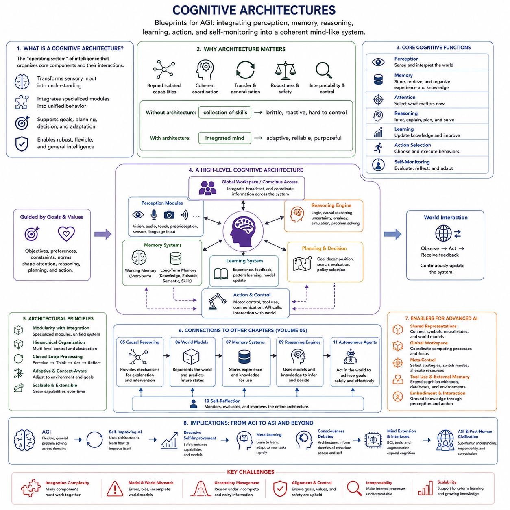
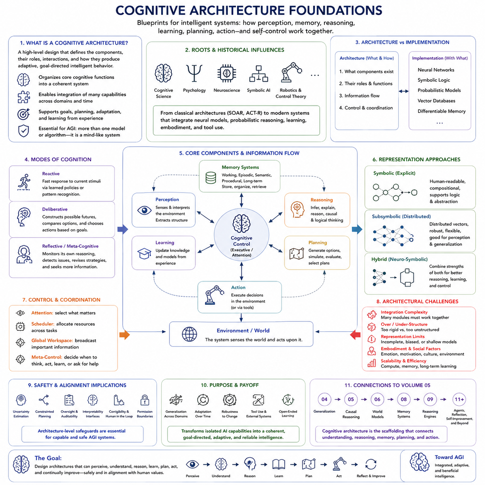
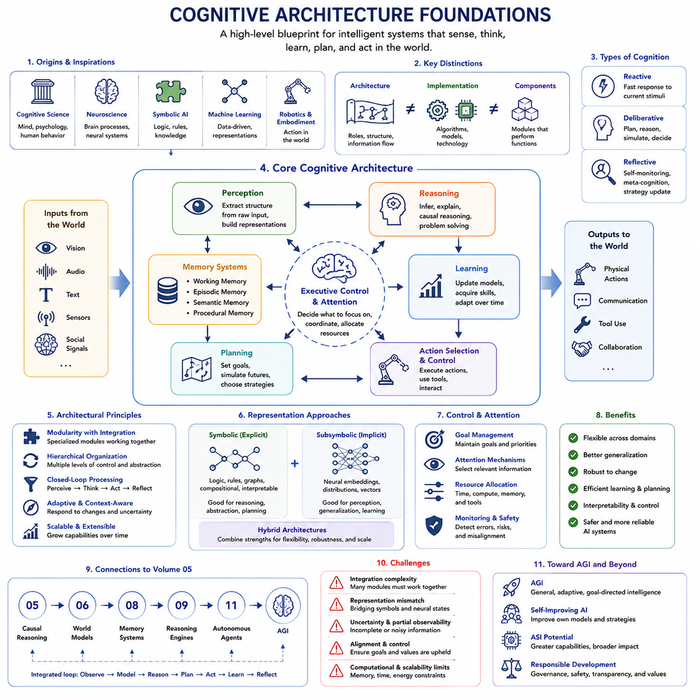
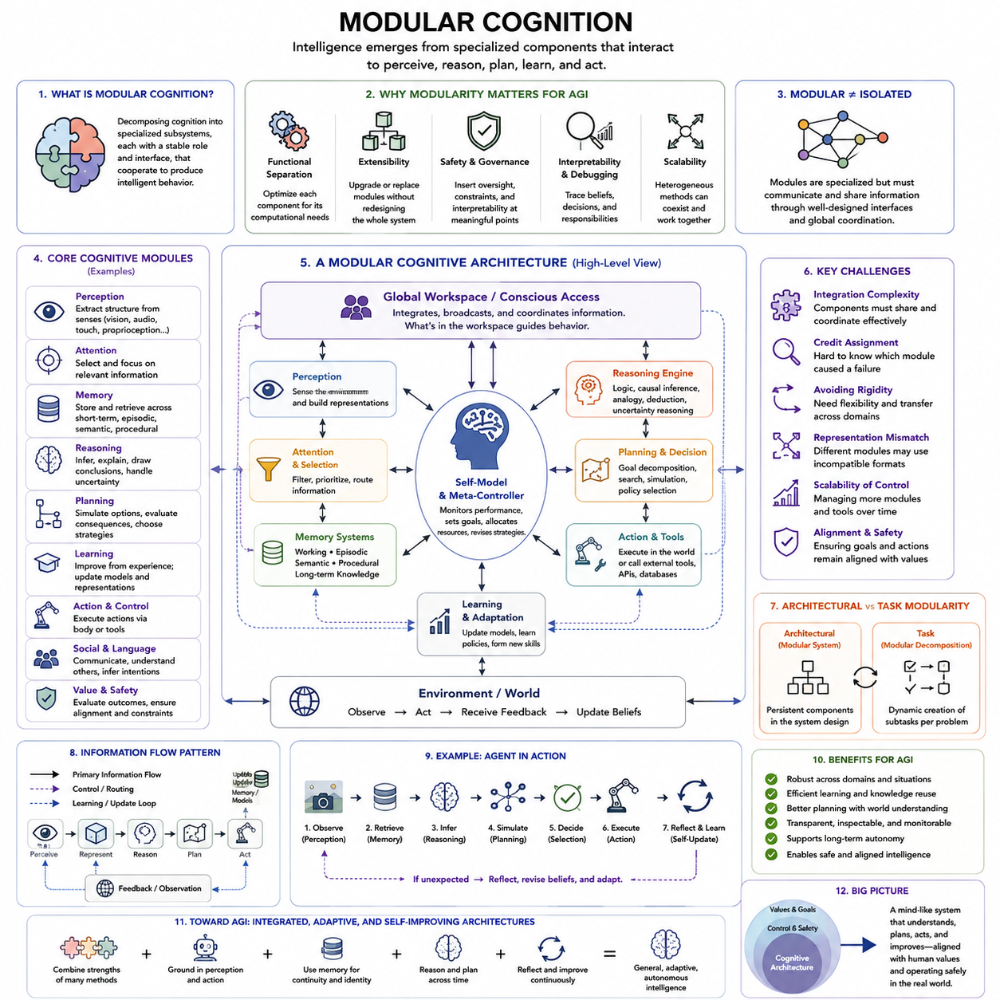
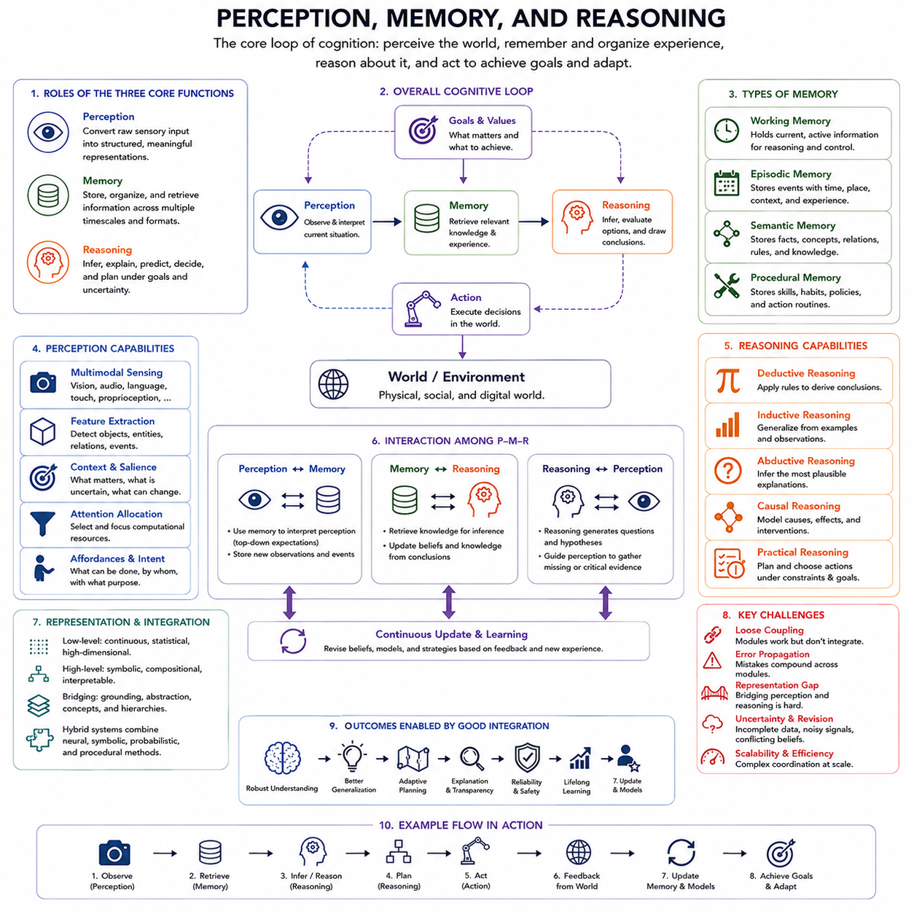
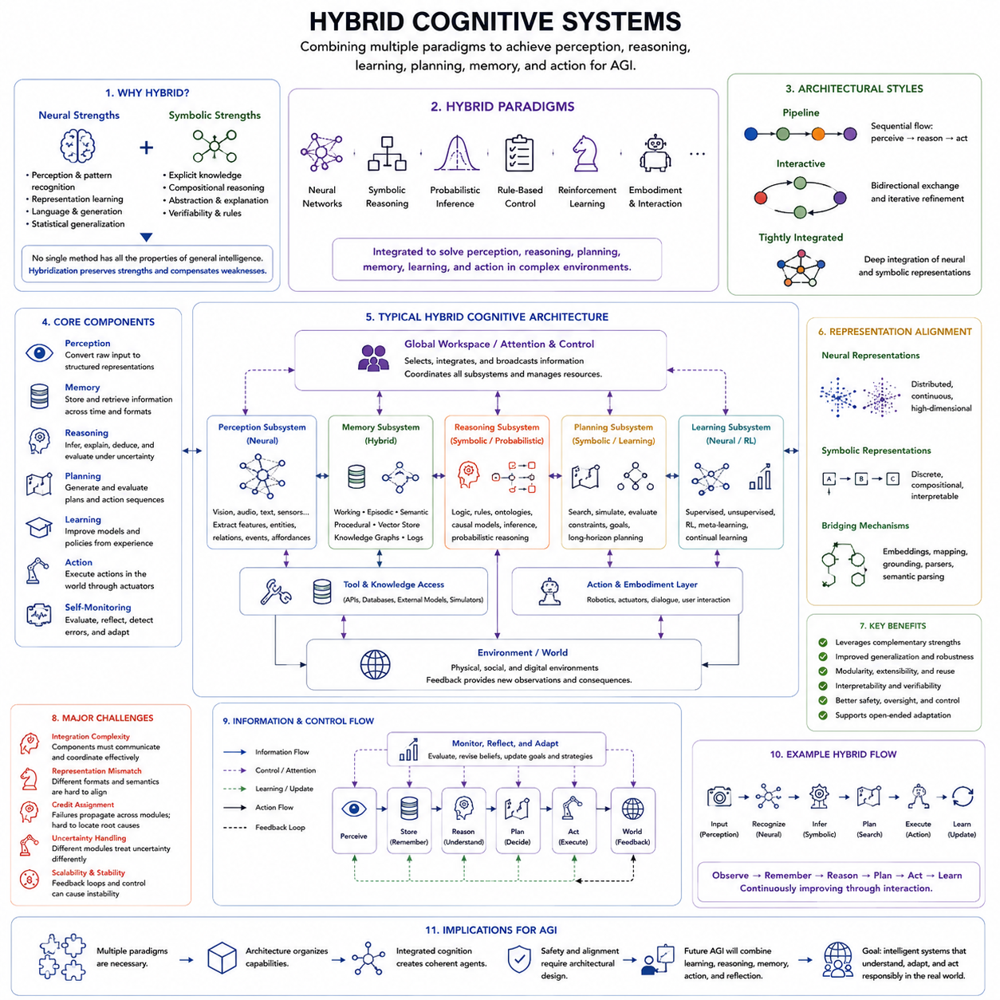
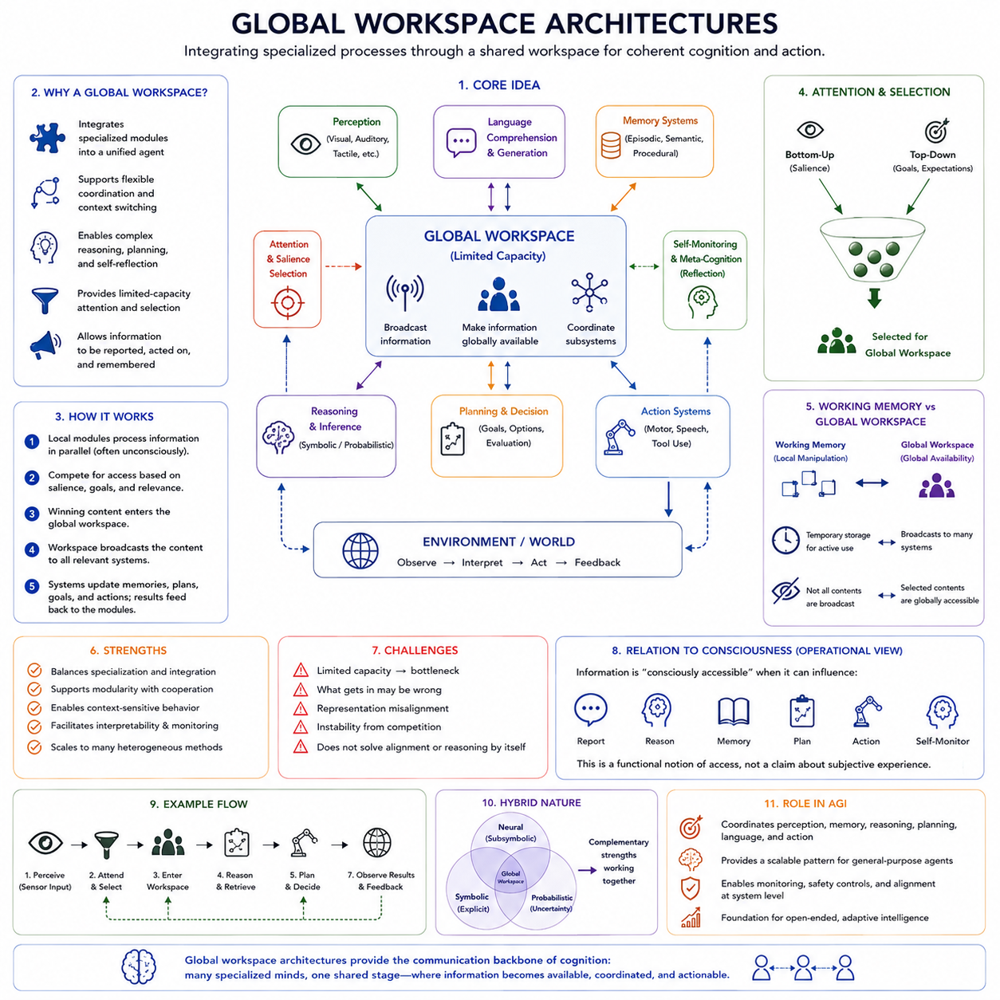
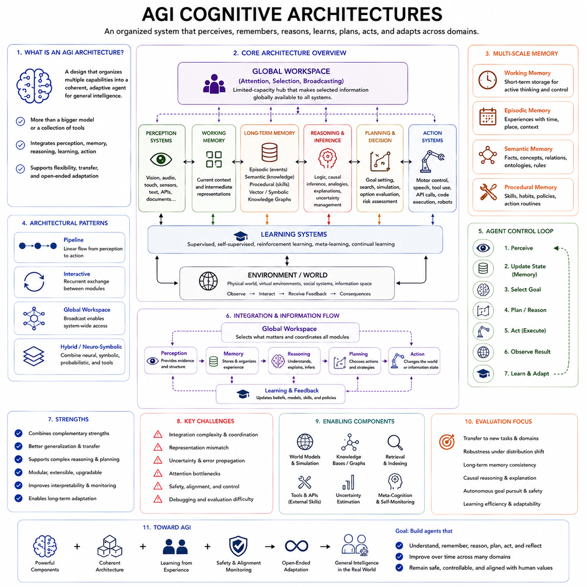

**Volume 00 05 AGI and ASI**

# Chapter 07. Cognitive Architectures

### Chapter Overview

{width="7.268055555555556in" height="7.268055555555556in"}

Cognitive architectures are blueprints for intelligent systems. They describe how perception, memory, attention, reasoning, learning, action selection, and self-monitoring can be organized into a coherent mind-like system. In AGI research, this question is central: intelligence is not only a collection of isolated capabilities, but an integrated process that transforms sensory input into world models, goals, plans, decisions, and adaptive behavior over time. A cognitive architecture asks what the "operating system" of intelligence should look like.

This chapter introduces the foundations of cognitive architecture as a bridge between cognitive science, neuroscience, symbolic AI, machine learning, robotics, and autonomous agent design. It examines why intelligence appears modular in some respects yet deeply integrated in others. Human cognition uses specialized systems for vision, language, motor control, memory, and social inference, but these systems cooperate through shared attention, working memory, long-term knowledge, and executive control. AGI systems face a similar challenge: they must combine specialized models and general reasoning processes without becoming brittle, incoherent, or unmanageable.

The chapter's scope moves from classical and modular views of cognition to modern hybrid systems that combine neural networks, symbolic reasoning, memory retrieval, planning, and tool use. It highlights the importance of perception, memory, and reasoning as interacting components rather than separate layers. Perception is not passive recording; it is guided by expectations and goals. Memory is not merely storage; it shapes identity, continuity, learning, and context. Reasoning is not only formal deduction; it includes causal inference, analogy, simulation, uncertainty management, and practical decision-making.

Special attention is given to global workspace architectures, in which many specialized processes compete and cooperate through a shared workspace resembling conscious access. Such architectures are important because they offer one way to explain flexible coordination: a system can focus attention, broadcast relevant information, update plans, and align multiple subsystems around a current task. This is especially relevant for AGI, where language models, perception modules, planners, memory systems, and external tools may need to operate as parts of a larger cognitive whole.

The motivation for studying cognitive architectures is practical as well as theoretical. Without architecture, increasingly powerful AI models may remain collections of capabilities rather than reliable general agents. With architecture, researchers can ask sharper questions about autonomy, robustness, interpretability, safety, self-reflection, and long-term learning. Cognitive architecture does not guarantee AGI, but it provides a disciplined framework for thinking about how AGI might be built, evaluated, constrained, and understood.

### Connection to Volume 05

This chapter sits at a pivotal point in Volume 05. The earlier chapters define the destination: what AGI is, what ASI might be, what kinds of intelligence exist, and why generalization matters. Cognitive architectures provide the structural response to those questions. If AGI requires flexible intelligence across domains, then it is not enough to train a system on many tasks; the system must have mechanisms for integrating knowledge, transferring skills, representing context, setting goals, and coordinating action. Architecture turns the abstract idea of general intelligence into a design problem.

The connection to causal reasoning and world models is especially direct. A cognitive architecture must decide where causal models live, how they are learned, how they are updated, and how they guide planning. World models become more useful when they are connected to perception, memory, imagination, and action. A system that predicts the world but cannot use those predictions to choose behavior remains incomplete. Likewise, a system that acts without a stable model of the world is likely to be reactive rather than genuinely intelligent. Cognitive architecture provides the integration layer between representation and control.

This chapter also prepares the reader for the following chapters on memory systems, reasoning engines, self-reflection, and autonomous agents. These topics can be studied separately, but in an AGI system they must function together. Memory supports reasoning by retrieving relevant experience and knowledge. Reasoning guides memory by determining what matters. Self-reflection monitors performance, detects failure, and revises strategies. Autonomy requires all of these processes to be coordinated across time. Cognitive architecture is therefore the conceptual scaffold on which later chapters build more specific mechanisms.

The later chapters on self-improving AI, recursive self-improvement, meta-learning, and Gödel machines depend on architectural questions as well. A system cannot safely or effectively improve itself unless it has some organized model of its own components, capabilities, limits, and objectives. Meta-learning requires an architecture that can distinguish between solving a task and improving the way tasks are learned. Recursive self-improvement raises even stronger demands: the system must preserve alignment, identity, and functional coherence while modifying itself. These are architectural problems, not merely algorithmic ones.

The chapters on consciousness, the Chinese Room argument, artificial consciousness, and global mind-like systems also connect deeply to cognitive architecture. Whether or not consciousness is required for AGI, many theories of conscious access are architectural theories: they describe information flow, attention, broadcasting, self-modeling, and reportability. The Chinese Room challenges us to ask whether symbol manipulation alone is sufficient for understanding; cognitive architectures help clarify what additional grounding, embodiment, memory, agency, or world interaction might be required.

Finally, the broader themes of transhumanism, brain-computer interfaces, mind uploading, technological singularity, and post-human civilization all depend on assumptions about cognition's structure. If minds are architecturally organized information-processing systems, then they may be extended, interfaced, copied, accelerated, or merged in ways that transform civilization. If cognition depends on biological embodiment in ways we do not understand, those ambitions become far more uncertain. This chapter therefore serves as a hinge between near-term AI engineering and the long-range philosophical, technical, and civilizational questions that define AGI and ASI.

## 07.00 Cognitive Architecture Foundations

{width="7.268055555555556in" height="7.268055555555556in"}

{width="7.268055555555556in" height="7.268055555555556in"}

A cognitive architecture is a high-level design for an intelligent system: a theory of what functional components are needed for cognition, how they exchange information, and how they jointly produce perception, reasoning, learning, planning, action, and adaptation. In the context of AGI, cognitive architectures matter because general intelligence cannot be reduced to a single model, algorithm, or benchmark score. It requires an organized system that can acquire knowledge across domains, use that knowledge flexibly, pursue goals over time, and remain coherent under changing conditions. This section establishes the foundations for the rest of the chapter, which moves from modular cognition to perception-memory-reasoning loops, hybrid systems, global workspace models, and candidate AGI architectures.

Historically, cognitive architectures emerged from cognitive science, symbolic AI, psychology, neuroscience, and control theory. Classical architectures such as SOAR and ACT-R attempted to model human problem solving through symbolic rules, working memory, procedural memory, and goal-directed behavior. Later systems integrated probabilistic reasoning, reinforcement learning, neural perception, and embodied interaction. The central insight is that cognition is not merely computation in the abstract; it is computation organized around an agent that must sense, remember, decide, and act within an environment. A useful architecture therefore specifies both internal information flow and the interface between the system and the world.

A foundational distinction is between architecture and implementation. The architecture defines roles and relationships: perception modules extract structure from sensory data, memory systems store and retrieve information, reasoning engines infer consequences, planners evaluate possible actions, and control mechanisms allocate attention and resources. The implementation may use neural networks, symbolic logic, vector databases, probabilistic programs, differentiable memory, or combinations of these. Two systems may share the same architectural pattern while using different algorithms internally. Conversely, the same algorithm can play different cognitive roles depending on how it is embedded in the larger system.

Another key distinction is between reactive, deliberative, and reflective cognition. Reactive processes respond quickly to current stimuli, often through learned policies or pattern recognition. Deliberative processes construct possible futures, compare alternatives, and choose actions based on goals and constraints. Reflective processes monitor the system's own reasoning, detect uncertainty or contradiction, revise strategies, and decide when to ask for help or gather more evidence. Human-like general intelligence appears to require all three. A purely reactive agent may be fast but brittle; a purely deliberative agent may be powerful but slow; a reflective agent without grounded perception and action may become trapped in self-referential analysis.

Most cognitive architectures include some version of perception, memory, attention, reasoning, learning, planning, and action. Perception transforms raw input into usable representations. Memory preserves information across time, often separated into short-term or working memory, episodic memory, semantic memory, and procedural memory. Attention selects what information is currently relevant, preventing the system from being overwhelmed. Reasoning combines stored knowledge and current observations to draw conclusions. Learning modifies the system based on experience. Planning organizes behavior toward goals, and action closes the loop by affecting the environment. The important point is not that these components must be physically separate, but that these cognitive functions must be supported somehow.

Representation is one of the hardest architectural questions. Symbolic representations are explicit, compositional, and often interpretable; they support logic, abstraction, and systematic reasoning. Subsymbolic representations, such as neural embeddings, are distributed, flexible, and robust to noisy data; they support pattern recognition and generalization. Modern AGI research increasingly explores hybrid architectures that combine both. For example, a language model may provide broad semantic competence, a symbolic planner may enforce constraints, an external memory may preserve long-term context, and a tool-use layer may connect the system to calculators, databases, simulators, or robotic actuators. The challenge is not simply to add components, but to coordinate them reliably.

Control is another foundation. An intelligent system must decide what to think about, what to ignore, when to act, when to deliberate, and when to learn. This is sometimes called cognitive control or executive control. Without control, an architecture becomes a collection of disconnected modules. With poor control, the system may over-plan, hallucinate, loop indefinitely, misuse tools, or optimize the wrong objective. Control mechanisms may be rule-based, learned, utility-driven, attention-based, or implemented through a global workspace in which competing processes broadcast information to the rest of the system. Later sections will examine such mechanisms in greater detail.

Architectures also shape safety and alignment. A system with explicit memory, goals, and self-monitoring may be more capable, but also more difficult to predict. An agent that can plan over long horizons, call external tools, modify its own strategies, or collaborate with other agents requires safeguards at the architectural level, not only at the level of model training. These safeguards may include uncertainty estimation, constrained planning, oversight channels, audit logs, interpretability interfaces, permission boundaries, and corrigibility mechanisms. For AGI, architecture is therefore not just an engineering issue; it is a governance and risk-management issue.

Cognitive architectures have limitations. They can become overdesigned, with many modules but no coherent theory of integration. They may imitate human cognition too literally, importing biological constraints that are not necessary for machines. They may also underestimate embodiment, social learning, cultural knowledge, emotion, motivation, and environmental feedback. Conversely, purely neural end-to-end systems may achieve impressive performance while lacking durable memory, explicit reasoning, stable goals, or introspective control. The central problem is finding the right level of structure: enough to support generality, reliability, and transparency, but not so much that the system becomes rigid and unscalable.

In this chapter, cognitive architecture serves as the bridge between individual AI capabilities and a plausible path toward AGI. Modular cognition explains functional specialization. Perception, memory, and reasoning show how information flows through an intelligent agent. Hybrid cognitive systems examine the integration of neural and symbolic methods. Global workspace architectures explore coordination and attention at system scale. Finally, AGI cognitive architectures ask what combinations of these ideas might produce robust, open-ended intelligence. The foundation is clear: general intelligence is not only about having powerful models, but about arranging perception, memory, reasoning, learning, control, and action into a coherent adaptive whole.

## 07.01 Modular Cognition

{width="7.268055555555556in" height="7.268055555555556in"}

A cognitive architecture is rarely a single undifferentiated mechanism. Whether the system is a biological brain, a symbolic AI, a neural agent, or a hybrid AGI prototype, intelligent behavior usually emerges from the coordination of specialized subsystems. Modular cognition is the idea that cognition can be decomposed into interacting functional components, each responsible for particular classes of computation such as perception, attention, working memory, planning, language, motor control, social inference, or value estimation. In the context of AGI, modularity is not merely an engineering convenience; it is one of the central design questions for making intelligence scalable, interpretable, reliable, and adaptable.

The concept has roots in cognitive science, especially debates about whether the human mind consists of domain-specific modules or more general learning mechanisms. Early theories of modularity emphasized relatively encapsulated systems, such as visual perception or language processing, that operate quickly and automatically with limited access to global knowledge. Modern views are more flexible. A module need not be a hard-coded box with rigid boundaries. It may be a learned neural subsystem, a symbolic reasoning service, a memory retrieval mechanism, a planner, a simulator, or an external tool. What makes it modular is that it has a relatively stable role, interface, and internal specialization within a larger cognitive system.

For AGI research, modular cognition offers several advantages. First, it supports functional separation. A system that uses distinct mechanisms for perception, memory, reasoning, and action can optimize each component for different computational demands. Perception often requires high-dimensional pattern recognition; reasoning may require compositional structure and variable binding; memory requires indexing, consolidation, and retrieval; action selection requires balancing goals, constraints, uncertainty, and cost. A monolithic model may learn many of these behaviors implicitly, but it can be difficult to inspect, repair, or control. Modular architectures allow designers to ask which subsystem produced a belief, which memory supported a decision, which planner generated an action, and which value model evaluated the outcome.

Second, modularity improves extensibility. A cognitive architecture designed around explicit interfaces can be upgraded component by component. A weak visual module can be replaced with a stronger one; a planner can be augmented with search; a language module can be connected to a knowledge graph; a memory module can be expanded from short-term context to long-term episodic storage. This is especially important for AGI, where no single algorithm is likely to solve all aspects of general intelligence. Modularity permits heterogeneous methods to coexist: neural networks for perception, symbolic systems for formal reasoning, probabilistic models for uncertainty, reinforcement learning for policy adaptation, and tool-use mechanisms for external computation.

Third, modular cognition can help with safety and governance. If a system contains separable components for goal management, world modeling, action proposal, risk assessment, and execution authorization, then oversight can be inserted at meaningful points. A purely end-to-end agent may translate objectives into actions through opaque internal dynamics, making it difficult to audit. A modular agent can expose intermediate representations: what it believes, what it predicts, what it intends, and what alternatives it considered. This does not guarantee safety, but it creates opportunities for monitoring, constraint checking, interpretability, and human intervention.

However, modularity also introduces serious challenges. The first is integration. Intelligence does not arise from isolated modules, but from the dynamic coordination among them. Perception must inform memory; memory must guide reasoning; reasoning must shape attention; attention must select relevant inputs; goals must constrain planning; and plans must update beliefs when the world changes. If modules communicate through poorly designed interfaces, the system may become brittle, slow, or inconsistent. A vision module may produce representations that a planner cannot use. A language model may generate plausible explanations that are not grounded in memory. A reasoning engine may demand precise symbolic inputs that perceptual modules cannot reliably provide.

The second challenge is credit assignment. When a modular system fails, identifying the responsible component is not always easy. Did the agent act incorrectly because perception misclassified the scene, memory retrieved the wrong case, the world model made a false prediction, the planner optimized the wrong objective, or the value module evaluated the consequences poorly? In tightly coupled systems, errors propagate across module boundaries. Therefore, modular architectures require not only component design but also diagnostic methods, confidence estimates, and mechanisms for resolving conflicts between subsystems.

The third challenge is avoiding excessive rigidity. Human cognition appears modular in some respects, but it is also deeply flexible. Skills transfer across domains; concepts are recombined; language influences perception; imagination supports planning; and social reasoning affects self-modeling. An AGI architecture that divides cognition into fixed compartments may fail to generalize when tasks require fluid coordination. For this reason, many contemporary approaches favor soft modularity: modules are specialized, but not completely isolated; interfaces are learned or adaptive; routing mechanisms decide which subsystem should be activated; and global representations allow information to be shared when needed.

This leads naturally to hybrid cognitive systems, global workspace architectures, and memory-centered designs. In a global workspace model, specialized processors compete or cooperate to broadcast information into a shared cognitive workspace. In a hybrid architecture, neural, symbolic, probabilistic, and procedural components are combined according to their strengths. In memory-augmented systems, modules do not merely compute outputs; they read from and write to shared stores that preserve context across time. Modular cognition therefore provides the structural vocabulary for later sections: perception, memory, and reasoning can be studied separately, but AGI requires understanding how they are bound into a coherent agent.

A useful distinction is between architectural modularity and task modularity. Architectural modularity refers to persistent components in the system design, such as a working memory buffer, an inference engine, or a planning module. Task modularity refers to temporary decomposition of a problem into subtasks, such as searching, summarizing, verifying, and executing. Advanced agents may combine both: they use stable cognitive subsystems to dynamically create task-specific workflows. This is increasingly visible in tool-using language agents, where a central model delegates subtasks to calculators, databases, code interpreters, search engines, and specialized models.

The implication for AGI is that modular cognition should not be understood as a simple alternative to large-scale learning. Instead, it is a way of organizing learning, reasoning, memory, and action so that they can cooperate at scale. A future AGI may contain large foundation models, explicit reasoning engines, episodic and semantic memory systems, simulators, planners, safety monitors, and self-reflective control loops. Its intelligence will depend not only on the power of each component, but on the architecture that governs communication among them. Modularity is therefore both a practical engineering strategy and a theoretical hypothesis about how general intelligence can be constructed from specialized capacities without losing coherence, flexibility, or autonomy.

## 07.02 Perception Memory and Reasoning

{width="7.268055555555556in" height="7.268055555555556in"}

A cognitive architecture becomes more than a collection of modules when perception, memory, and reasoning are integrated into a coherent control loop. In the previous section, modular cognition emphasized the value of decomposing intelligence into specialized functional components. This section examines how three of the most central components interact. Perception provides contact with the world, memory preserves and organizes experience, and reasoning transforms available information into judgments, plans, explanations, and decisions. In human cognition these capacities are deeply interdependent; in artificial systems, their separation is often convenient for engineering but can become a barrier to general intelligence if the interfaces are too rigid.

Perception is not merely the passive reception of sensory data. In cognitive architectures, perception converts raw signals into structured representations that can be used by other processes. A vision system may transform pixels into objects, spatial relations, affordances, and events. A language system may transform text or speech into entities, intentions, propositions, and discourse structure. For AGI, perception must be multimodal, context-sensitive, and action-oriented. It should not only recognize what is present but estimate what matters, what is uncertain, what may change, and what actions are possible. This is why perception is closely related to attention: a system cannot process everything at equal depth, so it must allocate computational resources to salient or task-relevant information.

Memory gives perception continuity and gives reasoning substance. Cognitive architectures typically distinguish several forms of memory. Working memory holds currently active information and supports immediate reasoning and control. Episodic memory stores experience as situated events: what happened, when, where, and under what conditions. Semantic memory stores more abstract knowledge about concepts, facts, relations, and rules. Procedural memory stores skills, policies, habits, and action routines. These distinctions are useful because they imply different access patterns and learning mechanisms. Remembering a theorem, recalling a previous conversation, and knowing how to ride a bicycle are not the same computational problem.

In modern AI systems, memory may appear as model parameters, external databases, vector stores, symbolic knowledge graphs, caches, logs, or learned latent states. Each form has strengths and weaknesses. Parameter memory is compact and fast but difficult to inspect or update precisely. Retrieval-augmented memory can provide current or domain-specific information, but it depends on indexing, relevance ranking, and context integration. Symbolic memory supports explicit reasoning and explanation, but it can be brittle when perception is noisy or concepts are ambiguous. A mature cognitive architecture must coordinate these memory forms rather than treating any single mechanism as sufficient.

Reasoning is the process by which an intelligent system draws conclusions, evaluates alternatives, and selects actions based on goals and evidence. It includes deductive reasoning from general rules, inductive reasoning from examples, abductive reasoning to plausible explanations, causal reasoning about interventions and consequences, and practical reasoning about what to do next. In cognitive architectures, reasoning may be implemented through symbolic logic, probabilistic inference, planning algorithms, neural sequence models, constraint solvers, or combinations of these. The key architectural question is not whether reasoning is "symbolic" or "neural" in isolation, but how representations are formed, revised, grounded, and used under uncertainty.

The interaction among perception, memory, and reasoning is especially important. Perception supplies evidence, but memory determines what the evidence means in context. Reasoning can guide perception by asking what information is missing or which uncertainty matters most. Memory can bias reasoning toward familiar patterns, sometimes efficiently and sometimes incorrectly. A cognitive architecture therefore requires mechanisms for updating beliefs, detecting contradictions, handling uncertainty, and revising earlier interpretations. Without these mechanisms, the system may appear competent in narrow tasks yet fail when the environment changes, when evidence is incomplete, or when goals conflict.

One major limitation of many current AI systems is that perception, memory, and reasoning are only loosely coupled. A model may produce fluent explanations without stable memory of its own commitments. A robot may perceive objects accurately but fail to reason about hidden causes, long-term consequences, or social meaning. A planning system may reason logically but depend on simplified world states that omit perceptual ambiguity. These failures reveal a gap between task performance and cognitive integration. General intelligence requires not just better components but better coordination among components over time.

This coordination also raises the issue of representation. Low-level perceptual representations are often continuous, high-dimensional, and statistical. High-level reasoning representations are often discrete, compositional, and interpretable. Bridging these levels is difficult but essential. If concepts are not grounded in perception and action, reasoning becomes detached from reality. If perception cannot be abstracted into stable concepts, reasoning cannot generalize. Hybrid cognitive systems, discussed in the next section, attempt to solve this problem by combining neural pattern recognition with symbolic structure, probabilistic models, memory retrieval, and planning.

For AGI, perception, memory, and reasoning must support open-ended adaptation. The system must learn new categories, remember relevant experiences, infer hidden structure, plan under uncertainty, explain its decisions, and improve through feedback. It must also know when not to trust its own perceptions, when memories may be incomplete, and when reasoning has exceeded available evidence. These metacognitive capacities prepare the way for later topics such as self-reflection, autonomous agents, and self-improving AI. Within cognitive architectures, the integration of perception, memory, and reasoning is therefore not a peripheral design choice. It is one of the central tests of whether an artificial system is merely performing tasks or beginning to exhibit general cognition.

## 07.03 Hybrid Cognitive Systems

{width="7.268055555555556in" height="7.268055555555556in"}

Hybrid cognitive systems combine multiple computational paradigms into a single architecture for perception, learning, reasoning, planning, memory, and action. In the context of cognitive architectures, "hybrid" usually means more than simply connecting several modules. It refers to the deliberate integration of distinct forms of intelligence: neural pattern recognition, symbolic reasoning, probabilistic inference, rule-based control, reinforcement learning, embodied interaction, and sometimes evolutionary or developmental mechanisms. The central motivation is that no single technique has yet shown all the properties associated with general intelligence.

The need for hybridization becomes clear when we compare the strengths and weaknesses of different approaches. Deep neural networks excel at perception, representation learning, language modeling, and statistical generalization across large data distributions. They can extract features from images, speech, text, and sensor streams without requiring hand-coded rules. However, they often struggle with systematic reasoning, explicit variable binding, long-horizon planning, causal explanation, and reliable extrapolation outside training conditions. Symbolic systems, by contrast, represent knowledge in explicit structures such as rules, graphs, logic expressions, schemas, and programs. They support compositional reasoning, abstraction, explanation, and verifiability, but they are brittle when facing noisy perception, incomplete data, ambiguous language, and open-ended real-world environments.

A hybrid cognitive system attempts to preserve the advantages of both. A perception subsystem may use neural networks to transform raw sensory input into structured representations. These representations may then be passed to a working memory, knowledge graph, planner, or reasoning engine. A symbolic planner may generate candidate action sequences, while a learned policy evaluates which actions are likely to succeed in a specific environment. A language model may interpret instructions and produce hypotheses, while a verification module checks consistency against facts, constraints, or formal rules. In this sense, hybrid systems form a bridge between the previous section's focus on perception, memory, and reasoning and the next section's discussion of global workspace architectures, where multiple specialized processes compete and cooperate through shared attention.

Hybrid cognition can be organized in several ways. In a pipeline architecture, neural perception feeds symbolic reasoning, which then produces actions. In an interactive architecture, neural and symbolic components exchange information repeatedly, allowing top-down goals to influence perception and bottom-up observations to revise beliefs. In a tightly integrated architecture, symbolic structures may be embedded inside neural networks, or neural methods may learn to manipulate symbolic programs. Neuro-symbolic AI is one prominent family of hybrid approaches, aiming to combine the learning capacity of neural models with the transparency and compositionality of symbolic representations.

Memory is a crucial design issue in hybrid systems. A purely neural model may encode knowledge implicitly in weights, making it difficult to inspect, update, or correct specific facts. A symbolic memory can store explicit propositions and relations, but it may not naturally handle uncertainty or similarity. Hybrid architectures often use multiple memory systems: vector databases for semantic retrieval, episodic stores for experiences, procedural memory for skills, and symbolic knowledge bases for stable facts and rules. The architecture must decide when to retrieve, when to reason, when to learn, and when to ignore irrelevant information. This coordination problem is central to building systems that behave coherently over time.

Another key issue is control. If a system contains many specialized subsystems, it needs a mechanism for selecting which subsystem should act, reason, or update memory at a given moment. Traditional cognitive architectures often use production rules, goal stacks, or blackboard systems for this purpose. Modern hybrid systems may use learned controllers, planning algorithms, attention mechanisms, or agentic loops that repeatedly observe, think, act, and reflect. The difficulty is that control must be flexible without becoming chaotic. A system that relies too heavily on symbolic control may become rigid; one that relies too heavily on learned policies may become opaque and unpredictable.

Hybrid cognitive systems also raise questions about representation alignment. Neural representations are often distributed, high-dimensional, and difficult to interpret. Symbolic representations are discrete, explicit, and human-readable. Mapping between these forms is not trivial. For example, a vision model may recognize "a cup on a table," but a reasoning system may need object identity, spatial relations, affordances, causal expectations, and task relevance. If the translation from perception to symbols is unreliable, downstream reasoning will be unreliable. Conversely, if symbolic goals cannot be grounded in sensory and motor experience, the system may reason correctly in form but fail in practice.

For AGI research, hybrid systems are attractive because they reflect the layered nature of intelligence. Human cognition appears to involve fast intuitive processes, slower deliberative reasoning, memory consolidation, language-mediated abstraction, emotional evaluation, and embodied sensorimotor learning. A plausible AGI architecture may therefore require multiple interacting subsystems rather than a single monolithic model. Hybrid design also supports safety and interpretability. Explicit constraints, audit trails, formal verification, and modular separation can make some behaviors easier to inspect than in purely end-to-end systems. However, hybridization does not automatically solve alignment, robustness, or consciousness. It can also introduce new failure modes at the boundaries between components.

The major limitation of hybrid cognitive systems is integration complexity. Each component may work well in isolation but fail when coupled with others. Representations may mismatch, timing may be inconsistent, uncertainty may be handled differently across modules, and feedback loops may create unstable behavior. Engineering such systems requires not only strong individual algorithms but also architectural principles for communication, arbitration, learning, and self-monitoring. As AGI research progresses, the central question is not whether neural or symbolic approaches will "win," but how perception, memory, reasoning, action, and reflection can be composed into systems that learn from experience, act in the world, and revise their own models responsibly.

## 07.04 Global Workspace Architectures

{width="7.268055555555556in" height="7.268055555555556in"}

Global workspace architectures provide one of the most influential bridges between cognitive psychology, neuroscience, and artificial cognitive systems. In the previous sections, we examined modular cognition and the interaction of perception, memory, and reasoning. A central problem now emerges: if cognition is distributed across specialized modules, how does an intelligent system coordinate them into coherent, context-sensitive behavior? Global workspace theory answers this by proposing a shared "workspace" in which selected information becomes globally available to many otherwise specialized processes.

The original Global Workspace Theory, associated with Bernard Baars, was developed as a model of conscious access in the human mind. The basic idea is not that every mental process is conscious, but that many unconscious specialist processes compete and cooperate to place information into a limited-capacity workspace. Once information enters this workspace, it is broadcast to other systems: memory, language, action planning, emotion, attention, and reasoning. In artificial systems, this idea becomes an architectural principle: local modules can remain specialized, but the system gains integration through a common broadcast mechanism.

A useful way to understand global workspace architectures is to contrast them with purely modular pipelines. In a simple pipeline, perception produces a representation, which is passed to reasoning, which then generates an action. This can work in narrow domains, but it is brittle when the environment is ambiguous, changing, or requires multiple forms of knowledge. A global workspace allows information to be shared more flexibly. A visual observation may trigger a memory, which may update a goal, which may redirect attention, which may cause a reasoning module to reconsider a plan. The architecture supports recurrent interaction rather than one-way processing.

In neuroscience, related ideas appear in Global Neuronal Workspace theory, associated with Stanislas Dehaene and others. This view suggests that conscious access depends on large-scale neural broadcasting, especially through long-range connections linking sensory, frontal, parietal, and executive systems. Although artificial cognitive architectures need not reproduce the brain exactly, the analogy is important. It suggests that intelligence may require not only powerful local processors but also mechanisms for attention, selection, integration, and reportability. A system that can process information but cannot make relevant information available to the rest of itself may fail to behave as a unified agent.

For AGI, global workspace architectures are attractive because they offer a practical model of cognitive integration. An AGI system may contain perceptual models, working memory, episodic memory, semantic knowledge, planning modules, language models, reinforcement learning components, and tool-use systems. Without coordination, these components may produce inconsistent or fragmented behavior. A global workspace can act as an intermediate layer where important representations are selected, prioritized, and broadcast. This does not automatically create general intelligence, but it helps address one of the core engineering problems: how to make heterogeneous cognitive subsystems cooperate.

Attention is central to this architecture. Since the workspace has limited capacity, not all information can be globally broadcast. Some mechanism must decide what is salient, urgent, goal-relevant, surprising, or uncertain. In biological cognition, attention is shaped by both bottom-up signals, such as sudden motion or pain, and top-down signals, such as current goals or expectations. In artificial systems, analogous mechanisms may include salience scoring, uncertainty estimation, reward prediction, task relevance, or explicit controller policies. The design of attention strongly affects what the system notices, remembers, reasons about, and acts upon.

Global workspace architectures also clarify the relationship between working memory and consciousness-like access. Working memory stores information temporarily for manipulation, while the global workspace broadcasts selected contents across the system. The two are related but not identical. A planner may maintain hidden state internally without broadcasting it. Conversely, a perception module may broadcast a surprising observation that other systems then encode into memory. In AGI design, confusing these functions can lead to architectures that either over-broadcast everything, causing computational overload, or under-broadcast critical information, causing incoherent decisions.

One implication is that "consciousness" in such architectures can be treated operationally rather than metaphysically. A system may be said to have global access to information when that information can influence memory retrieval, verbal report, action selection, self-monitoring, and future planning. This does not settle philosophical questions about subjective experience, but it provides a testable engineering notion of access consciousness. Later chapters on artificial consciousness will revisit the harder question of whether such access is sufficient for experience or merely simulates some functional properties of conscious cognition.

There are important limitations. Global broadcasting can become a bottleneck. If too little information enters the workspace, the agent becomes narrow and inattentive. If too much enters, the workspace loses its selective value and becomes noisy. Another challenge is representation alignment: modules must interpret broadcast contents in compatible ways. A symbolic planner, a neural perception system, and a language model may not share the same internal formats. Practical systems therefore need translation layers, shared embeddings, typed messages, or grounding mechanisms. Without these, the workspace becomes a communication channel without true understanding.

Global workspace models also do not by themselves solve reasoning, learning, embodiment, or value alignment. They describe a coordination pattern, not a complete mind. A poorly designed system with a global workspace can still make shallow inferences, pursue unsafe goals, or hallucinate false explanations. Moreover, competition for workspace access may produce unstable behavior if not regulated by goals, norms, uncertainty estimates, and safety constraints. In autonomous agents, deciding what is allowed into the workspace may be as important as deciding what action to take.

Despite these limitations, global workspace architectures are highly relevant to AGI cognitive architecture. They provide a conceptual middle ground between rigid symbolic systems and opaque end-to-end neural networks. They support modularity without isolation, integration without total centralization, and attention without requiring a single monolithic controller. In hybrid cognitive systems, the global workspace can serve as the place where perception, memory, reasoning, planning, language, and self-reflection meet. This connects naturally to the next section on AGI cognitive architectures, where the central question becomes how such mechanisms can be combined into scalable, adaptive, and safe general-purpose intelligence.

## 07.05 AGI Cognitive Architectures

{width="7.268055555555556in" height="7.268055555555556in"}

An AGI cognitive architecture is not merely a larger neural network, a longer prompt, or a collection of specialized tools. It is an organized design for an artificial system that can perceive, remember, reason, learn, act, and adapt across a broad range of environments and tasks. In the preceding sections, we examined modular cognition, the relationship between perception, memory, and reasoning, hybrid symbolic--neural systems, and global workspace architectures. AGI cognitive architectures integrate these ideas into a broader question: what kind of system organization could support general intelligence rather than narrow competence?

A useful distinction is between capability and architecture. A system may display impressive capabilities in language, vision, planning, or programming without having an explicit cognitive architecture. Conversely, an architecture may define memory stores, attention mechanisms, planning loops, learning modules, and action policies, yet remain limited if its components are weak or poorly integrated. AGI research therefore concerns both the components and the coordination principles that allow them to function as a coherent cognitive agent.

Most proposed AGI architectures include several recurring elements. First, they require perception systems that transform raw sensory or informational input into structured representations. In a human-like robot, this may involve vision, sound, touch, and proprioception. In a digital agent, perception may include documents, APIs, databases, code repositories, user instructions, and environment state. Second, they require memory systems at multiple time scales: working memory for immediate context, episodic memory for specific experiences, semantic memory for general knowledge, and procedural memory for skills. Third, they require reasoning and planning mechanisms capable of selecting actions, decomposing goals, evaluating alternatives, and revising beliefs. Fourth, they need learning mechanisms that can improve behavior from experience, feedback, simulation, and instruction.

The architectural challenge is that these elements must not operate as isolated modules. General intelligence requires a system to bind perception to memory, memory to reasoning, reasoning to action, and action back to learning. For example, an AGI-like agent should be able to observe a failure, identify the relevant cause, update its model of the world, revise its plan, and apply that lesson in a different domain. This kind of transfer is central to generalization and is one reason cognitive architecture matters: it provides pathways through which knowledge can be reused rather than trapped inside a single task-specific model.

Classical cognitive architectures such as SOAR and ACT-R emphasized symbolic rules, production systems, explicit goals, and structured memory. These systems were valuable because they made cognition inspectable and decomposable. They could represent plans, subgoals, and decision rules in ways that researchers could analyze. However, they often struggled with perception, ambiguity, open-ended learning, and the scale of real-world knowledge. Modern deep learning systems have the opposite profile: they are powerful at pattern recognition, representation learning, language generation, and multimodal integration, but their internal reasoning is often opaque, their memory can be unstable or context-limited, and their planning can be brittle over long horizons.

AGI cognitive architectures increasingly attempt to combine these strengths. A hybrid architecture may use neural models for perception and language understanding, symbolic or programmatic structures for explicit reasoning, vector databases for associative memory, planners for goal-directed behavior, and reinforcement learning or self-supervised learning for adaptation. Large language models can serve as flexible reasoning and interface components, but they are rarely sufficient by themselves. To become part of a more general architecture, they must be connected to persistent memory, grounding mechanisms, verification processes, tool use, world models, and action-control systems.

Global workspace theory offers one influential design pattern. In such architectures, many specialized processes operate in parallel, but only selected information becomes globally available through a central workspace. This broadcast enables perception, memory, reasoning, and planning modules to coordinate around the most relevant current content. For AGI, the global workspace idea suggests a way to manage attention and cognitive integration: not everything the system knows or senses can be processed deeply at once, so the architecture must decide what becomes salient, what remains background, and what should guide action.

Another important pattern is the agent loop: perceive, update state, select goal, plan, act, observe results, and learn. Simple agents can implement this loop mechanically, but AGI-level architectures require richer forms of self-monitoring. They must estimate uncertainty, detect contradictions, recognize when they lack knowledge, request help, test assumptions, and decide when to stop reasoning and act. This connects AGI cognitive architectures to later chapters on self-reflection, autonomous agents, self-improving AI, and recursive self-improvement. Without metacognition, an intelligent system may perform tasks but remain unable to reliably manage its own cognition.

Embodiment is another unresolved issue. Some researchers argue that AGI requires physical grounding in the world, because concepts such as force, distance, object permanence, cooperation, and risk are learned through sensorimotor interaction. Others argue that digital environments, simulations, language, and tool-mediated action can provide sufficient grounding for many forms of general intelligence. The architectural implication is that AGI may not have a single required embodiment, but it must have some reliable way to connect internal representations to external consequences. An ungrounded system may manipulate symbols fluently while failing to understand their operational meaning.

Evaluation remains difficult. A cognitive architecture cannot be judged only by benchmark scores, because benchmarks often reward narrow competence. More relevant tests include transfer to unfamiliar tasks, robustness under distribution shift, long-term memory consistency, causal reasoning, autonomous goal pursuit, safe tool use, and the ability to learn from limited experience. A true AGI architecture should not simply solve many tasks; it should improve its ability to solve new classes of tasks while preserving alignment, reliability, and interpretability.

The limitations are significant. Integrated architectures can become complex, hard to debug, and vulnerable to cascading errors. A flawed memory retrieval may mislead planning; an incorrect world model may produce dangerous actions; an overconfident language model may generate plausible but false justifications. As cognitive systems become more autonomous, architecture becomes a safety issue. Designers must consider monitoring, corrigibility, sandboxing, uncertainty estimation, audit trails, and constraints on self-modification.

AGI cognitive architectures therefore sit at the intersection of engineering, cognitive science, neuroscience, philosophy of mind, and AI safety. They provide a framework for asking how general intelligence might be organized, not merely how isolated intelligent behaviors can be produced. Whether future AGI emerges from scaled neural models, hybrid systems, embodied agents, global workspaces, or architectures not yet invented, the central problem will remain the same: building a system whose perception, memory, reasoning, learning, and action form a coherent, adaptive, and controllable intelligence.
