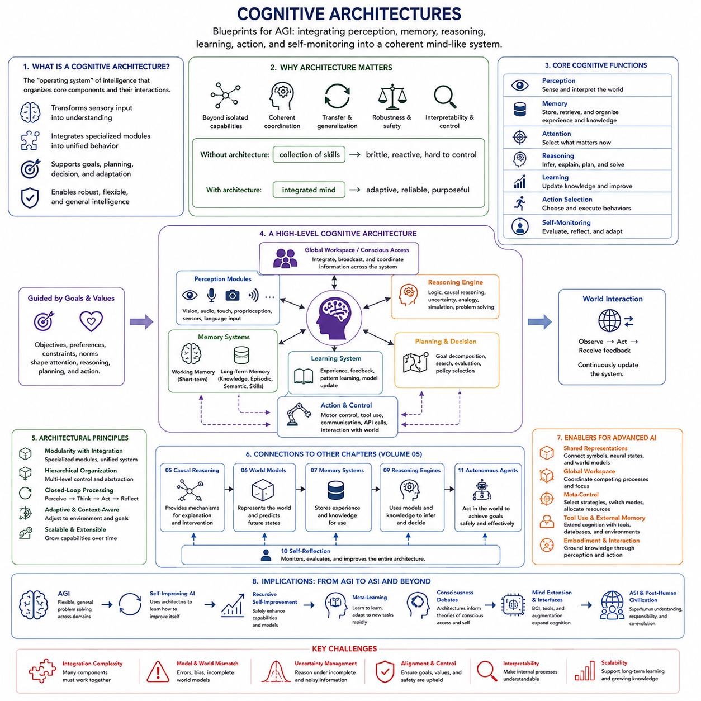
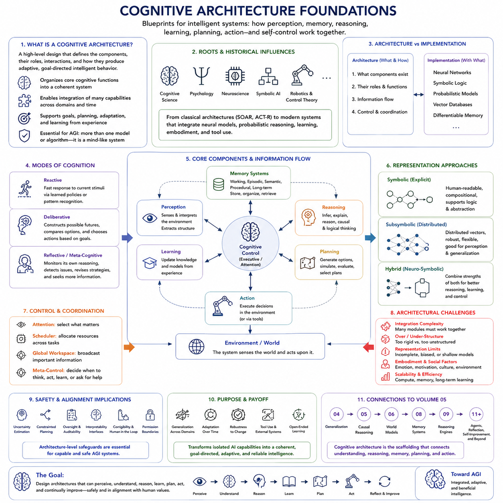
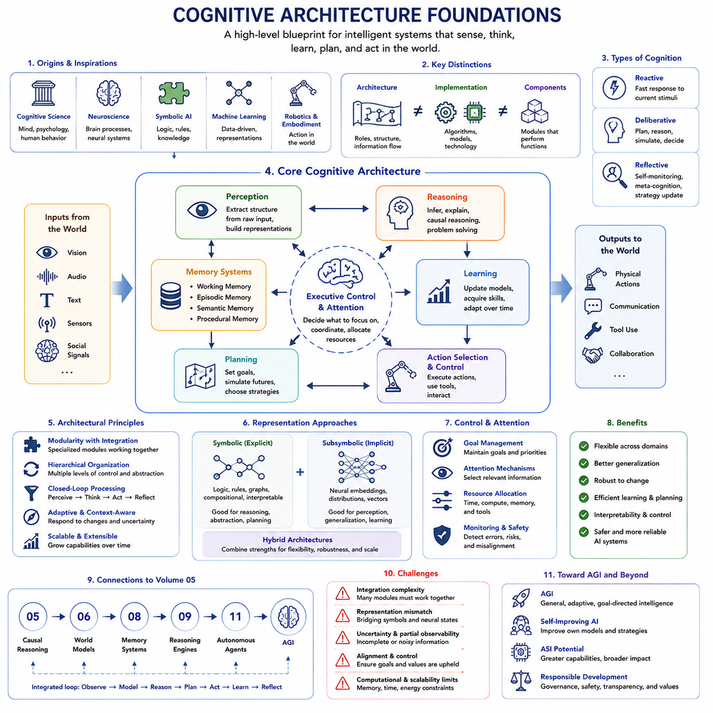
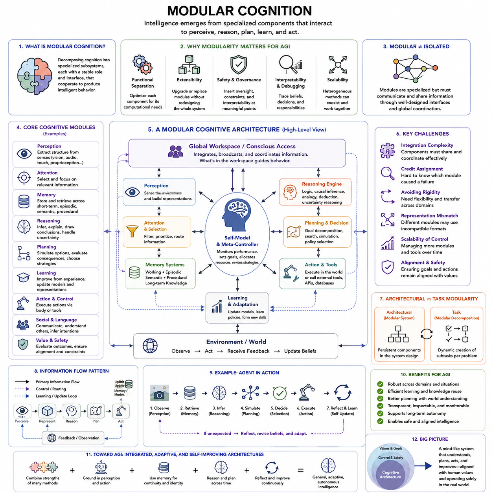
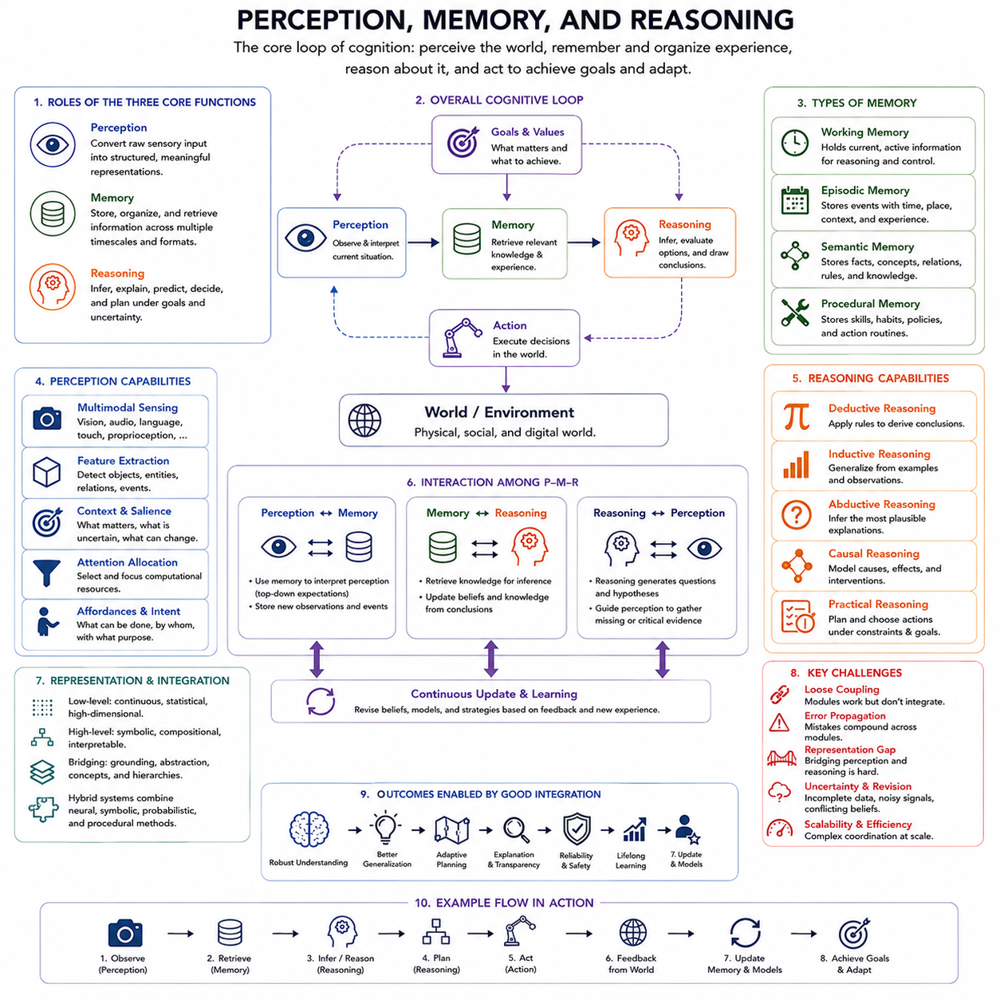
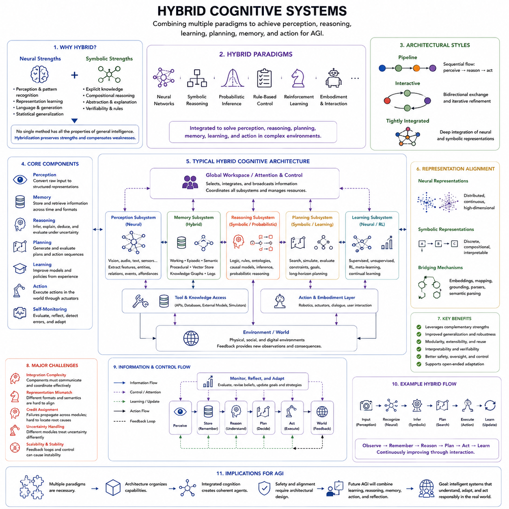
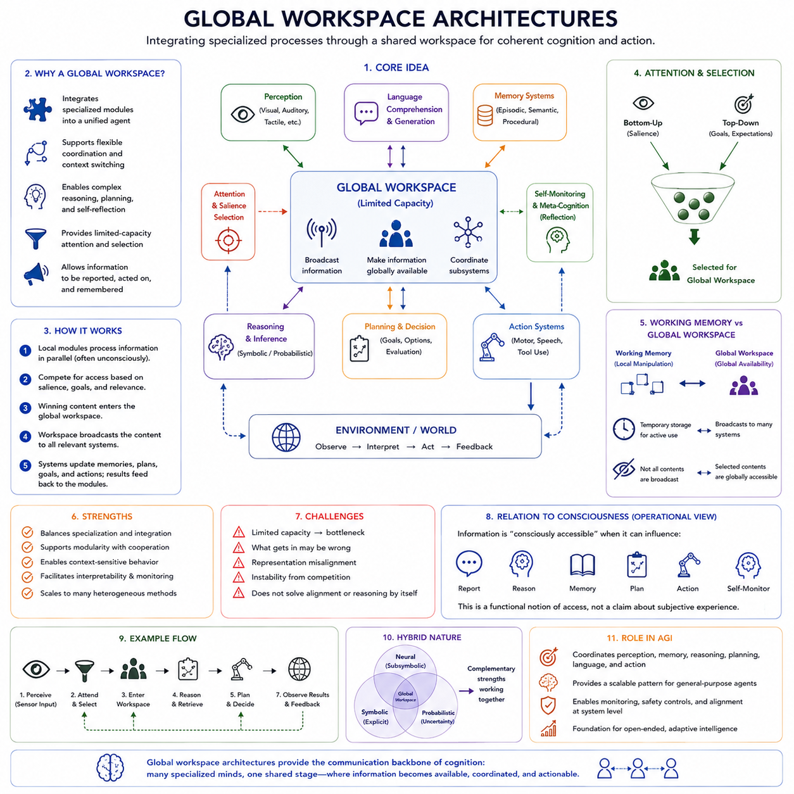
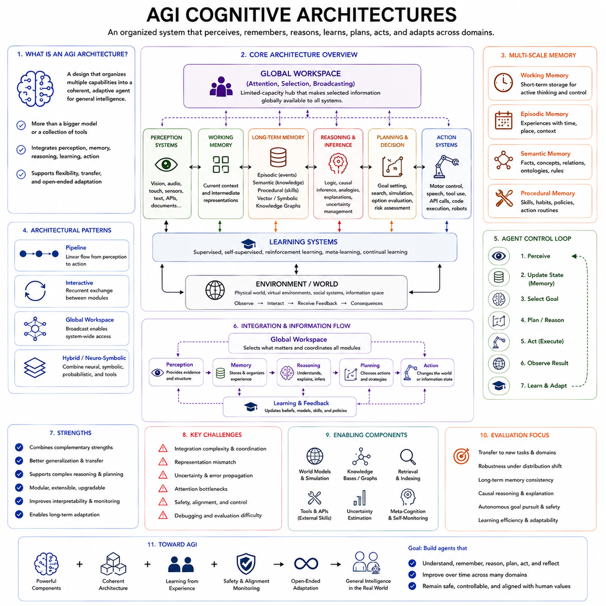

**Volume 00 05 AGI and ASI**

# Chapter 07. Cognitive Architectures

### Chapter Overview

{width="7.268055555555556in" height="7.268055555555556in"}

인지 아키텍처(Cognitive Architecture)는 지능적 시스템을 위한 청사진이다. 그것은 지각(perception), 기억(memory), 주의(attention), 추론(reasoning), 학습(learning), 행동 선택(action selection), 자기 감시(self-monitoring)가 어떻게 하나의 일관된 마음과 유사한 시스템으로 조직될 수 있는지를 설명한다. AGI 연구에서 이 질문은 핵심적이다. 지능은 고립된 능력들의 단순한 모음이 아니라, 감각 입력을 세계 모델(world model), 목표, 계획, 결정, 그리고 시간에 따른 적응적 행동으로 변환하는 통합 과정이기 때문이다. 인지 아키텍처는 지능의 "운영체제"가 어떤 모습이어야 하는지를 묻는다.

이 장은 인지과학(cognitive science), 신경과학(neuroscience), 기호 AI(symbolic AI), 머신러닝(machine learning), 로보틱스(robotics), 자율 에이전트 설계(autonomous agent design)를 잇는 다리로서 인지 아키텍처의 기초를 소개한다. 또한 지능이 어떤 면에서는 모듈식으로 보이지만, 다른 면에서는 깊이 통합되어 있는 이유를 검토한다. 인간 인지는 시각, 언어, 운동 제어, 기억, 사회적 추론을 위한 특화된 시스템을 사용하지만, 이러한 시스템들은 공유 주의, 작업 기억(working memory), 장기 지식, 실행 제어(executive control)를 통해 협력한다. AGI 시스템도 비슷한 도전에 직면한다. 특화된 모델과 일반적 추론 과정을 결합해야 하지만, 취약하거나 일관성을 잃거나 관리 불가능한 시스템이 되어서는 안 된다.

이 장의 범위는 고전적이고 모듈적인 인지 관점에서 출발하여, 신경망(neural network), 기호 추론(symbolic reasoning), 기억 검색(memory retrieval), 계획(planning), 도구 사용(tool use)을 결합하는 현대적 하이브리드 시스템(hybrid system)으로 이어진다. 지각, 기억, 추론을 서로 분리된 계층이 아니라 상호작용하는 구성요소로 이해하는 것이 중요하다는 점을 강조한다. 지각은 수동적 기록이 아니라 기대와 목표에 의해 안내된다. 기억은 단순한 저장소가 아니라 정체성, 연속성, 학습, 맥락을 형성한다. 추론은 형식적 연역만을 의미하지 않는다. 그것은 인과 추론(causal inference), 유추(analogy), 시뮬레이션(simulation), 불확실성 관리, 실천적 의사결정을 포함한다.

특히 이 장은 글로벌 워크스페이스 아키텍처(Global Workspace Architecture)에 주목한다. 이 관점에서 여러 특화된 과정은 의식적 접근(conscious access)과 유사한 공유 작업공간을 통해 경쟁하고 협력한다. 이러한 아키텍처가 중요한 이유는 유연한 조정을 설명하는 한 가지 방법을 제공하기 때문이다. 시스템은 주의를 집중하고, 관련 정보를 널리 전달하며, 계획을 갱신하고, 여러 하위 시스템을 현재 과제에 맞게 정렬할 수 있다. 이는 언어 모델, 지각 모듈, 계획기, 기억 시스템, 외부 도구가 더 큰 인지적 전체의 일부로 작동해야 할 수 있는 AGI에서 특히 중요하다.

인지 아키텍처를 연구하는 동기는 이론적일 뿐 아니라 실용적이기도 하다. 아키텍처가 없다면 점점 더 강력해지는 AI 모델들은 신뢰할 수 있는 일반 에이전트라기보다 능력들의 집합에 머물 수 있다. 아키텍처가 있다면 연구자들은 자율성, 견고성, 해석 가능성, 안전성, 자기 성찰, 장기 학습에 대해 더 정교한 질문을 던질 수 있다. 인지 아키텍처가 AGI를 보장하는 것은 아니지만, AGI가 어떻게 구축되고, 평가되고, 제약되고, 이해될 수 있는지를 사고하기 위한 엄밀한 틀을 제공한다.

### Connection to Volume 05

이 장은 Volume 05에서 중요한 전환점에 위치한다. 앞선 장들은 목적지를 정의한다. AGI가 무엇인지, ASI가 무엇일 수 있는지, 어떤 종류의 지능이 존재하는지, 그리고 일반화(generalization)가 왜 중요한지를 설명한다. 인지 아키텍처는 이러한 질문들에 대한 구조적 응답을 제공한다. AGI가 여러 영역을 가로지르는 유연한 지능을 요구한다면, 단순히 많은 과제로 시스템을 훈련하는 것만으로는 충분하지 않다. 시스템은 지식을 통합하고, 기술을 전이하며, 맥락을 표현하고, 목표를 설정하고, 행동을 조정하는 메커니즘을 가져야 한다. 아키텍처는 일반지능이라는 추상적 개념을 설계 문제로 전환한다.

인과 추론과 세계 모델에 대한 연결은 특히 직접적이다. 인지 아키텍처는 인과 모델이 어디에 존재하는지, 어떻게 학습되는지, 어떻게 갱신되는지, 그리고 그것이 계획을 어떻게 안내하는지를 결정해야 한다. 세계 모델은 지각, 기억, 상상, 행동과 연결될 때 더 유용해진다. 세계를 예측하지만 그 예측을 행동 선택에 사용할 수 없는 시스템은 불완전하다. 마찬가지로 안정적인 세계 모델 없이 행동하는 시스템은 진정으로 지능적이기보다 반응적일 가능성이 높다. 인지 아키텍처는 표상(representation)과 제어(control) 사이의 통합 계층을 제공한다.

이 장은 또한 뒤따르는 기억 시스템, 추론 엔진, 자기 성찰, 자율 에이전트 장들을 위한 준비 역할을 한다. 이러한 주제들은 따로 연구될 수 있지만, AGI 시스템에서는 함께 기능해야 한다. 기억은 관련 경험과 지식을 검색함으로써 추론을 지원한다. 추론은 무엇이 중요한지를 판단함으로써 기억을 안내한다. 자기 성찰은 수행을 감시하고, 실패를 감지하며, 전략을 수정한다. 자율성은 이 모든 과정이 시간에 걸쳐 조정될 것을 요구한다. 따라서 인지 아키텍처는 이후 장들이 더 구체적인 메커니즘을 세워 나가는 개념적 비계(scaffold)다.

자기 개선 AI, 재귀적 자기 개선(recursive self-improvement), 메타러닝(meta-learning), 괴델 머신(Gödel machine)에 관한 이후 장들도 아키텍처적 질문에 의존한다. 시스템이 자기 자신의 구성요소, 능력, 한계, 목표에 대한 어떤 조직화된 모델을 갖지 못한다면, 안전하고 효과적으로 자신을 개선할 수 없다. 메타러닝은 과제를 해결하는 것과 과제를 학습하는 방식을 개선하는 것을 구분할 수 있는 아키텍처를 필요로 한다. 재귀적 자기 개선은 더 강한 요구를 제기한다. 시스템은 스스로를 수정하는 동안에도 정렬(alignment), 정체성(identity), 기능적 일관성(functional coherence)을 보존해야 한다. 이것은 단순한 알고리즘 문제가 아니라 아키텍처의 문제다.

의식, 중국어 방 논변(Chinese Room Argument), 인공 의식(artificial consciousness), 그리고 글로벌한 마음과 유사한 시스템에 관한 장들도 인지 아키텍처와 깊이 연결된다. 의식이 AGI에 필수적인지 여부와 무관하게, 의식적 접근에 관한 많은 이론은 아키텍처 이론이다. 그것들은 정보 흐름, 주의, 방송(broadcasting), 자기 모델링(self-modeling), 보고 가능성(reportability)을 설명한다. 중국어 방 논변은 기호 조작만으로 이해가 충분한지를 묻게 한다. 인지 아키텍처는 어떤 추가적인 접지(grounding), 체화(embodiment), 기억, 행위성(agency), 또는 세계와의 상호작용이 필요할 수 있는지를 명확히 하는 데 도움을 준다.

마지막으로 트랜스휴머니즘(transhumanism), 뇌-컴퓨터 인터페이스(brain-computer interface), 마인드 업로딩(mind uploading), 기술적 특이점(technological singularity), 포스트휴먼 문명(post-human civilization)이라는 더 넓은 주제들은 모두 인지의 구조에 대한 가정에 의존한다. 마음이 아키텍처적으로 조직된 정보처리 시스템이라면, 그것은 문명을 변화시키는 방식으로 확장되고, 연결되고, 복제되고, 가속되고, 병합될 수 있다. 반대로 인지가 우리가 아직 이해하지 못하는 방식으로 생물학적 체화에 의존한다면, 그러한 전망은 훨씬 더 불확실해진다. 따라서 이 장은 가까운 미래의 AI 공학과 AGI 및 ASI를 규정하는 장기적 철학적, 기술적, 문명적 질문 사이를 잇는 경첩 역할을 한다.

## 07.00 Cognitive Architecture Foundations

{width="7.268055555555556in" height="7.268055555555556in"}

{width="7.268055555555556in" height="7.268055555555556in"}

인지 아키텍처(Cognitive Architecture)는 지능형 시스템을 위한 상위 수준의 설계이다. 즉, 인지에 필요한 기능적 구성 요소가 무엇인지, 이들이 어떻게 정보를 교환하는지, 그리고 함께 작동하여 지각(perception), 추론(reasoning), 학습(learning), 계획(planning), 행동(action), 적응(adaptation)을 어떻게 만들어 내는지에 관한 이론이다. AGI의 맥락에서 인지 아키텍처가 중요한 이유는 범용 지능(general intelligence)을 하나의 모델, 알고리즘, 또는 벤치마크 점수로 환원할 수 없기 때문이다. 범용 지능은 여러 영역에 걸쳐 지식을 획득하고, 그 지식을 유연하게 사용하며, 시간에 따라 목표를 추구하고, 변화하는 조건에서도 일관성을 유지할 수 있는 조직화된 시스템을 요구한다. 이 절은 모듈형 인지, 지각-기억-추론 루프, 하이브리드 시스템, 글로벌 워크스페이스 모델, 그리고 후보 AGI 아키텍처로 이어지는 이 장의 나머지 내용을 위한 기초를 세운다.

역사적으로 인지 아키텍처는 인지과학(cognitive science), 상징적 AI(symbolic AI), 심리학, 신경과학, 제어 이론에서 등장했다. SOAR나 ACT-R 같은 고전적 아키텍처는 상징 규칙, 작업 기억(working memory), 절차 기억(procedural memory), 목표 지향 행동을 통해 인간의 문제 해결을 모델링하려 했다. 이후의 시스템들은 확률적 추론, 강화학습(reinforcement learning), 신경망 기반 지각, 체화된 상호작용(embodied interaction)을 통합했다. 핵심 통찰은 인지가 추상적인 계산만이 아니라는 점이다. 인지는 환경 안에서 감지하고, 기억하고, 결정하고, 행동해야 하는 에이전트를 중심으로 조직된 계산이다. 따라서 유용한 아키텍처는 내부 정보 흐름뿐 아니라 시스템과 세계 사이의 인터페이스도 명시해야 한다.

기초적인 구분 중 하나는 아키텍처와 구현(implementation)의 구분이다. 아키텍처는 역할과 관계를 정의한다. 지각 모듈은 감각 데이터에서 구조를 추출하고, 기억 시스템은 정보를 저장하고 검색하며, 추론 엔진은 결과를 추론하고, 계획기는 가능한 행동을 평가하며, 제어 메커니즘은 주의와 자원을 배분한다. 구현은 신경망, 상징 논리, 벡터 데이터베이스, 확률적 프로그램, 미분 가능한 메모리(differentiable memory), 또는 이들의 조합을 사용할 수 있다. 두 시스템은 내부적으로 서로 다른 알고리즘을 사용하더라도 같은 아키텍처 패턴을 공유할 수 있다. 반대로 같은 알고리즘도 더 큰 시스템 안에 어떻게 포함되느냐에 따라 서로 다른 인지적 역할을 수행할 수 있다.

또 다른 핵심 구분은 반응적(reactive), 숙고적(deliberative), 성찰적(reflective) 인지의 구분이다. 반응적 과정은 현재 자극에 빠르게 반응하며, 종종 학습된 정책이나 패턴 인식을 통해 작동한다. 숙고적 과정은 가능한 미래를 구성하고, 대안을 비교하며, 목표와 제약 조건에 따라 행동을 선택한다. 성찰적 과정은 시스템 자신의 추론을 모니터링하고, 불확실성이나 모순을 감지하며, 전략을 수정하고, 언제 도움을 요청하거나 더 많은 증거를 수집해야 하는지 결정한다. 인간과 유사한 범용 지능은 이 세 가지를 모두 필요로 하는 것으로 보인다. 순수하게 반응적인 에이전트는 빠르지만 취약할 수 있고, 순수하게 숙고적인 에이전트는 강력하지만 느릴 수 있으며, 지각과 행동에 기반하지 않은 성찰적 에이전트는 자기참조적 분석에 갇힐 수 있다.

대부분의 인지 아키텍처에는 지각, 기억, 주의(attention), 추론, 학습, 계획, 행동의 어떤 형태가 포함된다. 지각은 원시 입력을 사용 가능한 표현으로 변환한다. 기억은 시간에 걸쳐 정보를 보존하며, 흔히 단기 기억 또는 작업 기억, 일화 기억(episodic memory), 의미 기억(semantic memory), 절차 기억으로 구분된다. 주의는 현재 관련 있는 정보를 선택하여 시스템이 과부하되지 않도록 한다. 추론은 저장된 지식과 현재 관찰을 결합하여 결론을 도출한다. 학습은 경험을 바탕으로 시스템을 수정한다. 계획은 목표를 향해 행동을 조직하고, 행동은 환경에 영향을 미침으로써 루프를 닫는다. 중요한 점은 이러한 구성 요소들이 물리적으로 반드시 분리되어야 한다는 것이 아니라, 이러한 인지 기능들이 어떤 방식으로든 지원되어야 한다는 것이다.

표현(representation)은 가장 어려운 아키텍처적 문제 중 하나이다. 상징적 표현(symbolic representation)은 명시적이고 조합적이며 대체로 해석 가능하다. 그것은 논리, 추상화, 체계적 추론을 지원한다. 신경 임베딩(neural embedding)과 같은 하위상징적 표현(subsymbolic representation)은 분산되어 있고 유연하며 잡음이 많은 데이터에 강하다. 그것은 패턴 인식과 일반화를 지원한다. 현대 AGI 연구는 점점 두 방식을 결합하는 하이브리드 아키텍처(hybrid architecture)를 탐구하고 있다. 예를 들어 언어 모델은 넓은 의미론적 능력을 제공하고, 상징적 계획기는 제약 조건을 강제하며, 외부 메모리는 장기 맥락을 보존하고, 도구 사용 계층은 시스템을 계산기, 데이터베이스, 시뮬레이터, 로봇 구동기와 연결할 수 있다. 과제는 단순히 구성 요소를 추가하는 것이 아니라, 이들을 신뢰성 있게 조정하는 것이다.

제어(control) 역시 또 하나의 기초이다. 지능형 시스템은 무엇에 대해 생각할지, 무엇을 무시할지, 언제 행동할지, 언제 숙고할지, 언제 학습할지를 결정해야 한다. 이를 인지 제어(cognitive control) 또는 실행 제어(executive control)라고 부르기도 한다. 제어가 없으면 아키텍처는 단절된 모듈들의 집합이 된다. 제어가 부실하면 시스템은 과도하게 계획하거나, 환각(hallucination)을 일으키거나, 무한 루프에 빠지거나, 도구를 오용하거나, 잘못된 목적을 최적화할 수 있다. 제어 메커니즘은 규칙 기반, 학습 기반, 효용 기반, 주의 기반일 수 있으며, 경쟁하는 과정들이 정보를 시스템의 나머지 부분에 방송하는 글로벌 워크스페이스(global workspace)를 통해 구현될 수도 있다. 이후 절들에서는 이러한 메커니즘을 더 자세히 살펴본다.

아키텍처는 안전성과 정렬(alignment)에도 영향을 미친다. 명시적 기억, 목표, 자기 모니터링을 가진 시스템은 더 유능할 수 있지만, 동시에 예측하기 더 어려울 수 있다. 장기적 계획을 수행하고, 외부 도구를 호출하며, 자신의 전략을 수정하거나, 다른 에이전트와 협력할 수 있는 에이전트는 모델 훈련 수준뿐 아니라 아키텍처 수준에서도 안전장치를 필요로 한다. 이러한 안전장치에는 불확실성 추정, 제약된 계획, 감독 채널, 감사 로그(audit log), 해석 가능성 인터페이스, 권한 경계, 수정 가능성(corrigibility) 메커니즘이 포함될 수 있다. 따라서 AGI에서 아키텍처는 단순한 공학 문제가 아니라 거버넌스와 위험 관리의 문제이기도 하다.

인지 아키텍처에는 한계도 있다. 많은 모듈을 갖추었지만 통합에 관한 일관된 이론이 없는 과잉 설계가 될 수 있다. 인간 인지를 지나치게 문자 그대로 모방하여 기계에는 필요하지 않은 생물학적 제약을 끌어들일 수도 있다. 또한 체화(embodiment), 사회적 학습, 문화적 지식, 감정, 동기, 환경 피드백을 과소평가할 수도 있다. 반대로 순수한 신경망 기반의 종단 간(end-to-end) 시스템은 인상적인 성능을 달성하면서도 지속적인 기억, 명시적 추론, 안정적인 목표, 자기성찰적 제어가 부족할 수 있다. 중심 문제는 적절한 구조의 수준을 찾는 것이다. 일반성, 신뢰성, 투명성을 지원할 만큼은 충분히 구조화되어야 하지만, 시스템이 경직되고 확장 불가능해질 정도로 과도해서는 안 된다.

이 장에서 인지 아키텍처는 개별 AI 능력과 AGI로 향하는 그럴듯한 경로를 연결하는 다리 역할을 한다. 모듈형 인지는 기능적 전문화를 설명한다. 지각, 기억, 추론은 지능형 에이전트를 통해 정보가 어떻게 흐르는지 보여 준다. 하이브리드 인지 시스템은 신경망 방식과 상징적 방식의 통합을 검토한다. 글로벌 워크스페이스 아키텍처는 시스템 규모에서의 조정과 주의를 탐구한다. 마지막으로 AGI 인지 아키텍처는 이러한 아이디어들의 어떤 조합이 견고하고 개방적인 지능을 만들어 낼 수 있는지 묻는다. 기초는 분명하다. 범용 지능은 강력한 모델을 보유하는 것만의 문제가 아니라, 지각, 기억, 추론, 학습, 제어, 행동을 일관된 적응적 전체로 배열하는 문제이다.

## 07.01 Modular Cognition

{width="7.268055555555556in" height="7.268055555555556in"}

인지 아키텍처(Cognitive architecture)는 단일하고 구분되지 않은 하나의 메커니즘인 경우가 드물다. 그 대상이 생물학적 뇌이든, 상징적 AI(symbolic AI)이든, 신경망 기반 에이전트(neural agent)이든, 또는 하이브리드 AGI 원형이든, 지능적 행동은 대개 특화된 하위 시스템들이 조정되어 나타난다. 모듈형 인지(Modular cognition)는 인지를 상호작용하는 기능적 구성 요소들로 분해할 수 있다는 관점이며, 각 구성 요소는 지각, 주의, 작업 기억, 계획, 언어, 운동 제어, 사회적 추론, 가치 평가와 같은 특정 계산 부류를 담당한다. AGI의 맥락에서 모듈성(modularity)은 단순한 공학적 편의가 아니다. 그것은 지능을 확장 가능하고, 해석 가능하며, 신뢰할 수 있고, 적응 가능하게 만들기 위한 핵심 설계 질문 중 하나다.

이 개념은 인지과학에 뿌리를 두고 있으며, 특히 인간의 마음이 영역 특화 모듈(domain-specific modules)로 구성되는지, 아니면 더 일반적인 학습 메커니즘으로 구성되는지에 관한 논쟁과 관련이 깊다. 초기 모듈성 이론은 시각 지각이나 언어 처리처럼 비교적 캡슐화된 시스템을 강조했다. 이러한 시스템은 전역 지식(global knowledge)에 대한 접근이 제한된 상태에서 빠르고 자동적으로 작동한다고 여겨졌다. 현대적 관점은 더 유연하다. 모듈은 경계가 엄격한 하드코딩된 상자일 필요가 없다. 그것은 학습된 신경망 하위 시스템, 상징적 추론 서비스, 기억 검색 메커니즘, 계획기(planner), 시뮬레이터, 또는 외부 도구일 수 있다. 어떤 구성 요소를 모듈형으로 만드는 것은 더 큰 인지 시스템 안에서 비교적 안정적인 역할, 인터페이스, 내부 특화를 가진다는 점이다.

AGI 연구에서 모듈형 인지는 여러 장점을 제공한다. 첫째, 기능적 분리(functional separation)를 지원한다. 지각, 기억, 추론, 행동을 위한 서로 다른 메커니즘을 사용하는 시스템은 각 구성 요소를 서로 다른 계산 요구에 맞게 최적화할 수 있다. 지각은 흔히 고차원 패턴 인식을 요구하고, 추론은 조합적 구조와 변수 결합(variable binding)을 요구할 수 있으며, 기억은 색인화, 통합, 검색을 요구한다. 행동 선택은 목표, 제약, 불확실성, 비용 사이의 균형을 필요로 한다. 단일한 모놀리식 모델(monolithic model)도 이러한 행동 중 다수를 암묵적으로 학습할 수 있지만, 점검하거나 수리하거나 제어하기 어려울 수 있다. 모듈형 아키텍처는 설계자가 어떤 하위 시스템이 믿음을 생성했는지, 어떤 기억이 결정을 뒷받침했는지, 어떤 계획기가 행동을 생성했는지, 어떤 가치 모델이 결과를 평가했는지를 물을 수 있게 한다.

둘째, 모듈성은 확장성(extensibility)을 향상시킨다. 명시적 인터페이스를 중심으로 설계된 인지 아키텍처는 구성 요소별로 업그레이드될 수 있다. 약한 시각 모듈은 더 강한 모듈로 교체될 수 있고, 계획기는 탐색(search)으로 보강될 수 있으며, 언어 모듈은 지식 그래프(knowledge graph)에 연결될 수 있다. 기억 모듈은 단기 문맥에서 장기 일화 기억(episodic memory) 저장소로 확장될 수 있다. 이는 일반 지능의 모든 측면을 해결할 단일 알고리즘이 나올 가능성이 낮은 AGI에서 특히 중요하다. 모듈성은 이질적인 방법들이 공존할 수 있게 한다. 지각을 위한 신경망, 형식 추론을 위한 상징 시스템, 불확실성을 위한 확률 모델, 정책 적응을 위한 강화학습, 외부 계산을 위한 도구 사용 메커니즘이 함께 작동할 수 있다.

셋째, 모듈형 인지는 안전성과 거버넌스에도 도움이 될 수 있다. 어떤 시스템이 목표 관리, 세계 모델링, 행동 제안, 위험 평가, 실행 승인에 대한 분리 가능한 구성 요소를 포함한다면, 의미 있는 지점에 감독을 삽입할 수 있다. 순수한 종단간(end-to-end) 에이전트는 불투명한 내부 동역학을 통해 목표를 행동으로 변환할 수 있으므로 감사를 어렵게 만든다. 반면 모듈형 에이전트는 중간 표현을 드러낼 수 있다. 즉, 무엇을 믿는지, 무엇을 예측하는지, 무엇을 의도하는지, 어떤 대안을 고려했는지를 보여줄 수 있다. 이것이 안전성을 보장하지는 않지만, 모니터링, 제약 검사, 해석 가능성, 인간 개입의 기회를 만든다.

그러나 모듈성은 중대한 과제도 낳는다. 첫 번째는 통합(integration)이다. 지능은 고립된 모듈에서 생기는 것이 아니라, 모듈들 사이의 동적인 조정에서 생긴다. 지각은 기억에 정보를 제공해야 하고, 기억은 추론을 안내해야 하며, 추론은 주의를 형성해야 한다. 주의는 관련 입력을 선택해야 하고, 목표는 계획을 제약해야 하며, 계획은 세계가 변할 때 믿음을 갱신해야 한다. 모듈들이 잘못 설계된 인터페이스를 통해 통신하면 시스템은 취약하고 느리며 일관성이 없어질 수 있다. 시각 모듈이 계획기가 사용할 수 없는 표현을 생성할 수도 있다. 언어 모델이 기억에 근거하지 않은 그럴듯한 설명을 만들어낼 수도 있다. 추론 엔진이 지각 모듈이 안정적으로 제공할 수 없는 정밀한 상징 입력을 요구할 수도 있다.

두 번째 과제는 신용 할당(credit assignment)이다. 모듈형 시스템이 실패했을 때 책임 있는 구성 요소를 식별하는 것은 항상 쉽지 않다. 에이전트가 잘못 행동한 이유가 장면을 잘못 분류한 지각 때문인가, 잘못된 사례를 검색한 기억 때문인가, 거짓 예측을 한 세계 모델 때문인가, 잘못된 목표를 최적화한 계획기 때문인가, 아니면 결과를 부적절하게 평가한 가치 모듈 때문인가? 긴밀히 결합된 시스템에서는 오류가 모듈 경계를 넘어 전파된다. 따라서 모듈형 아키텍처는 구성 요소 설계뿐 아니라 진단 방법, 신뢰도 추정, 하위 시스템 간 충돌 해결 메커니즘도 필요로 한다.

세 번째 과제는 과도한 경직성을 피하는 것이다. 인간 인지는 어떤 측면에서는 모듈형으로 보이지만, 동시에 매우 유연하다. 기술은 영역을 넘어 전이되고, 개념은 재조합되며, 언어는 지각에 영향을 미친다. 상상은 계획을 지원하고, 사회적 추론은 자기 모델링에 영향을 준다. 인지를 고정된 구획으로 나누는 AGI 아키텍처는 과제가 유동적인 조정을 요구할 때 일반화에 실패할 수 있다. 이런 이유로 현대의 많은 접근법은 연성 모듈성(soft modularity)을 선호한다. 모듈은 특화되어 있지만 완전히 고립되지 않고, 인터페이스는 학습되거나 적응적이며, 라우팅 메커니즘은 어떤 하위 시스템을 활성화할지 결정하고, 전역 표현(global representations)은 필요할 때 정보가 공유되도록 한다.

이는 자연스럽게 하이브리드 인지 시스템, 전역 작업공간 아키텍처(global workspace architectures), 기억 중심 설계로 이어진다. 전역 작업공간 모델에서는 특화된 처리기들이 정보를 공유 인지 작업공간에 방송하기 위해 경쟁하거나 협력한다. 하이브리드 아키텍처에서는 신경망, 상징적, 확률적, 절차적 구성 요소가 각자의 강점에 따라 결합된다. 기억 증강 시스템(memory-augmented systems)에서 모듈은 단순히 출력을 계산하는 데 그치지 않는다. 그것들은 시간에 걸친 문맥을 보존하는 공유 저장소에서 읽고 그곳에 기록한다. 따라서 모듈형 인지는 이후 절들을 위한 구조적 어휘를 제공한다. 지각, 기억, 추론은 따로 연구될 수 있지만, AGI는 이들이 어떻게 하나의 일관된 에이전트로 묶이는지를 이해해야 한다.

유용한 구분은 아키텍처적 모듈성(architectural modularity)과 과제 모듈성(task modularity) 사이의 구분이다. 아키텍처적 모듈성은 작업 기억 버퍼, 추론 엔진, 계획 모듈처럼 시스템 설계 안에 지속적으로 존재하는 구성 요소를 가리킨다. 과제 모듈성은 검색, 요약, 검증, 실행처럼 문제를 임시적인 하위 과제로 분해하는 것을 의미한다. 고급 에이전트는 두 가지를 결합할 수 있다. 안정적인 인지 하위 시스템을 사용하여 과제별 워크플로를 동적으로 만들어내는 것이다. 이는 도구를 사용하는 언어 에이전트에서 점점 더 뚜렷하게 나타난다. 중앙 모델이 계산기, 데이터베이스, 코드 인터프리터, 검색 엔진, 특화 모델에 하위 과제를 위임하는 방식이다.

AGI에 대한 함의는 모듈형 인지를 대규모 학습의 단순한 대안으로 이해해서는 안 된다는 점이다. 오히려 그것은 학습, 추론, 기억, 행동이 규모 있게 협력할 수 있도록 조직하는 방식이다. 미래의 AGI는 대형 기반 모델(foundation models), 명시적 추론 엔진, 일화 기억과 의미 기억(semantic memory) 시스템, 시뮬레이터, 계획기, 안전 모니터, 자기 성찰적 제어 루프를 포함할 수 있다. 그 지능은 각 구성 요소의 성능뿐 아니라, 그들 사이의 의사소통을 지배하는 아키텍처에 달려 있을 것이다. 따라서 모듈성은 실용적인 공학 전략인 동시에, 일반 지능이 특화된 능력들로부터 어떻게 구성될 수 있으며 그러면서도 일관성, 유연성, 자율성을 잃지 않을 수 있는지에 관한 이론적 가설이다.

## 07.02 Perception Memory and Reasoning

{width="7.268055555555556in" height="7.268055555555556in"}

인지 아키텍처(cognitive architecture)는 지각(perception), 기억(memory), 추론(reasoning)이 일관된 제어 루프(control loop)로 통합될 때 단순한 모듈들의 집합을 넘어선다. 앞 절의 모듈형 인지(modular cognition)는 지능을 특화된 기능 구성요소로 분해하는 가치에 초점을 맞추었다. 이 절에서는 가장 핵심적인 세 구성요소가 어떻게 상호작용하는지를 살펴본다. 지각은 세계와의 접촉을 제공하고, 기억은 경험을 보존하고 조직하며, 추론은 이용 가능한 정보를 판단, 계획, 설명, 의사결정으로 변환한다. 인간 인지에서 이러한 능력들은 깊이 상호의존적이다. 인공 시스템에서는 공학적 편의를 위해 분리하는 경우가 많지만, 인터페이스가 지나치게 경직되면 일반지능으로 나아가는 데 장벽이 될 수 있다.

지각은 감각 데이터를 수동적으로 수신하는 것에 그치지 않는다. 인지 아키텍처에서 지각은 원시 신호(raw signals)를 다른 과정들이 사용할 수 있는 구조화된 표현(structured representations)으로 변환한다. 시각 시스템은 픽셀을 객체, 공간적 관계, 행위 가능성(affordance), 사건으로 변환할 수 있다. 언어 시스템은 텍스트나 음성을 개체, 의도, 명제, 담화 구조로 변환할 수 있다. AGI에서 지각은 다중모달(multimodal)이어야 하고, 맥락에 민감해야 하며, 행동 지향적이어야 한다. 무엇이 존재하는지를 인식하는 것뿐 아니라 무엇이 중요한지, 무엇이 불확실한지, 무엇이 변할 수 있는지, 어떤 행동이 가능한지를 추정해야 한다. 이 때문에 지각은 주의(attention)와 밀접하게 관련된다. 시스템은 모든 것을 동일한 깊이로 처리할 수 없으므로, 두드러지거나 과제와 관련된 정보에 계산 자원을 배분해야 한다.

기억은 지각에 연속성을 부여하고 추론에 내용을 제공한다. 인지 아키텍처는 일반적으로 여러 형태의 기억을 구분한다. 작업 기억(working memory)은 현재 활성화된 정보를 유지하며 즉각적인 추론과 제어를 지원한다. 일화 기억(episodic memory)은 무엇이, 언제, 어디서, 어떤 조건에서 일어났는지와 같은 상황화된 사건으로 경험을 저장한다. 의미 기억(semantic memory)은 개념, 사실, 관계, 규칙에 관한 더 추상적인 지식을 저장한다. 절차 기억(procedural memory)은 기술, 정책, 습관, 행동 루틴을 저장한다. 이러한 구분은 서로 다른 접근 패턴과 학습 메커니즘을 함축하기 때문에 유용하다. 정리를 기억하는 것, 이전 대화를 회상하는 것, 자전거 타는 법을 아는 것은 동일한 계산 문제가 아니다.

현대 AI 시스템에서 기억은 모델 파라미터(model parameters), 외부 데이터베이스, 벡터 저장소(vector stores), 상징적 지식 그래프(symbolic knowledge graphs), 캐시, 로그, 학습된 잠재 상태(latent states)로 나타날 수 있다. 각 형태에는 강점과 약점이 있다. 파라미터 기억은 압축적이고 빠르지만, 정밀하게 검사하거나 갱신하기 어렵다. 검색 증강 기억(retrieval-augmented memory)은 최신 정보나 특정 영역의 정보를 제공할 수 있지만, 색인화, 관련성 순위화, 맥락 통합에 의존한다. 상징적 기억은 명시적 추론과 설명을 지원하지만, 지각이 잡음이 많거나 개념이 모호할 때 취약할 수 있다. 성숙한 인지 아키텍처는 어떤 단일 메커니즘이 충분하다고 가정하기보다 이러한 기억 형태들을 조정해야 한다.

추론은 지능 시스템이 목표와 증거에 기반해 결론을 도출하고, 대안을 평가하며, 행동을 선택하는 과정이다. 여기에는 일반 규칙으로부터의 연역 추론(deductive reasoning), 사례로부터의 귀납 추론(inductive reasoning), 그럴듯한 설명을 찾는 귀추 추론(abductive reasoning), 개입과 결과에 관한 인과 추론(causal reasoning), 다음에 무엇을 할지에 관한 실천적 추론(practical reasoning)이 포함된다. 인지 아키텍처에서 추론은 상징 논리(symbolic logic), 확률적 추론(probabilistic inference), 계획 알고리즘(planning algorithms), 신경망 순차 모델(neural sequence models), 제약 해결기(constraint solvers), 또는 이들의 조합으로 구현될 수 있다. 핵심적인 아키텍처상의 질문은 추론이 고립적으로 "상징적"인지 "신경망적"인지가 아니라, 표현이 어떻게 형성되고, 수정되고, 현실에 기반을 두며, 불확실성 속에서 사용되는가이다.

지각, 기억, 추론의 상호작용은 특히 중요하다. 지각은 증거를 제공하지만, 기억은 그 증거가 맥락에서 무엇을 의미하는지를 결정한다. 추론은 어떤 정보가 빠져 있는지 또는 어떤 불확실성이 가장 중요한지를 질문함으로써 지각을 안내할 수 있다. 기억은 추론을 익숙한 패턴으로 편향시킬 수 있는데, 이는 때로 효율적이지만 때로는 부정확하다. 따라서 인지 아키텍처에는 믿음을 갱신하고, 모순을 탐지하고, 불확실성을 처리하며, 이전 해석을 수정하는 메커니즘이 필요하다. 이러한 메커니즘이 없으면 시스템은 좁은 과제에서는 유능해 보일 수 있지만, 환경이 변하거나 증거가 불완전하거나 목표가 충돌할 때 실패할 수 있다.

현재 많은 AI 시스템의 주요 한계 중 하나는 지각, 기억, 추론이 느슨하게만 결합되어 있다는 점이다. 어떤 모델은 자신의 이전 약속에 대한 안정적인 기억 없이도 유창한 설명을 생성할 수 있다. 어떤 로봇은 객체를 정확히 지각하지만 숨겨진 원인, 장기적 결과, 사회적 의미에 대해 추론하지 못할 수 있다. 어떤 계획 시스템은 논리적으로 추론할 수 있지만 지각적 모호성을 생략한 단순화된 세계 상태에 의존할 수 있다. 이러한 실패는 과제 수행 능력과 인지적 통합 사이의 간극을 드러낸다. 일반지능은 더 나은 구성요소만이 아니라 시간에 걸쳐 구성요소들을 더 잘 조정하는 능력을 요구한다.

이러한 조정은 표현(representation)의 문제도 제기한다. 저수준 지각 표현은 흔히 연속적이고, 고차원적이며, 통계적이다. 고수준 추론 표현은 흔히 이산적이고, 조합적이며, 해석 가능하다. 이 수준들을 연결하는 일은 어렵지만 필수적이다. 개념이 지각과 행동에 기반을 두지 않으면 추론은 현실에서 분리된다. 지각이 안정적인 개념으로 추상화될 수 없으면 추론은 일반화할 수 없다. 다음 절에서 다룰 하이브리드 인지 시스템(hybrid cognitive systems)은 신경망적 패턴 인식(neural pattern recognition)과 상징적 구조(symbolic structure), 확률 모델, 기억 검색, 계획을 결합함으로써 이 문제를 해결하려 한다.

AGI에서 지각, 기억, 추론은 개방형 적응(open-ended adaptation)을 지원해야 한다. 시스템은 새로운 범주를 학습하고, 관련 경험을 기억하며, 숨겨진 구조를 추론하고, 불확실성 속에서 계획하고, 자신의 결정을 설명하며, 피드백을 통해 개선해야 한다. 또한 자신의 지각을 언제 신뢰하지 말아야 하는지, 기억이 언제 불완전할 수 있는지, 추론이 언제 이용 가능한 증거를 넘어섰는지를 알아야 한다. 이러한 메타인지적 능력(metacognitive capacities)은 이후의 자기성찰(self-reflection), 자율 에이전트(autonomous agents), 자기개선 AI(self-improving AI)와 같은 주제로 나아가는 기반이 된다. 따라서 인지 아키텍처 안에서 지각, 기억, 추론의 통합은 주변적인 설계 선택이 아니다. 그것은 인공 시스템이 단순히 과제를 수행하고 있는지, 아니면 일반 인지를 보이기 시작하는지를 판단하는 핵심 시험대 중 하나이다.

## 07.03 Hybrid Cognitive Systems

{width="7.268055555555556in" height="7.268055555555556in"}

하이브리드 인지 시스템(Hybrid Cognitive Systems)은 지각, 학습, 추론, 계획, 기억, 행동을 위해 여러 계산 패러다임을 하나의 아키텍처 안에 결합한 시스템이다. 인지 아키텍처(cognitive architecture)의 맥락에서 "하이브리드"란 단순히 여러 모듈을 연결한다는 뜻을 넘어선다. 이는 신경망 기반 패턴 인식(neural pattern recognition), 상징 추론(symbolic reasoning), 확률적 추론(probabilistic inference), 규칙 기반 제어(rule-based control), 강화학습(reinforcement learning), 체화된 상호작용(embodied interaction), 때로는 진화적 또는 발달적 메커니즘까지 서로 다른 지능의 형태를 의도적으로 통합한다는 의미다. 핵심 동기는 아직 어떤 단일 기법도 일반지능(general intelligence)에 관련된 모든 속성을 보여주지 못했다는 점에 있다.

하이브리드화의 필요성은 서로 다른 접근법의 강점과 약점을 비교할 때 분명해진다. 심층 신경망(deep neural network)은 지각, 표현 학습(representation learning), 언어 모델링, 대규모 데이터 분포에 대한 통계적 일반화에 뛰어나다. 신경망은 손으로 작성한 규칙 없이도 이미지, 음성, 텍스트, 센서 스트림에서 특징을 추출할 수 있다. 그러나 체계적 추론(systematic reasoning), 명시적 변수 결합(variable binding), 장기 계획(long-horizon planning), 인과적 설명(causal explanation), 훈련 조건 밖에서의 신뢰할 수 있는 외삽(extrapolation)에는 종종 어려움을 겪는다. 반대로 상징 시스템(symbolic system)은 규칙, 그래프, 논리 표현, 스키마, 프로그램과 같은 명시적 구조로 지식을 표현한다. 이들은 조합적 추론(compositional reasoning), 추상화, 설명 가능성, 검증 가능성을 지원하지만, 잡음이 있는 지각, 불완전한 데이터, 모호한 언어, 개방적인 현실 환경을 마주할 때 취약하다.

하이브리드 인지 시스템은 양쪽의 장점을 보존하려고 한다. 지각 서브시스템은 신경망을 사용해 원시 감각 입력을 구조화된 표현으로 변환할 수 있다. 이러한 표현은 작업 기억(working memory), 지식 그래프(knowledge graph), 계획기(planner), 추론 엔진(reasoning engine)으로 전달될 수 있다. 상징적 계획기는 후보 행동 순서를 생성하고, 학습된 정책(learned policy)은 특정 환경에서 어떤 행동이 성공할 가능성이 높은지 평가할 수 있다. 언어 모델은 지시를 해석하고 가설을 생성할 수 있으며, 검증 모듈은 그 내용이 사실, 제약, 형식 규칙과 일관되는지 확인할 수 있다. 이런 의미에서 하이브리드 시스템은 앞 절의 지각, 기억, 추론에 대한 논의와 다음 절의 전역 작업공간 아키텍처(global workspace architecture)에 대한 논의를 연결한다. 전역 작업공간에서는 여러 전문화된 과정이 공유된 주의(shared attention)를 통해 경쟁하고 협력한다.

하이브리드 인지는 여러 방식으로 조직될 수 있다. 파이프라인 아키텍처(pipeline architecture)에서는 신경망 지각이 상징 추론으로 이어지고, 상징 추론이 다시 행동을 산출한다. 상호작용형 아키텍처(interactive architecture)에서는 신경망 구성요소와 상징 구성요소가 정보를 반복적으로 교환하여, 하향식 목표(top-down goal)가 지각에 영향을 주고 상향식 관찰(bottom-up observation)이 믿음을 수정할 수 있게 한다. 긴밀히 통합된 아키텍처에서는 상징 구조가 신경망 내부에 내장되거나, 신경망 방법이 상징 프로그램을 조작하는 법을 학습할 수 있다. 신경-상징 AI(neuro-symbolic AI)는 대표적인 하이브리드 접근 계열로, 신경망 모델의 학습 능력과 상징 표현의 투명성 및 조합성을 결합하려 한다.

기억은 하이브리드 시스템에서 핵심적인 설계 문제다. 순수한 신경망 모델은 지식을 가중치(weight) 안에 암묵적으로 인코딩하기 때문에 특정 사실을 검사하거나 갱신하거나 수정하기 어렵다. 상징 기억(symbolic memory)은 명시적 명제와 관계를 저장할 수 있지만, 불확실성이나 유사성을 자연스럽게 다루지 못할 수 있다. 하이브리드 아키텍처는 보통 여러 기억 시스템을 사용한다. 의미 검색(semantic retrieval)을 위한 벡터 데이터베이스(vector database), 경험을 위한 일화 저장소(episodic store), 기술을 위한 절차 기억(procedural memory), 안정적인 사실과 규칙을 위한 상징 지식베이스(symbolic knowledge base)가 함께 쓰일 수 있다. 아키텍처는 언제 검색하고, 언제 추론하고, 언제 학습하고, 언제 관련 없는 정보를 무시할지를 결정해야 한다. 이러한 조정 문제는 시간이 지나도 일관되게 행동하는 시스템을 만드는 데 중심적인 과제다.

또 다른 핵심 문제는 제어(control)다. 시스템 안에 많은 전문화된 서브시스템이 있다면, 특정 순간에 어떤 서브시스템이 행동하고, 추론하고, 기억을 갱신해야 하는지 선택하는 메커니즘이 필요하다. 전통적인 인지 아키텍처는 이를 위해 생성 규칙(production rule), 목표 스택(goal stack), 블랙보드 시스템(blackboard system)을 자주 사용했다. 현대의 하이브리드 시스템은 학습된 제어기(learned controller), 계획 알고리즘(planning algorithm), 주의 메커니즘(attention mechanism), 또는 관찰하고 생각하고 행동하고 성찰하는 과정을 반복하는 에이전트 루프(agentic loop)를 사용할 수 있다. 어려운 점은 제어가 유연해야 하지만 혼란스러워져서는 안 된다는 것이다. 상징적 제어에 지나치게 의존하는 시스템은 경직될 수 있고, 학습된 정책에 지나치게 의존하는 시스템은 불투명하고 예측하기 어려워질 수 있다.

하이브리드 인지 시스템은 표현 정렬(representation alignment)에 관한 질문도 제기한다. 신경망 표현은 대개 분산적이고 고차원적이며 해석하기 어렵다. 상징 표현은 이산적이고 명시적이며 사람이 읽을 수 있다. 이 두 형식 사이를 매핑하는 일은 단순하지 않다. 예를 들어 시각 모델이 "탁자 위의 컵"을 인식할 수는 있지만, 추론 시스템은 객체 정체성(object identity), 공간 관계(spatial relation), 행동 가능성(affordance), 인과적 기대(causal expectation), 과제 관련성(task relevance)을 필요로 할 수 있다. 지각에서 상징으로의 번역이 신뢰할 수 없다면, 그 이후의 추론도 신뢰할 수 없게 된다. 반대로 상징적 목표가 감각 및 운동 경험에 기반을 두지 못한다면, 시스템은 형식적으로는 올바르게 추론하면서도 실제로는 실패할 수 있다.

AGI 연구에서 하이브리드 시스템은 지능의 층위적 성격을 반영하기 때문에 매력적이다. 인간 인지는 빠른 직관적 과정, 느린 숙고적 추론, 기억 공고화(memory consolidation), 언어를 매개로 한 추상화, 정서적 평가, 체화된 감각운동 학습이 함께 작동하는 것으로 보인다. 따라서 그럴듯한 AGI 아키텍처는 하나의 거대한 단일 모델이 아니라 여러 상호작용하는 서브시스템을 필요로 할 수 있다. 하이브리드 설계는 안전성과 해석 가능성도 지원한다. 명시적 제약, 감사 추적(audit trail), 형식 검증(formal verification), 모듈식 분리는 순수한 종단간(end-to-end) 시스템보다 일부 행동을 더 쉽게 검사할 수 있게 한다. 그러나 하이브리드화가 정렬(alignment), 견고성(robustness), 의식(consciousness)을 자동으로 해결하는 것은 아니다. 오히려 구성요소 사이의 경계에서 새로운 실패 양식을 만들어낼 수도 있다.

하이브리드 인지 시스템의 주요 한계는 통합 복잡성(integration complexity)이다. 각 구성요소는 단독으로는 잘 작동하더라도 다른 구성요소와 결합될 때 실패할 수 있다. 표현이 서로 맞지 않을 수 있고, 타이밍이 일관되지 않을 수 있으며, 모듈마다 불확실성을 처리하는 방식이 다를 수 있고, 피드백 루프가 불안정한 행동을 만들 수 있다. 이러한 시스템을 공학적으로 구현하려면 강력한 개별 알고리즘뿐 아니라 의사소통, 중재, 학습, 자기 모니터링(self-monitoring)을 위한 아키텍처 원리가 필요하다. AGI 연구가 진전될수록 핵심 질문은 신경망 접근과 상징 접근 중 어느 쪽이 "승리"할 것인가가 아니라, 지각, 기억, 추론, 행동, 성찰을 어떻게 조합하여 경험에서 배우고, 세계 안에서 행동하며, 자신의 모델을 책임 있게 수정하는 시스템을 만들 것인가이다.

## 07.04 Global Workspace Architectures

{width="7.268055555555556in" height="7.268055555555556in"}

전역 작업공간 아키텍처(Global Workspace Architectures)는 인지심리학, 신경과학, 인공 인지 시스템을 연결하는 가장 영향력 있는 다리 중 하나를 제공한다. 앞선 절들에서는 모듈형 인지(modular cognition)와 지각, 기억, 추론의 상호작용을 살펴보았다. 여기서 핵심 문제가 등장한다. 인지가 특화된 모듈들에 분산되어 있다면, 지능형 시스템은 어떻게 그것들을 조정하여 일관되고 맥락에 민감한 행동을 만들어 내는가? 전역 작업공간 이론(Global Workspace Theory)은 선택된 정보가 여러 전문화된 과정에 전역적으로 이용 가능해지는 공유 "작업공간"을 제안함으로써 이 질문에 답한다.

버나드 바스(Bernard Baars)와 관련된 원래의 전역 작업공간 이론은 인간 마음에서 의식적 접근(conscious access)을 설명하는 모델로 발전했다. 기본 아이디어는 모든 정신 과정이 의식적이라는 것이 아니라, 많은 무의식적 전문 과정들이 제한된 용량의 작업공간에 정보를 올리기 위해 경쟁하고 협력한다는 것이다. 정보가 이 작업공간에 들어오면, 그것은 기억, 언어, 행동 계획, 감정, 주의, 추론 등 다른 시스템으로 방송(broadcast)된다. 인공 시스템에서 이 아이디어는 하나의 아키텍처 원리가 된다. 지역 모듈들은 전문성을 유지할 수 있지만, 시스템은 공통 방송 메커니즘을 통해 통합성을 얻는다.

전역 작업공간 아키텍처를 이해하는 유용한 방법은 그것을 순수한 모듈형 파이프라인과 대비하는 것이다. 단순한 파이프라인에서는 지각이 표상을 만들고, 그 표상이 추론으로 전달되며, 추론은 다시 행동을 생성한다. 이는 좁은 영역에서는 작동할 수 있지만, 환경이 모호하거나 변화하거나 여러 형태의 지식을 요구할 때는 취약하다. 전역 작업공간은 정보가 더 유연하게 공유되도록 한다. 하나의 시각적 관찰이 기억을 촉발하고, 그 기억이 목표를 갱신하며, 갱신된 목표가 주의를 다시 돌리고, 그 결과 추론 모듈이 계획을 재검토하게 만들 수 있다. 이 아키텍처는 일방향 처리보다 순환적 상호작용을 지원한다.

신경과학에서는 스타니슬라스 드앤(Stanislas Dehaene) 등과 관련된 전역 신경 작업공간 이론(Global Neuronal Workspace theory)에서 유사한 아이디어가 나타난다. 이 관점은 의식적 접근이 대규모 신경 방송, 특히 감각계, 전두엽, 두정엽, 실행 시스템을 연결하는 장거리 연결에 의존한다고 제안한다. 인공 인지 아키텍처가 뇌를 정확히 재현할 필요는 없지만, 이 비유는 중요하다. 이는 지능에 강력한 지역 처리기뿐 아니라 주의, 선택, 통합, 보고 가능성(reportability)을 위한 메커니즘도 필요할 수 있음을 시사한다. 정보를 처리할 수는 있지만 관련 정보를 자기 자신의 나머지 부분에 제공하지 못하는 시스템은 통합된 에이전트처럼 행동하지 못할 수 있다.

AGI의 관점에서 전역 작업공간 아키텍처는 인지 통합의 실용적 모델을 제공하기 때문에 매력적이다. AGI 시스템은 지각 모델, 작업기억(working memory), 일화기억(episodic memory), 의미 지식, 계획 모듈, 언어 모델, 강화학습 구성요소, 도구 사용 시스템을 포함할 수 있다. 조정이 없다면 이러한 구성요소들은 불일치하거나 파편화된 행동을 만들어 낼 수 있다. 전역 작업공간은 중요한 표상이 선택되고, 우선순위가 매겨지고, 방송되는 중간 계층으로 작동할 수 있다. 이것이 자동으로 일반지능을 만들어 내는 것은 아니지만, 이질적인 인지 하위 시스템들이 협력하게 만드는 핵심 공학 문제를 다루는 데 도움이 된다.

주의(attention)는 이 아키텍처의 중심에 있다. 작업공간의 용량은 제한되어 있으므로 모든 정보가 전역적으로 방송될 수는 없다. 어떤 메커니즘이 무엇이 현저한지, 긴급한지, 목표와 관련되는지, 놀라운지, 불확실한지를 결정해야 한다. 생물학적 인지에서 주의는 갑작스러운 움직임이나 통증 같은 상향식 신호(bottom-up signals)와 현재 목표나 기대 같은 하향식 신호(top-down signals) 모두에 의해 형성된다. 인공 시스템에서 이와 유사한 메커니즘에는 현저성 점수(salience scoring), 불확실성 추정, 보상 예측, 과제 관련성, 명시적 제어기 정책 등이 포함될 수 있다. 주의 설계는 시스템이 무엇을 알아차리고, 기억하고, 추론하고, 행동하는지에 강하게 영향을 미친다.

전역 작업공간 아키텍처는 작업기억과 의식 유사 접근의 관계도 명확히 해준다. 작업기억은 조작을 위해 정보를 일시적으로 저장하는 반면, 전역 작업공간은 선택된 내용을 시스템 전체에 방송한다. 둘은 관련되어 있지만 동일하지는 않다. 계획기는 어떤 상태를 내부적으로 유지하면서도 그것을 방송하지 않을 수 있다. 반대로 지각 모듈은 놀라운 관찰을 방송하고, 다른 시스템들이 그 정보를 기억에 부호화할 수 있다. AGI 설계에서 이 기능들을 혼동하면 모든 것을 과도하게 방송하여 계산 과부하를 일으키거나, 중요한 정보를 충분히 방송하지 않아 결정의 일관성을 해치는 아키텍처가 만들어질 수 있다.

하나의 함의는 이러한 아키텍처에서 "의식"을 형이상학적이기보다 조작적으로 다룰 수 있다는 점이다. 어떤 정보가 기억 검색, 언어적 보고, 행동 선택, 자기 감시, 미래 계획에 영향을 미칠 수 있다면, 그 시스템은 그 정보에 대한 전역적 접근을 가진다고 말할 수 있다. 이것이 주관적 경험에 관한 철학적 문제를 해결하는 것은 아니지만, 접근 의식(access consciousness)에 대한 검증 가능한 공학적 개념을 제공한다. 이후 인공 의식에 관한 장에서는 그러한 접근이 경험에 충분한지, 아니면 의식적 인지의 일부 기능적 속성을 시뮬레이션할 뿐인지라는 더 어려운 질문을 다시 다룰 것이다.

중요한 한계도 있다. 전역 방송은 병목이 될 수 있다. 너무 적은 정보만 작업공간에 들어오면 에이전트는 좁고 부주의해진다. 너무 많은 정보가 들어오면 작업공간은 선택적 가치가 사라지고 잡음이 많아진다. 또 다른 과제는 표상 정렬(representation alignment)이다. 모듈들은 방송된 내용을 호환 가능한 방식으로 해석해야 한다. 기호적 계획기(symbolic planner), 신경망 기반 지각 시스템, 언어 모델은 동일한 내부 형식을 공유하지 않을 수 있다. 따라서 실제 시스템에는 번역 계층, 공유 임베딩(shared embeddings), 형식화된 메시지(typed messages), 또는 접지 메커니즘(grounding mechanisms)이 필요하다. 이것들이 없으면 작업공간은 진정한 이해가 없는 통신 채널이 된다.

전역 작업공간 모델 자체가 추론, 학습, 체화(embodiment), 가치 정렬(value alignment)을 해결하는 것도 아니다. 그것은 완전한 마음이 아니라 조정 패턴을 설명한다. 전역 작업공간을 가진 부실하게 설계된 시스템은 여전히 얕은 추론을 하거나, 안전하지 않은 목표를 추구하거나, 거짓 설명을 환각할 수 있다. 또한 작업공간 접근을 둘러싼 경쟁은 목표, 규범, 불확실성 추정, 안전 제약에 의해 조절되지 않으면 불안정한 행동을 낳을 수 있다. 자율 에이전트에서는 무엇이 작업공간에 들어오도록 허용할지를 결정하는 일이 어떤 행동을 취할지 결정하는 것만큼 중요할 수 있다.

이러한 한계에도 불구하고 전역 작업공간 아키텍처는 AGI 인지 아키텍처와 매우 관련이 깊다. 그것은 경직된 기호 시스템과 불투명한 종단간(end-to-end) 신경망 사이의 개념적 중간 지대를 제공한다. 또한 고립 없는 모듈성, 완전한 중앙집중화 없는 통합, 단일한 거대 제어기를 요구하지 않는 주의를 지원한다. 하이브리드 인지 시스템에서 전역 작업공간은 지각, 기억, 추론, 계획, 언어, 자기반성이 만나는 장소가 될 수 있다. 이는 다음 절인 AGI 인지 아키텍처로 자연스럽게 이어지며, 그곳에서 중심 질문은 이러한 메커니즘들을 어떻게 확장 가능하고 적응적이며 안전한 범용 지능으로 결합할 수 있는가가 된다.

## 07.05 AGI Cognitive Architectures

{width="7.268055555555556in" height="7.268055555555556in"}

AGI 인지 아키텍처(AGI cognitive architecture)는 단순히 더 큰 신경망(neural network), 더 긴 프롬프트, 또는 특수화된 도구들의 모음이 아니다. 그것은 인공 시스템이 광범위한 환경과 과제에서 지각하고, 기억하고, 추론하고, 학습하고, 행동하고, 적응할 수 있도록 하는 조직화된 설계다. 앞선 절들에서는 모듈형 인지(modular cognition), 지각·기억·추론의 관계, 하이브리드 상징--신경 시스템(hybrid symbolic--neural systems), 전역 작업공간 아키텍처(global workspace architectures)를 살펴보았다. AGI 인지 아키텍처는 이러한 아이디어들을 더 넓은 질문으로 통합한다. 즉, 좁은 능력이 아니라 일반지능(general intelligence)을 지원하려면 어떤 종류의 시스템 조직이 필요한가라는 질문이다.

유용한 구분은 능력(capability)과 아키텍처(architecture)의 구분이다. 어떤 시스템은 언어, 시각, 계획, 프로그래밍에서 인상적인 능력을 보일 수 있지만 명시적인 인지 아키텍처를 갖지 않을 수 있다. 반대로 어떤 아키텍처는 기억 저장소, 주의 메커니즘(attention mechanisms), 계획 루프, 학습 모듈, 행동 정책을 정의할 수 있지만, 구성 요소가 약하거나 제대로 통합되지 않으면 여전히 제한적일 수 있다. 따라서 AGI 연구는 구성 요소 자체와, 그 구성 요소들이 일관된 인지 에이전트(coherent cognitive agent)로 기능하게 하는 조정 원리 모두를 다룬다.

대부분의 제안된 AGI 아키텍처에는 몇 가지 반복적으로 등장하는 요소가 있다. 첫째, 원시 감각 입력이나 정보 입력을 구조화된 표현(structured representations)으로 변환하는 지각 시스템이 필요하다. 인간형 로봇에서는 시각, 소리, 촉각, 고유수용감각(proprioception)이 포함될 수 있다. 디지털 에이전트에서는 문서, API, 데이터베이스, 코드 저장소, 사용자 지시, 환경 상태가 지각의 대상이 될 수 있다. 둘째, 여러 시간 규모의 기억 시스템이 필요하다. 즉각적인 맥락을 위한 작업기억(working memory), 특정 경험을 위한 일화기억(episodic memory), 일반 지식을 위한 의미기억(semantic memory), 기술을 위한 절차기억(procedural memory)이 그것이다. 셋째, 행동을 선택하고, 목표를 분해하고, 대안을 평가하고, 믿음을 수정할 수 있는 추론 및 계획 메커니즘이 필요하다. 넷째, 경험, 피드백, 시뮬레이션, 지시로부터 행동을 개선할 수 있는 학습 메커니즘이 필요하다.

아키텍처상의 도전은 이러한 요소들이 고립된 모듈로 작동해서는 안 된다는 점이다. 일반지능은 지각을 기억에, 기억을 추론에, 추론을 행동에, 그리고 행동을 다시 학습에 연결하는 시스템을 요구한다. 예를 들어 AGI에 가까운 에이전트라면 실패를 관찰하고, 관련 원인을 식별하고, 세계 모델(world model)을 갱신하고, 계획을 수정하며, 그 교훈을 다른 영역에 적용할 수 있어야 한다. 이러한 전이(transfer)는 일반화(generalization)의 핵심이며, 인지 아키텍처가 중요한 이유 중 하나다. 인지 아키텍처는 지식이 단일 과제 전용 모델 안에 갇히지 않고 재사용될 수 있는 경로를 제공한다.

SOAR와 ACT-R 같은 고전적 인지 아키텍처(classical cognitive architectures)는 상징 규칙(symbolic rules), 생성 시스템(production systems), 명시적 목표, 구조화된 기억을 강조했다. 이러한 시스템은 인지를 검사 가능하고 분해 가능하게 만들었다는 점에서 가치가 있었다. 연구자들이 분석할 수 있는 방식으로 계획, 하위 목표, 의사결정 규칙을 표현할 수 있었기 때문이다. 그러나 이러한 시스템은 지각, 모호성, 개방형 학습(open-ended learning), 실제 세계 지식의 규모를 다루는 데 자주 어려움을 겪었다. 현대 딥러닝 시스템은 반대의 특성을 보인다. 패턴 인식, 표현 학습(representation learning), 언어 생성, 멀티모달 통합(multimodal integration)에는 강력하지만, 내부 추론은 종종 불투명하고, 기억은 불안정하거나 맥락에 제한되며, 계획은 긴 시간 범위에서 취약할 수 있다.

AGI 인지 아키텍처는 점점 이러한 강점들을 결합하려고 시도한다. 하이브리드 아키텍처는 지각과 언어 이해에는 신경 모델을, 명시적 추론에는 상징적 또는 프로그램적 구조를, 연상 기억(associative memory)에는 벡터 데이터베이스(vector databases)를, 목표 지향 행동에는 계획기(planners)를, 적응에는 강화학습(reinforcement learning)이나 자기지도학습(self-supervised learning)을 사용할 수 있다. 대규모 언어 모델(large language models)은 유연한 추론 및 인터페이스 구성 요소로 기능할 수 있지만, 그 자체만으로 충분한 경우는 드물다. 더 일반적인 아키텍처의 일부가 되려면, 대규모 언어 모델은 지속적 기억(persistent memory), 접지 메커니즘(grounding mechanisms), 검증 과정, 도구 사용, 세계 모델, 행동 제어 시스템과 연결되어야 한다.

전역 작업공간 이론(global workspace theory)은 영향력 있는 설계 패턴을 제공한다. 이러한 아키텍처에서는 많은 특수화된 과정들이 병렬로 작동하지만, 선택된 정보만 중앙 작업공간을 통해 전역적으로 이용 가능해진다. 이 방송(broadcast)은 지각, 기억, 추론, 계획 모듈이 현재 가장 관련성 높은 내용을 중심으로 조정되게 한다. AGI에서 전역 작업공간 아이디어는 주의(attention)와 인지 통합(cognitive integration)을 관리하는 방법을 시사한다. 시스템이 알고 있거나 감지하는 모든 것을 한 번에 깊이 처리할 수는 없으므로, 아키텍처는 무엇이 두드러져야 하는지, 무엇이 배경으로 남아야 하는지, 무엇이 행동을 이끌어야 하는지를 결정해야 한다.

또 다른 중요한 패턴은 에이전트 루프(agent loop)다. 이는 지각하고, 상태를 갱신하고, 목표를 선택하고, 계획하고, 행동하고, 결과를 관찰하고, 학습하는 순환이다. 단순한 에이전트도 이 루프를 기계적으로 구현할 수 있지만, AGI 수준의 아키텍처는 더 풍부한 자기 모니터링(self-monitoring)을 요구한다. 불확실성을 추정하고, 모순을 탐지하고, 지식이 부족한 때를 인식하고, 도움을 요청하고, 가정을 시험하고, 언제 추론을 멈추고 행동해야 하는지 결정할 수 있어야 한다. 이는 AGI 인지 아키텍처를 자기성찰(self-reflection), 자율 에이전트(autonomous agents), 자기개선 AI(self-improving AI), 재귀적 자기개선(recursive self-improvement)을 다루는 이후 장들과 연결한다. 메타인지(metacognition)가 없다면, 지능적 시스템은 과제를 수행할 수는 있어도 자신의 인지를 신뢰성 있게 관리하지 못할 수 있다.

체화(embodiment) 역시 아직 해결되지 않은 문제다. 일부 연구자들은 AGI가 세계 안에서 물리적으로 접지되어야 한다고 주장한다. 힘, 거리, 객체 영속성(object permanence), 협력, 위험과 같은 개념은 감각운동 상호작용(sensorimotor interaction)을 통해 학습되기 때문이다. 다른 연구자들은 디지털 환경, 시뮬레이션, 언어, 도구 매개 행동(tool-mediated action)이 많은 형태의 일반지능에 충분한 접지를 제공할 수 있다고 본다. 아키텍처상의 함의는 AGI에 단 하나의 필수 체화 형태가 있는 것은 아닐 수 있지만, 내부 표현을 외부 결과와 연결하는 신뢰할 수 있는 방법은 반드시 필요하다는 것이다. 접지되지 않은 시스템은 상징을 유창하게 조작하면서도 그 작동적 의미(operational meaning)를 이해하지 못할 수 있다.

평가는 여전히 어렵다. 인지 아키텍처는 벤치마크 점수만으로 판단될 수 없다. 벤치마크는 종종 좁은 능력을 보상하기 때문이다. 더 관련성 높은 시험에는 낯선 과제로의 전이, 분포 변화(distribution shift)에서의 강건성, 장기 기억의 일관성, 인과 추론(causal reasoning), 자율적 목표 추구, 안전한 도구 사용, 제한된 경험으로부터 학습하는 능력이 포함된다. 진정한 AGI 아키텍처는 단순히 많은 과제를 해결하는 데 그쳐서는 안 된다. 정렬(alignment), 신뢰성(reliability), 해석 가능성(interpretability)을 보존하면서 새로운 종류의 과제를 해결하는 능력을 개선해야 한다.

한계도 상당하다. 통합된 아키텍처는 복잡해지고, 디버깅하기 어려워지며, 연쇄 오류(cascading errors)에 취약해질 수 있다. 잘못된 기억 검색은 계획을 오도할 수 있고, 부정확한 세계 모델은 위험한 행동을 낳을 수 있으며, 과신하는 언어 모델은 그럴듯하지만 거짓인 정당화를 생성할 수 있다. 인지 시스템이 더 자율적으로 될수록 아키텍처는 안전 문제(safety issue)가 된다. 설계자는 모니터링, 수정 가능성(corrigibility), 샌드박싱(sandboxing), 불확실성 추정, 감사 추적(audit trails), 자기수정(self-modification)에 대한 제약을 고려해야 한다.

따라서 AGI 인지 아키텍처는 공학, 인지과학, 신경과학, 마음의 철학(philosophy of mind), AI 안전(AI safety)의 교차점에 놓여 있다. 그것은 고립된 지능적 행동을 어떻게 만들어낼 것인가가 아니라, 일반지능이 어떻게 조직될 수 있는지를 묻기 위한 틀을 제공한다. 미래의 AGI가 확장된 신경 모델, 하이브리드 시스템, 체화된 에이전트, 전역 작업공간, 또는 아직 발명되지 않은 아키텍처에서 등장하든, 중심 문제는 동일하게 남을 것이다. 즉, 지각, 기억, 추론, 학습, 행동이 일관되고 적응적이며 제어 가능한 지능을 이루는 시스템을 구축하는 것이다.
