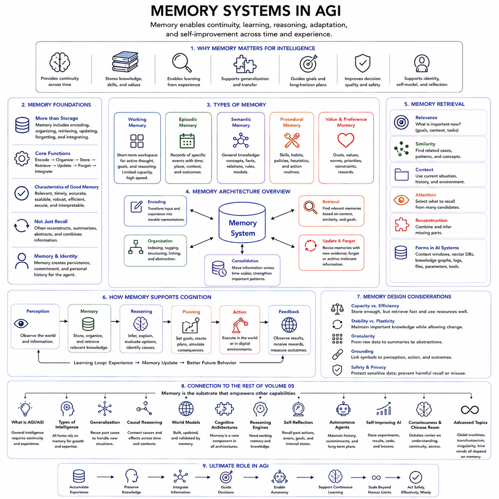
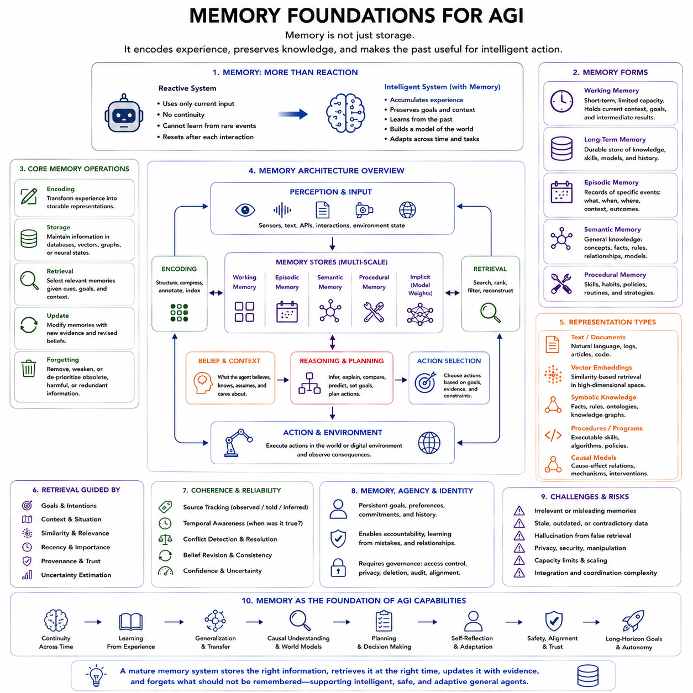
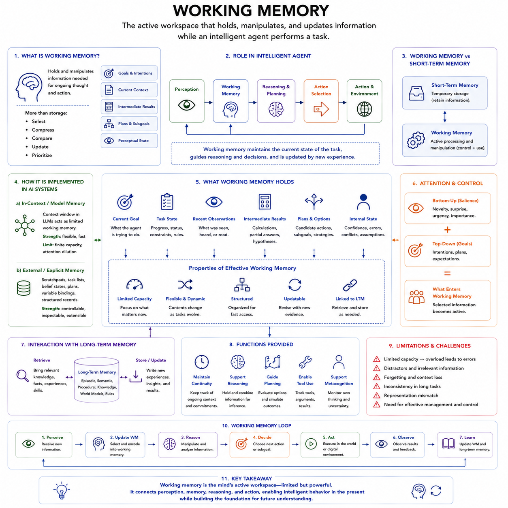
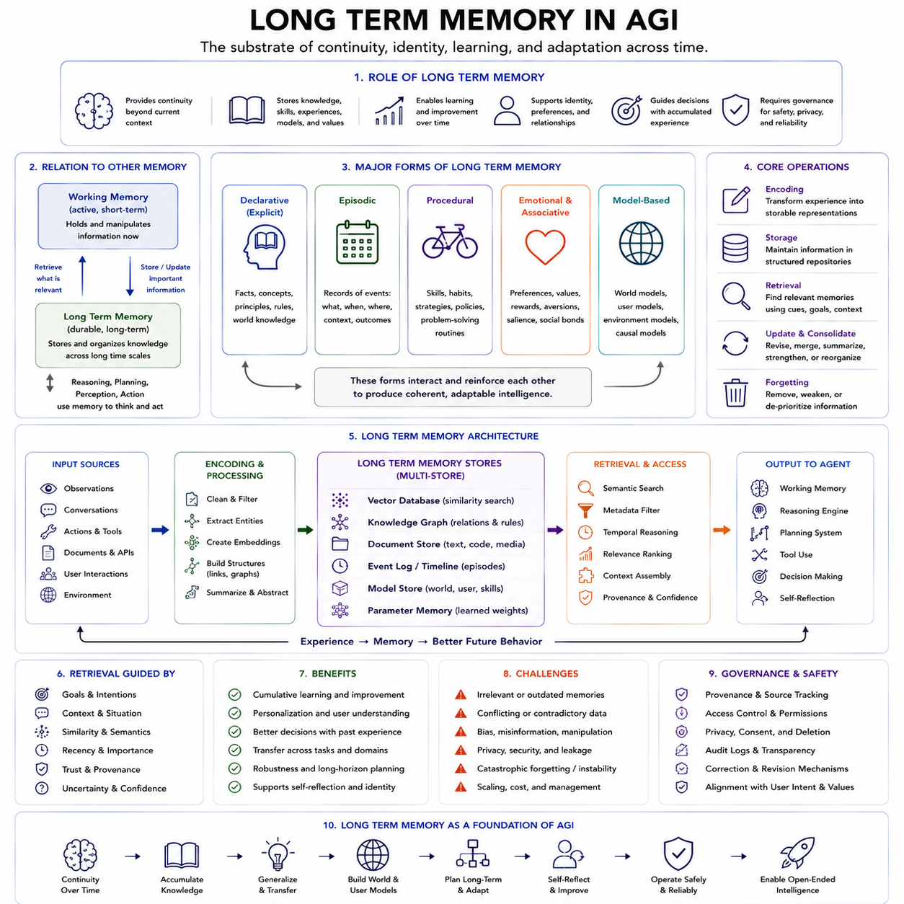
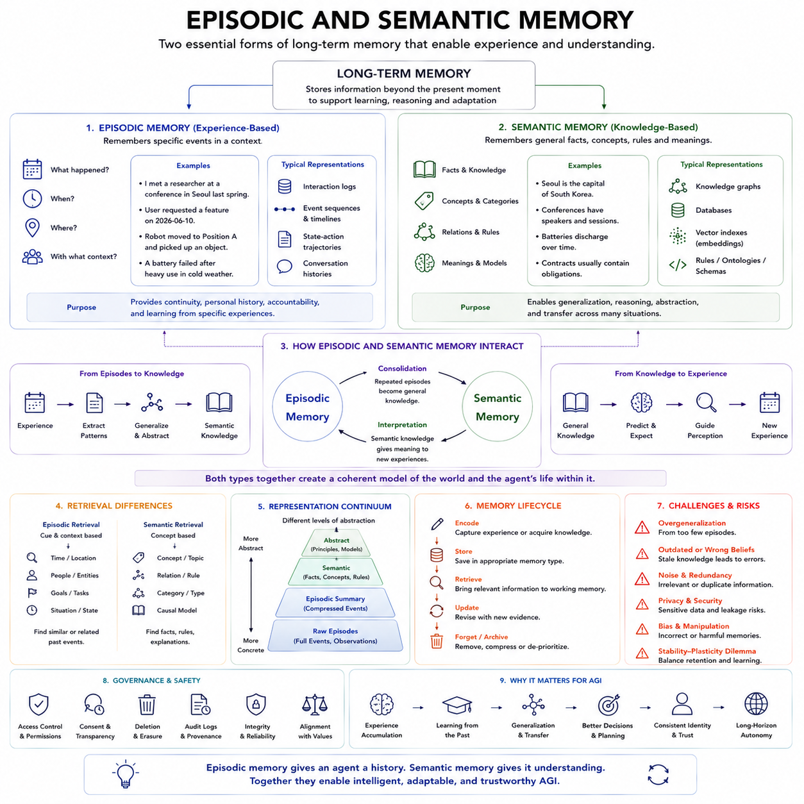
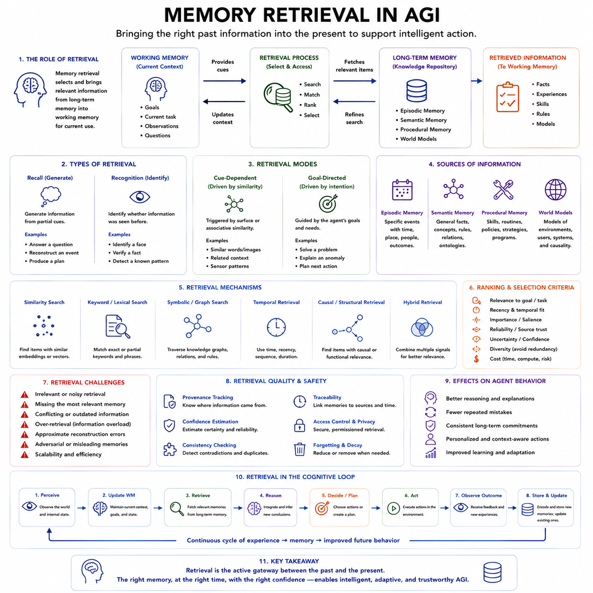
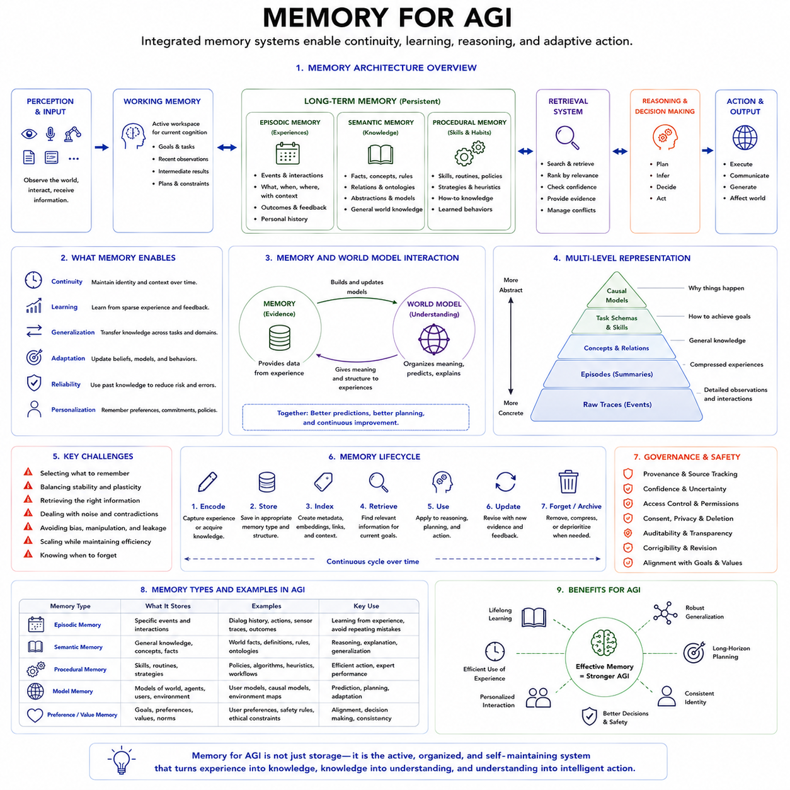

**Volume 00 05 AGI and ASI**

# Chapter 08. Memory Systems

### Chapter Overview

{width="7.268055555555556in" height="7.268055555555556in"}

Memory is one of the defining differences between a reactive system and an intelligent system that can learn, adapt, and maintain continuity across time. In humans, memory is not a single container but a family of interacting processes: short-lived working memory for active thought, long-term memory for accumulated knowledge and skills, episodic memory for lived events, semantic memory for concepts and facts, and retrieval mechanisms that determine what becomes available when it is needed. For artificial general intelligence, memory systems play a similarly foundational role. An AGI cannot merely compute responses from the present input; it must preserve experience, update beliefs, compare current situations with past cases, and use remembered knowledge to guide action in unfamiliar contexts.

This chapter examines memory as an architectural requirement for general intelligence. It begins with memory foundations, clarifying why storage alone is not memory in the cognitive sense. A useful memory system must encode information, organize it, retrieve it, update it, forget selectively, and integrate it with reasoning and action. The chapter then explores working memory as the temporary workspace in which goals, observations, plans, and intermediate reasoning steps are actively maintained. It discusses long-term memory as the durable substrate for knowledge, learned patterns, procedures, values, and world models. It distinguishes episodic and semantic memory, showing why both are necessary: episodic memory gives an agent a history of concrete experiences, while semantic memory abstracts those experiences into reusable knowledge.

The chapter also focuses on memory retrieval, because what an intelligent system can remember at the right moment often matters more than what it has stored somewhere in principle. Retrieval involves relevance, context, similarity, attention, indexing, and sometimes reconstruction rather than exact playback. In contemporary AI systems, memory may appear as context windows, vector databases, knowledge graphs, tool logs, parameterized knowledge, external documents, or agentic memory stores. Each design offers different strengths and risks. The central question is not simply how much information an AGI can store, but how memory can support coherent identity, robust learning, causal understanding, long-horizon planning, self-reflection, and safe adaptation.

기억은 단순히 반응하는 시스템과 시간에 걸쳐 학습하고 적응하며 연속성을 유지할 수 있는 지능적 시스템을 구분하는 핵심 요소 중 하나다. 인간에게 기억은 하나의 저장소가 아니라 서로 상호작용하는 과정들의 집합이다. 현재 사고를 위한 짧은 작업 기억(working memory), 축적된 지식과 기술을 위한 장기 기억(long-term memory), 실제로 겪은 사건을 담는 일화 기억(episodic memory), 개념과 사실을 담는 의미 기억(semantic memory), 그리고 필요한 순간에 무엇이 떠오를지를 결정하는 검색 메커니즘이 함께 작동한다. 인공 일반 지능(AGI)에서도 기억 시스템(memory systems)은 마찬가지로 기초적인 역할을 한다. AGI는 현재 입력만으로 응답을 계산하는 데 그쳐서는 안 된다. 경험을 보존하고, 믿음을 갱신하며, 현재 상황을 과거 사례와 비교하고, 기억된 지식을 사용해 낯선 맥락에서 행동을 이끌 수 있어야 한다.

이 장은 기억을 일반 지능을 위한 아키텍처적 요구사항으로 검토한다. 먼저 기억의 기초를 다루며, 단순한 저장(storage)만으로는 인지적 의미의 기억이 될 수 없음을 설명한다. 유용한 기억 시스템은 정보를 부호화하고, 조직하고, 검색하고, 갱신하고, 선택적으로 잊고, 추론 및 행동과 통합해야 한다. 이어서 작업 기억을 목표, 관찰, 계획, 중간 추론 단계가 능동적으로 유지되는 임시 작업 공간으로 살펴본다. 장기 기억은 지식, 학습된 패턴, 절차, 가치, 세계 모델(world models)을 지탱하는 지속적 기반으로 논의된다. 또한 일화 기억과 의미 기억을 구분하면서, 두 종류의 기억이 모두 필요한 이유를 설명한다. 일화 기억은 에이전트에게 구체적 경험의 역사를 제공하고, 의미 기억은 그러한 경험을 재사용 가능한 지식으로 추상화한다.

이 장은 기억 검색(memory retrieval)에도 중점을 둔다. 지능적 시스템이 원칙적으로 어딘가에 무엇을 저장해 두었는가보다, 적절한 순간에 무엇을 기억할 수 있는가가 더 중요할 때가 많기 때문이다. 검색에는 관련성, 맥락, 유사성, 주의(attention), 색인화(indexing), 그리고 때로는 정확한 재생이 아닌 재구성이 포함된다. 현대 AI 시스템에서 기억은 컨텍스트 창(context window), 벡터 데이터베이스(vector database), 지식 그래프(knowledge graph), 도구 사용 로그, 매개변수화된 지식, 외부 문서, 또는 에이전트형 기억 저장소의 형태로 나타날 수 있다. 각 설계는 서로 다른 장점과 위험을 가진다. 핵심 질문은 AGI가 얼마나 많은 정보를 저장할 수 있는가가 아니라, 기억이 어떻게 일관된 정체성, 견고한 학습, 인과적 이해, 장기 계획, 자기 성찰, 안전한 적응을 지원할 수 있는가이다.

### Connection to Volume 05

Memory Systems sits at the center of Volume 05 because nearly every capability associated with AGI and ASI depends on some form of durable, accessible, and structured memory. The earlier chapters on "What is AGI" and "What is ASI" define intelligence in terms of generality, adaptability, autonomy, and performance across domains. Those properties require more than pattern recognition at a single moment. They require the ability to accumulate experience and reuse it. The chapter on Types of Intelligence shows that intelligence includes reasoning, social understanding, creativity, embodiment, and practical judgment; memory provides the continuity that allows these forms of intelligence to develop rather than reset after each interaction.

The relationship with Generalization is especially direct. A system generalizes by using prior cases to guide new behavior, but this requires memories that are abstracted, indexed, and retrieved appropriately. Causal Reasoning also depends on memory, because causes and effects are often separated across time and must be connected through stored observations. World Models require memory as their raw material and maintenance mechanism: an agent's model of reality is built from accumulated perception, action, feedback, and revision. Cognitive Architectures specify how modules such as perception, planning, memory, and reasoning are arranged; this chapter provides the memory component that those architectures must integrate.

The following chapters deepen the connection. Reasoning Engines need working memory to hold premises, intermediate conclusions, and competing hypotheses. Self-Reflection requires memory of prior decisions, errors, goals, and internal states. Autonomous Agents need episodic records of actions and outcomes in order to plan, avoid repeating failures, and maintain commitments over time. Self-Improving AI and Recursive Self-Improvement require memory of experiments, code changes, performance results, and safety constraints. Meta-Learning depends on memory across tasks, enabling a system to learn how it learns.

Memory also connects to the more philosophical and speculative chapters. Discussions of consciousness, artificial consciousness, and the Chinese Room Argument often turn on whether a system has only symbol manipulation or also integrated experience, continuity, and self-modeling---functions closely tied to memory. Gödel Machines and Universal Constructors require representations of their own structure, goals, and modification history. Transhumanism, brain-computer interfaces, mind uploading, hive minds, and post-human civilization all raise questions about preserving, extending, merging, or transforming memory. Finally, the Technological Singularity cannot be understood without considering the possibility of systems whose memories scale far beyond human limits, enabling accelerating learning, coordination, and self-modification.

기억 시스템은 Volume 05의 중심에 위치한다. AGI와 ASI에 관련된 거의 모든 능력이 어떤 형태로든 지속적이고 접근 가능하며 구조화된 기억에 의존하기 때문이다. 앞선 장인 "AGI란 무엇인가"와 "ASI란 무엇인가"는 지능을 범용성, 적응성, 자율성, 여러 영역에서의 성능이라는 관점에서 정의한다. 이러한 속성은 한 순간의 패턴 인식만으로는 성립하지 않는다. 경험을 축적하고 다시 활용하는 능력이 필요하다. "지능의 유형" 장은 지능이 추론, 사회적 이해, 창의성, 체화(embodiment), 실제적 판단을 포함한다는 점을 보여준다. 기억은 이러한 지능 형태들이 매 상호작용 뒤에 초기화되지 않고 발전할 수 있게 하는 연속성을 제공한다.

"일반화"와의 관계는 특히 직접적이다. 시스템은 이전 사례를 사용해 새로운 행동을 이끌어 냄으로써 일반화하지만, 이를 위해서는 기억이 적절히 추상화되고, 색인화되고, 검색되어야 한다. "인과 추론" 역시 기억에 의존한다. 원인과 결과는 시간적으로 떨어져 있는 경우가 많고, 저장된 관찰을 통해 연결되어야 하기 때문이다. "세계 모델"은 기억을 원재료이자 유지 메커니즘으로 필요로 한다. 에이전트의 현실 모델은 누적된 지각, 행동, 피드백, 수정으로부터 구축된다. "인지 아키텍처"는 지각, 계획, 기억, 추론 같은 모듈이 어떻게 배열되는지를 설명한다. 이 장은 그러한 아키텍처가 통합해야 할 기억 구성 요소를 제공한다.

이어지는 장들과의 연결은 더욱 깊어진다. 추론 엔진(reasoning engines)은 전제, 중간 결론, 경쟁하는 가설을 유지하기 위해 작업 기억을 필요로 한다. 자기 성찰(self-reflection)은 이전 결정, 오류, 목표, 내부 상태에 대한 기억을 요구한다. 자율 에이전트(autonomous agents)는 계획을 세우고, 실패를 반복하지 않으며, 시간에 걸쳐 약속과 목표를 유지하기 위해 행동과 결과의 일화적 기록이 필요하다. 자기 개선 AI(self-improving AI)와 재귀적 자기 개선(recursive self-improvement)은 실험, 코드 변경, 성능 결과, 안전 제약에 대한 기억을 필요로 한다. 메타 학습(meta-learning)은 과제 전반에 걸친 기억에 의존하며, 시스템이 자신이 어떻게 학습하는지를 학습할 수 있게 한다.

기억은 더 철학적이고 사변적인 장들과도 연결된다. 의식, 인공 의식, 중국어 방 논증(Chinese Room Argument)에 대한 논의는 종종 시스템이 단순한 기호 조작만 수행하는지, 아니면 통합된 경험, 연속성, 자기 모델링을 갖는지의 문제로 이어진다. 이 기능들은 기억과 밀접하게 관련되어 있다. 괴델 머신(Gödel Machines)과 보편 구성자(Universal Constructors)는 자신의 구조, 목표, 수정 이력에 대한 표상을 필요로 한다. 트랜스휴머니즘(transhumanism), 뇌-컴퓨터 인터페이스(brain-computer interfaces), 마인드 업로딩(mind uploading), 하이브 마인드(hive mind), 포스트휴먼 문명(post-human civilization)은 모두 기억을 보존하고, 확장하고, 병합하고, 변형하는 문제를 제기한다. 마지막으로 기술적 특이점(Technological Singularity)은 인간의 한계를 훨씬 넘어 확장되는 기억을 가진 시스템의 가능성을 고려하지 않고는 이해할 수 없다. 그러한 기억은 가속적 학습, 조정, 자기 수정을 가능하게 할 수 있다.

##  

## 08.00 Memory Foundations

{width="7.268055555555556in" height="7.268055555555556in"}

Memory is one of the central requirements for any system that aspires to general intelligence. A model that can only react to its current input may appear capable in narrow settings, but it lacks continuity: it cannot accumulate experience, preserve goals across time, learn from rare events, or build a stable understanding of the world. In biological cognition, memory is not a single storehouse but a family of processes that encode, retain, transform, retrieve, and sometimes forget information. For artificial general intelligence(AGI), memory must be understood in the same functional sense: not merely as data storage, but as an active mechanism that shapes perception, reasoning, planning, identity, and adaptation.

A useful starting point is the distinction between memory as learned structure and memory as accessible content. In modern machine learning, much of what a system "knows" is embedded in parameters learned during training. These parameters capture statistical regularities, skills, language patterns, and compressed knowledge about the training distribution. This is a form of long-term implicit memory, but it is slow to update, difficult to inspect, and often separated from the system's current lived experience. By contrast, an AGI-like agent also needs explicit or semi-explicit memory: records of interactions, observations, commitments, preferences, past plans, failures, and environmental changes that can be retrieved and used during ongoing activity. The challenge is to integrate these forms without confusing a static learned prior with a reliable memory of what actually happened.

Memory systems operate across multiple time scales. At the shortest scale, transient context supports immediate reasoning: the agent keeps track of the current problem, recent dialogue, active goals, and intermediate results. This leads naturally to the next section on working memory(working memory), where capacity, attention, and task control are central. At longer scales, the system must preserve information beyond the current context window or active episode. Long-term memory(long-term memory) includes facts, skills, autobiographical traces, models of other agents, and accumulated evidence about the world. Between these extremes lie mechanisms for consolidation, summarization, rehearsal, and abstraction, which determine what is preserved, what is compressed, and what is discarded.

The foundation of any memory system involves several core operations. Encoding converts experience into a representation that can be stored. Storage maintains that representation over time, possibly in a database, vector index, symbolic knowledge graph, neural state, or hybrid architecture. Retrieval selects relevant memories in response to a cue, goal, question, or situation. Update modifies existing memories when new evidence arrives. Forgetting removes, weakens, or de-prioritizes information that is obsolete, misleading, redundant, or unsafe to retain. In AGI, each operation must be reliable under uncertainty. An agent must know not only what it remembers, but also how confident it should be, where the information came from, and whether it may have become outdated.

Representation is especially important. A memory stored as raw text, sensor data, embeddings, symbolic triples, executable procedures, or causal models will support different kinds of reasoning. Vector memories are powerful for similarity-based retrieval, allowing a system to find episodes or documents related to the current context even when the wording differs. Symbolic memories can support explicit inference, consistency checks, and structured planning. Episodic records preserve context-rich events: what happened, when, where, under what conditions, and with what outcome. Semantic memories extract more general knowledge: concepts, facts, rules, and relationships. The later section on episodic and semantic memory develops this distinction, but the foundation is that AGI needs both concrete experience and abstract knowledge, linked in ways that support generalization.

Retrieval is not a passive lookup. It is an intelligent act. A memory system must decide which cues matter, how broadly to search, how to rank relevance, and how to avoid retrieving plausible but false associations. In large language model systems, retrieval-augmented generation(RAG) demonstrates the value of external memory, but it also reveals limitations. A retrieved passage may be irrelevant, stale, adversarial, or interpreted incorrectly. Similarity is not the same as truth. Recency is not the same as importance. Frequency is not the same as reliability. For AGI, retrieval must be guided by goals, context, provenance, uncertainty estimation, and causal understanding, not just lexical or embedding proximity.

Memory also raises the problem of coherence. If an agent stores every observation without integration, its memory becomes noisy and contradictory. If it compresses too aggressively, it may lose crucial details. If it updates beliefs too quickly, it becomes unstable; if too slowly, it becomes rigid. A mature memory system therefore needs mechanisms for belief revision, conflict detection, source tracking, and temporal modeling. It must distinguish "I observed this," "someone told me this," "I inferred this," and "this was true at a particular time." These distinctions are essential for trustworthy reasoning and for avoiding hallucination-like behavior, where the system treats generated or inferred content as remembered fact.

For autonomous agents, memory is also tied to agency and identity. Persistent goals, user preferences, social commitments, learned habits, and records of consequences allow an agent to behave consistently over time. Without memory, an agent cannot meaningfully be held accountable, learn from mistakes, or maintain relationships. With memory, however, come risks: privacy violations, manipulation, unwanted personalization, security leakage, and the retention of harmful or biased information. Memory for AGI must therefore include governance mechanisms: access control, consent, auditability, deletion, compartmentalization, and alignment with the user's intentions and the system's safety constraints.

The central implication is that memory is not an optional extension to intelligence. It is part of the architecture that determines what an intelligent system can become. Working memory supports immediate thought; long-term memory supports continuity and learning; episodic and semantic memory support experience and knowledge; retrieval determines whether the right past becomes available at the right moment. The rest of this chapter examines these layers in more detail, moving from short-term cognitive control to durable knowledge stores and finally to the question of what kind of memory an AGI would need to operate safely, adaptively, and coherently in an open-ended world.

기억은 일반지능을 지향하는 어떤 시스템에도 핵심적인 요구 사항 중 하나다. 현재 입력에만 반응할 수 있는 모델은 좁은 환경에서는 유능해 보일 수 있지만, 연속성이 없다. 경험을 축적하지 못하고, 시간에 걸쳐 목표를 보존하지 못하며, 드문 사건에서 배우지 못하고, 세계에 대한 안정적인 이해를 구축하지 못한다. 생물학적 인지에서 기억은 하나의 저장고가 아니라 정보를 부호화하고, 유지하고, 변형하고, 검색하고, 때로는 잊는 과정들의 집합이다. 인공일반지능(AGI)에 대해서도 기억은 같은 기능적 의미로 이해되어야 한다. 즉 단순한 데이터 저장이 아니라 지각, 추론, 계획, 정체성, 적응을 형성하는 능동적 메커니즘이다.

유용한 출발점은 학습된 구조로서의 기억과 접근 가능한 내용으로서의 기억을 구분하는 것이다. 현대 기계학습에서 시스템이 "아는" 것의 상당 부분은 학습 중에 형성된 파라미터(parameters)에 내재되어 있다. 이 파라미터들은 통계적 규칙성, 기술, 언어 패턴, 학습 분포에 대한 압축된 지식을 포착한다. 이것은 장기 암묵 기억(long-term implicit memory)의 한 형태지만, 갱신이 느리고, 점검하기 어려우며, 시스템의 현재 실제 경험과 분리되어 있는 경우가 많다. 반대로 AGI와 유사한 에이전트는 명시적 또는 준명시적 기억도 필요로 한다. 즉 상호작용, 관찰, 약속, 선호, 과거 계획, 실패, 환경 변화에 대한 기록을 검색하여 진행 중인 활동에 사용할 수 있어야 한다. 과제는 정적인 학습 사전지식(static learned prior)을 실제로 일어난 일에 대한 신뢰할 수 있는 기억과 혼동하지 않으면서 이러한 형태들을 통합하는 것이다.

기억 시스템은 여러 시간 척도에서 작동한다. 가장 짧은 척도에서는 일시적 맥락이 즉각적인 추론을 지원한다. 에이전트는 현재 문제, 최근 대화, 활성 목표, 중간 결과를 추적한다. 이는 자연스럽게 다음 절인 작업 기억(working memory)으로 이어지며, 여기서는 용량, 주의, 과제 제어가 핵심이 된다. 더 긴 척도에서는 시스템이 현재 맥락 창(context window)이나 활성 에피소드를 넘어 정보를 보존해야 한다. 장기 기억(long-term memory)은 사실, 기술, 자전적 흔적, 다른 에이전트에 대한 모델, 세계에 대한 누적 증거를 포함한다. 이 양극단 사이에는 공고화(consolidation), 요약, 리허설, 추상화 메커니즘이 있으며, 무엇을 보존하고, 무엇을 압축하고, 무엇을 버릴지를 결정한다.

모든 기억 시스템의 기초에는 몇 가지 핵심 연산이 있다. 부호화(encoding)는 경험을 저장 가능한 표현으로 변환한다. 저장(storage)은 그 표현을 시간이 지나도 유지하며, 데이터베이스, 벡터 인덱스(vector index), 상징적 지식 그래프(symbolic knowledge graph), 신경 상태, 또는 하이브리드 아키텍처 안에서 이루어질 수 있다. 검색(retrieval)은 단서, 목표, 질문, 상황에 반응하여 관련 기억을 선택한다. 갱신(update)은 새로운 증거가 도착했을 때 기존 기억을 수정한다. 망각(forgetting)은 오래되었거나, 오해를 일으키거나, 중복되거나, 보존하기에 안전하지 않은 정보를 제거하거나 약화하거나 낮은 우선순위로 만든다. AGI에서는 각 연산이 불확실성 아래에서도 신뢰할 수 있어야 한다. 에이전트는 자신이 무엇을 기억하는지뿐 아니라, 그 기억에 대해 얼마나 확신해야 하는지, 정보가 어디서 왔는지, 그리고 그것이 시대에 뒤떨어졌을 수 있는지도 알아야 한다.

표현(representation)은 특히 중요하다. 기억이 원시 텍스트, 센서 데이터, 임베딩(embeddings), 상징적 삼중항(symbolic triples), 실행 가능한 절차, 또는 인과 모델(causal models)로 저장되는지에 따라 지원할 수 있는 추론의 종류가 달라진다. 벡터 기억(vector memory)은 유사도 기반 검색에 강력하여, 표현이 달라도 현재 맥락과 관련된 에피소드나 문서를 찾을 수 있게 한다. 상징 기억(symbolic memory)은 명시적 추론, 일관성 검사, 구조화된 계획을 지원할 수 있다. 일화 기억(episodic memory)은 무엇이, 언제, 어디서, 어떤 조건에서, 어떤 결과로 일어났는지와 같은 맥락이 풍부한 사건을 보존한다. 의미 기억(semantic memory)은 개념, 사실, 규칙, 관계와 같은 더 일반적인 지식을 추출한다. 뒤의 일화 기억과 의미 기억 절에서 이 구분을 더 자세히 다루지만, 기초적인 요점은 AGI가 구체적 경험과 추상적 지식을 모두 필요로 하며, 이 둘이 일반화를 지원하는 방식으로 연결되어야 한다는 것이다.

검색은 수동적인 조회가 아니다. 그것은 지능적인 행위다. 기억 시스템은 어떤 단서가 중요한지, 얼마나 넓게 탐색할지, 관련성을 어떻게 순위화할지, 그럴듯하지만 거짓인 연상을 어떻게 피할지를 결정해야 한다. 대규모 언어 모델 시스템에서 검색 증강 생성(retrieval-augmented generation, RAG)은 외부 기억의 가치를 보여 주지만, 동시에 한계도 드러낸다. 검색된 구절은 무관하거나, 오래되었거나, 적대적으로 조작되었거나, 잘못 해석될 수 있다. 유사도는 진실과 같지 않다. 최신성은 중요성과 같지 않다. 빈도는 신뢰성과 같지 않다. AGI에서 검색은 단순한 어휘적 근접성이나 임베딩 근접성이 아니라 목표, 맥락, 출처(provenance), 불확실성 추정, 인과적 이해에 의해 안내되어야 한다.

기억은 또한 일관성(coherence)의 문제를 제기한다. 에이전트가 모든 관찰을 통합 없이 저장하면 기억은 잡음 많고 모순적으로 변한다. 너무 공격적으로 압축하면 중요한 세부 정보를 잃을 수 있다. 믿음을 너무 빨리 갱신하면 불안정해지고, 너무 느리게 갱신하면 경직된다. 따라서 성숙한 기억 시스템에는 믿음 수정(belief revision), 충돌 탐지, 출처 추적, 시간 모델링을 위한 메커니즘이 필요하다. 시스템은 "내가 이것을 관찰했다", "누군가가 나에게 이것을 말했다", "내가 이것을 추론했다", "이것은 특정 시점에 참이었다"를 구분해야 한다. 이러한 구분은 신뢰할 수 있는 추론과, 시스템이 생성되었거나 추론된 내용을 기억된 사실로 취급하는 환각(hallucination) 유사 행동을 피하는 데 필수적이다.

자율 에이전트에게 기억은 행위성(agency)과 정체성(identity)과도 연결된다. 지속적인 목표, 사용자 선호, 사회적 약속, 학습된 습관, 결과에 대한 기록은 에이전트가 시간이 지나도 일관되게 행동하도록 해 준다. 기억이 없으면 에이전트는 의미 있게 책임을 질 수 없고, 실수에서 배울 수 없으며, 관계를 유지할 수 없다. 그러나 기억이 있으면 위험도 따른다. 개인정보 침해, 조작, 원치 않는 개인화, 보안 유출, 해롭거나 편향된 정보의 보존이 그 예다. 따라서 AGI를 위한 기억에는 접근 제어, 동의, 감사 가능성(auditability), 삭제, 구획화(compartmentalization), 사용자 의도 및 시스템 안전 제약과의 정렬 같은 거버넌스 메커니즘이 포함되어야 한다.

핵심적인 함의는 기억이 지능에 대한 선택적 확장이 아니라는 점이다. 기억은 지능 시스템이 무엇이 될 수 있는지를 결정하는 아키텍처의 일부다. 작업 기억은 즉각적인 사고를 지원하고, 장기 기억은 연속성과 학습을 지원하며, 일화 기억과 의미 기억은 경험과 지식을 지원하고, 검색은 적절한 과거가 적절한 순간에 이용 가능해지는지를 결정한다. 이 장의 나머지 부분은 이러한 층위를 더 자세히 검토한다. 짧은 기간의 인지 제어에서 시작해 지속 가능한 지식 저장소로 나아가고, 마지막으로 AGI가 개방형 세계에서 안전하고 적응적이며 일관되게 작동하기 위해 어떤 종류의 기억을 필요로 하는지라는 질문으로 이어진다.

##  

## 08.01 Working Memory

{width="7.268055555555556in" height="7.268055555555556in"}

Working memory is the system that allows an intelligent agent to hold, manipulate, and update information while performing a task. In human cognition, it is associated with the temporary maintenance of goals, intermediate results, perceptual context, and action plans. In artificial systems, especially those aimed at artificial general intelligence(AGI), working memory plays a comparable role: it is the active information workspace that connects perception, reasoning, planning, tool use, and long-term memory retrieval.

The previous section introduced memory foundations as the general problem of storing information so it can influence future behavior. Working memory narrows that problem to the short time scale of ongoing cognition. It is not merely a passive buffer. A useful working memory must support selection, compression, comparison, revision, and prioritization. When an agent solves a mathematical problem, follows a conversation, navigates a building, or coordinates multiple subtasks, it must preserve relevant state while discarding or suppressing irrelevant detail. This ability is central to coherent intelligence.

In cognitive science, working memory is often distinguished from short-term memory. Short-term memory refers primarily to temporary storage, while working memory includes active control and manipulation. For example, remembering a phone number for a few seconds is a short-term memory task; rearranging the digits, checking them against a rule, and deciding what to do next requires working memory. This distinction matters for AGI because intelligence depends not only on retaining tokens, facts, or observations, but also on operating over them in structured ways.

Modern AI systems implement working memory in several forms. In transformer-based language models, the context window functions as a limited working memory: tokens currently available to attention can directly influence the next prediction. This gives such models impressive short-range coherence, but also exposes a major limitation. Context windows are finite, and attention over long contexts can be computationally expensive. Even when millions of tokens are available, the system may fail to identify which details matter, confuse similar references, or lose track of task state. Capacity alone does not solve the control problem.

Agentic systems often add explicit working memory structures outside the model's immediate context. These may include scratchpads, task lists, belief states, plans, environment maps, variable bindings, or structured records of recent observations and actions. Such external working memory can be updated deliberately and queried as needed. For example, an autonomous research agent may keep a current hypothesis, a list of sources already checked, unresolved questions, and constraints imposed by the user. This makes the agent's cognition more inspectable and can reduce repeated work or contradictory behavior.

Working memory must also interact with attention. An intelligent agent cannot process everything at once; it needs mechanisms that decide what enters the active workspace and what remains latent. Attention may be driven by salience, current goals, uncertainty, novelty, expected value, or social relevance. In AGI, a robust working memory system would combine bottom-up signals from perception with top-down control from goals and plans. A sudden obstacle, a user correction, or a failed prediction may need to override the current focus. Conversely, the agent must resist distraction when irrelevant information appears.

Another key issue is representation. Working memory may contain raw tokens, images, embeddings, symbolic structures, probabilistic beliefs, or executable plans. Different tasks require different formats. A robot assembling an object needs spatial and motor representations; a theorem prover needs symbolic dependencies; a dialogue agent needs conversational commitments and speaker intentions. AGI may require a heterogeneous working memory capable of translating between representations rather than relying on a single format. This connects working memory to world models, reasoning engines, and cognitive architectures discussed elsewhere in this volume.

Working memory is also closely linked to metacognition and self-reflection. To act reliably, an agent must know something about the state of its own cognition: what it is trying to do, what it has already tried, which assumptions are uncertain, and when it should ask for help. A memory system that stores only external facts is insufficient. It must also track internal process state, such as active goals, confidence estimates, conflicts between subgoals, and pending decisions. This is especially important for long-horizon autonomy, where small errors in task state can accumulate into major failures.

The limitations of working memory help explain many failures in both humans and AI systems. Overloaded working memory leads to forgotten instructions, inconsistent reasoning, premature conclusions, and inability to coordinate multiple constraints. In language models, similar symptoms appear as lost context, hallucinated continuity, or failure to maintain a stable plan across many steps. External tools can help, but they introduce their own problems: what should be written down, how it should be indexed, when it should be refreshed, and how to prevent stale or false information from corrupting future reasoning.

A mature AGI memory architecture would treat working memory as a dynamic control layer rather than a fixed-size container. It would continuously decide what to hold actively, what to summarize, what to store in long-term memory, what to retrieve, and what to forget. It would also maintain links between current cognition and durable knowledge. This prepares the transition to the next section, long-term memory, where the focus shifts from active task state to persistent storage over extended time. Working memory and long-term memory are not isolated modules; they form a loop. Working memory guides retrieval from long-term memory, and retrieved knowledge reshapes the contents of working memory. In that loop, intelligence becomes not just the possession of information, but the disciplined management of relevance over time.

작업 기억(Working Memory)은 지능적 행위자가 과제를 수행하는 동안 정보를 유지하고, 조작하고, 갱신할 수 있게 해 주는 시스템이다. 인간 인지에서 작업 기억은 목표, 중간 결과, 지각적 맥락, 행동 계획을 일시적으로 유지하는 능력과 관련된다. 인공 시스템, 특히 범용 인공지능(AGI)을 목표로 하는 시스템에서도 작업 기억은 유사한 역할을 한다. 즉 지각, 추론, 계획, 도구 사용, 장기 기억 검색을 연결하는 능동적 정보 작업 공간(active information workspace)이다.

이전 절에서는 기억의 기초를 정보가 미래 행동에 영향을 줄 수 있도록 저장하는 일반 문제로 소개했다. 작업 기억은 그 문제를 현재 진행 중인 인지라는 짧은 시간 규모로 좁힌다. 작업 기억은 단순한 수동적 버퍼가 아니다. 유용한 작업 기억은 선택, 압축, 비교, 수정, 우선순위화를 지원해야 한다. 행위자가 수학 문제를 풀거나, 대화를 따라가거나, 건물 안을 이동하거나, 여러 하위 과제를 조정할 때에는 관련 상태를 보존하면서 무관한 세부 사항을 버리거나 억제해야 한다. 이 능력은 일관된 지능의 핵심이다.

인지과학에서 작업 기억은 종종 단기 기억(short-term memory)과 구분된다. 단기 기억은 주로 일시적 저장을 의미하는 반면, 작업 기억은 능동적 제어와 조작을 포함한다. 예를 들어 전화번호를 몇 초 동안 기억하는 것은 단기 기억 과제이지만, 숫자를 재배열하고, 규칙과 대조하고, 다음에 무엇을 할지 결정하는 것은 작업 기억을 필요로 한다. 이 구분은 AGI에서 중요하다. 지능은 토큰, 사실, 관찰을 보존하는 것뿐 아니라 그것들을 구조화된 방식으로 다루는 능력에 의존하기 때문이다.

현대 AI 시스템은 여러 형태로 작업 기억을 구현한다. 트랜스포머(transformer) 기반 언어 모델에서 컨텍스트 창(context window)은 제한된 작업 기억처럼 기능한다. 현재 어텐션(attention)에 제공되는 토큰들은 다음 예측에 직접 영향을 줄 수 있다. 이 구조는 짧은 범위의 인상적인 일관성을 제공하지만, 동시에 중대한 한계를 드러낸다. 컨텍스트 창은 유한하며, 긴 컨텍스트에 대한 어텐션은 계산 비용이 클 수 있다. 수백만 개의 토큰을 사용할 수 있더라도 시스템은 어떤 세부 사항이 중요한지 식별하지 못하거나, 유사한 참조를 혼동하거나, 과제 상태를 놓칠 수 있다. 용량만으로는 제어 문제가 해결되지 않는다.

에이전트형 시스템(agentic system)은 종종 모델의 즉각적인 컨텍스트 바깥에 명시적 작업 기억 구조를 추가한다. 여기에는 스크래치패드(scratchpad), 과제 목록, 믿음 상태(belief state), 계획, 환경 지도, 변수 바인딩(variable binding), 최근 관찰과 행동에 대한 구조화된 기록이 포함될 수 있다. 이러한 외부 작업 기억은 의도적으로 갱신되고 필요할 때 질의될 수 있다. 예를 들어 자율 연구 에이전트는 현재 가설, 이미 확인한 출처 목록, 해결되지 않은 질문, 사용자가 부여한 제약 조건을 유지할 수 있다. 이는 에이전트의 인지를 더 검사 가능하게 만들고, 반복 작업이나 모순된 행동을 줄일 수 있다.

작업 기억은 어텐션과도 상호작용해야 한다. 지능적 행위자는 모든 것을 한꺼번에 처리할 수 없으므로, 무엇이 능동적 작업 공간에 들어오고 무엇이 잠재 상태로 남을지 결정하는 메커니즘이 필요하다. 어텐션은 현저성(salience), 현재 목표, 불확실성, 새로움, 기대 가치, 사회적 관련성에 의해 구동될 수 있다. AGI에서 견고한 작업 기억 시스템은 지각으로부터 오는 상향식 신호(bottom-up signal)와 목표 및 계획으로부터 오는 하향식 제어(top-down control)를 결합해야 한다. 갑작스러운 장애물, 사용자의 정정, 실패한 예측은 현재 초점을 넘어설 필요가 있을 수 있다. 반대로 무관한 정보가 나타날 때 행위자는 산만함에 저항해야 한다.

또 다른 핵심 문제는 표현(representation)이다. 작업 기억은 원시 토큰, 이미지, 임베딩(embedding), 상징 구조, 확률적 믿음, 실행 가능한 계획을 포함할 수 있다. 서로 다른 과제는 서로 다른 형식을 요구한다. 물체를 조립하는 로봇은 공간 및 운동 표현이 필요하고, 정리 증명기(theorem prover)는 상징적 의존 관계가 필요하며, 대화 에이전트는 대화상의 약속과 화자의 의도를 필요로 한다. AGI는 단일 형식에 의존하기보다 표현들 사이를 번역할 수 있는 이질적 작업 기억(heterogeneous working memory)을 필요로 할 수 있다. 이는 이 책의 다른 장에서 논의되는 세계 모델(world model), 추론 엔진(reasoning engine), 인지 아키텍처(cognitive architecture)와 작업 기억을 연결한다.

작업 기억은 메타인지(metacognition) 및 자기 성찰(self-reflection)과도 밀접하게 연결된다. 신뢰성 있게 행동하기 위해 행위자는 자기 인지 상태에 대해 어느 정도 알아야 한다. 즉 무엇을 하려 하는지, 이미 무엇을 시도했는지, 어떤 가정이 불확실한지, 언제 도움을 요청해야 하는지를 추적해야 한다. 외부 사실만 저장하는 기억 시스템은 충분하지 않다. 능동적 목표, 신뢰도 추정, 하위 목표 간 충돌, 보류 중인 결정 같은 내부 과정 상태도 추적해야 한다. 이는 긴 시간 범위의 자율성에서 특히 중요하다. 과제 상태의 작은 오류가 누적되어 큰 실패로 이어질 수 있기 때문이다.

작업 기억의 한계는 인간과 AI 시스템 모두에서 나타나는 많은 실패를 설명해 준다. 작업 기억이 과부하되면 지시를 잊어버리고, 추론이 일관되지 않으며, 성급한 결론을 내리고, 여러 제약 조건을 조정하지 못한다. 언어 모델에서도 유사한 증상이 컨텍스트 상실, 환각된 연속성(hallucinated continuity), 여러 단계에 걸쳐 안정적인 계획을 유지하지 못하는 형태로 나타난다. 외부 도구는 도움이 될 수 있지만 그 자체의 문제를 도입한다. 무엇을 기록해야 하는지, 어떻게 색인해야 하는지, 언제 갱신해야 하는지, 오래되었거나 거짓인 정보가 미래 추론을 오염시키지 않게 하려면 어떻게 해야 하는지가 모두 문제가 된다.

성숙한 AGI 기억 아키텍처는 작업 기억을 고정 크기의 컨테이너가 아니라 동적인 제어 계층(dynamic control layer)으로 다룰 것이다. 그것은 무엇을 능동적으로 유지할지, 무엇을 요약할지, 무엇을 장기 기억에 저장할지, 무엇을 검색할지, 무엇을 잊을지를 지속적으로 결정해야 한다. 또한 현재 인지와 지속적인 지식 사이의 연결을 유지해야 한다. 이는 다음 절인 장기 기억(Long-Term Memory)으로의 전환을 준비한다. 다음 절에서는 능동적 과제 상태가 아니라 긴 시간에 걸친 지속적 저장에 초점이 옮겨 간다. 작업 기억과 장기 기억은 고립된 모듈이 아니다. 둘은 하나의 순환 고리를 형성한다. 작업 기억은 장기 기억으로부터의 검색을 안내하고, 검색된 지식은 작업 기억의 내용을 다시 형성한다. 그 순환 속에서 지능은 단순히 정보를 소유하는 것이 아니라, 시간에 따라 관련성을 규율 있게 관리하는 능력이 된다.

##  

## 08.02 Long Term Memory

{width="7.268055555555556in" height="7.268055555555556in"}

Long term memory is the substrate that allows an intelligent system to remain coherent across time. Working memory, discussed in the previous section, provides the temporary workspace for current goals, active perceptions, and intermediate reasoning steps. Long term memory, by contrast, stores information beyond the immediate context: facts learned from instruction, skills acquired through practice, records of past interactions, models of users and environments, and abstractions extracted from experience. For AGI, this is not merely a database attached to a reasoning engine. It is a core component of identity, competence, adaptation, and continuity.

In biological cognition, long term memory is usually divided into several interacting forms. Declarative memory stores information that can be consciously reported, such as events and facts. Procedural memory stores skills and habits, such as how to ride a bicycle or solve a familiar class of problems. Emotional and associative memory influence salience, preference, and anticipation. Artificial systems do not need to reproduce these categories exactly, but the distinctions are useful. An AGI that stores only explicit facts may answer questions well but fail to improve its behavior through repeated action. An agent that stores only policy updates may acquire habits but lack explainable recollection. Robust long term memory requires multiple representational layers.

Modern AI systems already contain several kinds of long term memory, though often implicitly. The parameters of a trained neural network encode statistical regularities from a training corpus. This is a form of distributed, compressed, long term memory, but it is difficult to edit, inspect, or update without retraining or fine tuning. External memory systems, such as vector databases, knowledge graphs, document stores, and event logs, provide a more explicit and modifiable complement. A retrieval-augmented generation system can search stored documents at inference time and bring relevant information into working context. This helps overcome the fixed context window of a model, but it does not by itself solve the deeper problem of deciding what should be remembered, how it should be organized, and when it should be forgotten.

Long term memory in AGI must support both storage and transformation. Raw experience is too large and noisy to preserve in full. A capable system must consolidate experience into durable representations: summaries, concepts, causal models, procedures, preferences, and exceptions. This resembles memory consolidation in humans, where repeated or significant experiences are integrated into existing knowledge. In machine systems, consolidation may involve embedding episodes into a vector space, extracting symbolic assertions, updating a world model, training small adapters, or creating reusable skills. The central challenge is maintaining fidelity while compressing. If memory is too literal, it becomes unmanageable. If it is too compressed, it loses the details needed for accountability, personalization, or rare but important cases.

Retrieval is as important as storage. A memory that cannot be accessed at the right time is practically absent. Long term memory must therefore be indexed by meaning, context, time, goal relevance, uncertainty, and causal relationship. Semantic similarity search is useful, but similarity is not the same as relevance. An AGI may need to retrieve a past failure that is superficially different from the current situation but causally analogous. It may need to recall a user's constraint, a safety rule, or an exception to a general policy. This requires memory systems that combine embeddings, symbolic metadata, temporal structure, and reasoning over relationships. The next section's discussion of episodic and semantic memory develops this distinction more directly.

Long term memory also introduces risks. Persistent memory can preserve errors, biases, private information, and adversarially inserted content. A system that remembers everything may violate privacy or become vulnerable to manipulation. A system that remembers too little may fail to learn, repeat mistakes, or provide inconsistent assistance. Therefore, memory governance is a technical and ethical requirement. AGI memory should include mechanisms for provenance, confidence estimation, consent, access control, deletion, correction, and auditability. It should know not only what it believes, but where a belief came from, how reliable it is, and under what conditions it may be used.

Another limitation is stability-plasticity tension. An intelligent system must remain stable enough to preserve important knowledge, yet plastic enough to learn from new evidence. Neural networks are known to suffer from catastrophic forgetting when updated on new data without preserving older capabilities. External memory reduces this problem but does not eliminate it, because the reasoning system must still decide how new memories interact with old ones. Contradictions must be detected, outdated beliefs revised, and context-specific truths separated from universal claims. In AGI, long term memory cannot be a passive archive; it must participate in belief maintenance.

The implications for AGI are profound. A system without durable memory may appear intelligent in isolated sessions but lacks developmental continuity. It cannot build trust over repeated interactions, accumulate expertise from lived experience, or form long-range plans grounded in its own history. Conversely, a system with poorly designed long term memory may become inconsistent, unsafe, or opaque. The goal is not infinite retention, but structured, revisable, purpose-sensitive memory. Long term memory should extend working memory, support reasoning engines, inform self-reflection, and enable agents to learn over months or years rather than only within a prompt. In this sense, memory is not an accessory to general intelligence. It is one of the mechanisms by which intelligence becomes cumulative.

장기 기억(Long Term Memory)은 지능 시스템이 시간에 걸쳐 일관성을 유지할 수 있게 하는 기반이다. 앞 절에서 다룬 작업 기억(Working Memory)은 현재 목표, 활성화된 지각, 중간 추론 단계들을 위한 임시 작업 공간을 제공한다. 반면 장기 기억은 즉각적인 맥락을 넘어서는 정보를 저장한다. 여기에는 지시를 통해 학습한 사실, 연습을 통해 획득한 기술, 과거 상호작용의 기록, 사용자와 환경에 대한 모델, 경험에서 추출된 추상화가 포함된다. AGI에서 장기 기억은 단순히 추론 엔진에 붙어 있는 데이터베이스가 아니다. 그것은 정체성, 역량, 적응, 연속성을 이루는 핵심 구성 요소다.

생물학적 인지에서 장기 기억은 보통 서로 상호작용하는 여러 형태로 나뉜다. 선언 기억(Declarative Memory)은 사건이나 사실처럼 의식적으로 보고할 수 있는 정보를 저장한다. 절차 기억(Procedural Memory)은 자전거 타는 법이나 익숙한 유형의 문제를 푸는 방법처럼 기술과 습관을 저장한다. 정서적 기억과 연상 기억은 중요도, 선호, 예측에 영향을 준다. 인공 시스템이 이러한 범주를 정확히 그대로 재현할 필요는 없지만, 이 구분은 유용하다. 명시적 사실만 저장하는 AGI는 질문에는 잘 답할 수 있어도 반복된 행동을 통해 자신의 행위를 개선하지 못할 수 있다. 정책 업데이트만 저장하는 에이전트는 습관을 얻을 수는 있지만 설명 가능한 회상을 갖지 못할 수 있다. 견고한 장기 기억에는 여러 표현 층위가 필요하다.

현대 AI 시스템은 이미 여러 종류의 장기 기억을 포함하고 있지만, 많은 경우 그것은 암묵적이다. 훈련된 신경망의 매개변수(parameters)는 훈련 말뭉치에서 얻은 통계적 규칙성을 인코딩한다. 이는 분산되고 압축된 형태의 장기 기억이지만, 재훈련이나 미세조정(fine tuning) 없이는 편집, 검사, 갱신이 어렵다. 벡터 데이터베이스(vector database), 지식 그래프(knowledge graph), 문서 저장소, 이벤트 로그와 같은 외부 기억 시스템은 더 명시적이고 수정 가능한 보완 수단을 제공한다. 검색 증강 생성(retrieval-augmented generation) 시스템은 추론 시점에 저장된 문서를 검색하여 관련 정보를 작업 맥락으로 가져올 수 있다. 이는 모델의 고정된 컨텍스트 창(context window)을 넘어서는 데 도움이 되지만, 무엇을 기억해야 하는지, 그것을 어떻게 조직해야 하는지, 언제 잊어야 하는지를 결정하는 더 깊은 문제를 그 자체로 해결하지는 못한다.

AGI의 장기 기억은 저장과 변환을 모두 지원해야 한다. 원시 경험은 전부 보존하기에는 너무 크고 잡음이 많다. 유능한 시스템은 경험을 요약, 개념, 인과 모델, 절차, 선호, 예외와 같은 지속 가능한 표현으로 통합해야 한다. 이는 반복되거나 중요한 경험이 기존 지식에 통합되는 인간의 기억 공고화(memory consolidation)와 유사하다. 기계 시스템에서 공고화는 에피소드를 벡터 공간에 임베딩하거나, 상징적 명제를 추출하거나, 세계 모델(world model)을 갱신하거나, 작은 어댑터(adapter)를 훈련하거나, 재사용 가능한 기술을 만드는 과정을 포함할 수 있다. 핵심 과제는 압축하면서도 충실도를 유지하는 것이다. 기억이 지나치게 문자 그대로라면 관리할 수 없게 된다. 반대로 지나치게 압축되면 책임성, 개인화, 드물지만 중요한 사례에 필요한 세부 정보를 잃게 된다.

검색은 저장만큼 중요하다. 적절한 시점에 접근할 수 없는 기억은 사실상 존재하지 않는 것과 같다. 따라서 장기 기억은 의미, 맥락, 시간, 목표 관련성, 불확실성, 인과 관계에 따라 색인화되어야 한다. 의미적 유사도 검색(semantic similarity search)은 유용하지만, 유사성이 곧 관련성인 것은 아니다. AGI는 현재 상황과 표면적으로는 다르지만 인과적으로 유사한 과거 실패를 검색해야 할 수도 있다. 또한 사용자의 제약 조건, 안전 규칙, 일반 정책의 예외를 기억해야 할 수도 있다. 이를 위해서는 임베딩(embedding), 상징적 메타데이터(symbolic metadata), 시간 구조, 관계에 대한 추론을 결합하는 기억 시스템이 필요하다. 다음 절의 에피소드 기억(Episodic Memory)과 의미 기억(Semantic Memory)에 대한 논의는 이 구분을 더 직접적으로 전개한다.

장기 기억은 또한 위험을 도입한다. 지속적 기억은 오류, 편향, 사적 정보, 적대적으로 삽입된 콘텐츠를 보존할 수 있다. 모든 것을 기억하는 시스템은 프라이버시를 침해하거나 조작에 취약해질 수 있다. 너무 적게 기억하는 시스템은 학습에 실패하고, 실수를 반복하며, 일관성 없는 도움을 제공할 수 있다. 그러므로 기억 거버넌스(memory governance)는 기술적이면서도 윤리적인 요구 사항이다. AGI의 기억에는 출처(provenance), 신뢰도 추정(confidence estimation), 동의(consent), 접근 제어(access control), 삭제, 정정, 감사 가능성(auditability)을 위한 메커니즘이 포함되어야 한다. 시스템은 자신이 무엇을 믿는지만이 아니라, 그 믿음이 어디에서 왔는지, 얼마나 신뢰할 수 있는지, 어떤 조건에서 사용될 수 있는지를 알아야 한다.

또 다른 한계는 안정성-가소성 긴장(stability-plasticity tension)이다. 지능 시스템은 중요한 지식을 보존할 만큼 안정적이어야 하지만, 새로운 증거로부터 학습할 만큼 가소적이어야 한다. 신경망은 기존 능력을 보존하지 않은 채 새로운 데이터로 갱신될 때 파국적 망각(catastrophic forgetting)을 겪는 것으로 알려져 있다. 외부 기억은 이 문제를 줄여 주지만 없애지는 못한다. 추론 시스템은 여전히 새로운 기억이 기존 기억과 어떻게 상호작용하는지 결정해야 하기 때문이다. 모순은 탐지되어야 하고, 오래된 믿음은 수정되어야 하며, 맥락에 따라 참인 것과 보편적 주장은 분리되어야 한다. AGI에서 장기 기억은 수동적인 아카이브일 수 없다. 그것은 믿음 유지(belief maintenance)에 참여해야 한다.

AGI에 대한 함의는 매우 크다. 지속적 기억이 없는 시스템은 고립된 세션에서는 지능적으로 보일 수 있지만 발달적 연속성을 결여한다. 그런 시스템은 반복된 상호작용을 통해 신뢰를 구축하거나, 실제 경험에서 전문성을 축적하거나, 자신의 역사에 기반한 장기 계획을 형성할 수 없다. 반대로 장기 기억이 잘못 설계된 시스템은 일관성이 없고, 안전하지 않으며, 불투명해질 수 있다. 목표는 무한한 보존이 아니라 구조화되고, 수정 가능하며, 목적에 민감한 기억이다. 장기 기억은 작업 기억을 확장하고, 추론 엔진을 지원하며, 자기 성찰(self-reflection)에 정보를 제공하고, 에이전트가 단지 프롬프트 안에서가 아니라 수개월 또는 수년에 걸쳐 학습할 수 있게 해야 한다. 이런 의미에서 기억은 일반 지능의 부속물이 아니다. 기억은 지능이 누적적인 것이 되게 하는 메커니즘 중 하나다.

##  

## 08.03 Episodic and Semantic Memory

{width="7.268055555555556in" height="7.268055555555556in"}

Within long-term memory, a crucial distinction is between episodic memory and semantic memory. Episodic memory stores specific experiences: what happened, when it happened, where it happened, and under what surrounding context. Semantic memory stores generalized knowledge: facts, concepts, rules, meanings, categories, and relations that are not tied to a single moment of experience. In humans, remembering "I met a researcher at a conference in Seoul last spring" is episodic; knowing that Seoul is the capital of South Korea, that conferences have speakers, and that researchers publish papers is semantic. For AGI, this distinction matters because intelligent behavior requires both situated recall and abstract understanding.

Episodic memory gives an agent continuity across time. It allows the system to answer questions such as: What did I observe earlier? Which action did I take? What was the outcome? Which user preference was expressed in this conversation? In autonomous agents, episodic memory is often represented as time-stamped interaction logs, trajectories, event records, or summaries of past states and actions. This kind of memory is essential for learning from experience, avoiding repeated mistakes, maintaining commitments, and adapting behavior to a particular environment or user. Without episodic memory, an agent may appear competent within a single prompt or task, but it lacks a persistent autobiography of its own interactions.

Semantic memory, by contrast, supports stable knowledge and generalization. It includes knowledge that can be applied across many situations, such as "a battery may fail when discharged," "a contract usually contains obligations," or "if a container is open, its contents may spill." In AI systems, semantic memory may be implemented through model parameters, knowledge graphs, databases, ontologies, vector indexes, symbolic rules, or combinations of these. Large language models contain a form of distributed semantic memory in their learned weights, while retrieval-augmented systems add explicit external stores that can be queried and updated. Semantic memory allows an AGI-like system to reason beyond the immediate episode and to connect present observations with broad background knowledge.

The boundary between episodic and semantic memory is not absolute. Repeated episodes can be consolidated into semantic knowledge. If an agent repeatedly observes that a particular user prefers concise answers, individual interactions may eventually become a generalized user model. Similarly, semantic expectations shape episodic interpretation: knowing what a restaurant is helps an agent interpret events such as ordering, waiting, paying, and leaving. This interaction is central to world models. A mature memory system should not merely archive everything; it should transform experience into useful abstractions while preserving enough provenance to trace where beliefs came from.

This leads to important design questions. What should be stored as a raw episode, what should be summarized, and what should be converted into semantic knowledge? Raw episodic traces can be large, noisy, redundant, and privacy-sensitive. Summaries save space but may omit details that later become important. Semantic extraction can improve generalization, but it can also introduce false conclusions if a system overgeneralizes from too few examples. A robust AGI memory architecture needs mechanisms for uncertainty, confidence, source tracking, revision, and forgetting. Forgetting is not simply a failure; it is a functional requirement when information is outdated, misleading, low value, or unsafe to retain.

Retrieval also differs across these memory types. Episodic retrieval is often cue-based and context-sensitive: a location, time, object, user, or goal can reactivate a relevant prior event. Semantic retrieval is usually concept-based: a question or planning problem activates related facts, categories, and rules. In practical AI systems, both are often implemented using embeddings and similarity search, but this can blur important distinctions. Similarity alone does not guarantee truth, relevance, chronology, or causal structure. For example, retrieving a past event that is semantically similar to the current situation may be useful, but it may also be misleading if the context differs in a crucial way.

Episodic and semantic memory also have different implications for alignment and safety. Episodic memory can contain sensitive personal data, private conversations, operational details, and records of user behavior. Semantic memory can encode persistent beliefs, norms, stereotypes, or inferred preferences. If an AGI system updates either memory type without safeguards, it may preserve harmful information, form inaccurate models of people, or act on obsolete assumptions. Therefore memory governance must include access control, consent, auditability, deletion mechanisms, and clear separation between temporary context, personal memory, organizational knowledge, and general world knowledge.

In the path from narrow AI to AGI, the integration of episodic and semantic memory is a major milestone. A system that remembers experiences but cannot generalize remains trapped in case-by-case behavior. A system that has broad semantic knowledge but no episodic continuity cannot learn meaningfully from its own life history. Human-like intelligence depends on the interplay between both: episodes provide grounded evidence, while semantics provide structure and transfer. The next section on memory retrieval examines how these stored traces and abstractions are selected at the right time, because memory is useful only when the right information can be brought back into working memory for reasoning and action.

장기 기억(long-term memory) 안에서 중요한 구분은 일화 기억(episodic memory)과 의미 기억(semantic memory)의 구분이다. 일화 기억은 특정 경험을 저장한다. 무엇이 일어났는지, 언제 일어났는지, 어디에서 일어났는지, 그리고 어떤 주변 맥락에서 일어났는지를 담는다. 의미 기억은 일반화된 지식을 저장한다. 사실, 개념, 규칙, 의미, 범주, 관계처럼 단일한 경험의 순간에 묶여 있지 않은 지식이다. 인간에게 "지난봄 서울의 한 학회에서 연구자를 만났다"는 기억은 일화적이다. 반면 서울이 대한민국의 수도라는 것, 학회에는 발표자가 있다는 것, 연구자는 논문을 출판한다는 것은 의미적 지식이다. AGI에서 이 구분이 중요한 이유는 지능적 행동에는 상황에 기반한 회상과 추상적 이해가 모두 필요하기 때문이다.

일화 기억은 에이전트에게 시간에 따른 연속성을 제공한다. 이를 통해 시스템은 다음과 같은 질문에 답할 수 있다. 내가 이전에 무엇을 관찰했는가? 어떤 행동을 했는가? 그 결과는 무엇이었는가? 이 대화에서 사용자가 어떤 선호를 표현했는가? 자율 에이전트에서 일화 기억은 흔히 시간 표시가 붙은 상호작용 로그, 궤적(trajectory), 사건 기록, 또는 과거 상태와 행동의 요약으로 표현된다. 이런 종류의 기억은 경험으로부터 학습하고, 같은 실수를 반복하지 않으며, 약속을 유지하고, 특정 환경이나 사용자에게 행동을 적응시키는 데 필수적이다. 일화 기억이 없으면 에이전트는 하나의 프롬프트나 작업 안에서는 유능해 보일 수 있지만, 자신의 상호작용에 대한 지속적인 자서전적 기록을 갖지 못한다.

반대로 의미 기억은 안정적인 지식과 일반화를 지원한다. 여기에는 "배터리는 방전되면 고장날 수 있다", "계약서에는 보통 의무 조항이 포함된다", "용기가 열려 있으면 내용물이 쏟아질 수 있다"처럼 여러 상황에 적용할 수 있는 지식이 포함된다. AI 시스템에서 의미 기억은 모델 파라미터, 지식 그래프(knowledge graph), 데이터베이스, 온톨로지(ontology), 벡터 인덱스(vector index), 상징 규칙(symbolic rule), 또는 이들의 조합으로 구현될 수 있다. 대규모 언어 모델은 학습된 가중치 안에 분산된 형태의 의미 기억을 포함하며, 검색 증강 시스템(retrieval-augmented system)은 질의하고 갱신할 수 있는 명시적 외부 저장소를 추가한다. 의미 기억은 AGI에 가까운 시스템이 즉각적인 사건을 넘어 추론하고, 현재 관찰을 넓은 배경지식과 연결할 수 있게 한다.

일화 기억과 의미 기억의 경계는 절대적이지 않다. 반복된 일화는 의미 지식으로 통합될 수 있다. 에이전트가 특정 사용자가 간결한 답변을 선호한다는 것을 반복해서 관찰하면, 개별 상호작용은 결국 일반화된 사용자 모델이 될 수 있다. 마찬가지로 의미적 기대는 일화적 해석을 형성한다. 식당이 무엇인지 알고 있으면 에이전트는 주문하기, 기다리기, 계산하기, 떠나기 같은 사건을 해석하는 데 도움을 받는다. 이러한 상호작용은 세계 모델(world model)의 핵심이다. 성숙한 기억 시스템은 모든 것을 단순히 보관해서는 안 된다. 경험을 유용한 추상화로 변환하면서도, 믿음이 어디에서 왔는지 추적할 수 있을 만큼의 출처(provenance)를 보존해야 한다.

이는 중요한 설계 질문으로 이어진다. 무엇을 원시 일화로 저장해야 하는가, 무엇을 요약해야 하는가, 무엇을 의미 지식으로 변환해야 하는가? 원시 일화 흔적은 크고, 잡음이 많고, 중복적이며, 개인정보에 민감할 수 있다. 요약은 공간을 절약하지만 나중에 중요해질 수 있는 세부 정보를 생략할 수 있다. 의미 추출은 일반화를 향상시킬 수 있지만, 시스템이 너무 적은 사례에서 과도하게 일반화하면 잘못된 결론을 도입할 수도 있다. 견고한 AGI 기억 아키텍처에는 불확실성, 신뢰도, 출처 추적, 수정, 망각을 위한 메커니즘이 필요하다. 망각은 단순한 실패가 아니다. 정보가 오래되었거나, 오해를 유발하거나, 가치가 낮거나, 보관하기에 안전하지 않을 때 필요한 기능적 요구사항이다.

검색 방식도 이 두 기억 유형에서 다르다. 일화 검색(episodic retrieval)은 흔히 단서 기반이며 맥락에 민감하다. 위치, 시간, 객체, 사용자, 목표가 관련된 과거 사건을 다시 활성화할 수 있다. 의미 검색(semantic retrieval)은 보통 개념 기반이다. 질문이나 계획 문제가 관련 사실, 범주, 규칙을 활성화한다. 실제 AI 시스템에서는 둘 다 임베딩(embedding)과 유사도 검색(similarity search)을 사용해 구현되는 경우가 많지만, 이는 중요한 차이를 흐릴 수 있다. 유사도만으로는 진실성, 관련성, 시간 순서, 인과 구조가 보장되지 않는다. 예를 들어 현재 상황과 의미적으로 유사한 과거 사건을 검색하는 것은 유용할 수 있지만, 맥락이 중요한 방식으로 다르다면 오히려 오도할 수도 있다.

일화 기억과 의미 기억은 정렬(alignment)과 안전성(safety)에 대해서도 서로 다른 함의를 갖는다. 일화 기억에는 민감한 개인 데이터, 사적인 대화, 운영 세부 사항, 사용자 행동 기록이 포함될 수 있다. 의미 기억은 지속적인 믿음, 규범, 고정관념, 추론된 선호를 인코딩할 수 있다. AGI 시스템이 안전장치 없이 어느 한 기억 유형을 갱신한다면, 해로운 정보를 보존하거나, 사람에 대한 부정확한 모델을 형성하거나, 낡은 가정에 따라 행동할 수 있다. 따라서 기억 거버넌스(memory governance)에는 접근 제어, 동의, 감사 가능성, 삭제 메커니즘, 그리고 임시 맥락, 개인 기억, 조직 지식, 일반 세계 지식 사이의 명확한 분리가 포함되어야 한다.

좁은 AI에서 AGI로 가는 경로에서 일화 기억과 의미 기억의 통합은 중요한 이정표다. 경험은 기억하지만 일반화하지 못하는 시스템은 사례별 행동에 갇힌다. 넓은 의미 지식은 있지만 일화적 연속성이 없는 시스템은 자기 삶의 이력으로부터 의미 있게 학습할 수 없다. 인간과 유사한 지능은 양자의 상호작용에 의존한다. 일화는 근거 있는 증거를 제공하고, 의미는 구조와 전이를 제공한다. 다음 절인 기억 검색(memory retrieval)은 이렇게 저장된 흔적과 추상화가 적절한 시점에 어떻게 선택되는지를 살펴본다. 기억은 올바른 정보가 추론과 행동을 위해 작업 기억(working memory)으로 다시 불러와질 수 있을 때에만 유용하기 때문이다.

##  

## 08.04 Memory Retrieval

{width="7.268055555555556in" height="7.268055555555556in"}

Memory retrieval is the process by which a cognitive system brings stored information back into active use. In biological minds, retrieval is not a simple read operation from a fixed address; it is a constructive act shaped by cues, context, goals, attention, and emotional state. In artificial systems, especially those aimed at AGI, retrieval plays a similar functional role: it determines which facts, experiences, skills, and prior reasoning traces become available to working memory and current decision-making. A system may possess a vast long-term memory, but if it cannot retrieve the right information at the right time, that memory has little practical value.

The previous sections distinguished working memory from long-term memory and episodic memory from semantic memory. Retrieval is the bridge among these systems. Working memory provides the current problem state and retrieval cues; long-term memory supplies candidate knowledge; episodic memory may return specific events or interaction histories; semantic memory may return general concepts, rules, or abstractions. Effective retrieval therefore depends not only on storage capacity but also on indexing, representation, similarity, relevance, and control.

A core distinction is between recall and recognition. Recall requires the system to generate stored content from partial cues, such as answering a question without being shown the answer. Recognition requires judging whether a presented item matches something previously stored, such as identifying a familiar face or verifying a known fact. Modern AI systems implement analogous mechanisms. A vector database may retrieve documents whose embeddings are similar to a query, while a classifier may recognize a known pattern. For AGI, both are necessary: recall supports reasoning and imagination, while recognition supports perception, validation, and grounding.

Retrieval can also be cue-dependent or goal-directed. Cue-dependent retrieval is driven by surface similarity: a phrase, image, location, or sensory pattern activates related memories. Goal-directed retrieval is driven by the agent's intention: the system searches for information that helps solve a task, explain an anomaly, plan an action, or answer a question. Human cognition combines both. A smell may spontaneously evoke a childhood memory, while deliberate reasoning may search for a theorem or previous example. AGI systems will need comparable flexibility, because not all useful memories are the most similar ones. Sometimes the most relevant memory is structurally analogous rather than superficially alike.

In contemporary AI, retrieval-augmented generation (RAG) is an important engineering pattern. A model receives a query, retrieves external documents or memory records, and uses them as context for generation. This reduces dependence on parameters alone and allows systems to access updated, domain-specific, or user-specific information. However, RAG is not equivalent to human-like memory. It often retrieves text chunks based on embedding similarity, which may miss causal relevance, temporal dependencies, contradictions, or implicit goals. A mature AGI memory system would need richer retrieval methods, including symbolic indexes, temporal organization, causal graphs, procedural triggers, uncertainty estimates, and mechanisms for resolving conflicts among memories.

Retrieval is inseparable from attention. Because working memory is limited, an intelligent system must select only a small subset of available information. Poor retrieval can cause hallucination, brittle reasoning, or irrelevant responses. Over-retrieval can overload the reasoning process with noise; under-retrieval can leave the system ignorant of critical facts. The central challenge is not merely to find related information, but to rank it by usefulness under the current context. This requires models of salience, trustworthiness, recency, frequency, source reliability, and task relevance. In agentic systems, retrieval may also be action-dependent: the system may decide to query a database, inspect logs, ask a human, search the web, or run an experiment.

Another important issue is reconstruction. Human memory retrieval is often approximate and can be distorted by expectations or later information. Artificial systems also reconstruct memories when they summarize, compress, embed, or infer missing details. This creates both power and risk. Compression enables scalability and abstraction, but it may discard details needed for future reasoning. Summaries may preserve conclusions while losing evidence. Embeddings may capture semantic similarity while obscuring provenance. For safety-critical AGI, retrieval must therefore include traceability: the system should know where information came from, how certain it is, when it was acquired, and whether it has been revised.

Memory retrieval also affects identity and continuity in autonomous agents. An agent that remembers past commitments, user preferences, failures, and learned strategies can behave consistently over time. Without reliable retrieval, the agent may repeat mistakes, contradict earlier decisions, or fail to honor long-term goals. Yet excessive persistence can be harmful if outdated memories dominate present judgment. AGI memory must support forgetting, decay, consolidation, and revision, not as defects but as necessary control mechanisms. Retrieval should be adaptive: old information may remain accessible, but its authority should depend on context and evidence.

For AGI, the highest-level goal of retrieval is not simply to answer queries. It is to make relevant prior experience available for perception, reasoning, planning, learning, and self-reflection. A general intelligence must retrieve facts for explanation, episodes for analogy, procedures for action, values for evaluation, and models for prediction. This requires integration across memory types and retrieval strategies. The next section, "Memory for AGI," builds on this idea by considering how memory systems must be designed as active, organized, and self-maintaining components of a general intelligent architecture, rather than passive stores of data.

기억 검색(Memory retrieval)은 인지 시스템이 저장된 정보를 다시 활성적으로 사용하도록 가져오는 과정이다. 생물학적 마음에서 검색은 고정된 주소에서 데이터를 단순히 읽는 작업이 아니다. 그것은 단서, 맥락, 목표, 주의, 감정 상태에 의해 형성되는 구성적 행위이다. 인공 시스템, 특히 AGI를 지향하는 시스템에서도 검색은 유사한 기능적 역할을 한다. 어떤 사실, 경험, 기술, 이전 추론 흔적이 작업 기억(working memory)과 현재 의사결정에 사용 가능해질지를 결정하기 때문이다. 시스템이 방대한 장기 기억(long-term memory)을 가지고 있더라도, 적절한 정보를 적절한 시점에 검색하지 못한다면 그 기억은 실용적 가치가 거의 없다.

앞선 절들은 작업 기억과 장기 기억, 그리고 일화 기억(episodic memory)과 의미 기억(semantic memory)을 구분했다. 검색은 이들 시스템 사이를 잇는 다리이다. 작업 기억은 현재의 문제 상태와 검색 단서를 제공하고, 장기 기억은 후보 지식을 제공한다. 일화 기억은 특정 사건이나 상호작용 이력을 반환할 수 있으며, 의미 기억은 일반 개념, 규칙, 추상화를 반환할 수 있다. 따라서 효과적인 검색은 저장 용량뿐 아니라 색인(indexing), 표현(representation), 유사성(similarity), 관련성(relevance), 제어(control)에 달려 있다.

핵심적인 구분은 회상(recall)과 재인(recognition) 사이에 있다. 회상은 부분적인 단서로부터 저장된 내용을 생성해야 하는 과정이다. 예를 들어 답을 보여주지 않은 상태에서 질문에 대답하는 경우가 이에 해당한다. 재인은 제시된 항목이 이전에 저장된 어떤 것과 일치하는지 판단하는 과정이다. 익숙한 얼굴을 알아보거나 알려진 사실을 검증하는 것이 그 예이다. 현대 AI 시스템은 이와 유사한 메커니즘을 구현한다. 벡터 데이터베이스(vector database)는 질의와 임베딩(embedding)이 유사한 문서를 검색할 수 있고, 분류기(classifier)는 알려진 패턴을 인식할 수 있다. AGI에는 둘 다 필요하다. 회상은 추론과 상상을 지원하고, 재인은 지각, 검증, 접지(grounding)를 지원하기 때문이다.

검색은 또한 단서 의존적(cue-dependent)이거나 목표 지향적(goal-directed)일 수 있다. 단서 의존적 검색은 표면적 유사성에 의해 구동된다. 어떤 문구, 이미지, 장소, 감각 패턴이 관련 기억을 활성화하는 방식이다. 목표 지향적 검색은 에이전트의 의도에 의해 구동된다. 시스템은 과제를 해결하거나, 이상 현상을 설명하거나, 행동을 계획하거나, 질문에 답하는 데 도움이 되는 정보를 찾는다. 인간 인지는 이 둘을 결합한다. 어떤 냄새가 어린 시절 기억을 자발적으로 불러일으킬 수 있는 반면, 의도적 추론은 정리(theorem)나 이전 사례를 찾을 수 있다. AGI 시스템에도 이와 비슷한 유연성이 필요하다. 모든 유용한 기억이 가장 유사한 기억은 아니기 때문이다. 때로 가장 관련 있는 기억은 표면적으로 닮은 것이 아니라 구조적으로 유비적인 기억이다.

현대 AI에서 검색 증강 생성(retrieval-augmented generation, RAG)은 중요한 공학적 패턴이다. 모델은 질의를 받고, 외부 문서나 기억 기록을 검색한 뒤, 그것을 생성의 맥락으로 사용한다. 이는 매개변수(parameters)에만 의존하는 정도를 줄이고, 시스템이 갱신된 정보, 도메인 특화 정보, 사용자 특화 정보에 접근할 수 있게 한다. 그러나 RAG가 인간과 유사한 기억과 동일한 것은 아니다. RAG는 종종 임베딩 유사성에 근거해 텍스트 조각을 검색하는데, 이 방식은 인과적 관련성, 시간적 의존성, 모순, 암묵적 목표를 놓칠 수 있다. 성숙한 AGI 기억 시스템은 더 풍부한 검색 방법을 필요로 한다. 여기에는 기호적 색인(symbolic index), 시간적 조직화(temporal organization), 인과 그래프(causal graph), 절차적 트리거(procedural trigger), 불확실성 추정, 기억들 사이의 충돌을 해결하는 메커니즘이 포함된다.

검색은 주의(attention)와 분리될 수 없다. 작업 기억의 용량은 제한되어 있으므로, 지능적 시스템은 이용 가능한 정보 중 작은 부분만 선택해야 한다. 부적절한 검색은 환각(hallucination), 취약한 추론, 무관한 응답을 초래할 수 있다. 과도한 검색은 추론 과정에 잡음을 너무 많이 주입할 수 있고, 부족한 검색은 시스템이 중요한 사실을 모른 채 작동하게 만들 수 있다. 중심 과제는 단지 관련 정보를 찾는 것이 아니라, 현재 맥락에서의 유용성에 따라 그것을 순위화하는 것이다. 이를 위해서는 현저성(salience), 신뢰도(trustworthiness), 최신성(recency), 빈도(frequency), 출처 신뢰성(source reliability), 과제 관련성(task relevance)에 대한 모델이 필요하다. 에이전트형 시스템(agentic system)에서는 검색이 행동 의존적일 수도 있다. 시스템은 데이터베이스에 질의하거나, 로그를 조사하거나, 인간에게 질문하거나, 웹을 검색하거나, 실험을 실행하기로 결정할 수 있다.

또 다른 중요한 문제는 재구성(reconstruction)이다. 인간의 기억 검색은 종종 근사적이며 기대나 이후 정보에 의해 왜곡될 수 있다. 인공 시스템도 기억을 요약하고, 압축하고, 임베딩하고, 누락된 세부사항을 추론할 때 기억을 재구성한다. 이것은 힘이자 위험이다. 압축은 확장성과 추상화를 가능하게 하지만, 미래 추론에 필요한 세부사항을 버릴 수 있다. 요약은 결론을 보존하면서 증거를 잃을 수 있다. 임베딩은 의미적 유사성을 포착하면서 출처(provenance)를 흐릴 수 있다. 따라서 안전이 중요한 AGI에서는 검색에 추적 가능성(traceability)이 포함되어야 한다. 시스템은 정보가 어디에서 왔는지, 얼마나 확실한지, 언제 획득되었는지, 수정된 적이 있는지를 알아야 한다.

기억 검색은 자율 에이전트(autonomous agent)의 정체성과 연속성에도 영향을 미친다. 과거의 약속, 사용자 선호, 실패, 학습된 전략을 기억하는 에이전트는 시간이 지나도 일관되게 행동할 수 있다. 신뢰할 수 있는 검색이 없으면 에이전트는 같은 실수를 반복하고, 이전 결정과 모순되며, 장기 목표를 지키지 못할 수 있다. 그러나 오래된 기억이 현재 판단을 지배한다면 과도한 지속성도 해로울 수 있다. AGI 기억은 망각(forgetting), 감쇠(decay), 공고화(consolidation), 수정(revision)을 결함이 아니라 필요한 제어 메커니즘으로 지원해야 한다. 검색은 적응적이어야 한다. 오래된 정보는 접근 가능하게 남아 있을 수 있지만, 그 권위는 맥락과 증거에 따라 달라져야 한다.

AGI에서 검색의 최상위 목표는 단순히 질의에 답하는 것이 아니다. 그것은 지각, 추론, 계획, 학습, 자기 성찰에 관련 있는 과거 경험을 사용 가능하게 만드는 것이다. 일반 지능은 설명을 위해 사실을, 유비를 위해 일화를, 행동을 위해 절차를, 평가를 위해 가치를, 예측을 위해 모델을 검색해야 한다. 이를 위해서는 기억 유형과 검색 전략 전반의 통합이 필요하다. 다음 절인 "AGI를 위한 기억(Memory for AGI)"은 이 생각을 바탕으로, 기억 시스템이 수동적인 데이터 저장소가 아니라 일반 지능 아키텍처의 능동적이고 조직화되며 자기 유지적인 구성요소로 설계되어야 함을 살펴본다.

##  

## 08.05 Memory for AGI

{width="7.268055555555556in" height="7.268055555555556in"}

For an artificial general intelligence, memory is not merely a storage component attached to a reasoning system. It is part of the machinery that allows an agent to remain coherent over time, learn from sparse experience, adapt to new domains, and maintain a stable sense of goals, context, and identity. The preceding sections distinguished working memory, long-term memory, episodic memory, semantic memory, and retrieval. In an AGI system, these are not isolated modules but interacting layers of a larger cognitive process.

Working memory gives an AGI a temporary workspace for active reasoning: the current task, intermediate conclusions, recent observations, plans under consideration, and constraints that should not be forgotten during inference. Long-term memory provides persistence beyond a single interaction or task episode. Episodic memory records particular experiences, such as what happened, when it happened, under what conditions, and what outcome followed. Semantic memory abstracts facts, concepts, procedures, and regularities from those experiences. Retrieval connects all of these systems by bringing relevant stored information back into the active context at the right time.

A central challenge for AGI is that memory must support generalization rather than simple recall. A narrow system may memorize examples and reproduce patterns within a fixed distribution. A general intelligence must recognize when a past experience is relevant despite surface differences, and when an apparently similar case is misleading because the causal structure is different. This requires memory representations that preserve multiple levels of abstraction: raw traces, compressed summaries, causal relations, task schemas, skills, and uncertainty estimates. The system must be able to ask not only "What have I seen before?" but also "What kind of situation is this?", "Which past cases are analogous?", and "What should I revise in my model?"

Memory for AGI must also be integrated with world models. A world model predicts how states change, how agents behave, and how actions produce consequences. Memory supplies the evidence from which such models are built and updated. At the same time, the world model organizes memory by giving events meaning. Without a model, memory becomes a database of unstructured fragments. Without memory, a model becomes brittle, disconnected from lived evidence, and unable to improve from experience. The interaction between memory and modeling is therefore central to cumulative learning.

Another requirement is continual learning. An AGI operating over months or years cannot be retrained from scratch whenever new information arrives. It must incorporate new knowledge while preserving important old knowledge. This creates the well-known problem of catastrophic forgetting, in which new learning overwrites previous capabilities. Biological cognition appears to manage this through mechanisms such as consolidation, rehearsal, abstraction, and context-sensitive retrieval. Artificial systems may use related strategies: parameter-efficient updates, external memory stores, retrieval-augmented generation, experience replay, knowledge graphs, and modular architectures. None of these alone solves the problem, but together they point toward memory systems that can grow without losing coherence.

Memory also raises questions of reliability. Human memory is reconstructive and fallible; machine memory can be exact in storage but unreliable in interpretation or retrieval. An AGI may store a transcript perfectly yet draw the wrong lesson from it, retrieve irrelevant precedents, or overgeneralize from biased data. Therefore memory systems need metadata: source, time, confidence, provenance, permissions, context, and known limitations. They also need mechanisms for contradiction management. A capable system will encounter conflicting evidence and must decide whether to maintain multiple hypotheses, revise a belief, mark a claim as uncertain, or seek more information.

In autonomous agents, memory is closely linked to agency and alignment. A system that remembers user preferences, institutional rules, safety constraints, and previous failures can behave more consistently and responsibly. However, persistent memory can also create risks: privacy violations, manipulation through stored personal data, unapproved goal persistence, and the accumulation of false or harmful beliefs. For this reason, memory for AGI must include governance mechanisms, not only engineering mechanisms. Forgetting, consent, auditability, access control, and corrigibility are design requirements, not afterthoughts.

There is also a distinction between memory as data and memory as skill. Many important capabilities are not stored as explicit facts but as learned procedures: how to prove a theorem, negotiate a plan, debug a system, or interpret ambiguous social cues. In neural systems, such procedural knowledge may be distributed across parameters rather than stored in a retrievable record. In symbolic or hybrid systems, procedures may appear as rules, programs, plans, or policies. A mature AGI memory architecture will likely combine both: explicit memories that can be inspected and updated, and implicit competencies that enable fluent action.

The hardest open question is how to make memory serve understanding. Storing more information does not by itself produce intelligence. A system with vast memory may still fail if it cannot select what matters, relate evidence to goals, reason causally, and update itself appropriately. Conversely, an AGI with well-structured memory could use limited experience efficiently, transfer knowledge across domains, and maintain continuity across long horizons. Memory is therefore not a passive archive. It is an active, selective, self-organizing process that links perception, reasoning, learning, and action.

In the broader path toward AGI, memory systems are one of the bridges between present-day AI and more general cognition. Current large models already contain implicit statistical memory in their parameters and can be extended with external retrieval. Yet they often lack durable personal memory, robust temporal understanding, reliable belief revision, and principled forgetting. Building memory for AGI means moving beyond larger context windows or bigger databases. It means designing systems that know what to remember, why it matters, when to retrieve it, how to revise it, and when to let it go.

인공 일반 지능(artificial general intelligence, AGI)에서 기억(memory)은 추론 시스템에 부착된 단순한 저장 구성 요소가 아니다. 기억은 에이전트가 시간에 걸쳐 일관성을 유지하고, 희소한 경험으로부터 학습하며, 새로운 영역에 적응하고, 목표, 맥락, 정체성에 대한 안정된 감각을 유지하게 하는 장치의 일부이다. 앞선 절들에서는 작업 기억(working memory), 장기 기억(long-term memory), 일화 기억(episodic memory), 의미 기억(semantic memory), 검색(retrieval)을 구분했다. AGI 시스템에서 이것들은 고립된 모듈이 아니라 더 큰 인지 과정의 상호작용하는 층들이다.

작업 기억은 AGI에 능동적 추론을 위한 임시 작업 공간을 제공한다. 여기에는 현재 과제, 중간 결론, 최근 관찰, 검토 중인 계획, 추론 중 잊어서는 안 되는 제약 조건이 포함된다. 장기 기억은 단일 상호작용이나 과제 에피소드를 넘어 지속성을 제공한다. 일화 기억은 무엇이 일어났는지, 언제 일어났는지, 어떤 조건에서 일어났는지, 어떤 결과가 뒤따랐는지와 같은 특정 경험을 기록한다. 의미 기억은 그러한 경험에서 사실, 개념, 절차, 규칙성을 추상화한다. 검색은 관련 저장 정보를 적절한 시점에 활성 맥락으로 다시 가져옴으로써 이 모든 시스템을 연결한다.

AGI의 핵심 과제는 기억이 단순 회상이 아니라 일반화(generalization)를 지원해야 한다는 점이다. 좁은 범위의 시스템은 예시를 암기하고 고정된 분포 안에서 패턴을 재현할 수 있다. 일반 지능은 표면적 차이에도 불구하고 과거 경험이 언제 관련성이 있는지, 그리고 겉보기에는 비슷한 사례가 인과 구조가 달라 언제 오해를 낳을 수 있는지 인식해야 한다. 이를 위해서는 원시 흔적, 압축된 요약, 인과 관계, 과제 스키마, 기술, 불확실성 추정치 등 여러 추상화 수준을 보존하는 기억 표현이 필요하다. 시스템은 "전에 무엇을 보았는가?"뿐 아니라 "이것은 어떤 종류의 상황인가?", "어떤 과거 사례가 유사한가?", "내 모델에서 무엇을 수정해야 하는가?"를 물을 수 있어야 한다.

AGI를 위한 기억은 세계 모델(world model)과도 통합되어야 한다. 세계 모델은 상태가 어떻게 변하는지, 행위자들이 어떻게 행동하는지, 행동이 어떤 결과를 낳는지 예측한다. 기억은 그러한 모델이 구축되고 갱신되는 증거를 제공한다. 동시에 세계 모델은 사건에 의미를 부여함으로써 기억을 조직한다. 모델이 없으면 기억은 구조화되지 않은 조각들의 데이터베이스가 된다. 기억이 없으면 모델은 취약해지고, 실제 경험적 증거와 단절되며, 경험으로부터 개선될 수 없다. 따라서 기억과 모델링의 상호작용은 누적 학습의 중심에 있다.

또 다른 요구 사항은 지속 학습(continual learning)이다. 수개월 또는 수년에 걸쳐 작동하는 AGI는 새로운 정보가 들어올 때마다 처음부터 다시 훈련될 수 없다. 중요한 기존 지식을 보존하면서 새로운 지식을 통합해야 한다. 여기에서 새로운 학습이 이전 능력을 덮어쓰는 파국적 망각(catastrophic forgetting)이라는 잘 알려진 문제가 발생한다. 생물학적 인지는 공고화(consolidation), 반복 시연(rehearsal), 추상화, 맥락 민감적 검색과 같은 메커니즘을 통해 이를 관리하는 것으로 보인다. 인공 시스템도 매개변수 효율적 갱신(parameter-efficient updates), 외부 기억 저장소, 검색 증강 생성(retrieval-augmented generation), 경험 재생(experience replay), 지식 그래프(knowledge graph), 모듈형 아키텍처와 같은 관련 전략을 사용할 수 있다. 이들 중 어느 하나만으로 문제가 해결되지는 않지만, 함께 사용될 때 일관성을 잃지 않고 성장할 수 있는 기억 시스템의 방향을 제시한다.

기억은 신뢰성의 문제도 제기한다. 인간 기억은 재구성적이고 오류가 많다. 기계 기억은 저장에서는 정확할 수 있지만 해석이나 검색에서는 신뢰할 수 없을 수 있다. AGI는 대화 기록을 완벽하게 저장하고도 그로부터 잘못된 교훈을 끌어내거나, 관련 없는 선례를 검색하거나, 편향된 데이터에서 과도하게 일반화할 수 있다. 따라서 기억 시스템에는 출처, 시간, 신뢰도, 이력(provenance), 권한, 맥락, 알려진 한계와 같은 메타데이터(metadata)가 필요하다. 또한 모순 관리 메커니즘도 필요하다. 유능한 시스템은 상충하는 증거를 마주치게 되며, 여러 가설을 유지할지, 믿음을 수정할지, 어떤 주장을 불확실한 것으로 표시할지, 더 많은 정보를 찾을지 결정해야 한다.

자율 에이전트에서 기억은 행위성(agency) 및 정렬(alignment)과 밀접하게 연결된다. 사용자 선호, 기관 규칙, 안전 제약, 이전 실패를 기억하는 시스템은 더 일관되고 책임 있게 행동할 수 있다. 그러나 지속적 기억은 사생활 침해, 저장된 개인 데이터를 통한 조작, 승인되지 않은 목표 지속성, 거짓이거나 해로운 믿음의 축적과 같은 위험도 만들 수 있다. 이런 이유로 AGI를 위한 기억에는 공학적 메커니즘뿐 아니라 거버넌스 메커니즘도 포함되어야 한다. 망각, 동의, 감사 가능성(auditability), 접근 제어, 교정 가능성(corrigibility)은 사후 고려 사항이 아니라 설계 요구 사항이다.

또한 데이터로서의 기억과 기술로서의 기억 사이에는 구분이 있다. 많은 중요한 능력은 명시적 사실로 저장되지 않고 학습된 절차로 저장된다. 예를 들어 정리를 증명하는 법, 계획을 협상하는 법, 시스템을 디버깅하는 법, 모호한 사회적 단서를 해석하는 법이 그렇다. 신경망 시스템에서 이러한 절차적 지식(procedural knowledge)은 검색 가능한 기록으로 저장되기보다 매개변수 전체에 분산되어 있을 수 있다. 상징적(symbolic) 또는 하이브리드 시스템에서는 절차가 규칙, 프로그램, 계획, 정책의 형태로 나타날 수 있다. 성숙한 AGI 기억 아키텍처는 검사하고 갱신할 수 있는 명시적 기억과 유창한 행동을 가능하게 하는 암묵적 역량을 모두 결합할 가능성이 높다.

가장 어려운 미해결 문제는 기억이 어떻게 이해(understanding)에 기여하게 할 것인가이다. 더 많은 정보를 저장한다고 해서 그 자체로 지능이 생기지는 않는다. 방대한 기억을 가진 시스템도 무엇이 중요한지 선택하고, 증거를 목표와 연결하며, 인과적으로 추론하고, 자신을 적절히 갱신하지 못한다면 실패할 수 있다. 반대로 잘 구조화된 기억을 가진 AGI는 제한된 경험을 효율적으로 사용하고, 영역 간 지식을 전이하며, 긴 시간 범위에 걸쳐 연속성을 유지할 수 있다. 따라서 기억은 수동적 기록 보관소가 아니다. 기억은 지각, 추론, 학습, 행동을 연결하는 능동적이고 선택적이며 자기 조직적인 과정이다.

AGI로 향하는 더 넓은 경로에서 기억 시스템은 현재의 AI와 더 일반적인 인지를 잇는 다리 중 하나이다. 현재의 대형 모델들은 이미 매개변수 안에 암묵적인 통계적 기억을 포함하고 있으며 외부 검색으로 확장될 수 있다. 그러나 이들은 종종 지속적인 개인 기억, 견고한 시간 이해, 신뢰할 만한 믿음 수정, 원칙 있는 망각을 결여한다. AGI를 위한 기억을 구축한다는 것은 더 큰 맥락 창(context window)이나 더 큰 데이터베이스를 넘어서는 일이다. 그것은 무엇을 기억해야 하는지, 왜 그것이 중요한지, 언제 검색해야 하는지, 어떻게 수정해야 하는지, 언제 놓아주어야 하는지를 아는 시스템을 설계하는 것을 의미한다.
