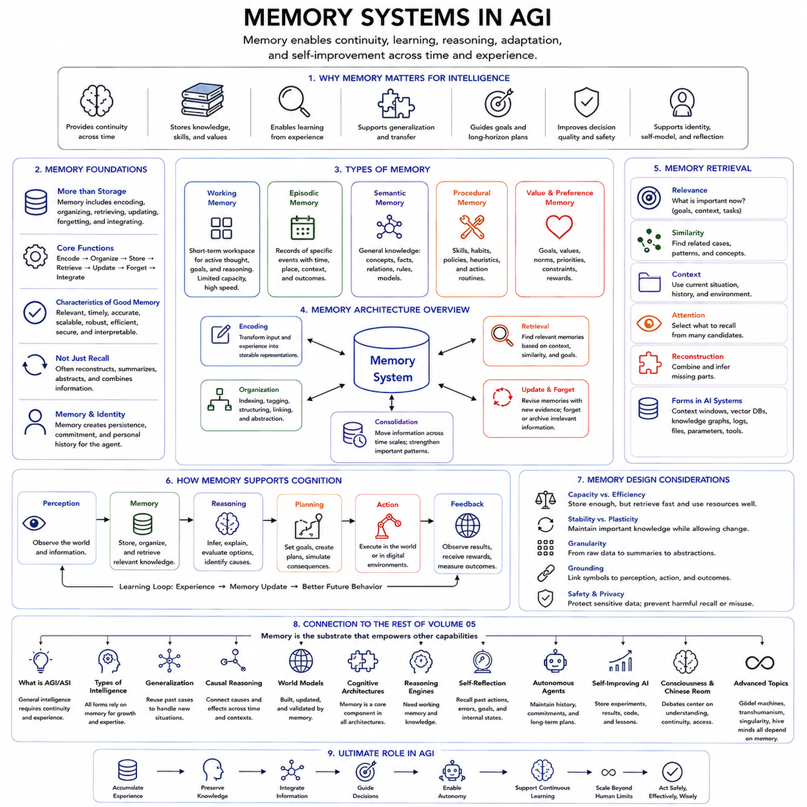
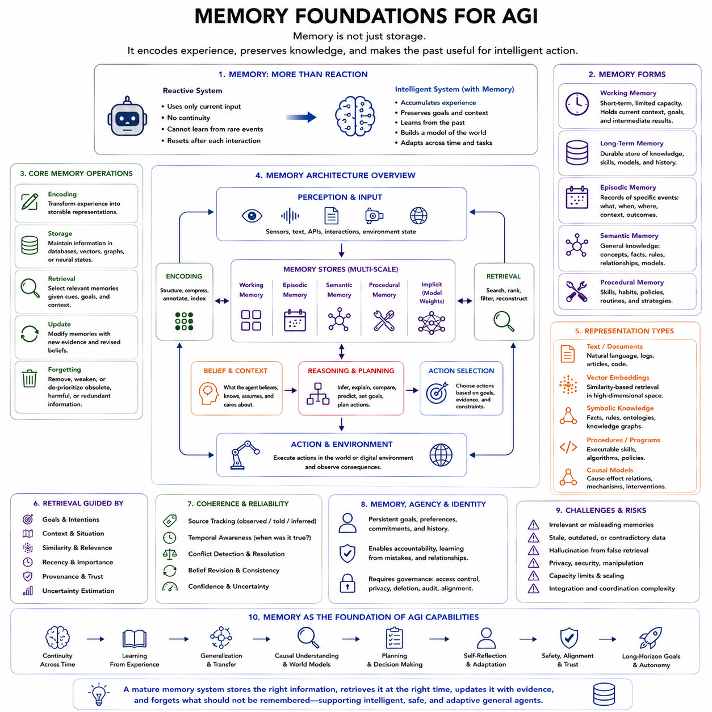
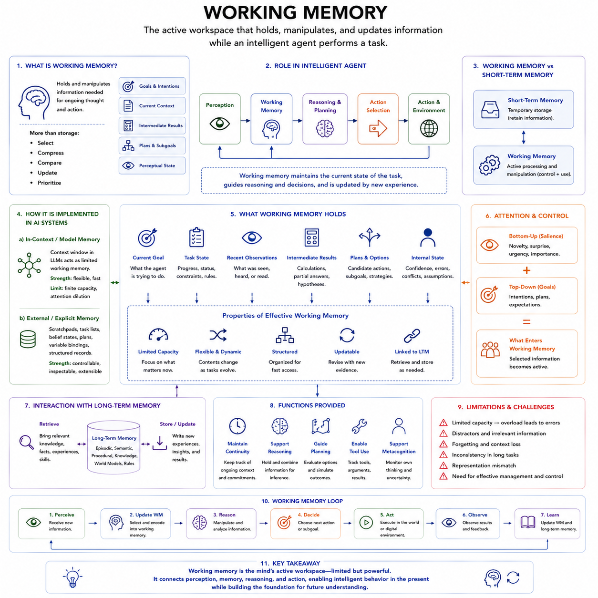
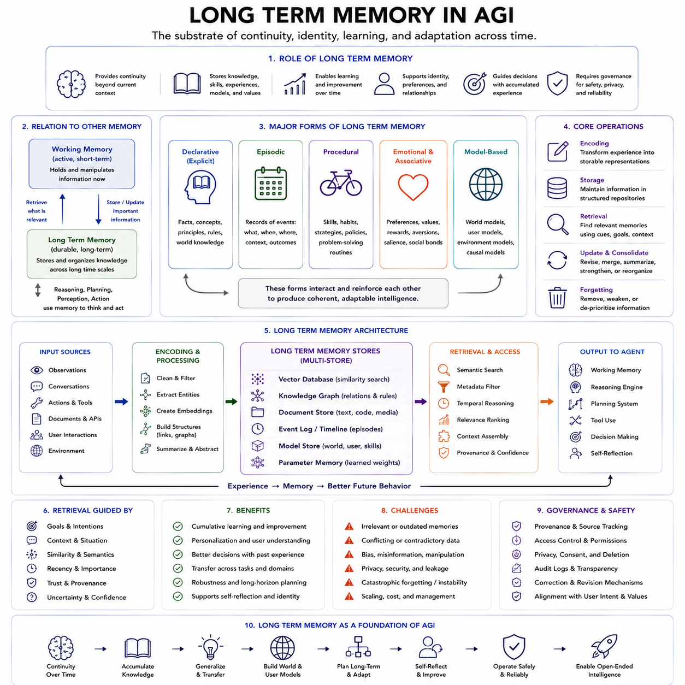
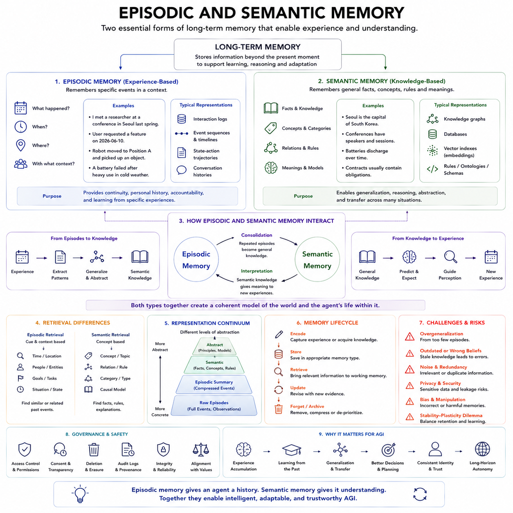
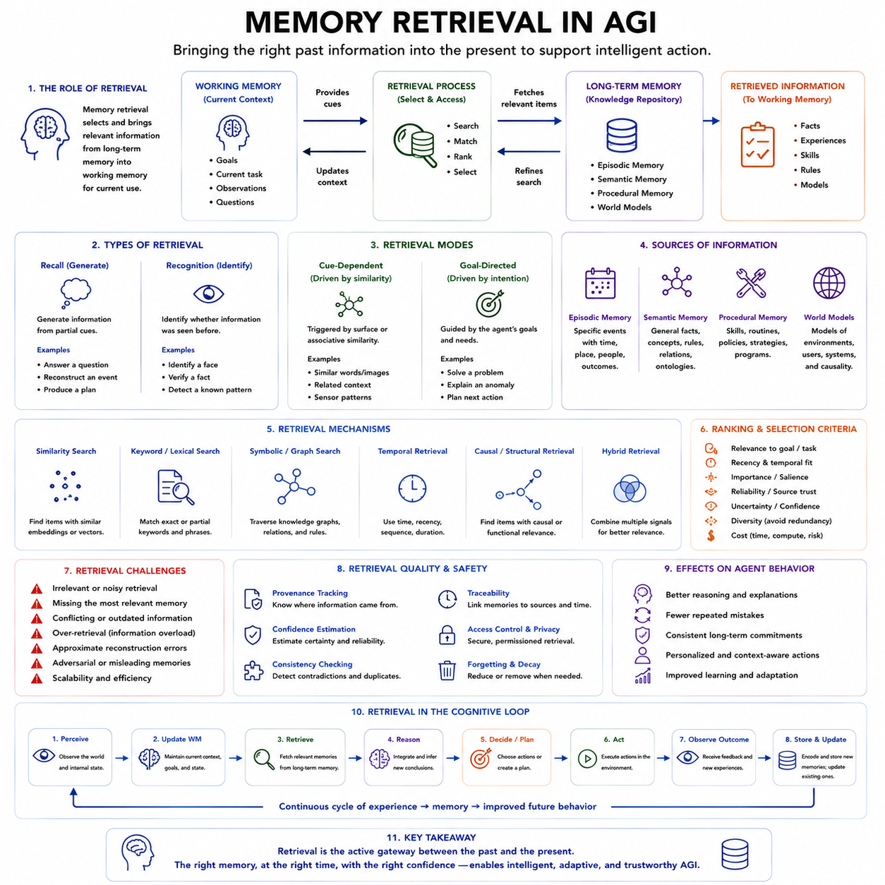
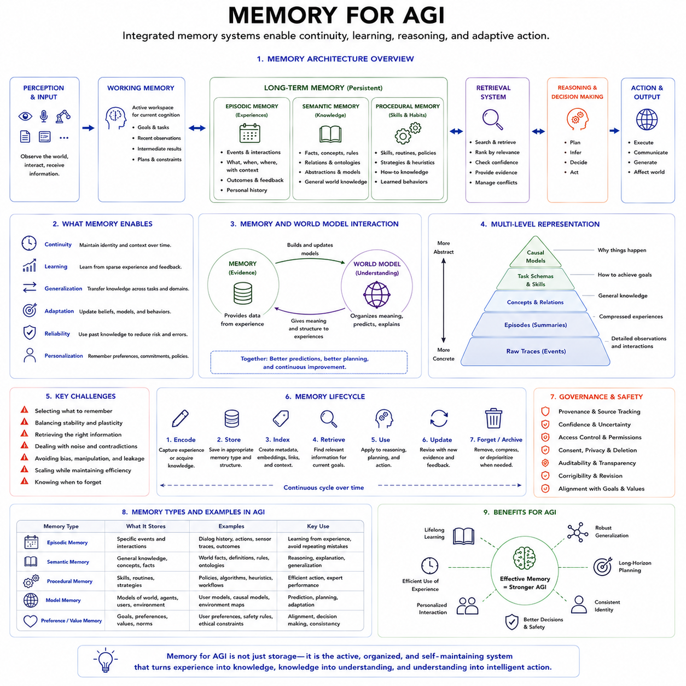

**Volume 00 05 AGI and ASI**

# Chapter 08. Memory Systems

### Chapter Overview

{width="7.268055555555556in" height="7.268055555555556in"}

Memory is one of the defining differences between a reactive system and an intelligent system that can learn, adapt, and maintain continuity across time. In humans, memory is not a single container but a family of interacting processes: short-lived working memory for active thought, long-term memory for accumulated knowledge and skills, episodic memory for lived events, semantic memory for concepts and facts, and retrieval mechanisms that determine what becomes available when it is needed. For artificial general intelligence, memory systems play a similarly foundational role. An AGI cannot merely compute responses from the present input; it must preserve experience, update beliefs, compare current situations with past cases, and use remembered knowledge to guide action in unfamiliar contexts.

This chapter examines memory as an architectural requirement for general intelligence. It begins with memory foundations, clarifying why storage alone is not memory in the cognitive sense. A useful memory system must encode information, organize it, retrieve it, update it, forget selectively, and integrate it with reasoning and action. The chapter then explores working memory as the temporary workspace in which goals, observations, plans, and intermediate reasoning steps are actively maintained. It discusses long-term memory as the durable substrate for knowledge, learned patterns, procedures, values, and world models. It distinguishes episodic and semantic memory, showing why both are necessary: episodic memory gives an agent a history of concrete experiences, while semantic memory abstracts those experiences into reusable knowledge.

The chapter also focuses on memory retrieval, because what an intelligent system can remember at the right moment often matters more than what it has stored somewhere in principle. Retrieval involves relevance, context, similarity, attention, indexing, and sometimes reconstruction rather than exact playback. In contemporary AI systems, memory may appear as context windows, vector databases, knowledge graphs, tool logs, parameterized knowledge, external documents, or agentic memory stores. Each design offers different strengths and risks. The central question is not simply how much information an AGI can store, but how memory can support coherent identity, robust learning, causal understanding, long-horizon planning, self-reflection, and safe adaptation.

### Connection to Volume 05

Memory Systems sits at the center of Volume 05 because nearly every capability associated with AGI and ASI depends on some form of durable, accessible, and structured memory. The earlier chapters on "What is AGI" and "What is ASI" define intelligence in terms of generality, adaptability, autonomy, and performance across domains. Those properties require more than pattern recognition at a single moment. They require the ability to accumulate experience and reuse it. The chapter on Types of Intelligence shows that intelligence includes reasoning, social understanding, creativity, embodiment, and practical judgment; memory provides the continuity that allows these forms of intelligence to develop rather than reset after each interaction.

The relationship with Generalization is especially direct. A system generalizes by using prior cases to guide new behavior, but this requires memories that are abstracted, indexed, and retrieved appropriately. Causal Reasoning also depends on memory, because causes and effects are often separated across time and must be connected through stored observations. World Models require memory as their raw material and maintenance mechanism: an agent's model of reality is built from accumulated perception, action, feedback, and revision. Cognitive Architectures specify how modules such as perception, planning, memory, and reasoning are arranged; this chapter provides the memory component that those architectures must integrate.

The following chapters deepen the connection. Reasoning Engines need working memory to hold premises, intermediate conclusions, and competing hypotheses. Self-Reflection requires memory of prior decisions, errors, goals, and internal states. Autonomous Agents need episodic records of actions and outcomes in order to plan, avoid repeating failures, and maintain commitments over time. Self-Improving AI and Recursive Self-Improvement require memory of experiments, code changes, performance results, and safety constraints. Meta-Learning depends on memory across tasks, enabling a system to learn how it learns.

Memory also connects to the more philosophical and speculative chapters. Discussions of consciousness, artificial consciousness, and the Chinese Room Argument often turn on whether a system has only symbol manipulation or also integrated experience, continuity, and self-modeling---functions closely tied to memory. Gödel Machines and Universal Constructors require representations of their own structure, goals, and modification history. Transhumanism, brain-computer interfaces, mind uploading, hive minds, and post-human civilization all raise questions about preserving, extending, merging, or transforming memory. Finally, the Technological Singularity cannot be understood without considering the possibility of systems whose memories scale far beyond human limits, enabling accelerating learning, coordination, and self-modification.

## 08.00 Memory Foundations

{width="7.268055555555556in" height="7.268055555555556in"}

Memory is one of the central requirements for any system that aspires to general intelligence. A model that can only react to its current input may appear capable in narrow settings, but it lacks continuity: it cannot accumulate experience, preserve goals across time, learn from rare events, or build a stable understanding of the world. In biological cognition, memory is not a single storehouse but a family of processes that encode, retain, transform, retrieve, and sometimes forget information. For artificial general intelligence(AGI), memory must be understood in the same functional sense: not merely as data storage, but as an active mechanism that shapes perception, reasoning, planning, identity, and adaptation.

A useful starting point is the distinction between memory as learned structure and memory as accessible content. In modern machine learning, much of what a system "knows" is embedded in parameters learned during training. These parameters capture statistical regularities, skills, language patterns, and compressed knowledge about the training distribution. This is a form of long-term implicit memory, but it is slow to update, difficult to inspect, and often separated from the system's current lived experience. By contrast, an AGI-like agent also needs explicit or semi-explicit memory: records of interactions, observations, commitments, preferences, past plans, failures, and environmental changes that can be retrieved and used during ongoing activity. The challenge is to integrate these forms without confusing a static learned prior with a reliable memory of what actually happened.

Memory systems operate across multiple time scales. At the shortest scale, transient context supports immediate reasoning: the agent keeps track of the current problem, recent dialogue, active goals, and intermediate results. This leads naturally to the next section on working memory(working memory), where capacity, attention, and task control are central. At longer scales, the system must preserve information beyond the current context window or active episode. Long-term memory(long-term memory) includes facts, skills, autobiographical traces, models of other agents, and accumulated evidence about the world. Between these extremes lie mechanisms for consolidation, summarization, rehearsal, and abstraction, which determine what is preserved, what is compressed, and what is discarded.

The foundation of any memory system involves several core operations. Encoding converts experience into a representation that can be stored. Storage maintains that representation over time, possibly in a database, vector index, symbolic knowledge graph, neural state, or hybrid architecture. Retrieval selects relevant memories in response to a cue, goal, question, or situation. Update modifies existing memories when new evidence arrives. Forgetting removes, weakens, or de-prioritizes information that is obsolete, misleading, redundant, or unsafe to retain. In AGI, each operation must be reliable under uncertainty. An agent must know not only what it remembers, but also how confident it should be, where the information came from, and whether it may have become outdated.

Representation is especially important. A memory stored as raw text, sensor data, embeddings, symbolic triples, executable procedures, or causal models will support different kinds of reasoning. Vector memories are powerful for similarity-based retrieval, allowing a system to find episodes or documents related to the current context even when the wording differs. Symbolic memories can support explicit inference, consistency checks, and structured planning. Episodic records preserve context-rich events: what happened, when, where, under what conditions, and with what outcome. Semantic memories extract more general knowledge: concepts, facts, rules, and relationships. The later section on episodic and semantic memory develops this distinction, but the foundation is that AGI needs both concrete experience and abstract knowledge, linked in ways that support generalization.

Retrieval is not a passive lookup. It is an intelligent act. A memory system must decide which cues matter, how broadly to search, how to rank relevance, and how to avoid retrieving plausible but false associations. In large language model systems, retrieval-augmented generation(RAG) demonstrates the value of external memory, but it also reveals limitations. A retrieved passage may be irrelevant, stale, adversarial, or interpreted incorrectly. Similarity is not the same as truth. Recency is not the same as importance. Frequency is not the same as reliability. For AGI, retrieval must be guided by goals, context, provenance, uncertainty estimation, and causal understanding, not just lexical or embedding proximity.

Memory also raises the problem of coherence. If an agent stores every observation without integration, its memory becomes noisy and contradictory. If it compresses too aggressively, it may lose crucial details. If it updates beliefs too quickly, it becomes unstable; if too slowly, it becomes rigid. A mature memory system therefore needs mechanisms for belief revision, conflict detection, source tracking, and temporal modeling. It must distinguish "I observed this," "someone told me this," "I inferred this," and "this was true at a particular time." These distinctions are essential for trustworthy reasoning and for avoiding hallucination-like behavior, where the system treats generated or inferred content as remembered fact.

For autonomous agents, memory is also tied to agency and identity. Persistent goals, user preferences, social commitments, learned habits, and records of consequences allow an agent to behave consistently over time. Without memory, an agent cannot meaningfully be held accountable, learn from mistakes, or maintain relationships. With memory, however, come risks: privacy violations, manipulation, unwanted personalization, security leakage, and the retention of harmful or biased information. Memory for AGI must therefore include governance mechanisms: access control, consent, auditability, deletion, compartmentalization, and alignment with the user's intentions and the system's safety constraints.

The central implication is that memory is not an optional extension to intelligence. It is part of the architecture that determines what an intelligent system can become. Working memory supports immediate thought; long-term memory supports continuity and learning; episodic and semantic memory support experience and knowledge; retrieval determines whether the right past becomes available at the right moment. The rest of this chapter examines these layers in more detail, moving from short-term cognitive control to durable knowledge stores and finally to the question of what kind of memory an AGI would need to operate safely, adaptively, and coherently in an open-ended world.

## 08.01 Working Memory

{width="7.268055555555556in" height="7.268055555555556in"}

Working memory is the system that allows an intelligent agent to hold, manipulate, and update information while performing a task. In human cognition, it is associated with the temporary maintenance of goals, intermediate results, perceptual context, and action plans. In artificial systems, especially those aimed at artificial general intelligence(AGI), working memory plays a comparable role: it is the active information workspace that connects perception, reasoning, planning, tool use, and long-term memory retrieval.

The previous section introduced memory foundations as the general problem of storing information so it can influence future behavior. Working memory narrows that problem to the short time scale of ongoing cognition. It is not merely a passive buffer. A useful working memory must support selection, compression, comparison, revision, and prioritization. When an agent solves a mathematical problem, follows a conversation, navigates a building, or coordinates multiple subtasks, it must preserve relevant state while discarding or suppressing irrelevant detail. This ability is central to coherent intelligence.

In cognitive science, working memory is often distinguished from short-term memory. Short-term memory refers primarily to temporary storage, while working memory includes active control and manipulation. For example, remembering a phone number for a few seconds is a short-term memory task; rearranging the digits, checking them against a rule, and deciding what to do next requires working memory. This distinction matters for AGI because intelligence depends not only on retaining tokens, facts, or observations, but also on operating over them in structured ways.

Modern AI systems implement working memory in several forms. In transformer-based language models, the context window functions as a limited working memory: tokens currently available to attention can directly influence the next prediction. This gives such models impressive short-range coherence, but also exposes a major limitation. Context windows are finite, and attention over long contexts can be computationally expensive. Even when millions of tokens are available, the system may fail to identify which details matter, confuse similar references, or lose track of task state. Capacity alone does not solve the control problem.

Agentic systems often add explicit working memory structures outside the model's immediate context. These may include scratchpads, task lists, belief states, plans, environment maps, variable bindings, or structured records of recent observations and actions. Such external working memory can be updated deliberately and queried as needed. For example, an autonomous research agent may keep a current hypothesis, a list of sources already checked, unresolved questions, and constraints imposed by the user. This makes the agent's cognition more inspectable and can reduce repeated work or contradictory behavior.

Working memory must also interact with attention. An intelligent agent cannot process everything at once; it needs mechanisms that decide what enters the active workspace and what remains latent. Attention may be driven by salience, current goals, uncertainty, novelty, expected value, or social relevance. In AGI, a robust working memory system would combine bottom-up signals from perception with top-down control from goals and plans. A sudden obstacle, a user correction, or a failed prediction may need to override the current focus. Conversely, the agent must resist distraction when irrelevant information appears.

Another key issue is representation. Working memory may contain raw tokens, images, embeddings, symbolic structures, probabilistic beliefs, or executable plans. Different tasks require different formats. A robot assembling an object needs spatial and motor representations; a theorem prover needs symbolic dependencies; a dialogue agent needs conversational commitments and speaker intentions. AGI may require a heterogeneous working memory capable of translating between representations rather than relying on a single format. This connects working memory to world models, reasoning engines, and cognitive architectures discussed elsewhere in this volume.

Working memory is also closely linked to metacognition and self-reflection. To act reliably, an agent must know something about the state of its own cognition: what it is trying to do, what it has already tried, which assumptions are uncertain, and when it should ask for help. A memory system that stores only external facts is insufficient. It must also track internal process state, such as active goals, confidence estimates, conflicts between subgoals, and pending decisions. This is especially important for long-horizon autonomy, where small errors in task state can accumulate into major failures.

The limitations of working memory help explain many failures in both humans and AI systems. Overloaded working memory leads to forgotten instructions, inconsistent reasoning, premature conclusions, and inability to coordinate multiple constraints. In language models, similar symptoms appear as lost context, hallucinated continuity, or failure to maintain a stable plan across many steps. External tools can help, but they introduce their own problems: what should be written down, how it should be indexed, when it should be refreshed, and how to prevent stale or false information from corrupting future reasoning.

A mature AGI memory architecture would treat working memory as a dynamic control layer rather than a fixed-size container. It would continuously decide what to hold actively, what to summarize, what to store in long-term memory, what to retrieve, and what to forget. It would also maintain links between current cognition and durable knowledge. This prepares the transition to the next section, long-term memory, where the focus shifts from active task state to persistent storage over extended time. Working memory and long-term memory are not isolated modules; they form a loop. Working memory guides retrieval from long-term memory, and retrieved knowledge reshapes the contents of working memory. In that loop, intelligence becomes not just the possession of information, but the disciplined management of relevance over time.

## 08.02 Long Term Memory

{width="7.268055555555556in" height="7.268055555555556in"}

Long term memory is the substrate that allows an intelligent system to remain coherent across time. Working memory, discussed in the previous section, provides the temporary workspace for current goals, active perceptions, and intermediate reasoning steps. Long term memory, by contrast, stores information beyond the immediate context: facts learned from instruction, skills acquired through practice, records of past interactions, models of users and environments, and abstractions extracted from experience. For AGI, this is not merely a database attached to a reasoning engine. It is a core component of identity, competence, adaptation, and continuity.

In biological cognition, long term memory is usually divided into several interacting forms. Declarative memory stores information that can be consciously reported, such as events and facts. Procedural memory stores skills and habits, such as how to ride a bicycle or solve a familiar class of problems. Emotional and associative memory influence salience, preference, and anticipation. Artificial systems do not need to reproduce these categories exactly, but the distinctions are useful. An AGI that stores only explicit facts may answer questions well but fail to improve its behavior through repeated action. An agent that stores only policy updates may acquire habits but lack explainable recollection. Robust long term memory requires multiple representational layers.

Modern AI systems already contain several kinds of long term memory, though often implicitly. The parameters of a trained neural network encode statistical regularities from a training corpus. This is a form of distributed, compressed, long term memory, but it is difficult to edit, inspect, or update without retraining or fine tuning. External memory systems, such as vector databases, knowledge graphs, document stores, and event logs, provide a more explicit and modifiable complement. A retrieval-augmented generation system can search stored documents at inference time and bring relevant information into working context. This helps overcome the fixed context window of a model, but it does not by itself solve the deeper problem of deciding what should be remembered, how it should be organized, and when it should be forgotten.

Long term memory in AGI must support both storage and transformation. Raw experience is too large and noisy to preserve in full. A capable system must consolidate experience into durable representations: summaries, concepts, causal models, procedures, preferences, and exceptions. This resembles memory consolidation in humans, where repeated or significant experiences are integrated into existing knowledge. In machine systems, consolidation may involve embedding episodes into a vector space, extracting symbolic assertions, updating a world model, training small adapters, or creating reusable skills. The central challenge is maintaining fidelity while compressing. If memory is too literal, it becomes unmanageable. If it is too compressed, it loses the details needed for accountability, personalization, or rare but important cases.

Retrieval is as important as storage. A memory that cannot be accessed at the right time is practically absent. Long term memory must therefore be indexed by meaning, context, time, goal relevance, uncertainty, and causal relationship. Semantic similarity search is useful, but similarity is not the same as relevance. An AGI may need to retrieve a past failure that is superficially different from the current situation but causally analogous. It may need to recall a user's constraint, a safety rule, or an exception to a general policy. This requires memory systems that combine embeddings, symbolic metadata, temporal structure, and reasoning over relationships. The next section's discussion of episodic and semantic memory develops this distinction more directly.

Long term memory also introduces risks. Persistent memory can preserve errors, biases, private information, and adversarially inserted content. A system that remembers everything may violate privacy or become vulnerable to manipulation. A system that remembers too little may fail to learn, repeat mistakes, or provide inconsistent assistance. Therefore, memory governance is a technical and ethical requirement. AGI memory should include mechanisms for provenance, confidence estimation, consent, access control, deletion, correction, and auditability. It should know not only what it believes, but where a belief came from, how reliable it is, and under what conditions it may be used.

Another limitation is stability-plasticity tension. An intelligent system must remain stable enough to preserve important knowledge, yet plastic enough to learn from new evidence. Neural networks are known to suffer from catastrophic forgetting when updated on new data without preserving older capabilities. External memory reduces this problem but does not eliminate it, because the reasoning system must still decide how new memories interact with old ones. Contradictions must be detected, outdated beliefs revised, and context-specific truths separated from universal claims. In AGI, long term memory cannot be a passive archive; it must participate in belief maintenance.

The implications for AGI are profound. A system without durable memory may appear intelligent in isolated sessions but lacks developmental continuity. It cannot build trust over repeated interactions, accumulate expertise from lived experience, or form long-range plans grounded in its own history. Conversely, a system with poorly designed long term memory may become inconsistent, unsafe, or opaque. The goal is not infinite retention, but structured, revisable, purpose-sensitive memory. Long term memory should extend working memory, support reasoning engines, inform self-reflection, and enable agents to learn over months or years rather than only within a prompt. In this sense, memory is not an accessory to general intelligence. It is one of the mechanisms by which intelligence becomes cumulative.

## 08.03 Episodic and Semantic Memory

{width="7.268055555555556in" height="7.268055555555556in"}

Within long-term memory, a crucial distinction is between episodic memory and semantic memory. Episodic memory stores specific experiences: what happened, when it happened, where it happened, and under what surrounding context. Semantic memory stores generalized knowledge: facts, concepts, rules, meanings, categories, and relations that are not tied to a single moment of experience. In humans, remembering "I met a researcher at a conference in Seoul last spring" is episodic; knowing that Seoul is the capital of South Korea, that conferences have speakers, and that researchers publish papers is semantic. For AGI, this distinction matters because intelligent behavior requires both situated recall and abstract understanding.

Episodic memory gives an agent continuity across time. It allows the system to answer questions such as: What did I observe earlier? Which action did I take? What was the outcome? Which user preference was expressed in this conversation? In autonomous agents, episodic memory is often represented as time-stamped interaction logs, trajectories, event records, or summaries of past states and actions. This kind of memory is essential for learning from experience, avoiding repeated mistakes, maintaining commitments, and adapting behavior to a particular environment or user. Without episodic memory, an agent may appear competent within a single prompt or task, but it lacks a persistent autobiography of its own interactions.

Semantic memory, by contrast, supports stable knowledge and generalization. It includes knowledge that can be applied across many situations, such as "a battery may fail when discharged," "a contract usually contains obligations," or "if a container is open, its contents may spill." In AI systems, semantic memory may be implemented through model parameters, knowledge graphs, databases, ontologies, vector indexes, symbolic rules, or combinations of these. Large language models contain a form of distributed semantic memory in their learned weights, while retrieval-augmented systems add explicit external stores that can be queried and updated. Semantic memory allows an AGI-like system to reason beyond the immediate episode and to connect present observations with broad background knowledge.

The boundary between episodic and semantic memory is not absolute. Repeated episodes can be consolidated into semantic knowledge. If an agent repeatedly observes that a particular user prefers concise answers, individual interactions may eventually become a generalized user model. Similarly, semantic expectations shape episodic interpretation: knowing what a restaurant is helps an agent interpret events such as ordering, waiting, paying, and leaving. This interaction is central to world models. A mature memory system should not merely archive everything; it should transform experience into useful abstractions while preserving enough provenance to trace where beliefs came from.

This leads to important design questions. What should be stored as a raw episode, what should be summarized, and what should be converted into semantic knowledge? Raw episodic traces can be large, noisy, redundant, and privacy-sensitive. Summaries save space but may omit details that later become important. Semantic extraction can improve generalization, but it can also introduce false conclusions if a system overgeneralizes from too few examples. A robust AGI memory architecture needs mechanisms for uncertainty, confidence, source tracking, revision, and forgetting. Forgetting is not simply a failure; it is a functional requirement when information is outdated, misleading, low value, or unsafe to retain.

Retrieval also differs across these memory types. Episodic retrieval is often cue-based and context-sensitive: a location, time, object, user, or goal can reactivate a relevant prior event. Semantic retrieval is usually concept-based: a question or planning problem activates related facts, categories, and rules. In practical AI systems, both are often implemented using embeddings and similarity search, but this can blur important distinctions. Similarity alone does not guarantee truth, relevance, chronology, or causal structure. For example, retrieving a past event that is semantically similar to the current situation may be useful, but it may also be misleading if the context differs in a crucial way.

Episodic and semantic memory also have different implications for alignment and safety. Episodic memory can contain sensitive personal data, private conversations, operational details, and records of user behavior. Semantic memory can encode persistent beliefs, norms, stereotypes, or inferred preferences. If an AGI system updates either memory type without safeguards, it may preserve harmful information, form inaccurate models of people, or act on obsolete assumptions. Therefore memory governance must include access control, consent, auditability, deletion mechanisms, and clear separation between temporary context, personal memory, organizational knowledge, and general world knowledge.

In the path from narrow AI to AGI, the integration of episodic and semantic memory is a major milestone. A system that remembers experiences but cannot generalize remains trapped in case-by-case behavior. A system that has broad semantic knowledge but no episodic continuity cannot learn meaningfully from its own life history. Human-like intelligence depends on the interplay between both: episodes provide grounded evidence, while semantics provide structure and transfer. The next section on memory retrieval examines how these stored traces and abstractions are selected at the right time, because memory is useful only when the right information can be brought back into working memory for reasoning and action.

## 08.04 Memory Retrieval

{width="7.268055555555556in" height="7.268055555555556in"}

Memory retrieval is the process by which a cognitive system brings stored information back into active use. In biological minds, retrieval is not a simple read operation from a fixed address; it is a constructive act shaped by cues, context, goals, attention, and emotional state. In artificial systems, especially those aimed at AGI, retrieval plays a similar functional role: it determines which facts, experiences, skills, and prior reasoning traces become available to working memory and current decision-making. A system may possess a vast long-term memory, but if it cannot retrieve the right information at the right time, that memory has little practical value.

The previous sections distinguished working memory from long-term memory and episodic memory from semantic memory. Retrieval is the bridge among these systems. Working memory provides the current problem state and retrieval cues; long-term memory supplies candidate knowledge; episodic memory may return specific events or interaction histories; semantic memory may return general concepts, rules, or abstractions. Effective retrieval therefore depends not only on storage capacity but also on indexing, representation, similarity, relevance, and control.

A core distinction is between recall and recognition. Recall requires the system to generate stored content from partial cues, such as answering a question without being shown the answer. Recognition requires judging whether a presented item matches something previously stored, such as identifying a familiar face or verifying a known fact. Modern AI systems implement analogous mechanisms. A vector database may retrieve documents whose embeddings are similar to a query, while a classifier may recognize a known pattern. For AGI, both are necessary: recall supports reasoning and imagination, while recognition supports perception, validation, and grounding.

Retrieval can also be cue-dependent or goal-directed. Cue-dependent retrieval is driven by surface similarity: a phrase, image, location, or sensory pattern activates related memories. Goal-directed retrieval is driven by the agent's intention: the system searches for information that helps solve a task, explain an anomaly, plan an action, or answer a question. Human cognition combines both. A smell may spontaneously evoke a childhood memory, while deliberate reasoning may search for a theorem or previous example. AGI systems will need comparable flexibility, because not all useful memories are the most similar ones. Sometimes the most relevant memory is structurally analogous rather than superficially alike.

In contemporary AI, retrieval-augmented generation (RAG) is an important engineering pattern. A model receives a query, retrieves external documents or memory records, and uses them as context for generation. This reduces dependence on parameters alone and allows systems to access updated, domain-specific, or user-specific information. However, RAG is not equivalent to human-like memory. It often retrieves text chunks based on embedding similarity, which may miss causal relevance, temporal dependencies, contradictions, or implicit goals. A mature AGI memory system would need richer retrieval methods, including symbolic indexes, temporal organization, causal graphs, procedural triggers, uncertainty estimates, and mechanisms for resolving conflicts among memories.

Retrieval is inseparable from attention. Because working memory is limited, an intelligent system must select only a small subset of available information. Poor retrieval can cause hallucination, brittle reasoning, or irrelevant responses. Over-retrieval can overload the reasoning process with noise; under-retrieval can leave the system ignorant of critical facts. The central challenge is not merely to find related information, but to rank it by usefulness under the current context. This requires models of salience, trustworthiness, recency, frequency, source reliability, and task relevance. In agentic systems, retrieval may also be action-dependent: the system may decide to query a database, inspect logs, ask a human, search the web, or run an experiment.

Another important issue is reconstruction. Human memory retrieval is often approximate and can be distorted by expectations or later information. Artificial systems also reconstruct memories when they summarize, compress, embed, or infer missing details. This creates both power and risk. Compression enables scalability and abstraction, but it may discard details needed for future reasoning. Summaries may preserve conclusions while losing evidence. Embeddings may capture semantic similarity while obscuring provenance. For safety-critical AGI, retrieval must therefore include traceability: the system should know where information came from, how certain it is, when it was acquired, and whether it has been revised.

Memory retrieval also affects identity and continuity in autonomous agents. An agent that remembers past commitments, user preferences, failures, and learned strategies can behave consistently over time. Without reliable retrieval, the agent may repeat mistakes, contradict earlier decisions, or fail to honor long-term goals. Yet excessive persistence can be harmful if outdated memories dominate present judgment. AGI memory must support forgetting, decay, consolidation, and revision, not as defects but as necessary control mechanisms. Retrieval should be adaptive: old information may remain accessible, but its authority should depend on context and evidence.

For AGI, the highest-level goal of retrieval is not simply to answer queries. It is to make relevant prior experience available for perception, reasoning, planning, learning, and self-reflection. A general intelligence must retrieve facts for explanation, episodes for analogy, procedures for action, values for evaluation, and models for prediction. This requires integration across memory types and retrieval strategies. The next section, "Memory for AGI," builds on this idea by considering how memory systems must be designed as active, organized, and self-maintaining components of a general intelligent architecture, rather than passive stores of data.

## 08.05 Memory for AGI

{width="7.268055555555556in" height="7.268055555555556in"}

For an artificial general intelligence, memory is not merely a storage component attached to a reasoning system. It is part of the machinery that allows an agent to remain coherent over time, learn from sparse experience, adapt to new domains, and maintain a stable sense of goals, context, and identity. The preceding sections distinguished working memory, long-term memory, episodic memory, semantic memory, and retrieval. In an AGI system, these are not isolated modules but interacting layers of a larger cognitive process.

Working memory gives an AGI a temporary workspace for active reasoning: the current task, intermediate conclusions, recent observations, plans under consideration, and constraints that should not be forgotten during inference. Long-term memory provides persistence beyond a single interaction or task episode. Episodic memory records particular experiences, such as what happened, when it happened, under what conditions, and what outcome followed. Semantic memory abstracts facts, concepts, procedures, and regularities from those experiences. Retrieval connects all of these systems by bringing relevant stored information back into the active context at the right time.

A central challenge for AGI is that memory must support generalization rather than simple recall. A narrow system may memorize examples and reproduce patterns within a fixed distribution. A general intelligence must recognize when a past experience is relevant despite surface differences, and when an apparently similar case is misleading because the causal structure is different. This requires memory representations that preserve multiple levels of abstraction: raw traces, compressed summaries, causal relations, task schemas, skills, and uncertainty estimates. The system must be able to ask not only "What have I seen before?" but also "What kind of situation is this?", "Which past cases are analogous?", and "What should I revise in my model?"

Memory for AGI must also be integrated with world models. A world model predicts how states change, how agents behave, and how actions produce consequences. Memory supplies the evidence from which such models are built and updated. At the same time, the world model organizes memory by giving events meaning. Without a model, memory becomes a database of unstructured fragments. Without memory, a model becomes brittle, disconnected from lived evidence, and unable to improve from experience. The interaction between memory and modeling is therefore central to cumulative learning.

Another requirement is continual learning. An AGI operating over months or years cannot be retrained from scratch whenever new information arrives. It must incorporate new knowledge while preserving important old knowledge. This creates the well-known problem of catastrophic forgetting, in which new learning overwrites previous capabilities. Biological cognition appears to manage this through mechanisms such as consolidation, rehearsal, abstraction, and context-sensitive retrieval. Artificial systems may use related strategies: parameter-efficient updates, external memory stores, retrieval-augmented generation, experience replay, knowledge graphs, and modular architectures. None of these alone solves the problem, but together they point toward memory systems that can grow without losing coherence.

Memory also raises questions of reliability. Human memory is reconstructive and fallible; machine memory can be exact in storage but unreliable in interpretation or retrieval. An AGI may store a transcript perfectly yet draw the wrong lesson from it, retrieve irrelevant precedents, or overgeneralize from biased data. Therefore memory systems need metadata: source, time, confidence, provenance, permissions, context, and known limitations. They also need mechanisms for contradiction management. A capable system will encounter conflicting evidence and must decide whether to maintain multiple hypotheses, revise a belief, mark a claim as uncertain, or seek more information.

In autonomous agents, memory is closely linked to agency and alignment. A system that remembers user preferences, institutional rules, safety constraints, and previous failures can behave more consistently and responsibly. However, persistent memory can also create risks: privacy violations, manipulation through stored personal data, unapproved goal persistence, and the accumulation of false or harmful beliefs. For this reason, memory for AGI must include governance mechanisms, not only engineering mechanisms. Forgetting, consent, auditability, access control, and corrigibility are design requirements, not afterthoughts.

There is also a distinction between memory as data and memory as skill. Many important capabilities are not stored as explicit facts but as learned procedures: how to prove a theorem, negotiate a plan, debug a system, or interpret ambiguous social cues. In neural systems, such procedural knowledge may be distributed across parameters rather than stored in a retrievable record. In symbolic or hybrid systems, procedures may appear as rules, programs, plans, or policies. A mature AGI memory architecture will likely combine both: explicit memories that can be inspected and updated, and implicit competencies that enable fluent action.

The hardest open question is how to make memory serve understanding. Storing more information does not by itself produce intelligence. A system with vast memory may still fail if it cannot select what matters, relate evidence to goals, reason causally, and update itself appropriately. Conversely, an AGI with well-structured memory could use limited experience efficiently, transfer knowledge across domains, and maintain continuity across long horizons. Memory is therefore not a passive archive. It is an active, selective, self-organizing process that links perception, reasoning, learning, and action.

In the broader path toward AGI, memory systems are one of the bridges between present-day AI and more general cognition. Current large models already contain implicit statistical memory in their parameters and can be extended with external retrieval. Yet they often lack durable personal memory, robust temporal understanding, reliable belief revision, and principled forgetting. Building memory for AGI means moving beyond larger context windows or bigger databases. It means designing systems that know what to remember, why it matters, when to retrieve it, how to revise it, and when to let it go.
