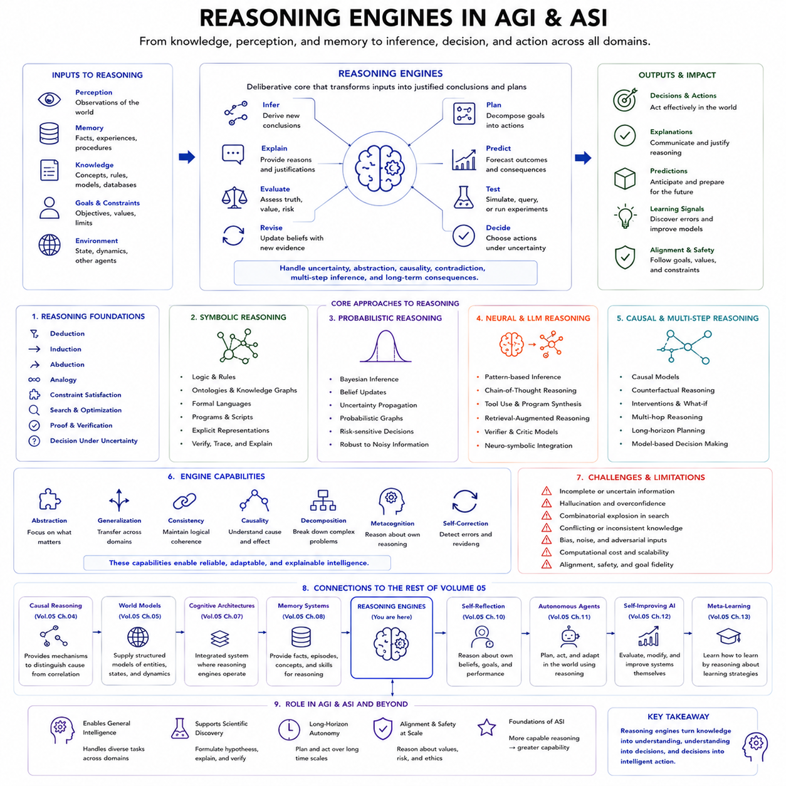
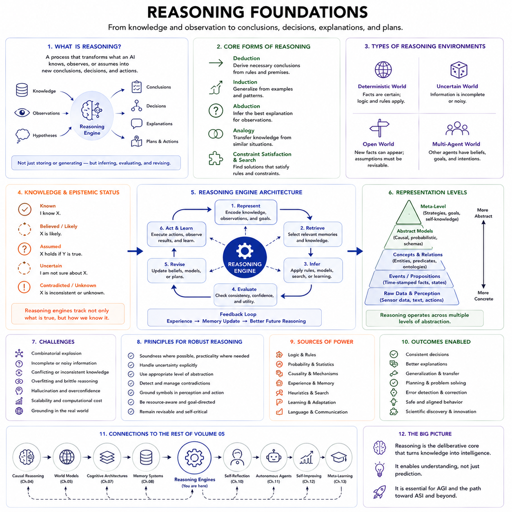
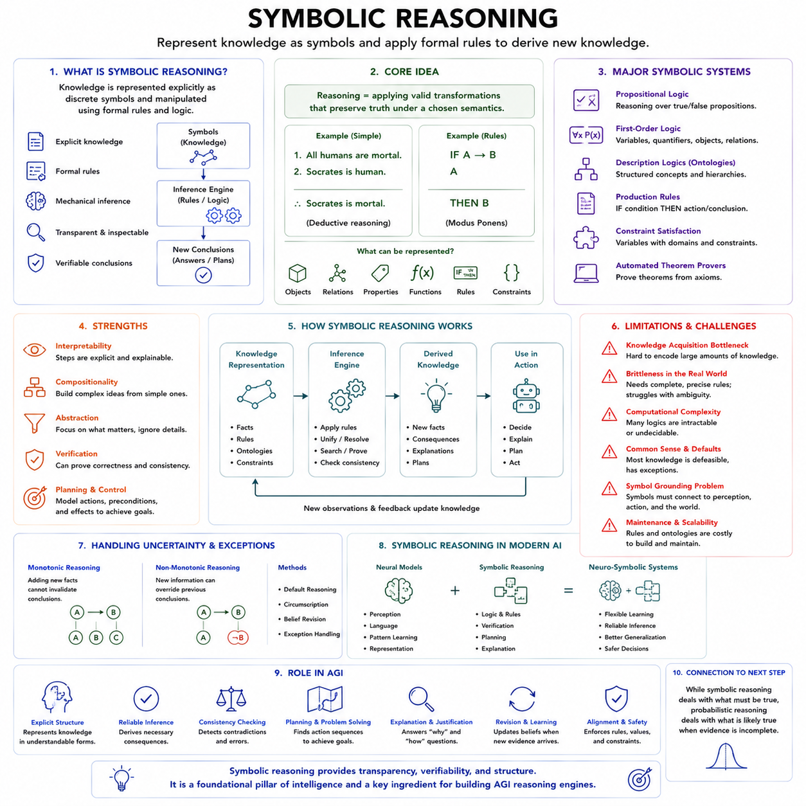
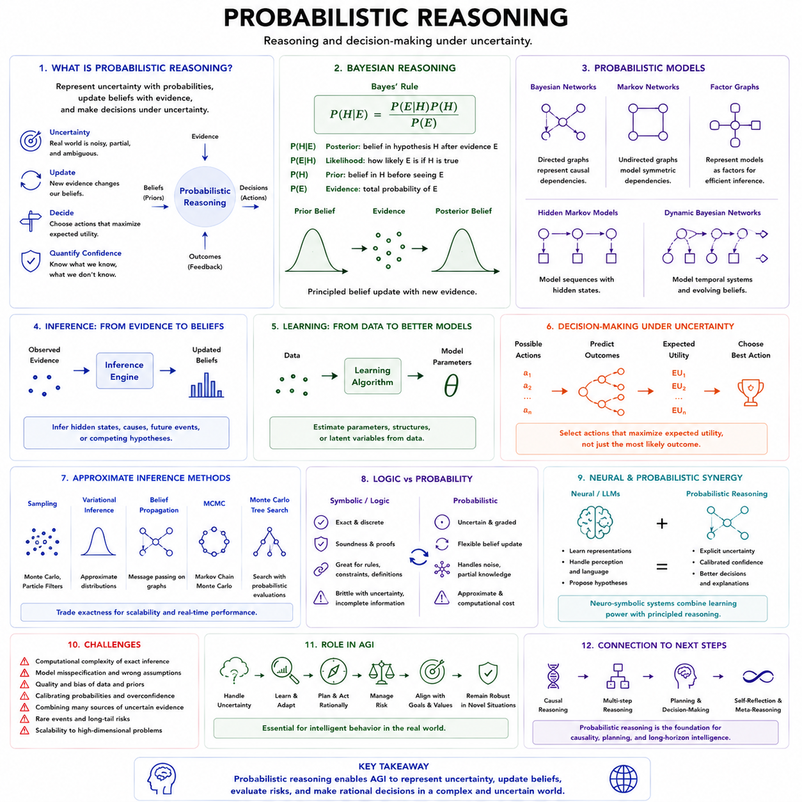
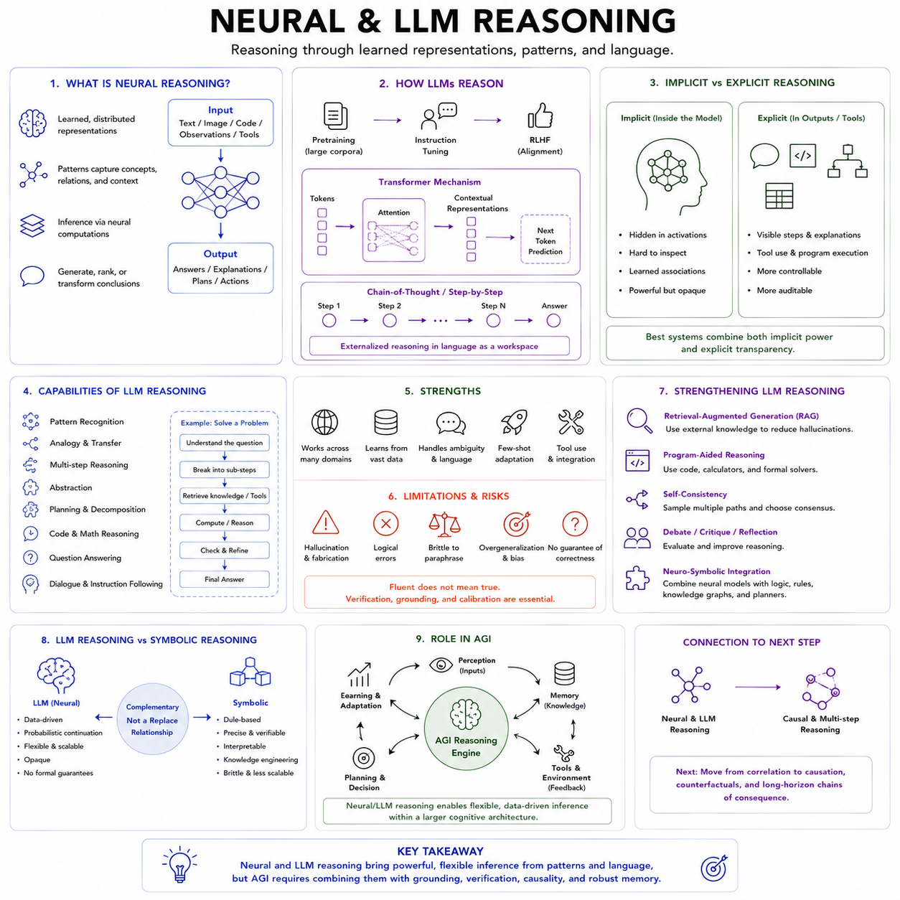
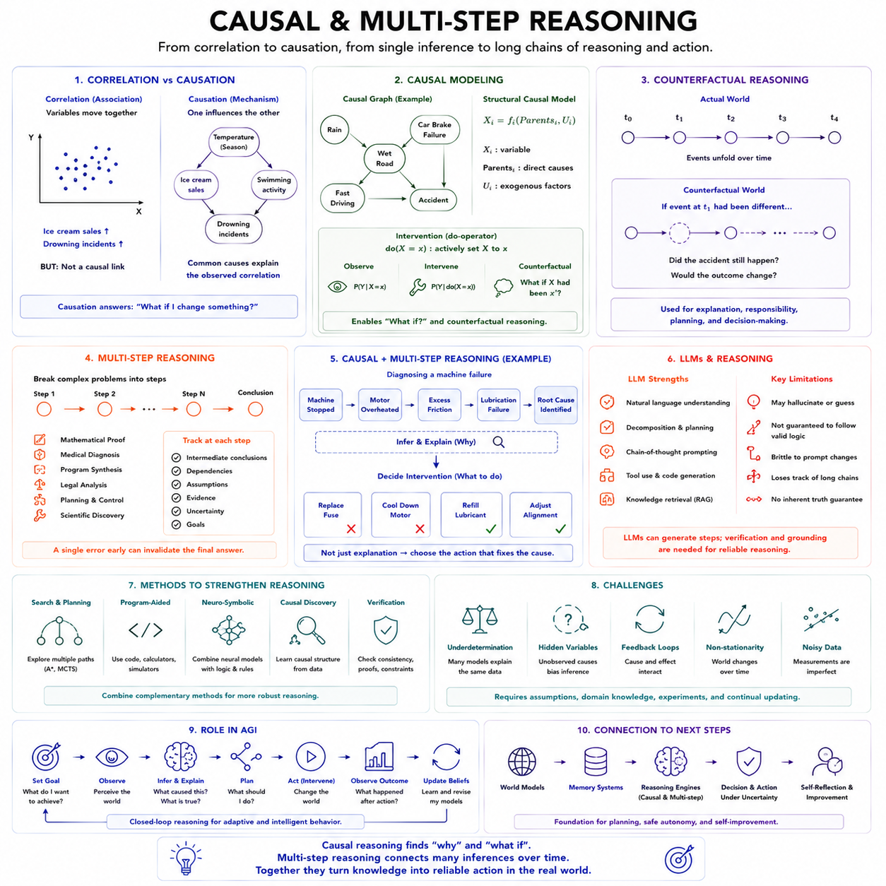
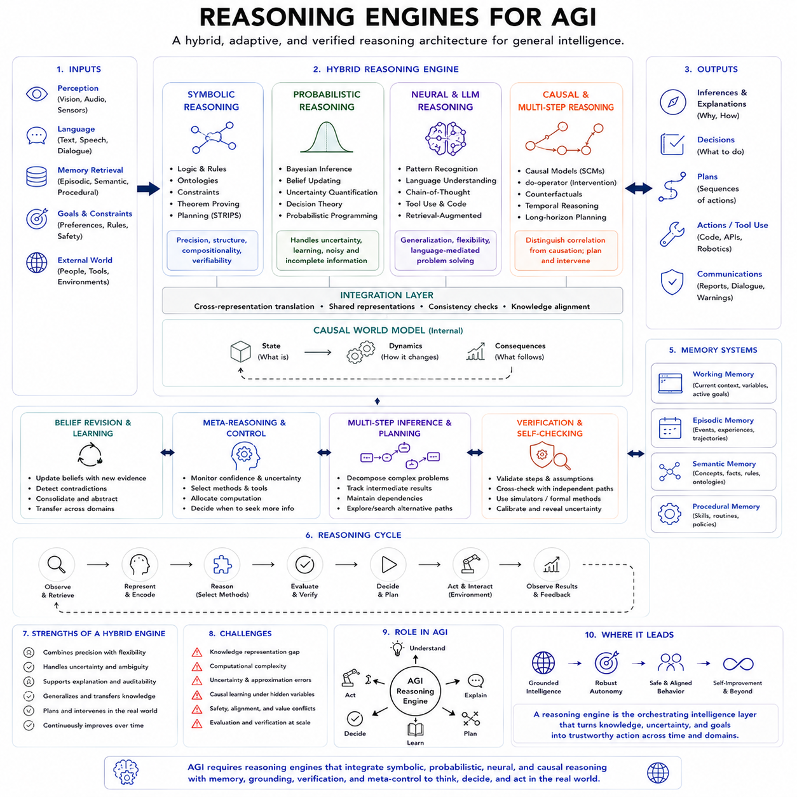
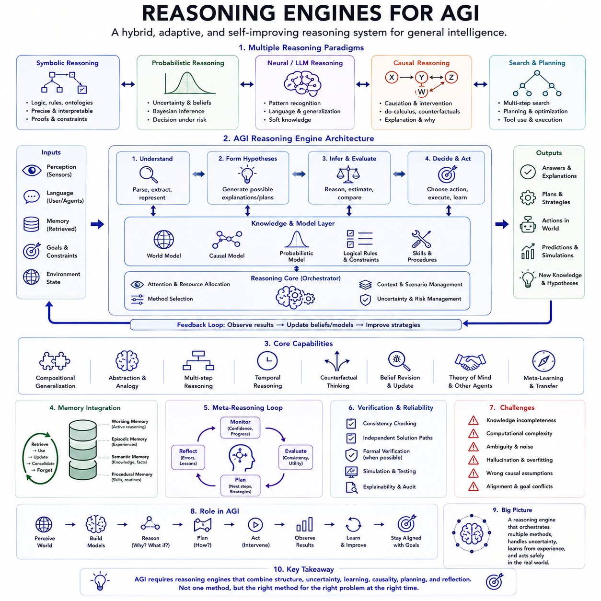

**Volume 00 05 AGI and ASI**

# Chapter 09. Reasoning Engines

### Chapter Overview

{width="7.268055555555556in" height="7.268055555555556in"}

Reasoning engines are the mechanisms by which an intelligent system moves from what it knows, observes, or assumes toward what it can infer, decide, explain, and test. In the context of AGI and ASI, a reasoning engine is not merely a rule processor or a mathematical solver. It is the organized capacity to handle uncertainty, abstraction, causality, contradiction, planning, and long chains of implication across many domains. This chapter examines reasoning as a core capability that turns perception, memory, and learned representations into deliberate intelligence.

The chapter begins with reasoning foundations: deduction, induction, abduction, analogy, constraint satisfaction, search, proof, and decision-making under uncertainty. It then studies symbolic reasoning, where explicit representations such as logic, rules, ontologies, and programs allow systems to manipulate concepts in transparent and verifiable ways. Probabilistic reasoning follows, emphasizing Bayesian inference, belief updates, uncertainty propagation, and risk-sensitive decisions. These approaches are essential because real-world intelligence rarely operates with perfect information.

The chapter then turns to neural and LLM reasoning. Modern language models can generate explanations, perform multi-step problem solving, use tools, and simulate deliberation, yet their reasoning may be brittle, opaque, or dependent on patterns learned from data. The discussion therefore distinguishes genuine inference from fluent prediction and examines techniques such as chain-of-thought prompting, retrieval-augmented reasoning, verifier models, program synthesis, and neuro-symbolic integration. Causal and multi-step reasoning are treated as a bridge between pattern recognition and robust understanding: an intelligent system must reason not only about what is correlated, but about what would happen if actions, interventions, or counterfactual conditions changed the world.

The importance of reasoning engines lies in their role as the "deliberative core" of advanced AI. Without reliable reasoning, an AGI-like system may possess vast knowledge and impressive language ability while still failing at consistency, transfer, planning, scientific discovery, or safe autonomy. For ASI, reasoning becomes even more consequential: systems with superhuman capability must be able to justify conclusions, evaluate consequences, detect errors, revise beliefs, and align decisions with goals and constraints at scales beyond human supervision.

### Connection to Volume 05

This chapter sits at the center of Volume 05 because reasoning connects many of the volume's major themes into an operational architecture. The earlier chapters define the destination: AGI as broad, flexible intelligence and ASI as intelligence that may exceed human capability across many dimensions. The chapters on types of intelligence and generalization establish that intelligence is not a single skill but a family of abilities, including abstraction, transfer, planning, explanation, and adaptation. Reasoning engines are where many of these abilities become executable processes rather than abstract ideals.

The chapter depends directly on the discussions of causal reasoning and world models. A reasoning engine needs a model of what exists, how entities interact, what actions are possible, and what consequences may follow. World models provide the structured or learned representations over which reasoning operates, while causal reasoning gives the engine the ability to distinguish correlation from mechanism. Cognitive architectures provide the larger system design into which reasoning engines are embedded, and memory systems supply the facts, experiences, procedures, and episodic traces that reasoning engines query, update, and reorganize.

This chapter also prepares the reader for later discussions of self-reflection, autonomous agents, self-improving AI, and recursive self-improvement. A system cannot reliably inspect its own beliefs, plan over long horizons, improve its algorithms, or evaluate proposed self-modifications without some form of reasoning engine. Meta-learning likewise depends on reasoning about learning processes themselves: what worked, why it worked, and how learning strategies should change in a new environment. The later chapters on Gödel machines and universal constructors extend this logic toward systems that reason about their own code, proofs of improvement, and physical or computational construction.

The philosophical chapters are also closely linked. Debates about consciousness, the Chinese Room argument, and artificial consciousness often ask whether symbol manipulation, neural prediction, or functional reasoning is sufficient for understanding. Reasoning engines do not settle these debates, but they provide concrete technical models for examining them. Finally, the chapters on transhumanism, hive minds, brain-computer interfaces, mind uploading, the technological singularity, and post-human civilization all involve futures in which reasoning may be distributed across machines, humans, institutions, and hybrid collectives. In that broader arc, reasoning engines are not just components of AI systems; they are candidates for the cognitive infrastructure of future civilization.

## 09.00 Reasoning Foundations

{width="7.268055555555556in" height="7.268055555555556in"}

A reasoning engine is a component or system that transforms what an AI knows, observes, or hypothesizes into conclusions, decisions, explanations, or plans. In the context of AGI and ASI, reasoning engines are important because intelligence is not only the ability to store patterns, retrieve facts, or generate plausible language. It is also the ability to infer what follows from what is known, identify what remains uncertain, compare possible actions, notice contradictions, and revise beliefs when the world pushes back. This section establishes the foundations that support the more specialized approaches discussed later: symbolic reasoning, probabilistic reasoning, neural and LLM reasoning, causal reasoning, and multi-step reasoning for AGI.

At its core, reasoning concerns relations between representations. A representation may be a logical proposition, a probability distribution, a graph, a program state, a natural-language statement, an embedding, or a learned latent variable. A reasoning process applies operations to these representations in order to derive new information. In classical logic, this may mean applying rules such as modus ponens: if "A implies B" and "A" is true, then "B" follows. In probabilistic reasoning, it may mean updating a belief distribution after observing evidence. In planning, it may mean simulating how actions change the state of the world. In a neural system, it may mean transforming internal activations so that a model can answer a question, complete a proof-like chain, or select an action.

A key distinction is between deduction, induction, and abduction. Deduction derives conclusions that necessarily follow from premises, assuming the rules and premises are valid. It is powerful for mathematics, formal verification, and rule-based systems, but it is brittle when the premises are incomplete or ambiguous. Induction generalizes from examples, such as learning that objects unsupported in midair tend to fall. It is essential for learning from data, but its conclusions are uncertain and can fail under distribution shift. Abduction seeks the best explanation for observations: if the grass is wet, perhaps it rained, though a sprinkler is another possibility. Human practical reasoning often combines all three: we infer consequences, learn patterns, and construct explanations under uncertainty.

Another foundation is the difference between monotonic and non-monotonic reasoning. In monotonic logic, adding new facts cannot invalidate conclusions already drawn. This is appropriate for many formal domains, but the real world rarely behaves so cleanly. If an AI concludes that "birds can fly" and later learns that the bird is a penguin or injured, the conclusion should be revised. Non-monotonic reasoning allows default assumptions to be overridden by new evidence. This capability is central to common sense, diagnosis, legal reasoning, and open-world interaction, where knowledge is always partial and revisable.

Reasoning also depends on epistemic status: what is known, believed, assumed, uncertain, contradicted, or merely possible. A capable system should distinguish "I know X," "X is likely," "X follows if assumption Y holds," and "X was retrieved from an unreliable source." Without such distinctions, an AI may produce fluent but ungrounded answers, confuse speculation with fact, or fail to ask for missing information. This is especially important for AGI, where reasoning engines must operate across domains, interact with humans, and handle situations in which the correct representation is not given in advance.

The computational difficulty of reasoning is a persistent limitation. Many reasoning problems are combinatorial: the number of possible conclusions, proofs, plans, or explanations can grow explosively. Exact logical inference, Bayesian inference, constraint solving, and planning can become intractable in large or uncertain environments. Practical reasoning engines therefore rely on heuristics, approximations, abstractions, search strategies, and bounded rationality. A system may reason at multiple levels of detail, use quick approximate judgments first, and reserve expensive inference for high-stakes decisions. The architecture of a reasoning engine is therefore not only about correctness; it is also about resource management.

Soundness and completeness are classic ideals. A sound reasoning system derives only valid conclusions according to its rules. A complete system can derive every valid conclusion expressible within the formalism. In practice, many AI systems trade these guarantees for scalability, robustness, or adaptability. Large language models, for example, can perform impressive informal reasoning but do not guarantee valid inference. Symbolic theorem provers can provide strong guarantees but require well-formed representations and may fail when knowledge is incomplete. Hybrid systems attempt to combine the strengths of both: neural components handle perception, language, and pattern recognition, while structured components enforce constraints, track dependencies, or verify critical steps.

Grounding is another foundational issue. A reasoning engine manipulating symbols must connect those symbols to the world: observations, actions, sensors, goals, and consequences. The statement "the cup is on the table" is useful only if the system can relate "cup," "table," and "on" to perception and action. Without grounding, reasoning risks becoming a formal game detached from reality. For AGI, grounding must be multimodal, temporal, and interactive: the system must reason about objects, agents, events, causes, intentions, and its own uncertainty over time.

Finally, reasoning is not a single mechanism but a family of capabilities. It includes logical inference, probabilistic updating, causal explanation, analogical transfer, counterfactual imagination, planning, moral deliberation, and self-critique. The neighboring sections examine these mechanisms in greater detail. Symbolic reasoning emphasizes explicit rules and formal structure. Probabilistic reasoning handles uncertainty. Neural and LLM reasoning explores learned representations and language-mediated inference. Causal and multi-step reasoning addresses interventions, chains of dependency, and long-horizon problem solving. Together, these approaches point toward reasoning engines for AGI: systems that are not merely fluent or reactive, but able to justify, revise, and coordinate their beliefs and actions in a complex world.

## 09.01 Symbolic Reasoning

{width="7.268055555555556in" height="7.268055555555556in"}

Symbolic reasoning is the classical foundation of artificial intelligence: the attempt to represent knowledge explicitly as symbols and to manipulate those symbols according to formal rules. In the context of reasoning engines, it provides the most transparent and inspectable form of inference. Where the previous section introduced reasoning foundations in terms of representation, inference, soundness, completeness, and tractability, symbolic reasoning shows how these ideas become operational in systems that use logic, rules, ontologies, and search.

At its core, symbolic reasoning assumes that aspects of the world can be encoded as discrete structures: propositions, predicates, objects, relations, functions, and rules. A simple proposition such as "the door is locked" can be represented as a logical statement. A richer statement such as "all humans are mortal" can be represented using first-order logic as a universally quantified rule. Once knowledge is represented this way, an inference engine can derive consequences: if Socrates is human, and all humans are mortal, then Socrates is mortal. This example is simple, but it captures the essential mechanism: reasoning is performed by applying formal transformations that preserve truth under a chosen semantics.

The most familiar symbolic systems include propositional logic, first-order logic, description logics, production rules, constraint satisfaction systems, and automated theorem provers. Propositional logic reasons over true-or-false statements without internal structure. First-order logic adds variables, quantifiers, objects, and relations, making it far more expressive. Description logics support structured knowledge representation and form the basis of many ontology languages, including those used in the Semantic Web. Rule-based systems encode knowledge as "if-then" rules, often in the form of production systems. Constraint solvers represent a problem as variables and allowable conditions, then search for assignments that satisfy all constraints. Theorem provers attempt to prove that a conclusion follows from axioms, often using methods such as resolution, unification, rewriting, or sequent calculus.

A key strength of symbolic reasoning is interpretability. Because its knowledge and inference steps are explicit, a symbolic engine can often explain why it reached a conclusion. This matters in domains such as law, medicine, finance, engineering, and safety-critical control, where a correct answer is not sufficient unless the reasoning process can be audited. Symbolic reasoning also supports compositionality: complex concepts can be built from simpler ones, and rules can apply systematically across many situations. This ability to recombine known structures is one reason symbolic methods remain important in discussions of AGI, where the system must reason about novel configurations rather than merely recognize patterns seen during training.

Symbolic reasoning is also valuable for abstraction. It can ignore irrelevant perceptual detail and focus on relationships that matter for a task. A robot planning to move a box does not always need a pixel-level representation of the room; it may need to know that the box is on the table, the table is in the kitchen, and the robot can grasp the box if it is within reach. In such cases, symbolic representations can make planning and explanation more efficient. Classical planning systems such as STRIPS and later planning languages model states, actions, preconditions, and effects in symbolic form, enabling agents to search for action sequences that achieve goals.

However, symbolic reasoning has well-known limitations. The first is the knowledge acquisition problem: someone or something must encode the relevant concepts, facts, rules, exceptions, and background assumptions. Hand-building large symbolic knowledge bases is slow, expensive, and brittle. The second is brittleness in open-world settings. Real environments contain ambiguity, uncertainty, incomplete information, conflicting evidence, and continuously changing conditions. Pure logic systems often require crisp definitions and complete rule sets, which are difficult to maintain outside narrow domains. The third is computational complexity. More expressive logics can become undecidable or intractable, meaning that even if a proof exists, finding it may require unreasonable time or resources.

Another challenge is the symbol grounding problem. Symbols inside a formal system have meaning because humans assign interpretations to them, but an autonomous AGI must connect symbols to perception, action, and experience. The symbol "cup" should not merely refer to a token in a database; it should connect to visual patterns, tactile expectations, functional uses, social conventions, and possible actions such as grasping, filling, or washing. Without grounding, symbolic reasoning risks becoming detached manipulation of tokens. This issue connects directly to later discussions of neural and LLM reasoning, where learned representations can capture rich statistical structure but may lack explicit logical guarantees.

Symbolic reasoning also struggles with common sense. Human reasoning relies on enormous background knowledge about objects, intentions, causality, time, space, and social behavior. Much of this knowledge is defeasible: it is usually true but admits exceptions. Birds usually fly, but penguins do not; a cup on a table usually remains there, unless someone moves it; people usually act toward goals, but their behavior can be irrational or deceptive. Non-monotonic logics, default reasoning, circumscription, and belief revision were developed to address such cases, allowing conclusions to be withdrawn when new information appears. These methods are important, but they add complexity and do not fully solve the challenge of scalable common-sense reasoning.

In modern AI, symbolic reasoning is rarely viewed as a complete alternative to neural methods. Instead, it is increasingly seen as one component in hybrid reasoning engines. Neural models are strong at perception, language, pattern recognition, and learning from large data. Symbolic systems are strong at explicit structure, rule following, verification, planning, and explanation. A hybrid system might use a neural model to extract entities and relations from text, a symbolic reasoner to check consistency and infer consequences, and a planner to select actions under constraints. This neuro-symbolic approach attempts to combine the flexibility of learning with the reliability of formal reasoning.

For AGI, symbolic reasoning remains significant because general intelligence requires more than statistical association. An advanced agent must represent goals, commitments, obligations, counterfactuals, causal relations, and long chains of conditional reasoning. It must know when a conclusion follows necessarily, when it follows only probably, and when it depends on assumptions that may fail. Symbolic reasoning provides tools for making these distinctions explicit. Yet AGI cannot rely on symbols alone; it must also reason under uncertainty, learn from experience, ground concepts in the world, and operate with limited computational resources. This transition leads naturally to the next section, probabilistic reasoning, where inference is not about what must be true, but about what is likely to be true given incomplete evidence.

## 09.02 Probabilistic Reasoning

{width="7.268055555555556in" height="7.268055555555556in"}

Symbolic reasoning, discussed in the previous section, gives an intelligence system a way to manipulate explicit concepts, rules, and logical relations. Its strength is precision: if the premises are true and the inference rules are valid, the conclusion follows. Real environments, however, rarely present an agent with complete, noise-free, and perfectly specified facts. Sensors fail, language is ambiguous, memories are incomplete, and causal mechanisms may be only partially understood. Probabilistic reasoning extends the reasoning engine by allowing it to represent degrees of belief, update those beliefs as evidence arrives, and make decisions under uncertainty.

At the core of probabilistic reasoning is the idea that uncertainty can be quantified. A probability is not merely a frequency in past data; in many AI systems it is also a measure of rational belief given available information. Bayesian reasoning formalizes this through Bayes' rule, which describes how a prior belief should be updated into a posterior belief after observing evidence. This gives an agent a principled method for learning from incomplete information. For example, a medical diagnostic system may begin with prior probabilities of diseases, observe symptoms and test results, and update the likelihood of each diagnosis. The same structure applies to robotics, cybersecurity, scientific discovery, and language understanding.

Probabilistic graphical models are one important family of reasoning engines. Bayesian networks represent variables as nodes and conditional dependencies as directed edges. They allow a system to reason about how evidence about one variable changes beliefs about others. Markov networks and factor graphs represent related structures, often useful when dependencies are undirected or when a model is decomposed into reusable factors. These models make uncertainty explicit and interpretable: a human can inspect assumptions, conditional probabilities, and dependency structure. This is a major advantage in safety-critical domains where explanations and calibrated confidence matter.

Another important distinction is between probabilistic inference and probabilistic learning. Inference asks what follows from a model and observed evidence: given these observations, what is the probability of a hidden state, future event, or competing hypothesis? Learning asks how the model itself should be estimated or improved from data: what parameters, structures, or latent variables best explain the observations? Mature reasoning engines often require both. An autonomous vehicle, for instance, must infer the likely intentions of pedestrians in real time while also improving its models from accumulated driving experience.

Probabilistic reasoning also supports decision-making. Expected utility theory combines beliefs about possible outcomes with preferences over those outcomes. A rational agent does not merely ask, "What is most likely?" but also, "What action has the best expected consequence under uncertainty?" This distinction is crucial. A low-probability catastrophic event may deserve strong attention if its cost is extreme. In AGI safety, this matters because advanced systems may operate in high-stakes domains where rare failures are unacceptable. Probabilistic reasoning provides tools for risk estimation, confidence calibration, and robust planning, although these tools are only as reliable as the assumptions behind them.

There are several computational challenges. Exact probabilistic inference can be intractable in large models, especially when many variables interact. Practical systems often use approximate methods such as sampling, variational inference, particle filters, or Monte Carlo tree search. These methods trade exactness for scalability. The tradeoff is not merely technical; it affects reliability. Approximate inference may be fast enough for real-time action but may also produce biased or unstable estimates. A reasoning engine designed for AGI must therefore manage uncertainty about its own uncertainty, including when to seek more evidence, defer action, or escalate to human oversight.

Probabilistic reasoning differs from pure logic but does not replace it. Logic is well suited for constraints, definitions, proofs, and rule-governed domains. Probability is suited for noisy evidence, uncertain predictions, and incomplete knowledge. Many powerful architectures combine the two. Statistical relational learning, probabilistic programming, Markov logic networks, and neuro-symbolic systems attempt to represent structured knowledge while also handling uncertainty. Such hybrids are important because general intelligence requires both compositional structure and flexible belief revision. An AGI may need to reason that a physical object cannot be in two places at once, while also estimating uncertain sensor readings about where the object actually is.

In relation to neural and LLM reasoning, probabilistic reasoning provides both a complement and a critique. Modern language models often produce fluent answers but may not maintain explicit probability distributions over hypotheses, nor reliably distinguish confidence from plausibility. They can simulate reasoning in language while lacking a stable internal model of uncertainty. Probabilistic frameworks can help by forcing explicit representations of alternatives, evidence, confidence, and expected consequences. Conversely, neural systems can help probabilistic reasoning scale by learning representations, proposing hypotheses, and approximating complex distributions that would be difficult to hand-design.

For AGI, probabilistic reasoning is not just a mathematical technique; it is a foundation for acting intelligently in an uncertain world. A general agent must decide what it knows, what it does not know, what it should investigate, and what risks it is willing to take. It must update beliefs without overreacting to noise, combine evidence from multiple sources, and remain calibrated when facing novel situations. The deeper challenge is not assigning probabilities in isolation, but integrating probabilistic belief with causal models, memory, planning, self-reflection, and values. This connection leads naturally to later sections on causal and multi-step reasoning, where uncertainty must be combined with explanations, interventions, and long chains of consequence.

## 09.03 Neural and LLM Reasoning

{width="7.268055555555556in" height="7.268055555555556in"}

Neural reasoning refers to inference performed by learned, distributed representations rather than by explicitly written rules alone. In the previous section, probabilistic reasoning emphasized uncertainty, likelihoods, and belief updating. Neural and large language model reasoning continues that theme, but shifts the mechanism: instead of manually specifying probability tables, logical clauses, or search procedures, a model learns statistical structure from data and uses its parameters to generate, rank, or transform candidate conclusions. This makes neural reasoning powerful in domains where rules are incomplete, ambiguous, or too numerous to enumerate.

Modern neural networks reason through patterns encoded in high-dimensional vector spaces. Concepts, relations, and contexts are represented as embeddings, and computation proceeds through layers of nonlinear transformations. In transformers, the dominant architecture behind contemporary large language models(LLMs), attention mechanisms allow the model to condition each token on other relevant tokens in the context. This enables the model to track dependencies, compare alternatives, retrieve implicit associations, and compose partial results. Although this is not reasoning in the classical symbolic sense, it can produce behavior that resembles analogy, deduction, induction, abstraction, and planning.

LLMs are especially important because they are trained on vast corpora containing explanations, arguments, code, mathematics, scientific text, dialogue, and procedural instructions. During pretraining, they learn broad regularities of language and the world as expressed in text. During instruction tuning and reinforcement learning from human feedback(RLHF), they become better at following requests, producing coherent explanations, and aligning outputs with human preferences. When prompted to "think step by step," generate intermediate steps, or use chain-of-thought reasoning, LLMs often perform better on multi-step tasks because the output sequence provides a workspace in which intermediate representations can be externalized.

However, LLM reasoning is not the same as guaranteed logical inference. A theorem prover derives conclusions from formal axioms under explicit rules; an LLM estimates likely continuations conditioned on its training and context. This distinction matters. LLMs can produce correct explanations, but they can also hallucinate, invent citations, make arithmetic mistakes, or present invalid arguments in fluent language. Their reasoning may be brittle under paraphrase, sensitive to prompt wording, and vulnerable to misleading context. They may solve a problem by recognizing a familiar pattern rather than by constructing a robust general proof or causal model.

A useful distinction is between implicit reasoning and explicit reasoning. Implicit reasoning occurs inside the model's activations and is difficult to inspect directly. Explicit reasoning appears in generated text, tool calls, diagrams, equations, or executable code. LLM systems increasingly combine both. A model may draft a plan, call a calculator, query a database, run code, inspect the result, and revise its answer. In such systems, the LLM acts less like a self-contained reasoning engine and more like a controller coordinating external tools. This hybrid approach can reduce errors, improve factual grounding, and make reasoning more auditable.

Neural reasoning also supports soft generalization. Symbolic systems often require exact matches between predicates and rules, while neural systems can recognize similarity, analogy, and partial structure. This is valuable for natural language understanding, perception, robotics, medical triage, and scientific hypothesis generation. Yet soft generalization is double-edged: a model may generalize beyond the evidence, overfit spurious correlations, or treat surface similarity as deep equivalence. For AGI, the challenge is to combine flexibility with reliability: a generally intelligent system must infer under uncertainty, but also know when an inference is weak, unsupported, or dangerous.

Several methods attempt to strengthen LLM reasoning. Retrieval-augmented generation(RAG) supplies relevant external documents so the model need not rely only on parametric memory. Program-aided reasoning converts parts of a problem into code or formal expressions. Self-consistency samples multiple reasoning paths and selects convergent answers. Debate, critique, and reflection methods ask models to evaluate their own or other models' outputs. Neuro-symbolic systems integrate neural perception and language understanding with symbolic logic, constraint solvers, planners, or knowledge graphs. These approaches recognize that no single reasoning style is sufficient for all tasks.

For AGI research, neural and LLM reasoning is both a breakthrough and a warning. It demonstrates that broad, useful reasoning-like behavior can emerge from scale, data, architecture, and training objectives without hand-coded world knowledge. At the same time, it reveals the limits of pattern-based intelligence when separated from causal grounding, persistent memory, embodied feedback, and formal verification. The next section, on causal and multi-step reasoning, builds directly on this tension. Neural models can generate plausible chains of thought, but AGI requires reasoning engines that distinguish correlation from causation, track long horizons, test assumptions, and maintain coherence across actions in the real world.

## 09.04 Causal and Multi Step Reasoning

{width="7.268055555555556in" height="7.268055555555556in"}

Causal and multi step reasoning are central capabilities for any reasoning engine intended to support AGI. Symbolic systems can manipulate explicit rules, probabilistic systems can represent uncertainty, and neural systems can recognize patterns and generate plausible continuations. Yet intelligence requires more than finding associations or completing surface-level patterns. An agent must ask what causes what, what would happen if an intervention were made, and how a sequence of actions or inferences changes the state of the world over time.

Causal reasoning is concerned with relationships of production, influence, and dependence rather than mere correlation. If ice cream sales and drowning incidents both increase in summer, a purely correlational system may treat one as predictive of the other. A causal reasoner should identify temperature, season, and human activity as relevant common causes. This distinction matters because actions change the world. Observing that two variables move together does not imply that manipulating one will change the other. AGI systems must therefore distinguish prediction from intervention.

Multi step reasoning extends this challenge across chains of inference. Rather than answering a question in one associative jump, the system must maintain intermediate conclusions, dependencies, assumptions, and goals. In mathematical proof, medical diagnosis, program synthesis, legal analysis, planning, and scientific discovery, correctness often depends on a long chain in which an early error can invalidate the final answer. A capable reasoning engine must therefore track not only conclusions but also the path by which those conclusions were reached.

Causal and multi step reasoning often interact. Consider an autonomous robot diagnosing why a machine stopped. It may infer that a motor overheated, then that overheating was caused by excess friction, then that friction resulted from lubrication failure, and finally that replacing a fuse alone will not solve the underlying problem. This is not merely a long explanation; it is a causal chain that supports intervention selection. The value of reasoning lies in choosing an action whose consequences satisfy a goal, not in producing a fluent narrative.

Large language models have shown surprising ability to perform multi step reasoning when prompted carefully, especially through decomposition, scratchpad reasoning, chain-of-thought style prompting, tool use, and retrieval augmentation. However, their reasoning is not guaranteed to be faithful. A model may generate a plausible sequence of steps after implicitly guessing the answer, or it may preserve verbal coherence while losing logical validity. This creates a distinction between generated reasoning and actual reasoning. In safety-critical settings, a reasoning engine must expose verifiable intermediate states, not merely persuasive explanations.

Several techniques attempt to improve reliability. Search-based methods explore multiple reasoning paths and select those that satisfy constraints. Program-aided reasoning translates parts of a problem into executable code. Neuro-symbolic approaches combine neural perception and language understanding with symbolic proof, planning, or constraint solving. Causal discovery algorithms attempt to infer causal structure from data, though they usually require assumptions such as causal sufficiency, no hidden confounders, or particular temporal ordering. Verification systems can check whether conclusions follow from premises, but only within a specified formalism.

The main limitation is that real-world causal reasoning is underdetermined. Many causal models can explain the same observations. Hidden variables, feedback loops, selection bias, non-stationary environments, and measurement error all complicate inference. Human beings rely heavily on background knowledge, experimentation, analogy, and embodied experience. AGI systems will need similar mechanisms: world models that support simulation, memory systems that preserve evidence, causal representations that can be updated, and reasoning engines that can decide when uncertainty is too high for confident action.

For AGI, causal and multi step reasoning provide the bridge between knowledge and agency. A system that only predicts the next token, label, or event remains primarily reactive. A system that can reason causally can evaluate interventions. A system that can reason over multiple steps can plan, explain, debug, and learn from failure. When combined, these abilities allow an agent to ask not only "What is likely?" but "What caused this?", "What would change it?", "What follows from my assumptions?", and "What should I do next?" The following section builds on this foundation by examining how reasoning engines may be organized specifically for AGI-level cognition, where perception, memory, causality, planning, and self-monitoring must operate as parts of a unified architecture.

## 09.05 Reasoning Engines for AGI

{width="7.268055555555556in" height="7.268055555555556in"}

{width="7.268055555555556in" height="7.268055555555556in"}

A reasoning engine for AGI is not merely a module that solves logic puzzles or produces persuasive explanations. It is the control substrate that allows an intelligent system to transform knowledge, goals, observations, and uncertainty into coherent action across many domains. The previous sections examined symbolic reasoning, probabilistic reasoning, neural and LLM reasoning, and causal multi-step reasoning as distinct traditions. For AGI, the central challenge is to integrate these traditions into an architecture that can reason flexibly, learn continuously, revise its beliefs, and remain grounded in the real world.

A purely symbolic engine offers precision, compositionality, and explicit proofs, but it struggles when the world is ambiguous, incomplete, or too large to enumerate. A purely probabilistic engine can represent uncertainty and update beliefs, but it may become computationally expensive and may lack interpretable structure. Neural and LLM-based reasoning systems are powerful pattern recognizers and language-mediated problem solvers, yet they can hallucinate, overfit to surface correlations, and fail at robust long-horizon reasoning. Causal reasoning adds a crucial layer by distinguishing correlation from intervention, but causal models must be learned, validated, and updated under imperfect evidence. An AGI reasoning engine must therefore be hybrid: symbolic enough to manipulate explicit concepts, probabilistic enough to reason under uncertainty, neural enough to generalize from experience, and causal enough to support planning and intervention.

The practical role of such an engine is to maintain a dynamic relationship between a world model, memory systems, goals, and actions. When an AGI receives new information, the reasoning engine should determine what the information means, how reliable it is, what existing beliefs it affects, and what actions it makes possible or necessary. This requires belief revision, abstraction, analogy, counterfactual reasoning, and planning. It also requires temporal reasoning: the system must connect past events, present observations, and predicted futures. A capable reasoning engine does not simply answer "what is true?" It asks "what would happen if?", "what evidence would change my mind?", "which plan is robust under uncertainty?", and "what are the consequences for other agents and future states?"

For AGI, reasoning must also be resource-aware. Human-like intelligence does not reason exhaustively; it allocates attention and computation strategically. An AGI reasoning engine must decide when to use fast heuristic inference, when to invoke deeper search, when to consult tools, when to ask for clarification, and when to stop. This introduces meta-reasoning: reasoning about the reasoning process itself. Meta-reasoning allows a system to monitor confidence, detect contradictions, estimate the value of additional computation, and select among alternative methods. Without this layer, a system may produce fluent but unsupported answers, pursue brittle plans, or waste resources on intractable searches.

Another defining requirement is compositional generalization. AGI should be able to combine known concepts in novel ways and transfer reasoning strategies across domains. For example, the same abstract structure of constraint satisfaction may appear in scheduling, chemistry, legal interpretation, and robotics. A reasoning engine that represents only domain-specific patterns will fail to generalize. A stronger engine can identify invariants, build reusable abstractions, and map one problem structure onto another. This is where symbolic representations, learned embeddings, and causal schemas can reinforce each other: symbols provide manipulable structure, embeddings provide similarity and context, and causal schemas provide action-relevant interpretation.

Reasoning engines for AGI must also interact with memory. Working memory supports active chains of thought and temporary variables. Episodic memory stores experiences that can be retrieved by context. Semantic memory stores general knowledge, concepts, and rules. Procedural memory encodes skills and routines. A mature reasoning engine should know when to retrieve, when to compress, when to forget, and when to consolidate new knowledge. Long-context neural models alone are not sufficient; they need mechanisms for indexing, verification, summarization, and conflict resolution. Otherwise, the system may treat all retrieved information as equally valid or fail to notice that new evidence contradicts old assumptions.

Verification is especially important because AGI-level reasoning will often affect real environments. A reasoning engine should be able to check its own intermediate steps, compare independent solution paths, run simulations, use formal methods where appropriate, and distinguish explanation from justification. In safety-critical settings, reasoning cannot be evaluated only by whether the final answer sounds plausible. The system must expose assumptions, uncertainty, and failure modes. This is one reason hybrid architectures remain attractive: symbolic components can support auditability, probabilistic components can quantify uncertainty, neural components can handle perception and language, and causal components can estimate the effects of actions.

Autonomous agents make the stakes higher. When a reasoning engine is embedded in an agent that can act, use tools, write code, communicate with humans, or control physical systems, reasoning becomes inseparable from agency. The engine must align local decisions with long-term objectives, handle conflicting goals, model other agents, and avoid harmful instrumental strategies. It must also understand the difference between predicting a human request and satisfying the human's actual intent. This connects reasoning engines directly to alignment, interpretability, and governance.

Current systems show fragments of this vision. Large language models can perform impressive natural-language reasoning, tool use, and code generation, especially when supported by retrieval, external calculators, search, and self-checking loops. Planning systems and theorem provers can deliver rigor in constrained domains. Probabilistic programming and causal discovery tools can reason about uncertainty and intervention. Yet no existing system combines these capabilities with reliable autonomy, broad transfer, grounded understanding, and stable self-correction. The gap between advanced reasoning tools and a true AGI reasoning engine remains substantial.

The implication is that AGI will likely not emerge from scale alone or from logic alone. It will require architectures that coordinate multiple forms of inference over multiple timescales, with explicit mechanisms for grounding, memory, uncertainty, planning, reflection, and verification. A reasoning engine for AGI is therefore best understood as an orchestrating intelligence layer: a system that chooses and combines methods according to the problem, the evidence, the risks, and the goals. Building such engines is one of the deepest technical challenges on the path from narrow AI to artificial general intelligence.
