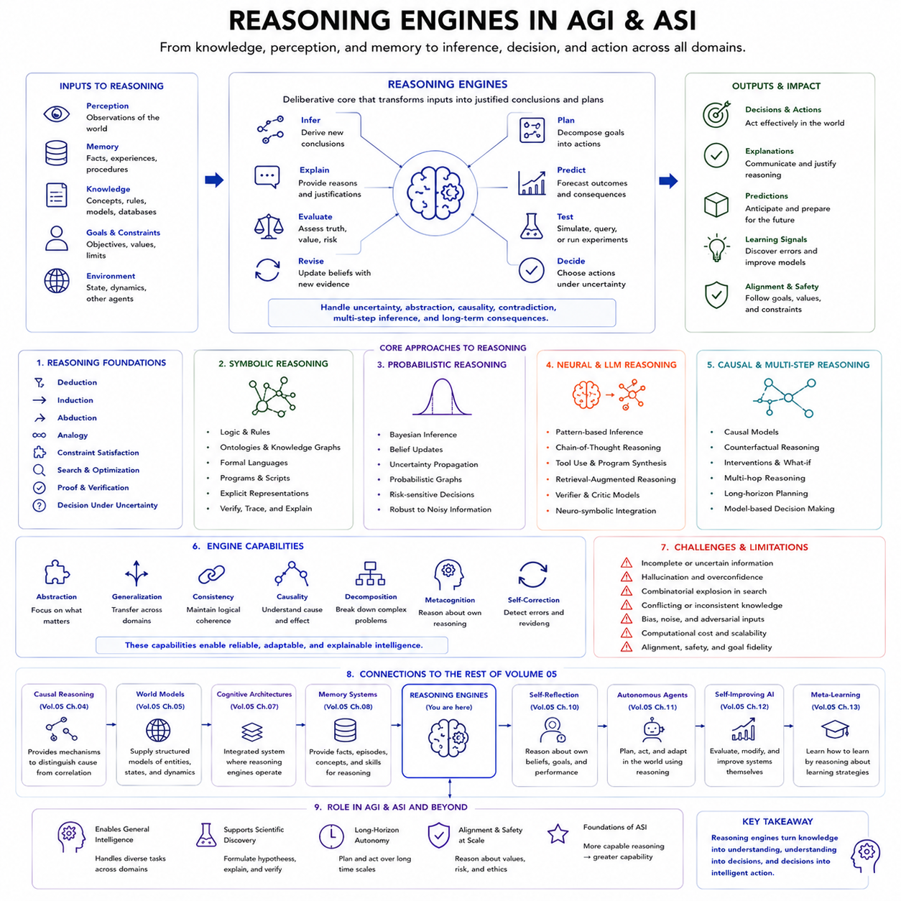
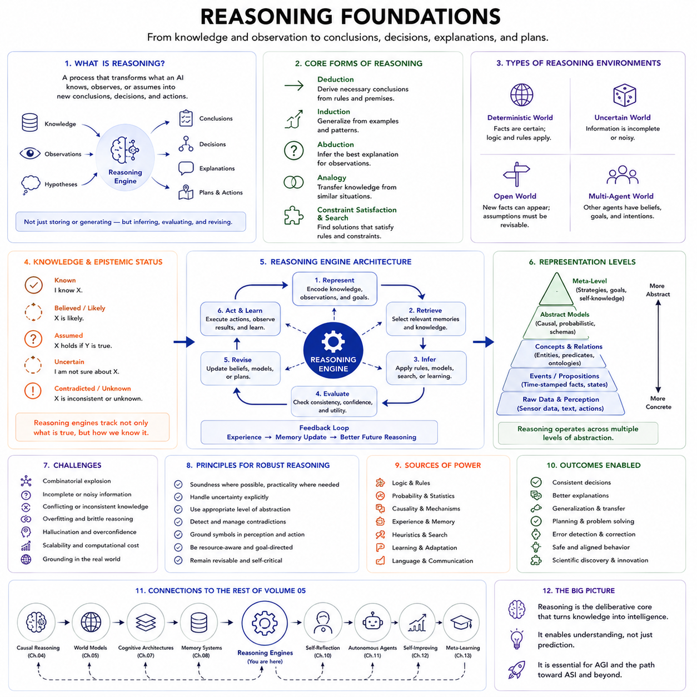
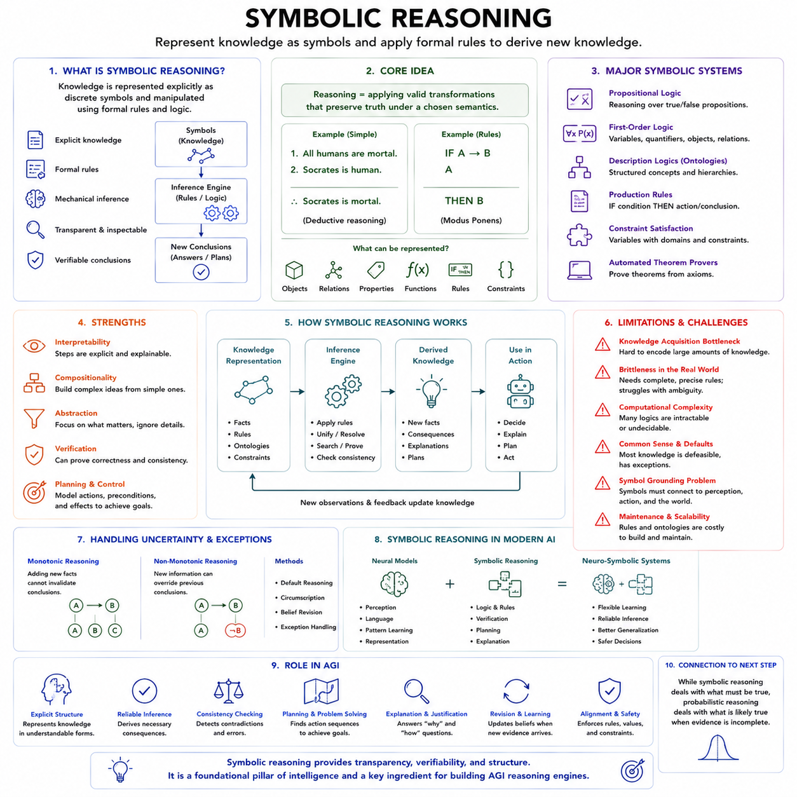
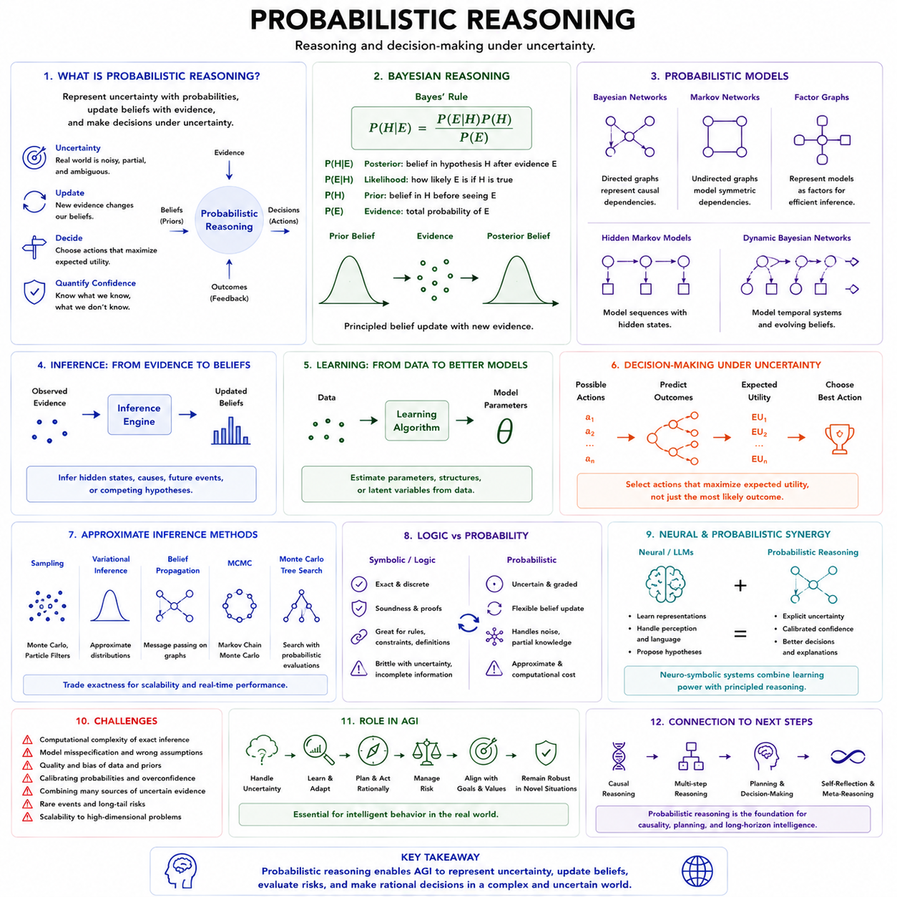
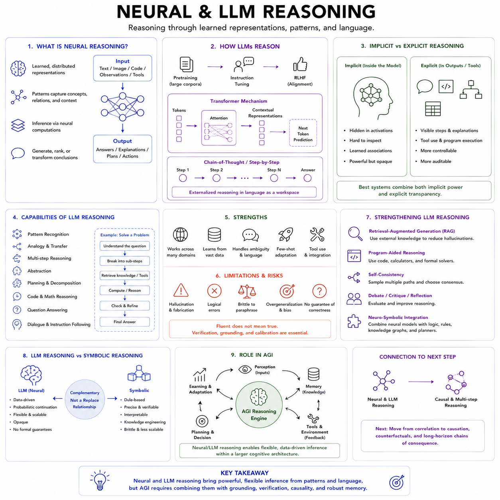
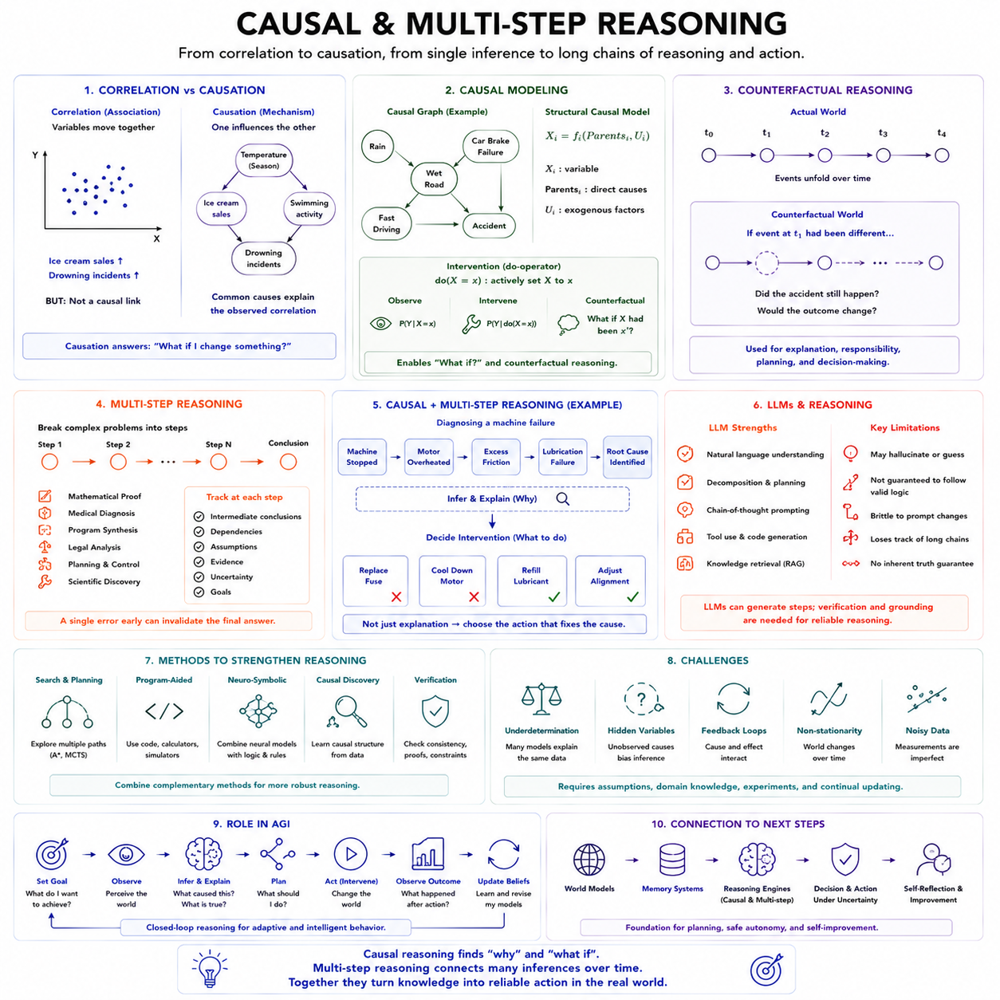
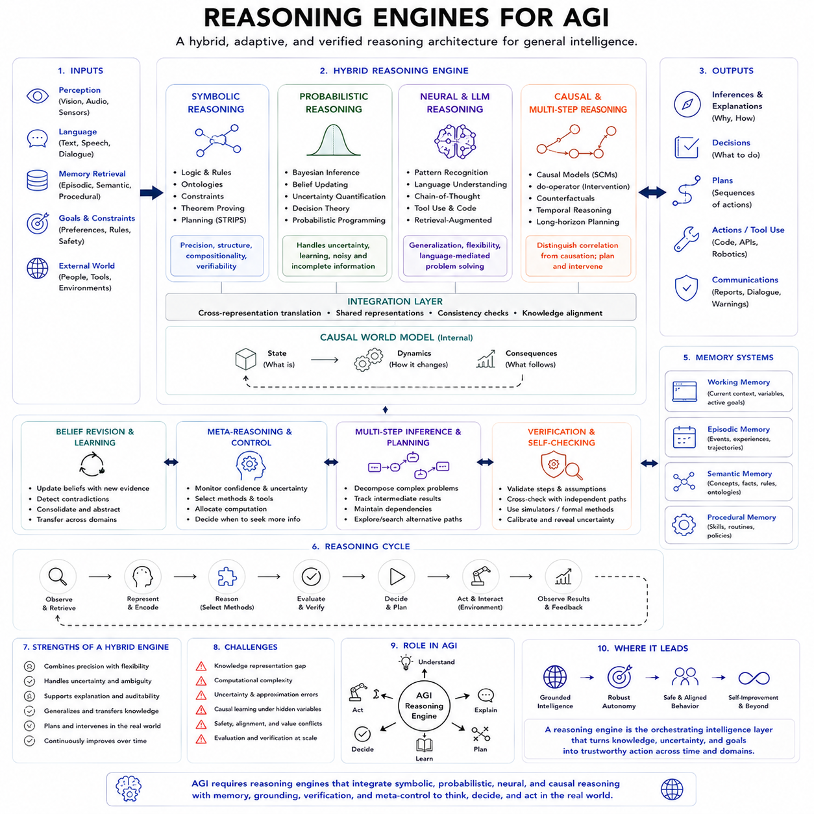
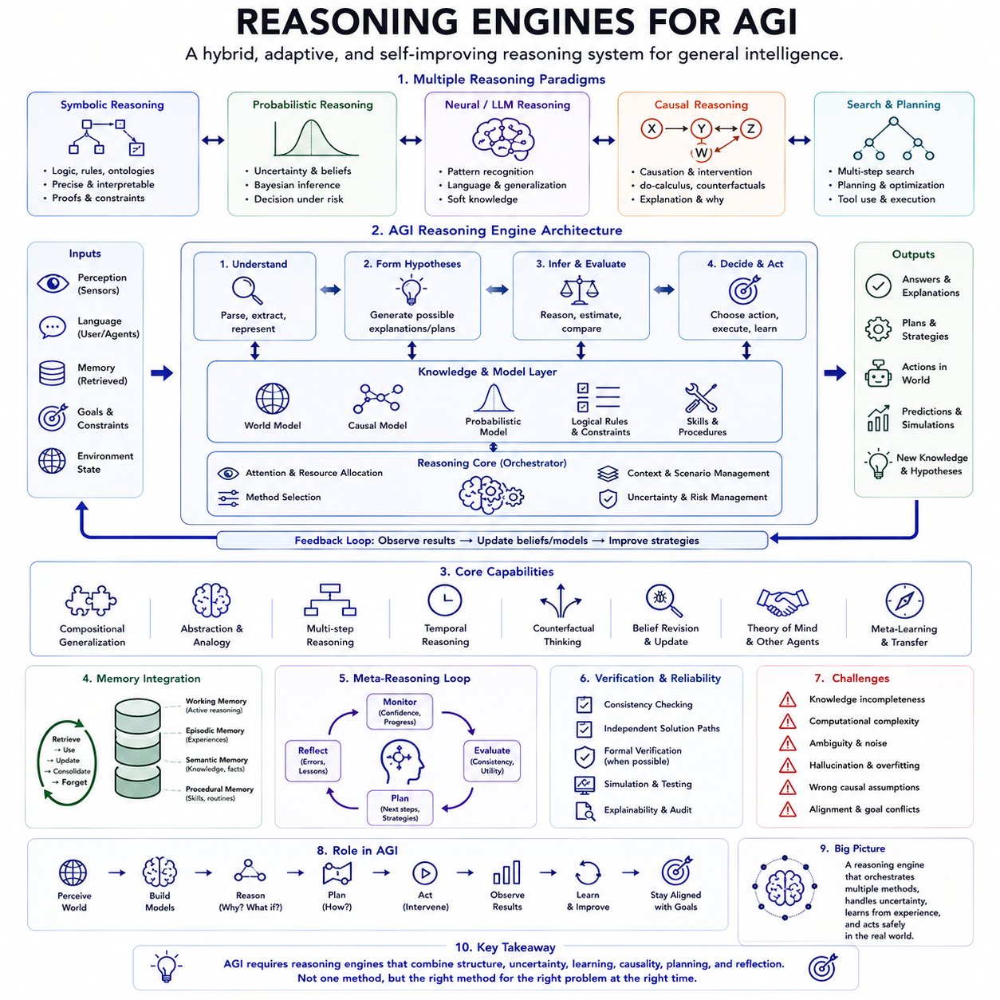

**Volume 00 05 AGI and ASI**

# Chapter 09. Reasoning Engines

### Chapter Overview

{width="7.268055555555556in" height="7.268055555555556in"}

추론 엔진(Reasoning engine)은 지능 시스템이 자신이 알고 있거나 관찰하거나 가정한 것에서 출발해 추론하고, 결정하고, 설명하고, 검증할 수 있는 결론으로 나아가게 하는 메커니즘이다. AGI와 ASI의 맥락에서 추론 엔진은 단순한 규칙 처리기나 수학적 풀이 장치가 아니다. 그것은 여러 영역에 걸쳐 불확실성, 추상화, 인과성, 모순, 계획, 긴 함의의 연쇄를 다루는 조직화된 능력이다. 이 장은 추론을 지각, 기억, 학습된 표현을 숙고하는 지능으로 전환하는 핵심 능력으로 살펴본다.

이 장은 추론의 기초에서 시작한다. 연역(deduction), 귀납(induction), 가추(abduction), 유추(analogy), 제약 만족(constraint satisfaction), 탐색(search), 증명(proof), 불확실성하의 의사결정이 여기에 포함된다. 이어서 명시적 표현인 논리, 규칙, 온톨로지(ontology), 프로그램을 사용해 시스템이 개념을 투명하고 검증 가능한 방식으로 조작하게 하는 상징 추론(Symbolic reasoning)을 다룬다. 그다음에는 베이지안 추론(Bayesian inference), 믿음 갱신, 불확실성 전파, 위험 민감 의사결정을 강조하는 확률적 추론(Probabilistic reasoning)을 살펴본다. 이러한 접근은 현실 세계의 지능이 완전한 정보 속에서 작동하는 경우가 거의 없기 때문에 필수적이다.

이후 이 장은 신경망 및 LLM 추론(Neural and LLM reasoning)으로 전환한다. 현대 언어 모델은 설명을 생성하고, 다단계 문제 해결을 수행하며, 도구를 사용하고, 숙고를 시뮬레이션할 수 있다. 그러나 그 추론은 취약하거나 불투명하거나 데이터에서 학습한 패턴에 의존할 수 있다. 따라서 이 논의는 진정한 추론과 유창한 예측을 구분하며, 사고 연쇄 프롬프팅(chain-of-thought prompting), 검색 증강 추론(retrieval-augmented reasoning), 검증자 모델(verifier model), 프로그램 합성(program synthesis), 신경-상징 통합(neuro-symbolic integration) 같은 기법을 검토한다. 인과 및 다단계 추론(Causal and multi-step reasoning)은 패턴 인식과 견고한 이해를 연결하는 다리로 다루어진다. 지능 시스템은 무엇이 상관되어 있는지만이 아니라, 행동, 개입, 반사실적 조건이 세계를 바꾸면 무엇이 일어날지도 추론해야 한다.

추론 엔진의 중요성은 고도 AI의 "숙고적 핵심(deliberative core)" 역할에 있다. 신뢰할 수 있는 추론이 없다면 AGI에 가까운 시스템은 방대한 지식과 인상적인 언어 능력을 갖추고도 일관성, 전이, 계획, 과학적 발견, 안전한 자율성에서 실패할 수 있다. ASI에서는 추론이 더욱 중대한 의미를 갖는다. 초인적 능력을 지닌 시스템은 인간 감독을 넘어서는 규모에서 결론을 정당화하고, 결과를 평가하며, 오류를 탐지하고, 믿음을 수정하며, 목표와 제약에 맞게 결정을 정렬할 수 있어야 하기 때문이다.

### Connection to Volume 05

이 장은 Volume 05의 중심부에 위치한다. 추론은 이 책의 주요 주제들을 작동 가능한 구조로 연결하기 때문이다. 앞선 장들은 도착점을 정의한다. AGI는 넓고 유연한 지능이며, ASI는 여러 차원에서 인간 능력을 넘어설 수 있는 지능이다. 지능의 유형과 일반화에 관한 장들은 지능이 단일한 기술이 아니라 추상화, 전이, 계획, 설명, 적응을 포함하는 능력들의 집합임을 보여준다. 추론 엔진은 이러한 능력 중 다수가 추상적 이상이 아니라 실행 가능한 과정이 되는 지점이다.

이 장은 인과 추론과 세계 모델(World model)에 관한 논의에 직접 의존한다. 추론 엔진은 무엇이 존재하는지, 개체들이 어떻게 상호작용하는지, 어떤 행동이 가능한지, 어떤 결과가 뒤따를 수 있는지에 대한 모델을 필요로 한다. 세계 모델은 추론이 작동하는 구조화된 또는 학습된 표현을 제공하고, 인과 추론은 엔진이 상관관계와 메커니즘을 구별할 수 있게 한다. 인지 아키텍처(Cognitive architecture)는 추론 엔진이 내장되는 더 큰 시스템 설계를 제공하며, 기억 시스템(Memory system)은 추론 엔진이 질의하고, 갱신하고, 재조직하는 사실, 경험, 절차, 일화적 흔적을 공급한다.

이 장은 또한 자기성찰(Self-reflection), 자율 에이전트(Autonomous agent), 자기개선 AI(Self-improving AI), 재귀적 자기개선(Recursive self-improvement)에 관한 뒤의 논의를 준비한다. 어떤 시스템도 일정한 형태의 추론 엔진 없이는 자신의 믿음을 안정적으로 점검하고, 장기적 계획을 세우며, 자신의 알고리즘을 개선하고, 제안된 자기 수정의 타당성을 평가할 수 없다. 메타러닝(Meta-learning) 역시 학습 과정 자체에 대한 추론에 의존한다. 무엇이 효과가 있었는지, 왜 효과가 있었는지, 새로운 환경에서 학습 전략을 어떻게 바꾸어야 하는지를 판단해야 하기 때문이다. 괴델 머신(Gödel machine)과 범용 생성자(Universal constructor)에 관한 뒤의 장들은 이 논리를 자신의 코드, 개선의 증명, 물리적 또는 계산적 구성에 대해 추론하는 시스템으로 확장한다.

철학적 장들과도 연결이 깊다. 의식, 중국어 방 논변(Chinese Room argument), 인공 의식(Artificial consciousness)에 관한 논쟁은 흔히 상징 조작, 신경망 예측, 기능적 추론이 이해에 충분한지를 묻는다. 추론 엔진은 이러한 논쟁을 종결하지는 않지만, 그것들을 검토할 수 있는 구체적인 기술적 모델을 제공한다. 마지막으로 트랜스휴머니즘(Transhumanism), 하이브 마인드와 집단 AI(Hive mind and collective AI), 뇌-컴퓨터 인터페이스(Brain-computer interface), 마인드 업로딩(Mind uploading), 기술적 특이점(Technological singularity), 포스트휴먼 문명(Post-human civilization)에 관한 장들은 모두 추론이 기계, 인간, 제도, 하이브리드 집단에 걸쳐 분산될 수 있는 미래를 다룬다. 이 더 큰 흐름 속에서 추론 엔진은 단지 AI 시스템의 구성 요소가 아니라 미래 문명의 인지 인프라 후보가 된다.

## 09.00 Reasoning Foundations

{width="7.268055555555556in" height="7.268055555555556in"}

추론 엔진(reasoning engine)은 AI가 알고 있거나, 관찰하거나, 가정하는 것을 결론, 결정, 설명, 또는 계획으로 변환하는 구성 요소 또는 시스템이다. AGI와 ASI의 맥락에서 추론 엔진이 중요한 이유는 지능이 단지 패턴을 저장하고, 사실을 검색하고, 그럴듯한 언어를 생성하는 능력만이 아니기 때문이다. 지능은 알려진 것으로부터 무엇이 따라 나오는지 추론하고, 무엇이 여전히 불확실한지 식별하며, 가능한 행동을 비교하고, 모순을 알아차리고, 세계가 반례를 제시할 때 믿음을 수정하는 능력이기도 하다. 이 절은 이후에 논의될 더 전문화된 접근들, 즉 상징적 추론(symbolic reasoning), 확률적 추론(probabilistic reasoning), 신경망 및 LLM 추론(neural and LLM reasoning), 인과 추론(causal reasoning), 그리고 AGI를 위한 다단계 추론(multi-step reasoning)을 뒷받침하는 기초를 세운다.

핵심적으로 추론은 표현(representation)들 사이의 관계를 다룬다. 표현은 논리 명제(logical proposition), 확률 분포(probability distribution), 그래프, 프로그램 상태, 자연어 문장, 임베딩(embedding), 또는 학습된 잠재 변수(latent variable)일 수 있다. 추론 과정은 새로운 정보를 도출하기 위해 이러한 표현들에 연산을 적용한다. 고전 논리(classical logic)에서는 이것이 "A가 B를 함의한다"와 "A가 참이다"가 주어지면 "B"가 따라온다는 식의 규칙, 예컨대 긍정 논법(modus ponens)을 적용하는 것을 의미할 수 있다. 확률적 추론에서는 증거를 관찰한 뒤 믿음 분포를 갱신하는 것을 의미할 수 있다. 계획(planning)에서는 행동이 세계의 상태를 어떻게 바꾸는지 시뮬레이션하는 것을 의미할 수 있다. 신경망 시스템에서는 모델이 질문에 답하거나, 증명과 유사한 사슬을 완성하거나, 행동을 선택할 수 있도록 내부 활성화(internal activation)를 변환하는 것을 의미할 수 있다.

중요한 구분은 연역(deduction), 귀납(induction), 귀추(abduction) 사이에 있다. 연역은 규칙과 전제가 타당하다고 가정할 때 전제로부터 필연적으로 따라오는 결론을 도출한다. 이는 수학, 형식 검증(formal verification), 규칙 기반 시스템(rule-based system)에 강력하지만, 전제가 불완전하거나 모호할 때 취약하다. 귀납은 예시로부터 일반화한다. 예를 들어 공중에서 지지되지 않는 물체는 대체로 떨어진다는 것을 학습하는 방식이다. 귀납은 데이터로부터 학습하는 데 필수적이지만, 그 결론은 불확실하며 분포 이동(distribution shift) 상황에서 실패할 수 있다. 귀추는 관찰에 대한 최선의 설명을 찾는다. 잔디가 젖어 있다면 비가 왔을 수도 있지만, 스프링클러가 작동했을 가능성도 있다. 인간의 실천적 추론은 흔히 이 세 가지를 결합한다. 우리는 결과를 추론하고, 패턴을 학습하며, 불확실성 속에서 설명을 구성한다.

또 다른 기초는 단조 추론(monotonic reasoning)과 비단조 추론(non-monotonic reasoning)의 차이다. 단조 논리(monotonic logic)에서는 새로운 사실을 추가해도 이미 도출된 결론이 무효화되지 않는다. 이는 많은 형식적 영역에 적합하지만, 현실 세계는 그렇게 깔끔하게 작동하는 경우가 드물다. AI가 "새는 날 수 있다"고 결론 내린 뒤 그 새가 펭귄이거나 다쳤다는 사실을 나중에 알게 된다면, 그 결론은 수정되어야 한다. 비단조 추론은 기본 가정(default assumption)이 새로운 증거에 의해 뒤집히는 것을 허용한다. 이 능력은 상식(common sense), 진단, 법적 추론, 열린 세계 상호작용(open-world interaction)에 핵심적이다. 이러한 환경에서는 지식이 항상 부분적이며 수정 가능하기 때문이다.

추론은 또한 인식론적 지위(epistemic status)에 의존한다. 즉 무엇이 알려져 있는지, 믿어지는지, 가정된 것인지, 불확실한지, 모순되는지, 또는 단지 가능한 것인지의 구분이다. 유능한 시스템은 "나는 X를 안다", "X는 그럴듯하다", "가정 Y가 성립하면 X가 따라온다", "X는 신뢰할 수 없는 출처에서 검색되었다"를 구별해야 한다. 이러한 구분이 없으면 AI는 유창하지만 근거 없는 답변을 만들거나, 추측을 사실과 혼동하거나, 필요한 정보가 빠졌을 때 질문하지 못할 수 있다. 이는 AGI에서 특히 중요하다. 추론 엔진은 여러 영역에 걸쳐 작동하고, 인간과 상호작용하며, 올바른 표현이 처음부터 주어지지 않는 상황을 처리해야 하기 때문이다.

추론의 계산적 난이도(computational difficulty)는 지속적인 한계다. 많은 추론 문제는 조합적(combinatorial)이다. 가능한 결론, 증명, 계획, 또는 설명의 수가 폭발적으로 증가할 수 있다. 정확한 논리 추론, 베이즈 추론(Bayesian inference), 제약 해결(constraint solving), 계획은 크거나 불확실한 환경에서 다루기 어려워질 수 있다. 따라서 실용적인 추론 엔진은 휴리스틱(heuristic), 근사(approximation), 추상화(abstraction), 탐색 전략(search strategy), 그리고 제한된 합리성(bounded rationality)에 의존한다. 시스템은 여러 세부 수준에서 추론하고, 먼저 빠른 근사 판단을 사용한 뒤, 고위험 의사결정에 대해서만 비용이 큰 추론을 남겨둘 수 있다. 그러므로 추론 엔진의 아키텍처는 정확성만의 문제가 아니라 자원 관리(resource management)의 문제이기도 하다.

건전성(soundness)과 완전성(completeness)은 고전적인 이상이다. 건전한 추론 시스템은 자신의 규칙에 따라 유효한 결론만을 도출한다. 완전한 시스템은 해당 형식 체계 안에서 표현 가능한 모든 유효한 결론을 도출할 수 있다. 실제로 많은 AI 시스템은 확장성, 견고성, 적응성을 위해 이러한 보장을 일부 포기한다. 예를 들어 대규모 언어 모델(large language model)은 인상적인 비형식적 추론을 수행할 수 있지만, 유효한 추론을 보장하지는 않는다. 상징적 정리 증명기(symbolic theorem prover)는 강한 보장을 제공할 수 있지만, 잘 형성된 표현이 필요하며 지식이 불완전할 때 실패할 수 있다. 하이브리드 시스템(hybrid system)은 양쪽의 장점을 결합하려 한다. 신경망 구성 요소는 지각, 언어, 패턴 인식을 처리하고, 구조화된 구성 요소는 제약을 강제하거나, 의존 관계를 추적하거나, 중요한 단계를 검증한다.

접지(grounding)도 또 하나의 기초 문제다. 기호를 조작하는 추론 엔진은 그 기호들을 세계와 연결해야 한다. 즉 관찰, 행동, 센서, 목표, 결과와 연결해야 한다. "컵이 탁자 위에 있다"라는 문장은 시스템이 "컵", "탁자", "위에 있음"을 지각과 행동에 연결할 수 있을 때에만 유용하다. 접지가 없으면 추론은 현실과 분리된 형식적 게임이 될 위험이 있다. AGI에서는 접지가 다중모달(multimodal)이고, 시간적(temporal)이며, 상호작용적(interactive)이어야 한다. 시스템은 시간에 따라 객체, 행위자, 사건, 원인, 의도, 그리고 자신의 불확실성에 대해 추론해야 한다.

마지막으로, 추론은 하나의 단일 메커니즘이 아니라 능력들의 집합이다. 여기에는 논리적 추론, 확률적 갱신, 인과적 설명, 유추적 전이(analogical transfer), 반사실적 상상(counterfactual imagination), 계획, 도덕적 숙고(moral deliberation), 자기 비판(self-critique)이 포함된다. 이웃한 절들은 이러한 메커니즘을 더 자세히 살펴본다. 상징적 추론은 명시적 규칙과 형식 구조를 강조한다. 확률적 추론은 불확실성을 다룬다. 신경망 및 LLM 추론은 학습된 표현과 언어 매개 추론(language-mediated inference)을 탐구한다. 인과 및 다단계 추론은 개입(intervention), 의존 관계의 사슬, 장기적 문제 해결을 다룬다. 이 접근들은 함께 AGI를 위한 추론 엔진을 가리킨다. 즉 단지 유창하거나 반응적인 시스템이 아니라, 복잡한 세계 속에서 자신의 믿음과 행동을 정당화하고, 수정하고, 조정할 수 있는 시스템이다.

## 09.01 Symbolic Reasoning

{width="7.268055555555556in" height="7.268055555555556in"}

기호 추론(Symbolic reasoning)은 인공지능의 고전적 토대이다. 이는 지식을 명시적으로 기호(symbol)로 표현하고, 형식적 규칙(formal rules)에 따라 그 기호를 조작하려는 접근이다. 추론 엔진(reasoning engines)의 맥락에서 기호 추론은 가장 투명하고 점검 가능한 형태의 추론을 제공한다. 앞 절에서 표현(representation), 추론(inference), 건전성(soundness), 완전성(completeness), 계산 가능성 및 tractability와 같은 추론의 기초를 소개했다면, 기호 추론은 이러한 개념들이 논리(logic), 규칙(rules), 온톨로지(ontologies), 탐색(search)을 사용하는 시스템 안에서 어떻게 실제로 작동하는지를 보여준다.

기호 추론의 핵심 가정은 세계의 여러 측면을 이산적 구조(discrete structures)로 부호화할 수 있다는 것이다. 여기에는 명제(propositions), 술어(predicates), 객체(objects), 관계(relations), 함수(functions), 규칙(rules)이 포함된다. "문이 잠겨 있다"와 같은 단순한 명제는 논리적 문장으로 표현될 수 있다. "모든 인간은 죽는다"와 같은 더 풍부한 문장은 1차 논리(first-order logic)에서 보편 양화된 규칙으로 표현될 수 있다. 지식이 이렇게 표현되면 추론 엔진은 그 결과를 도출할 수 있다. 소크라테스가 인간이고 모든 인간이 죽는다면, 소크라테스는 죽는다. 이 예는 단순하지만 본질적인 메커니즘을 보여준다. 즉, 추론은 선택된 의미론(semantics) 아래에서 진리를 보존하는 형식적 변환을 적용하는 과정이다.

가장 익숙한 기호 시스템에는 명제 논리(propositional logic), 1차 논리(first-order logic), 기술 논리(description logics), 생성 규칙(production rules), 제약 만족 시스템(constraint satisfaction systems), 자동 정리 증명기(automated theorem provers)가 포함된다. 명제 논리는 내부 구조가 없는 참 또는 거짓의 문장들을 대상으로 추론한다. 1차 논리는 변수, 양화사, 객체, 관계를 추가하여 훨씬 더 높은 표현력을 제공한다. 기술 논리는 구조화된 지식 표현을 지원하며, 시맨틱 웹(Semantic Web)에서 사용되는 여러 온톨로지 언어의 기반이 된다. 규칙 기반 시스템(rule-based systems)은 지식을 흔히 생성 시스템(production systems)의 형태인 "만약-그러면(if-then)" 규칙으로 부호화한다. 제약 해결기(constraint solvers)는 문제를 변수와 허용 조건으로 표현한 뒤 모든 제약을 만족하는 값의 할당을 탐색한다. 정리 증명기(theorem provers)는 결론이 공리(axioms)로부터 따라 나오는지를 증명하려 하며, 종종 해소(resolution), 단일화(unification), 재작성(rewriting), 시퀀트 계산(sequent calculus) 같은 방법을 사용한다.

기호 추론의 핵심 강점은 해석 가능성(interpretability)이다. 지식과 추론 단계가 명시적이기 때문에, 기호 엔진은 자신이 왜 특정 결론에 도달했는지 설명할 수 있는 경우가 많다. 이는 법률, 의학, 금융, 공학, 안전이 중요한 제어 시스템처럼 정답만으로 충분하지 않고 추론 과정도 감사(audit)할 수 있어야 하는 영역에서 중요하다. 기호 추론은 또한 조합성(compositionality)을 지원한다. 복잡한 개념은 더 단순한 개념들로부터 구성될 수 있고, 규칙은 다양한 상황에 체계적으로 적용될 수 있다. 알려진 구조를 재조합하는 이러한 능력은 기호적 방법이 AGI 논의에서 여전히 중요한 이유 중 하나이다. AGI 시스템은 훈련 중 본 패턴을 단순히 인식하는 것이 아니라 새로운 구성에 대해 추론해야 하기 때문이다.

기호 추론은 추상화(abstraction)에도 유용하다. 이는 관련 없는 지각적 세부 사항을 무시하고 과제에 중요한 관계에 집중할 수 있다. 상자를 옮기려는 로봇은 항상 방의 픽셀 수준 표현이 필요한 것은 아니다. 상자가 탁자 위에 있고, 탁자는 부엌에 있으며, 로봇이 닿을 수 있으면 상자를 잡을 수 있다는 사실을 알아야 할 수 있다. 이런 경우 기호 표현은 계획(planning)과 설명을 더 효율적으로 만들 수 있다. STRIPS와 이후의 계획 언어 같은 고전적 계획 시스템은 상태(states), 행동(actions), 전제 조건(preconditions), 효과(effects)를 기호적 형태로 모델링하여, 에이전트가 목표를 달성하는 행동 순서를 탐색할 수 있게 한다.

그러나 기호 추론에는 잘 알려진 한계가 있다. 첫째는 지식 획득 문제(knowledge acquisition problem)이다. 누군가 또는 어떤 시스템이 관련 개념, 사실, 규칙, 예외, 배경 가정을 부호화해야 한다. 대규모 기호 지식 베이스를 수작업으로 구축하는 것은 느리고 비싸며 취약하다. 둘째는 열린 세계(open-world) 환경에서의 취약성이다. 실제 환경에는 모호성, 불확실성, 불완전한 정보, 상충하는 증거, 지속적으로 변하는 조건이 존재한다. 순수 논리 시스템은 종종 명확한 정의와 완전한 규칙 집합을 요구하는데, 이는 좁은 영역 밖에서는 유지하기 어렵다. 셋째는 계산 복잡성(computational complexity)이다. 표현력이 더 높은 논리는 결정 불가능하거나 계산적으로 다루기 어려워질 수 있다. 즉, 증명이 존재하더라도 그것을 찾는 데 비현실적인 시간이나 자원이 필요할 수 있다.

또 다른 과제는 기호 접지 문제(symbol grounding problem)이다. 형식 시스템 내부의 기호는 인간이 해석을 부여하기 때문에 의미를 갖지만, 자율적인 AGI는 기호를 지각, 행동, 경험과 연결해야 한다. "컵"이라는 기호는 단순히 데이터베이스 안의 토큰을 가리켜서는 안 된다. 그것은 시각적 패턴, 촉각적 기대, 기능적 사용, 사회적 관습, 잡기, 채우기, 씻기와 같은 가능한 행동과 연결되어야 한다. 접지가 없으면 기호 추론은 토큰의 분리된 조작에 머물 위험이 있다. 이 문제는 이후의 신경망 및 LLM 추론(neural and LLM reasoning) 논의와 직접 연결된다. 학습된 표현은 풍부한 통계적 구조를 포착할 수 있지만, 명시적 논리 보장은 부족할 수 있기 때문이다.

기호 추론은 상식(common sense)에도 어려움을 겪는다. 인간 추론은 객체, 의도, 인과관계, 시간, 공간, 사회적 행동에 대한 방대한 배경 지식에 의존한다. 이 지식의 상당 부분은 취소 가능(defeasible)하다. 대체로 참이지만 예외를 허용한다는 뜻이다. 새는 보통 날지만 펭귄은 날지 못한다. 탁자 위의 컵은 보통 그대로 있지만 누군가 옮기면 그렇지 않다. 사람들은 보통 목표를 향해 행동하지만, 그 행동은 비합리적이거나 기만적일 수도 있다. 비단조 논리(non-monotonic logics), 기본 추론(default reasoning), circumscription, 믿음 수정(belief revision)은 이러한 사례를 다루기 위해 개발되었으며, 새로운 정보가 나타날 때 결론을 철회할 수 있게 한다. 이러한 방법들은 중요하지만 복잡성을 더하며, 확장 가능한 상식 추론의 문제를 완전히 해결하지는 못한다.

현대 AI에서 기호 추론은 신경망 방법의 완전한 대안으로 여겨지는 경우가 드물다. 대신 하이브리드 추론 엔진(hybrid reasoning engines)의 한 구성 요소로 점점 더 많이 이해된다. 신경망 모델은 지각, 언어, 패턴 인식, 대규모 데이터로부터의 학습에 강하다. 기호 시스템은 명시적 구조, 규칙 준수, 검증, 계획, 설명에 강하다. 하이브리드 시스템은 신경망 모델을 사용해 텍스트에서 개체와 관계를 추출하고, 기호 추론기를 사용해 일관성을 점검하고 결과를 추론하며, 계획기를 사용해 제약 아래에서 행동을 선택할 수 있다. 이러한 신경-기호(neuro-symbolic) 접근은 학습의 유연성과 형식 추론의 신뢰성을 결합하려는 시도이다.

AGI에서 기호 추론은 여전히 중요하다. 일반 지능에는 통계적 연관 이상의 것이 필요하기 때문이다. 고도화된 에이전트는 목표, 약속, 의무, 반사실(counterfactuals), 인과관계, 긴 조건부 추론 사슬을 표현해야 한다. 또한 어떤 결론이 필연적으로 따라오는지, 어떤 결론이 단지 확률적으로 따라오는지, 어떤 결론이 실패할 수 있는 가정에 의존하는지를 알아야 한다. 기호 추론은 이러한 구분을 명시적으로 만들기 위한 도구를 제공한다. 그러나 AGI는 기호에만 의존할 수 없다. 불확실성 아래에서 추론하고, 경험으로부터 학습하며, 개념을 세계에 접지하고, 제한된 계산 자원으로 작동해야 한다. 이러한 전환은 자연스럽게 다음 절인 확률적 추론(probabilistic reasoning)으로 이어진다. 그곳에서 추론은 반드시 참인 것이 무엇인가가 아니라, 불완전한 증거가 주어졌을 때 무엇이 참일 가능성이 높은가에 관한 문제가 된다.

## 09.02 Probabilistic Reasoning

{width="7.268055555555556in" height="7.268055555555556in"}

이전 절에서 다룬 상징적 추론(Symbolic reasoning)은 지능 시스템이 명시적 개념, 규칙, 논리적 관계를 조작할 수 있는 방법을 제공한다. 그 강점은 정밀성에 있다. 전제가 참이고 추론 규칙이 타당하다면 결론은 따라온다. 그러나 실제 환경은 에이전트에게 완전하고, 잡음이 없으며, 완벽하게 명세된 사실을 거의 제공하지 않는다. 센서는 실패하고, 언어는 모호하며, 기억은 불완전하고, 인과 메커니즘은 부분적으로만 이해될 수 있다. 확률적 추론(Probabilistic reasoning)은 믿음의 정도를 표현하고, 증거가 들어올 때 그 믿음을 갱신하며, 불확실성 아래에서 의사결정을 내릴 수 있게 함으로써 추론 엔진을 확장한다.

확률적 추론의 핵심에는 불확실성을 정량화할 수 있다는 생각이 있다. 확률은 단순히 과거 데이터에서의 빈도만을 의미하지 않는다. 많은 AI 시스템에서 확률은 이용 가능한 정보에 기반한 합리적 믿음의 척도이기도 하다. 베이즈 추론(Bayesian reasoning)은 이를 베이즈 규칙(Bayes' rule)을 통해 형식화한다. 베이즈 규칙은 증거를 관찰한 뒤 사전 믿음(prior belief)이 사후 믿음(posterior belief)으로 어떻게 갱신되어야 하는지를 설명한다. 이는 에이전트가 불완전한 정보로부터 학습하는 원칙적인 방법을 제공한다. 예를 들어 의료 진단 시스템은 질병의 사전 확률에서 시작하여 증상과 검사 결과를 관찰하고 각 진단의 가능성을 갱신할 수 있다. 같은 구조는 로보틱스, 사이버보안, 과학적 발견, 언어 이해에도 적용된다.

확률적 그래프 모델(Probabilistic graphical models)은 중요한 추론 엔진 계열 중 하나다. 베이즈 네트워크(Bayesian networks)는 변수를 노드로, 조건부 의존성을 방향성 간선으로 표현한다. 이를 통해 시스템은 어떤 변수에 관한 증거가 다른 변수들에 대한 믿음을 어떻게 변화시키는지 추론할 수 있다. 마르코프 네트워크(Markov networks)와 팩터 그래프(Factor graphs)는 관련된 구조를 표현하며, 의존성이 비방향성이거나 모델을 재사용 가능한 요인(factor)으로 분해할 때 유용한 경우가 많다. 이러한 모델은 불확실성을 명시적이고 해석 가능하게 만든다. 인간은 가정, 조건부 확률, 의존성 구조를 검토할 수 있다. 이는 설명과 보정된 확신(calibrated confidence)이 중요한 안전 필수 영역에서 큰 장점이다.

또 다른 중요한 구분은 확률적 추론(probabilistic inference)과 확률적 학습(probabilistic learning) 사이에 있다. 추론은 모델과 관찰된 증거로부터 무엇이 따라오는지를 묻는다. 즉 이러한 관찰이 주어졌을 때 숨겨진 상태, 미래 사건, 또는 경쟁 가설의 확률은 얼마인가를 묻는다. 학습은 모델 자체가 데이터로부터 어떻게 추정되거나 개선되어야 하는지를 묻는다. 즉 어떤 매개변수, 구조, 잠재 변수(latent variables)가 관찰을 가장 잘 설명하는가를 묻는다. 성숙한 추론 엔진은 종종 둘 모두를 필요로 한다. 예를 들어 자율주행차는 보행자의 의도를 실시간으로 추론해야 하면서도 축적된 주행 경험으로부터 자신의 모델을 개선해야 한다.

확률적 추론은 의사결정도 지원한다. 기대 효용 이론(Expected utility theory)은 가능한 결과에 대한 믿음과 그 결과들에 대한 선호를 결합한다. 합리적 에이전트는 단순히 "무엇이 가장 가능성이 높은가?"만 묻지 않고, "불확실성 아래에서 어떤 행동이 가장 좋은 기대 결과를 갖는가?"도 묻는다. 이 구분은 매우 중요하다. 확률은 낮지만 파국적인 사건은 그 비용이 극단적으로 크다면 강한 주의를 받을 필요가 있다. AGI 안전성에서는 이것이 중요하다. 고도화된 시스템이 드문 실패조차 허용될 수 없는 고위험 영역에서 작동할 수 있기 때문이다. 확률적 추론은 위험 추정, 확신 보정, 견고한 계획을 위한 도구를 제공하지만, 이러한 도구들은 그 배후의 가정만큼만 신뢰할 수 있다.

계산상의 어려움도 여러 가지가 있다. 정확한 확률적 추론은 큰 모델에서, 특히 많은 변수가 상호작용할 때 계산적으로 다루기 어려울 수 있다. 실제 시스템은 종종 샘플링(sampling), 변분 추론(variational inference), 입자 필터(particle filters), 몬테카를로 트리 탐색(Monte Carlo tree search) 같은 근사 방법을 사용한다. 이러한 방법은 정확성과 확장성 사이의 절충을 만든다. 이 절충은 단순히 기술적인 문제가 아니라 신뢰성에 영향을 준다. 근사 추론은 실시간 행동에 충분히 빠를 수 있지만, 편향되거나 불안정한 추정치를 만들 수도 있다. 따라서 AGI를 위해 설계된 추론 엔진은 언제 더 많은 증거를 찾고, 행동을 보류하며, 인간 감독으로 상향해야 하는지를 포함하여 자신의 불확실성에 대한 불확실성도 관리해야 한다.

확률적 추론은 순수 논리와 다르지만 그것을 대체하지는 않는다. 논리는 제약, 정의, 증명, 규칙 지배적 영역에 적합하다. 확률은 잡음 있는 증거, 불확실한 예측, 불완전한 지식에 적합하다. 강력한 아키텍처 중 다수는 둘을 결합한다. 통계적 관계 학습(Statistical relational learning), 확률적 프로그래밍(Probabilistic programming), 마르코프 논리 네트워크(Markov logic networks), 신경-상징 시스템(Neuro-symbolic systems)은 구조화된 지식을 표현하면서도 불확실성을 처리하려고 시도한다. 이러한 하이브리드는 일반 지능이 구성적 구조와 유연한 믿음 수정 모두를 요구하기 때문에 중요하다. AGI는 물리적 객체가 동시에 두 장소에 있을 수 없다고 추론해야 하는 동시에, 그 객체가 실제로 어디에 있는지에 관한 불확실한 센서 판독값도 추정해야 할 수 있다.

신경망 및 LLM 추론과의 관계에서 확률적 추론은 보완물이자 비판 기준을 제공한다. 현대 언어 모델은 유창한 답변을 생성하는 경우가 많지만, 가설들에 대한 명시적 확률 분포를 유지하지 못하거나 확신(confidence)과 그럴듯함(plausibility)을 안정적으로 구분하지 못할 수 있다. 언어 속에서 추론을 모사할 수는 있지만, 불확실성에 대한 안정적인 내부 모델이 부족할 수 있다. 확률적 프레임워크는 대안, 증거, 확신, 기대 결과를 명시적으로 표현하게 함으로써 도움을 줄 수 있다. 반대로 신경망 시스템은 표현을 학습하고, 가설을 제안하며, 사람이 직접 설계하기 어려운 복잡한 분포를 근사함으로써 확률적 추론의 확장을 도울 수 있다.

AGI에서 확률적 추론은 단순한 수학적 기법이 아니라 불확실한 세계에서 지능적으로 행동하기 위한 기반이다. 일반 에이전트는 자신이 무엇을 아는지, 무엇을 모르는지, 무엇을 조사해야 하는지, 어떤 위험을 감수할 의지가 있는지를 결정해야 한다. 또한 잡음에 과민 반응하지 않고 믿음을 갱신하며, 여러 출처의 증거를 결합하고, 새로운 상황에 직면했을 때도 보정된 상태를 유지해야 한다. 더 깊은 과제는 확률을 고립적으로 할당하는 것이 아니라, 확률적 믿음을 인과 모델, 기억, 계획, 자기 성찰, 가치와 통합하는 것이다. 이 연결은 자연스럽게 인과적 및 다단계 추론에 관한 이후 절로 이어지며, 그곳에서는 불확실성이 설명, 개입, 긴 결과의 사슬과 결합되어야 한다.

## 09.03 Neural and LLM Reasoning

{width="7.268055555555556in" height="7.268055555555556in"}

신경 추론(Neural reasoning)은 명시적으로 작성된 규칙만이 아니라, 학습된 분산 표현(distributed representation)을 통해 수행되는 추론을 뜻한다. 앞 절에서 확률적 추론(probabilistic reasoning)은 불확실성, 가능도, 믿음 갱신을 강조했다. 신경 추론과 대규모 언어 모델 추론(LLM reasoning)은 그 흐름을 이어가지만, 작동 메커니즘을 바꾼다. 확률표, 논리 절, 탐색 절차를 사람이 직접 지정하는 대신, 모델은 데이터로부터 통계적 구조를 학습하고 자신의 매개변수를 사용해 가능한 결론을 생성하거나 순위를 매기거나 변환한다. 이 때문에 신경 추론은 규칙이 불완전하거나 모호하거나 너무 많아 일일이 열거하기 어려운 영역에서 강력하다.

현대 신경망은 고차원 벡터 공간에 인코딩된 패턴을 통해 추론한다. 개념, 관계, 맥락은 임베딩(embedding)으로 표현되며, 계산은 비선형 변환의 여러 층을 거쳐 진행된다. 현대 대규모 언어 모델(LLM)의 핵심 구조인 트랜스포머(transformer)에서는 어텐션 메커니즘(attention mechanism)이 모델로 하여금 각 토큰을 문맥 속의 다른 관련 토큰들에 조건화할 수 있게 한다. 이를 통해 모델은 의존성을 추적하고, 대안을 비교하며, 암묵적 연관을 검색하고, 부분 결과를 조합할 수 있다. 이는 고전적 상징 추론(symbolic reasoning)의 의미에서의 추론은 아니지만, 유추, 연역, 귀납, 추상화, 계획과 유사한 행동을 만들어낼 수 있다.

LLM이 특히 중요한 이유는 설명, 논증, 코드, 수학, 과학 문헌, 대화, 절차적 지시를 포함한 방대한 말뭉치로 훈련되기 때문이다. 사전학습(pretraining) 동안 LLM은 언어와, 텍스트로 표현된 세계의 광범위한 규칙성을 학습한다. 지시 튜닝(instruction tuning)과 인간 피드백 기반 강화학습(reinforcement learning from human feedback, RLHF)을 거치면, 요청을 따르고 일관된 설명을 생성하며 출력을 인간 선호에 맞추는 능력이 향상된다. "단계별로 생각하라"는 프롬프트를 받거나, 중간 단계를 생성하거나, 사고의 사슬 추론(chain-of-thought reasoning)을 사용할 때 LLM은 다단계 과제에서 더 나은 성능을 보이는 경우가 많다. 출력 시퀀스가 중간 표현을 외부화할 수 있는 작업 공간을 제공하기 때문이다.

그러나 LLM 추론은 보장된 논리적 추론과 같지 않다. 정리 증명기(theorem prover)는 명시적 규칙 아래에서 형식 공리로부터 결론을 도출한다. 반면 LLM은 자신의 학습과 문맥에 조건화된 그럴듯한 다음 내용을 추정한다. 이 차이는 중요하다. LLM은 올바른 설명을 생성할 수 있지만, 동시에 환각(hallucination)을 일으키거나, 존재하지 않는 인용을 만들어내거나, 산술 오류를 범하거나, 유창한 언어로 타당하지 않은 논증을 제시할 수도 있다. 그 추론은 문장 바꾸기(paraphrase)에 취약할 수 있고, 프롬프트 표현에 민감하며, 오도하는 문맥에 쉽게 영향을 받을 수 있다. 모델은 견고한 일반 증명이나 인과 모델을 구성하기보다, 익숙한 패턴을 인식해 문제를 해결하는 것일 수 있다.

유용한 구분은 암묵적 추론(implicit reasoning)과 명시적 추론(explicit reasoning) 사이에 있다. 암묵적 추론은 모델의 활성값 내부에서 일어나며 직접 관찰하기 어렵다. 명시적 추론은 생성된 텍스트, 도구 호출, 도표, 방정식, 실행 가능한 코드로 나타난다. LLM 시스템은 점점 더 이 둘을 결합하고 있다. 모델은 계획 초안을 작성하고, 계산기를 호출하고, 데이터베이스를 질의하고, 코드를 실행하고, 결과를 검사한 뒤 답변을 수정할 수 있다. 이런 시스템에서 LLM은 독립적인 추론 엔진이라기보다 외부 도구들을 조정하는 컨트롤러에 가깝다. 이러한 하이브리드 접근은 오류를 줄이고, 사실 기반성을 높이며, 추론을 더 감사 가능하게 만들 수 있다.

신경 추론은 또한 유연한 일반화(soft generalization)를 지원한다. 상징 시스템은 술어와 규칙 사이의 정확한 일치를 요구하는 경우가 많지만, 신경 시스템은 유사성, 유추, 부분적 구조를 인식할 수 있다. 이는 자연어 이해, 지각, 로보틱스, 의료 선별, 과학적 가설 생성에 가치가 있다. 그러나 유연한 일반화는 양날의 검이다. 모델은 증거를 넘어 과도하게 일반화하거나, 허위 상관관계에 과적합하거나, 표면적 유사성을 깊은 동등성으로 취급할 수 있다. AGI에서의 과제는 유연성과 신뢰성을 결합하는 것이다. 일반 지능 시스템은 불확실성 아래에서 추론해야 하지만, 동시에 어떤 추론이 약하거나, 근거가 부족하거나, 위험한지도 알아야 한다.

LLM 추론을 강화하려는 여러 방법이 있다. 검색 증강 생성(retrieval-augmented generation, RAG)은 관련 외부 문서를 제공하여 모델이 매개변수 기억(parametric memory)에만 의존하지 않게 한다. 프로그램 보조 추론(program-aided reasoning)은 문제의 일부를 코드나 형식 표현으로 변환한다. 자기 일관성(self-consistency)은 여러 추론 경로를 샘플링하고 수렴하는 답을 선택한다. 토론, 비평, 성찰 방법은 모델에게 자신이나 다른 모델의 출력을 평가하게 한다. 신경-상징 시스템(neuro-symbolic system)은 신경망 기반 지각과 언어 이해를 상징 논리, 제약 해결기, 계획기, 지식 그래프와 통합한다. 이러한 접근들은 어떤 단일한 추론 방식도 모든 과제에 충분하지 않다는 점을 인정한다.

AGI 연구에서 신경 추론과 LLM 추론은 돌파구이자 경고이다. 이는 손으로 코딩한 세계 지식 없이도 규모, 데이터, 아키텍처, 훈련 목표로부터 폭넓고 유용한 추론 유사 행동이 나타날 수 있음을 보여준다. 동시에 인과적 기반(causal grounding), 지속적 기억, 체화된 피드백, 형식 검증과 분리된 패턴 기반 지능의 한계도 드러낸다. 다음 절인 인과 및 다단계 추론(causal and multi-step reasoning)은 바로 이 긴장 위에서 전개된다. 신경 모델은 그럴듯한 사고의 사슬을 생성할 수 있지만, AGI에는 상관관계와 인과관계를 구분하고, 긴 시간 지평을 추적하며, 가정을 검증하고, 현실 세계의 행동 전반에서 일관성을 유지하는 추론 엔진이 필요하다.

## 09.04 Causal and Multi Step Reasoning

{width="7.268055555555556in" height="7.268055555555556in"}

A common formal language for causal reasoning is the structural causal model(구조적 인과 모델), often represented by variables, directed causal graphs, and structural equations. In such models, arrows express hypothesized causal influence. The do-operator(개입 연산자), introduced in causal inference, represents active intervention: do(X = x) means setting X to a value rather than merely observing it. This enables questions such as "What will happen if the agent closes the valve?" or "Would the accident have occurred if the sensor had not failed?" The latter is a counterfactual(반사실적) question, requiring reasoning over alternative possible worlds.

인과 추론(Causal reasoning)과 다단계 추론(multi step reasoning)은 AGI를 지원하려는 모든 추론 엔진(reasoning engine)에 핵심적인 능력이다. 기호 시스템(symbolic system)은 명시적 규칙을 조작할 수 있고, 확률 시스템(probabilistic system)은 불확실성을 표현할 수 있으며, 신경망 시스템(neural system)은 패턴을 인식하고 그럴듯한 후속 내용을 생성할 수 있다. 그러나 지능은 연관성을 찾거나 표면적 패턴을 완성하는 것 이상을 요구한다. 에이전트는 무엇이 무엇을 일으키는지, 어떤 개입이 이루어지면 무슨 일이 발생하는지, 그리고 일련의 행동이나 추론이 시간이 지나며 세계의 상태를 어떻게 변화시키는지를 물을 수 있어야 한다.

인과 추론은 단순한 상관관계가 아니라 생성, 영향, 의존의 관계를 다룬다. 여름에 아이스크림 판매량과 익사 사고가 모두 증가한다면, 순수하게 상관관계에 의존하는 시스템은 하나가 다른 하나를 예측한다고 취급할 수 있다. 그러나 인과 추론기는 기온, 계절, 인간 활동을 관련된 공통 원인(common cause)으로 식별해야 한다. 이러한 구분이 중요한 이유는 행동이 세계를 변화시키기 때문이다. 두 변수가 함께 움직인다는 관찰은 하나를 조작하면 다른 하나가 변한다는 뜻이 아니다. 따라서 AGI 시스템은 예측(prediction)과 개입(intervention)을 구별해야 한다.

인과 추론을 위한 일반적인 형식 언어는 구조적 인과 모델(structural causal model)이며, 보통 변수, 방향성 인과 그래프(directed causal graph), 구조 방정식(structural equation)으로 표현된다. 이러한 모델에서 화살표는 가정된 인과적 영향을 나타낸다. 인과 추론에서 도입된 개입 연산자(do-operator)는 능동적 개입을 표현한다. do(X = x)는 X를 단순히 관찰하는 것이 아니라 특정 값으로 설정한다는 뜻이다. 이를 통해 "에이전트가 밸브를 닫으면 무슨 일이 일어나는가?" 또는 "센서가 고장 나지 않았다면 사고가 발생했을까?"와 같은 질문을 다룰 수 있다. 후자는 반사실적(counterfactual) 질문으로, 대안적인 가능 세계(alternative possible worlds)에 대한 추론을 요구한다.

다단계 추론은 이러한 과제를 추론의 연쇄 전체로 확장한다. 시스템은 하나의 연상적 도약으로 질문에 답하는 대신, 중간 결론, 의존 관계, 가정, 목표를 유지해야 한다. 수학적 증명, 의학적 진단, 프로그램 합성(program synthesis), 법률 분석, 계획 수립, 과학적 발견에서는 긴 추론 사슬의 정확성이 중요하며, 초기의 오류 하나가 최종 답을 무효화할 수 있다. 따라서 유능한 추론 엔진은 결론뿐 아니라 그 결론에 도달한 경로도 추적해야 한다.

인과 추론과 다단계 추론은 자주 상호작용한다. 한 자율 로봇이 기계가 멈춘 원인을 진단한다고 생각해 보자. 로봇은 모터가 과열되었다고 추론하고, 과열은 과도한 마찰 때문에 발생했으며, 마찰은 윤활 실패에서 비롯되었고, 결국 퓨즈만 교체하는 것으로는 근본 문제가 해결되지 않는다고 판단할 수 있다. 이것은 단순히 긴 설명이 아니라 개입 선택을 뒷받침하는 인과 사슬이다. 추론의 가치는 유창한 서사를 만드는 데 있는 것이 아니라, 목표를 만족하는 결과를 낳을 행동을 선택하는 데 있다.

대형 언어 모델(large language model)은 신중하게 프롬프트를 설계했을 때, 특히 문제 분해(decomposition), 스크래치패드 추론(scratchpad reasoning), 사고의 사슬(chain-of-thought) 방식의 프롬프팅, 도구 사용(tool use), 검색 증강(retrieval augmentation)을 통해 다단계 추론에서 놀라운 능력을 보여 주었다. 그러나 그 추론이 충실하다고 보장되지는 않는다. 모델은 답을 암묵적으로 추측한 뒤 그럴듯한 단계들을 생성할 수도 있고, 언어적 일관성은 유지하면서 논리적 타당성은 잃을 수도 있다. 이는 생성된 추론(generated reasoning)과 실제 추론(actual reasoning)의 구분을 만든다. 안전이 중요한 환경에서 추론 엔진은 설득력 있는 설명만이 아니라 검증 가능한 중간 상태를 드러내야 한다.

신뢰성을 높이기 위한 여러 기법이 있다. 탐색 기반 방법(search-based method)은 여러 추론 경로를 탐색하고 제약 조건을 만족하는 경로를 선택한다. 프로그램 보조 추론(program-aided reasoning)은 문제의 일부를 실행 가능한 코드로 변환한다. 신경-기호 접근(neuro-symbolic approach)은 신경망 기반 지각과 언어 이해를 기호적 증명, 계획, 제약 해결과 결합한다. 인과 발견(causal discovery) 알고리즘은 데이터로부터 인과 구조를 추론하려고 하지만, 보통 인과적 충분성(causal sufficiency), 숨은 교란 변수(hidden confounder)의 부재, 특정한 시간적 순서와 같은 가정을 필요로 한다. 검증 시스템(verification system)은 결론이 전제로부터 따라오는지 확인할 수 있지만, 이는 지정된 형식 체계 안에서만 가능하다.

주요 한계는 현실 세계의 인과 추론이 과소결정(underdetermined)되어 있다는 점이다. 동일한 관찰을 설명할 수 있는 인과 모델은 많다. 숨은 변수, 피드백 루프(feedback loop), 선택 편향(selection bias), 비정상적 환경(non-stationary environment), 측정 오류는 모두 추론을 복잡하게 만든다. 인간은 배경지식, 실험, 유추, 체화된 경험(embodied experience)에 크게 의존한다. AGI 시스템도 이와 유사한 메커니즘을 필요로 할 것이다. 시뮬레이션을 지원하는 세계 모델(world model), 증거를 보존하는 기억 시스템(memory system), 갱신 가능한 인과 표현(causal representation), 그리고 불확실성이 너무 높아 확신 있는 행동을 하기 어려운 시점을 판단할 수 있는 추론 엔진이 필요하다.

AGI에서 인과 추론과 다단계 추론은 지식과 행위성(agency)을 연결하는 다리 역할을 한다. 다음 토큰, 라벨, 사건만 예측하는 시스템은 주로 반응적이다. 인과적으로 추론할 수 있는 시스템은 개입을 평가할 수 있다. 여러 단계에 걸쳐 추론할 수 있는 시스템은 계획하고, 설명하고, 디버깅하고, 실패로부터 학습할 수 있다. 이 능력들이 결합되면 에이전트는 "무엇이 가능성이 높은가?"뿐 아니라 "무엇이 이것을 일으켰는가?", "무엇이 이것을 바꿀 수 있는가?", "내 가정에서 무엇이 따라오는가?", "다음에 무엇을 해야 하는가?"를 물을 수 있다. 다음 절은 이러한 토대 위에서, 지각, 기억, 인과성, 계획, 자기 점검이 통합된 아키텍처의 일부로 작동해야 하는 AGI 수준의 인지를 위해 추론 엔진이 어떻게 조직될 수 있는지 살펴본다.

## 09.05 Reasoning Engines for AGI

{width="7.268055555555556in" height="7.268055555555556in"}

{width="7.268055555555556in" height="7.268055555555556in"}

AGI를 위한 추론 엔진(reasoning engine)은 단순히 논리 퍼즐을 풀거나 설득력 있는 설명을 만들어 내는 모듈이 아니다. 그것은 지식, 목표, 관찰, 불확실성을 여러 영역에 걸쳐 일관된 행동으로 변환하게 해 주는 지능 시스템의 제어 기반이다. 앞선 절들에서는 기호 추론(symbolic reasoning), 확률적 추론(probabilistic reasoning), 신경망 및 LLM 추론(neural and LLM reasoning), 그리고 인과적 다단계 추론(causal multi-step reasoning)을 서로 다른 전통으로 살펴보았다. AGI에서 핵심 과제는 이러한 전통들을 유연하게 추론하고, 지속적으로 학습하며, 자신의 믿음을 수정하고, 현실 세계에 기반을 유지할 수 있는 아키텍처로 통합하는 것이다.

순수한 기호 엔진은 정밀성, 구성성(compositionality), 명시적 증명을 제공하지만, 세계가 모호하거나 불완전하거나 열거하기에 너무 클 때 어려움을 겪는다. 순수한 확률적 엔진은 불확실성을 표현하고 믿음을 갱신할 수 있지만, 계산 비용이 커질 수 있으며 해석 가능한 구조가 부족할 수 있다. 신경망 및 LLM 기반 추론 시스템은 강력한 패턴 인식기이자 언어를 매개로 한 문제 해결기이지만, 환각(hallucination)을 일으키고, 표면적 상관관계에 과적합하며, 견고한 장기 추론에서 실패할 수 있다. 인과 추론은 상관관계와 개입(intervention)을 구별함으로써 중요한 층을 추가하지만, 인과 모델은 불완전한 증거 속에서 학습되고 검증되며 갱신되어야 한다. 따라서 AGI 추론 엔진은 하이브리드(hybrid)여야 한다. 명시적 개념을 조작할 만큼 기호적이고, 불확실성 속에서 추론할 만큼 확률적이며, 경험으로부터 일반화할 만큼 신경망적이고, 계획과 개입을 지원할 만큼 인과적이어야 한다.

그러한 엔진의 실제 역할은 세계 모델(world model), 기억 시스템(memory systems), 목표, 행동 사이의 동적인 관계를 유지하는 것이다. AGI가 새로운 정보를 받으면, 추론 엔진은 그 정보가 무엇을 의미하는지, 얼마나 신뢰할 수 있는지, 기존 믿음 중 무엇에 영향을 주는지, 어떤 행동을 가능하게 하거나 필요하게 만드는지를 판단해야 한다. 이를 위해서는 믿음 수정(belief revision), 추상화(abstraction), 유추(analogy), 반사실적 추론(counterfactual reasoning), 계획(planning)이 필요하다. 또한 시간적 추론(temporal reasoning)도 필요하다. 시스템은 과거 사건, 현재 관찰, 예측된 미래를 연결해야 한다. 유능한 추론 엔진은 단순히 "무엇이 참인가?"라고 답하지 않는다. 그것은 "만약 이렇게 한다면 무슨 일이 일어나는가?", "어떤 증거가 내 생각을 바꾸게 할 것인가?", "불확실성 속에서도 견고한 계획은 무엇인가?", "다른 행위자와 미래 상태에 어떤 결과가 생기는가?"라고 묻는다.

AGI에서 추론은 자원 인식적(resource-aware)이어야 한다. 인간과 유사한 지능은 모든 것을 완전하게 추론하지 않는다. 그것은 주의와 계산을 전략적으로 할당한다. AGI 추론 엔진은 언제 빠른 휴리스틱 추론(heuristic inference)을 사용할지, 언제 더 깊은 탐색(search)을 호출할지, 언제 도구를 참조할지, 언제 명확화를 요청할지, 언제 멈출지를 결정해야 한다. 이는 메타 추론(meta-reasoning), 즉 추론 과정 자체에 대한 추론을 도입한다. 메타 추론은 시스템이 확신도를 감시하고, 모순을 감지하며, 추가 계산의 가치를 추정하고, 대안적 방법들 중에서 선택하도록 해 준다. 이 층이 없으면 시스템은 유창하지만 근거 없는 답을 내놓거나, 취약한 계획을 추구하거나, 해결 불가능한 탐색에 자원을 낭비할 수 있다.

또 다른 핵심 요구 사항은 구성적 일반화(compositional generalization)이다. AGI는 알려진 개념들을 새로운 방식으로 결합하고 추론 전략을 영역 간에 전이할 수 있어야 한다. 예를 들어 제약 만족(constraint satisfaction)이라는 동일한 추상 구조는 일정 관리, 화학, 법률 해석, 로보틱스에서 나타날 수 있다. 영역 특화 패턴만 표현하는 추론 엔진은 일반화에 실패한다. 더 강한 엔진은 불변성(invariants)을 식별하고, 재사용 가능한 추상화를 만들며, 한 문제 구조를 다른 문제 구조에 사상할 수 있다. 여기서 기호 표현, 학습된 임베딩(embeddings), 인과 스키마(causal schemas)는 서로를 강화할 수 있다. 기호는 조작 가능한 구조를 제공하고, 임베딩은 유사성과 맥락을 제공하며, 인과 스키마는 행동과 관련된 해석을 제공한다.

AGI를 위한 추론 엔진은 기억과도 상호작용해야 한다. 작업 기억(working memory)은 활성화된 사고 사슬과 임시 변수를 지원한다. 일화 기억(episodic memory)은 맥락에 따라 검색될 수 있는 경험을 저장한다. 의미 기억(semantic memory)은 일반 지식, 개념, 규칙을 저장한다. 절차 기억(procedural memory)은 기술과 루틴을 인코딩한다. 성숙한 추론 엔진은 언제 검색하고, 언제 압축하며, 언제 잊고, 언제 새로운 지식을 통합할지를 알아야 한다. 긴 컨텍스트를 가진 신경망 모델만으로는 충분하지 않다. 그것들은 색인화(indexing), 검증(verification), 요약(summarization), 충돌 해결(conflict resolution)을 위한 메커니즘을 필요로 한다. 그렇지 않으면 시스템은 검색된 모든 정보를 동일하게 타당한 것으로 취급하거나, 새로운 증거가 오래된 가정과 모순된다는 사실을 알아차리지 못할 수 있다.

검증은 특히 중요하다. AGI 수준의 추론은 종종 실제 환경에 영향을 미칠 것이기 때문이다. 추론 엔진은 자신의 중간 단계를 점검하고, 독립적인 해결 경로들을 비교하며, 시뮬레이션을 실행하고, 적절한 경우 형식 기법(formal methods)을 사용하며, 설명(explanation)과 정당화(justification)를 구별할 수 있어야 한다. 안전이 중요한 환경에서는 최종 답이 그럴듯하게 들리는지만으로 추론을 평가할 수 없다. 시스템은 가정, 불확실성, 실패 양상을 드러내야 한다. 이것이 하이브리드 아키텍처가 여전히 매력적인 이유 중 하나이다. 기호 구성요소는 감사 가능성(auditability)을 지원하고, 확률적 구성요소는 불확실성을 정량화하며, 신경망 구성요소는 지각과 언어를 처리하고, 인과 구성요소는 행동의 효과를 추정할 수 있다.

자율 에이전트(autonomous agents)는 그 중요성을 더욱 높인다. 추론 엔진이 행동하고, 도구를 사용하고, 코드를 작성하고, 인간과 소통하거나, 물리 시스템을 제어할 수 있는 에이전트 안에 포함될 때, 추론은 행위성(agency)과 분리될 수 없다. 엔진은 국소적 결정을 장기 목표와 정렬하고, 상충하는 목표를 다루며, 다른 행위자를 모델링하고, 해로운 도구적 전략(instrumental strategies)을 피해야 한다. 또한 인간의 요청을 예측하는 것과 인간의 실제 의도를 만족시키는 것의 차이를 이해해야 한다. 이는 추론 엔진을 정렬(alignment), 해석 가능성(interpretability), 거버넌스(governance)와 직접 연결한다.

현재 시스템들은 이 비전의 일부를 보여 준다. 대규모 언어 모델(large language models)은 검색, 외부 계산기, 탐색, 자기 점검 루프의 지원을 받을 때 특히 인상적인 자연어 추론, 도구 사용, 코드 생성을 수행할 수 있다. 계획 시스템과 정리 증명기(theorem provers)는 제한된 영역에서 엄밀성을 제공할 수 있다. 확률적 프로그래밍(probabilistic programming)과 인과 발견(causal discovery) 도구는 불확실성과 개입에 대해 추론할 수 있다. 그러나 신뢰할 수 있는 자율성, 광범위한 전이, 기반을 갖춘 이해, 안정적인 자기 수정을 이러한 능력들과 결합한 기존 시스템은 아직 없다. 고급 추론 도구와 진정한 AGI 추론 엔진 사이의 간극은 여전히 크다.

그 함의는 AGI가 규모만으로도, 논리만으로도 등장하지 않을 가능성이 높다는 것이다. AGI에는 여러 시간 척도에 걸쳐 다양한 추론 형식을 조정하고, 기반화(grounding), 기억, 불확실성, 계획, 성찰(reflection), 검증을 위한 명시적 메커니즘을 갖춘 아키텍처가 필요하다. 따라서 AGI를 위한 추론 엔진은 조율하는 지능 계층(orchestrating intelligence layer)으로 이해하는 것이 가장 적절하다. 즉 문제, 증거, 위험, 목표에 따라 방법들을 선택하고 결합하는 시스템이다. 그러한 엔진을 구축하는 일은 좁은 AI에서 인공 일반 지능으로 나아가는 경로에서 가장 깊은 기술적 과제 중 하나이다.
