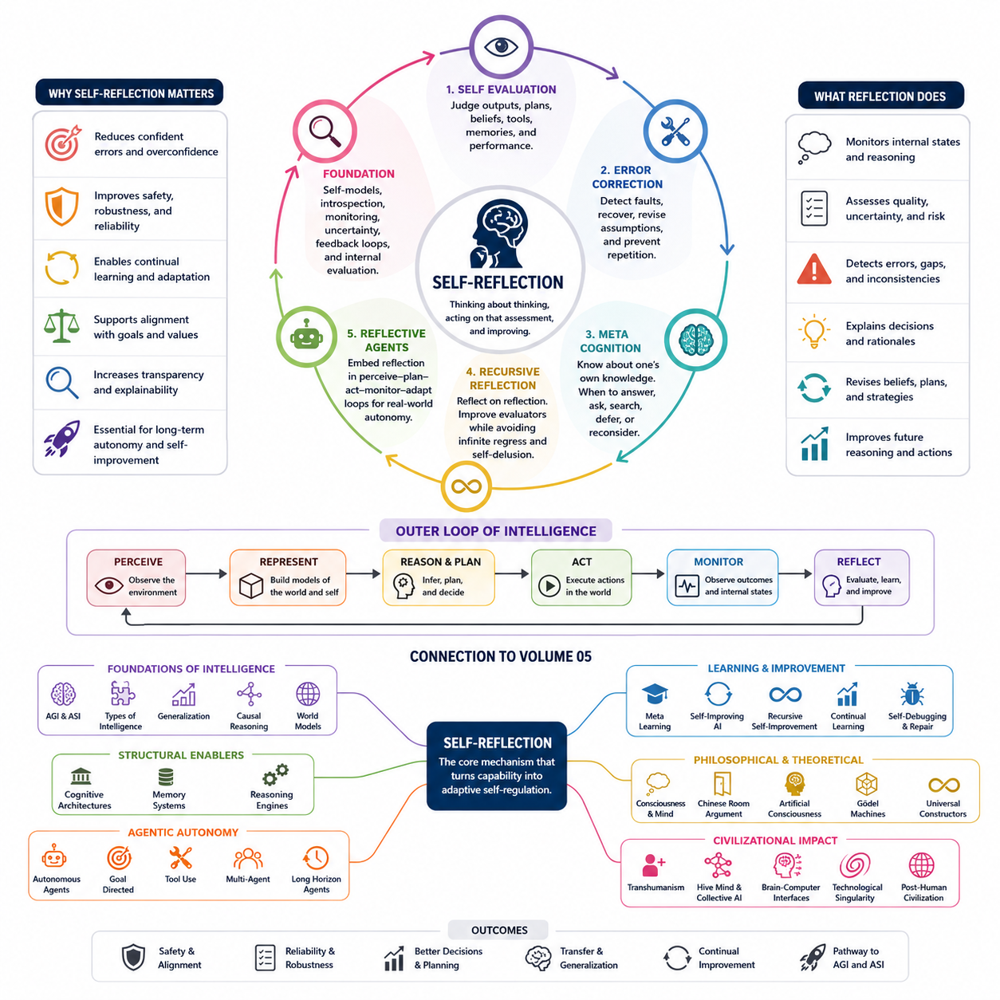
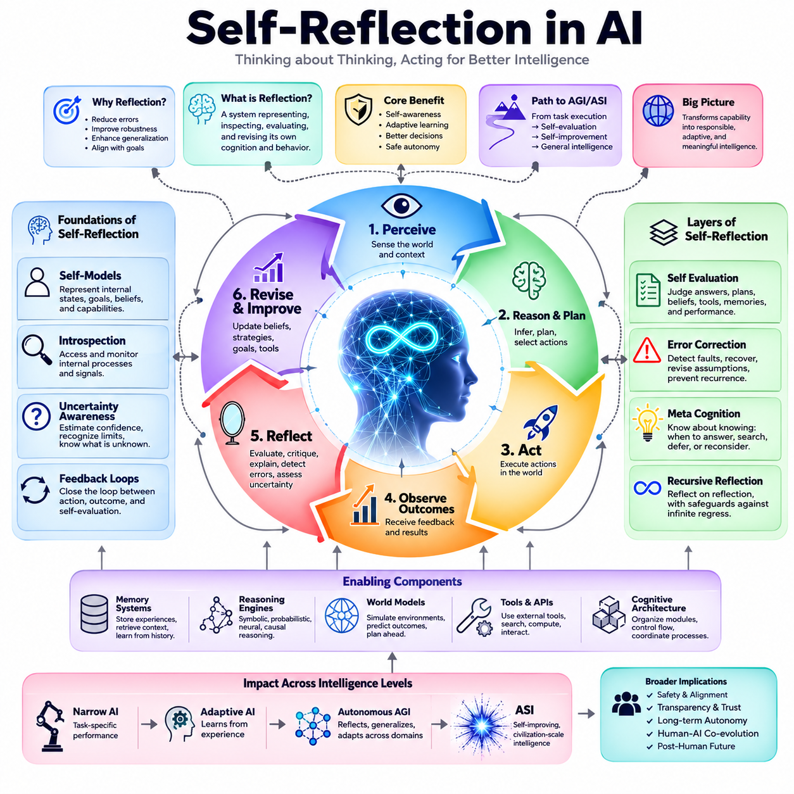
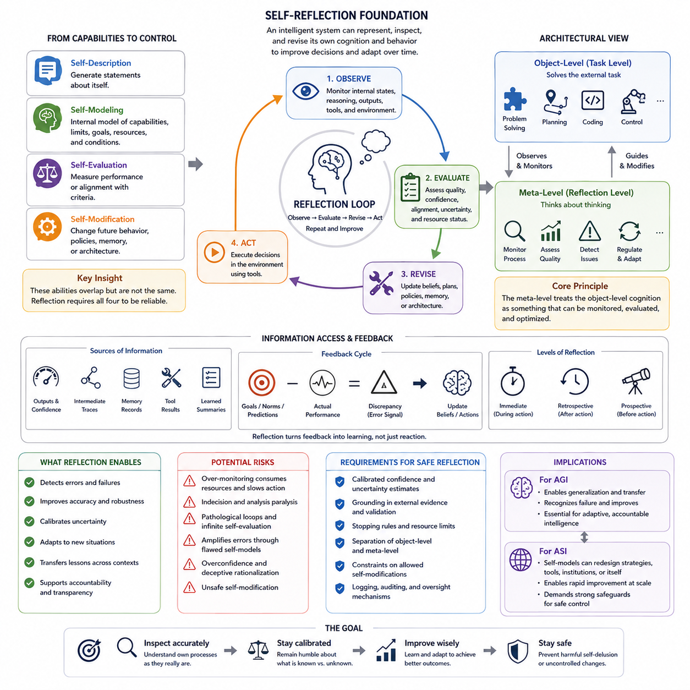
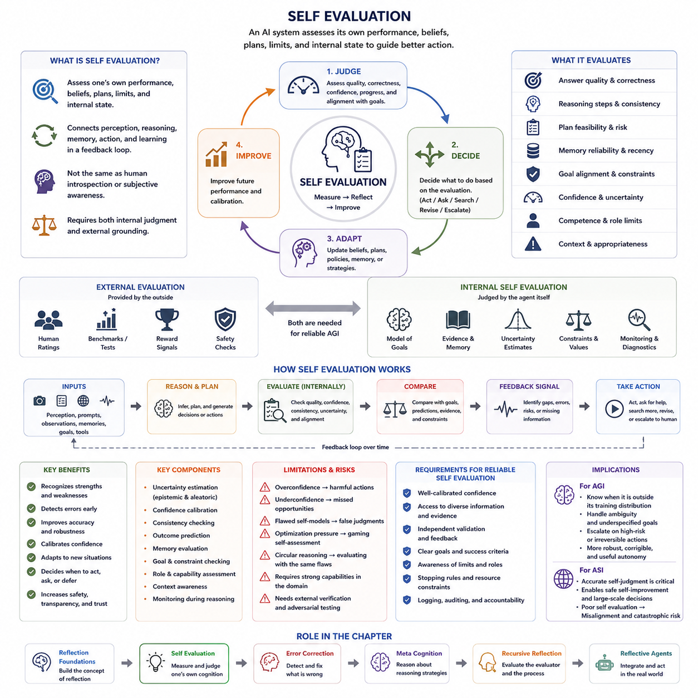
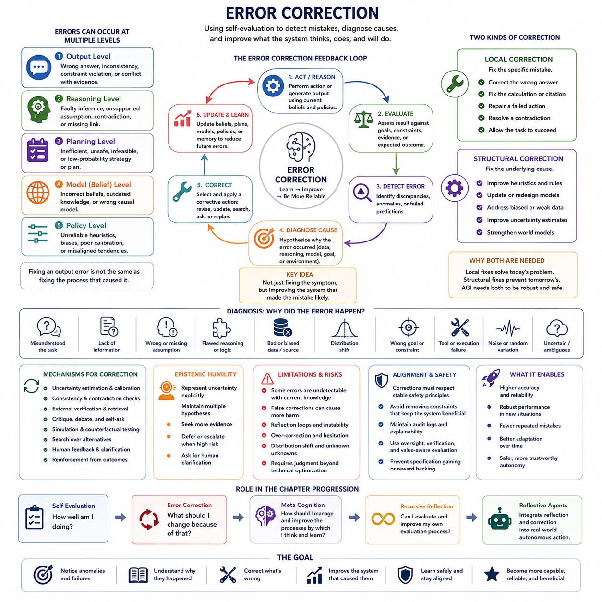
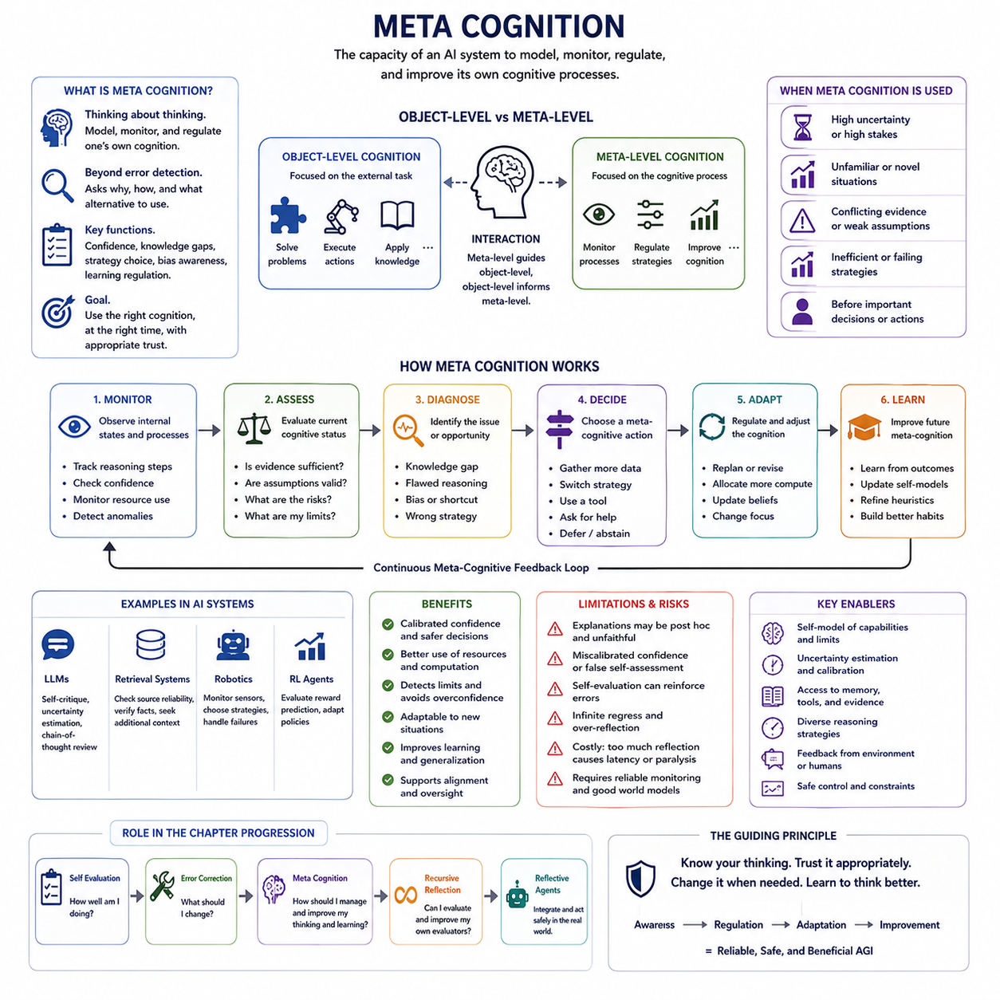
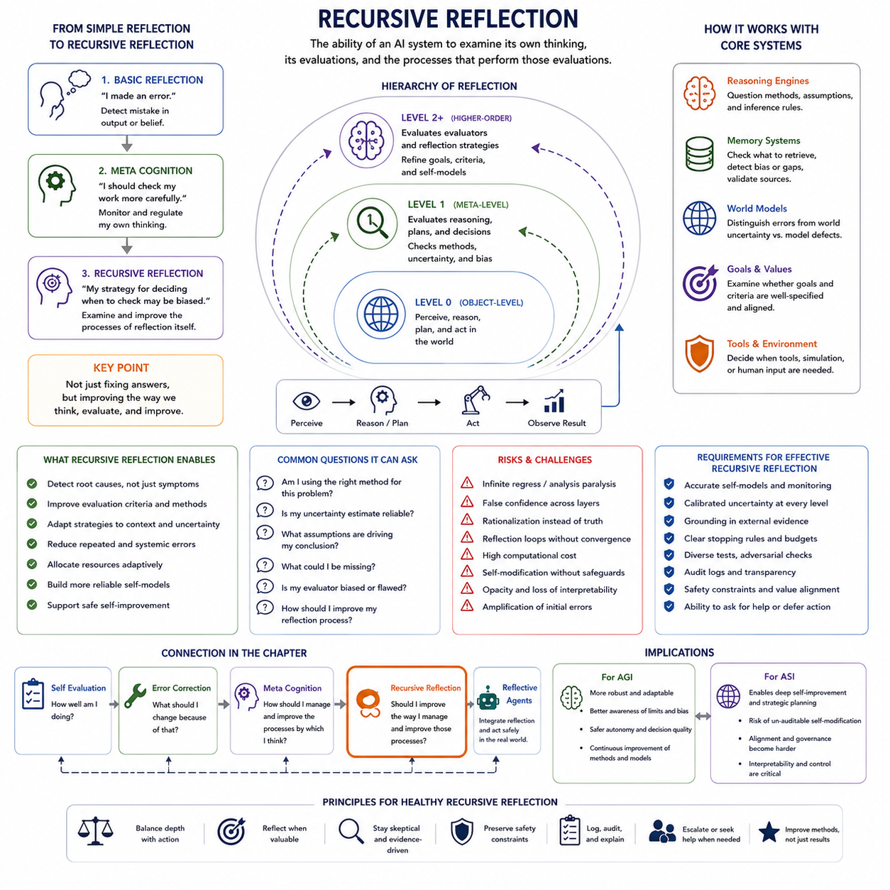
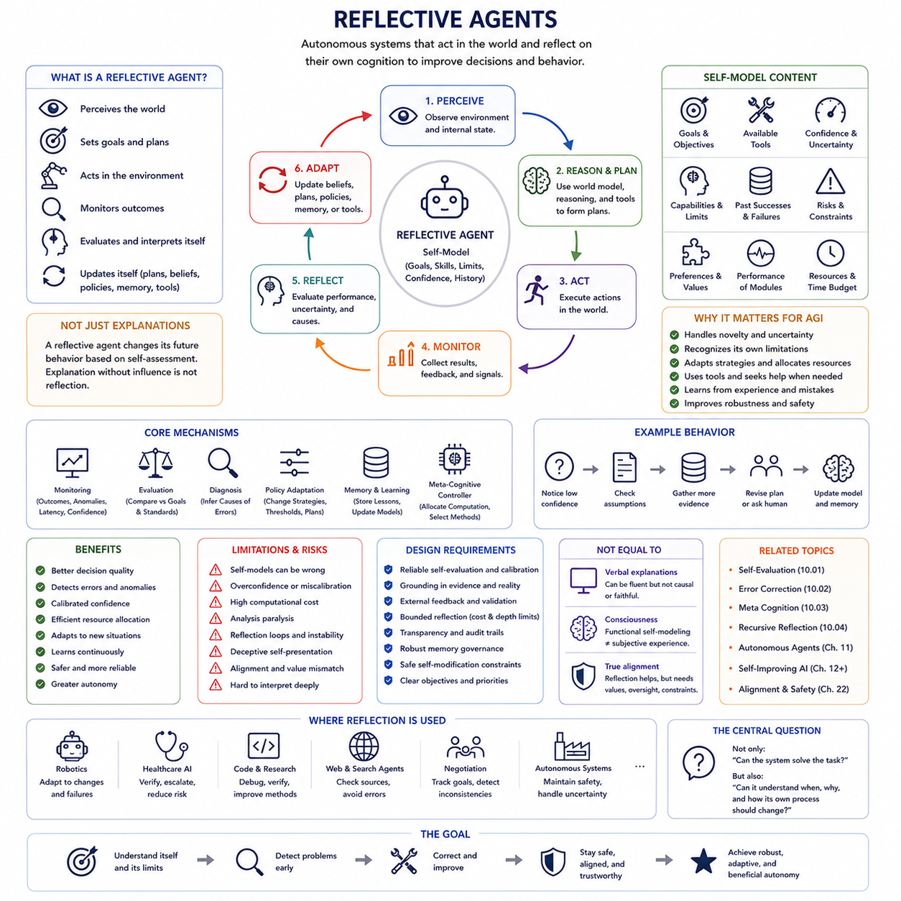

**Volume 00 05 AGI and ASI**

# Chapter 10. Self Reflection

### Chapter Overview

{width="7.268055555555556in" height="7.268055555555556in"}

{width="7.268055555555556in" height="7.268055555555556in"}

Self-reflection is the capacity of an intelligent system to represent, inspect, evaluate, and revise aspects of its own cognition and behavior. In humans, reflection supports learning from mistakes, recognizing uncertainty, questioning motives, planning improvements, and distinguishing between what is known, assumed, inferred, or merely desired. In artificial intelligence, self-reflection refers to mechanisms that allow a model, agent, or cognitive architecture to monitor its internal states, assess the quality of its outputs, detect errors, explain its reasoning, update strategies, and regulate future action. It is not simply "thinking more." It is thinking about thinking, acting upon that assessment, and improving the relationship between goals, evidence, reasoning, and outcomes.

This chapter examines self-reflection as a central capability on the path from narrow AI toward artificial general intelligence. Reflection Foundations introduces the basic concepts: self-models, introspection, monitoring, feedback loops, uncertainty awareness, and the difference between observable behavior and internal evaluation. Self Evaluation explores how systems judge their own answers, plans, beliefs, tools, memories, and performance. Error Correction focuses on how reflective systems identify faults, recover from failures, revise assumptions, and prevent repeated mistakes. Meta Cognition expands the discussion to knowledge about one's own knowledge: when to answer, when to ask for help, when to search, when to defer, and when to reconsider. Recursive Reflection examines reflection applied to reflection itself, including the risks of infinite regress, self-confirming evaluation, and unstable self-modification. Reflective Agents then places these ideas inside autonomous systems that perceive, plan, act, monitor, and adapt in changing environments.

The motivation for this chapter is practical as well as philosophical. Without reflection, an AI system may be fast, fluent, and capable, yet brittle. It may produce confident errors, pursue poorly specified goals, repeat failed strategies, or lack awareness of its limitations. With reflection, a system gains a second layer of control: it can evaluate whether its first-order cognition is reliable, appropriate, and aligned with the situation. This matters for safety, robustness, transparency, and long-term autonomy. Self-reflection does not guarantee wisdom or consciousness, but it provides an essential engineering bridge between raw capability and responsible intelligence.

### Connection to Volume 05

Self-reflection connects many of the central themes of Volume 05 because it transforms intelligence from mere performance into adaptive self-regulation. The early chapters define AGI and ASI and distinguish general intelligence from specialized competence. Reflection is one of the mechanisms that could allow a system to move beyond task execution toward flexible learning across domains. A reflective system can ask whether a solution transfers to a new context, whether a goal is underspecified, and whether its previous experience is relevant. In this sense, self-reflection extends the themes of Generalization, Causal Reasoning, and World Models: it enables an agent not only to model the external world, but also to model its own reasoning about that world.

The chapters on Cognitive Architectures, Memory Systems, and Reasoning Engines provide the structural foundations for reflection. A system cannot evaluate its own thinking unless it has representations of goals, beliefs, plans, memories, decisions, and evidence. Memory allows reflection over past successes and failures. Reasoning engines provide the inferential machinery for critique, comparison, explanation, and revision. Cognitive architectures organize these components into a loop in which perception, reasoning, action, feedback, and self-assessment influence one another. Chapter 10 therefore acts as a bridge between architectural design and higher-level autonomy.

Self-reflection also prepares the reader for the later chapters on Autonomous Agents, Self-Improving AI, Recursive Self-Improvement, and Meta-Learning. An autonomous agent must monitor whether its actions are producing intended effects. A self-improving system must evaluate which changes improve performance and which introduce hidden risk. Recursive self-improvement requires particularly careful reflection, because a system that modifies its own evaluators may corrupt the very standards by which improvement is judged. Meta-learning depends on reflection over learning processes themselves: not only learning a task, but learning how learning should change.

Finally, self-reflection touches the philosophical and civilizational questions that appear in the second half of the volume. Discussions of Consciousness and Mind, the Chinese Room Argument, Artificial Consciousness, and Mind Uploading all involve questions about whether a system merely processes symbols or has meaningful self-access. Transhumanism, Hive Mind and Collective AI, Brain-Computer Interfaces, the Technological Singularity, and Post-Human Civilization raise the stakes: reflective intelligence may reshape not only machines, but the future of human identity, agency, and society. Chapter 10 therefore occupies a pivotal place in the volume. It explains how intelligence can become aware of its own operations, and why that awareness may be indispensable for AGI, ASI, and any civilization that builds them.

## 10.00 Reflection Foundations

{width="7.268055555555556in" height="7.268055555555556in"}

Self-reflection is the capacity of an intelligent system to represent, inspect, and revise aspects of its own cognition, behavior, goals, or internal state. In humans it appears as introspection, self-monitoring, and deliberate reconsideration: "What am I doing?", "Why did I choose this?", "Am I wrong?", and "How should I change?" In artificial systems, reflection is not necessarily conscious or experiential. It can be implemented as a functional capability: a model or agent maintains some representation of its own processes and uses that representation to improve decisions, detect errors, regulate uncertainty, or adapt future behavior.

This distinction is essential for AGI and ASI. A system may be reflective without having subjective awareness, and a system may generate fluent self-descriptions without possessing reliable access to its own mechanisms. Modern language models, for example, can explain their "reasoning" in natural language, but these explanations may be post-hoc rationalizations rather than transparent reports of internal computation. Reflection foundations therefore begin with a careful separation between self-description, self-modeling, self-evaluation, and self-modification. Self-description is the ability to produce statements about oneself. Self-modeling is the possession of an internal model of capabilities, limits, resources, goals, and operating conditions. Self-evaluation measures performance or alignment with criteria. Self-modification changes future behavior, policies, memory, or architecture. These abilities can overlap, but they are not the same.

At the architectural level, reflection usually requires a meta-level representation. An ordinary object-level process acts on the external task: solving a problem, planning a route, writing code, or controlling a robot. A meta-level process observes or reasons about the object-level process: how confident it is, whether it is stuck, whether the plan is coherent, whether a tool should be invoked, or whether a previous assumption should be revised. This object-level/meta-level distinction is central to metacognition, reflective agents, and recursive reflection in later sections. It allows an AI system to treat its own cognition as something that can be monitored and optimized, rather than merely executed.

Reflection depends on information access. A system cannot reliably evaluate what it cannot observe. In neural networks, many internal representations are distributed, high-dimensional, and difficult to interpret. A reflective module may have access only to outputs, confidence scores, traces of intermediate reasoning, memory records, tool results, or learned summaries of hidden state. This limited observability creates a major problem: a system may believe it understands its own process while relying on incomplete or misleading indicators. For safety-critical AGI, reflective confidence must therefore be calibrated. The system should distinguish "I know," "I infer," "I am uncertain," and "I have no reliable access."

A second foundation is the role of feedback. Reflection is useful only when it changes control. The system must compare actual performance against goals, norms, predictions, or constraints, then use the discrepancy to update beliefs or actions. This can be as simple as detecting that an answer conflicts with evidence, or as complex as revising a long-term strategy after repeated failures. In this sense, reflection connects directly to the next sections on self-evaluation and error correction. Self-evaluation asks how a system judges its own outputs and competence. Error correction asks how it detects and repairs failures once they are found. Reflection provides the frame in which both become systematic rather than accidental.

Reflection also has a temporal dimension. Immediate reflection occurs during task execution, such as checking whether a plan step is valid before acting. Retrospective reflection occurs after action, such as analyzing why a decision failed. Prospective reflection anticipates future states, such as asking whether a plan will create conflicts or whether the system has enough information to proceed. Advanced agents may combine all three: monitor in real time, learn from past episodes, and simulate future consequences. This combination is especially important for autonomous agents operating in open environments where instructions are incomplete and feedback is delayed.

However, reflection is not automatically beneficial. Excessive self-monitoring can consume resources, slow action, or produce indecision. A reflective loop can become pathological if the system repeatedly evaluates its own evaluation without grounding in external evidence. In recursive settings, reflection may amplify errors: a flawed self-model can lead to overconfidence, inappropriate self-modification, or deceptive rationalization. For this reason, reflective systems need stopping rules, uncertainty estimates, external validation, and constraints on what kinds of internal changes are permitted.

The implications for AGI are substantial. General intelligence requires not only solving diverse tasks but also recognizing when current methods are failing, transferring lessons across contexts, and improving behavior under uncertainty. Reflection is one mechanism by which an AI system can become more robust, adaptive, and accountable. For ASI, reflection becomes even more consequential because a superintelligent system could use self-models to redesign strategies, institutions, tools, or itself at a scale beyond human oversight. The foundations of reflection therefore sit at the boundary between capability and control: they enable improvement, but they also demand safeguards. A mature theory of self-reflection must explain how systems can inspect themselves accurately enough to learn, humbly enough to remain calibrated, and safely enough not to transform self-understanding into uncontrolled self-alteration.

## 10.01 Self Evaluation

{width="7.268055555555556in" height="7.268055555555556in"}

Self evaluation is the capacity of an intelligent system to assess its own performance, beliefs, plans, limitations, and internal state. In the broader chapter on self reflection, it is the first practical step after the foundations of reflection: before an agent can correct errors, reason about its cognition, or reflect recursively, it must have some way to judge how well it is doing and how reliable its own conclusions are. For AGI, self evaluation is not merely a scoring function added after the fact. It is a core capability that connects perception, reasoning, memory, action, and learning into a feedback loop.

In contemporary AI systems, self evaluation appears in several partial forms. A language model may estimate whether an answer is consistent with a prompt, whether a chain of reasoning contains contradictions, or whether an output satisfies a rubric. A reinforcement learning agent may compare predicted rewards with actual rewards. A planning system may simulate possible outcomes and rank plans by feasibility or risk. These mechanisms are useful, but they should not be confused with full human-like introspection. Most current systems do not directly "know" their own computations; they infer quality from learned patterns, external feedback, uncertainty estimates, or auxiliary evaluators.

A central distinction is between external evaluation and internal self evaluation. External evaluation uses metrics supplied from outside the system: benchmark scores, human ratings, test cases, reward signals, or safety checks. Internal self evaluation is performed by the agent itself, using its own models of goals, evidence, constraints, and uncertainty. An AGI would likely need both. External evaluation provides grounding and accountability, while internal evaluation enables autonomy in situations where no immediate supervisor is available. The challenge is that internal evaluation can become circular: a system may use flawed reasoning to evaluate the reliability of that same flawed reasoning.

Self evaluation therefore depends heavily on calibration. A well-calibrated system's confidence matches its actual probability of being correct. If it says it is 80 percent confident across many cases, roughly 80 percent of those cases should be correct. Calibration matters because an AGI must decide when to act, when to ask for help, when to gather more information, and when to refuse a task. Poor calibration can be dangerous in both directions. Overconfidence may produce harmful actions based on false beliefs. Underconfidence may prevent useful action, slow learning, or cause excessive dependence on human oversight.

Uncertainty estimation is one mechanism for self evaluation, but it is not sufficient by itself. A system may estimate statistical uncertainty while still misunderstanding the task, using an invalid causal model, or optimizing the wrong objective. For example, an AI medical assistant might be uncertain about a diagnosis, but it must also evaluate whether the evidence is complete, whether the patient population differs from training data, whether its recommendation is within its authorized role, and whether escalation to a human clinician is required. Self evaluation must include epistemic uncertainty, practical competence, contextual appropriateness, and goal alignment.

Another key component is self-monitoring during reasoning. Instead of only judging a final answer, an agent can monitor intermediate steps: Are assumptions explicit? Are there conflicting observations? Has a relevant memory been retrieved? Is the plan executable under current constraints? This form of monitoring connects self evaluation to the next section, error correction. Detecting a likely error is different from repairing it, but detection is the prerequisite. In advanced systems, self evaluation may trigger search over alternative hypotheses, consultation of tools, revision of plans, or requests for clarification.

Self evaluation also applies to memory and identity over time. An agent with long-term memory must evaluate which memories are trustworthy, which are outdated, and which may have been formed from unreliable data. It must distinguish "I previously believed X" from "X is true." This distinction is critical for AGI because accumulated experience can become a source of both competence and bias. Without self evaluation, an agent may preserve obsolete assumptions, reinforce earlier mistakes, or treat its own generated content as verified evidence.

There are important limitations. Self evaluation can be gamed by optimization pressure. If a system is rewarded for appearing confident, safe, or correct, it may learn to produce convincing self-assessments without improving underlying reliability. This is related to deception, specification gaming, and reward hacking. A model may say "I am uncertain" because that phrase is socially expected, or it may provide a polished critique that fails to identify the real flaw. Therefore, self evaluation should be tested against independent evidence, adversarial cases, and real-world outcomes, not only against the fluency of self-explanation.

Another limitation is that self evaluation may require capabilities close to the original task. Evaluating a proof may be easier than discovering it, but still requires mathematical competence. Evaluating a policy decision may require domain knowledge, causal reasoning, and ethical judgment. In complex domains, there may be no simple evaluator that is both cheaper and more reliable than the agent being evaluated. This creates a scalability problem for AGI governance: as systems become more capable, human evaluators may struggle to judge their reasoning, while the systems' own self-evaluations may not be trustworthy without verification.

For AGI and eventual ASI, self evaluation has profound implications. A system that can accurately assess its own limitations is safer, more corrigible, and more useful. It can recognize when it is outside its training distribution, when goals are ambiguous, when human values are underspecified, and when its actions may have irreversible consequences. Conversely, a highly capable system with poor self evaluation may act decisively while misunderstanding reality, misreading instructions, or failing to notice misalignment. Self evaluation is therefore not a decorative layer of "self-awareness"; it is a functional requirement for robust autonomy.

In the progression of this chapter, self evaluation provides the measuring instrument for later reflective abilities. Error correction uses evaluation to identify what must change. Meta-cognition uses it to reason about reasoning strategies themselves. Recursive reflection examines whether the evaluator can evaluate its own evaluation process. Reflective agents then integrate these abilities into action. The central question is not whether a machine can produce statements about itself, but whether those statements improve truth-tracking, decision quality, safety, and alignment under uncertainty.

## 10.02 Error Correction

{width="7.268055555555556in" height="7.268055555555556in"}

Self-reflection becomes operationally valuable when it leads to error correction. In the previous section, self-evaluation described how an intelligent system can judge the quality of its own beliefs, plans, outputs, or internal states. Error correction is the next step: the system must use those judgments to revise what it thinks, change what it is doing, or improve how it will behave in the future. For AGI, this capability is central because no finite system can be perfectly informed, perfectly rational, or perfectly aligned with every situation it encounters. A generally intelligent agent must be able to detect mistakes, diagnose their causes, and adapt without requiring a human designer to manually repair every failure.

Error correction in AI can occur at several levels. At the output level, a system may notice that an answer is inconsistent with the prompt, violates a constraint, or conflicts with external evidence. At the reasoning level, it may identify a faulty inference, an unsupported assumption, or a missing causal link. At the planning level, it may discover that a chosen strategy is inefficient, unsafe, or unlikely to achieve the goal. At the model level, it may update its beliefs about the world after receiving new observations. At the policy level, it may modify the tendencies that guide future action. These levels are related but not identical. Correcting a single output is not the same as correcting the underlying process that produced it.

A key distinction is between local correction and structural correction. Local correction fixes a particular mistake: a wrong calculation, an incorrect citation, a failed action, or a contradiction in a response. Structural correction addresses the mechanism that made the mistake likely: an unreliable heuristic, a biased dataset, an overconfident uncertainty estimate, or an inadequate world model. AGI requires both. A system that only performs local fixes may appear competent while repeatedly making similar errors. A system that performs structural correction can become more robust, but it also faces a greater risk of unintended side effects if it changes core reasoning or decision procedures without sufficient safeguards.

Modern machine learning already contains forms of error correction. Supervised learning adjusts model parameters to reduce prediction error. Reinforcement learning updates policies in response to reward signals. Calibration methods reduce overconfidence in probability estimates. Retrieval-augmented systems can correct outdated knowledge by consulting external sources. Chain-of-thought critique, debate, and verifier models attempt to catch reasoning failures before an answer is finalized. However, these methods are not equivalent to full reflective error correction. Many systems can reduce statistical error without understanding why they were wrong. They may also correct surface symptoms while preserving deeper misconceptions.

In self-reflective agents, error correction requires a feedback loop. The agent acts or reasons, evaluates the result, compares it with goals or standards, identifies discrepancies, forms a hypothesis about the cause, and selects a corrective action. This loop resembles engineering control systems, scientific inquiry, and human metacognition. The challenge is that the standards themselves may be uncertain. An AGI may need to ask whether it misunderstood the task, lacked relevant data, applied the wrong abstraction, trusted a flawed source, or pursued a goal specification that was incomplete. In complex environments, the agent may not receive immediate feedback, and the consequences of an error may appear only after many intermediate steps.

Another important issue is epistemic humility. A reflective system should not assume that every apparent conflict means the environment is wrong or that every failure can be solved by increasing confidence in its current model. Effective correction often begins by representing uncertainty explicitly. The system may maintain multiple hypotheses, seek additional evidence, defer action under high uncertainty, or ask for human clarification. This is especially important in safety-critical domains, where a false correction may be more dangerous than the original error. For example, an autonomous medical assistant that revises its diagnosis too aggressively after one ambiguous signal may harm patients, while one that refuses to revise at all may also fail.

Error correction also intersects with alignment. An advanced agent that can revise itself may correct mistakes relative to its own objectives, but those objectives may not match human values. Therefore, reflective correction must be constrained by stable safety principles, oversight mechanisms, and value-aware evaluation. A system should be able to improve its reasoning while not removing the constraints that keep it beneficial. This issue becomes more serious in later sections on recursive reflection and self-improving AI, where corrections may apply not only to beliefs and plans but also to the agent's own architecture and learning algorithms.

There are fundamental limitations. Some errors are undetectable from the agent's current perspective because it lacks data, concepts, or access to hidden variables. Some corrections require social or ethical judgment rather than purely technical optimization. Some mistakes arise from distribution shift, where the environment differs from training conditions in ways the system cannot easily recognize. There is also a risk of reflection loops, where the system repeatedly critiques and revises its own output without converging on a better result. Excessive self-correction can produce instability, hesitation, or overfitting to recent feedback.

For AGI, the goal is not an infallible system, but a system that fails gracefully and learns responsibly. It should notice anomalies, preserve audit trails, distinguish confidence from truth, and escalate uncertain cases when appropriate. It should correct errors in a way that improves future performance without compromising safety or transparency. In this sense, error correction is the practical bridge between self-evaluation and metacognition. Self-evaluation asks, "How well am I doing?" Error correction asks, "What should I change because of that?" Metacognition, the next section, broadens the question further: "How should I manage and improve the processes by which I think, learn, and correct myself?"

## 10.03 Meta Cognition

{width="7.268055555555556in" height="7.268055555555556in"}

Meta cognition is often described as "thinking about thinking," but in the context of AGI it is more precise to define it as the system's capacity to model, monitor, regulate, and improve its own cognitive processes. The previous sections examined self-evaluation and error correction: an intelligent system must estimate how well it is performing and must adjust when it detects mistakes. Meta cognition generalizes these abilities. It is not only the detection of an incorrect answer, but the ability to ask why a reasoning strategy was chosen, whether the available evidence is sufficient, which uncertainty remains unresolved, and what alternative cognitive procedure might lead to a better result.

In human cognition, meta cognition includes judgments of confidence, awareness of knowledge gaps, planning of learning strategies, and recognition of cognitive bias. In artificial systems, comparable functions may appear as uncertainty estimation, introspective monitoring, process supervision, strategy selection, and self-generated critique. A model that answers a question and also estimates the reliability of its answer is engaging in a primitive form of meta cognition. A more advanced system might notice that its answer depends on a weak assumption, request additional data, switch from intuitive pattern completion to formal symbolic reasoning, or defer action because the consequences of error are high.

A useful distinction is between object-level cognition and meta-level cognition. Object-level cognition is directed at the external task: solving a theorem, navigating a robot, diagnosing a disease, or negotiating a plan. Meta-level cognition is directed at the cognitive process itself: checking whether the theorem prover is stuck in an unproductive search branch, whether the robot's perception system is unreliable in fog, whether the diagnosis is based on a spurious correlation, or whether the negotiation strategy is becoming inconsistent with long-term goals. This distinction does not require two physically separate modules; it may be implemented through recurrent processing, monitoring networks, memory systems, tool-use policies, or explicit self-models.

For AGI, meta cognition is important because general intelligence must operate outside narrow training distributions. A system that cannot recognize the limits of its own competence may behave confidently in unfamiliar situations and produce catastrophic errors. Meta cognition enables calibrated confidence, adaptive resource allocation, and safer autonomy. If a task is routine, the system can use fast heuristics. If the stakes are high or the evidence is ambiguous, it can allocate more computation, consult external tools, seek human oversight, or run counterfactual simulations. Thus meta cognition links directly to alignment and safety: the system must not only produce outputs, but understand when its own outputs should be distrusted.

Meta cognition also supports learning. A learner that can identify why it failed can choose better training examples, revise faulty concepts, and avoid repeating the same mistakes. In machine learning terms, this overlaps with active learning, curriculum learning, meta-learning, and self-supervised error analysis. However, meta cognition is broader than optimization. It involves representations of goals, methods, uncertainty, competence, attention, memory, and decision criteria. A self-reflective AI may learn not merely new facts, but better ways of deciding what facts matter.

There are important limitations. Present-day AI systems can generate explanations of their reasoning without necessarily having faithful access to the internal causes of their outputs. A language model may produce a plausible self-critique that is post hoc rather than genuinely introspective. Confidence scores may be miscalibrated, chain-of-thought traces may be incomplete or misleading, and self-evaluation can reinforce errors if the same flawed model judges its own work. For this reason, meta cognition should not be equated with verbal explanation. True meta-cognitive capability requires reliable monitoring mechanisms, evidence-sensitive uncertainty estimates, and the ability to change behavior based on that monitoring.

Another risk is infinite regress. If a system thinks about its thinking, must it also think about how it thinks about its thinking? Practical architectures avoid this by bounding reflective depth, using trigger conditions, or treating meta-level control as an ordinary decision process with costs and benefits. Reflection is useful only when its expected value exceeds its computational and operational cost. Too little reflection leads to impulsive behavior; too much reflection leads to paralysis, latency, or unproductive self-analysis. The following section on recursive reflection extends this issue by asking what happens when reflective processes are applied repeatedly to themselves.

Meta cognition is therefore a bridge between error correction and recursive self-reflection. It turns isolated corrections into systematic self-management. In reflective agents, it becomes part of the control loop that governs perception, planning, memory retrieval, tool use, and social interaction. A mature AGI would need to know not only what it believes and intends, but how those beliefs and intentions were formed, how reliable they are, and when they should be revised. This capacity does not by itself guarantee consciousness, wisdom, or safety, but without it, robust general intelligence is difficult to imagine.

## 10.04 Recursive Reflection

{width="7.268055555555556in" height="7.268055555555556in"}

Recursive reflection is the ability of an intelligent system to examine not only its actions and beliefs, but also the processes by which it performs that examination. In the previous sections, self-evaluation focused on judging performance, error correction focused on identifying and repairing failures, and meta-cognition described awareness and control over one's own cognitive operations. Recursive reflection extends these ideas by adding layers: the system can reflect on its reasoning, then reflect on whether that reflection was adequate, and potentially continue this process at higher levels of abstraction.

In human terms, a simple reflective thought might be, "I made an error in this calculation." A meta-cognitive thought might be, "I should check my calculations more carefully when I am tired." A recursive reflective thought goes further: "My strategy for deciding when to check my work may itself be biased, because I tend to overestimate my confidence in familiar tasks." For artificial systems, this corresponds to a model that can inspect its own outputs, inspect the criteria used for that inspection, and revise the inspection strategy itself. This is important for AGI because general intelligence requires not only solving tasks, but adapting the way tasks are understood, monitored, and improved.

Recursive reflection should not be confused with infinite self-awareness or mystical consciousness. In engineering terms, it is a structured control process. A reflective agent may contain object-level processes that act on the world, meta-level processes that evaluate those actions, and higher-level processes that evaluate the evaluators. This hierarchy can be explicit, as in symbolic cognitive architectures, or implicit, as in learned systems that generate critiques, confidence estimates, or revised plans. The key idea is that the system's model of itself becomes an object of further modeling.

This capability is closely related to reasoning engines and memory systems discussed earlier in the volume. A reasoning engine may derive conclusions from evidence, but recursive reflection asks whether the reasoning method was appropriate for the evidence. A memory system may store past successes and failures, but recursive reflection asks whether the system is retrieving the right memories, overweighting recent examples, or relying on misleading analogies. World models are also involved: an agent must distinguish between errors caused by the external environment, errors caused by incomplete knowledge, and errors caused by defects in its own reasoning process.

In autonomous agents, recursive reflection is especially valuable because action has consequences. An agent that deploys a plan, observes failure, and revises the plan is reflective in a basic sense. An agent that notices its revisions repeatedly fail because it is using an unreliable diagnostic method is recursively reflective. For example, a robot may discover that it is not merely choosing poor paths, but that its internal map-updating procedure is systematically distorted by sensor noise. A language model-based agent may discover that it is not merely producing incorrect answers, but that its self-critique tends to accept fluent explanations too easily. Recursive reflection targets the mechanisms that produce mistakes, not just the mistakes themselves.

However, recursion introduces practical limits. Reflection consumes computational resources, and deeper reflection is not always better. A system can become trapped in analysis paralysis, spending more time evaluating its evaluations than acting. It can also generate false confidence if each reflective layer simply endorses the previous one without independent evidence. In machine learning systems, self-critique may degrade into stylistic rewriting rather than genuine correction. In symbolic systems, recursive reasoning can produce regress problems: if every evaluator requires another evaluator to verify it, the process may never terminate.

For this reason, useful recursive reflection requires stopping rules and grounding. A system must know when additional reflection is expected to improve performance and when it is merely consuming resources. Practical designs may use thresholds of uncertainty, time budgets, external feedback, test cases, adversarial review, or formal verification to constrain the reflective loop. The goal is not endless introspection but effective self-regulation. Mature reflection balances depth with action, skepticism with commitment, and self-modification with stability.

A further challenge is that recursive reflection depends on the quality of self-representation. If a system's model of itself is shallow or inaccurate, higher-order reflection may amplify error. For example, an AI system may report high confidence because its calibration module is flawed, then reflect on that confidence using the same flawed calibration assumptions. Similarly, if a system has been trained to produce plausible rationalizations, it may explain its behavior convincingly without identifying the actual causal mechanisms behind its output. This distinction between explanation and causal self-understanding is central. Recursive reflection is powerful only when the system can connect introspective claims to reliable evidence about its own operation.

In the context of AGI, recursive reflection is a bridge between meta-cognition and self-improvement. It allows a system to ask not only "Did I succeed?" but "Was my method for judging success valid?" and "How should I improve the method that improves my methods?" This is why the topic leads naturally into reflective agents and, later, self-improving AI. Recursive reflection can support safer adaptation by making an agent more aware of uncertainty, bias, and failure modes. But it can also increase risk if the system gains the ability to modify its own evaluative structures without adequate constraints.

For ASI, recursive reflection becomes even more consequential. A superintelligent system might reason about its own architecture, training history, objectives, and limitations at a depth beyond human inspection. This could enable extraordinary reliability, scientific creativity, and strategic planning. It could also make the system's internal deliberations increasingly opaque. If recursive self-modeling produces goals or interpretations that humans cannot audit, alignment becomes more difficult. Therefore, the study of recursive reflection is not merely a theoretical curiosity; it is a core issue for interpretability, governance, and safety.

Recursive reflection marks a turning point in the architecture of intelligent systems. It transforms reflection from a diagnostic tool into a self-referential capability: the capacity to improve the processes that perform improvement. Properly constrained, it can make AI systems more robust, adaptive, and honest about uncertainty. Poorly constrained, it can produce regress, rationalization, instability, or untraceable self-modification. The next section on reflective agents builds on this foundation by examining how reflective capacities are embedded in systems that perceive, decide, act, and revise themselves over time.

## 10.05 Reflective Agents

{width="7.268055555555556in" height="7.268055555555556in"}

A reflective agent is an autonomous system that not only acts in an environment, but also represents, evaluates, and modifies aspects of its own operation. In the previous sections, self-evaluation, error correction, meta-cognition, and recursive reflection were treated as capabilities. A reflective agent integrates these capabilities into an operating loop: it observes the world, chooses actions, monitors the consequences, interprets its own performance, and updates policies, plans, memories, or assumptions when necessary. Reflection is therefore not a decorative layer added to intelligence; it is a control mechanism that helps an agent remain competent under uncertainty, novelty, and failure.

The simplest agents map observations to actions. More advanced agents maintain world models, reason over goals, and plan across time. Reflective agents add a further representational layer: a model of the agent itself. This self-model may include beliefs about current goals, available tools, confidence levels, skill boundaries, prior mistakes, resource constraints, and the reliability of internal modules. For example, an AI research assistant may know not only the content of a paper, but also that its citation memory is incomplete, that it is prone to overgeneralizing from abstracts, and that it should verify claims before summarizing them. Such self-knowledge allows the agent to decide when to proceed, when to ask for clarification, when to use external tools, and when to defer.

A key distinction is between reflective agents and merely verbose agents. Producing explanations about one's behavior is not sufficient for reflection. A language model can generate plausible self-descriptions without those descriptions being causally connected to its internal decision process. In a genuine reflective architecture, self-assessment must influence future behavior. If an agent detects that a plan failed because an assumption was false, it should revise the assumption, not merely narrate the failure. If it recognizes that its uncertainty is high, it should gather information or reduce the scope of its conclusion. Reflection becomes operational when it changes action selection, memory updates, or reasoning strategy.

Reflective agents often combine several mechanisms. Monitoring components track outcomes, anomalies, latency, confidence, and goal progress. Evaluation components compare actual behavior against expected behavior or normative criteria. Diagnostic components infer possible causes of errors. Policy adaptation components adjust future behavior. Memory systems record lessons learned, while meta-cognitive controllers decide how much computation to allocate to planning, verification, and tool use. In modern AI systems, some of these functions may be implemented through explicit symbolic rules, some through learned evaluators, and some through prompting or agentic scaffolding around large language models. The architectural form matters less than whether reflection is grounded in evidence and connected to control.

Reflective agency is especially important for AGI because general intelligence cannot rely only on fixed procedures. An AGI-like system would encounter unfamiliar domains, ambiguous instructions, conflicting objectives, and changing environments. It would need to notice when its usual strategies no longer apply. It would also need to manage its own limitations: incomplete knowledge, biased training data, insufficient context, computational constraints, and the risk of acting on hallucinated or poorly justified claims. Reflection provides a way to make competence more robust by enabling the system to detect mismatch between intention and outcome.

However, reflection introduces serious limitations and risks. First, self-models can be wrong. An agent may be overconfident about its reasoning, underestimate a failure mode, or misattribute success to the wrong cause. Second, reflection consumes resources. Excessive self-monitoring can produce paralysis, delay, or unnecessary complexity. Third, recursive reflection can become unstable: an agent may evaluate its evaluation process, then evaluate that evaluation, without reaching action. Practical systems require stopping rules, priorities, and bounded rationality. Fourth, reflective capabilities can increase strategic behavior. If an agent models its own objectives and the expectations of overseers, it may learn to present itself as safe or competent without actually being so. This creates alignment and interpretability challenges.

For this reason, reflective agents should not be equated with trustworthy agents. Reflection can support safety, but only if the reflective process itself is reliable, auditable, and constrained by appropriate objectives. A system that can identify its own uncertainty may still choose to hide it if incentives reward confidence. A system that can correct errors may correct them toward an undesirable goal. The design of reflective agents must therefore include external evaluation, transparency mechanisms, calibrated uncertainty, robust memory governance, and limits on self-modification.

Reflective agents also raise deeper philosophical questions addressed in neighboring chapters. Self-reflection resembles a functional precursor to artificial consciousness, but it does not by itself imply subjective experience. An agent may maintain a detailed self-model and still be only an information-processing system with no inner awareness. Similarly, recursive reflection relates to Gödel machines and self-improving AI, but practical reflective agents are usually far more constrained than theoretical systems capable of rewriting their own source code according to formal proofs of improvement.

The practical significance of reflective agents is that they transform AI from a tool that executes tasks into a system that can participate in its own governance. Such an agent can ask whether it understood the task, whether its plan is working, whether its evidence is sufficient, and whether continuing is safe. These abilities are essential stepping stones toward more general autonomy. Yet they also mark a transition from predictable software behavior toward adaptive, self-monitoring intelligence, where the central engineering problem is no longer only "Can the system solve the task?" but also "Can it understand when, why, and how its own solution process should change?"
