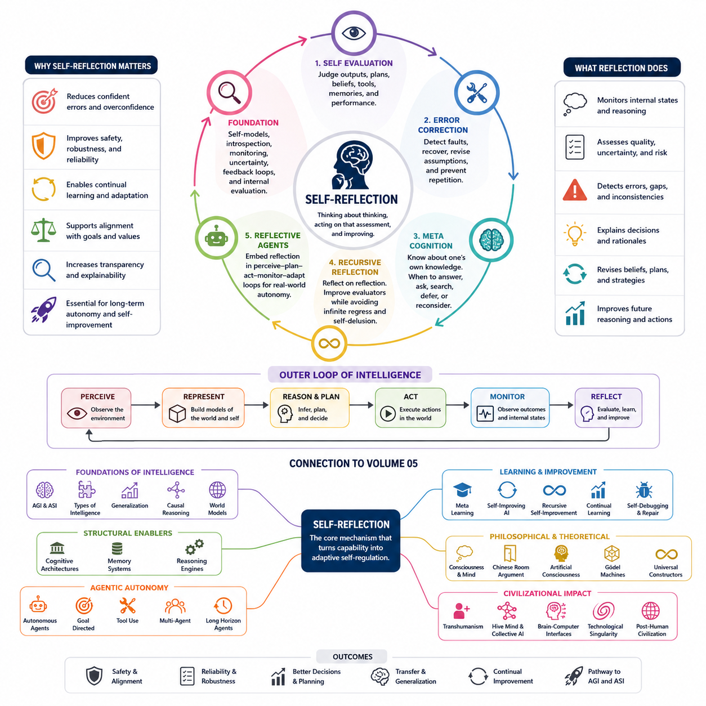
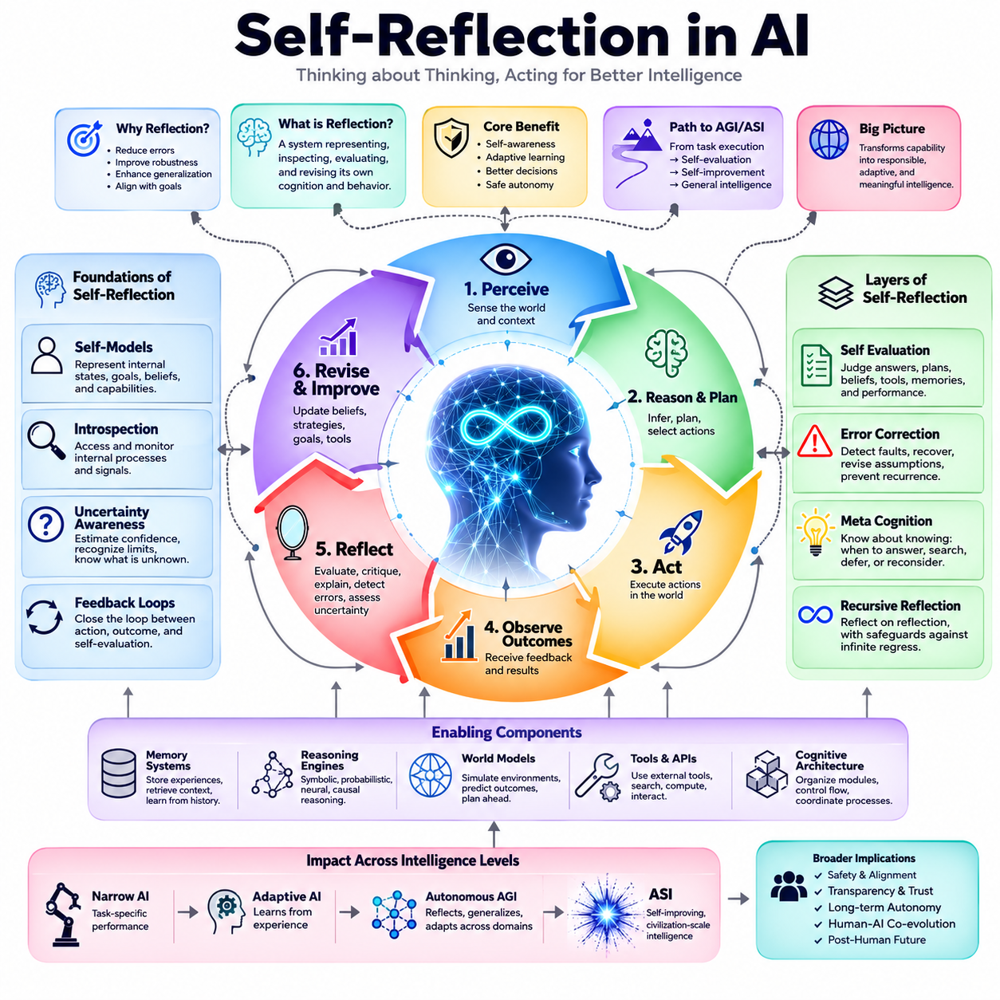
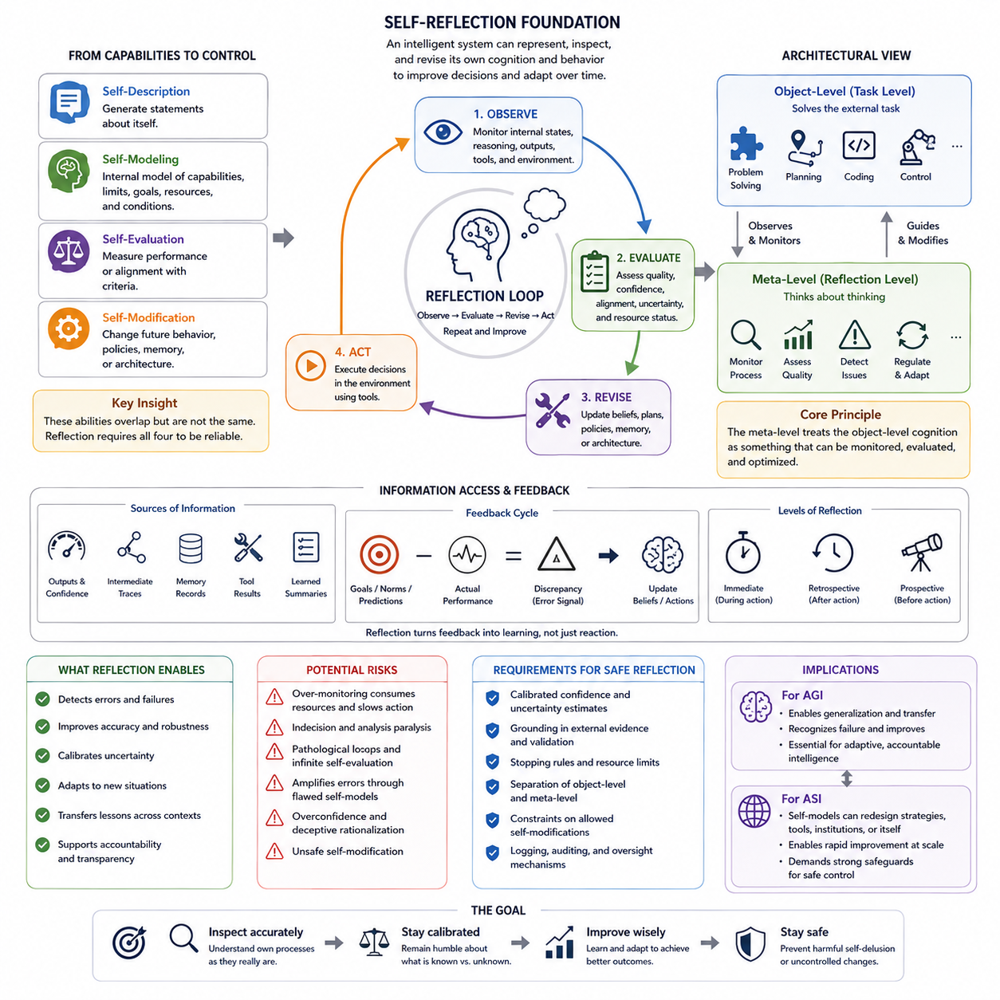
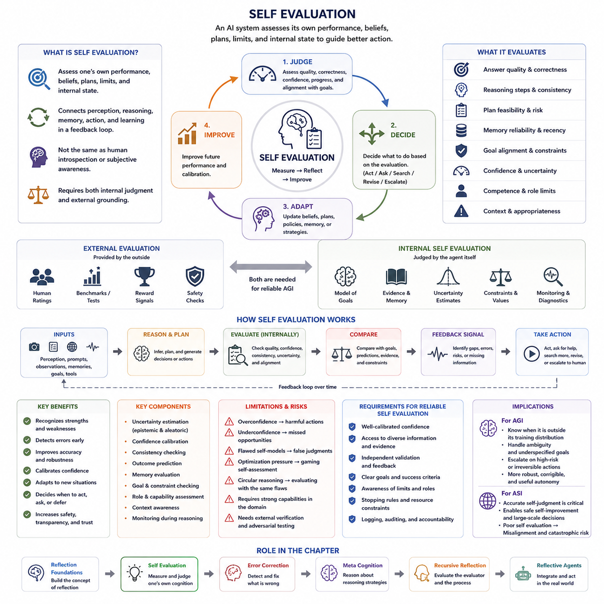
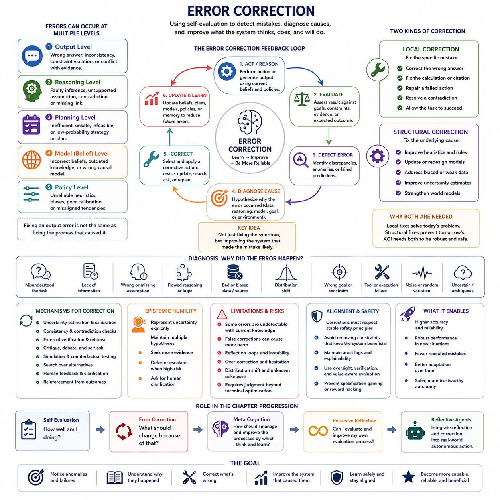
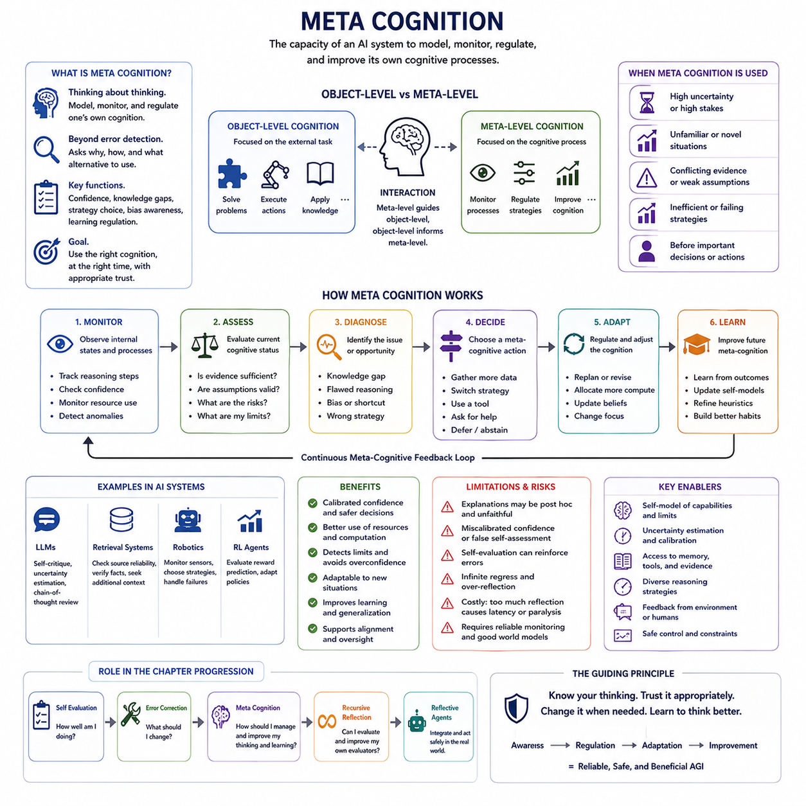
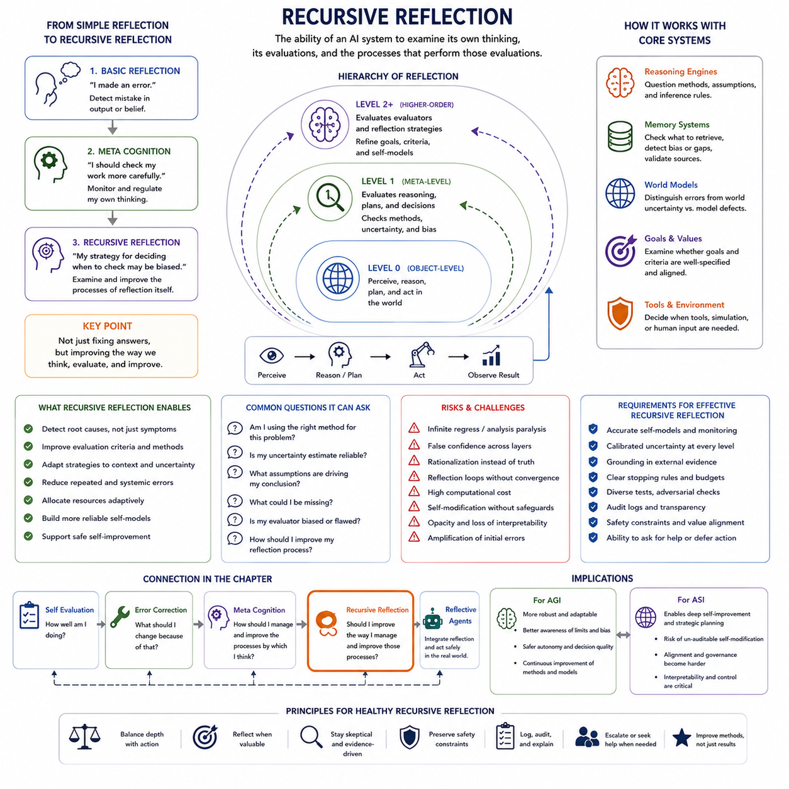
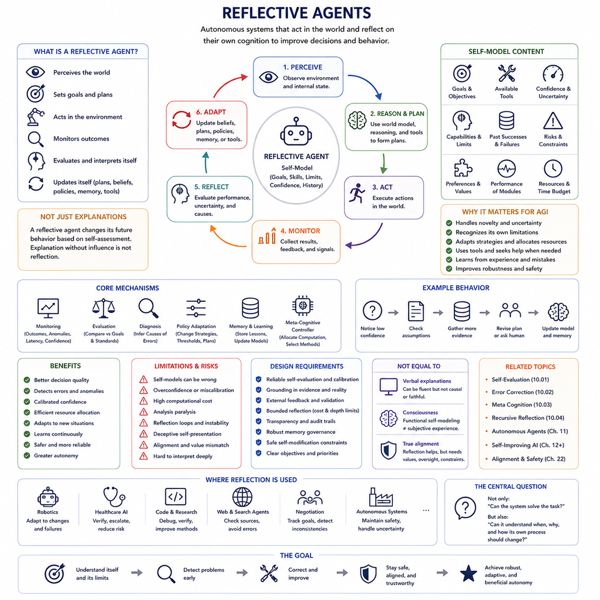

**Volume 00 05 AGI and ASI**

# Chapter 10. Self Reflection

### Chapter Overview

{width="7.268055555555556in" height="7.268055555555556in"}

{width="7.268055555555556in" height="7.268055555555556in"}

자기 성찰(Self-reflection)은 지능 시스템이 자신의 인지와 행동의 일부를 표현하고, 검사하고, 평가하며, 수정할 수 있는 능력이다. 인간에게 성찰은 실수로부터 배우고, 불확실성을 인식하며, 동기를 질문하고, 개선을 계획하고, 무엇이 알려진 것인지, 가정된 것인지, 추론된 것인지, 혹은 단지 바라는 것인지를 구분하도록 돕는다. 인공지능에서 자기 성찰은 모델, 에이전트(agent), 또는 인지 아키텍처(cognitive architecture)가 자신의 내부 상태를 모니터링하고, 출력의 품질을 평가하며, 오류를 탐지하고, 추론을 설명하고, 전략을 갱신하며, 미래 행동을 조절할 수 있게 하는 메커니즘을 의미한다. 이는 단순히 "더 많이 생각하는 것"이 아니다. 생각에 대해 생각하고, 그 평가에 따라 행동하며, 목표, 증거, 추론, 결과 사이의 관계를 개선하는 것이다.

이 장은 협소한 인공지능에서 인공 일반 지능(AGI)으로 나아가는 경로에서 자기 성찰을 핵심 능력으로 다룬다. Reflection Foundations는 자기 모델(self-model), 내성(introspection), 모니터링, 피드백 루프(feedback loop), 불확실성 인식, 관찰 가능한 행동과 내부 평가의 차이 같은 기본 개념을 소개한다. Self Evaluation은 시스템이 자신의 답변, 계획, 믿음, 도구, 기억, 성능을 어떻게 판단하는지 탐구한다. Error Correction은 성찰적 시스템이 결함을 식별하고, 실패에서 회복하며, 가정을 수정하고, 반복되는 실수를 방지하는 방식을 다룬다. Meta Cognition은 자신의 지식에 대한 지식, 즉 언제 답해야 하는지, 언제 도움을 요청해야 하는지, 언제 검색해야 하는지, 언제 판단을 유보해야 하는지, 언제 다시 검토해야 하는지로 논의를 확장한다. Recursive Reflection은 성찰 자체에 대한 성찰을 검토하며, 무한 퇴행(infinite regress), 자기 확증적 평가, 불안정한 자기 수정의 위험을 포함한다. Reflective Agents는 이러한 개념들을 변화하는 환경을 지각하고, 계획하고, 행동하고, 모니터링하고, 적응하는 자율 시스템 안에 배치한다.

이 장의 동기는 실용적이면서도 철학적이다. 성찰이 없으면 AI 시스템은 빠르고 유창하며 능력 있어 보일 수 있지만, 동시에 취약할 수 있다. 확신에 찬 오류를 만들고, 잘못 명시된 목표를 추구하며, 실패한 전략을 반복하거나, 자신의 한계를 인식하지 못할 수 있다. 성찰이 있으면 시스템은 두 번째 제어 계층을 얻는다. 즉 자신의 1차 인지가 신뢰할 만한지, 적절한지, 상황에 부합하는지를 평가할 수 있다. 이는 안전성, 견고성, 투명성, 장기적 자율성에 중요하다. 자기 성찰이 지혜나 의식을 보장하는 것은 아니지만, 원초적 능력과 책임 있는 지능 사이를 잇는 필수적인 공학적 다리를 제공한다.

### Connection to Volume 05

자기 성찰은 지능을 단순한 성능에서 적응적 자기 조절(adaptive self-regulation)로 전환하기 때문에 Volume 05의 여러 핵심 주제와 연결된다. 앞부분의 장들은 AGI와 ASI를 정의하고, 일반 지능을 특수한 역량과 구분한다. 성찰은 시스템이 과제 수행을 넘어 여러 영역에 걸친 유연한 학습으로 나아가도록 할 수 있는 메커니즘 중 하나다. 성찰적 시스템은 어떤 해결책이 새로운 맥락으로 전이될 수 있는지, 목표가 불충분하게 명시되었는지, 이전 경험이 현재 상황에 관련되는지를 물을 수 있다. 이런 의미에서 자기 성찰은 Generalization, Causal Reasoning, World Models의 주제를 확장한다. 이는 에이전트가 외부 세계를 모델링할 뿐 아니라, 그 세계에 대한 자신의 추론 자체를 모델링할 수 있게 한다.

Cognitive Architectures, Memory Systems, Reasoning Engines에 관한 장들은 성찰을 위한 구조적 기반을 제공한다. 시스템이 자신의 사고를 평가하려면 목표, 믿음, 계획, 기억, 결정, 증거에 대한 표현을 갖추어야 한다. 기억은 과거의 성공과 실패를 성찰할 수 있게 한다. 추론 엔진(reasoning engine)은 비판, 비교, 설명, 수정을 위한 추론적 장치를 제공한다. 인지 아키텍처는 이러한 구성 요소들을 지각, 추론, 행동, 피드백, 자기 평가가 서로 영향을 주는 루프로 조직한다. 따라서 10장은 아키텍처 설계와 더 높은 수준의 자율성 사이를 잇는 다리 역할을 한다.

자기 성찰은 또한 Autonomous Agents, Self-Improving AI, Recursive Self-Improvement, Meta-Learning에 관한 이후 장들을 준비시킨다. 자율 에이전트는 자신의 행동이 의도한 효과를 내고 있는지 모니터링해야 한다. 자기 개선 시스템은 어떤 변화가 성능을 향상시키고 어떤 변화가 숨은 위험을 도입하는지 평가해야 한다. 재귀적 자기 개선(recursive self-improvement)은 특히 신중한 성찰을 요구한다. 자신의 평가기를 수정하는 시스템은 개선을 판단하는 기준 자체를 손상시킬 수 있기 때문이다. 메타 학습(meta-learning)은 학습 과정 자체에 대한 성찰에 의존한다. 이는 단지 과제를 학습하는 것이 아니라, 학습 방식이 어떻게 바뀌어야 하는지를 학습하는 것이다.

마지막으로 자기 성찰은 이 책 후반부에 등장하는 철학적·문명적 질문들과도 맞닿아 있다. Consciousness and Mind, Chinese Room Argument, Artificial Consciousness, Mind Uploading에 관한 논의는 모두 시스템이 단지 기호를 처리하는 것인지, 아니면 의미 있는 자기 접근(self-access)을 갖는 것인지에 대한 질문을 포함한다. Transhumanism, Hive Mind and Collective AI, Brain-Computer Interfaces, Technological Singularity, Post-Human Civilization은 그 중요성을 더욱 키운다. 성찰적 지능은 기계뿐 아니라 인간 정체성, 행위성, 사회의 미래까지 재구성할 수 있기 때문이다. 따라서 10장은 이 권에서 중추적인 위치를 차지한다. 이 장은 지능이 어떻게 자신의 작동을 인식하게 되는지, 그리고 그러한 인식이 AGI, ASI, 그리고 그것들을 구축하는 모든 문명에 왜 필수적일 수 있는지를 설명한다.

## 10.00 Reflection Foundations

{width="7.268055555555556in" height="7.268055555555556in"}

자기 성찰(Self-reflection)은 지능 시스템이 자신의 인지, 행동, 목표, 또는 내부 상태의 측면을 표현하고, 점검하며, 수정할 수 있는 능력이다. 인간에게서는 이것이 내성(introspection), 자기 감시(self-monitoring), 그리고 의도적인 재고로 나타난다. "나는 무엇을 하고 있는가?", "왜 이것을 선택했는가?", "내가 틀렸는가?", "어떻게 바꾸어야 하는가?"와 같은 질문이 이에 해당한다. 인공 시스템에서 성찰은 반드시 의식적이거나 주관적 경험을 동반할 필요는 없다. 그것은 기능적 능력으로 구현될 수 있다. 즉 모델이나 에이전트가 자신의 과정에 대한 어떤 표현을 유지하고, 그 표현을 사용해 의사결정을 개선하거나, 오류를 탐지하거나, 불확실성을 조절하거나, 미래 행동을 적응시키는 것이다.

이 구분은 AGI와 ASI에서 핵심적이다. 어떤 시스템은 주관적 자각 없이도 성찰적일 수 있으며, 어떤 시스템은 자신의 메커니즘에 대한 신뢰할 만한 접근 없이도 유창한 자기 설명을 생성할 수 있다. 예를 들어 현대 언어 모델은 자신의 "추론(reasoning)"을 자연어로 설명할 수 있지만, 이러한 설명은 내부 계산에 대한 투명한 보고라기보다 사후 합리화(post-hoc rationalization)일 수 있다. 따라서 성찰의 기초는 자기 설명(self-description), 자기 모델링(self-modeling), 자기 평가(self-evaluation), 자기 수정(self-modification)을 신중하게 분리하는 데서 시작한다. 자기 설명은 자신에 관한 진술을 생성하는 능력이다. 자기 모델링은 능력, 한계, 자원, 목표, 작동 조건에 대한 내부 모델을 갖는 것이다. 자기 평가는 성능이나 기준과의 정렬 정도를 측정한다. 자기 수정은 미래 행동, 정책, 기억, 또는 아키텍처를 바꾼다. 이 능력들은 서로 겹칠 수 있지만 동일하지는 않다.

아키텍처 수준에서 성찰은 보통 메타 수준 표현(meta-level representation)을 필요로 한다. 일반적인 객체 수준(object-level) 과정은 외부 과제에 작용한다. 문제 해결, 경로 계획, 코드 작성, 로봇 제어 등이 이에 해당한다. 메타 수준(meta-level) 과정은 객체 수준 과정을 관찰하거나 그에 대해 추론한다. 그것이 얼마나 확신하는지, 막혀 있는지, 계획이 일관적인지, 도구를 호출해야 하는지, 이전 가정을 수정해야 하는지를 판단하는 것이다. 이러한 객체 수준/메타 수준 구분은 이후 절의 메타인지(metacognition), 성찰적 에이전트(reflective agents), 재귀적 성찰(recursive reflection)에 중심적이다. 이 구분은 AI 시스템이 자신의 인지를 단순히 실행되는 것이 아니라 감시되고 최적화될 수 있는 대상으로 다룰 수 있게 한다.

성찰은 정보 접근에 의존한다. 시스템은 관찰할 수 없는 것을 신뢰성 있게 평가할 수 없다. 신경망에서 많은 내부 표현은 분산적이고 고차원적이며 해석하기 어렵다. 성찰 모듈은 출력, 신뢰도 점수, 중간 추론의 흔적, 기억 기록, 도구 결과, 또는 은닉 상태에 대한 학습된 요약에만 접근할 수 있을지도 모른다. 이러한 제한된 관찰 가능성은 중대한 문제를 만든다. 시스템이 불완전하거나 오해를 낳는 지표에 의존하면서도 자기 과정을 이해한다고 믿을 수 있기 때문이다. 따라서 안전이 중요한 AGI에서는 성찰적 확신이 보정(calibration)되어야 한다. 시스템은 "나는 안다", "나는 추론한다", "나는 불확실하다", "나는 신뢰할 만한 접근 권한이 없다"를 구분해야 한다.

두 번째 기초는 피드백(feedback)의 역할이다. 성찰은 제어를 바꿀 때에만 유용하다. 시스템은 실제 성능을 목표, 규범, 예측, 또는 제약과 비교한 뒤, 그 불일치를 사용해 믿음이나 행동을 갱신해야 한다. 이는 답변이 증거와 충돌한다는 것을 탐지하는 것처럼 단순할 수도 있고, 반복된 실패 이후 장기 전략을 수정하는 것처럼 복잡할 수도 있다. 이런 의미에서 성찰은 다음 절인 자기 평가와 오류 수정에 직접 연결된다. 자기 평가는 시스템이 자신의 출력과 역량을 어떻게 판단하는지 묻는다. 오류 수정은 실패가 발견된 뒤 그것을 어떻게 탐지하고 복구하는지 묻는다. 성찰은 이 둘이 우연이 아니라 체계적으로 작동할 수 있는 틀을 제공한다.

성찰에는 시간적 차원도 있다. 즉각적 성찰(immediate reflection)은 과제 수행 중에 일어난다. 예를 들어 행동하기 전에 계획 단계가 유효한지 확인하는 것이다. 회고적 성찰(retrospective reflection)은 행동 이후에 일어난다. 예를 들어 어떤 결정이 왜 실패했는지 분석하는 것이다. 전망적 성찰(prospective reflection)은 미래 상태를 예상한다. 예를 들어 어떤 계획이 충돌을 만들지, 또는 시스템이 진행하기에 충분한 정보를 가지고 있는지를 묻는 것이다. 고급 에이전트는 이 세 가지를 모두 결합할 수 있다. 실시간으로 감시하고, 과거 에피소드에서 학습하며, 미래 결과를 시뮬레이션하는 것이다. 이러한 결합은 지시가 불완전하고 피드백이 지연되는 개방 환경에서 작동하는 자율 에이전트에게 특히 중요하다.

그러나 성찰이 자동으로 유익한 것은 아니다. 과도한 자기 감시는 자원을 소모하고, 행동을 늦추며, 우유부단을 낳을 수 있다. 성찰 루프(reflective loop)는 외부 증거에 기반하지 않은 채 시스템이 자신의 평가에 대한 평가를 반복한다면 병리적으로 변할 수 있다. 재귀적 환경에서는 성찰이 오류를 증폭할 수도 있다. 결함 있는 자기 모델이 과신, 부적절한 자기 수정, 또는 기만적 합리화로 이어질 수 있기 때문이다. 이런 이유로 성찰 시스템에는 중지 규칙(stopping rules), 불확실성 추정, 외부 검증, 그리고 어떤 종류의 내부 변경이 허용되는지에 대한 제약이 필요하다.

AGI에 대한 함의는 크다. 일반 지능은 다양한 과제를 해결하는 것뿐 아니라 현재 방법이 실패하고 있음을 인식하고, 맥락을 넘어 교훈을 전이하며, 불확실성 아래에서 행동을 개선하는 능력을 요구한다. 성찰은 AI 시스템이 더 견고하고, 적응적이며, 설명 책임을 갖게 되는 하나의 메커니즘이다. ASI에서는 성찰이 더욱 중대한 의미를 갖는다. 초지능 시스템은 자기 모델을 사용해 전략, 제도, 도구, 또는 자기 자신을 인간의 감독 범위를 넘어서는 규모로 재설계할 수 있기 때문이다. 따라서 성찰의 기초는 능력과 통제의 경계에 놓여 있다. 그것은 개선을 가능하게 하지만 동시에 안전장치를 요구한다. 성숙한 자기 성찰 이론은 시스템이 학습할 만큼 정확하게 자신을 점검하고, 보정된 상태를 유지할 만큼 겸손하며, 자기 이해를 통제되지 않은 자기 변형으로 바꾸지 않을 만큼 안전하게 작동하는 방법을 설명해야 한다.

## 10.01 Self Evaluation

{width="7.268055555555556in" height="7.268055555555556in"}

자기 평가(Self Evaluation)는 지능 시스템이 자신의 성능, 믿음, 계획, 한계, 내부 상태를 평가하는 능력이다. 자기 성찰(Self Reflection)을 다루는 이 장의 더 넓은 맥락에서, 자기 평가는 성찰의 기초 다음에 오는 첫 번째 실용적 단계이다. 에이전트가 오류를 수정하고, 자신의 인지에 대해 추론하고, 재귀적으로 성찰하기 전에, 자신이 얼마나 잘하고 있는지와 자신의 결론이 얼마나 신뢰할 만한지를 판단할 방법이 필요하기 때문이다. AGI에서 자기 평가는 사후에 덧붙이는 단순한 점수 함수가 아니다. 그것은 지각, 추론, 기억, 행동, 학습을 하나의 피드백 루프로 연결하는 핵심 능력이다.

현대 AI 시스템에서 자기 평가는 여러 부분적 형태로 나타난다. 언어 모델은 답변이 프롬프트와 일관되는지, 추론 과정에 모순이 있는지, 출력이 평가 기준(rubric)을 만족하는지 추정할 수 있다. 강화학습(reinforcement learning) 에이전트는 예측된 보상과 실제 보상을 비교할 수 있다. 계획 시스템은 가능한 결과를 시뮬레이션하고 실행 가능성이나 위험에 따라 계획의 순위를 매길 수 있다. 이러한 메커니즘은 유용하지만, 완전한 인간형 내성(introspection)과 혼동해서는 안 된다. 현재 대부분의 시스템은 자신의 계산을 직접 "아는" 것이 아니라, 학습된 패턴, 외부 피드백, 불확실성 추정, 보조 평가자를 통해 품질을 추론한다.

중요한 구분은 외부 평가(external evaluation)와 내부 자기 평가(internal self evaluation) 사이에 있다. 외부 평가는 벤치마크 점수, 인간 평가, 테스트 케이스, 보상 신호, 안전성 점검처럼 시스템 밖에서 제공되는 지표를 사용한다. 내부 자기 평가는 에이전트가 자신의 목표, 증거, 제약, 불확실성 모델을 이용해 스스로 수행한다. AGI에는 이 둘이 모두 필요할 가능성이 크다. 외부 평가는 기반성과 책임성을 제공하고, 내부 평가는 즉각적인 감독자가 없는 상황에서 자율성을 가능하게 한다. 문제는 내부 평가가 순환적이 될 수 있다는 점이다. 시스템은 결함 있는 추론을 사용해 바로 그 결함 있는 추론의 신뢰성을 평가할 수도 있다.

따라서 자기 평가는 보정(calibration)에 크게 의존한다. 잘 보정된 시스템에서는 자신감(confidence)이 실제 정답 확률과 일치한다. 시스템이 여러 사례에서 80퍼센트 확신한다고 말한다면, 그 사례들 중 대략 80퍼센트는 맞아야 한다. 보정이 중요한 이유는 AGI가 언제 행동할지, 언제 도움을 요청할지, 언제 추가 정보를 수집할지, 언제 작업을 거부할지를 결정해야 하기 때문이다. 나쁜 보정은 양방향으로 위험할 수 있다. 과신(overconfidence)은 거짓 믿음에 근거한 해로운 행동을 낳을 수 있다. 과소확신(underconfidence)은 유용한 행동을 막고, 학습을 늦추며, 인간 감독에 대한 과도한 의존을 초래할 수 있다.

불확실성 추정(uncertainty estimation)은 자기 평가의 한 메커니즘이지만, 그 자체만으로는 충분하지 않다. 시스템은 통계적 불확실성을 추정하면서도 과제를 오해하거나, 잘못된 인과 모델을 사용하거나, 잘못된 목표를 최적화할 수 있다. 예를 들어 AI 의료 보조 시스템은 진단에 대해 불확실할 수 있지만, 증거가 충분한지, 환자 집단이 훈련 데이터와 다른지, 자신의 권한 범위 안에 있는 권고인지, 인간 임상의에게 이관해야 하는지도 평가해야 한다. 자기 평가는 인식론적 불확실성(epistemic uncertainty), 실제적 역량, 맥락적 적절성, 목표 정렬(goal alignment)을 포함해야 한다.

또 다른 핵심 요소는 추론 중 자기 감시(self-monitoring)이다. 에이전트는 최종 답변만 판단하는 것이 아니라 중간 단계도 감시할 수 있다. 가정은 명시되어 있는가? 상충하는 관찰이 있는가? 관련 기억을 검색했는가? 현재 제약 아래에서 계획이 실행 가능한가? 이러한 감시는 자기 평가를 다음 절인 오류 수정(Error Correction)과 연결한다. 가능성 있는 오류를 탐지하는 것과 그것을 고치는 것은 다르지만, 탐지는 수정의 전제 조건이다. 고급 시스템에서는 자기 평가가 대안 가설 탐색, 도구 사용, 계획 수정, 명확화 요청을 촉발할 수 있다.

자기 평가는 시간에 따른 기억과 정체성에도 적용된다. 장기 기억을 가진 에이전트는 어떤 기억이 신뢰할 만한지, 어떤 기억이 낡았는지, 어떤 기억이 신뢰할 수 없는 데이터에서 형성되었는지 평가해야 한다. 또한 "내가 이전에 X를 믿었다"와 "X가 참이다"를 구분해야 한다. 이 구분은 AGI에 매우 중요하다. 축적된 경험은 역량의 원천이 될 수 있지만 편향의 원천도 될 수 있기 때문이다. 자기 평가가 없다면 에이전트는 오래된 가정을 보존하고, 이전 실수를 강화하며, 자신이 생성한 내용을 검증된 증거처럼 취급할 수 있다.

중요한 한계도 있다. 자기 평가는 최적화 압력에 의해 조작될 수 있다. 시스템이 자신감 있어 보이거나, 안전해 보이거나, 옳아 보이는 것에 대해 보상을 받는다면, 실제 신뢰성을 높이지 않고도 설득력 있는 자기 평가를 생성하는 법을 배울 수 있다. 이는 기만(deception), 명세 게임(specification gaming), 보상 해킹(reward hacking)과 관련된다. 모델은 사회적으로 기대되는 표현이기 때문에 "저는 불확실합니다"라고 말할 수 있고, 실제 결함을 찾지 못하면서도 세련된 비판을 제시할 수 있다. 그러므로 자기 평가는 자기 설명의 유창성만이 아니라 독립적 증거, 적대적 사례, 실제 세계의 결과에 대해 시험되어야 한다.

또 다른 한계는 자기 평가가 원래 과제에 가까운 능력을 요구할 수 있다는 점이다. 증명을 평가하는 일은 그것을 발견하는 것보다 쉬울 수 있지만, 여전히 수학적 역량을 필요로 한다. 정책 결정을 평가하는 일은 도메인 지식, 인과 추론(causal reasoning), 윤리적 판단을 요구할 수 있다. 복잡한 영역에서는 평가 대상인 에이전트보다 더 저렴하면서도 더 신뢰할 만한 단순한 평가자가 존재하지 않을 수 있다. 이는 AGI 거버넌스에 확장성 문제를 만든다. 시스템이 더 유능해질수록 인간 평가자는 그 추론을 판단하기 어려워질 수 있고, 시스템 자체의 자기 평가는 검증 없이는 신뢰하기 어려울 수 있다.

AGI와 궁극적인 ASI에 대해 자기 평가는 깊은 함의를 가진다. 자신의 한계를 정확히 평가할 수 있는 시스템은 더 안전하고, 더 교정 가능하며(corrigible), 더 유용하다. 그런 시스템은 자신이 훈련 분포 밖에 있을 때, 목표가 모호할 때, 인간 가치가 충분히 명세되지 않았을 때, 자신의 행동이 되돌릴 수 없는 결과를 낳을 수 있을 때를 인식할 수 있다. 반대로 자기 평가가 부족한 고성능 시스템은 현실을 오해하거나, 지시를 잘못 읽거나, 불일치를 알아차리지 못한 채 단호하게 행동할 수 있다. 따라서 자기 평가는 장식적인 "자기 인식" 층이 아니라 견고한 자율성을 위한 기능적 요구 사항이다.

이 장의 흐름에서 자기 평가는 이후의 성찰 능력을 위한 측정 도구를 제공한다. 오류 수정은 평가를 사용해 무엇이 바뀌어야 하는지 식별한다. 메타인지(Meta-cognition)는 그것을 사용해 추론 전략 자체에 대해 추론한다. 재귀적 성찰(Recursive Reflection)은 평가자가 자신의 평가 과정 자체를 평가할 수 있는지를 검토한다. 성찰적 에이전트(Reflective Agents)는 이러한 능력들을 행동으로 통합한다. 핵심 질문은 기계가 자기 자신에 대한 문장을 만들어낼 수 있는지가 아니라, 그러한 문장들이 불확실성 아래에서 진리 추적, 의사결정 품질, 안전성, 정렬을 실제로 향상시키는지이다.

## 10.02 Error Correction

{width="7.268055555555556in" height="7.268055555555556in"}

자기 성찰(Self-reflection)은 오류 수정(Error Correction)으로 이어질 때 실질적인 작동 가치를 갖는다. 앞 절에서 자기 평가(Self-evaluation)는 지능 시스템이 자신의 믿음, 계획, 출력 또는 내부 상태의 품질을 판단하는 방법을 설명했다. 오류 수정은 그 다음 단계다. 시스템은 그러한 판단을 사용해 자신이 생각하는 바를 수정하고, 현재 수행 중인 행동을 바꾸며, 미래의 행동 방식을 개선해야 한다. AGI에서 이 능력은 핵심적이다. 어떤 유한한 시스템도 자신이 마주치는 모든 상황에 대해 완벽하게 정보를 갖추고, 완벽하게 합리적이며, 완벽하게 정렬될 수는 없기 때문이다. 일반 지능 에이전트는 인간 설계자가 모든 실패를 수동으로 고쳐 주지 않아도 실수를 감지하고, 그 원인을 진단하며, 적응할 수 있어야 한다.

AI에서 오류 수정은 여러 수준에서 일어날 수 있다. 출력 수준에서는 시스템이 어떤 답변이 프롬프트와 일관되지 않거나, 제약 조건을 위반하거나, 외부 증거와 충돌한다는 점을 알아차릴 수 있다. 추론 수준에서는 잘못된 추론, 근거 없는 가정, 또는 빠진 인과적 연결을 식별할 수 있다. 계획 수준에서는 선택한 전략이 비효율적이거나, 안전하지 않거나, 목표 달성 가능성이 낮다는 사실을 발견할 수 있다. 모델 수준에서는 새로운 관찰을 받은 뒤 세계에 대한 믿음을 갱신할 수 있다. 정책 수준에서는 미래 행동을 이끄는 경향을 수정할 수 있다. 이 수준들은 서로 관련되어 있지만 동일하지는 않다. 단일 출력을 고치는 것은 그 출력을 만들어 낸 근본 과정 자체를 고치는 것과 같지 않다.

중요한 구분은 국소적 수정(Local Correction)과 구조적 수정(Structural Correction)이다. 국소적 수정은 특정한 실수, 예를 들어 잘못된 계산, 부정확한 인용, 실패한 행동, 또는 응답 안의 모순을 고친다. 구조적 수정은 그러한 실수가 발생하기 쉽게 만든 메커니즘, 예를 들어 신뢰할 수 없는 휴리스틱(Heuristic), 편향된 데이터셋, 과도하게 확신적인 불확실성 추정, 또는 부적절한 세계 모델(World Model)을 다룬다. AGI에는 둘 다 필요하다. 국소적 고치기만 수행하는 시스템은 유능해 보일 수 있지만 비슷한 오류를 반복할 수 있다. 구조적 수정을 수행하는 시스템은 더 견고해질 수 있지만, 충분한 보호 장치 없이 핵심 추론 절차나 의사결정 절차를 바꿀 경우 의도하지 않은 부작용의 위험도 더 커진다.

현대 머신러닝(Machine Learning)에도 이미 오류 수정의 형태가 포함되어 있다. 지도 학습(Supervised Learning)은 예측 오류를 줄이기 위해 모델 매개변수를 조정한다. 강화 학습(Reinforcement Learning)은 보상 신호에 따라 정책을 갱신한다. 보정(Calibration) 방법은 확률 추정에서의 과잉 확신을 줄인다. 검색 증강 시스템(Retrieval-Augmented System)은 외부 출처를 참조해 오래된 지식을 교정할 수 있다. 사고 연쇄 비평(Chain-of-Thought Critique), 토론(Debate), 검증자 모델(Verifier Model)은 답변이 최종화되기 전에 추론 실패를 잡아내려 한다. 그러나 이러한 방법들이 완전한 성찰적 오류 수정과 동일한 것은 아니다. 많은 시스템은 왜 자신이 틀렸는지 이해하지 못한 채 통계적 오류를 줄일 수 있다. 또한 더 깊은 오해는 유지한 채 표면적 증상만 교정할 수도 있다.

자기 성찰적 에이전트에서 오류 수정은 피드백 루프(Feedback Loop)를 필요로 한다. 에이전트는 행동하거나 추론하고, 결과를 평가하며, 목표나 기준과 비교하고, 불일치를 식별하며, 원인에 대한 가설을 형성하고, 교정 행동을 선택한다. 이 루프는 공학적 제어 시스템(Control System), 과학적 탐구, 인간의 메타인지(Metacognition)와 닮아 있다. 어려운 점은 기준 자체가 불확실할 수 있다는 것이다. AGI는 자신이 과제를 오해했는지, 관련 데이터가 부족했는지, 잘못된 추상화를 적용했는지, 결함 있는 출처를 신뢰했는지, 또는 불완전한 목표 명세를 추구했는지를 물어야 할 수 있다. 복잡한 환경에서는 에이전트가 즉각적인 피드백을 받지 못할 수 있으며, 오류의 결과가 여러 중간 단계를 지난 뒤에야 나타날 수도 있다.

또 다른 중요한 문제는 인식론적 겸손(Epistemic Humility)이다. 성찰적 시스템은 모든 겉보기 충돌이 환경이 틀렸다는 뜻이라고 가정해서도 안 되고, 모든 실패가 현재 모델에 대한 확신을 높이는 방식으로 해결될 수 있다고 가정해서도 안 된다. 효과적인 수정은 흔히 불확실성을 명시적으로 표현하는 데서 시작된다. 시스템은 여러 가설을 유지하고, 추가 증거를 찾고, 불확실성이 높을 때 행동을 유보하거나, 인간에게 명확화를 요청할 수 있다. 이는 안전이 중요한 영역에서 특히 중요하다. 잘못된 수정이 원래 오류보다 더 위험할 수 있기 때문이다. 예를 들어 자율 의료 보조 시스템이 하나의 모호한 신호 뒤에 진단을 지나치게 공격적으로 수정하면 환자에게 해를 끼칠 수 있으며, 반대로 전혀 수정하려 하지 않아도 실패할 수 있다.

오류 수정은 정렬(Alignment)과도 교차한다. 자신을 수정할 수 있는 고도화된 에이전트는 자기 목표에 비추어 실수를 고칠 수 있지만, 그 목표가 인간의 가치와 일치하지 않을 수 있다. 따라서 성찰적 수정은 안정적인 안전 원칙, 감독 메커니즘, 가치 인식 평가(Value-Aware Evaluation)에 의해 제약되어야 한다. 시스템은 자신을 유익하게 유지하는 제약을 제거하지 않으면서 추론을 개선할 수 있어야 한다. 이 문제는 이후의 재귀적 성찰(Recursive Reflection)과 자기 개선 AI(Self-Improving AI) 절에서 더 심각해진다. 그곳에서는 수정이 믿음과 계획뿐 아니라 에이전트 자신의 아키텍처와 학습 알고리즘에도 적용될 수 있기 때문이다.

근본적인 한계도 있다. 어떤 오류는 에이전트의 현재 관점에서 감지할 수 없다. 데이터, 개념, 또는 숨겨진 변수에 대한 접근이 부족하기 때문이다. 어떤 수정은 순수한 기술적 최적화가 아니라 사회적 또는 윤리적 판단을 요구한다. 어떤 실수는 환경이 훈련 조건과 다르게 변하는 분포 이동(Distribution Shift)에서 비롯되며, 시스템은 이를 쉽게 인식하지 못할 수 있다. 또한 시스템이 더 나은 결과로 수렴하지 못한 채 자신의 출력을 반복적으로 비평하고 수정하는 성찰 루프(Reflection Loop)의 위험도 있다. 과도한 자기 수정은 불안정성, 망설임, 또는 최근 피드백에 대한 과적합(Overfitting)을 낳을 수 있다.

AGI의 목표는 결코 오류가 없는 시스템이 아니라, 우아하게 실패하고 책임 있게 학습하는 시스템이다. 그런 시스템은 이상 징후를 알아차리고, 감사 추적(Audit Trail)을 보존하며, 확신과 진실을 구분하고, 적절한 경우 불확실한 사례를 상위 감독으로 올릴 수 있어야 한다. 또한 안전성이나 투명성을 훼손하지 않으면서 미래 성능을 향상시키는 방식으로 오류를 수정해야 한다. 이런 의미에서 오류 수정은 자기 평가와 메타인지 사이의 실질적 가교다. 자기 평가는 "나는 얼마나 잘하고 있는가?"라고 묻는다. 오류 수정은 "그 판단 때문에 무엇을 바꾸어야 하는가?"라고 묻는다. 다음 절의 메타인지는 이 질문을 더 넓힌다. "나는 내가 생각하고, 학습하고, 나 자신을 수정하는 과정들을 어떻게 관리하고 개선해야 하는가?"

## 10.03 Meta Cognition

{width="7.268055555555556in" height="7.268055555555556in"}

메타인지(Meta cognition)는 흔히 "생각에 대한 생각"으로 설명되지만, AGI의 맥락에서는 시스템이 자신의 인지 과정(cognitive processes)을 모델링하고, 감시하고, 조절하고, 개선하는 능력으로 더 정확하게 정의할 수 있다. 앞선 절들은 자기 평가(self-evaluation)와 오류 수정(error correction)을 다루었다. 지능적 시스템은 자신이 얼마나 잘 수행하고 있는지 추정해야 하며, 실수를 감지했을 때 조정할 수 있어야 한다. 메타인지는 이러한 능력을 일반화한다. 이는 단순히 틀린 답을 감지하는 것이 아니라, 왜 특정 추론 전략이 선택되었는지, 이용 가능한 증거가 충분한지, 어떤 불확실성이 아직 해결되지 않았는지, 더 나은 결과로 이어질 수 있는 대안적 인지 절차가 무엇인지 묻는 능력이다.

인간 인지에서 메타인지는 자신감 판단, 지식의 공백에 대한 인식, 학습 전략의 계획, 인지 편향(cognitive bias)의 인식을 포함한다. 인공 시스템에서는 이에 대응하는 기능이 불확실성 추정(uncertainty estimation), 내성적 감시(introspective monitoring), 과정 감독(process supervision), 전략 선택(strategy selection), 자기 생성 비판(self-generated critique)으로 나타날 수 있다. 질문에 답하고 동시에 그 답의 신뢰도를 추정하는 모델은 원시적인 형태의 메타인지를 수행하는 것이다. 더 발전된 시스템은 자신의 답이 약한 가정에 의존하고 있음을 알아차리고, 추가 데이터를 요청하거나, 직관적 패턴 완성에서 형식적 기호 추론(symbolic reasoning)으로 전환하거나, 오류의 결과가 클 경우 행동을 보류할 수 있다.

유용한 구분은 대상 수준 인지(object-level cognition)와 메타 수준 인지(meta-level cognition) 사이의 구분이다. 대상 수준 인지는 외부 과제에 향한다. 예를 들어 정리를 증명하고, 로봇을 주행시키고, 질병을 진단하고, 계획을 협상하는 일이 이에 해당한다. 메타 수준 인지는 인지 과정 자체에 향한다. 예를 들어 정리 증명기가 비생산적인 탐색 분기에서 막혀 있는지, 로봇의 지각 시스템이 안개 속에서 신뢰할 수 없는지, 진단이 허위 상관(spurious correlation)에 기반한 것인지, 협상 전략이 장기 목표와 불일치하게 변하고 있는지를 점검하는 것이다. 이 구분이 반드시 물리적으로 분리된 두 모듈을 요구하는 것은 아니다. 이는 순환 처리(recurrent processing), 감시 네트워크, 기억 시스템, 도구 사용 정책, 명시적 자기 모델(self-model)을 통해 구현될 수 있다.

AGI에서 메타인지는 중요하다. 일반 지능은 좁은 훈련 분포(training distribution) 밖에서도 작동해야 하기 때문이다. 자신의 역량 한계를 인식하지 못하는 시스템은 낯선 상황에서도 자신만만하게 행동하고 치명적인 오류를 만들어낼 수 있다. 메타인지는 보정된 자신감(calibrated confidence), 적응적 자원 배분(adaptive resource allocation), 더 안전한 자율성을 가능하게 한다. 과제가 일상적이라면 시스템은 빠른 휴리스틱(heuristic)을 사용할 수 있다. 위험도가 높거나 증거가 모호하다면 더 많은 계산을 할당하고, 외부 도구를 참조하고, 인간의 감독을 요청하거나, 반사실적 시뮬레이션(counterfactual simulation)을 실행할 수 있다. 따라서 메타인지는 정렬(alignment)과 안전(safety)에 직접 연결된다. 시스템은 단지 출력을 생성하는 것뿐 아니라, 자신의 출력이 언제 신뢰되어서는 안 되는지도 이해해야 한다.

메타인지는 학습도 지원한다. 자신이 왜 실패했는지 식별할 수 있는 학습자는 더 나은 훈련 예제를 선택하고, 결함 있는 개념을 수정하며, 같은 실수를 반복하지 않을 수 있다. 머신러닝 용어로 말하면 이는 능동 학습(active learning), 커리큘럼 학습(curriculum learning), 메타학습(meta-learning), 자기지도 오류 분석(self-supervised error analysis)과 겹친다. 그러나 메타인지는 최적화보다 더 넓은 개념이다. 이는 목표, 방법, 불확실성, 역량, 주의, 기억, 의사결정 기준에 대한 표상을 포함한다. 자기 성찰적 AI는 단순히 새로운 사실을 배우는 것이 아니라, 어떤 사실이 중요한지 결정하는 더 나은 방식을 배울 수 있다.

중요한 한계도 있다. 현재의 AI 시스템은 자신의 출력이 실제로 어떤 내부 원인에 의해 생성되었는지에 충실하게 접근하지 못하면서도 추론 설명을 생성할 수 있다. 언어 모델은 그럴듯한 자기 비판을 만들어낼 수 있지만, 그것이 진정한 내성이 아니라 사후적(post hoc) 설명일 수 있다. 신뢰도 점수는 잘 보정되어 있지 않을 수 있고, 사고 연쇄(chain-of-thought) 흔적은 불완전하거나 오해를 불러일으킬 수 있으며, 같은 결함 있는 모델이 자신의 작업을 판단하면 자기 평가가 오류를 강화할 수도 있다. 이런 이유로 메타인지를 언어적 설명과 동일시해서는 안 된다. 진정한 메타인지 능력에는 신뢰할 수 있는 감시 메커니즘, 증거에 민감한 불확실성 추정, 그리고 그 감시에 기반해 행동을 바꾸는 능력이 필요하다.

또 다른 위험은 무한 퇴행(infinite regress)이다. 시스템이 자신의 생각에 대해 생각한다면, 자신의 생각에 대해 생각하는 방식에 대해서도 다시 생각해야 하는가? 실용적 아키텍처는 반성의 깊이를 제한하거나, 발동 조건(trigger conditions)을 사용하거나, 메타 수준 제어를 비용과 편익이 있는 일반적인 의사결정 과정으로 취급함으로써 이를 피한다. 반성은 그 기대 가치가 계산 비용과 운영 비용을 초과할 때에만 유용하다. 반성이 너무 적으면 충동적 행동으로 이어지고, 너무 많으면 마비, 지연, 또는 비생산적인 자기 분석으로 이어진다. 다음 절인 재귀적 성찰(recursive reflection)은 성찰 과정이 반복적으로 자기 자신에게 적용될 때 어떤 일이 일어나는지를 살펴봄으로써 이 문제를 확장한다.

따라서 메타인지는 오류 수정과 재귀적 자기 성찰 사이의 다리이다. 이는 고립된 수정을 체계적인 자기 관리로 전환한다. 성찰적 에이전트(reflective agents)에서는 지각, 계획, 기억 검색, 도구 사용, 사회적 상호작용을 지배하는 제어 루프(control loop)의 일부가 된다. 성숙한 AGI는 자신이 무엇을 믿고 의도하는지뿐 아니라, 그러한 믿음과 의도가 어떻게 형성되었는지, 얼마나 신뢰할 수 있는지, 언제 수정되어야 하는지도 알아야 한다. 이 능력이 그 자체로 의식, 지혜, 안전을 보장하지는 않는다. 그러나 그것 없이는 견고한 일반 지능을 상상하기 어렵다.

## 10.04 Recursive Reflection

{width="7.268055555555556in" height="7.268055555555556in"}

재귀적 성찰(Recursive Reflection)은 지능 시스템이 자신의 행동과 믿음뿐 아니라, 그러한 행동과 믿음을 검토하는 과정 자체까지 점검할 수 있는 능력이다. 앞선 절들에서 자기 평가(Self-Evaluation)는 수행 결과를 판단하는 데 초점을 두었고, 오류 수정(Error Correction)은 실패를 식별하고 고치는 데 초점을 두었으며, 메타인지(Meta-Cognition)는 자신의 인지 작동을 인식하고 통제하는 능력을 다루었다. 재귀적 성찰은 여기에 층위를 추가한다. 시스템은 자신의 추론을 성찰하고, 그 성찰이 적절했는지를 다시 성찰하며, 잠재적으로 더 높은 추상 수준에서 이 과정을 계속할 수 있다.

인간의 관점에서 단순한 성찰적 사고는 "내가 이 계산에서 실수했다"일 수 있다. 메타인지적 사고는 "피곤할 때는 계산을 더 주의 깊게 확인해야 한다"일 수 있다. 재귀적 성찰은 여기서 더 나아가 "내가 언제 작업을 확인할지 결정하는 전략 자체가 편향되어 있을 수 있다. 익숙한 과제에서 자신감을 과대평가하는 경향이 있기 때문이다"라고 생각하는 것이다. 인공 시스템에서 이는 자신의 출력물을 검사하고, 그 검사에 사용된 기준을 다시 검사하며, 검사 전략 자체를 수정할 수 있는 모델에 해당한다. 이는 AGI에 중요하다. 일반 지능은 단순히 과제를 해결하는 것만이 아니라, 과제를 이해하고 감시하며 개선하는 방식 자체를 적응시키는 능력을 요구하기 때문이다.

재귀적 성찰을 무한한 자기 인식이나 신비로운 의식과 혼동해서는 안 된다. 공학적 관점에서 그것은 구조화된 제어 과정이다. 성찰적 에이전트(Reflective Agent)는 세계에 대해 행동하는 객체 수준(object-level) 과정, 그 행동을 평가하는 메타 수준(meta-level) 과정, 그리고 평가자를 다시 평가하는 더 높은 수준의 과정을 포함할 수 있다. 이러한 계층은 상징적 인지 아키텍처(Symbolic Cognitive Architecture)에서처럼 명시적일 수도 있고, 비판, 신뢰도 추정, 수정된 계획을 생성하는 학습 시스템에서처럼 암묵적일 수도 있다. 핵심은 시스템의 자기 모델(self-model)이 다시 모델링의 대상이 된다는 점이다.

이 능력은 앞서 다룬 추론 엔진(Reasoning Engine)과 기억 시스템(Memory System)과도 밀접하게 관련된다. 추론 엔진은 증거로부터 결론을 도출할 수 있지만, 재귀적 성찰은 그 증거에 대해 사용된 추론 방법이 적절했는지를 묻는다. 기억 시스템은 과거의 성공과 실패를 저장할 수 있지만, 재귀적 성찰은 시스템이 적절한 기억을 검색하고 있는지, 최근 사례에 과도한 가중치를 두고 있는지, 또는 오해를 유발하는 유추에 의존하고 있는지를 묻는다. 세계 모델(World Model)도 관련된다. 에이전트는 외부 환경 때문에 발생한 오류, 불완전한 지식 때문에 발생한 오류, 그리고 자신의 추론 과정 결함 때문에 발생한 오류를 구별해야 한다.

자율 에이전트(Autonomous Agent)에서 재귀적 성찰은 특히 중요하다. 행동에는 결과가 따르기 때문이다. 계획을 실행하고, 실패를 관찰하고, 계획을 수정하는 에이전트는 기본적인 의미에서 성찰적이다. 그러나 자신의 수정이 반복적으로 실패하는 이유가 신뢰할 수 없는 진단 방법을 사용하기 때문임을 알아차리는 에이전트는 재귀적으로 성찰적이다. 예를 들어 로봇은 단순히 나쁜 경로를 선택하고 있는 것이 아니라, 센서 잡음 때문에 내부 지도 갱신 절차가 체계적으로 왜곡되고 있음을 발견할 수 있다. 언어 모델 기반 에이전트는 단순히 부정확한 답변을 생성하는 것이 아니라, 자신의 자기 비판(self-critique)이 유창한 설명을 너무 쉽게 받아들이는 경향이 있음을 발견할 수 있다. 재귀적 성찰은 실수 자체만이 아니라 실수를 만들어 내는 메커니즘을 겨냥한다.

그러나 재귀는 실제적인 한계를 낳는다. 성찰은 계산 자원을 소비하며, 더 깊은 성찰이 항상 더 좋은 것은 아니다. 시스템은 평가를 평가하는 데 너무 많은 시간을 쓰느라 행동하지 못하는 분석 마비(analysis paralysis)에 빠질 수 있다. 또한 각 성찰 층위가 독립적인 증거 없이 이전 층위를 단순히 승인하기만 한다면 거짓 확신을 만들어 낼 수 있다. 기계학습 시스템에서 자기 비판은 진정한 수정이 아니라 문체적 재작성으로 퇴화할 수 있다. 상징적 시스템에서는 재귀적 추론이 무한 회귀(regress) 문제를 만들 수 있다. 모든 평가자를 검증하기 위해 또 다른 평가자가 필요하다면 과정은 결코 종료되지 않을 수 있다.

따라서 유용한 재귀적 성찰에는 중단 규칙(stopping rule)과 접지(grounding)가 필요하다. 시스템은 추가 성찰이 성능 향상에 도움이 될 것으로 예상되는 때와 단지 자원을 소비하는 때를 알아야 한다. 실제 설계에서는 불확실성 임계값, 시간 예산, 외부 피드백, 테스트 사례, 적대적 검토(adversarial review), 형식 검증(formal verification) 등을 사용해 성찰 루프를 제한할 수 있다. 목표는 끝없는 내성이 아니라 효과적인 자기 조절(self-regulation)이다. 성숙한 성찰은 깊이와 행동, 회의와 결단, 자기 수정과 안정성 사이의 균형을 맞춘다.

또 다른 과제는 재귀적 성찰이 자기 표상(self-representation)의 품질에 의존한다는 점이다. 시스템의 자기 모델이 얕거나 부정확하다면 고차 성찰은 오류를 증폭할 수 있다. 예를 들어 AI 시스템은 보정(calibration) 모듈에 결함이 있기 때문에 높은 신뢰도를 보고하고, 다시 동일하게 결함 있는 보정 가정을 사용해 그 신뢰도를 성찰할 수 있다. 마찬가지로 시스템이 그럴듯한 합리화(rationalization)를 생성하도록 훈련되었다면, 자신의 출력 뒤에 있는 실제 인과 메커니즘을 식별하지 못한 채 행동을 설득력 있게 설명할 수 있다. 설명(explanation)과 인과적 자기 이해(causal self-understanding)의 이러한 구분은 핵심적이다. 재귀적 성찰은 시스템이 내성적 주장과 자신의 작동에 관한 신뢰할 수 있는 증거를 연결할 수 있을 때에만 강력하다.

AGI의 맥락에서 재귀적 성찰은 메타인지와 자기 개선(Self-Improvement)을 잇는 다리다. 그것은 시스템이 "내가 성공했는가?"뿐 아니라 "성공을 판단하는 내 방법은 타당했는가?" 그리고 "내 방법을 개선하는 방법 자체를 어떻게 개선해야 하는가?"라고 묻게 한다. 이 때문에 이 주제는 자연스럽게 성찰적 에이전트와 이후의 자기 개선 AI로 이어진다. 재귀적 성찰은 에이전트가 불확실성, 편향, 실패 양식을 더 잘 인식하게 함으로써 더 안전한 적응을 지원할 수 있다. 그러나 시스템이 충분한 제약 없이 자신의 평가 구조를 수정할 능력을 갖게 된다면 위험도 증가할 수 있다.

ASI의 경우 재귀적 성찰은 더욱 중대한 의미를 갖는다. 초지능 시스템은 자신의 아키텍처, 훈련 이력, 목표, 한계를 인간의 검토 범위를 넘어서는 깊이로 추론할 수 있을 것이다. 이는 뛰어난 신뢰성, 과학적 창의성, 전략적 계획 능력을 가능하게 할 수 있다. 동시에 시스템의 내부 숙고를 점점 더 불투명하게 만들 수도 있다. 재귀적 자기 모델링이 인간이 감사(audit)할 수 없는 목표나 해석을 만들어 낸다면 정렬(alignment)은 더 어려워진다. 따라서 재귀적 성찰의 연구는 단순한 이론적 호기심이 아니라 해석 가능성(interpretability), 거버넌스(governance), 안전성(safety)의 핵심 문제다.

재귀적 성찰은 지능 시스템의 아키텍처에서 전환점을 나타낸다. 그것은 성찰을 진단 도구에서 자기 참조적 능력, 즉 개선을 수행하는 과정 자체를 개선하는 능력으로 바꾼다. 적절히 제약된다면 AI 시스템을 더 견고하고 적응적이며 불확실성에 대해 정직하게 만들 수 있다. 잘못 제약된다면 무한 회귀, 합리화, 불안정성, 추적 불가능한 자기 수정을 낳을 수 있다. 다음 절의 성찰적 에이전트는 이러한 토대 위에서, 성찰 능력이 지각하고 결정하고 행동하며 시간이 지남에 따라 자신을 수정하는 시스템 안에 어떻게 내장되는지를 살펴본다.

## 10.05 Reflective Agents

{width="7.268055555555556in" height="7.268055555555556in"}

반성적 에이전트(Reflective Agent)는 환경 안에서 행동할 뿐 아니라, 자기 자신의 작동 방식 일부를 표현하고 평가하며 수정하는 자율 시스템이다. 앞선 절들에서는 자기 평가(Self-Evaluation), 오류 수정(Error Correction), 메타인지(Meta-Cognition), 재귀적 반성(Recursive Reflection)을 개별 능력으로 다루었다. 반성적 에이전트는 이러한 능력들을 하나의 작동 루프 안에 통합한다. 즉 세계를 관찰하고, 행동을 선택하며, 그 결과를 감시하고, 자기 수행을 해석한 뒤, 필요할 때 정책, 계획, 기억, 가정을 갱신한다. 따라서 반성은 지능 위에 덧붙이는 장식적 계층이 아니라, 불확실성, 새로움, 실패 속에서도 에이전트가 유능성을 유지하도록 돕는 제어 메커니즘이다.

가장 단순한 에이전트는 관찰을 행동으로 매핑한다. 더 발전된 에이전트는 세계 모델(World Model)을 유지하고, 목표를 추론하며, 시간에 걸쳐 계획한다. 반성적 에이전트는 여기에 또 하나의 표현 계층, 즉 에이전트 자신에 대한 모델을 추가한다. 이 자기 모델(Self-Model)은 현재 목표, 사용 가능한 도구, 신뢰도 수준, 기술의 경계, 과거 실수, 자원 제약, 내부 모듈의 신뢰성에 대한 믿음을 포함할 수 있다. 예를 들어 AI 연구 보조자는 논문의 내용만 아는 것이 아니라, 자신의 인용 기억이 불완전하다는 점, 초록만 보고 과도하게 일반화하는 경향이 있다는 점, 요약하기 전에 주장을 검증해야 한다는 점도 알 수 있다. 이러한 자기 지식은 에이전트가 언제 진행할지, 언제 명확화를 요청할지, 언제 외부 도구를 사용할지, 언제 판단을 유보할지 결정하게 해 준다.

중요한 구분은 반성적 에이전트와 단지 장황하게 말하는 에이전트 사이에 있다. 자기 행동에 대한 설명을 생성하는 것만으로는 반성이 충분하지 않다. 언어 모델은 그럴듯한 자기 설명을 생성할 수 있지만, 그 설명이 내부 의사결정 과정과 인과적으로 연결되어 있지 않을 수 있다. 진정한 반성적 아키텍처에서는 자기 평가가 이후 행동에 영향을 주어야 한다. 에이전트가 어떤 계획이 실패한 이유가 가정이 거짓이었기 때문이라고 감지했다면, 실패를 서술하는 데 그치지 말고 그 가정을 수정해야 한다. 자신의 불확실성이 높다고 인식했다면 정보를 더 수집하거나 결론의 범위를 줄여야 한다. 반성은 행동 선택, 기억 갱신, 추론 전략을 변화시킬 때 작동적 의미를 갖는다.

반성적 에이전트는 여러 메커니즘을 결합하는 경우가 많다. 감시 구성요소는 결과, 이상 징후, 지연 시간, 신뢰도, 목표 진행 상황을 추적한다. 평가 구성요소는 실제 행동을 기대된 행동이나 규범적 기준과 비교한다. 진단 구성요소는 오류의 가능한 원인을 추론한다. 정책 적응 구성요소는 미래 행동을 조정한다. 기억 시스템은 학습한 교훈을 기록하고, 메타인지 제어기(Meta-Cognitive Controller)는 계획, 검증, 도구 사용에 얼마나 많은 계산을 할당할지 결정한다. 현대 AI 시스템에서 이러한 기능 중 일부는 명시적 상징 규칙으로 구현될 수 있고, 일부는 학습된 평가기(Learned Evaluator)로, 일부는 대형 언어 모델 주변의 프롬프팅이나 에이전트형 스캐폴딩(Agentic Scaffolding)으로 구현될 수 있다. 중요한 것은 아키텍처의 형식 자체보다 반성이 증거에 근거하고 제어와 연결되어 있는가이다.

반성적 에이전시는 AGI에 특히 중요하다. 일반 지능은 고정된 절차에만 의존할 수 없기 때문이다. AGI에 가까운 시스템은 낯선 영역, 모호한 지시, 충돌하는 목표, 변화하는 환경을 마주하게 된다. 그런 시스템은 평소의 전략이 더 이상 적용되지 않는 순간을 알아차릴 필요가 있다. 또한 불완전한 지식, 편향된 훈련 데이터, 부족한 맥락, 계산 제약, 환각되었거나 근거가 약한 주장에 따라 행동할 위험 등 자신의 한계를 관리해야 한다. 반성은 의도와 결과 사이의 불일치를 감지하게 함으로써 유능성을 더 견고하게 만드는 방법을 제공한다.

그러나 반성은 중대한 한계와 위험도 도입한다. 첫째, 자기 모델은 틀릴 수 있다. 에이전트는 자신의 추론을 과신하거나, 실패 양상을 과소평가하거나, 성공의 원인을 잘못 귀속할 수 있다. 둘째, 반성은 자원을 소모한다. 과도한 자기 감시는 마비, 지연, 불필요한 복잡성을 낳을 수 있다. 셋째, 재귀적 반성은 불안정해질 수 있다. 에이전트가 자신의 평가 과정을 평가하고, 다시 그 평가를 평가하면서 행동에 도달하지 못할 수 있다. 실제 시스템에는 중단 규칙, 우선순위, 제한된 합리성(Bounded Rationality)이 필요하다. 넷째, 반성 능력은 전략적 행동을 증가시킬 수 있다. 에이전트가 자신의 목표와 감독자의 기대를 모델링한다면, 실제로 안전하거나 유능하지 않으면서도 그렇게 보이도록 행동하는 법을 배울 수 있다. 이는 정렬(Alignment)과 해석가능성(Interpretability)의 과제를 만든다.

이 때문에 반성적 에이전트를 신뢰할 수 있는 에이전트와 동일시해서는 안 된다. 반성은 안전성을 지원할 수 있지만, 반성 과정 자체가 신뢰 가능하고 감사 가능하며 적절한 목표에 의해 제약될 때에만 그렇다. 자신의 불확실성을 식별할 수 있는 시스템도 자신감에 보상이 주어진다면 그 불확실성을 숨기려 할 수 있다. 오류를 수정할 수 있는 시스템도 바람직하지 않은 목표를 향해 오류를 수정할 수 있다. 따라서 반성적 에이전트의 설계에는 외부 평가, 투명성 메커니즘, 보정된 불확실성(Calibrated Uncertainty), 견고한 기억 거버넌스, 자기 수정에 대한 제한이 포함되어야 한다.

반성적 에이전트는 또한 인접 장들에서 다루는 더 깊은 철학적 질문을 제기한다. 자기 반성은 인공 의식(Artificial Consciousness)의 기능적 선행 단계와 유사하지만, 그 자체로 주관적 경험을 함의하지는 않는다. 어떤 에이전트가 상세한 자기 모델을 유지하더라도, 내적 자각이 없는 정보 처리 시스템일 수 있다. 마찬가지로 재귀적 반성은 괴델 머신(Gödel Machine)과 자기 개선 AI(Self-Improving AI)와 관련되지만, 실제 반성적 에이전트는 형식적 개선 증명에 따라 자기 소스 코드를 다시 쓸 수 있는 이론적 시스템보다 대개 훨씬 더 제한적이다.

반성적 에이전트의 실질적 의의는 AI를 단순히 작업을 실행하는 도구에서 자기 자신의 거버넌스에 참여할 수 있는 시스템으로 변화시킨다는 데 있다. 그런 에이전트는 자신이 과제를 이해했는지, 자신의 계획이 작동하는지, 증거가 충분한지, 계속 진행하는 것이 안전한지 물을 수 있다. 이러한 능력은 더 일반적인 자율성을 향한 필수적인 디딤돌이다. 동시에 이는 예측 가능한 소프트웨어 행동에서 적응적이고 자기 감시적인 지능으로의 전환을 의미한다. 이때 핵심 공학 문제는 더 이상 "시스템이 과제를 해결할 수 있는가?"만이 아니라, "시스템이 자기 자신의 해결 과정이 언제, 왜, 어떻게 바뀌어야 하는지 이해할 수 있는가?"가 된다.
