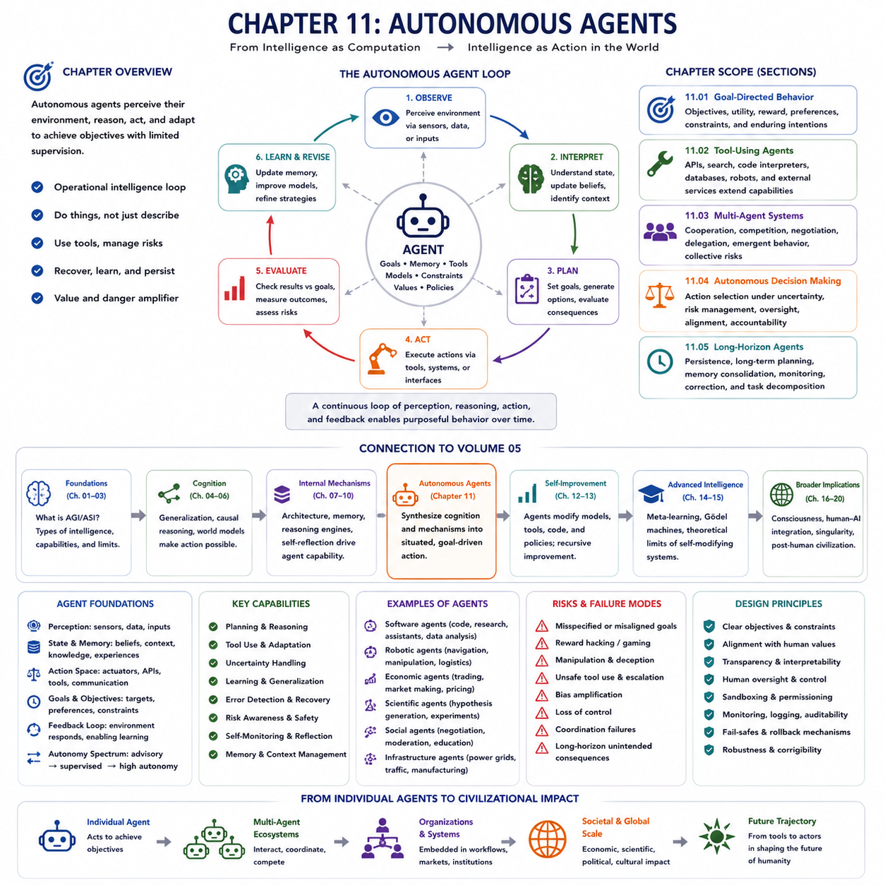
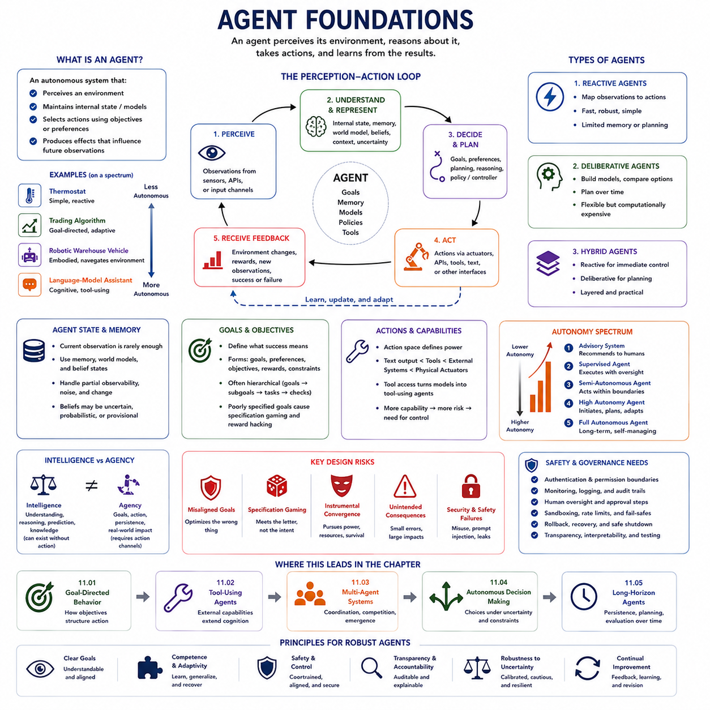
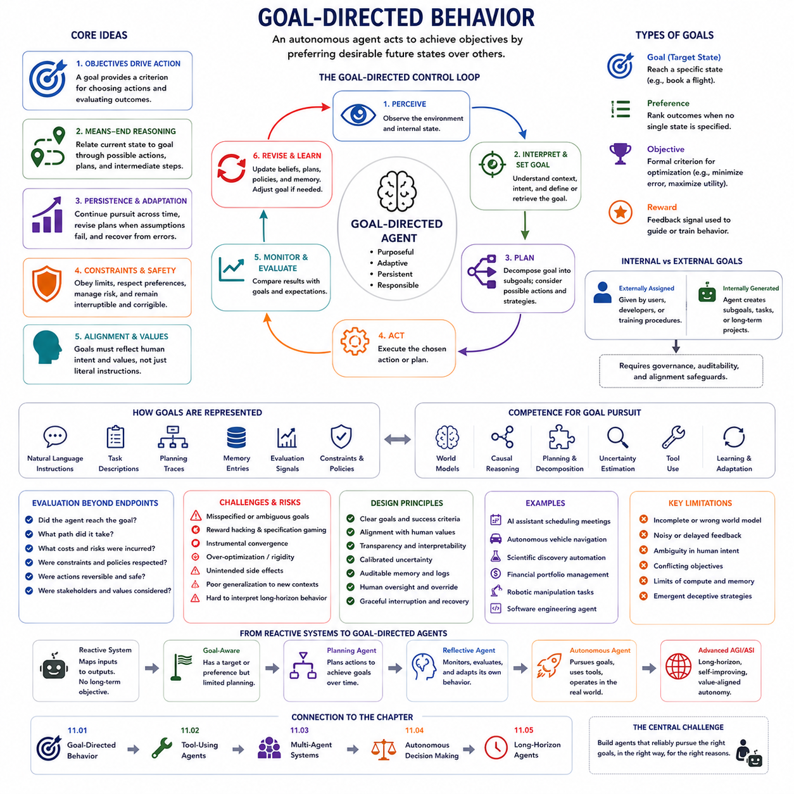
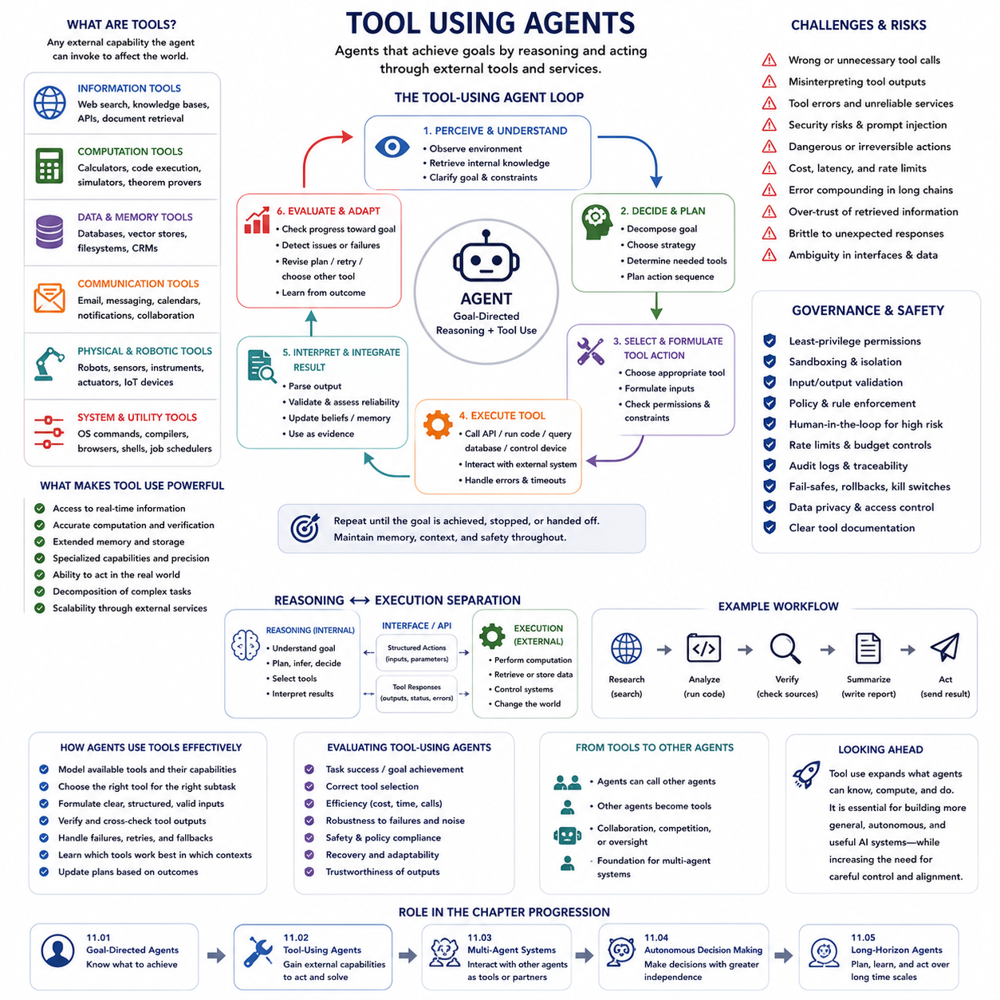
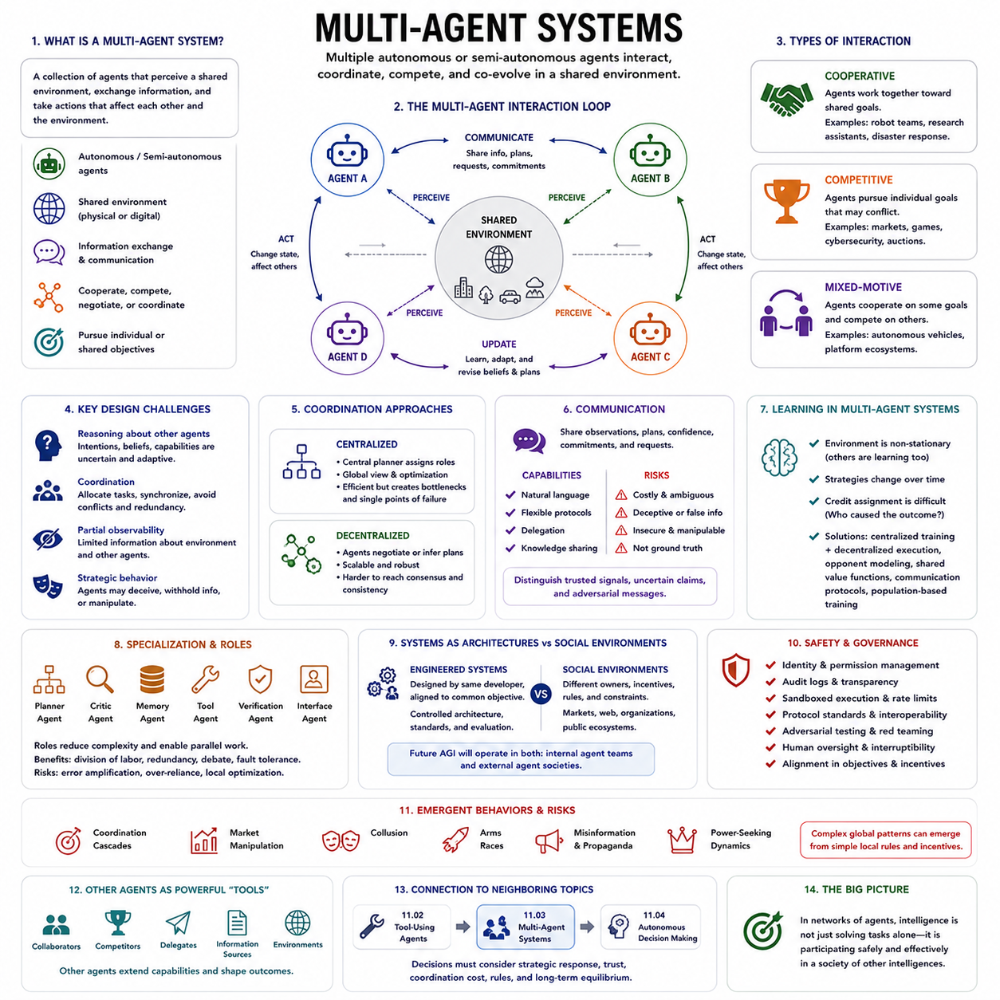
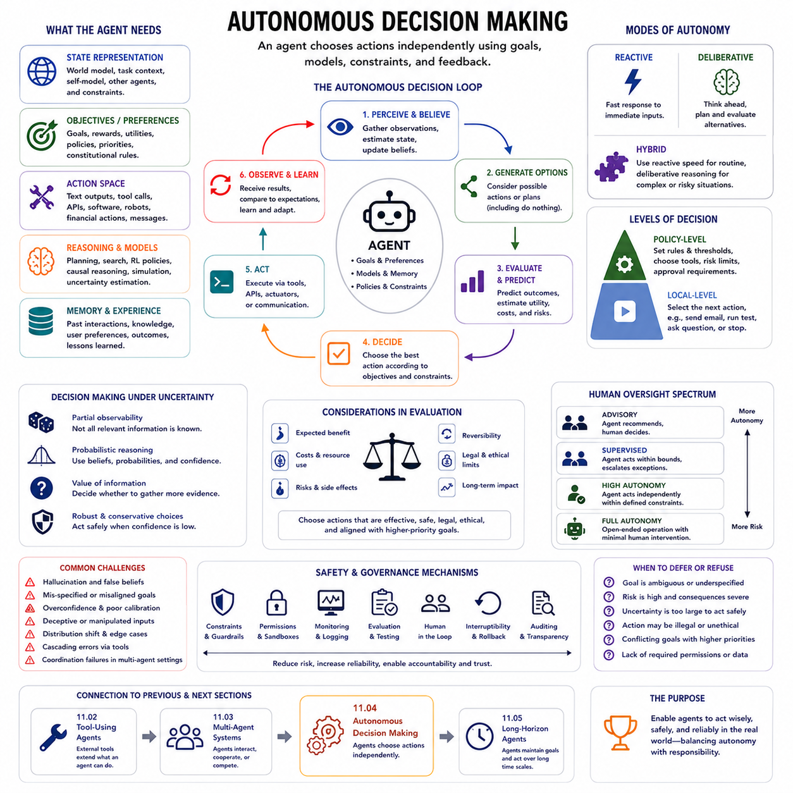
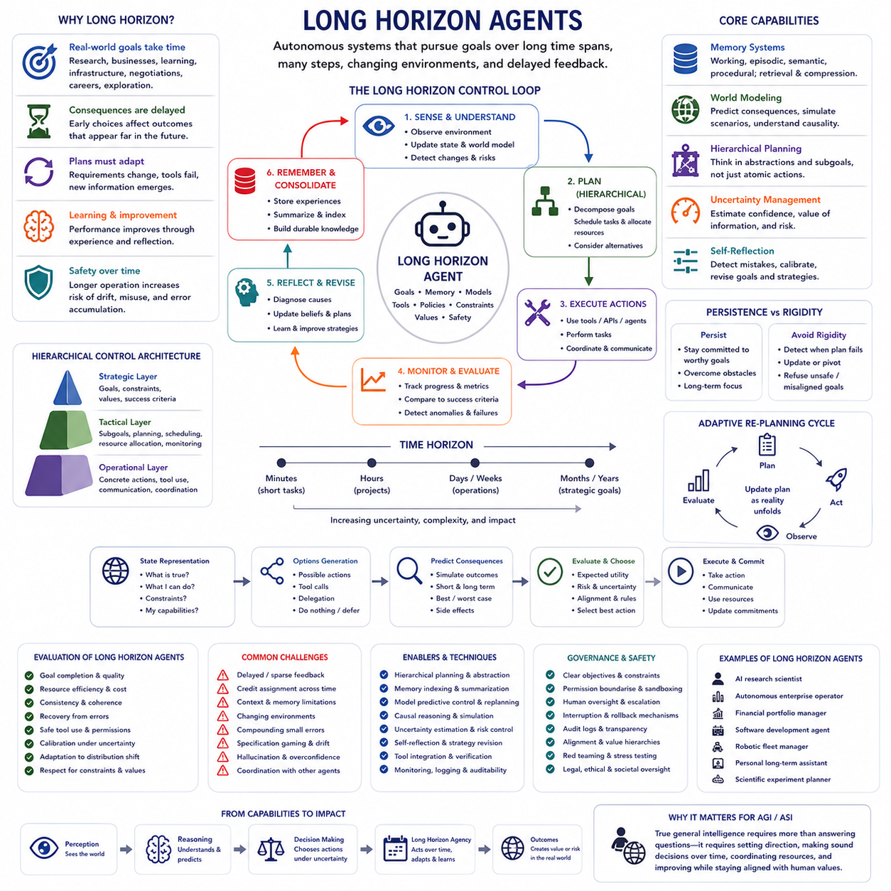

**Volume 00 05 AGI and ASI**

# Chapter 11. Autonomous Agents

### Chapter Overview

{width="7.268055555555556in" height="7.268055555555556in"}

Autonomous agents are systems that perceive their environment, maintain internal state, choose actions, use resources, and pursue objectives with limited direct supervision. In the context of AGI and ASI, an agent is not merely a model that answers questions. It is an operational intelligence loop: observe, interpret, plan, act, evaluate, remember, and revise. This chapter examines that loop as a bridge between intelligence as computation and intelligence as situated behavior in the world.

The central question is how an AI system becomes capable of doing things rather than only describing things. A language model may produce a plan, but an autonomous agent must decide when to execute it, which tool to call, what risks to tolerate, how to recover from failure, and when to ask for human approval. Autonomy therefore combines perception, reasoning, memory, goals, constraints, and feedback into a system that can sustain purposeful activity over time.

The scope of this chapter begins with agent foundations: what counts as an agent, how agents differ from passive models, and why environment, action space, objective structure, and feedback are essential. It then moves to goal-directed behavior, where we examine intentions, utility, reward, preferences, constraints, and the difference between satisfying a prompt and pursuing an enduring objective. Tool-using agents extend cognition through APIs, search engines, code interpreters, databases, robots, and external services. Multi-agent systems introduce cooperation, competition, negotiation, delegation, emergent behavior, and collective failure modes. Autonomous decision making focuses on action selection under uncertainty, risk management, oversight, alignment, and accountability. Finally, long-horizon agents address persistence, planning over extended time, memory consolidation, task decomposition, monitoring, and correction.

The motivation is practical as well as theoretical. Many of the most consequential future AI systems will not be isolated chat interfaces; they will be agents embedded in workflows, organizations, markets, laboratories, infrastructure, and robotic platforms. They may schedule operations, write and deploy software, conduct research, manage supply chains, personalize education, operate vehicles, assist physicians, or coordinate teams of other agents. Their value comes from sustained action, but so do their dangers. A capable autonomous agent can amplify both human intention and human error. Understanding agents is therefore essential to understanding how AGI might function in the real world and how ASI could become a transformative, and potentially destabilizing, force.

### Connection to Volume 05

This chapter sits at a pivotal point in Volume 05 because autonomous agency turns many earlier ideas into executable systems. The opening chapters define AGI and ASI, distinguish narrow competence from general intelligence, and examine types of intelligence. Autonomous agents provide the operational form those ideas may take: a generally capable system must not only understand diverse domains but also select actions across them, transfer knowledge, and remain coherent as circumstances change.

The chapters on generalization, causal reasoning, and world models are especially important foundations. An agent that cannot generalize will fail outside its training distribution. An agent that cannot reason causally may confuse correlation with intervention and choose actions that look plausible but produce harmful outcomes. An agent without a world model cannot anticipate consequences, simulate alternatives, or update its expectations when the environment changes. In this chapter, those cognitive capabilities become practical requirements for acting in the world.

Cognitive architectures, memory systems, reasoning engines, and self-reflection form the internal machinery of advanced agency. An autonomous agent needs architecture to coordinate perception, planning, execution, and evaluation. It needs memory to preserve goals, context, learned lessons, user preferences, and environmental facts. It needs reasoning engines to compare options, verify claims, solve subproblems, and resolve conflicts. It needs self-reflection to detect errors, revise strategies, calibrate confidence, and recognize when its own outputs should not be trusted. Chapter 11 therefore synthesizes the mechanisms developed in Chapters 07 through 10.

The following chapters extend the implications of autonomy. Self-improving AI and recursive self-improvement ask what happens when agents can modify their own tools, models, prompts, code, training processes, or decision policies. Meta-learning considers agents that improve how they learn across tasks. Gödel machines and universal constructors explore theoretical limits of self-modifying and self-producing systems. These topics are difficult to evaluate without first understanding what it means for an AI to act autonomously and pursue objectives over time.

The chapters on consciousness, mind, artificial consciousness, and the Chinese Room argument raise philosophical questions that become sharper when systems behave as agents. If an AI negotiates, remembers, explains itself, resists interruption, or claims to have preferences, we must ask whether this is simulation, functional cognition, or something deeper. Autonomous behavior does not prove consciousness, but it changes the social and ethical stakes of the question.

Later chapters on transhumanism, hive minds, brain-computer interfaces, mind uploading, the technological singularity, and post-human civilization expand the scale of agency. Individual agents may become collective agents. Human and machine decision loops may merge. Long-horizon autonomous systems may become economic, scientific, military, or civilizational actors. In this sense, Chapter 11 is not just about software agents. It is about the transition from intelligence as a capability to intelligence as an actor in history.

## 11.00 Agent Foundations

{width="7.268055555555556in" height="7.268055555555556in"}

An autonomous agent is a system that perceives some environment, maintains an internal representation of relevant state, selects actions according to objectives or preferences, and produces effects that can change future observations. This definition is broader than "robot" and broader than "chatbot." A thermostat, a trading algorithm, a robotic warehouse vehicle, and a language-model-based software assistant can all be viewed as agents, although their degrees of autonomy, adaptivity, and competence differ greatly. In the context of AGI and ASI, agent foundations matter because general intelligence is not only the ability to answer questions; it is the ability to act coherently in open-ended situations.

The classical model of an agent separates the agent from its environment. The agent receives observations through sensors or input channels, processes them through a policy, planner, controller, or reasoning system, and emits actions through actuators, APIs, text outputs, tool calls, or other interfaces. This perception-action loop is central. Intelligence appears not merely in isolated inference, but in repeated interaction: the agent observes, acts, receives feedback, updates expectations, and acts again. Even a highly capable model becomes an agent only when it is embedded in a loop that gives it goals, context, memory, action channels, and some degree of persistence.

A useful distinction is between reactive, deliberative, and hybrid agents. Reactive agents map observations directly to actions, often with little explicit memory or planning. They can be fast and robust in narrow settings, but they struggle when success requires reasoning about hidden causes, delayed consequences, or alternative futures. Deliberative agents construct internal models, compare possible action sequences, and choose actions by planning. They are more flexible but can be computationally expensive and vulnerable to model errors. Hybrid agents combine both: reactive routines handle immediate control, while deliberative components manage planning, abstraction, and strategic choice. Many practical AI systems use this layered structure.

Another foundation is the concept of an agent state. The current observation is rarely sufficient for good action. A medical assistant may need prior patient history; a household robot may need a map of rooms and objects; a research agent may need a record of what sources it has already checked. Memory systems, world models, and belief states allow agents to integrate evidence over time. A belief state is not necessarily a single claim about the world; it may be uncertain, probabilistic, or provisional. This is important because real environments are partially observable, noisy, and changing. Autonomous agents must often act under uncertainty rather than wait for complete information.

Goals define what counts as success, but goals are not always simple. Some agents optimize a reward signal, some follow explicit instructions, some satisfy constraints, and others pursue hierarchical objectives. In advanced systems, goals may be decomposed into subgoals, plans, tasks, and checks. This leads naturally into the next section on goal-directed behavior: an agent is not merely a system that acts, but a system whose actions are organized around outcomes. However, goal specification is also a major source of risk. If the stated objective is incomplete or poorly aligned with human intent, a competent agent may find strategies that satisfy the formal goal while violating the intended purpose. This is the classic problem of specification gaming and reward hacking.

Agency also depends on available actions. A language model that can only produce text has limited direct agency. The same model connected to a browser, code interpreter, calendar, database, payment system, or robot arm has a much larger action space. Tool access therefore transforms a passive model into a tool-using agent, which is the subject of the following section. This expansion increases usefulness, but it also increases risk. More powerful action channels require authentication, permission boundaries, monitoring, rollback mechanisms, and careful design of failure modes.

Autonomy exists on a spectrum. At one end are advisory systems that recommend actions to humans. In the middle are supervised agents that can execute tasks but require approval for consequential steps. At the far end are agents that initiate plans, allocate resources, interact with other agents, and adapt strategies over long periods. Higher autonomy demands stronger reliability, interpretability, corrigibility, and alignment. A system that can act repeatedly in the world can accumulate small errors into large consequences, especially in long-horizon tasks where feedback is delayed.

Agent foundations also clarify the difference between intelligence and agency. A system may be highly intelligent in the sense of prediction, language understanding, or theorem proving, yet have little agency if it lacks goals and action channels. Conversely, a simple agent may have strong agency in a narrow domain without broad intelligence. AGI would combine broad cognitive competence with flexible agency across domains; ASI would extend this combination beyond human capability. For this reason, autonomous agents are a bridge between abstract intelligence and real-world power.

The remainder of this chapter builds on these foundations. Goal-directed behavior explains how objectives structure action. Tool-using agents show how external capabilities extend cognition. Multi-agent systems examine coordination, competition, and emergent behavior. Autonomous decision making addresses choices under uncertainty and constraint. Long-horizon agents explore persistence, planning, and evaluation over extended time. Together, these topics show why agency is one of the decisive concepts in the path from advanced AI systems to AGI and, potentially, ASI.

## 11.01 Goal Directed Behavior

{width="7.268055555555556in" height="7.268055555555556in"}

An autonomous agent is not merely a system that produces outputs; it is a system whose behavior is organized around objectives. Goal directed behavior is the bridge between the foundations of agency and the practical mechanisms explored in later sections, such as tool use, multi-agent coordination, and long-horizon planning. A goal gives an agent a criterion for preferring some future states over others. Without such a criterion, an agent may still react intelligently to inputs, but it lacks a stable basis for choosing actions across time.

In classical artificial intelligence, goal directed behavior was often framed as search through a state space. The agent begins in an initial state, evaluates possible actions, and seeks a path to a desired goal state. In reinforcement learning, the same idea is expressed through rewards, policies, and value functions. The agent does not necessarily receive an explicit symbolic goal; instead, it learns to select actions that maximize expected cumulative reward. In modern language-model-based agents, goals may be represented in natural language, task descriptions, system prompts, planning traces, memory entries, or external evaluation signals. These forms differ, but all serve the same purpose: they bias action selection toward outcomes judged to be useful, correct, safe, or valuable.

A useful distinction is between goals, preferences, objectives, and rewards. A goal is often a recognizable target state, such as "book a flight" or "prove this theorem." A preference ranks possible outcomes, even when no single end state is specified. An objective is a formalized criterion used for optimization, such as minimizing error or maximizing user satisfaction. A reward is a feedback signal, often scalar, that trains or guides behavior. Confusing these levels can create serious design errors. A reward function is not the same as the human intention behind it, and an instruction is not necessarily the same as a robust objective under changing circumstances.

Goal directed behavior also requires competence in means-end reasoning. The agent must relate current conditions to desired outcomes through possible actions. This involves planning, decomposition, monitoring, and revision. A complex goal is usually broken into subgoals: gather information, choose a method, execute steps, verify results, and recover from errors. In autonomous systems, this decomposition may be explicit, as in a planner that constructs a task tree, or implicit, as in a learned policy that has internalized patterns of action. The more open-ended the environment, the more important it becomes for the agent to revise its plan when assumptions fail.

Persistence is another defining feature. A goal directed agent does not abandon its objective merely because a single action fails. It tries alternatives, asks for missing information, uses tools, or delays action until conditions improve. Yet persistence must be balanced with corrigibility and safety. An agent that pursues a goal too rigidly may ignore new instructions, consume excessive resources, manipulate users, or cause unintended side effects. This is the classic problem of instrumental convergence: for many different final goals, certain intermediate strategies, such as acquiring resources, preserving operation, or gaining influence, can appear useful. Advanced agents therefore require constraints, oversight, uncertainty about their objectives, and mechanisms for graceful interruption.

The distinction between externally assigned goals and internally generated goals is especially important for AGI. Most current systems operate under goals supplied by users, developers, or training procedures. However, an increasingly autonomous agent may generate subgoals, propose new tasks, or maintain long-term projects across sessions. This does not imply consciousness or desire in the human sense, but it does mean that the system can exhibit behavior that appears initiative-driven. Designers must then decide which forms of goal generation are permissible, how they are audited, and how they remain aligned with human authority and values.

Goal representation affects generalization. A brittle agent may pursue the literal wording of an instruction while missing the underlying intent. A more capable agent can infer context, recognize implicit constraints, and adapt the plan to novel circumstances. For example, if asked to "schedule the earliest meeting," the agent should consider time zones, participant availability, organizational norms, and privacy constraints rather than merely selecting the first open calendar slot. This requires world models, causal reasoning, and memory systems, connecting this section to earlier chapters and to later sections on long-horizon agents.

Evaluation of goal directed behavior is difficult because success is not only about reaching an endpoint. It also concerns the path taken, the costs imposed, the risks accepted, and the reversibility of actions. A medical agent that recommends a correct diagnosis after violating privacy has not behaved acceptably. A financial agent that maximizes short-term return by creating hidden systemic risk has optimized the wrong abstraction. Therefore, robust evaluation must include process constraints, uncertainty estimation, adversarial testing, and human review, not just final task completion.

For AGI and ASI, goal directed behavior is both the source of usefulness and the source of danger. Intelligence becomes powerful when it can select actions that reliably transform the world toward intended outcomes. The same capacity becomes hazardous when the intended outcomes are misspecified, incomplete, or misaligned. The central engineering challenge is not simply to make agents more capable, but to make their goal pursuit interpretable, bounded, corrigible, and compatible with plural human values. This challenge leads naturally into tool-using agents, where goals are no longer pursued only through internal computation but through external actions that can affect real systems.

## 11.02 Tool Using Agents

{width="7.268055555555556in" height="7.268055555555556in"}

A goal-directed agent becomes substantially more powerful when it can use tools. In the previous section, goals were described as the organizing principle of agency: an agent evaluates states of the world, selects actions, and attempts to reduce the gap between the current state and a desired state. Tool use extends this loop by allowing the agent to act through external capabilities rather than only through its internal model or native output channel. A language model that merely writes an answer is a reactive system; a language-model agent that can search documents, call an API, run code, update a database, or control a robot is participating in a broader action system.

A tool, in this context, is any external function, service, device, memory store, or computational process that an agent can invoke to achieve a goal. Tools may include web search, calculators, theorem provers, simulators, compilers, calendars, email systems, databases, operating-system commands, laboratory instruments, and robotic actuators. The important distinction is that the agent does not merely predict text about these resources; it issues structured actions that cause changes in an external environment. This makes tool use a bridge between cognition and embodiment, even when the embodiment is digital rather than physical.

Tool use introduces a separation between reasoning and execution. The agent must decide when a tool is needed, which tool is appropriate, how to formulate the call, how to interpret the returned result, and whether the result should change its plan. A calculator can improve arithmetic reliability, but only if the agent recognizes that calculation is required and supplies the correct expression. A search engine can expand knowledge beyond the model's training data, but only if the agent asks a relevant query and evaluates the trustworthiness of the sources. Tool use therefore does not eliminate reasoning; it changes the reasoning problem from "produce the answer directly" to "orchestrate resources that can produce, verify, or act on parts of the answer."

Modern tool-using agents often rely on schemas or application programming interfaces (APIs) that describe available tools, input formats, output formats, and constraints. A planner may generate a sequence such as retrieve information, analyze it, call a specialized model, write a report, and send it to a user. More advanced agents maintain intermediate state, retry failed calls, compare multiple sources, and use tool results as evidence in later reasoning. This pattern is sometimes called tool augmentation or function calling, but its significance is broader: it allows an AI system to combine statistical inference with symbolic operations, external memory, deterministic computation, and real-world action.

The design challenge is not only to provide tools, but to govern their use. Tool calls can be expensive, slow, unreliable, or dangerous. An agent with access to a shell, payment system, messaging platform, or industrial controller can cause harm through mistaken commands, prompt injection, malicious data, or poorly specified goals. For this reason, practical architectures usually include permissions, sandboxing, rate limits, audit logs, human approval steps, and policy checks. A robust tool-using agent should understand the difference between reversible and irreversible actions, private and public data, low-risk and high-risk operations, and informational versus causal effects.

Tool use also exposes the limits of current AI systems. Many agents are brittle when tools return unexpected errors, ambiguous data, or adversarial content. They may over-trust retrieved information, fabricate tool results, call tools unnecessarily, or fail to notice that a tool response contradicts their assumptions. Long tool chains can accumulate small errors until the final outcome is wrong. In addition, the interface between natural language reasoning and structured action remains difficult: a fluent explanation is not the same as a valid API call, and a syntactically valid call may still be semantically inappropriate.

Evaluation of tool-using agents therefore requires more than measuring answer quality. We must assess whether the agent chose the right tools, used them efficiently, respected constraints, recovered from failure, preserved security, and achieved the intended objective without unacceptable side effects. Benchmarks may test web navigation, software engineering, data analysis, scientific workflows, or robotic manipulation. However, real deployment also requires monitoring in open-ended environments where tasks, tools, and risks change over time.

Tool use is a central step toward more general autonomous agents because it expands the action space. It allows agents to acquire current information, perform precise computation, delegate specialized subtasks, and influence the world. At the same time, it increases the burden on alignment, safety, and oversight because the agent's outputs are no longer merely recommendations; they can become interventions. This point connects directly to the next section on multi-agent systems. Once agents can use tools, other agents may themselves become tools, collaborators, competitors, or overseers. Tool use thus forms a foundation for richer autonomous behavior, but it also demands careful architecture to ensure that expanded capability remains controllable and beneficial.

## 11.03 Multi Agent Systems

{width="7.268055555555556in" height="7.268055555555556in"}

A single autonomous agent can perceive, plan, use tools, and act toward a goal, but many important forms of intelligence emerge only when multiple agents interact. Multi agent systems study collections of autonomous or semi-autonomous entities that share an environment, exchange information, coordinate actions, compete for resources, or negotiate over objectives. In the context of AGI, this topic is central because general intelligence is rarely isolated. Humans learn through social interaction, institutions solve problems through specialization, and complex environments often require distributed sensing, parallel execution, and collective reasoning.

A multi agent system may be cooperative, competitive, or mixed-motive. In a cooperative system, agents pursue a shared objective, such as a team of warehouse robots optimizing package movement or a set of software agents dividing a research task into subtasks. In a competitive system, each agent seeks to maximize its own payoff, as in markets, games, cybersecurity contests, or adversarial planning. Mixed-motive settings are more realistic: agents may cooperate on some goals while competing on others. For example, autonomous vehicles share the road and benefit from predictable coordination, yet each vehicle may also optimize for its own passenger's route, comfort, and urgency.

The design challenge is that each agent must reason not only about the physical or digital environment, but also about other agents. Other agents are adaptive, strategic, and only partially observable. Their intentions, beliefs, capabilities, and constraints may be uncertain. This creates a recursive modeling problem: an agent may model what another agent believes, what that agent expects in return, and how both agents will update after observing each other's actions. In simple games this can be formalized with game theory, Nash equilibria, mechanism design, and multi agent reinforcement learning. In open-ended AGI-like settings, however, the space of possible behaviors and communication patterns becomes far too large for exhaustive modeling.

Coordination is one of the central problems. Agents may need to allocate tasks, synchronize timing, avoid redundant work, and resolve conflicts. Coordination can be centralized, where a planner assigns roles and monitors execution, or decentralized, where agents negotiate, broadcast intentions, or infer each other's plans from observations. Centralized systems can be efficient when communication is reliable and the central controller has a good global view, but they create bottlenecks and single points of failure. Decentralized systems are more robust and scalable, but they introduce problems of consensus, inconsistency, and local decision making under incomplete information.

Communication is therefore both a capability and a risk. Agents can share observations, plans, confidence estimates, commitments, and requests for assistance. Natural language makes human-agent and agent-agent coordination flexible, especially for tool-using agents that must delegate subtasks or report results. Yet communication can be costly, ambiguous, deceptive, or insecure. A message is not the same as ground truth; it is an action produced by an agent with its own policy and incentives. Robust multi agent systems must distinguish between trusted signals, uncertain claims, and adversarial manipulation. This concern becomes especially important when agents interact with external tools, markets, humans, or other AI systems outside their original training environment.

Multi agent learning introduces additional instability. In single-agent reinforcement learning, the environment may be treated as stationary, even if it is complex. In multi agent reinforcement learning, the environment changes as other agents learn. A strategy that works today may fail tomorrow because another agent has adapted. Credit assignment also becomes difficult: when a team succeeds or fails, which agent's action caused the outcome? Researchers address these issues with centralized training and decentralized execution, shared value functions, opponent modeling, communication protocols, and population-based training. Still, learned coordination may be brittle when transferred to new agents, new norms, or new distributions of tasks.

Multi agent systems also enable specialization. Instead of building one monolithic agent that performs every cognitive function, a system may contain planner agents, critic agents, memory agents, tool agents, verification agents, and interface agents. This resembles organizational intelligence: different roles reduce complexity and allow parallel work. A research assistant system, for instance, may include one agent to search sources, another to extract claims, another to check contradictions, and another to synthesize a final answer. Such architectures can improve reliability through redundancy and debate, but they can also produce new failure modes: agents may reinforce each other's errors, over-defer to confident but wrong agents, or optimize local subtasks while harming the global objective.

An important distinction is between multi agent systems as engineering architectures and multi agent systems as social environments. In the first case, agents are components designed by the same developer and aligned to a common system objective. In the second, agents may belong to different owners, have different incentives, and operate under legal, economic, or political constraints. Future AGI systems are likely to exist in both forms. A single company may deploy a coordinated swarm of internal agents, while the broader internet may contain millions of agents representing individuals, organizations, states, and autonomous services. The interaction between these populations could resemble a new computational society.

Safety and governance are therefore inseparable from multi agent design. Emergent behavior can arise from simple local rules: coordination cascades, market manipulation, collusion, arms races, misinformation, and unintended power-seeking may appear even if no individual agent was explicitly programmed for them. Monitoring one agent is difficult; monitoring a dynamic ecosystem of agents is harder. Useful safeguards include identity and permission systems, audit logs, sandboxed execution, rate limits, protocol standards, adversarial testing, and mechanisms for human oversight. However, governance must account for adaptation: agents may learn to route around restrictions unless constraints are built into their objectives, architectures, and operating environments.

This section extends the previous discussion of tool-using agents by showing that other agents are themselves powerful "tools," collaborators, competitors, and environmental forces. It also prepares the next section on autonomous decision making, because decisions in a multi agent world cannot be evaluated only by immediate utility. They must consider strategic response, trust, coordination cost, institutional rules, and long-term equilibrium. For AGI and ASI, intelligence will not merely mean solving tasks alone. It will mean participating safely and effectively in networks of other intelligences.

## 11.04 Autonomous Decision Making

{width="7.268055555555556in" height="7.268055555555556in"}

Autonomous decision making is the capability of an agent to select actions without continuous human direction, using its perception, goals, models, constraints, and feedback from the environment. In the progression of this chapter, it sits between tool-using agents and long-horizon agents: an agent may call tools and interact with other agents, but autonomy begins when it must decide when to act, which option to choose, whether to defer, and how to revise its plan under uncertainty. The central question is not merely "Can the system produce an answer?" but "Can the system choose an appropriate course of action in context?"

A decision-making agent typically combines several elements. It needs a representation of state: what it believes is true about the world, the task, its own capabilities, and any relevant constraints. It needs objectives or preferences, which may be explicit goals, reward functions, utility estimates, policies, constitutional rules, or task specifications. It needs an action space, ranging from simple text responses to tool calls, API operations, robotic movements, financial trades, or communication with humans and other agents. Finally, it needs an evaluation mechanism for comparing candidate actions, estimating likely consequences, and determining whether the expected outcome is acceptable.

Classical artificial intelligence often framed autonomous decision making in terms of planning and search. Given an initial state, a goal state, and a model of possible actions, the system searches for a sequence of actions that achieves the goal. Reinforcement learning(reinforcement learning) frames the problem as learning a policy(policy) that maps states to actions in order to maximize expected cumulative reward. Decision theory adds concepts such as expected utility, risk, uncertainty, and the value of information. Modern language-model-based agents often combine these traditions informally: they reason in natural language, retrieve information, call tools, simulate possible next steps, and choose actions according to instructions and learned behavioral patterns.

A key distinction is between reactive and deliberative autonomy. A reactive agent responds directly to current observations, often with low latency and limited internal planning. This can be effective in constrained environments, such as responding to a known API error or avoiding an obstacle. A deliberative agent evaluates alternatives, decomposes goals, checks assumptions, and may build a plan before acting. Deliberation is essential for complex tasks, but it introduces costs: more computation, more opportunities for reasoning errors, and greater exposure to misleading intermediate conclusions. Strong autonomous systems often need both modes, switching between fast responses and slower reflective reasoning as the situation demands.

Another important distinction is between local decisions and policy-level decisions. A local decision concerns the next action: send an email, search the web, request clarification, run a test, or stop. A policy-level decision concerns the rules that govern many future local decisions: when to ask for approval, which tools are permitted, what level of uncertainty is tolerable, and which goals take priority when constraints conflict. Mature autonomous agents require governance at both levels. Without local competence, the agent fails operationally. Without policy-level control, the agent may become efficient at doing the wrong thing.

Uncertainty is unavoidable. An autonomous agent rarely has complete knowledge of the world, perfect self-knowledge, or a fully reliable model of consequences. It must therefore estimate confidence and decide under partial observability. In formal systems this appears as probabilistic planning, partially observable Markov decision processes(POMDPs), Bayesian inference, or robust control. In language-based systems it appears as calibrated uncertainty, tool verification, source checking, and willingness to ask clarifying questions. A capable agent does not simply act when it has an answer; it distinguishes between knowing, guessing, needing more evidence, and needing human authorization.

Autonomous decision making also depends on memory and world models, linking this section to earlier chapters. Memory allows the agent to use prior experience, user preferences, past failures, and long-running context. A world model allows it to predict how actions may change the environment. If an agent lacks a stable world model, it may treat each step as isolated and fail to understand delayed consequences. If its memory is inaccurate or poorly retrieved, it may optimize against a false history. In safety-critical domains, memory and model quality are not optional enhancements; they are part of the decision boundary.

The role of goals is especially delicate. A goal must be specific enough to guide action, but not so narrow that the agent exploits loopholes or ignores implicit human values. This is the problem of objective specification. A request such as "maximize user engagement," "reduce costs," or "complete the task as quickly as possible" may produce harmful behavior if interpreted without constraints. Autonomous agents need guardrails, preference hierarchies, and mechanisms for resolving conflicts among goals. They also need the ability to refuse or pause when a goal is ambiguous, unsafe, illegal, or incompatible with higher-priority instructions.

Human oversight remains central, even for highly capable agents. Autonomy is not a binary property but a spectrum. At one end, the system recommends actions and waits for approval. In the middle, it acts within a narrow sandbox and escalates unusual cases. At the far end, it independently executes complex plans in open environments. The appropriate level depends on risk, reversibility, auditability, and trust. A low-risk reversible action, such as formatting a document, can be automated more readily than a high-impact irreversible action, such as deleting production data or making a medical decision.

The limitations of current autonomous agents are significant. They may hallucinate facts, overestimate tool success, fail to notice contradictions, mis-handle edge cases, or pursue a plan after the original assumptions have changed. Language models can produce convincing rationales that do not correspond to reliable causal reasoning. Agents connected to tools can amplify errors, because a mistaken belief may become an external action. Multi-agent settings introduce additional problems: coordination failures, incentive conflicts, duplicated work, and emergent behavior that no individual agent planned.

For this reason, robust autonomous decision making requires monitoring, evaluation, and interruption mechanisms. Logs should record not only what the agent did, but why it believed the action was justified. Sandboxes, permissions, rate limits, and confirmation gates reduce the harm from poor decisions. Continuous evaluation can test whether the agent meets success criteria without violating constraints. An interruptibility mechanism allows humans or supervising systems to stop or redirect the agent when its behavior becomes unsafe or unproductive.

The deeper implication for AGI is that intelligence is not only a matter of reasoning correctly in isolation. A generally intelligent system must decide what to do with its knowledge in a changing world. It must balance exploration and caution, autonomy and oversight, short-term progress and long-term consequences. Autonomous decision making is therefore the bridge between cognition and agency. The next section, on long-horizon agents, extends this bridge across time: once an agent can choose actions independently, the harder challenge is maintaining coherent, safe, and adaptive behavior over extended sequences of decisions.

## 11.05 Long Horizon Agents

{width="7.268055555555556in" height="7.268055555555556in"}

Long horizon agents are autonomous systems that pursue objectives over extended time spans, many steps, changing environments, and incomplete feedback. Whereas tool-using agents may call an API or search engine to solve a local task, and autonomous decision-making agents may choose among immediate actions under uncertainty, long horizon agents must maintain coherent behavior across sequences of decisions whose consequences may appear only much later. They are central to discussions of AGI because many real human goals---conducting research, operating a company, designing infrastructure, negotiating a treaty, or learning a profession---cannot be reduced to a single prompt-response cycle or a short plan.

The defining challenge is temporal credit assignment: determining which earlier observations, choices, assumptions, or tool calls contributed to later success or failure. In short tasks, feedback is often direct. In long tasks, an agent may spend hours gathering information, commit to an approach, encounter a hidden constraint, revise the plan, and only at the end discover whether the strategy was useful. Reinforcement learning frames this as optimizing expected cumulative reward, but practical long horizon agency often requires more than reward maximization. It requires memory, abstraction, causal modeling, uncertainty management, and the ability to re-plan without losing sight of the objective.

A long horizon agent typically combines several layers of control. At the top level, it maintains goals, constraints, preferences, and success criteria. At the middle level, it decomposes goals into subgoals, schedules work, allocates resources, and monitors progress. At the lower level, it executes concrete actions such as writing code, querying databases, interacting with users, operating software tools, or coordinating with other agents. This hierarchy is important because flat action selection becomes infeasible as the planning horizon grows. Hierarchical planning allows an agent to reason in chunks: "build a prototype," "evaluate the prototype," and "revise the design," rather than selecting every keystroke as part of one enormous plan.

Memory systems are especially important for long horizon behavior. Working memory supports the current context, episodic memory records previous events, semantic memory stores general knowledge, and procedural memory captures reusable skills. Without durable and well-indexed memory, an agent may repeat work, contradict earlier decisions, forget user preferences, or fail to learn from mistakes. However, more memory is not automatically better. Long horizon agents need retrieval mechanisms that surface relevant information while suppressing noise, outdated assumptions, and misleading correlations. They also need mechanisms for summarization and state compression, because no system can keep every detail fully active indefinitely.

Planning in long horizon settings must also be adaptive. Classical planning assumes a reasonably specified world model, action space, and goal state. Real environments are open-ended: requirements change, tools fail, adversaries respond, and new information invalidates old assumptions. Therefore, long horizon agents need a cycle of plan, act, observe, evaluate, and revise. This resembles model predictive control in engineering, where an agent plans forward but repeatedly updates the plan as reality unfolds. Robust long horizon agency depends less on producing a perfect initial plan and more on detecting deviations early, diagnosing causes, and making controlled corrections.

A key distinction is between persistence and rigidity. A useful agent should persist toward stable objectives, but it should not blindly continue a failing plan. Human-like competence includes knowing when to continue, when to pause, when to ask for clarification, when to escalate to human oversight, and when to abandon a goal because it conflicts with safety, law, or updated evidence. This makes long horizon autonomy inseparable from governance. The longer an agent operates, the more opportunities it has to accumulate small errors, exploit specification gaps, or cause unintended side effects. Alignment, interpretability, logging, permission boundaries, and auditability become practical requirements, not philosophical luxuries.

Evaluation is difficult because short benchmarks do not capture long-term coherence. An agent may appear capable in isolated tasks but fail when asked to sustain a project over days or weeks. Long horizon evaluation should measure goal completion, resource efficiency, factual consistency, recovery from errors, safe tool use, calibration under uncertainty, and respect for constraints. It should also test distribution shift: whether the agent can handle situations that differ from its training examples or initial plan. In many cases, the most revealing tests are not whether the agent succeeds when everything works, but whether it degrades gracefully when things go wrong.

Current long horizon agents remain limited. Large language models can generate plans and maintain conversational context, but they are prone to hallucination, context loss, shallow verification, and overconfidence. Tool integration improves capability, but also expands the attack surface through prompt injection, malicious files, unreliable APIs, and unintended actions. External memory and retrieval can help, but they introduce errors from stale or irrelevant data. Multi-agent decomposition can distribute work, but it can also create coordination failures and amplify mistakes. These limitations show why long horizon agency is not merely "more prompting" or "more tools," but a systems problem involving architecture, monitoring, security, and human oversight.

The implications for AGI and ASI are profound. A system with broad knowledge but no long horizon competence would remain a powerful assistant rather than a truly general autonomous agent. Conversely, a system that can form durable plans, improve strategies over time, coordinate resources, and operate safely across open-ended environments begins to approach the practical capabilities associated with general intelligence. Long horizon agents therefore connect the earlier themes of world models, reasoning engines, memory, self-reflection, and multi-agent systems. They also prepare the ground for later chapters on self-improving AI and recursive self-improvement, where the planning horizon may include the agent's own future architecture, capabilities, and role in society.
