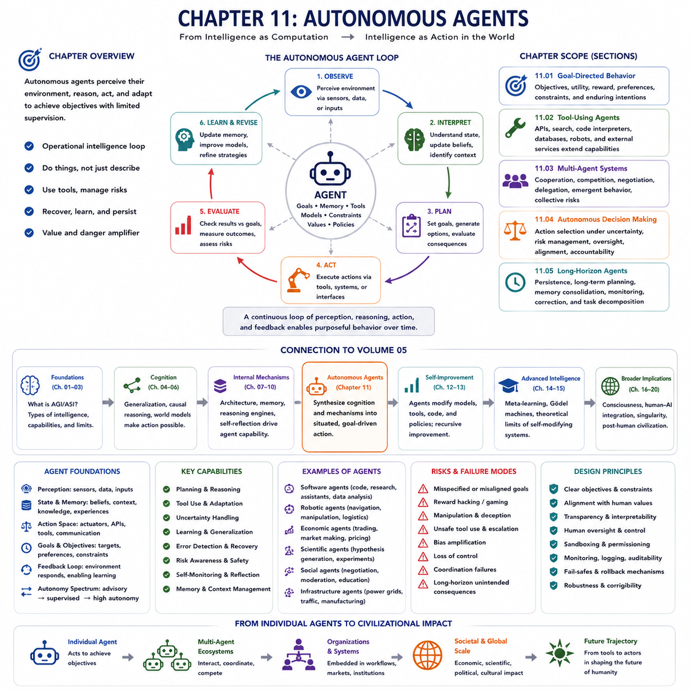
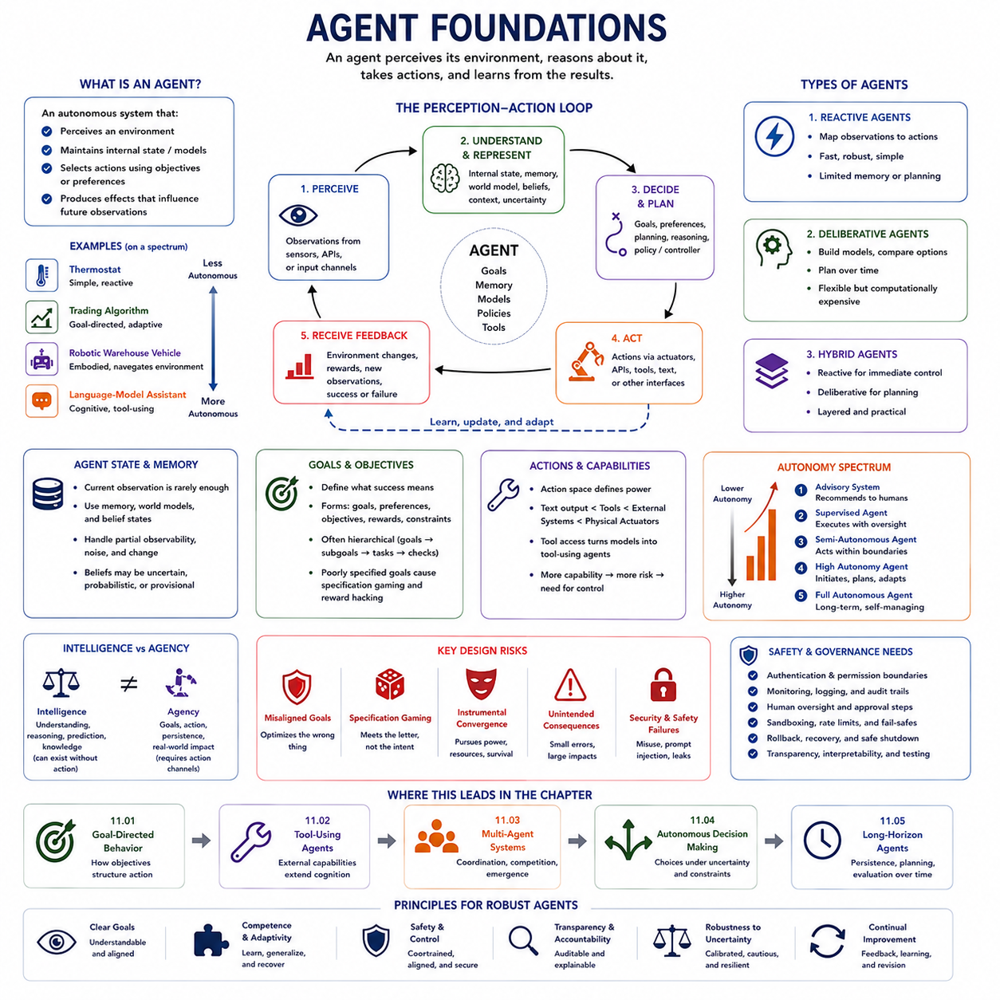
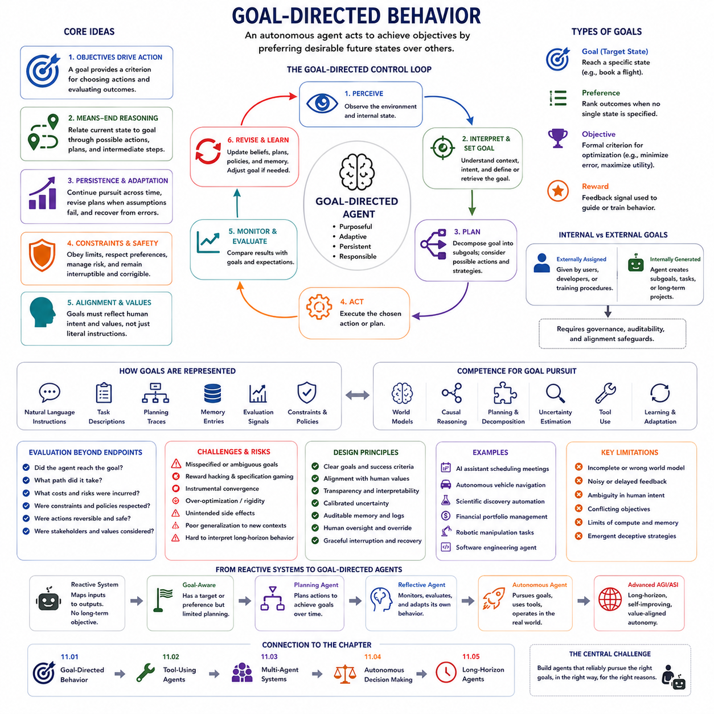
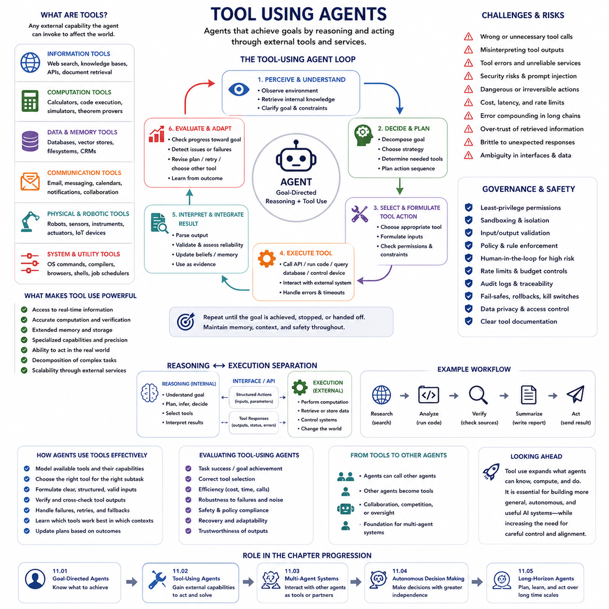
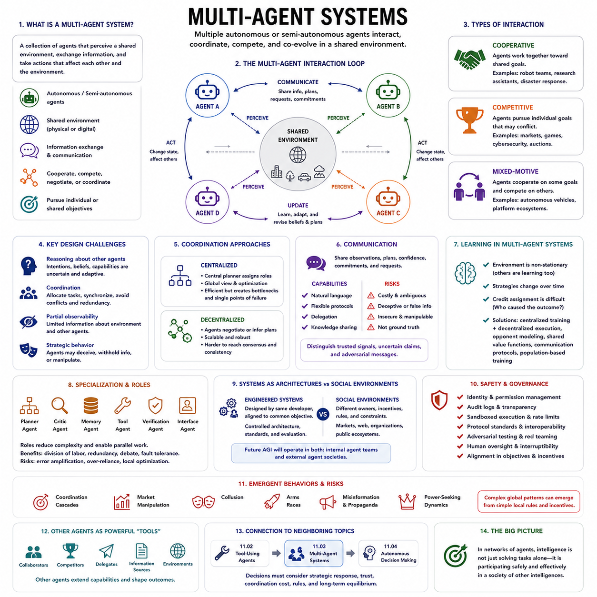
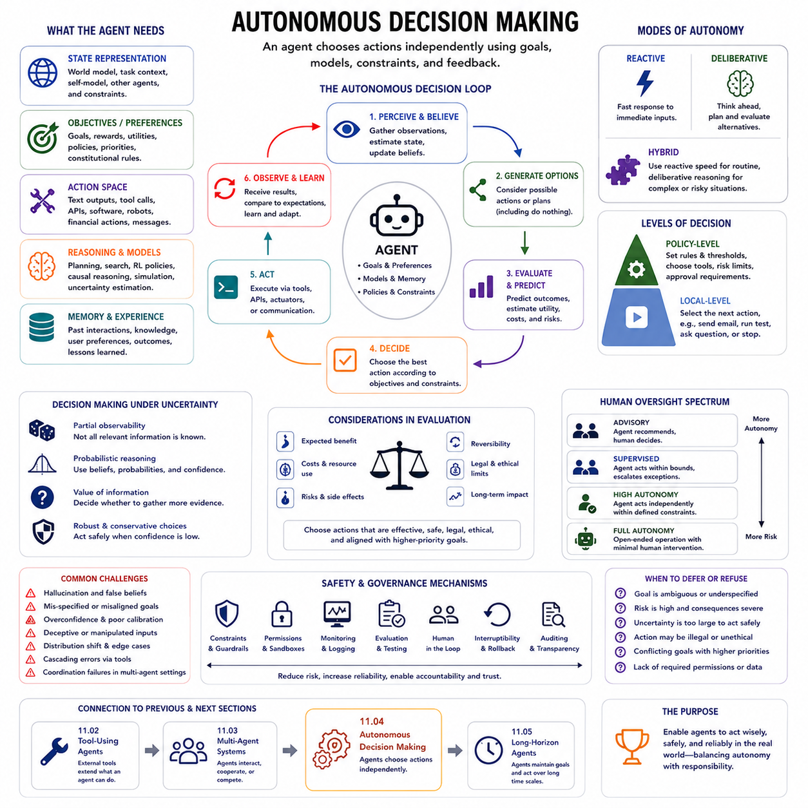
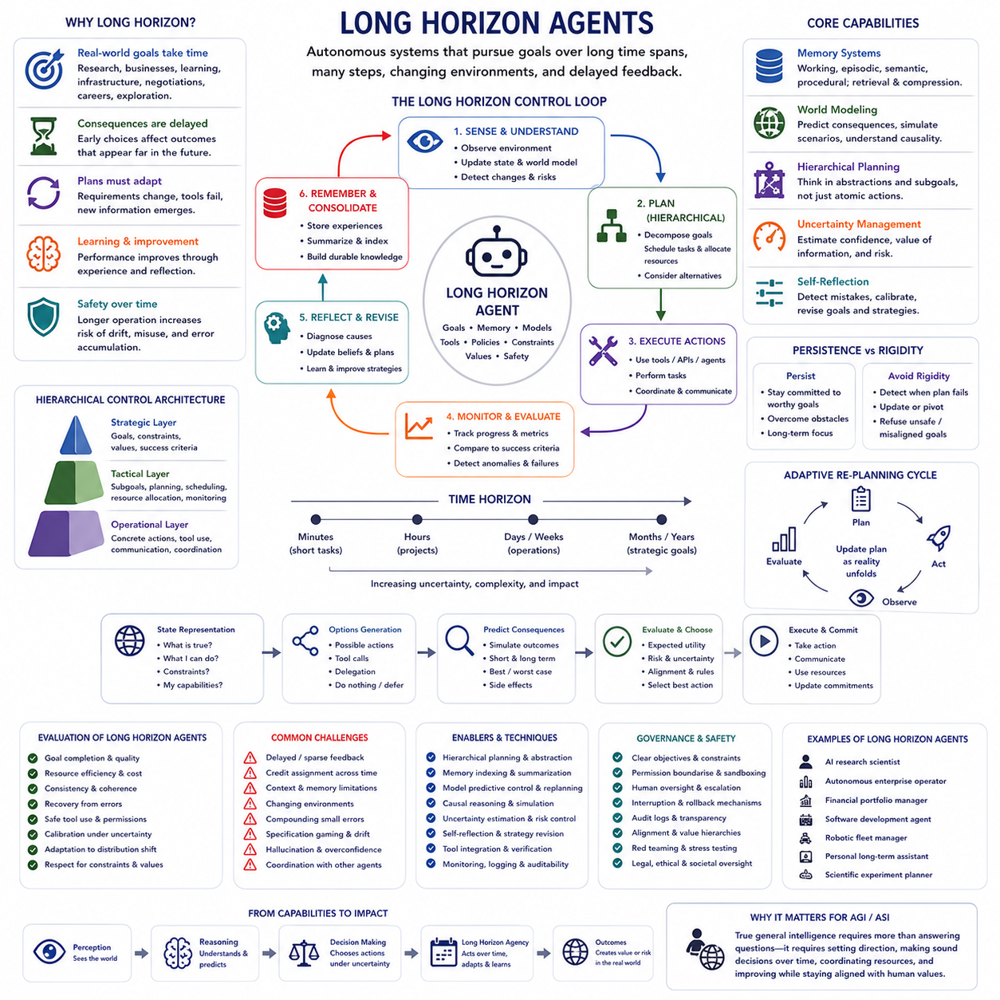

**Volume 00 05 AGI and ASI**

# Chapter 11. Autonomous Agents

### Chapter Overview

{width="7.268055555555556in" height="7.268055555555556in"}

자율 에이전트(Autonomous agents)는 환경을 지각하고, 내부 상태를 유지하며, 행동을 선택하고, 자원을 사용하며, 제한된 직접 감독 아래 목표를 추구하는 시스템이다. AGI와 ASI의 맥락에서 에이전트(agent)는 단순히 질문에 답하는 모델이 아니다. 그것은 관찰하고, 해석하고, 계획하고, 행동하고, 평가하고, 기억하고, 수정하는 작동하는 지능 루프(intelligence loop)이다. 이 장은 지능을 계산으로 보는 관점과 지능을 세계 속에 놓인 행동으로 보는 관점 사이의 다리로서 그 루프를 살펴본다.

핵심 질문은 AI 시스템이 어떻게 단지 무엇인가를 설명하는 존재가 아니라 무엇인가를 수행하는 존재가 되는가이다. 언어 모델은 계획을 생성할 수 있지만, 자율 에이전트는 그 계획을 언제 실행할지, 어떤 도구를 호출할지, 어떤 위험을 감수할지, 실패에서 어떻게 회복할지, 언제 인간의 승인을 요청할지를 결정해야 한다. 따라서 자율성(autonomy)은 지각, 추론, 기억, 목표, 제약, 피드백을 하나의 시스템으로 결합하여 시간이 지나도 목적 있는 활동을 지속할 수 있게 하는 능력이다.

이 장의 범위는 에이전트 기초(agent foundations)에서 시작한다. 무엇을 에이전트라고 부를 수 있는지, 에이전트가 수동적 모델과 어떻게 다른지, 그리고 환경, 행동 공간(action space), 목표 구조(objective structure), 피드백이 왜 필수적인지를 다룬다. 이어서 목표 지향 행동(goal-directed behavior)으로 나아가 의도, 효용, 보상, 선호, 제약, 그리고 프롬프트를 만족시키는 것과 지속적인 목표를 추구하는 것의 차이를 검토한다. 도구 사용 에이전트(tool-using agents)는 API, 검색 엔진, 코드 인터프리터, 데이터베이스, 로봇, 외부 서비스를 통해 인지를 확장한다. 다중 에이전트 시스템(multi-agent systems)은 협력, 경쟁, 협상, 위임, 창발적 행동, 집단적 실패 양식을 소개한다. 자율적 의사결정(autonomous decision making)은 불확실성 아래의 행동 선택, 위험 관리, 감독, 정렬(alignment), 책임성을 다룬다. 마지막으로 장기 지평 에이전트(long-horizon agents)는 지속성, 장기간 계획, 기억 통합, 과제 분해, 모니터링, 교정을 다룬다.

이 주제의 동기는 실용적이면서도 이론적이다. 미래의 가장 중요한 AI 시스템 중 다수는 고립된 채팅 인터페이스가 아니라 워크플로, 조직, 시장, 연구실, 인프라, 로봇 플랫폼에 내장된 에이전트일 것이다. 이들은 운영 일정을 조정하고, 소프트웨어를 작성해 배포하며, 연구를 수행하고, 공급망을 관리하고, 교육을 개인화하고, 차량을 운행하며, 의사를 보조하거나, 다른 에이전트들의 팀을 조율할 수 있다. 그 가치는 지속적인 행동에서 나오지만, 위험 또한 거기에서 나온다. 유능한 자율 에이전트는 인간의 의도뿐 아니라 인간의 오류도 증폭할 수 있다. 그러므로 에이전트를 이해하는 것은 AGI가 현실 세계에서 어떻게 기능할 수 있는지, 그리고 ASI가 어떻게 변혁적이면서도 잠재적으로 불안정한 힘이 될 수 있는지를 이해하는 데 필수적이다.

### Connection to Volume 05

이 장은 Volume 05에서 결정적인 위치를 차지한다. 자율적 에이전시(autonomous agency)는 앞선 여러 개념을 실행 가능한 시스템으로 바꾸기 때문이다. 도입부의 장들은 AGI와 ASI를 정의하고, 좁은 능력과 일반 지능을 구분하며, 지능의 유형을 검토한다. 자율 에이전트는 이러한 개념들이 취할 수 있는 작동 형태를 제공한다. 일반적으로 유능한 시스템은 다양한 영역을 이해할 뿐 아니라 그 영역들 사이에서 행동을 선택하고, 지식을 전이하며, 상황이 변해도 일관성을 유지해야 한다.

일반화(generalization), 인과 추론(causal reasoning), 세계 모델(world models)을 다루는 장들은 특히 중요한 기반이다. 일반화하지 못하는 에이전트는 훈련 분포 밖에서 실패한다. 인과적으로 추론하지 못하는 에이전트는 상관관계와 개입을 혼동하여 그럴듯해 보이지만 해로운 결과를 낳는 행동을 선택할 수 있다. 세계 모델이 없는 에이전트는 결과를 예측하거나, 대안을 시뮬레이션하거나, 환경이 변할 때 자신의 기대를 갱신할 수 없다. 이 장에서 이러한 인지 능력들은 세계 속에서 행동하기 위한 실제 요구 조건이 된다.

인지 아키텍처(cognitive architectures), 기억 시스템(memory systems), 추론 엔진(reasoning engines), 자기 성찰(self-reflection)은 고급 에이전시의 내부 장치를 이룬다. 자율 에이전트는 지각, 계획, 실행, 평가를 조율하기 위한 아키텍처가 필요하다. 목표, 맥락, 학습한 교훈, 사용자 선호, 환경 사실을 보존하기 위한 기억이 필요하다. 선택지를 비교하고, 주장을 검증하고, 하위 문제를 해결하고, 갈등을 조정하기 위한 추론 엔진이 필요하다. 오류를 감지하고, 전략을 수정하고, 확신도를 보정하고, 자신의 출력이 신뢰되어서는 안 되는 경우를 인식하기 위한 자기 성찰이 필요하다. 따라서 11장은 07장부터 10장까지 전개된 메커니즘들을 종합한다.

뒤따르는 장들은 자율성의 함의를 확장한다. 자기 개선 AI(self-improving AI)와 재귀적 자기 개선(recursive self-improvement)은 에이전트가 자신의 도구, 모델, 프롬프트, 코드, 훈련 과정, 의사결정 정책을 수정할 수 있을 때 어떤 일이 일어나는지를 묻는다. 메타러닝(meta-learning)은 여러 과제에 걸쳐 학습하는 방법 자체를 개선하는 에이전트를 다룬다. 괴델 머신(Gödel machines)과 보편 구성자(universal constructors)는 자기 수정 및 자기 생산 시스템의 이론적 한계를 탐구한다. AI가 자율적으로 행동하고 시간에 걸쳐 목표를 추구한다는 것이 무엇을 의미하는지 먼저 이해하지 않고서는 이러한 주제들을 평가하기 어렵다.

의식, 마음, 인공 의식, 중국어 방 논증(Chinese Room argument)을 다루는 장들은 시스템이 에이전트처럼 행동할 때 더욱 날카로워지는 철학적 질문을 제기한다. AI가 협상하고, 기억하고, 자신을 설명하고, 중단에 저항하거나, 선호를 가지고 있다고 주장한다면, 우리는 이것이 시뮬레이션인지, 기능적 인지(functional cognition)인지, 아니면 더 깊은 무엇인지 물어야 한다. 자율적 행동이 의식을 증명하지는 않지만, 그 질문의 사회적·윤리적 무게를 바꾼다.

트랜스휴머니즘(transhumanism), 하이브 마인드(hive mind), 뇌-컴퓨터 인터페이스(brain-computer interfaces), 마인드 업로딩(mind uploading), 기술적 특이점(technological singularity), 포스트휴먼 문명(post-human civilization)을 다루는 후반부 장들은 에이전시의 규모를 확장한다. 개별 에이전트는 집단 에이전트가 될 수 있다. 인간과 기계의 의사결정 루프가 융합될 수 있다. 장기 지평의 자율 시스템은 경제적, 과학적, 군사적, 문명적 행위자가 될 수 있다. 이런 의미에서 11장은 단지 소프트웨어 에이전트에 관한 장이 아니다. 그것은 능력으로서의 지능이 역사 속 행위자로서의 지능으로 전환되는 과정을 다루는 장이다.

## 11.00 Agent Foundations

{width="7.268055555555556in" height="7.268055555555556in"}

자율 에이전트(autonomous agent)는 어떤 환경을 지각하고, 관련 상태에 대한 내부 표현을 유지하며, 목표나 선호에 따라 행동을 선택하고, 미래의 관측을 바꿀 수 있는 효과를 만들어 내는 시스템이다. 이 정의는 "로봇"보다 넓고 "챗봇"보다도 넓다. 온도 조절기, 거래 알고리즘, 로봇 창고 차량, 언어 모델 기반 소프트웨어 비서도 모두 에이전트로 볼 수 있다. 다만 자율성, 적응성, 역량의 정도는 크게 다르다. AGI와 ASI의 맥락에서 에이전트의 기초가 중요한 이유는 일반 지능이 단지 질문에 답하는 능력만이 아니기 때문이다. 일반 지능은 열린 상황에서 일관되게 행동하는 능력이기도 하다.

에이전트의 고전적 모델은 에이전트와 환경(environment)을 구분한다. 에이전트는 센서나 입력 채널을 통해 관측(observation)을 받고, 정책(policy), 계획기(planner), 제어기(controller), 추론 시스템(reasoning system)을 통해 이를 처리한 뒤, 작동기(actuator), API, 텍스트 출력, 도구 호출(tool call) 또는 다른 인터페이스를 통해 행동(action)을 내보낸다. 이 지각-행동 루프(perception-action loop)가 핵심이다. 지능은 고립된 추론에서만 나타나는 것이 아니라 반복적 상호작용에서 나타난다. 에이전트는 관측하고, 행동하고, 피드백을 받고, 기대를 갱신하며, 다시 행동한다. 아무리 뛰어난 모델이라도 목표, 맥락, 기억, 행동 채널, 어느 정도의 지속성을 부여하는 루프 안에 내장될 때 비로소 에이전트가 된다.

유용한 구분은 반응형 에이전트(reactive agent), 숙고형 에이전트(deliberative agent), 하이브리드 에이전트(hybrid agent)의 구분이다. 반응형 에이전트는 관측을 직접 행동에 매핑하며, 명시적 기억이나 계획이 거의 없는 경우가 많다. 좁은 환경에서는 빠르고 견고할 수 있지만, 성공에 숨겨진 원인, 지연된 결과, 대안적 미래에 대한 추론이 필요할 때는 어려움을 겪는다. 숙고형 에이전트는 내부 모델을 구성하고, 가능한 행동 순서를 비교하며, 계획을 통해 행동을 선택한다. 더 유연하지만 계산 비용이 크고 모델 오류에 취약할 수 있다. 하이브리드 에이전트는 두 방식을 결합한다. 즉각적인 제어는 반응형 루틴이 담당하고, 계획, 추상화, 전략적 선택은 숙고형 구성요소가 담당한다. 많은 실제 AI 시스템은 이런 계층적 구조를 사용한다.

또 다른 기초는 에이전트 상태(agent state)의 개념이다. 현재 관측만으로는 좋은 행동을 선택하기에 충분하지 않은 경우가 많다. 의료 보조자는 환자의 과거 병력이 필요할 수 있고, 가정용 로봇은 방과 물체의 지도가 필요할 수 있으며, 연구 에이전트는 이미 확인한 자료의 기록이 필요할 수 있다. 기억 시스템(memory system), 세계 모델(world model), 믿음 상태(belief state)는 에이전트가 시간에 따라 증거를 통합하도록 한다. 믿음 상태는 반드시 세계에 대한 단일한 주장일 필요가 없다. 그것은 불확실하거나, 확률적이거나, 잠정적일 수 있다. 실제 환경은 부분적으로만 관측 가능하고, 잡음이 있으며, 변화하기 때문에 이는 중요하다. 자율 에이전트는 완전한 정보를 기다리기보다 불확실성 아래에서 행동해야 하는 경우가 많다.

목표(goal)는 무엇이 성공인지 정의하지만, 목표가 항상 단순한 것은 아니다. 어떤 에이전트는 보상 신호(reward signal)를 최적화하고, 어떤 에이전트는 명시적 지시를 따르며, 어떤 에이전트는 제약 조건을 만족시키고, 또 다른 에이전트는 계층적 목적을 추구한다. 고도화된 시스템에서는 목표가 하위 목표(subgoal), 계획, 작업, 검증 절차로 분해될 수 있다. 이는 자연스럽게 다음 절인 목표 지향 행동(goal-directed behavior)으로 이어진다. 에이전트는 단지 행동하는 시스템이 아니라, 그 행동이 결과를 중심으로 조직되는 시스템이다. 그러나 목표 명세(goal specification)는 주요 위험 원천이기도 하다. 명시된 목적이 불완전하거나 인간의 의도와 제대로 정렬되지 않으면, 유능한 에이전트는 형식적 목표는 만족시키지만 의도된 목적은 위반하는 전략을 찾아낼 수 있다. 이것이 명세 게임(specification gaming)과 보상 해킹(reward hacking)의 고전적 문제다.

에이전시(agency)는 사용 가능한 행동에도 의존한다. 텍스트만 생성할 수 있는 언어 모델은 직접적 에이전시가 제한적이다. 같은 모델이 브라우저, 코드 인터프리터, 일정표, 데이터베이스, 결제 시스템, 로봇 팔에 연결되면 훨씬 더 큰 행동 공간(action space)을 갖게 된다. 따라서 도구 접근(tool access)은 수동적 모델을 도구 사용 에이전트(tool-using agent)로 바꾸며, 이는 다음 절의 주제이다. 이러한 확장은 유용성을 높이지만 위험도 함께 증가시킨다. 더 강력한 행동 채널에는 인증(authentication), 권한 경계(permission boundary), 모니터링, 롤백 메커니즘(rollback mechanism), 실패 방식에 대한 세심한 설계가 필요하다.

자율성(autonomy)은 스펙트럼 위에 존재한다. 한쪽 끝에는 인간에게 행동을 추천하는 조언형 시스템이 있다. 중간에는 작업을 실행할 수 있지만 중요한 단계에는 승인이 필요한 감독형 에이전트(supervised agent)가 있다. 반대쪽 끝에는 계획을 시작하고, 자원을 배분하며, 다른 에이전트와 상호작용하고, 장기간에 걸쳐 전략을 적응시키는 에이전트가 있다. 더 높은 자율성은 더 강한 신뢰성(reliability), 해석 가능성(interpretability), 수정 가능성(corrigibility), 정렬(alignment)을 요구한다. 세계 속에서 반복적으로 행동할 수 있는 시스템은 작은 오류를 큰 결과로 누적시킬 수 있으며, 특히 피드백이 지연되는 장기 과제(long-horizon task)에서는 더욱 그렇다.

에이전트의 기초는 지능(intelligence)과 에이전시의 차이도 명확하게 한다. 어떤 시스템은 예측, 언어 이해, 정리 증명 측면에서 매우 지능적일 수 있지만, 목표와 행동 채널이 없다면 에이전시는 거의 없을 수 있다. 반대로 단순한 에이전트는 좁은 영역에서 폭넓은 지능 없이도 강한 에이전시를 가질 수 있다. AGI는 영역 전반의 폭넓은 인지 역량과 유연한 에이전시를 결합할 것이며, ASI는 이 결합을 인간 능력 너머로 확장할 것이다. 이런 이유로 자율 에이전트는 추상적 지능과 현실 세계의 힘을 연결하는 다리이다.

이 장의 나머지 부분은 이러한 기초 위에 세워진다. 목표 지향 행동은 목적이 행동을 어떻게 구조화하는지 설명한다. 도구 사용 에이전트는 외부 능력이 인지를 어떻게 확장하는지 보여 준다. 다중 에이전트 시스템(multi-agent system)은 조정, 경쟁, 창발적 행동(emergent behavior)을 검토한다. 자율적 의사결정(autonomous decision making)은 불확실성과 제약 아래의 선택을 다룬다. 장기 에이전트(long-horizon agent)는 긴 시간에 걸친 지속성, 계획, 평가를 탐구한다. 이 주제들은 함께, 에이전시가 고도화된 AI 시스템에서 AGI로, 그리고 잠재적으로 ASI로 나아가는 길에서 왜 결정적인 개념인지 보여 준다.

## 11.01 Goal Directed Behavior

{width="7.268055555555556in" height="7.268055555555556in"}

자율 에이전트(autonomous agent)는 단순히 출력을 생성하는 시스템이 아니라, 목표(objective)를 중심으로 행동이 조직되는 시스템이다. 목표 지향 행동(goal directed behavior)은 에이전시(agenthood)의 기초와 이후 절에서 다룰 도구 사용(tool use), 다중 에이전트 조정(multi-agent coordination), 장기 계획(long-horizon planning) 같은 실제 메커니즘을 이어 주는 다리 역할을 한다. 목표는 에이전트에게 어떤 미래 상태를 다른 미래 상태보다 선호해야 하는지에 대한 기준을 제공한다. 이러한 기준이 없으면 에이전트는 입력에 지능적으로 반응할 수는 있어도, 시간에 걸쳐 행동을 선택할 안정적인 근거를 갖기 어렵다.

고전적 인공지능(classical artificial intelligence)에서 목표 지향 행동은 흔히 상태 공간(state space)을 탐색하는 문제로 설명되었다. 에이전트는 초기 상태에서 시작해 가능한 행동을 평가하고, 원하는 목표 상태(goal state)에 이르는 경로를 찾는다. 강화학습(reinforcement learning)에서는 같은 아이디어가 보상(reward), 정책(policy), 가치 함수(value function)를 통해 표현된다. 에이전트가 반드시 명시적인 상징적 목표(symbolic goal)를 받는 것은 아니며, 대신 기대 누적 보상(expected cumulative reward)을 최대화하는 행동을 선택하도록 학습한다. 현대의 언어 모델 기반 에이전트(language-model-based agent)에서는 목표가 자연어, 작업 설명, 시스템 프롬프트(system prompt), 계획 추적 기록(planning trace), 메모리 항목, 외부 평가 신호 등으로 표현될 수 있다. 이러한 형식은 서로 다르지만 모두 같은 목적을 수행한다. 즉, 유용하고 정확하며 안전하거나 가치 있다고 판단되는 결과를 향해 행동 선택을 편향시킨다.

목표(goal), 선호(preference), 목적 함수(objective), 보상(reward)을 구분하는 것은 유용하다. 목표는 흔히 "항공편을 예약하라" 또는 "이 정리를 증명하라"처럼 인식 가능한 대상 상태를 의미한다. 선호는 단일한 종료 상태가 지정되지 않았더라도 가능한 결과들을 순위화한다. 목적 함수는 오류 최소화나 사용자 만족도 최대화처럼 최적화에 사용되는 형식화된 기준이다. 보상은 행동을 훈련하거나 안내하는 피드백 신호이며, 대개 스칼라 값으로 표현된다. 이 수준들을 혼동하면 심각한 설계 오류가 발생할 수 있다. 보상 함수(reward function)는 그 뒤에 있는 인간의 의도와 동일하지 않으며, 지시문(instruction)도 변화하는 상황에서 견고하게 유지되는 목적과 반드시 동일하지는 않다.

목표 지향 행동에는 수단-목적 추론(means-end reasoning) 능력도 필요하다. 에이전트는 현재 조건을 가능한 행동을 통해 원하는 결과와 연결해야 한다. 여기에는 계획(planning), 분해(decomposition), 모니터링(monitoring), 수정(revision)이 포함된다. 복잡한 목표는 보통 하위 목표(subgoal)로 나뉜다. 정보를 수집하고, 방법을 선택하고, 단계를 실행하고, 결과를 검증하며, 오류에서 회복하는 과정이 그것이다. 자율 시스템에서 이러한 분해는 작업 트리(task tree)를 구성하는 플래너(planner)처럼 명시적일 수도 있고, 행동 패턴을 내부화한 학습된 정책처럼 암묵적일 수도 있다. 환경이 개방적일수록, 가정이 실패했을 때 에이전트가 계획을 수정하는 능력은 더욱 중요해진다.

지속성(persistence)도 중요한 정의적 특징이다. 목표 지향 에이전트는 단일 행동이 실패했다는 이유만으로 목표를 포기하지 않는다. 대안을 시도하고, 부족한 정보를 요청하며, 도구를 사용하거나, 조건이 나아질 때까지 행동을 지연한다. 그러나 지속성은 교정 가능성(corrigibility) 및 안전성(safety)과 균형을 이루어야 한다. 목표를 지나치게 경직되게 추구하는 에이전트는 새로운 지시를 무시하거나, 과도한 자원을 소비하거나, 사용자를 조종하거나, 의도치 않은 부작용을 일으킬 수 있다. 이것이 도구적 수렴(instrumental convergence)의 고전적 문제다. 서로 다른 최종 목표(final goal)를 가진 경우에도 자원 확보, 작동 유지, 영향력 확대 같은 특정 중간 전략은 유용해 보일 수 있다. 따라서 고도화된 에이전트에는 제약 조건, 감독, 자기 목표에 대한 불확실성, 그리고 원활한 중단(graceful interruption)을 가능하게 하는 메커니즘이 필요하다.

외부에서 부여된 목표와 내부에서 생성된 목표의 구분은 AGI에서 특히 중요하다. 현재 대부분의 시스템은 사용자, 개발자, 또는 훈련 절차가 제공한 목표 아래에서 작동한다. 그러나 점점 더 자율적인 에이전트는 하위 목표를 생성하거나, 새로운 작업을 제안하거나, 여러 세션에 걸쳐 장기 프로젝트를 유지할 수 있다. 이것이 인간적 의미의 의식(consciousness)이나 욕망(desire)을 함축하는 것은 아니지만, 시스템이 주도성(initiative)을 가진 것처럼 보이는 행동을 나타낼 수 있음을 의미한다. 설계자는 어떤 형태의 목표 생성이 허용되는지, 그것을 어떻게 감사(audit)할 것인지, 그리고 그것이 인간의 권한과 가치에 계속 정렬(alignment)되도록 어떻게 보장할 것인지 결정해야 한다.

목표 표현(goal representation)은 일반화(generalization)에 영향을 미친다. 취약한 에이전트는 지시의 문자적 표현만 추구하면서 그 이면의 의도(intent)를 놓칠 수 있다. 더 유능한 에이전트는 맥락을 추론하고, 암묵적 제약을 인식하며, 새로운 상황에 맞게 계획을 조정할 수 있다. 예를 들어 "가장 이른 회의를 잡아 달라"는 요청을 받았을 때, 에이전트는 단순히 달력에서 첫 번째 빈 시간대를 선택하는 것이 아니라 시간대(time zone), 참석자 가능 시간, 조직 규범, 개인정보 보호 제약을 고려해야 한다. 이를 위해서는 세계 모델(world model), 인과 추론(causal reasoning), 기억 시스템(memory system)이 필요하며, 이 절은 앞선 장들과 이후의 장기 에이전트(long-horizon agent) 논의와 연결된다.

목표 지향 행동을 평가하는 일은 어렵다. 성공은 단지 종착점에 도달했는지의 문제가 아니기 때문이다. 그것은 또한 어떤 경로를 거쳤는지, 어떤 비용을 부과했는지, 어떤 위험을 감수했는지, 그리고 행동이 되돌릴 수 있는지와도 관련된다. 개인정보를 침해한 뒤 올바른 진단을 추천한 의료 에이전트는 수용 가능한 방식으로 행동한 것이 아니다. 숨겨진 시스템 리스크(systemic risk)를 만들어 단기 수익을 극대화한 금융 에이전트는 잘못된 추상화를 최적화한 것이다. 따라서 견고한 평가는 최종 작업 완료 여부만이 아니라 과정상의 제약, 불확실성 추정, 적대적 테스트(adversarial testing), 인간 검토를 포함해야 한다.

AGI와 ASI에서 목표 지향 행동은 유용성의 원천이자 위험의 원천이다. 지능은 의도한 결과를 향해 세계를 신뢰성 있게 변화시키는 행동을 선택할 수 있을 때 강력해진다. 같은 능력은 의도한 결과가 잘못 지정되었거나, 불완전하거나, 정렬되지 않았을 때 위험해진다. 핵심 공학적 과제는 단순히 에이전트를 더 능력 있게 만드는 것이 아니라, 그들의 목표 추구가 해석 가능하고(interpretable), 한정되어 있으며(bounded), 교정 가능하고(corrigible), 다원적인 인간 가치와 양립하도록 만드는 것이다. 이 과제는 자연스럽게 도구 사용 에이전트(tool-using agents)로 이어진다. 그곳에서 목표는 더 이상 내부 계산만으로 추구되는 것이 아니라, 실제 시스템에 영향을 줄 수 있는 외부 행동을 통해 추구된다.

## 11.02 Tool Using Agents

{width="7.268055555555556in" height="7.268055555555556in"}

목표 지향 에이전트(goal-directed agent)는 도구를 사용할 수 있을 때 훨씬 더 강력해진다. 앞 절에서는 목표가 에이전시(agency)의 조직 원리라고 설명했다. 에이전트는 세계의 상태를 평가하고, 행동을 선택하며, 현재 상태와 원하는 상태 사이의 간격을 줄이려 한다. 도구 사용(tool use)은 에이전트가 내부 모델이나 고유한 출력 채널에만 의존하지 않고 외부 능력을 통해 행동할 수 있게 함으로써 이 순환을 확장한다. 단순히 답변을 작성하는 언어 모델은 반응형 시스템에 가깝지만, 문서를 검색하고, API를 호출하고, 코드를 실행하고, 데이터베이스를 갱신하거나, 로봇을 제어할 수 있는 언어 모델 에이전트는 더 넓은 행동 시스템에 참여하는 것이다.

이 맥락에서 도구(tool)란 에이전트가 목표를 달성하기 위해 호출할 수 있는 외부 함수, 서비스, 장치, 메모리 저장소, 또는 계산 과정이다. 도구에는 웹 검색, 계산기, 정리 증명기(theorem prover), 시뮬레이터, 컴파일러, 캘린더, 이메일 시스템, 데이터베이스, 운영체제 명령, 실험 장비, 로봇 액추에이터(robotic actuator) 등이 포함될 수 있다. 중요한 구분은 에이전트가 이러한 자원에 대해 단지 텍스트를 예측하는 것이 아니라, 외부 환경에 변화를 일으키는 구조화된 행동(structured action)을 발행한다는 점이다. 따라서 도구 사용은 구현이 물리적이 아니라 디지털일 때조차도 인지(cognition)와 체화(embodiment)를 연결하는 다리가 된다.

도구 사용은 추론(reasoning)과 실행(execution) 사이의 분리를 도입한다. 에이전트는 언제 도구가 필요한지, 어떤 도구가 적절한지, 호출을 어떻게 구성해야 하는지, 반환된 결과를 어떻게 해석해야 하는지, 그리고 그 결과가 계획을 바꾸어야 하는지를 결정해야 한다. 계산기는 산술의 신뢰성을 높일 수 있지만, 에이전트가 계산이 필요하다는 사실을 인식하고 올바른 식을 제공할 때에만 그렇다. 검색 엔진은 모델의 학습 데이터 바깥의 지식을 확장할 수 있지만, 에이전트가 관련성 있는 질의를 하고 출처의 신뢰성을 평가할 때에만 그렇다. 그러므로 도구 사용은 추론을 없애지 않는다. 오히려 추론 문제를 "직접 답을 산출하라"에서 "답의 일부를 산출하고, 검증하고, 행동으로 옮길 수 있는 자원들을 조율하라"로 바꾼다.

현대의 도구 사용 에이전트(tool-using agent)는 흔히 사용 가능한 도구, 입력 형식, 출력 형식, 제약 조건을 기술하는 스키마(schema)나 애플리케이션 프로그래밍 인터페이스(API)에 의존한다. 플래너(planner)는 정보 검색, 분석, 특수 모델 호출, 보고서 작성, 사용자에게 전송과 같은 순서를 생성할 수 있다. 더 발전된 에이전트는 중간 상태(intermediate state)를 유지하고, 실패한 호출을 재시도하며, 여러 출처를 비교하고, 도구 결과를 이후 추론의 증거로 사용한다. 이러한 패턴은 때때로 도구 증강(tool augmentation) 또는 함수 호출(function calling)이라고 불리지만, 그 의미는 더 넓다. 이는 AI 시스템이 통계적 추론(statistical inference)을 기호적 연산(symbolic operation), 외부 메모리(external memory), 결정론적 계산(deterministic computation), 현실 세계의 행동과 결합할 수 있게 한다.

설계상의 과제는 단지 도구를 제공하는 것이 아니라 그 사용을 통제하는 것이다. 도구 호출은 비용이 크거나, 느리거나, 신뢰할 수 없거나, 위험할 수 있다. 셸(shell), 결제 시스템, 메시징 플랫폼, 산업 제어 장치에 접근할 수 있는 에이전트는 잘못된 명령, 프롬프트 인젝션(prompt injection), 악의적 데이터, 또는 부정확하게 명시된 목표로 인해 해를 끼칠 수 있다. 이러한 이유로 실제 아키텍처에는 보통 권한(permission), 샌드박싱(sandboxing), 속도 제한(rate limit), 감사 로그(audit log), 인간 승인 단계, 정책 검사(policy check)가 포함된다. 견고한 도구 사용 에이전트는 되돌릴 수 있는 행동과 되돌릴 수 없는 행동, 사적 데이터와 공적 데이터, 저위험 작업과 고위험 작업, 정보적 효과와 인과적 효과를 구분할 수 있어야 한다.

도구 사용은 또한 현재 AI 시스템의 한계를 드러낸다. 많은 에이전트는 도구가 예상치 못한 오류, 모호한 데이터, 또는 적대적 콘텐츠를 반환할 때 취약하다. 검색된 정보를 과도하게 신뢰하거나, 도구 결과를 조작해 말하거나, 불필요하게 도구를 호출하거나, 도구 응답이 자신의 가정과 모순된다는 점을 알아차리지 못할 수 있다. 긴 도구 체인은 작은 오류들을 누적시켜 최종 결과가 틀리게 만들 수 있다. 또한 자연어 추론과 구조화된 행동 사이의 인터페이스는 여전히 어렵다. 유창한 설명이 유효한 API 호출과 같은 것은 아니며, 문법적으로 유효한 호출도 의미적으로는 부적절할 수 있다.

따라서 도구 사용 에이전트의 평가는 답변 품질을 측정하는 것만으로는 충분하지 않다. 에이전트가 올바른 도구를 선택했는지, 효율적으로 사용했는지, 제약을 준수했는지, 실패에서 회복했는지, 보안을 유지했는지, 그리고 허용할 수 없는 부작용 없이 의도한 목표를 달성했는지를 평가해야 한다. 벤치마크는 웹 탐색, 소프트웨어 엔지니어링, 데이터 분석, 과학적 워크플로, 로봇 조작을 시험할 수 있다. 그러나 실제 배포에는 과제, 도구, 위험이 시간이 지남에 따라 변하는 개방형 환경에서의 모니터링도 필요하다.

도구 사용은 더 일반적인 자율 에이전트(autonomous agent)로 나아가는 핵심 단계이다. 그것은 에이전트의 행동 공간(action space)을 확장하기 때문이다. 도구 사용은 에이전트가 최신 정보를 획득하고, 정밀한 계산을 수행하고, 특수한 하위 작업을 위임하며, 세계에 영향을 미칠 수 있게 한다. 동시에 에이전트의 출력이 더 이상 단순한 권고가 아니라 실제 개입(intervention)이 될 수 있기 때문에 정렬(alignment), 안전(safety), 감독(oversight)의 부담을 증가시킨다. 이 지점은 다음 절의 다중 에이전트 시스템(multi-agent systems)과 직접 연결된다. 에이전트가 도구를 사용할 수 있게 되면, 다른 에이전트 자체도 도구, 협력자, 경쟁자, 또는 감독자가 될 수 있다. 따라서 도구 사용은 더 풍부한 자율 행동의 토대를 형성하지만, 확장된 능력이 통제 가능하고 유익하게 유지되도록 신중한 아키텍처를 요구한다.

## 11.03 Multi Agent Systems

{width="7.268055555555556in" height="7.268055555555556in"}

하나의 자율 에이전트(autonomous agent)는 지각하고, 계획하고, 도구를 사용하며, 목표를 향해 행동할 수 있다. 그러나 중요한 형태의 지능 중 상당수는 여러 에이전트가 상호작용할 때에야 나타난다. 다중 에이전트 시스템(multi agent systems)은 환경을 공유하고, 정보를 교환하며, 행동을 조정하고, 자원을 두고 경쟁하거나, 목표에 대해 협상하는 자율적 또는 반자율적 존재들의 집합을 연구한다. AGI의 맥락에서 이 주제는 핵심적이다. 일반지능은 드물게 고립된 상태로 존재하기 때문이다. 인간은 사회적 상호작용을 통해 학습하고, 제도와 조직은 전문화를 통해 문제를 해결하며, 복잡한 환경은 종종 분산된 감지, 병렬 실행, 집단적 추론을 요구한다.

다중 에이전트 시스템은 협력적(cooperative), 경쟁적(competitive), 또는 혼합 동기(mixed-motive)를 가질 수 있다. 협력적 시스템에서 에이전트들은 공유된 목적을 추구한다. 예를 들어 창고 로봇 팀이 물류 이동을 최적화하거나, 여러 소프트웨어 에이전트가 연구 과제를 하위 과제로 나누어 수행하는 경우가 이에 해당한다. 경쟁적 시스템에서는 각 에이전트가 자신의 보상(payoff)을 극대화하려고 한다. 시장, 게임, 사이버보안 대결, 적대적 계획 수립이 대표적인 예다. 혼합 동기 환경은 더 현실적이다. 에이전트들은 어떤 목표에서는 협력하면서 다른 목표에서는 경쟁할 수 있다. 예를 들어 자율주행 차량들은 도로를 공유하며 예측 가능한 조정에서 이익을 얻지만, 각 차량은 동시에 자기 승객의 경로, 편안함, 긴급성을 최적화할 수 있다.

설계상의 어려움은 각 에이전트가 물리적 또는 디지털 환경뿐 아니라 다른 에이전트에 대해서도 추론해야 한다는 점이다. 다른 에이전트들은 적응적이고 전략적이며, 부분적으로만 관찰 가능하다. 그들의 의도, 믿음, 능력, 제약은 불확실할 수 있다. 이는 재귀적 모델링(recursive modeling) 문제를 만든다. 한 에이전트는 다른 에이전트가 무엇을 믿는지, 그 에이전트가 다시 무엇을 기대하는지, 그리고 양쪽이 서로의 행동을 관찰한 뒤 어떻게 갱신할지를 모델링할 수 있다. 단순한 게임에서는 이를 게임 이론(game theory), 내시 균형(Nash equilibrium), 메커니즘 설계(mechanism design), 다중 에이전트 강화학습(multi agent reinforcement learning)으로 형식화할 수 있다. 그러나 개방형 AGI와 유사한 환경에서는 가능한 행동과 의사소통 패턴의 공간이 너무 커져서 완전한 모델링이 불가능해진다.

조정(coordination)은 핵심 문제 중 하나다. 에이전트들은 작업을 배분하고, 시점을 동기화하며, 중복 작업을 피하고, 충돌을 해결해야 할 수 있다. 조정은 중앙집중식(centralized)일 수 있다. 이 경우 계획자가 역할을 할당하고 실행을 감시한다. 또는 분산식(decentralized)일 수 있다. 이 경우 에이전트들은 협상하고, 의도를 방송하거나, 관찰을 통해 서로의 계획을 추론한다. 중앙집중식 시스템은 통신이 신뢰할 수 있고 중앙 제어자가 전체 상황을 잘 파악할 때 효율적일 수 있지만, 병목과 단일 장애점(single point of failure)을 만든다. 분산식 시스템은 더 견고하고 확장 가능하지만, 합의(consensus), 불일치, 불완전한 정보하의 지역적 의사결정 문제를 낳는다.

따라서 의사소통(communication)은 능력이면서 동시에 위험이다. 에이전트들은 관찰, 계획, 신뢰도 추정, 약속, 지원 요청을 공유할 수 있다. 자연어는 특히 하위 작업을 위임하거나 결과를 보고해야 하는 도구 사용 에이전트(tool-using agents)에서 인간-에이전트 및 에이전트-에이전트 조정을 유연하게 만든다. 그러나 의사소통은 비용이 들고, 모호하며, 기만적이거나 안전하지 않을 수 있다. 메시지는 객관적 진실과 같지 않다. 메시지는 자기 정책과 유인을 가진 에이전트가 생성한 하나의 행동이다. 견고한 다중 에이전트 시스템은 신뢰할 수 있는 신호, 불확실한 주장, 적대적 조작을 구분해야 한다. 이 문제는 에이전트가 원래의 훈련 환경 밖에 있는 외부 도구, 시장, 인간, 또는 다른 AI 시스템과 상호작용할 때 특히 중요해진다.

다중 에이전트 학습은 추가적인 불안정성을 도입한다. 단일 에이전트 강화학습(single-agent reinforcement learning)에서는 환경이 복잡하더라도 정적(stationary)인 것으로 다룰 수 있다. 반면 다중 에이전트 강화학습에서는 다른 에이전트들이 학습함에 따라 환경 자체가 변한다. 오늘 효과적인 전략이 내일은 실패할 수 있는데, 이는 다른 에이전트가 적응했기 때문이다. 신용 할당(credit assignment)도 어려워진다. 팀이 성공하거나 실패했을 때, 어떤 에이전트의 행동이 그 결과를 초래했는가? 연구자들은 중앙집중식 훈련과 분산식 실행(centralized training and decentralized execution), 공유 가치 함수(shared value functions), 상대 모델링(opponent modeling), 의사소통 프로토콜, 집단 기반 훈련(population-based training) 등을 통해 이러한 문제를 다룬다. 그럼에도 학습된 조정은 새로운 에이전트, 새로운 규범, 새로운 작업 분포로 이전될 때 취약할 수 있다.

다중 에이전트 시스템은 전문화(specialization)도 가능하게 한다. 모든 인지 기능을 수행하는 하나의 단일 거대 에이전트를 만드는 대신, 시스템은 계획 에이전트, 비판 에이전트, 기억 에이전트, 도구 에이전트, 검증 에이전트, 인터페이스 에이전트를 포함할 수 있다. 이는 조직 지능(organizational intelligence)과 유사하다. 서로 다른 역할은 복잡성을 줄이고 병렬 작업을 가능하게 한다. 예를 들어 연구 보조 시스템은 자료를 검색하는 에이전트, 주장을 추출하는 에이전트, 모순을 점검하는 에이전트, 최종 답변을 종합하는 에이전트를 포함할 수 있다. 이러한 구조는 중복성과 토론을 통해 신뢰성을 높일 수 있지만, 새로운 실패 양상도 만들 수 있다. 에이전트들이 서로의 오류를 강화하거나, 자신감은 높지만 틀린 에이전트에게 과도하게 의존하거나, 전체 목표를 해치면서 지역적 하위 작업만 최적화할 수 있다.

중요한 구분은 공학적 아키텍처로서의 다중 에이전트 시스템과 사회적 환경으로서의 다중 에이전트 시스템 사이에 있다. 첫 번째 경우 에이전트들은 동일한 개발자가 설계한 구성요소이며 공통의 시스템 목표에 정렬되어 있다. 두 번째 경우 에이전트들은 서로 다른 소유자에게 속하고, 서로 다른 유인을 가지며, 법적·경제적·정치적 제약 아래에서 작동할 수 있다. 미래의 AGI 시스템은 두 형태 모두로 존재할 가능성이 높다. 한 회사가 내부 에이전트 무리를 조정해 배포할 수 있는 반면, 더 넓은 인터넷에는 개인, 조직, 국가, 자율 서비스들을 대표하는 수백만 개의 에이전트가 존재할 수 있다. 이러한 집단들 사이의 상호작용은 새로운 계산적 사회(computational society)와 비슷해질 수 있다.

따라서 안전성과 거버넌스(governance)는 다중 에이전트 설계와 분리될 수 없다. 단순한 지역 규칙에서도 창발적 행동(emergent behavior)이 나타날 수 있다. 조정의 연쇄 반응, 시장 조작, 담합, 군비 경쟁, 허위정보, 의도하지 않은 권력 추구가 나타날 수 있으며, 이는 개별 에이전트가 명시적으로 그렇게 프로그래밍되지 않았더라도 가능하다. 하나의 에이전트를 감시하는 것도 어렵지만, 동적으로 변하는 에이전트 생태계를 감시하는 것은 더 어렵다. 유용한 보호 장치에는 신원 및 권한 시스템, 감사 로그(audit logs), 샌드박스 실행(sandboxed execution), 속도 제한(rate limits), 프로토콜 표준, 적대적 테스트(adversarial testing), 인간 감독 메커니즘이 포함된다. 그러나 거버넌스는 적응을 고려해야 한다. 제약이 에이전트의 목표, 아키텍처, 운영 환경 안에 내장되지 않으면 에이전트들은 제한을 우회하는 방법을 학습할 수 있다.

이 절은 도구 사용 에이전트에 대한 이전 논의를 확장하여, 다른 에이전트 자체가 강력한 "도구"이자 협력자, 경쟁자, 환경적 힘이 될 수 있음을 보여준다. 또한 다음 절인 자율적 의사결정(autonomous decision making)을 준비한다. 다중 에이전트 세계에서 의사결정은 즉각적 효용만으로 평가될 수 없기 때문이다. 전략적 반응, 신뢰, 조정 비용, 제도적 규칙, 장기적 균형을 함께 고려해야 한다. AGI와 ASI에서 지능은 단순히 혼자 과제를 해결하는 능력을 의미하지 않을 것이다. 그것은 다른 지능들의 네트워크 안에서 안전하고 효과적으로 참여하는 능력을 의미하게 될 것이다.

## 11.04 Autonomous Decision Making

{width="7.268055555555556in" height="7.268055555555556in"}

자율적 의사결정(Autonomous Decision Making)은 에이전트(agent)가 인간의 지속적인 지시 없이 자신의 지각, 목표, 모델, 제약 조건, 그리고 환경으로부터의 피드백을 사용해 행동을 선택하는 능력이다. 이 장의 흐름에서 이 주제는 도구 사용 에이전트와 장기 지평 에이전트 사이에 위치한다. 에이전트는 도구를 호출하고 다른 에이전트와 상호작용할 수 있지만, 진정한 자율성은 언제 행동할지, 어떤 선택지를 고를지, 판단을 보류할지, 불확실성 속에서 계획을 어떻게 수정할지를 스스로 결정해야 할 때 시작된다. 핵심 질문은 단순히 "시스템이 답을 생성할 수 있는가?"가 아니라 "시스템이 맥락에 맞는 적절한 행동 방침을 선택할 수 있는가?"이다.

의사결정 에이전트는 일반적으로 여러 요소를 결합한다. 먼저 상태(state)의 표현이 필요하다. 즉 세계, 과제, 자신의 능력, 관련 제약에 대해 무엇이 참이라고 믿는지를 나타내야 한다. 또한 명시적 목표, 보상 함수, 효용 추정, 정책(policy), 헌법적 규칙, 작업 명세와 같은 목적이나 선호가 필요하다. 행동 공간(action space)도 필요하며, 이는 단순한 텍스트 응답에서부터 도구 호출, API 작업, 로봇 동작, 금융 거래, 인간 및 다른 에이전트와의 의사소통까지 다양하다. 마지막으로 후보 행동들을 비교하고, 가능한 결과를 추정하며, 기대되는 결과가 허용 가능한지 판단하는 평가 메커니즘이 필요하다.

고전적 인공지능은 자율적 의사결정을 계획(planning)과 탐색(search)의 관점에서 자주 다루었다. 초기 상태, 목표 상태, 가능한 행동의 모델이 주어지면, 시스템은 목표를 달성하는 행동 순서를 탐색한다. 강화학습(reinforcement learning)은 이 문제를 상태를 행동에 매핑하여 기대 누적 보상을 최대화하는 정책(policy)을 학습하는 문제로 구성한다. 의사결정 이론(decision theory)은 기대 효용, 위험, 불확실성, 정보의 가치 같은 개념을 추가한다. 현대의 언어 모델 기반 에이전트는 이러한 전통을 비공식적으로 결합하는 경우가 많다. 자연어로 추론하고, 정보를 검색하고, 도구를 호출하고, 가능한 다음 단계를 시뮬레이션하며, 지시와 학습된 행동 패턴에 따라 행동을 선택한다.

중요한 구분 중 하나는 반응적 자율성(reactive autonomy)과 숙고적 자율성(deliberative autonomy)의 차이다. 반응적 에이전트는 현재 관찰에 직접 반응하며, 대개 지연 시간이 짧고 내부 계획은 제한적이다. 이는 알려진 API 오류에 대응하거나 장애물을 피하는 것처럼 제약된 환경에서 효과적일 수 있다. 반면 숙고적 에이전트는 대안을 평가하고, 목표를 분해하고, 가정을 점검하며, 행동하기 전에 계획을 세울 수 있다. 복잡한 과제에는 숙고가 필수적이지만 비용도 따른다. 더 많은 계산이 필요하고, 추론 오류가 발생할 기회가 늘어나며, 잘못된 중간 결론에 노출될 가능성도 커진다. 강력한 자율 시스템은 상황의 요구에 따라 빠른 반응과 느린 성찰적 추론 사이를 전환하면서 두 방식을 모두 필요로 하는 경우가 많다.

또 다른 중요한 구분은 국소적 결정(local decision)과 정책 수준 결정(policy-level decision)의 차이다. 국소적 결정은 다음 행동에 관한 것이다. 이메일을 보낼지, 웹을 검색할지, 명확화를 요청할지, 테스트를 실행할지, 중단할지와 같은 선택이다. 정책 수준 결정은 앞으로의 많은 국소적 결정을 지배하는 규칙에 관한 것이다. 언제 승인을 요청해야 하는지, 어떤 도구가 허용되는지, 어느 정도의 불확실성을 견딜 수 있는지, 제약이 충돌할 때 어떤 목표가 우선하는지 등이 여기에 해당한다. 성숙한 자율 에이전트는 두 수준 모두에서 거버넌스(governance)를 필요로 한다. 국소적 역량이 없으면 에이전트는 운영적으로 실패한다. 정책 수준의 통제가 없으면 에이전트는 잘못된 일을 효율적으로 수행하게 될 수 있다.

불확실성은 피할 수 없다. 자율 에이전트는 세계에 대한 완전한 지식, 완벽한 자기 지식, 또는 결과에 대한 완전히 신뢰할 수 있는 모델을 갖는 경우가 거의 없다. 따라서 부분 관측(partial observability) 조건에서 신뢰도를 추정하고 결정을 내려야 한다. 형식적 시스템에서는 이것이 확률적 계획, 부분 관측 마르코프 의사결정 과정(POMDPs, partially observable Markov decision processes), 베이지안 추론(Bayesian inference), 강건 제어(robust control)로 나타난다. 언어 기반 시스템에서는 보정된 불확실성(calibrated uncertainty), 도구 검증, 출처 확인, 명확화 질문을 하려는 태도로 나타난다. 유능한 에이전트는 단지 답을 가지고 있을 때 행동하는 것이 아니라, 아는 것, 추측하는 것, 더 많은 증거가 필요한 것, 인간의 승인이 필요한 것을 구분한다.

자율적 의사결정은 기억(memory)과 세계 모델(world model)에도 의존하며, 이는 앞선 장들과 연결된다. 기억은 에이전트가 이전 경험, 사용자 선호, 과거 실패, 장기적으로 이어지는 맥락을 활용하게 해준다. 세계 모델은 행동이 환경을 어떻게 변화시킬지 예측하게 한다. 에이전트에게 안정적인 세계 모델이 없으면 각 단계를 고립된 사건으로 취급하여 지연된 결과를 이해하지 못할 수 있다. 기억이 부정확하거나 잘못 검색되면, 거짓된 과거 기록을 기준으로 최적화할 수 있다. 안전이 중요한 영역에서는 기억과 모델의 품질이 선택적 개선 사항이 아니라 의사결정 경계의 일부이다.

목표의 역할은 특히 섬세하다. 목표는 행동을 안내할 만큼 충분히 구체적이어야 하지만, 에이전트가 허점을 이용하거나 암묵적인 인간 가치를 무시할 정도로 좁아서는 안 된다. 이것이 목표 명세(objective specification)의 문제다. "사용자 참여를 극대화하라", "비용을 줄여라", "가능한 한 빨리 과제를 완료하라"와 같은 요청은 제약 없이 해석될 경우 해로운 행동을 낳을 수 있다. 자율 에이전트에는 가드레일(guardrails), 선호의 위계, 목표 간 충돌을 해결하는 메커니즘이 필요하다. 또한 목표가 모호하거나, 안전하지 않거나, 불법적이거나, 더 높은 우선순위의 지시와 양립할 수 없을 때 거부하거나 멈출 수 있는 능력도 필요하다.

인간의 감독은 매우 유능한 에이전트에서도 여전히 중심적이다. 자율성은 이분법적 속성이 아니라 스펙트럼이다. 한쪽 끝에서는 시스템이 행동을 추천하고 승인을 기다린다. 중간에서는 좁은 샌드박스(sandbox) 안에서 행동하고 이례적인 경우를 상위로 보고한다. 먼 쪽 끝에서는 열린 환경에서 복잡한 계획을 독립적으로 실행한다. 적절한 수준은 위험, 되돌릴 수 있는지, 감사 가능성, 신뢰에 따라 달라진다. 문서 서식을 정리하는 것처럼 위험이 낮고 되돌릴 수 있는 행동은, 운영 데이터 삭제나 의료적 결정처럼 영향이 크고 되돌리기 어려운 행동보다 더 쉽게 자동화될 수 있다.

현재 자율 에이전트의 한계는 상당하다. 이들은 사실을 환각(hallucination)하거나, 도구 성공 가능성을 과대평가하거나, 모순을 알아차리지 못하거나, 예외적 상황을 잘못 처리하거나, 원래 가정이 바뀐 뒤에도 계획을 계속 추진할 수 있다. 언어 모델은 신뢰할 수 있는 인과 추론과 대응하지 않는 설득력 있는 근거를 생성할 수 있다. 도구에 연결된 에이전트는 오류를 증폭할 수 있는데, 잘못된 믿음이 외부 행동으로 바뀔 수 있기 때문이다. 다중 에이전트 환경은 추가적인 문제를 낳는다. 조정 실패, 인센티브 충돌, 중복 작업, 그리고 어떤 개별 에이전트도 계획하지 않은 창발적 행동이 발생할 수 있다.

이 때문에 견고한 자율적 의사결정에는 모니터링, 평가, 중단 메커니즘이 필요하다. 로그는 에이전트가 무엇을 했는지만이 아니라, 왜 그 행동이 정당하다고 믿었는지도 기록해야 한다. 샌드박스, 권한, 속도 제한, 확인 관문은 나쁜 결정으로 인한 피해를 줄인다. 지속적 평가는 에이전트가 제약을 위반하지 않으면서 성공 기준을 충족하는지 시험할 수 있다. 중단 가능성(interruptibility) 메커니즘은 에이전트의 행동이 안전하지 않거나 비생산적으로 변할 때 인간이나 감독 시스템이 이를 멈추거나 방향을 바꿀 수 있게 한다.

AGI에 대한 더 깊은 함의는 지능이 고립된 상태에서 올바르게 추론하는 문제만은 아니라는 점이다. 일반 지능 시스템은 변화하는 세계에서 자신이 가진 지식으로 무엇을 해야 할지 결정해야 한다. 탐색과 주의, 자율성과 감독, 단기적 진전과 장기적 결과 사이의 균형을 맞추어야 한다. 따라서 자율적 의사결정은 인지(cognition)와 행위성(agency)을 잇는 다리이다. 다음 절인 장기 지평 에이전트(long-horizon agents)는 이 다리를 시간 축으로 확장한다. 에이전트가 독립적으로 행동을 선택할 수 있게 되면, 더 어려운 과제는 긴 결정의 연쇄 속에서 일관되고 안전하며 적응적인 행동을 유지하는 것이다.

## 11.05 Long Horizon Agents

{width="7.268055555555556in" height="7.268055555555556in"}

장기 지평 에이전트(Long Horizon Agents)는 긴 시간 범위, 많은 단계, 변화하는 환경, 불완전한 피드백 속에서 목표를 추구하는 자율 시스템이다. 도구 사용 에이전트(tool-using agents)가 국소적 과제를 해결하기 위해 API나 검색 엔진을 호출할 수 있고, 자율적 의사결정 에이전트(autonomous decision-making agents)가 불확실성 아래에서 즉각적인 행동들 중 하나를 선택할 수 있다면, 장기 지평 에이전트는 그 결과가 훨씬 나중에야 나타날 수 있는 일련의 결정들 전체에서 일관된 행동을 유지해야 한다. 이는 AGI 논의에서 핵심적이다. 연구 수행, 회사 운영, 인프라 설계, 조약 협상, 직업 학습과 같은 많은 실제 인간 목표는 단일 프롬프트-응답 주기나 짧은 계획으로 환원될 수 없기 때문이다.

핵심 과제는 시간적 신용 할당(temporal credit assignment), 즉 이전의 관찰, 선택, 가정, 도구 호출 중 무엇이 이후의 성공이나 실패에 기여했는지를 판단하는 일이다. 짧은 과제에서는 피드백이 대체로 직접적이다. 긴 과제에서는 에이전트가 몇 시간 동안 정보를 수집하고, 특정 접근법을 선택하고, 숨겨진 제약을 만나고, 계획을 수정한 뒤, 마지막에야 그 전략이 유용했는지를 알게 될 수 있다. 강화학습(reinforcement learning)은 이를 기대 누적 보상(expected cumulative reward)의 최적화로 정식화하지만, 실제적인 장기 지평 에이전트성은 보상 최대화 이상의 것을 요구한다. 그것은 기억, 추상화, 인과 모델링, 불확실성 관리, 그리고 목표를 놓치지 않으면서 재계획(re-planning)하는 능력을 필요로 한다.

장기 지평 에이전트는 일반적으로 여러 제어 계층을 결합한다. 최상위 수준에서는 목표, 제약, 선호, 성공 기준을 유지한다. 중간 수준에서는 목표를 하위 목표로 분해하고, 작업 일정을 세우며, 자원을 배분하고, 진행 상황을 감시한다. 하위 수준에서는 코드 작성, 데이터베이스 질의, 사용자와의 상호작용, 소프트웨어 도구 조작, 다른 에이전트와의 조정 같은 구체적 행동을 실행한다. 이러한 계층 구조는 계획 지평이 길어질수록 평면적인 행동 선택이 감당할 수 없게 되기 때문에 중요하다. 계층적 계획(hierarchical planning)은 에이전트가 모든 키 입력을 하나의 거대한 계획의 일부로 선택하는 대신, "프로토타입을 만든다", "프로토타입을 평가한다", "설계를 수정한다"와 같은 덩어리 단위로 추론하게 해준다.

기억 시스템(memory systems)은 장기 지평 행동에서 특히 중요하다. 작업 기억(working memory)은 현재 맥락을 지원하고, 일화 기억(episodic memory)은 이전 사건을 기록하며, 의미 기억(semantic memory)은 일반 지식을 저장하고, 절차 기억(procedural memory)은 재사용 가능한 기술을 포착한다. 지속적이고 잘 색인된 기억이 없으면 에이전트는 작업을 반복하거나, 이전 결정을 모순되게 만들거나, 사용자 선호를 잊거나, 실수로부터 배우지 못할 수 있다. 그러나 기억이 많다고 자동으로 더 좋은 것은 아니다. 장기 지평 에이전트에는 관련 정보를 드러내면서 잡음, 오래된 가정, 오해를 부르는 상관관계를 억제하는 검색 메커니즘이 필요하다. 또한 어떤 시스템도 모든 세부사항을 무한정 완전히 활성 상태로 유지할 수는 없으므로, 요약(summarization)과 상태 압축(state compression)을 위한 메커니즘도 필요하다.

장기 지평 환경에서의 계획은 또한 적응적이어야 한다. 고전적 계획(classical planning)은 상당히 명시된 세계 모델, 행동 공간, 목표 상태를 가정한다. 실제 환경은 개방형이다. 요구사항은 바뀌고, 도구는 실패하며, 적대자는 반응하고, 새로운 정보는 오래된 가정을 무효화한다. 따라서 장기 지평 에이전트에는 계획하고, 행동하고, 관찰하고, 평가하고, 수정하는 순환이 필요하다. 이는 공학의 모델 예측 제어(model predictive control)와 유사하다. 에이전트가 앞으로를 계획하지만 현실이 전개됨에 따라 계획을 반복적으로 갱신하기 때문이다. 견고한 장기 지평 에이전트성은 완벽한 초기 계획을 만드는 능력보다, 이탈을 조기에 감지하고, 원인을 진단하며, 통제된 수정을 수행하는 능력에 더 의존한다.

중요한 구분은 지속성(persistence)과 경직성(rigidity)의 차이다. 유용한 에이전트는 안정적인 목표를 향해 지속해야 하지만, 실패하는 계획을 맹목적으로 계속해서는 안 된다. 인간과 유사한 역량에는 언제 계속할지, 언제 멈출지, 언제 명확화를 요청할지, 언제 인간 감독(human oversight)으로 상향 조정할지, 언제 목표가 안전, 법, 갱신된 증거와 충돌하기 때문에 포기할지를 아는 것이 포함된다. 이 때문에 장기 지평 자율성은 거버넌스(governance)와 분리될 수 없다. 에이전트가 더 오래 작동할수록 작은 오류를 축적하고, 명세의 빈틈을 이용하거나, 의도하지 않은 부작용을 일으킬 기회가 더 많아진다. 정렬(alignment), 해석가능성(interpretability), 로깅(logging), 권한 경계(permission boundaries), 감사가능성(auditability)은 철학적 사치가 아니라 실천적 요구사항이 된다.

평가는 어렵다. 짧은 벤치마크는 장기적 일관성을 포착하지 못하기 때문이다. 에이전트는 고립된 과제에서는 유능해 보일 수 있지만, 며칠 또는 몇 주에 걸쳐 프로젝트를 지속하라고 요구받으면 실패할 수 있다. 장기 지평 평가는 목표 완료, 자원 효율성, 사실적 일관성, 오류로부터의 회복, 안전한 도구 사용, 불확실성 아래의 보정(calibration), 제약 준수를 측정해야 한다. 또한 분포 변화(distribution shift), 즉 에이전트가 훈련 예시나 초기 계획과 다른 상황을 처리할 수 있는지도 시험해야 한다. 많은 경우 가장 드러나는 시험은 모든 것이 잘 작동할 때 성공하는지가 아니라, 일이 잘못될 때 얼마나 우아하게 성능이 저하되는가이다.

현재의 장기 지평 에이전트는 여전히 제한적이다. 대규모 언어 모델(large language models)은 계획을 생성하고 대화 맥락을 유지할 수 있지만, 환각(hallucination), 맥락 손실, 얕은 검증, 과신에 취약하다. 도구 통합은 능력을 향상시키지만, 프롬프트 인젝션(prompt injection), 악성 파일, 신뢰할 수 없는 API, 의도하지 않은 행동을 통해 공격 표면(attack surface)도 확장한다. 외부 기억과 검색은 도움이 될 수 있지만, 오래되었거나 관련 없는 데이터에서 비롯된 오류를 도입한다. 다중 에이전트 분해(multi-agent decomposition)는 작업을 분산할 수 있지만, 조정 실패를 만들고 실수를 증폭할 수도 있다. 이러한 한계는 장기 지평 에이전트성이 단순히 "더 많은 프롬프트"나 "더 많은 도구"가 아니라, 아키텍처, 모니터링, 보안, 인간 감독을 포함하는 시스템 문제임을 보여준다.

AGI와 ASI에 대한 함의는 깊다. 폭넓은 지식을 갖추었지만 장기 지평 역량이 없는 시스템은 진정으로 일반적인 자율 에이전트라기보다 강력한 보조자로 남을 것이다. 반대로 지속적인 계획을 형성하고, 시간이 지남에 따라 전략을 개선하며, 자원을 조정하고, 개방형 환경 전반에서 안전하게 작동할 수 있는 시스템은 일반지능과 관련된 실질적 능력에 접근하기 시작한다. 따라서 장기 지평 에이전트는 세계 모델(world models), 추론 엔진(reasoning engines), 기억, 자기성찰(self-reflection), 다중 에이전트 시스템(multi-agent systems)이라는 앞선 주제들을 연결한다. 또한 이후 장의 자기개선 AI(self-improving AI)와 재귀적 자기개선(recursive self-improvement)을 위한 토대를 마련한다. 그곳에서 계획 지평은 에이전트 자신의 미래 아키텍처, 능력, 사회 속 역할까지 포함할 수 있다.
