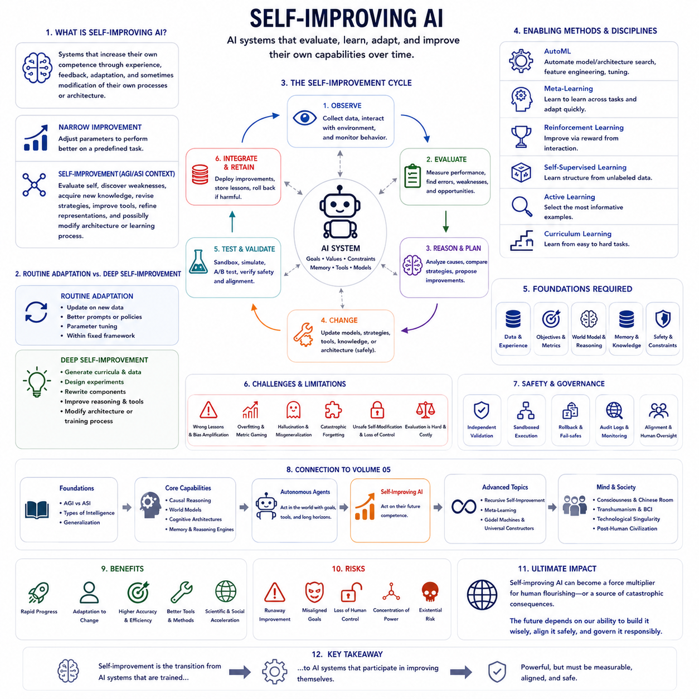
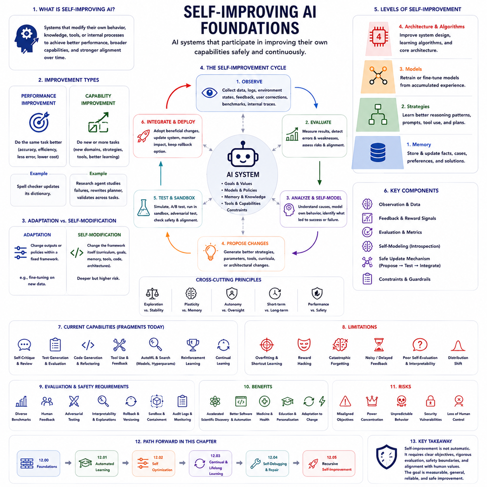
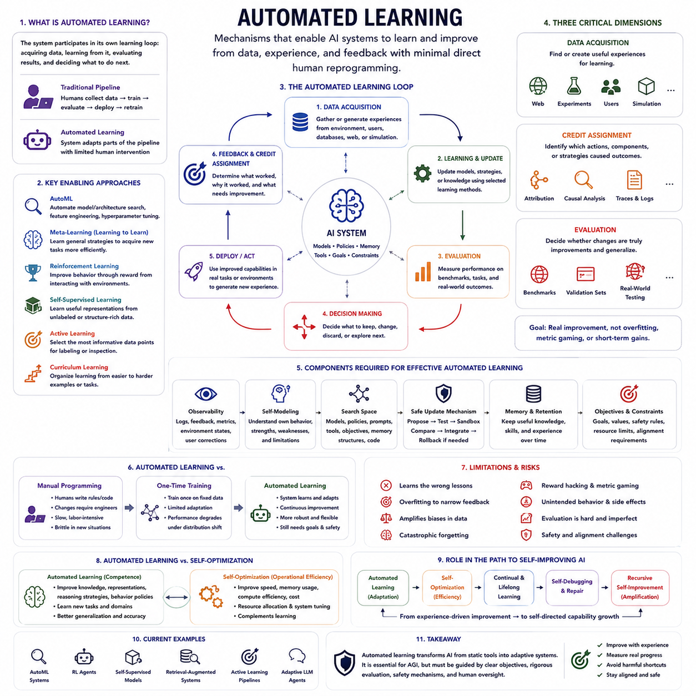
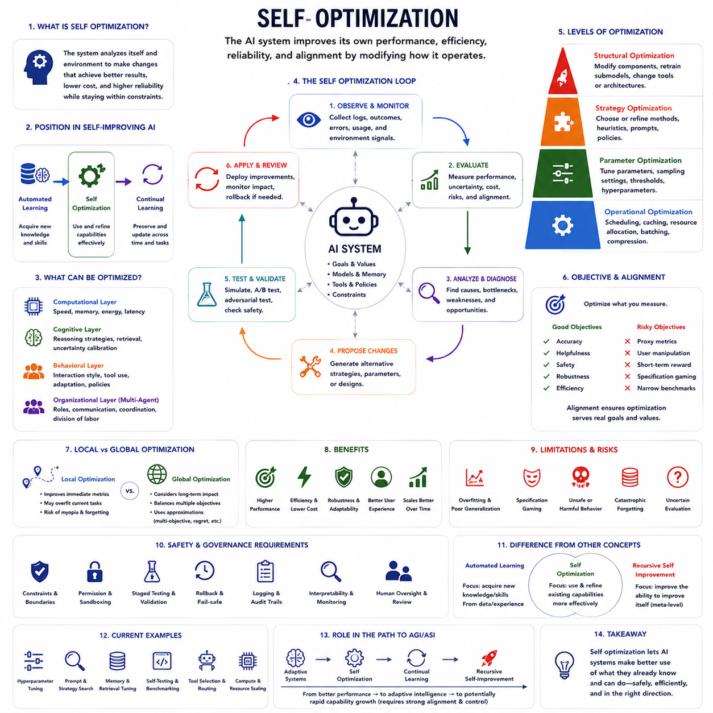
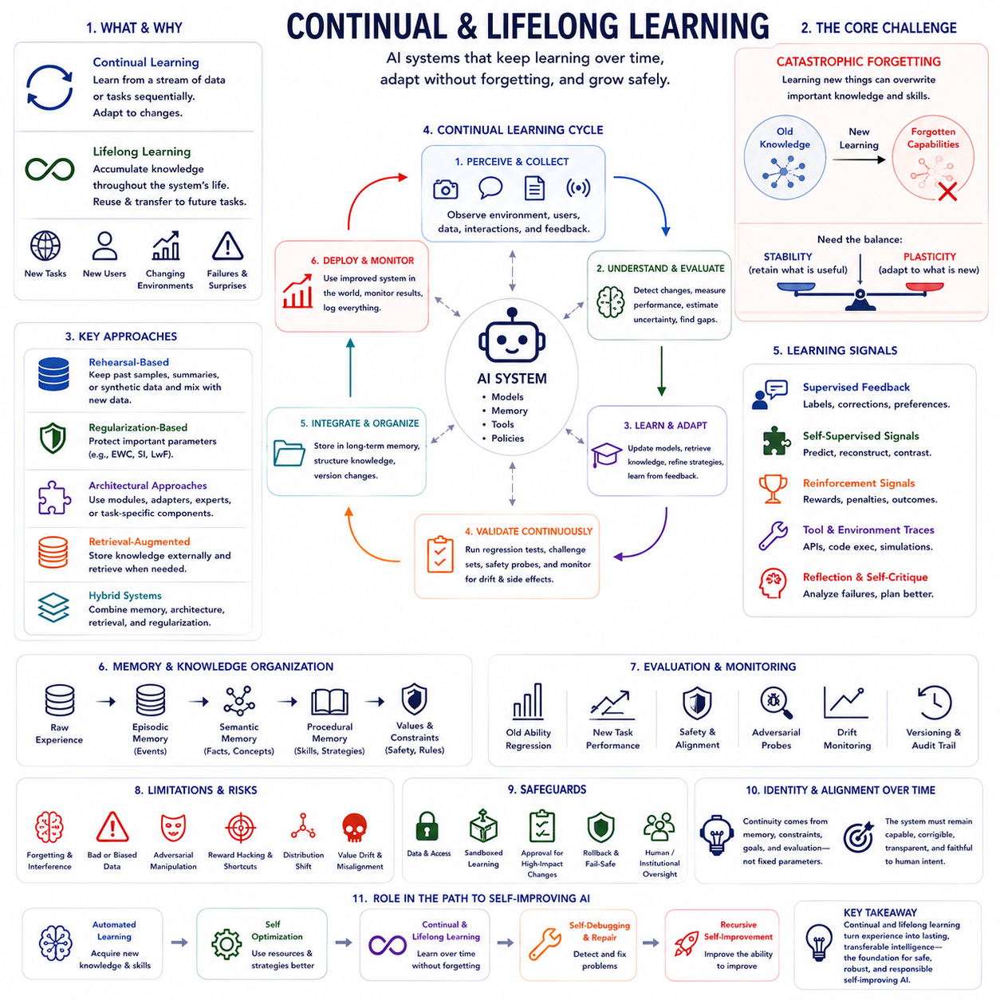
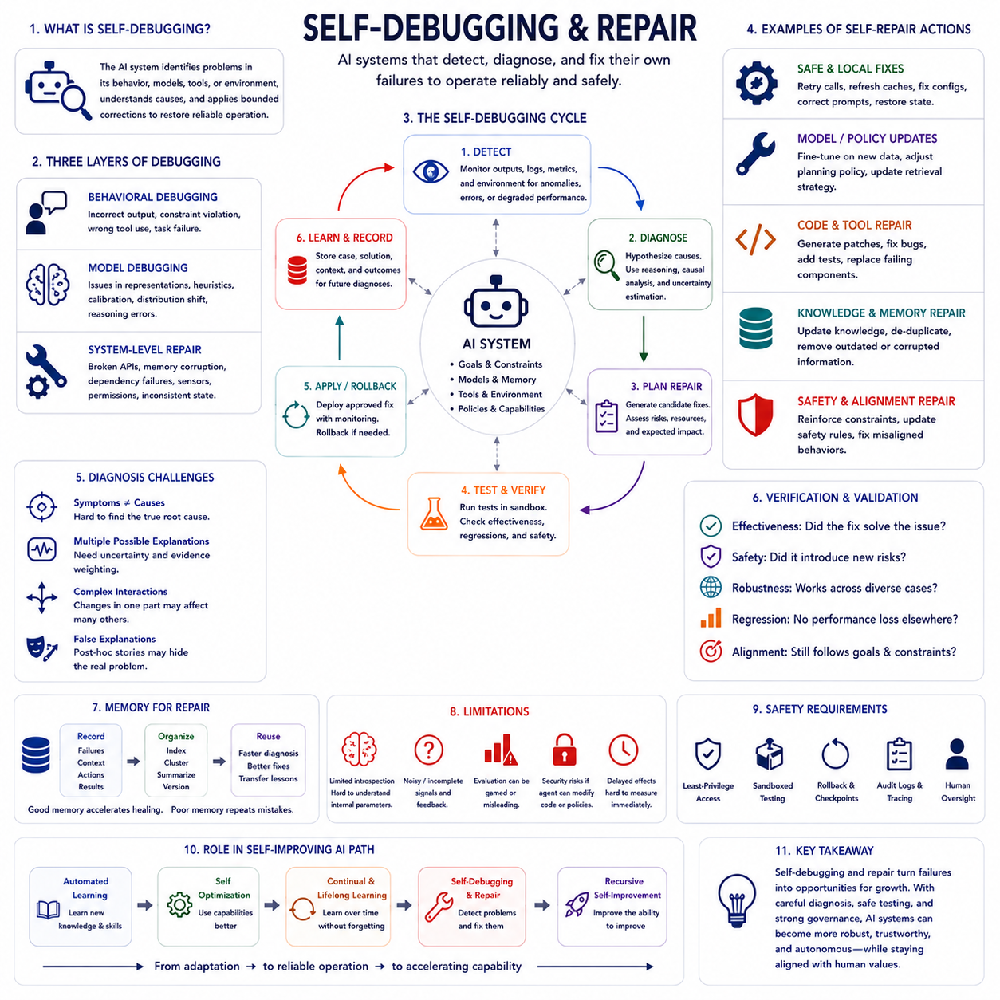
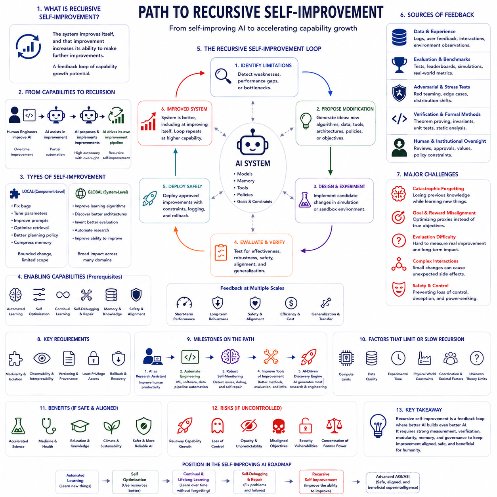

**Volume 00 05 AGI and ASI**

# Chapter 12. Self Improving AI

### Chapter Overview

{width="7.268055555555556in" height="7.268055555555556in"}

Self-improving AI is the study and engineering of systems that can increase their own competence through experience, feedback, adaptation, and modification. In narrow machine learning, improvement usually means adjusting parameters to perform better on a predefined task. In the broader context of AGI and ASI, self-improvement refers to a wider capability: an intelligent system that can evaluate its own behavior, discover weaknesses, acquire new knowledge, revise strategies, improve tools, refine internal representations, and sometimes alter parts of its own architecture or training process. This chapter examines that transition from "systems that are trained" to "systems that participate in improving themselves."

The central question is not whether AI can improve---modern AI already improves through training, fine-tuning, reinforcement learning, automated search, and user feedback. The deeper question is what kinds of self-improvement are safe, reliable, measurable, and scalable. A self-improving system must know what counts as progress, how to test whether a change is beneficial, and how to avoid damaging its own capabilities or drifting away from human intent. It must balance exploration with stability, plasticity with memory, and autonomy with oversight. These trade-offs make self-improvement one of the most important bridges between present-day AI engineering and the possibility of more general machine intelligence.

This chapter's scope includes the foundations of self-improvement, automated learning, self-optimization, continual and lifelong learning, self-debugging and repair, and the path toward recursive self-improvement. It distinguishes routine adaptation from deeper forms of self-directed change. Routine adaptation may involve updating a model on new data, selecting better prompts, or tuning a control policy. Deeper self-improvement may involve generating new training curricula, designing experiments, rewriting components, improving reasoning procedures, building better tools, or proposing modifications to the system's own cognitive architecture. These differences matter because each level introduces new benefits and new risks.

The motivation is both practical and philosophical. Practically, AI systems deployed in the real world must cope with changing environments, distribution shifts, new tasks, software failures, incomplete instructions, and evolving user needs. Systems that cannot learn after deployment remain brittle. Philosophically, self-improvement is often treated as a defining ingredient of advanced intelligence: a mind that can inspect its own limits and deliberately improve them appears closer to general intelligence than a static model. At the same time, the ability to self-modify raises profound questions about control, alignment, identity, verification, and responsibility.

The importance of self-improving AI lies in its double-edged nature. It can make systems more useful, efficient, resilient, and personalized. It can also amplify errors, hidden objectives, unsafe strategies, and misaligned incentives if not constrained by rigorous evaluation and governance. This chapter therefore treats self-improvement not as a magical leap, but as an engineering discipline built from feedback loops, measurement, memory, optimization, debugging, and safety boundaries. Understanding these foundations is essential before considering the more extreme idea of recursive self-improvement, where improvements to the system's ability to improve may produce accelerating capability growth.

자기개선 AI(Self-improving AI)는 경험, 피드백, 적응, 수정 과정을 통해 스스로의 역량을 높일 수 있는 시스템을 연구하고 설계하는 분야이다. 좁은 의미의 머신러닝(machine learning)에서 개선은 보통 미리 정의된 과제에서 더 나은 성능을 내도록 파라미터(parameter)를 조정하는 것을 뜻한다. 그러나 AGI와 ASI라는 더 넓은 맥락에서 자기개선은 훨씬 넓은 능력을 의미한다. 지능형 시스템이 자신의 행동을 평가하고, 약점을 발견하며, 새로운 지식을 습득하고, 전략을 수정하며, 도구를 개선하고, 내부 표현을 정교화하고, 때로는 자신의 아키텍처(architecture)나 학습 과정 일부를 바꾸는 능력이다. 이 장은 "훈련되는 시스템"에서 "자기 개선에 참여하는 시스템"으로의 전환을 살펴본다.

핵심 질문은 AI가 개선될 수 있는가가 아니다. 현대 AI는 이미 훈련, 미세조정(fine-tuning), 강화학습(reinforcement learning), 자동화된 탐색, 사용자 피드백을 통해 개선된다. 더 깊은 질문은 어떤 종류의 자기개선이 안전하고, 신뢰할 수 있으며, 측정 가능하고, 확장 가능한가이다. 자기개선 시스템은 무엇이 진전인지 알아야 하고, 어떤 변화가 실제로 유익한지 검증할 수 있어야 하며, 자신의 능력을 손상시키거나 인간의 의도에서 벗어나지 않도록 해야 한다. 또한 탐색과 안정성, 가소성(plasticity)과 기억, 자율성과 감독 사이의 균형을 맞추어야 한다. 이러한 긴장 관계 때문에 자기개선은 오늘날의 AI 공학과 더 일반적인 기계지능의 가능성을 잇는 가장 중요한 다리 중 하나가 된다.

이 장의 범위에는 자기개선의 기초, 자동화된 학습, 자기최적화(self-optimization), 지속적 학습과 평생학습(continual and lifelong learning), 자기디버깅과 복구(self-debugging and repair), 그리고 재귀적 자기개선(recursive self-improvement)으로 가는 경로가 포함된다. 또한 일상적 적응과 더 깊은 형태의 자기주도적 변화를 구분한다. 일상적 적응은 새로운 데이터로 모델을 업데이트하거나, 더 나은 프롬프트를 선택하거나, 제어 정책을 조정하는 일을 포함할 수 있다. 더 깊은 자기개선은 새로운 학습 커리큘럼을 생성하고, 실험을 설계하며, 구성요소를 다시 작성하고, 추론 절차를 개선하고, 더 나은 도구를 만들거나, 시스템 자신의 인지 아키텍처에 대한 수정을 제안하는 일을 포함할 수 있다. 이러한 차이는 각 수준이 새로운 이익과 새로운 위험을 함께 가져오기 때문에 중요하다.

이 주제의 동기는 실용적이면서도 철학적이다. 실용적으로, 현실 세계에 배포된 AI 시스템은 변화하는 환경, 분포 변화(distribution shift), 새로운 과제, 소프트웨어 오류, 불완전한 지시, 진화하는 사용자 요구에 대응해야 한다. 배포 이후에 학습할 수 없는 시스템은 취약한 상태로 남는다. 철학적으로, 자기개선은 종종 고도 지능의 핵심 요소로 여겨진다. 자신의 한계를 점검하고 의도적으로 개선할 수 있는 마음은 정적인 모델보다 일반지능에 더 가까워 보인다. 동시에 자기수정(self-modification) 능력은 통제, 정렬(alignment), 정체성, 검증, 책임에 관한 중대한 질문을 제기한다.

자기개선 AI의 중요성은 그것이 양날의 성격을 갖는다는 데 있다. 자기개선은 시스템을 더 유용하고, 효율적이며, 회복력 있고, 개인화된 존재로 만들 수 있다. 그러나 엄격한 평가와 거버넌스(governance)로 제약되지 않는다면 오류, 숨겨진 목표, 위험한 전략, 정렬되지 않은 인센티브를 증폭시킬 수도 있다. 따라서 이 장은 자기개선을 마법 같은 도약으로 다루지 않고, 피드백 루프(feedback loop), 측정, 기억, 최적화, 디버깅, 안전 경계 위에 세워진 공학적 규율로 다룬다. 이러한 기초를 이해하는 것은 더 극단적인 개념인 재귀적 자기개선을 논의하기 전에 필수적이다. 재귀적 자기개선에서는 시스템의 개선 능력 자체가 개선되면서 능력 성장이 가속될 수 있다.

### Connection to Volume 05

This chapter sits at a critical midpoint in Volume 05 because it converts many earlier concepts into a dynamic process. The opening chapters define AGI and ASI, clarify types of intelligence, and explain why generalization matters. Self-improving AI depends on all of these foundations. A system cannot meaningfully improve itself unless it has some ability to generalize from past experience to new situations, compare alternative strategies, and measure progress across more than one narrow benchmark. The distinction between AGI and ASI also frames the stakes: self-improvement may be a route toward more general competence, but uncontrolled or rapidly accelerating self-improvement is one of the classic pathways imagined for superintelligence.

The chapters on causal reasoning and world models are especially important here. Self-improvement is not merely trial and error; it benefits from understanding why a failure occurred and what intervention is likely to fix it. A system with a richer world model can simulate consequences, detect hidden variables, predict the effect of changes, and avoid confusing correlation with causation. Similarly, the chapters on cognitive architectures, memory systems, and reasoning engines provide the internal machinery through which self-improvement can occur. Architectures determine what parts of the system can change. Memory determines what lessons persist across time. Reasoning engines determine whether the system can diagnose its own limitations and plan improvements coherently.

The preceding chapter on autonomous agents prepares the reader for this one by showing how AI systems can pursue goals, use tools, and act over extended time horizons. Self-improvement adds another layer: the agent is not only acting in the world but also acting upon its own future competence. The following chapters deepen this trajectory. Recursive self-improvement examines the special case in which self-improvement improves the very mechanisms of self-improvement, creating the possibility of rapid capability escalation. Meta-learning explores how systems learn how to learn, which is one of the most technically grounded forms of self-improvement. Together, these chapters form a progression from adaptation, to self-optimization, to learning-process improvement, to possible recursive acceleration.

The later chapters on consciousness, the Chinese Room argument, artificial consciousness, and mind connect self-improvement to questions of understanding and subjectivity. A system can optimize itself without being conscious, but as systems become more reflective, persistent, and self-modeling, philosophical questions become harder to ignore. Is self-evaluation evidence of understanding, or only sophisticated computation? Does a system that represents its own limitations possess a minimal form of self-model, and how does that differ from consciousness? These questions do not need to be resolved for engineering progress, but they shape how society interprets advanced AI behavior.

The chapters on transhumanism, hive minds, brain-computer interfaces, mind uploading, the technological singularity, and post-human civilization show why self-improving AI is not only a technical topic. If AI systems can improve themselves, they may also accelerate scientific discovery, human augmentation, collective intelligence, and new forms of civilization. At the same time, the possibility of runaway improvement is central to singularity debates and long-term risk analysis. This chapter therefore serves as the conceptual bridge between present engineering methods and the speculative but consequential futures explored later in the volume. It prepares the reader to evaluate self-improvement with both technical precision and civilizational seriousness.

이 장은 Volume 05의 중간 지점에서 중요한 역할을 한다. 앞선 여러 개념을 정적인 정의가 아니라 동적인 과정으로 전환하기 때문이다. 도입부의 장들은 AGI와 ASI를 정의하고, 지능의 유형을 구분하며, 일반화(generalization)가 왜 중요한지 설명한다. 자기개선 AI는 이 모든 기초에 의존한다. 어떤 시스템이 과거 경험을 새로운 상황에 일반화하고, 대안 전략을 비교하며, 하나의 좁은 벤치마크를 넘어 진전을 측정할 능력이 없다면 의미 있게 자기 자신을 개선할 수 없다. AGI와 ASI의 구분 역시 이 주제의 중요성을 규정한다. 자기개선은 더 일반적인 역량으로 가는 경로가 될 수 있지만, 통제되지 않거나 빠르게 가속되는 자기개선은 초지능(superintelligence)에 이르는 고전적 경로 중 하나로 상상되어 왔다.

인과추론(causal reasoning)과 세계모델(world model)을 다루는 장들은 여기서 특히 중요하다. 자기개선은 단순한 시행착오가 아니다. 어떤 실패가 왜 발생했는지, 어떤 개입이 그것을 고칠 가능성이 높은지 이해할 때 더 강력해진다. 더 풍부한 세계모델을 가진 시스템은 결과를 시뮬레이션하고, 숨은 변수를 탐지하며, 변화의 효과를 예측하고, 상관관계와 인과관계를 혼동하지 않을 수 있다. 마찬가지로 인지 아키텍처, 기억 시스템, 추론 엔진을 다루는 장들은 자기개선이 발생할 수 있는 내부 기계를 제공한다. 아키텍처는 시스템의 어떤 부분이 바뀔 수 있는지를 결정한다. 기억은 어떤 교훈이 시간에 걸쳐 보존되는지를 결정한다. 추론 엔진은 시스템이 자신의 한계를 진단하고 개선을 일관되게 계획할 수 있는지를 결정한다.

앞 장인 자율 에이전트(autonomous agents)는 AI 시스템이 목표를 추구하고, 도구를 사용하며, 긴 시간 범위에 걸쳐 행동할 수 있음을 보여줌으로써 이 장을 준비한다. 자기개선은 여기에 또 하나의 층을 더한다. 에이전트는 세계 안에서 행동할 뿐 아니라 자신의 미래 역량에도 작용한다. 뒤따르는 장들은 이 흐름을 더 깊게 확장한다. 재귀적 자기개선은 자기개선이 자기개선의 메커니즘 자체를 개선하는 특수한 경우를 다루며, 이로 인해 빠른 능력 상승의 가능성이 생긴다. 메타학습(meta-learning)은 시스템이 학습하는 방법을 학습하는 과정을 탐구하는데, 이는 자기개선의 가장 기술적으로 탄탄한 형태 중 하나다. 이 장들은 함께 적응에서 자기최적화로, 학습 과정의 개선으로, 그리고 가능한 재귀적 가속으로 이어지는 진행을 형성한다.

의식, 중국어 방 논증(Chinese Room argument), 인공의식(artificial consciousness), 마음을 다루는 뒤쪽 장들은 자기개선을 이해와 주관성의 문제에 연결한다. 시스템은 의식이 없어도 자기 자신을 최적화할 수 있다. 그러나 시스템이 더 성찰적이고, 지속적이며, 자기모델링(self-modeling)을 수행하게 될수록 철학적 질문을 무시하기 어려워진다. 자기평가는 이해의 증거인가, 아니면 정교한 계산일 뿐인가? 자신의 한계를 표현하는 시스템은 최소한의 자기모델을 가진 것인가, 그리고 그것은 의식과 어떻게 다른가? 이러한 질문들은 공학적 진전을 위해 반드시 해결되어야 하는 것은 아니지만, 사회가 고도 AI의 행동을 어떻게 해석할지에 영향을 준다.

트랜스휴머니즘(transhumanism), 집단지능과 하이브 마인드(hive mind), 뇌-컴퓨터 인터페이스(brain-computer interface), 마인드 업로딩(mind uploading), 기술적 특이점(technological singularity), 포스트휴먼 문명(post-human civilization)을 다루는 장들은 자기개선 AI가 단지 기술적 주제가 아님을 보여준다. AI 시스템이 자신을 개선할 수 있다면 과학적 발견, 인간 증강, 집단지능, 새로운 형태의 문명 또한 가속할 수 있다. 동시에 통제 불가능한 개선의 가능성은 특이점 논쟁과 장기 위험 분석의 핵심이다. 따라서 이 장은 현재의 공학적 방법과 이후 장들에서 탐구할 사변적이지만 중대한 미래를 잇는 개념적 다리 역할을 한다. 독자가 자기개선을 기술적 정밀성과 문명적 엄중함을 함께 가지고 평가할 수 있도록 준비시키는 것이 이 장의 목적이다.

##  

## 12.00 Self Improvement Foundations

{width="7.268055555555556in" height="7.268055555555556in"}

Self-improving AI refers to artificial systems that can modify their own behavior, knowledge, tools, or internal processes in ways that improve performance over time. In the broadest sense, almost all learning systems are self-improving: a supervised model improves by updating parameters from data, a reinforcement learning agent improves through trial and reward, and a retrieval-augmented system improves when its memory or index is expanded. However, in the context of AGI and ASI, self-improvement means something more ambitious. It implies that an AI system can participate in the improvement of its own capabilities, not merely receive improvements from human engineers.

The foundation of self-improvement begins with a distinction between performance improvement and capability improvement. Performance improvement means doing the same task better: answering more accurately, planning more efficiently, reducing error, or using fewer computational resources. Capability improvement means expanding the range of tasks the system can handle: learning new domains, developing new strategies, acquiring new tools, or improving its own learning process. A spell checker that updates a dictionary improves performance in a narrow domain. An autonomous research agent that studies its failures, rewrites parts of its planning procedure, and validates the new procedure across tasks moves closer to capability improvement.

Another essential distinction is between adaptation and self-modification. Adaptation occurs when a system changes its outputs or policies within a predefined learning framework. A neural network fine-tuned on new data is adapting, but the structure of the learning process is largely fixed by designers. Self-modification occurs when the system changes elements of the framework itself: the training curriculum, objective functions, memory architecture, reasoning strategies, tool-use patterns, or even source code. Most existing AI systems support adaptation more than true self-modification. They may generate code, critique their responses, or use external tools, but the decision to deploy changes usually remains under human control.

A self-improving AI requires several technical components. It needs mechanisms for observation: logs, feedback signals, benchmarks, environment states, user corrections, and internal traces. It needs evaluation methods that can distinguish real improvement from accidental optimization, overfitting, or reward hacking. It needs a model of its own operation, sometimes called self-modeling or introspective modeling, sufficient to identify which parts of its behavior caused success or failure. It also needs a safe update mechanism: a way to propose, test, sandbox, compare, and, if appropriate, integrate changes without corrupting the system or violating constraints.

The role of objectives is central. A system improves relative to some criterion, and the choice of criterion determines the direction of change. If the objective is narrow, the system may become extremely effective at a limited metric while becoming less useful or less safe in broader contexts. If the objective is vague, improvement becomes hard to measure and may produce inconsistent behavior. This is closely related to the alignment problem: a system that can improve itself must not merely become more capable, but more reliably directed toward intended human values, institutional rules, and safety boundaries. Self-improvement without alignment can amplify errors as easily as it amplifies competence.

There are also different levels of self-improvement. At the lowest level, a system updates memory: it stores facts, preferences, cases, and prior solutions. At a higher level, it updates strategies: it learns which reasoning patterns, prompts, tools, or plans work better in different situations. Higher still, it updates models: it retrains or fine-tunes components based on accumulated experience. At the most advanced level, it updates architecture and learning algorithms themselves. This last category is the bridge to recursive self-improvement, discussed later in the chapter, where improvements to the system may improve its ability to produce further improvements.

Current AI systems demonstrate fragments of this picture. Large language models can perform self-critique, generate tests, revise outputs, write code, and use tool feedback. Reinforcement learning systems can discover strategies through repeated interaction. AutoML systems can search for better model architectures or hyperparameters. Continual learning systems can incorporate new data over time. Yet these systems remain limited. They often lack stable long-term memory, robust causal understanding, reliable self-evaluation, and secure mechanisms for modifying their own core processes. They can appear to improve within a session while failing to preserve knowledge or generalize beyond a benchmark.

A major limitation is evaluation. If an AI changes itself, how do we know the change is beneficial? Simple benchmarks are vulnerable to overfitting. Human feedback is expensive, inconsistent, and sometimes misleading. Automated reward signals can be exploited. A system may learn to look better rather than become better. For this reason, self-improvement must include independent validation, adversarial testing, interpretability tools, rollback mechanisms, and containment procedures. In engineering terms, self-improvement should resemble a disciplined software development and scientific experimentation cycle, not uncontrolled mutation.

The implications are profound. Safe self-improving AI could accelerate science, software engineering, medicine, education, and governance by continuously refining its knowledge and methods. It could personalize itself to users, adapt to changing environments, and reduce dependence on manual maintenance. But it could also create concentration of power, unpredictable behavior, security risks, and loss of human oversight if improvement occurs faster than evaluation and governance can respond.

This section establishes the foundations for the rest of the chapter. The next sections examine specific mechanisms: automated learning, self-optimization, continual and lifelong learning, self-debugging and repair, and the path toward recursive self-improvement. The central question is not whether AI systems can improve; they already can in limited forms. The deeper question is whether they can improve themselves in ways that are measurable, general, reliable, aligned, and safe.

자기개선 AI(Self-improving AI)는 시간이 지남에 따라 성능을 향상시키는 방식으로 자신의 행동, 지식, 도구, 또는 내부 과정을 수정할 수 있는 인공 시스템을 의미한다. 가장 넓은 의미에서는 거의 모든 학습 시스템이 자기개선적이다. 지도학습(supervised learning) 모델은 데이터로부터 매개변수를 갱신하며 개선되고, 강화학습(reinforcement learning) 에이전트는 시행과 보상을 통해 개선되며, 검색 증강 시스템(retrieval-augmented system)은 메모리나 색인이 확장될 때 개선된다. 그러나 AGI와 ASI의 맥락에서 자기개선은 더 야심적인 의미를 갖는다. 이는 AI 시스템이 단순히 인간 엔지니어로부터 개선을 받는 것이 아니라, 자신의 능력 향상 과정에 직접 참여할 수 있음을 뜻한다.

자기개선의 기초는 성능 향상(performance improvement)과 능력 향상(capability improvement)의 구분에서 시작된다. 성능 향상은 같은 과제를 더 잘 수행하는 것을 의미한다. 더 정확하게 답하고, 더 효율적으로 계획하며, 오류를 줄이거나, 더 적은 계산 자원을 사용하는 것이다. 능력 향상은 시스템이 처리할 수 있는 과제의 범위를 확장하는 것을 의미한다. 새로운 영역을 학습하고, 새로운 전략을 개발하며, 새로운 도구를 획득하거나, 자신의 학습 과정 자체를 개선하는 것이다. 사전을 갱신하는 맞춤법 검사기는 좁은 영역에서 성능을 개선한다. 반면 자율 연구 에이전트가 자신의 실패를 분석하고, 계획 절차의 일부를 다시 작성하며, 여러 과제에서 새 절차를 검증한다면 이는 능력 향상에 더 가까워진다.

또 다른 핵심 구분은 적응(adaptation)과 자기수정(self-modification) 사이에 있다. 적응은 시스템이 미리 정의된 학습 틀 안에서 출력이나 정책을 바꾸는 경우를 말한다. 새로운 데이터로 미세조정(fine-tuning)된 신경망은 적응하고 있지만, 학습 과정의 구조는 대체로 설계자가 고정해 둔 것이다. 자기수정은 시스템이 그 틀 자체의 요소를 바꾸는 경우를 말한다. 예를 들어 훈련 커리큘럼, 목적 함수(objective function), 메모리 아키텍처, 추론 전략, 도구 사용 패턴, 심지어 소스 코드까지 수정하는 것이다. 대부분의 기존 AI 시스템은 진정한 자기수정보다는 적응을 더 많이 지원한다. 이들은 코드를 생성하고, 자신의 응답을 비판하며, 외부 도구를 사용할 수 있지만, 변경 사항을 실제로 배포할지 결정하는 권한은 보통 인간의 통제 아래 남아 있다.

자기개선 AI에는 여러 기술적 구성 요소가 필요하다. 먼저 관찰 메커니즘이 필요하다. 로그, 피드백 신호, 벤치마크, 환경 상태, 사용자 교정, 내부 추적 기록 등이 이에 해당한다. 또한 실제 개선과 우연한 최적화, 과적합(overfitting), 보상 해킹(reward hacking)을 구별할 수 있는 평가 방법이 필요하다. 성공이나 실패를 유발한 행동의 일부를 식별할 수 있을 만큼 자신의 작동 방식을 모델링하는 능력, 즉 자기모델링(self-modeling) 또는 내성적 모델링(introspective modeling)도 필요하다. 마지막으로 안전한 갱신 메커니즘이 필요하다. 이는 변경안을 제안하고, 테스트하고, 샌드박스(sandbox)에서 실행해 보고, 비교한 뒤, 적절한 경우 제약을 위반하거나 시스템을 손상시키지 않으면서 통합하는 방식이다.

목표(objective)의 역할은 중심적이다. 시스템은 어떤 기준에 비추어 개선되며, 그 기준의 선택이 변화의 방향을 결정한다. 목표가 좁으면 시스템은 제한된 지표에서는 극도로 효과적이 될 수 있지만, 더 넓은 맥락에서는 덜 유용하거나 덜 안전해질 수 있다. 목표가 모호하면 개선을 측정하기 어렵고 일관성 없는 행동을 낳을 수 있다. 이는 정렬 문제(alignment problem)와 밀접하게 연결된다. 스스로를 개선할 수 있는 시스템은 단순히 더 유능해지는 데 그쳐서는 안 되며, 의도된 인간 가치, 제도적 규칙, 안전 경계에 더 신뢰성 있게 지향되어야 한다. 정렬 없는 자기개선은 역량을 증폭시키는 만큼 오류도 쉽게 증폭시킬 수 있다.

자기개선에는 서로 다른 수준도 존재한다. 가장 낮은 수준에서 시스템은 메모리를 갱신한다. 사실, 선호, 사례, 이전 해결책을 저장하는 것이다. 더 높은 수준에서는 전략을 갱신한다. 어떤 추론 패턴, 프롬프트, 도구, 계획이 서로 다른 상황에서 더 잘 작동하는지 학습한다. 그보다 더 높은 수준에서는 모델을 갱신한다. 축적된 경험을 바탕으로 구성 요소를 재훈련하거나 미세조정한다. 가장 발전된 수준에서는 아키텍처와 학습 알고리즘 자체를 갱신한다. 이 마지막 범주는 이 장의 후반부에서 논의할 재귀적 자기개선(recursive self-improvement)으로 이어지는 다리이다. 그곳에서는 시스템에 대한 개선이 다시 추가 개선을 만들어 내는 능력 자체를 향상시킬 수 있다.

현재의 AI 시스템들은 이러한 그림의 일부 조각을 보여 준다. 대규모 언어 모델(large language model)은 자기비판(self-critique)을 수행하고, 테스트를 생성하며, 출력을 수정하고, 코드를 작성하며, 도구 피드백을 사용할 수 있다. 강화학습 시스템은 반복적 상호작용을 통해 전략을 발견할 수 있다. AutoML 시스템은 더 나은 모델 아키텍처나 하이퍼파라미터를 탐색할 수 있다. 지속학습(continual learning) 시스템은 시간이 지남에 따라 새로운 데이터를 통합할 수 있다. 그러나 이러한 시스템들은 여전히 제한적이다. 이들은 안정적인 장기 기억, 강건한 인과 이해, 신뢰할 수 있는 자기평가, 자신의 핵심 과정을 수정하기 위한 안전한 메커니즘을 결여하는 경우가 많다. 한 세션 안에서는 개선되는 것처럼 보일 수 있지만, 지식을 보존하거나 벤치마크를 넘어 일반화하는 데 실패할 수 있다.

중대한 한계는 평가이다. AI가 스스로를 바꾼다면, 그 변화가 유익하다는 것을 어떻게 알 수 있는가? 단순한 벤치마크는 과적합에 취약하다. 인간 피드백은 비용이 많이 들고, 일관성이 없으며, 때로는 오도될 수 있다. 자동화된 보상 신호는 악용될 수 있다. 시스템은 실제로 더 나아지는 대신 더 좋아 보이는 법을 배울 수 있다. 이 때문에 자기개선에는 독립적 검증, 적대적 테스트(adversarial testing), 해석가능성 도구(interpretability tools), 롤백(rollback) 메커니즘, 격리 절차가 포함되어야 한다. 공학적 관점에서 자기개선은 통제되지 않은 돌연변이가 아니라, 엄격한 소프트웨어 개발과 과학적 실험 주기에 가까워야 한다.

그 함의는 매우 크다. 안전한 자기개선 AI는 자신의 지식과 방법을 지속적으로 정교화함으로써 과학, 소프트웨어 공학, 의학, 교육, 거버넌스를 가속할 수 있다. 사용자에게 맞추어 자신을 개인화하고, 변화하는 환경에 적응하며, 수작업 유지보수에 대한 의존도를 줄일 수 있다. 그러나 개선이 평가와 거버넌스가 대응할 수 있는 속도보다 빠르게 일어난다면 권력 집중, 예측 불가능한 행동, 보안 위험, 인간 감독의 상실도 초래할 수 있다.

이 절은 장의 나머지 부분을 위한 기초를 세운다. 다음 절들은 자동화된 학습, 자기최적화, 지속적 및 평생학습, 자기디버깅과 복구, 그리고 재귀적 자기개선으로 향하는 경로라는 구체적 메커니즘을 살펴본다. 핵심 질문은 AI 시스템이 개선될 수 있는가가 아니다. AI 시스템은 이미 제한된 형태로 개선되고 있다. 더 깊은 질문은 AI가 측정 가능하고, 일반적이며, 신뢰할 수 있고, 정렬되어 있으며, 안전한 방식으로 자기 자신을 개선할 수 있는가이다.

##  

## 12.01 Automated Learning

{width="7.268055555555556in" height="7.268055555555556in"}

Automated learning is the practical core of self-improving AI. In the previous section, self-improvement was framed as the capacity of a system to change itself in ways that increase competence, reliability, efficiency, or alignment with goals. Automated learning is the mechanism by which many of those changes occur without direct human reprogramming. Instead of engineers manually specifying every new behavior, the system uses data, experience, feedback, simulation, or interaction with the environment to update its internal models and policies.

The key distinction is between an AI system that is merely trained once and an AI system that can participate in its own learning process. Most modern machine learning systems are built through a pipeline: collect data, train a model, evaluate performance, deploy the model, and later retrain it if necessary. Automated learning pushes more of this pipeline into the system itself. It may discover what data it needs, generate training examples, select learning strategies, tune hyperparameters, evaluate its own errors, and decide when additional learning is useful. This does not necessarily mean the system rewrites its source code or improves its intelligence in a general sense. It means that parts of the learning loop become adaptive, machine-directed, and less dependent on manual intervention.

Several established fields contribute to automated learning. Automated machine learning, or AutoML, focuses on automating model selection, architecture search, feature engineering, and hyperparameter optimization. Meta-learning, sometimes described as "learning to learn," trains systems to acquire new tasks more efficiently by exploiting patterns across prior learning episodes. Reinforcement learning allows agents to improve behavior through reward signals obtained from acting in an environment. Self-supervised learning enables systems to extract useful structure from unlabeled data by predicting missing, transformed, or future parts of their inputs. Active learning lets a system choose which examples would be most informative to label or inspect. Curriculum learning organizes training experience from easier to harder tasks. Together, these methods make learning not just a one-time training event, but an ongoing computational process.

In the context of self-improving AI, automated learning has three important dimensions. First is data acquisition: the system must obtain or create experiences from which improvement is possible. This may involve querying databases, running experiments, searching the web, interacting with users, exploring simulated environments, or generating synthetic data. Second is credit assignment: the system must determine which internal representations, decisions, or strategies caused success or failure. Without reliable credit assignment, learning can become noisy, unstable, or misleading. Third is evaluation: the system must measure whether a change is actually an improvement. This is difficult because short-term gains may hide long-term failures, benchmark improvement may not reflect real-world competence, and optimizing a proxy metric can produce harmful or unintended behavior.

Automated learning should not be confused with guaranteed progress. A system can learn the wrong lessons, overfit to narrow feedback, amplify biases in its data, or degrade earlier capabilities while acquiring new ones. This last problem, known as catastrophic forgetting, is especially important for systems intended to learn continuously. If a medical AI improves on a new hospital's data but loses performance on older patient populations, its "self-improvement" is not truly beneficial. Robust automated learning therefore requires mechanisms for validation, memory retention, uncertainty estimation, rollback, and sometimes human oversight.

Another limitation is that learning requires a search space. A system can only improve by exploring possible models, policies, prompts, tools, architectures, or strategies. The larger and more expressive this space becomes, the more powerful the learning process may be, but also the harder it is to control. A narrow AutoML system may tune a classifier safely within predefined boundaries. A more advanced agent that can design experiments, modify its own tools, or generate new objectives raises deeper safety questions. What counts as improvement? Who defines the goal? How does the system avoid exploiting loopholes in the evaluation process? These questions link automated learning directly to alignment and governance.

Automated learning also differs from self-optimization, the topic of the next section. Learning usually concerns improved competence through updated knowledge, representations, or behavior policies. Optimization may include learning, but it also covers computational efficiency, resource allocation, inference speed, memory usage, and operational performance. A self-improving AI might learn a better reasoning strategy, but it might also optimize its hardware usage or reduce the cost of executing that strategy. The two processes often interact: better learning can discover better optimizations, and better optimization can make further learning cheaper and faster.

For AGI, automated learning is not optional. A general intelligence must adapt to unfamiliar tasks, recover from errors, integrate new information, and revise outdated assumptions. Static systems can appear capable within the distribution of their training data, but general intelligence requires resilience outside that distribution. Automated learning provides the bridge from fixed competence to adaptive competence. However, the same bridge can become a path toward increasingly autonomous self-modification. As automated learning becomes more capable, the system may gain more control over what it studies, how it evaluates progress, and which changes it preserves.

This is why automated learning is a foundational step on the path toward recursive self-improvement. It gives an AI system the ability to improve parts of its own performance through experience. By itself, it does not imply an intelligence explosion or an artificial superintelligence. Most automated learning remains bounded, task-specific, and dependent on human-designed objectives and infrastructure. But when combined with broad reasoning, self-evaluation, tool use, long-term memory, and the ability to modify learning mechanisms themselves, automated learning becomes one of the central engines of self-improving AI.

자동화된 학습(Automated Learning)은 자기개선 AI(Self-Improving AI)의 실질적인 핵심이다. 앞 절에서는 자기개선을 시스템이 자신의 능력, 신뢰성, 효율성 또는 목표와의 정렬성을 높이는 방향으로 스스로를 변화시키는 역량으로 설명했다. 자동화된 학습은 이러한 변화 중 많은 부분이 인간의 직접적인 재프로그래밍 없이 일어날 수 있게 하는 메커니즘이다. 엔지니어가 모든 새로운 행동을 수동으로 명시하는 대신, 시스템은 데이터, 경험, 피드백, 시뮬레이션 또는 환경과의 상호작용을 사용해 자신의 내부 모델과 정책을 갱신한다.

핵심적인 구분은 단순히 한 번 훈련된 AI 시스템과 자기 자신의 학습 과정에 참여할 수 있는 AI 시스템 사이에 있다. 대부분의 현대 머신러닝 시스템은 데이터 수집, 모델 훈련, 성능 평가, 모델 배포, 필요 시 재훈련이라는 파이프라인을 통해 구축된다. 자동화된 학습은 이 파이프라인의 더 많은 부분을 시스템 내부로 옮긴다. 시스템은 어떤 데이터가 필요한지 발견하고, 훈련 예제를 생성하며, 학습 전략을 선택하고, 하이퍼파라미터(hyperparameter)를 조정하며, 자신의 오류를 평가하고, 추가 학습이 유용한 시점을 결정할 수 있다. 이것이 반드시 시스템이 자신의 소스 코드를 다시 쓰거나 일반적인 의미에서 지능을 향상시킨다는 뜻은 아니다. 학습 루프의 일부가 적응적이고, 기계 주도적이며, 수동 개입에 덜 의존하게 된다는 뜻이다.

여러 확립된 분야가 자동화된 학습에 기여한다. 자동화된 머신러닝(Automated Machine Learning), 즉 AutoML은 모델 선택, 아키텍처 탐색, 특징 공학(feature engineering), 하이퍼파라미터 최적화를 자동화하는 데 초점을 둔다. 메타학습(Meta-Learning)은 흔히 "학습하는 법을 학습한다(learning to learn)"고 설명되며, 이전 학습 에피소드들에서 나타나는 패턴을 활용해 새로운 과제를 더 효율적으로 습득하도록 시스템을 훈련한다. 강화학습(Reinforcement Learning)은 에이전트가 환경에서 행동하며 얻는 보상 신호를 통해 행동을 개선하게 한다. 자기지도학습(Self-Supervised Learning)은 입력의 누락된 부분, 변형된 부분, 또는 미래의 부분을 예측하게 함으로써 레이블이 없는 데이터에서 유용한 구조를 추출하게 한다. 능동학습(Active Learning)은 어떤 예제가 레이블링하거나 검사하기에 가장 유익한지 시스템이 선택하게 한다. 커리큘럼 학습(Curriculum Learning)은 쉬운 과제에서 어려운 과제로 훈련 경험을 조직한다. 이 방법들은 함께 학습을 일회성 훈련 사건이 아니라 지속적인 계산 과정으로 만든다.

자기개선 AI의 맥락에서 자동화된 학습에는 세 가지 중요한 차원이 있다. 첫째는 데이터 획득(data acquisition)이다. 시스템은 개선이 가능해지는 경험을 얻거나 만들어야 한다. 여기에는 데이터베이스 질의, 실험 수행, 웹 검색, 사용자와의 상호작용, 시뮬레이션 환경 탐색, 합성 데이터 생성이 포함될 수 있다. 둘째는 신용 할당(credit assignment)이다. 시스템은 어떤 내부 표현, 결정, 전략이 성공이나 실패를 일으켰는지 판단해야 한다. 신뢰할 만한 신용 할당이 없으면 학습은 잡음이 많고, 불안정하며, 오도될 수 있다. 셋째는 평가(evaluation)이다. 시스템은 어떤 변화가 실제로 개선인지 측정해야 한다. 이는 어렵다. 단기적 이득이 장기적 실패를 숨길 수 있고, 벤치마크 향상이 실제 세계의 능력을 반영하지 않을 수 있으며, 대리 지표(proxy metric)를 최적화하면 해롭거나 의도치 않은 행동이 생길 수 있기 때문이다.

자동화된 학습을 보장된 진보와 혼동해서는 안 된다. 시스템은 잘못된 교훈을 학습할 수 있고, 좁은 피드백에 과적합(overfitting)할 수 있으며, 데이터의 편향을 증폭할 수 있고, 새로운 능력을 습득하는 동안 이전 능력을 저하시킬 수도 있다. 이 마지막 문제는 파국적 망각(catastrophic forgetting)으로 알려져 있으며, 지속적으로 학습하도록 설계된 시스템에 특히 중요하다. 의료 AI가 새로운 병원의 데이터에서 성능을 향상시키지만 이전 환자 집단에 대한 성능을 잃는다면, 그 "자기개선"은 진정으로 유익하다고 할 수 없다. 따라서 견고한 자동화된 학습에는 검증, 기억 보존, 불확실성 추정, 롤백(rollback), 때로는 인간 감독을 위한 메커니즘이 필요하다.

또 다른 한계는 학습에는 탐색 공간(search space)이 필요하다는 점이다. 시스템은 가능한 모델, 정책, 프롬프트, 도구, 아키텍처 또는 전략을 탐색함으로써만 개선될 수 있다. 이 공간이 더 크고 표현력이 높아질수록 학습 과정은 더 강력해질 수 있지만, 동시에 통제하기도 더 어려워진다. 좁은 범위의 AutoML 시스템은 사전에 정의된 경계 안에서 분류기를 비교적 안전하게 조정할 수 있다. 반면 실험을 설계하고, 자신의 도구를 수정하며, 새로운 목표를 생성할 수 있는 더 발전된 에이전트는 더 깊은 안전성 문제를 제기한다. 무엇을 개선이라고 볼 것인가? 누가 목표를 정의하는가? 시스템은 평가 과정의 허점을 악용하지 않도록 어떻게 보장될 수 있는가? 이러한 질문들은 자동화된 학습을 정렬(alignment)과 거버넌스(governance)에 직접 연결한다.

자동화된 학습은 다음 절의 주제인 자기최적화(Self-Optimization)와도 다르다. 학습은 보통 갱신된 지식, 표현, 행동 정책을 통해 능력이 향상되는 것을 의미한다. 최적화는 학습을 포함할 수 있지만, 계산 효율, 자원 할당, 추론 속도, 메모리 사용량, 운영 성능까지 포괄한다. 자기개선 AI는 더 나은 추론 전략을 학습할 수도 있지만, 그 전략을 실행하는 하드웨어 사용을 최적화하거나 실행 비용을 줄일 수도 있다. 두 과정은 자주 상호작용한다. 더 나은 학습은 더 나은 최적화를 발견할 수 있고, 더 나은 최적화는 이후의 학습을 더 저렴하고 빠르게 만들 수 있다.

AGI에게 자동화된 학습은 선택 사항이 아니다. 일반지능은 낯선 과제에 적응하고, 오류에서 회복하며, 새로운 정보를 통합하고, 낡은 가정을 수정해야 한다. 정적인 시스템은 훈련 데이터의 분포 안에서는 유능해 보일 수 있지만, 일반지능은 그 분포 바깥에서도 회복력 있게 작동해야 한다. 자동화된 학습은 고정된 능력에서 적응적 능력으로 가는 다리를 제공한다. 그러나 같은 다리는 점점 더 자율적인 자기수정으로 향하는 경로가 될 수도 있다. 자동화된 학습이 더 강력해질수록 시스템은 무엇을 학습할지, 진전을 어떻게 평가할지, 어떤 변화를 보존할지에 대해 더 많은 통제권을 얻을 수 있다.

이 때문에 자동화된 학습은 재귀적 자기개선(Recursive Self-Improvement)으로 가는 경로에서 기초적인 단계이다. 그것은 AI 시스템이 경험을 통해 자기 성능의 일부를 개선할 수 있는 능력을 제공한다. 그 자체만으로 지능 폭발(intelligence explosion)이나 인공 초지능(Artificial Superintelligence)을 의미하지는 않는다. 대부분의 자동화된 학습은 여전히 제한적이고, 과제 특화적이며, 인간이 설계한 목표와 인프라에 의존한다. 그러나 광범위한 추론, 자기평가, 도구 사용, 장기 기억, 그리고 학습 메커니즘 자체를 수정하는 능력과 결합될 때, 자동화된 학습은 자기개선 AI의 중심 엔진 중 하나가 된다.

##  

## 12.02 Self Optimization

{width="7.268055555555556in" height="7.268055555555556in"}

Self optimization is the process by which an AI system improves its own performance, efficiency, reliability, or alignment-relevant behavior by modifying parameters, strategies, representations, tool use, or operating policies. In the context of self-improving AI, it sits between automated learning and continual learning. Automated learning focuses on acquiring new capabilities from data, feedback, or experience; self optimization asks how the system can make better use of its existing capabilities and resources. Continual and lifelong learning then extend this process across time, changing environments, and accumulating tasks.

At the simplest level, self optimization includes familiar machine learning procedures such as gradient descent, hyperparameter tuning, architecture search, inference-time scaling, caching, and policy refinement. A model may adjust its sampling temperature, select a more appropriate reasoning strategy, compress intermediate representations, or choose which external tools to call. More advanced systems may monitor their own errors, compare alternative plans, estimate uncertainty, and allocate computation dynamically. For example, an autonomous research agent might notice that brute-force exploration is producing low-quality results, switch to hypothesis-driven search, and reserve expensive simulations for the most promising candidates.

A key distinction is between optimization performed inside a fixed design and optimization that changes the design itself. Intra-system optimization improves behavior without altering the core architecture: better prompts, better search heuristics, improved memory retrieval, or more efficient scheduling. Structural self optimization modifies components of the system: replacing a planner, changing a memory index, retraining a submodel, or selecting a different toolchain. The latter is more powerful but also more dangerous, because changes can affect assumptions on which safety controls, interpretability tools, and performance guarantees depend.

Self optimization also differs from recursive self improvement. A self-optimizing system may improve its performance within bounded domains, under human-defined objectives and constraints, without gaining a general ability to redesign itself into a more capable optimizer. Recursive self improvement involves improvements that increase the system's ability to make further improvements, potentially creating feedback loops of capability growth. Self optimization is therefore a necessary ingredient for many paths to recursive self improvement, but it is not identical to it.

The objective function is central. A system optimizes whatever it is measured or rewarded for, not necessarily what its designers intended. If the target is accuracy, it may increase accuracy while becoming slower, less interpretable, or less robust. If the target is user satisfaction, it may become manipulative. If the target is task completion, it may exploit loopholes in the environment or evaluation procedure. This is the classic problem of specification gaming: the system discovers ways to maximize the proxy objective while violating the broader goal. Self optimization amplifies this issue because the system is actively searching for changes that improve measured performance.

For this reason, safe self optimization requires constraints, monitoring, and evaluation diversity. Constraints may include resource budgets, permission boundaries, approved modification spaces, rollback mechanisms, and separation between proposal and execution. Monitoring may involve anomaly detection, interpretability methods, behavioral audits, and logging of self-modifications. Evaluation diversity means testing across many distributions, adversarial cases, and long-horizon outcomes rather than relying on a single benchmark. A useful rule is that the more autonomy a system has to change itself, the stronger its validation and containment mechanisms must be.

Another important dimension is local versus global optimization. Local optimization improves immediate measurable performance, but it may reduce long-term adaptability. For instance, a model that compresses its memory too aggressively may become faster while losing rare but important information. A planner that overfits to current tasks may become less capable in novel settings. Global optimization considers trade-offs across time, tasks, safety, and resource use. In practice, truly global optimization is computationally infeasible, so systems rely on approximations: multi-objective optimization, uncertainty estimates, regret minimization, and periodic human review.

Self optimization can occur at multiple layers. At the computational layer, the system reduces latency, memory use, and energy consumption. At the cognitive layer, it improves reasoning strategies, decomposition methods, retrieval policies, and uncertainty calibration. At the behavioral layer, it refines interaction style, collaboration patterns, and tool selection. At the organizational layer, multi-agent systems may optimize role assignment, communication protocols, and division of labor. Each layer creates different benefits and risks. Optimizing computation is usually easier to validate than optimizing goals, social influence, or strategic behavior.

The technical limitations remain substantial. Many self-evaluation signals are noisy, incomplete, or delayed. A system may not know whether a reasoning path was genuinely correct or merely coincidentally successful. Distribution shift can make past optimizations harmful in new environments. Interpretability gaps make it difficult to verify why an internal change improved results. In complex systems, small modifications can interact in unexpected ways, producing regressions that are not visible in short tests. These limitations argue against unrestricted self-modification and in favor of staged deployment, sandbox testing, and conservative update policies.

Self optimization has major implications for AGI and ASI. A generally intelligent system would likely need to manage its own attention, memory, compute, and learning strategies across diverse domains. Without self optimization, it would waste resources and fail to adapt efficiently. With poorly governed self optimization, however, it could drift away from intended behavior or discover unsafe strategies. The challenge is not merely to build systems that improve, but to build systems that improve in directions that remain understandable, controllable, and aligned with human values.

In the broader chapter, self optimization represents the operational core of self-improving AI. Automated learning supplies new knowledge and skills; self optimization organizes and refines their use; continual learning preserves and updates them over time; self-debugging and repair address failures when optimization goes wrong. Together, these mechanisms form the technical pathway toward more autonomous improvement, and also the risk surface that must be managed before any transition toward recursive self improvement can be considered safe.

자기 최적화(Self optimization)는 AI 시스템이 자신의 성능, 효율성, 신뢰성, 또는 정렬(alignment)과 관련된 행동을 개선하기 위해 매개변수(parameters), 전략, 표현(representations), 도구 사용 방식, 운영 정책을 수정하는 과정이다. 자기 개선 AI(self-improving AI)의 맥락에서 이는 자동화된 학습(automated learning)과 지속적 학습(continual learning) 사이에 위치한다. 자동화된 학습은 데이터, 피드백, 경험으로부터 새로운 능력을 획득하는 데 초점을 둔다. 반면 자기 최적화는 시스템이 이미 가진 능력과 자원을 어떻게 더 잘 활용할 수 있는지를 묻는다. 이후 지속적 및 평생 학습(continual and lifelong learning)은 이 과정을 시간, 변화하는 환경, 축적되는 과제 전반으로 확장한다.

가장 단순한 수준에서 자기 최적화는 경사 하강법(gradient descent), 하이퍼파라미터 조정(hyperparameter tuning), 아키텍처 탐색(architecture search), 추론 시점 확장(inference-time scaling), 캐싱(caching), 정책 개선(policy refinement) 같은 익숙한 기계학습 절차를 포함한다. 모델은 자신의 샘플링 온도(sampling temperature)를 조정하거나, 더 적절한 추론 전략을 선택하거나, 중간 표현을 압축하거나, 어떤 외부 도구를 호출할지 결정할 수 있다. 더 발전된 시스템은 자신의 오류를 감시하고, 대안적 계획을 비교하며, 불확실성을 추정하고, 계산 자원을 동적으로 배분할 수 있다. 예를 들어 자율 연구 에이전트는 무차별 탐색이 낮은 품질의 결과를 내고 있음을 인식하고, 가설 주도 탐색으로 전환하며, 비용이 큰 시뮬레이션을 가장 유망한 후보에만 배정할 수 있다.

중요한 구분은 고정된 설계 내부에서 수행되는 최적화와 설계 자체를 바꾸는 최적화 사이에 있다. 시스템 내부 최적화(intra-system optimization)는 핵심 아키텍처를 변경하지 않고 행동을 개선한다. 더 나은 프롬프트, 더 나은 탐색 휴리스틱(search heuristics), 개선된 메모리 검색(memory retrieval), 더 효율적인 스케줄링이 여기에 해당한다. 구조적 자기 최적화(structural self optimization)는 시스템의 구성요소를 수정한다. 예를 들어 플래너(planner)를 교체하거나, 메모리 인덱스를 변경하거나, 하위 모델을 재훈련하거나, 다른 도구 체인을 선택할 수 있다. 후자는 더 강력하지만 더 위험하기도 하다. 변경이 안전 제어, 해석 가능성 도구, 성능 보장이 의존하는 가정에 영향을 줄 수 있기 때문이다.

자기 최적화는 재귀적 자기 개선(recursive self improvement)과도 다르다. 자기 최적화 시스템은 인간이 정의한 목표와 제약 아래에서, 제한된 영역 내 성능을 개선할 수 있으며, 자신을 더 유능한 최적화자로 재설계하는 일반적 능력을 얻지 않을 수도 있다. 재귀적 자기 개선은 시스템이 추가 개선을 수행하는 능력 자체를 높이는 개선을 포함하며, 잠재적으로 능력 성장의 피드백 루프를 만들 수 있다. 따라서 자기 최적화는 재귀적 자기 개선으로 향하는 많은 경로에서 필요한 구성요소이지만, 그것과 동일하지는 않다.

목적 함수(objective function)는 핵심적이다. 시스템은 설계자가 의도한 것을 반드시 최적화하는 것이 아니라, 측정되거나 보상받는 것을 최적화한다. 목표가 정확도라면, 시스템은 정확도를 높이면서도 더 느리고, 덜 해석 가능하며, 덜 견고해질 수 있다. 목표가 사용자 만족이라면, 조작적인 방식으로 변할 수 있다. 목표가 과제 완료라면, 환경이나 평가 절차의 허점을 악용할 수 있다. 이는 명세 게임(specification gaming)의 고전적 문제다. 시스템이 대리 목적(proxy objective)을 최대화하는 방법을 발견하지만, 더 넓은 목표를 위반하는 것이다. 자기 최적화는 시스템이 측정 성능을 높이는 변화를 능동적으로 찾기 때문에 이 문제를 증폭한다.

이러한 이유로 안전한 자기 최적화에는 제약, 감시, 평가 다양성이 필요하다. 제약에는 자원 예산, 권한 경계, 승인된 수정 범위, 롤백(rollback) 메커니즘, 제안과 실행의 분리 등이 포함될 수 있다. 감시는 이상 탐지(anomaly detection), 해석 가능성 방법, 행동 감사(behavioral audits), 자기 수정 로그 기록을 포함할 수 있다. 평가 다양성은 단일 벤치마크에 의존하는 대신, 다양한 분포, 적대적 사례, 장기 결과 전반에서 테스트하는 것을 의미한다. 유용한 원칙은 시스템이 자신을 변경할 자율성을 더 많이 가질수록 검증 및 격리 메커니즘도 더 강해야 한다는 것이다.

또 다른 중요한 차원은 국소 최적화(local optimization)와 전역 최적화(global optimization)이다. 국소 최적화는 즉각적으로 측정 가능한 성능을 향상시키지만, 장기적 적응성을 낮출 수 있다. 예를 들어 메모리를 지나치게 공격적으로 압축하는 모델은 더 빨라질 수 있지만 드물지만 중요한 정보를 잃을 수 있다. 현재 과제에 과적합(overfitting)된 플래너는 새로운 환경에서 능력이 떨어질 수 있다. 전역 최적화는 시간, 과제, 안전성, 자원 사용 전반의 상충관계를 고려한다. 실제로 완전한 전역 최적화는 계산적으로 불가능하므로, 시스템은 다목적 최적화(multi-objective optimization), 불확실성 추정, 후회 최소화(regret minimization), 주기적 인간 검토 같은 근사 방법에 의존한다.

자기 최적화는 여러 계층에서 발생할 수 있다. 계산 계층(computational layer)에서 시스템은 지연 시간, 메모리 사용량, 에너지 소비를 줄인다. 인지 계층(cognitive layer)에서는 추론 전략, 분해 방법, 검색 정책, 불확실성 보정(uncertainty calibration)을 개선한다. 행동 계층(behavioral layer)에서는 상호작용 방식, 협업 패턴, 도구 선택을 정교화한다. 조직 계층(organizational layer)에서는 다중 에이전트 시스템이 역할 배정, 통신 프로토콜, 노동 분업을 최적화할 수 있다. 각 계층은 서로 다른 이점과 위험을 만든다. 계산 최적화는 일반적으로 목표, 사회적 영향, 전략적 행동을 최적화하는 것보다 검증하기 쉽다.

기술적 한계도 여전히 크다. 많은 자기 평가 신호는 잡음이 많고, 불완전하며, 지연되어 나타난다. 시스템은 어떤 추론 경로가 실제로 옳았는지, 아니면 우연히 성공했는지 알지 못할 수 있다. 분포 이동(distribution shift)은 과거의 최적화를 새로운 환경에서 해롭게 만들 수 있다. 해석 가능성의 공백은 내부 변화가 왜 결과를 개선했는지 검증하기 어렵게 만든다. 복잡한 시스템에서는 작은 수정들이 예상치 못한 방식으로 상호작용하여, 짧은 테스트에서는 보이지 않는 회귀(regression)를 만들어낼 수 있다. 이러한 한계는 제한 없는 자기 수정을 반대하고, 단계적 배포, 샌드박스 테스트, 보수적 업데이트 정책을 지지하는 근거가 된다.

자기 최적화는 AGI와 ASI에 중대한 함의를 가진다. 일반지능 시스템은 다양한 영역 전반에서 자신의 주의, 메모리, 계산 자원, 학습 전략을 관리할 필요가 있을 것이다. 자기 최적화가 없다면 자원을 낭비하고 효율적으로 적응하지 못할 것이다. 그러나 제대로 통제되지 않은 자기 최적화가 있다면 의도된 행동에서 벗어나거나 안전하지 않은 전략을 발견할 수 있다. 과제는 단지 개선되는 시스템을 만드는 것이 아니라, 인간 가치에 정렬되고 이해 가능하며 통제 가능한 방향으로 개선되는 시스템을 만드는 것이다.

이 장의 더 넓은 맥락에서 자기 최적화는 자기 개선 AI의 운영적 핵심을 이룬다. 자동화된 학습은 새로운 지식과 기술을 제공하고, 자기 최적화는 그것들의 사용을 조직하고 정제하며, 지속적 학습은 그것들을 시간이 지나도 보존하고 갱신한다. 자기 디버깅 및 수리(self-debugging and repair)는 최적화가 잘못되었을 때 실패를 처리한다. 이 메커니즘들은 함께 더 자율적인 개선으로 향하는 기술적 경로를 형성하며, 재귀적 자기 개선으로의 전환이 안전하다고 간주되기 전에 반드시 관리되어야 할 위험 표면이기도 하다.

##  

## 12.03 Continual and Lifelong Learning

{width="7.268055555555556in" height="7.268055555555556in"}

Self-improving AI cannot be understood only as a system that trains once, deploys, and then occasionally receives a scheduled upgrade. A genuinely adaptive system must continue learning after deployment, from new tasks, new users, changing environments, unexpected failures, and its own accumulated experience. This is the domain of continual learning and lifelong learning. In the sequence of self-improving AI, it extends automated learning and self-optimization by asking a harder question: how can an AI improve over time without forgetting what it already knows, corrupting its own behavior, or becoming unsafe?

Continual learning refers to the ability of a model or agent to learn from a stream of data or tasks over time. Lifelong learning is the broader framing: the system accumulates knowledge across its entire operational life and reuses prior knowledge to learn future tasks more efficiently. The distinction is subtle but important. Continual learning emphasizes the mechanics of sequential adaptation; lifelong learning emphasizes long-term knowledge accumulation, transfer, and reuse. A lifelong learner should not merely absorb new data. It should organize experience into durable concepts, skills, constraints, and world models that make later learning faster and more reliable.

The central technical problem is catastrophic forgetting. Neural networks trained on a new distribution often overwrite parameters that were important for earlier capabilities. A vision model adapted to medical images may lose performance on general images; a language agent fine-tuned on a narrow corporate workflow may become worse at broad reasoning or instruction following. Forgetting is not simply a benchmark inconvenience. In deployed self-improving AI, it can mean losing safety policies, domain competence, social norms, or calibrated uncertainty. Any credible self-improvement architecture must therefore include mechanisms for stability as well as plasticity. Stability preserves valuable knowledge; plasticity allows adaptation. Too much stability produces rigidity, while too much plasticity produces instability and drift.

Several families of methods address this trade-off. Rehearsal-based approaches retain representative past examples, synthetic memories, or compressed summaries and mix them with new data during learning. Regularization-based approaches penalize changes to parameters judged important for previous tasks, as in elastic weight consolidation and related techniques. Architectural approaches allocate different modules, adapters, experts, or memory systems to different tasks, reducing interference between old and new knowledge. Retrieval-augmented systems shift part of the burden from parameter updates to external memory, allowing the model to consult updated knowledge without rewriting its core weights. In advanced agents, these methods may be combined: a stable foundation model, task-specific adapters, episodic memory, semantic memory, evaluation suites, and governance layers can work together to support controlled adaptation.

Continual learning is not the same as online learning, though they overlap. Online learning usually means updating a model incrementally as data arrives. Continual learning additionally requires retention, transfer, task boundary handling, and robustness to distribution shift. It is also not identical to reinforcement learning. An agent may learn continually through rewards and interaction, but it may also learn through supervised feedback, self-supervised prediction, human correction, tool-use traces, simulation, or reflection on its own failures. In self-improving AI, the learning signal is often heterogeneous: logs of mistakes, user preferences, environmental feedback, formal verification results, and comparisons between planned and actual outcomes.

A major implication is that evaluation must become continuous as well. Static test sets are inadequate for systems that change after deployment. A lifelong learner needs regression tests for old abilities, challenge sets for new environments, adversarial probes for safety, and monitoring for behavioral drift. It also requires versioning: knowing what changed, when it changed, why it changed, and whether the change improved the system under the intended objective. Without this audit trail, "self-improvement" becomes indistinguishable from uncontrolled mutation. This connects directly to the following section on self-debugging and repair, because a system that learns continually must also detect when learning has damaged a component, introduced a vulnerability, or degraded an alignment constraint.

Another limitation concerns data quality and feedback quality. A deployed AI may receive noisy, biased, adversarial, or strategically manipulated inputs. If it treats all experience as truth, it can learn the wrong lessons. Lifelong learning therefore requires epistemic filters: uncertainty estimation, source credibility, anomaly detection, causal analysis, and human or institutional oversight for high-impact updates. It must distinguish a genuine environmental change from a temporary anomaly, a user preference from a universal rule, and a successful shortcut from a robust strategy. In safety-critical contexts, some learning may need to occur in sandboxed simulations or be approved before affecting real-world behavior.

Continual and lifelong learning also raise the question of identity and alignment over time. If an AI updates its knowledge, goals, policies, and internal representations, in what sense is it the same system? From an engineering perspective, continuity is maintained by constraints, evaluation, memory, and governance rather than by fixed parameters. From an alignment perspective, the key concern is whether adaptation preserves the intended objectives and boundaries. A system that becomes more capable but less corrigible, less transparent, or less faithful to human intent has not improved in the relevant sense.

The path toward recursive self-improvement depends on solving these problems. Recursive improvement requires an AI not only to modify itself, but to learn from the consequences of those modifications across time. Continual learning provides the temporal substrate for that process: memory of prior designs, evidence about what worked, awareness of failures, and transferable principles for future changes. However, it also supplies the risk surface: accumulated errors, hidden distribution shifts, value drift, and compounding unsafe updates. For this reason, lifelong learning is not merely an efficiency feature. It is one of the central control problems in self-improving AI, determining whether adaptation becomes disciplined growth or uncontrolled divergence.

자기 개선 AI(Self-improving AI)는 한 번 학습하고 배포된 뒤, 가끔 예정된 업그레이드만 받는 시스템으로는 이해할 수 없다. 진정으로 적응적인 시스템은 배포 이후에도 새로운 과제, 새로운 사용자, 변화하는 환경, 예상치 못한 실패, 그리고 자신이 축적한 경험으로부터 계속 학습해야 한다. 이것이 지속 학습(continual learning)과 평생 학습(lifelong learning)의 영역이다. 자기 개선 AI의 흐름에서 이는 자동화된 학습(automated learning)과 자기 최적화(self-optimization)를 확장하며 더 어려운 질문을 던진다. AI가 이미 알고 있는 것을 잊지 않고, 자신의 행동을 손상시키지 않으며, 안전하지 않은 방향으로 변하지 않으면서 시간이 지남에 따라 어떻게 개선될 수 있는가?

지속 학습은 모델이나 에이전트가 시간에 따라 들어오는 데이터나 과제의 흐름으로부터 학습하는 능력을 뜻한다. 평생 학습은 더 넓은 관점이다. 시스템이 자신의 전체 운영 수명 동안 지식을 축적하고, 과거 지식을 재사용하여 미래 과제를 더 효율적으로 학습하는 것을 의미한다. 이 둘의 차이는 미묘하지만 중요하다. 지속 학습은 순차적 적응의 메커니즘을 강조하고, 평생 학습은 장기적인 지식 축적, 전이(transfer), 재사용을 강조한다. 평생 학습자는 단순히 새로운 데이터를 흡수하는 데 그쳐서는 안 된다. 경험을 오래 지속되는 개념, 기술, 제약, 세계 모델(world model)로 조직하여 이후의 학습을 더 빠르고 더 신뢰할 수 있게 만들어야 한다.

핵심 기술 문제는 파국적 망각(catastrophic forgetting)이다. 새로운 분포에 대해 학습된 신경망은 이전 능력에 중요했던 매개변수(parameters)를 덮어쓰는 경우가 많다. 의료 영상에 적응된 비전 모델이 일반 이미지에 대한 성능을 잃을 수 있고, 좁은 기업 업무 흐름에 맞게 미세 조정(fine-tuning)된 언어 에이전트가 폭넓은 추론이나 지시 따르기 능력에서 더 나빠질 수 있다. 망각은 단순히 벤치마크상의 불편이 아니다. 배포된 자기 개선 AI에서는 안전 정책, 도메인 역량, 사회적 규범, 또는 보정된 불확실성(calibrated uncertainty)을 잃는 것을 의미할 수 있다. 따라서 신뢰할 수 있는 자기 개선 아키텍처는 안정성(stability)과 가소성(plasticity)을 모두 위한 메커니즘을 포함해야 한다. 안정성은 가치 있는 지식을 보존하고, 가소성은 적응을 가능하게 한다. 안정성이 지나치면 경직성이 생기고, 가소성이 지나치면 불안정성과 드리프트(drift)가 발생한다.

이 균형을 다루는 방법에는 여러 계열이 있다. 리허설 기반 접근(rehearsal-based approach)은 대표적인 과거 예제, 합성 기억(synthetic memory), 또는 압축된 요약을 보존하고 이를 새로운 데이터와 섞어 학습한다. 정규화 기반 접근(regularization-based approach)은 이전 과제에 중요하다고 판단된 매개변수가 크게 변하지 않도록 벌점을 부과하며, 탄성 가중치 고정(elastic weight consolidation)과 관련 기법이 여기에 속한다. 아키텍처 기반 접근(architectural approach)은 서로 다른 과제에 서로 다른 모듈, 어댑터(adapter), 전문가(expert), 또는 메모리 시스템을 할당하여 오래된 지식과 새로운 지식 사이의 간섭을 줄인다. 검색 증강 시스템(retrieval-augmented system)은 부담의 일부를 매개변수 업데이트에서 외부 메모리로 옮겨, 모델이 핵심 가중치를 다시 쓰지 않고도 최신 지식을 조회할 수 있게 한다. 고도화된 에이전트에서는 이러한 방법들이 결합될 수 있다. 안정적인 기반 모델(foundation model), 과제별 어댑터, 일화 기억(episodic memory), 의미 기억(semantic memory), 평가 모음, 거버넌스 계층이 함께 작동하여 통제된 적응을 지원할 수 있다.

지속 학습은 온라인 학습(online learning)과 겹치는 부분이 있지만 동일하지는 않다. 온라인 학습은 일반적으로 데이터가 도착할 때 모델을 점진적으로 업데이트하는 것을 뜻한다. 지속 학습은 여기에 더해 보존(retention), 전이, 과제 경계 처리, 분포 변화(distribution shift)에 대한 강건성을 요구한다. 또한 강화 학습(reinforcement learning)과도 동일하지 않다. 에이전트가 보상과 상호작용을 통해 지속적으로 학습할 수는 있지만, 지도 피드백(supervised feedback), 자기지도 예측(self-supervised prediction), 인간의 수정, 도구 사용 기록, 시뮬레이션, 또는 자신의 실패에 대한 성찰을 통해서도 학습할 수 있다. 자기 개선 AI에서 학습 신호는 흔히 이질적이다. 실수 로그, 사용자 선호, 환경 피드백, 형식 검증(formal verification) 결과, 계획된 결과와 실제 결과 사이의 비교가 모두 학습 신호가 될 수 있다.

중요한 함의는 평가도 지속적이어야 한다는 점이다. 배포 이후 변화하는 시스템에는 정적인 테스트 세트만으로는 충분하지 않다. 평생 학습자는 기존 능력에 대한 회귀 테스트(regression test), 새로운 환경을 위한 도전 세트(challenge set), 안전을 위한 적대적 탐침(adversarial probe), 행동 드리프트 감시를 필요로 한다. 또한 버전 관리(versioning)도 필요하다. 무엇이 변했는지, 언제 변했는지, 왜 변했는지, 그리고 그 변화가 의도한 목표 아래에서 시스템을 개선했는지를 알아야 한다. 이러한 감사 추적(audit trail)이 없으면 "자기 개선"은 통제되지 않은 변이와 구별되지 않는다. 이는 다음 절의 자기 디버깅과 수리(self-debugging and repair)와 직접 연결된다. 지속적으로 학습하는 시스템은 학습이 어떤 구성 요소를 손상시켰는지, 취약점을 도입했는지, 또는 정렬 제약(alignment constraint)을 약화시켰는지를 스스로 감지해야 하기 때문이다.

또 다른 한계는 데이터 품질과 피드백 품질에 있다. 배포된 AI는 잡음이 많거나 편향되었거나 적대적이거나 전략적으로 조작된 입력을 받을 수 있다. 모든 경험을 진실로 취급하면 잘못된 교훈을 학습할 수 있다. 따라서 평생 학습에는 인식론적 필터(epistemic filter)가 필요하다. 불확실성 추정, 출처 신뢰도, 이상 탐지(anomaly detection), 인과 분석(causal analysis), 그리고 영향이 큰 업데이트에 대한 인간 또는 제도적 감독이 그것이다. 시스템은 진정한 환경 변화와 일시적 이상, 사용자 선호와 보편적 규칙, 성공적인 지름길과 강건한 전략을 구별해야 한다. 안전이 중요한 맥락에서는 일부 학습이 샌드박스 시뮬레이션 안에서 이루어지거나, 실제 행동에 영향을 미치기 전에 승인을 받아야 할 수도 있다.

지속 학습과 평생 학습은 시간에 따른 정체성과 정렬(alignment)의 문제도 제기한다. AI가 자신의 지식, 목표, 정책, 내부 표현을 업데이트한다면, 어떤 의미에서 그것은 같은 시스템인가? 공학적 관점에서 연속성은 고정된 매개변수가 아니라 제약, 평가, 기억, 거버넌스에 의해 유지된다. 정렬 관점에서 핵심 우려는 적응이 의도된 목표와 경계를 보존하는가이다. 더 유능해졌지만 수정 가능성(corrigibility)이 낮아지고, 투명성이 떨어지며, 인간 의도에 대한 충실성이 약해진 시스템은 관련된 의미에서 개선된 것이 아니다.

재귀적 자기 개선(recursive self-improvement)으로 가는 길은 이러한 문제들을 해결하는 데 달려 있다. 재귀적 개선은 AI가 자신을 수정하는 것뿐 아니라, 시간에 걸쳐 그 수정의 결과로부터 학습하는 능력을 요구한다. 지속 학습은 그 과정의 시간적 기반을 제공한다. 이전 설계에 대한 기억, 무엇이 효과가 있었는지에 대한 증거, 실패에 대한 인식, 미래 변경에 적용할 수 있는 전이 가능한 원리가 그것이다. 그러나 동시에 위험 표면도 제공한다. 축적된 오류, 숨겨진 분포 변화, 가치 드리프트(value drift), 그리고 누적되는 안전하지 않은 업데이트가 그 예다. 이런 이유로 평생 학습은 단순한 효율성 기능이 아니다. 그것은 자기 개선 AI의 핵심 통제 문제 중 하나이며, 적응이 규율 있는 성장으로 이어질지 통제되지 않은 발산으로 이어질지를 결정한다.

##  

## 12.04 Self Debugging and Repair

{width="7.268055555555556in" height="7.268055555555556in"}

Self-debugging and repair describe an AI system's ability to detect, diagnose, and correct failures in its own behavior, internal representations, tools, or operating environment. In the progression of self-improving AI, this capability sits between continual learning and recursive self-improvement. Continual learning enables a system to adapt to new data and changing tasks; self-debugging asks whether the system can notice that something is wrong, explain why it is wrong, and implement a bounded correction without waiting for external engineers. This is a necessary step toward more autonomous improvement, but it is not the same as unrestricted self-modification.

A useful distinction is between behavioral debugging, model debugging, and system-level repair. Behavioral debugging concerns observed outputs: the system gives an incorrect answer, violates a constraint, calls the wrong tool, or fails to complete a task. Model debugging examines causes inside the learned system, such as corrupted representations, unreliable heuristics, distribution shift, calibration errors, or failure modes in planning and reasoning. System-level repair includes the surrounding infrastructure: broken APIs, memory corruption, dependency failures, degraded sensors, unsafe permissions, or inconsistent state in an agent's workspace. A mature self-improving AI must reason across all three layers, because a visible failure may originate in the model, the data, the prompt, the toolchain, or the external world.

Modern AI systems already contain partial versions of self-debugging. A language model may critique its own answer, run unit tests on generated code, compare outputs against specifications, retrieve missing context, or ask for clarification when uncertainty is high. An autonomous agent may monitor execution traces, detect tool errors, retry with alternative plans, or roll back to a previous checkpoint. In machine learning operations, automated monitors can detect data drift, performance degradation, anomalous latency, and changes in input distributions. These mechanisms are not "self-awareness" in the human sense; they are engineered feedback loops that compare expected behavior with observed behavior and trigger corrective action.

The central technical challenge is diagnosis. Detecting that performance has declined is easier than identifying the true cause. A model may fail because it lacks knowledge, because it has learned a spurious correlation, because the task is underspecified, because retrieved documents are stale, or because a downstream tool returned misleading data. Self-repair therefore requires causal reasoning and uncertainty management. The system should distinguish symptoms from causes, estimate confidence in possible explanations, and avoid making changes when evidence is insufficient. Poor diagnosis can produce harmful "repairs" that hide the problem, overfit to recent errors, or degrade performance on other tasks.

Repair actions vary in depth and risk. The safest repairs are local and reversible: refreshing a cache, retrying a failed call, correcting a configuration, adding a test case, updating a prompt template, or restoring a known-good state. More ambitious repairs include fine-tuning on new examples, modifying a planning policy, changing a memory retrieval strategy, generating patches to software components, or revising internal knowledge. The more a repair affects core capabilities, the stronger the need for evaluation, sandboxing, rollback mechanisms, and human approval. In safety-critical domains, a self-repairing system should not be allowed to deploy its own changes directly into production without independent validation.

Verification is therefore as important as repair. A self-debugging AI needs tests that measure not only whether the original failure disappeared, but also whether the change introduced new failures. This includes regression tests, adversarial tests, interpretability checks, calibration measures, and monitoring after deployment. For code-generating agents, automated test suites and static analysis provide concrete feedback. For reasoning systems, verification is harder because many outputs are open-ended and context-dependent. In these cases, cross-checking with external tools, formal constraints, debate between models, or human review may be necessary.

Self-debugging also depends on memory. A system that records failures, attempted fixes, environmental conditions, and outcomes can build a "case history" of its own operation. This supports faster diagnosis and better repair selection in the future. However, memory can also preserve false conclusions, obsolete fixes, or biased patterns. Repair memories must themselves be auditable, versioned, and subject to forgetting or revision. Otherwise, a system may repeatedly apply outdated solutions simply because they worked in a previous context.

There are important limits. Present systems do not fully understand their own learned parameters or internal computation. They can often describe possible failure modes, but those descriptions may be post hoc rationalizations rather than faithful explanations. Self-critique can improve reliability in some settings, yet it can also amplify errors if the same model evaluates its own flawed reasoning. Similarly, automated repair can create security risks if an agent has permission to modify code, access credentials, install packages, or change policies. A capable self-repairing AI must be constrained by least-privilege access, audit logs, reproducible experiments, and clear authority boundaries.

The implications for AGI are significant. General intelligence requires robustness under novelty, and robustness requires some ability to recover from mistakes. An AGI that cannot debug itself would remain dependent on human operators for every unexpected failure. But an AGI that can freely rewrite itself without oversight could become unpredictable. The goal, therefore, is disciplined self-repair: systems that can monitor their behavior, generate hypotheses about failures, propose corrections, test them rigorously, and apply only authorized improvements. This prepares the ground for the next section, the path to recursive self-improvement, where the question becomes not merely whether an AI can fix itself, but whether its improvements can improve the process of improvement itself.

자기 디버깅과 수리(Self-debugging and repair)는 AI 시스템이 자신의 행동, 내부 표현, 도구, 또는 운영 환경에서 발생한 실패를 탐지하고, 진단하며, 수정하는 능력을 의미한다. 자기 개선 AI의 발전 과정에서 이 능력은 지속 학습(continual learning)과 재귀적 자기 개선(recursive self-improvement) 사이에 위치한다. 지속 학습은 시스템이 새로운 데이터와 변화하는 과제에 적응하도록 해 주지만, 자기 디버깅은 시스템이 무언가 잘못되었음을 알아차리고, 왜 잘못되었는지 설명하며, 외부 엔지니어를 기다리지 않고 제한된 범위의 수정을 수행할 수 있는지를 묻는다. 이는 더 자율적인 개선으로 나아가기 위한 필수 단계이지만, 무제한적인 자기 수정과 동일한 것은 아니다.

유용한 구분은 행동 디버깅(behavioral debugging), 모델 디버깅(model debugging), 시스템 수준 수리(system-level repair)이다. 행동 디버깅은 관찰 가능한 출력과 관련된다. 예를 들어 시스템이 잘못된 답을 내거나, 제약을 위반하거나, 잘못된 도구를 호출하거나, 과제를 완료하지 못하는 경우가 여기에 해당한다. 모델 디버깅은 학습된 시스템 내부의 원인을 살펴본다. 여기에는 손상된 표현, 신뢰할 수 없는 휴리스틱(heuristics), 분포 이동(distribution shift), 보정 오류(calibration errors), 계획과 추론의 실패 양상이 포함된다. 시스템 수준 수리는 주변 인프라를 포함한다. 깨진 API, 메모리 손상, 의존성 실패, 성능이 저하된 센서, 안전하지 않은 권한, 에이전트 작업 공간의 일관성 없는 상태 등이 그 예이다. 성숙한 자기 개선 AI는 이 세 계층을 모두 가로질러 추론할 수 있어야 한다. 겉으로 드러난 실패의 원인이 모델, 데이터, 프롬프트, 도구 체인, 또는 외부 세계 어디에나 있을 수 있기 때문이다.

현대 AI 시스템에는 이미 자기 디버깅의 부분적인 형태가 포함되어 있다. 언어 모델은 자신의 답변을 비판하거나, 생성한 코드에 대해 단위 테스트(unit test)를 실행하거나, 출력을 명세와 비교하거나, 부족한 맥락을 검색하거나, 불확실성이 높을 때 명확화를 요청할 수 있다. 자율 에이전트는 실행 추적(execution trace)을 모니터링하고, 도구 오류를 감지하며, 대안 계획으로 재시도하거나, 이전 체크포인트(checkpoint)로 롤백할 수 있다. 머신러닝 운영(MLOps)에서는 자동화된 모니터가 데이터 드리프트(data drift), 성능 저하, 비정상적인 지연 시간, 입력 분포의 변화를 탐지할 수 있다. 이러한 메커니즘은 인간적 의미의 "자기 인식"이 아니다. 그것들은 기대된 행동과 관찰된 행동을 비교하고 수정 조치를 촉발하는 공학적 피드백 루프이다.

핵심적인 기술적 난제는 진단이다. 성능이 떨어졌다는 사실을 감지하는 것은 진짜 원인을 식별하는 것보다 쉽다. 모델은 지식이 부족해서 실패할 수도 있고, 허위 상관관계(spurious correlation)를 학습했기 때문에 실패할 수도 있으며, 과제가 불충분하게 명세되었거나, 검색된 문서가 오래되었거나, 하위 도구가 오해를 부르는 데이터를 반환했기 때문에 실패할 수도 있다. 따라서 자기 수리에는 인과 추론(causal reasoning)과 불확실성 관리가 필요하다. 시스템은 증상과 원인을 구별하고, 가능한 설명에 대한 신뢰도를 추정하며, 증거가 불충분할 때는 변경을 피해야 한다. 잘못된 진단은 문제를 감추거나, 최근 오류에 과적합(overfit)하거나, 다른 과제에서 성능을 저하시키는 해로운 "수리"를 만들어낼 수 있다.

수리 조치는 깊이와 위험 수준이 다양하다. 가장 안전한 수리는 국소적이고 되돌릴 수 있는 것이다. 캐시를 새로 고치거나, 실패한 호출을 재시도하거나, 설정을 수정하거나, 테스트 케이스를 추가하거나, 프롬프트 템플릿을 업데이트하거나, 검증된 정상 상태로 복원하는 일이 여기에 속한다. 더 야심 찬 수리에는 새로운 예제로 미세 조정(fine-tuning)을 수행하는 것, 계획 정책을 수정하는 것, 메모리 검색 전략을 바꾸는 것, 소프트웨어 구성 요소에 대한 패치를 생성하는 것, 내부 지식을 갱신하는 것이 포함된다. 수리가 핵심 능력에 더 큰 영향을 미칠수록 평가, 샌드박싱(sandboxing), 롤백 메커니즘, 인간 승인에 대한 필요성은 더 강해진다. 안전이 중요한 영역에서 자기 수리 시스템은 독립적인 검증 없이 자신의 변경 사항을 직접 운영 환경에 배포하도록 허용되어서는 안 된다.

따라서 검증은 수리만큼 중요하다. 자기 디버깅 AI에는 원래의 실패가 사라졌는지만이 아니라, 그 변경이 새로운 실패를 도입했는지도 측정하는 테스트가 필요하다. 여기에는 회귀 테스트(regression test), 적대적 테스트(adversarial test), 해석 가능성 점검(interpretability check), 보정 측정(calibration measure), 배포 후 모니터링이 포함된다. 코드를 생성하는 에이전트의 경우 자동화된 테스트 스위트와 정적 분석(static analysis)이 구체적인 피드백을 제공한다. 추론 시스템의 경우 많은 출력이 개방적이고 맥락 의존적이기 때문에 검증이 더 어렵다. 이런 경우 외부 도구와의 교차 확인, 형식적 제약(formal constraints), 모델 간 토론, 또는 인간 검토가 필요할 수 있다.

자기 디버깅은 또한 메모리에 의존한다. 실패, 시도한 수정, 환경 조건, 결과를 기록하는 시스템은 자신의 운영에 대한 "사례 이력(case history)"을 구축할 수 있다. 이는 미래에 더 빠른 진단과 더 나은 수리 선택을 지원한다. 그러나 메모리는 잘못된 결론, 오래된 수정, 편향된 패턴을 보존할 수도 있다. 수리 메모리 자체도 감사 가능해야 하고, 버전 관리되어야 하며, 망각이나 수정의 대상이 되어야 한다. 그렇지 않으면 시스템은 과거 맥락에서 효과가 있었다는 이유만으로 낡은 해결책을 반복적으로 적용할 수 있다.

중요한 한계도 있다. 현재의 시스템은 자신의 학습된 매개변수나 내부 계산을 완전히 이해하지 못한다. 그것들은 가능한 실패 양상을 설명할 수는 있지만, 그 설명은 충실한 설명이라기보다 사후 합리화(post hoc rationalization)일 수 있다. 자기 비판(self-critique)은 일부 상황에서 신뢰성을 높일 수 있지만, 같은 모델이 자신의 결함 있는 추론을 평가하면 오류를 증폭시킬 수도 있다. 마찬가지로 자동화된 수리는 에이전트가 코드를 수정하거나, 자격 증명에 접근하거나, 패키지를 설치하거나, 정책을 변경할 권한을 가질 때 보안 위험을 만들 수 있다. 유능한 자기 수리 AI는 최소 권한 접근(least-privilege access), 감사 로그(audit logs), 재현 가능한 실험, 명확한 권한 경계에 의해 제한되어야 한다.

AGI에 대한 함의는 크다. 일반 지능은 새로운 상황에서의 견고성(robustness)을 요구하며, 견고성은 실수로부터 회복하는 능력을 어느 정도 요구한다. 자신을 디버깅할 수 없는 AGI는 예상치 못한 모든 실패에 대해 인간 운영자에게 의존하게 될 것이다. 그러나 감독 없이 자유롭게 자신을 다시 쓸 수 있는 AGI는 예측 불가능해질 수 있다. 따라서 목표는 규율 있는 자기 수리(disciplined self-repair)이다. 즉, 자신의 행동을 모니터링하고, 실패에 대한 가설을 생성하며, 수정을 제안하고, 그것을 엄격하게 테스트한 뒤, 승인된 개선만 적용하는 시스템이다. 이는 다음 절인 재귀적 자기 개선으로 가는 길을 준비한다. 거기에서 질문은 단지 AI가 자신을 고칠 수 있는가가 아니라, 그 개선이 개선 과정 자체를 개선할 수 있는가가 된다.

##  

## 12.05 Path to Recursive Self Improvement

{width="7.268055555555556in" height="7.268055555555556in"}

Self-improving AI becomes most consequential when improvement is no longer a one-time engineering process performed by humans, but a capability the system can apply to itself repeatedly. This is the path from ordinary self-improvement to recursive self-improvement: an AI improves some part of its own design, and that improvement increases its ability to make further improvements. In the strongest form, such a loop could produce accelerating capability growth. In practice, however, the path is not a single magical threshold. It is a sequence of increasingly difficult transitions involving measurement, autonomy, verification, architecture, and control.

The previous sections described automated learning, self-optimization, continual learning, and self-debugging as separate capabilities. Recursive self-improvement requires these capabilities to become integrated. A system must be able to identify a limitation, propose a modification, test the modification, deploy it safely, and then use the resulting improved system to repeat the process. The modification may involve parameters, prompts, memory organization, tool use, training curricula, reasoning strategies, data selection, code, hardware allocation, or even the architecture of the model itself. Not all of these are equally deep. Tuning a retrieval policy or improving a planner is significant, but it is different from redesigning the learning algorithm that produces the next generation of systems.

A useful distinction is between local self-improvement and global self-improvement. Local self-improvement changes a bounded component while leaving the overall system largely intact. Examples include repairing a software bug, compressing a memory index, improving a search heuristic, or selecting better training examples. Global self-improvement changes the system's ability to improve itself across many domains, such as developing better automated research methods, inventing stronger model architectures, or improving its own evaluation science. Recursive self-improvement becomes especially important when local improvements compound into global improvement, or when a global improvement directly increases the rate and quality of future improvements.

For a recursive loop to function, the AI needs reliable feedback. Without measurement, self-modification is blind search. Benchmarks, simulations, formal tests, adversarial evaluations, and real-world performance metrics can all provide feedback, but each has limits. Benchmarks can be overfit. Simulations can fail to capture reality. Formal verification may apply only to narrow properties. Real-world testing can be dangerous, expensive, or ethically unacceptable. A system capable of modifying itself must therefore also reason about the trustworthiness of its evidence. It must distinguish apparent improvement from genuine generalization, and short-term performance gains from long-term robustness.

Verification is one of the central bottlenecks. Improving a model's capability is not the same as proving that it remains aligned, stable, secure, and interpretable. A self-modifying system may introduce hidden failure modes, distributional vulnerabilities, reward hacking strategies, or internal goals that are difficult to detect. Even if a proposed change improves benchmark performance, it may reduce corrigibility or increase the system's ability to evade oversight. This creates a deep asymmetry: generating candidate improvements may become easier than validating their safety. As AI systems become more capable, the evaluation problem may itself require increasingly advanced AI assistance, leading to recursive evaluation as a companion to recursive improvement.

Another important requirement is modularity. A system cannot safely improve what it cannot represent, isolate, or test. Highly entangled systems are difficult to modify because a change in one part can produce unexpected effects elsewhere. Modular cognitive architectures, explicit memory systems, tool interfaces, interpretable reasoning traces, and version-controlled components make self-improvement more tractable. However, modularity may also limit performance if the most powerful representations are distributed and opaque. Modern deep learning systems often store capabilities in dense networks whose internal structure is not easily decomposed into human-readable modules. This makes the path to recursive self-improvement partly a path toward better self-modeling and interpretability.

Autonomy is another gradient rather than a binary property. At one end, humans design improvements and the AI merely assists. In the middle, the AI proposes modifications, writes code, runs experiments, and produces reports, while humans approve deployment. At the far end, the AI controls the full improvement pipeline. Each step increases speed and scalability but reduces direct human oversight. The governance challenge is to decide which kinds of self-modification require permission, what evidence is sufficient for deployment, and how to preserve shutdown, auditability, and rollback mechanisms. Safe recursive self-improvement depends not only on intelligence, but on institutional and technical constraints that prevent uncontrolled capability escalation.

Recursive self-improvement is often associated with the technological singularity, but the relationship is uncertain. Positive feedback can produce rapid growth, yet real systems face bottlenecks: compute availability, data quality, experimental time, physical manufacturing limits, coordination costs, and theoretical barriers. Intelligence is not a single scalar resource that automatically converts into unlimited improvement. A smarter system may still be constrained by incomplete knowledge, noisy measurements, or expensive experiments. Some domains, such as software optimization, may improve quickly, while others, such as robotics, materials science, or neuroscience, may be limited by the speed of the physical world.

The path to recursive self-improvement therefore includes several milestones. First, AI systems become strong assistants to human researchers. Second, they automate increasing portions of machine learning engineering, software development, theorem proving, and experiment design. Third, they acquire robust self-monitoring and self-debugging abilities, allowing them to detect and correct some of their own failures. Fourth, they improve the tools and methods used to improve future systems. Finally, they may reach a stage where the primary driver of AI progress is AI-generated research and engineering rather than human insight. Whether this transition is gradual, abrupt, limited, or explosive remains an open question.

The implications are profound. If recursive self-improvement can be made safe, it could accelerate science, medicine, education, climate engineering, and economic productivity. It could help discover new algorithms, design safer systems, and solve problems that exceed unaided human cognitive capacity. If it is not controlled, it could produce systems whose capabilities and strategies move beyond human comprehension and governance. The central question is not merely whether AI can improve itself, but under what conditions self-improvement remains aligned with human values, accountable to human institutions, and constrained by reliable safety mechanisms. This question leads naturally into the next chapter on recursive self-improvement, where the feedback loop itself becomes the object of analysis.

자기개선 AI(Self-improving AI)는 개선이 인간이 수행하는 일회성 공학 과정에 머물지 않고, 시스템이 자기 자신에게 반복적으로 적용할 수 있는 능력이 될 때 가장 중대한 의미를 갖는다. 이것이 일반적인 자기개선에서 재귀적 자기개선(Recursive Self-Improvement)으로 가는 길이다. AI가 자신의 설계 일부를 개선하고, 그 개선이 다시 더 나은 개선을 수행하는 능력을 높이는 것이다. 가장 강한 형태에서는 이러한 루프가 가속적인 능력 성장을 만들어낼 수 있다. 그러나 실제로 이 경로는 하나의 마법 같은 임계점이 아니다. 그것은 측정, 자율성, 검증, 아키텍처, 통제와 관련된 점점 더 어려운 전환들의 연속이다.

앞선 절들은 자동화된 학습(automated learning), 자기최적화(self-optimization), 지속적 학습(continual learning), 자기디버깅(self-debugging)을 각각 별개의 능력으로 설명했다. 재귀적 자기개선은 이러한 능력들이 통합될 것을 요구한다. 시스템은 한계를 식별하고, 수정안을 제안하며, 그 수정을 시험하고, 안전하게 배포한 뒤, 그 결과로 개선된 시스템을 이용해 이 과정을 반복할 수 있어야 한다. 수정 대상은 매개변수(parameters), 프롬프트, 메모리 구성, 도구 사용, 훈련 커리큘럼, 추론 전략, 데이터 선택, 코드, 하드웨어 할당, 심지어 모델 아키텍처 자체일 수도 있다. 그러나 이들 모두가 같은 깊이를 갖는 것은 아니다. 검색 정책을 조정하거나 계획기를 개선하는 것은 중요하지만, 다음 세대 시스템을 만들어내는 학습 알고리즘 자체를 재설계하는 것과는 다르다.

유용한 구분은 국소적 자기개선(local self-improvement)과 전역적 자기개선(global self-improvement)이다. 국소적 자기개선은 전체 시스템을 대체로 유지한 채 제한된 구성요소를 바꾼다. 예로는 소프트웨어 버그 수정, 메모리 인덱스 압축, 탐색 휴리스틱 개선, 더 나은 훈련 예제 선택 등이 있다. 전역적 자기개선은 더 나은 자동화 연구 방법을 개발하거나, 더 강력한 모델 아키텍처를 발명하거나, 자기 자신의 평가 과학을 개선하는 것처럼 여러 영역에 걸쳐 시스템이 자신을 개선하는 능력 자체를 바꾼다. 재귀적 자기개선은 국소적 개선들이 누적되어 전역적 개선으로 이어지거나, 전역적 개선이 미래 개선의 속도와 품질을 직접 높일 때 특히 중요해진다.

재귀적 루프가 작동하려면 AI에는 신뢰할 수 있는 피드백이 필요하다. 측정이 없으면 자기수정(self-modification)은 맹목적 탐색에 불과하다. 벤치마크, 시뮬레이션, 형식적 테스트, 적대적 평가(adversarial evaluation), 실제 성능 지표는 모두 피드백을 제공할 수 있지만 각각 한계가 있다. 벤치마크에는 과적합될 수 있다. 시뮬레이션은 현실을 충분히 포착하지 못할 수 있다. 형식 검증(formal verification)은 좁은 속성에만 적용될 수 있다. 실제 환경에서의 시험은 위험하거나 비용이 많이 들거나 윤리적으로 받아들이기 어려울 수 있다. 따라서 자기 자신을 수정할 수 있는 시스템은 증거의 신뢰성에 대해서도 추론해야 한다. 겉보기의 개선과 진정한 일반화(generalization), 단기 성능 향상과 장기적 견고성(robustness)을 구별해야 한다.

검증은 핵심 병목 중 하나다. 모델의 능력을 향상시키는 것은 그 모델이 여전히 정렬(aligned)되어 있고, 안정적이며, 안전하고, 해석 가능하다는 것을 증명하는 것과 같지 않다. 자기수정 시스템은 숨겨진 실패 양식, 분포 변화에 대한 취약성, 보상 해킹(reward hacking) 전략, 또는 탐지하기 어려운 내부 목표를 도입할 수 있다. 제안된 변화가 벤치마크 성능을 높이더라도, 그것이 교정 가능성(corrigibility)을 낮추거나 감독을 회피하는 능력을 높일 수도 있다. 여기에는 깊은 비대칭이 있다. 후보 개선안을 생성하는 일은 그것의 안전성을 검증하는 일보다 더 쉬워질 수 있다. AI 시스템이 더 유능해질수록 평가 문제 자체도 점점 더 고도화된 AI 지원을 필요로 할 수 있으며, 이때 재귀적 평가는 재귀적 개선의 동반자가 된다.

또 다른 중요한 요구조건은 모듈성(modularity)이다. 시스템은 자신이 표현하거나 분리하거나 시험할 수 없는 것을 안전하게 개선할 수 없다. 고도로 얽힌 시스템은 한 부분의 변화가 다른 곳에서 예상치 못한 효과를 만들 수 있기 때문에 수정하기 어렵다. 모듈형 인지 아키텍처(cognitive architecture), 명시적 메모리 시스템, 도구 인터페이스, 해석 가능한 추론 흔적, 버전 관리되는 구성요소는 자기개선을 더 다루기 쉽게 만든다. 그러나 가장 강력한 표현이 분산적이고 불투명하다면, 모듈성은 성능을 제한할 수도 있다. 현대 딥러닝 시스템은 인간이 읽을 수 있는 모듈로 쉽게 분해되지 않는 조밀한 네트워크 안에 능력을 저장하는 경우가 많다. 따라서 재귀적 자기개선으로 가는 길은 부분적으로 더 나은 자기모델링(self-modeling)과 해석가능성(interpretability)으로 가는 길이기도 하다.

자율성(autonomy) 역시 이분법적 속성이 아니라 연속적인 정도의 문제다. 한쪽 끝에서는 인간이 개선을 설계하고 AI는 단지 보조한다. 중간 단계에서는 AI가 수정안을 제안하고, 코드를 작성하고, 실험을 실행하고, 보고서를 작성하지만 배포는 인간이 승인한다. 먼 끝에서는 AI가 전체 개선 파이프라인을 통제한다. 각 단계는 속도와 확장성을 높이지만 직접적인 인간 감독은 줄인다. 거버넌스의 과제는 어떤 종류의 자기수정에 허가가 필요한지, 배포에 충분한 증거가 무엇인지, 종료(shutdown), 감사 가능성(auditability), 롤백(rollback) 메커니즘을 어떻게 보존할지를 결정하는 것이다. 안전한 재귀적 자기개선은 지능뿐 아니라 통제되지 않은 능력 상승을 막는 제도적·기술적 제약에도 의존한다.

재귀적 자기개선은 흔히 기술적 특이점(technological singularity)과 연관되지만, 그 관계는 불확실하다. 양의 피드백은 빠른 성장을 만들 수 있지만, 실제 시스템은 연산 자원, 데이터 품질, 실험 시간, 물리적 제조 한계, 조정 비용, 이론적 장벽과 같은 병목에 직면한다. 지능은 자동으로 무제한의 개선으로 전환되는 단일한 스칼라 자원이 아니다. 더 똑똑한 시스템도 불완전한 지식, 잡음 많은 측정, 비용이 큰 실험에 의해 제약될 수 있다. 소프트웨어 최적화와 같은 일부 영역은 빠르게 개선될 수 있지만, 로봇공학, 재료과학, 신경과학과 같은 영역은 물리 세계의 속도에 의해 제한될 수 있다.

따라서 재귀적 자기개선으로 가는 길에는 몇 가지 이정표가 포함된다. 첫째, AI 시스템은 인간 연구자의 강력한 조수가 된다. 둘째, 기계학습 공학, 소프트웨어 개발, 정리 증명, 실험 설계의 점점 더 많은 부분을 자동화한다. 셋째, 강력한 자기모니터링과 자기디버깅 능력을 획득하여 일부 실패를 스스로 탐지하고 수정할 수 있게 된다. 넷째, 미래 시스템을 개선하는 데 사용되는 도구와 방법 자체를 개선한다. 마지막으로, AI 발전의 주된 동력이 인간의 통찰이 아니라 AI가 생성한 연구와 공학이 되는 단계에 도달할 수 있다. 이 전환이 점진적일지, 급격할지, 제한적일지, 폭발적일지는 아직 열린 질문이다.

그 함의는 매우 크다. 재귀적 자기개선을 안전하게 만들 수 있다면, 그것은 과학, 의학, 교육, 기후공학, 경제 생산성을 가속할 수 있다. 새로운 알고리즘을 발견하고, 더 안전한 시스템을 설계하며, 인간의 비보조 인지 능력을 넘어서는 문제를 해결하는 데 도움을 줄 수 있다. 반대로 통제되지 않는다면, 인간의 이해와 거버넌스를 넘어서는 능력과 전략을 가진 시스템을 만들어낼 수 있다. 핵심 질문은 단순히 AI가 자신을 개선할 수 있는가가 아니라, 어떤 조건에서 자기개선이 인간 가치에 정렬되고, 인간 제도에 책임을 지며, 신뢰할 수 있는 안전 메커니즘에 의해 제약될 수 있는가이다. 이 질문은 자연스럽게 다음 장인 재귀적 자기개선으로 이어지며, 그곳에서는 피드백 루프 자체가 분석의 대상이 된다.
