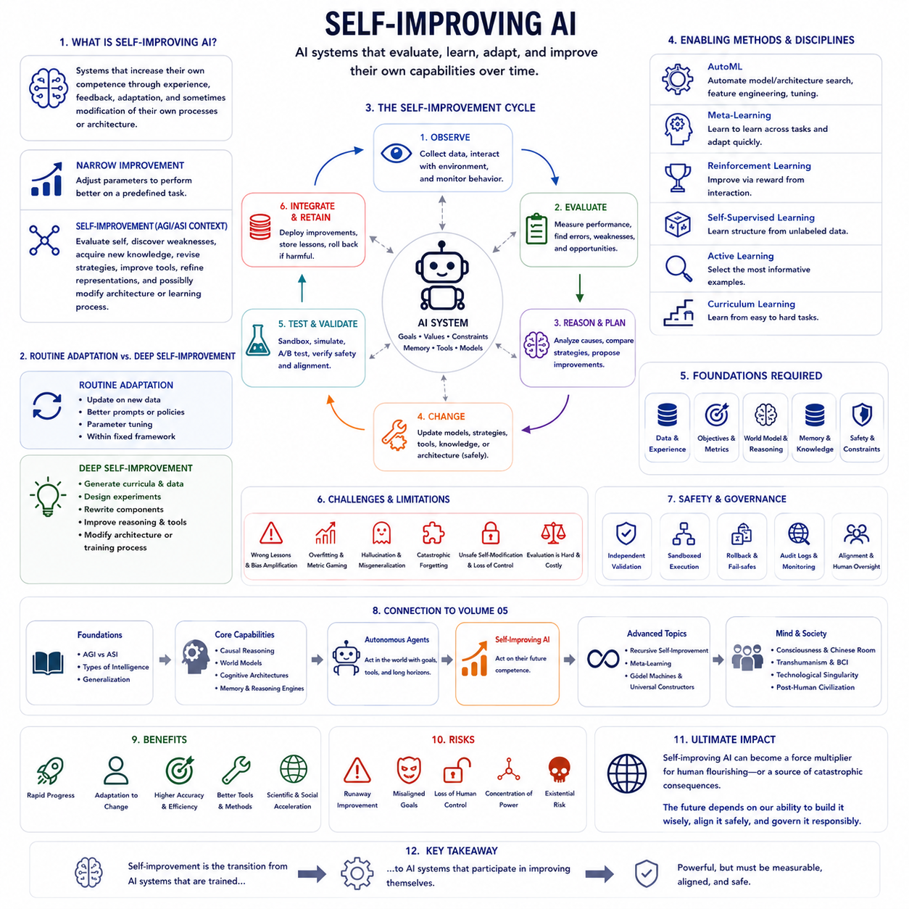
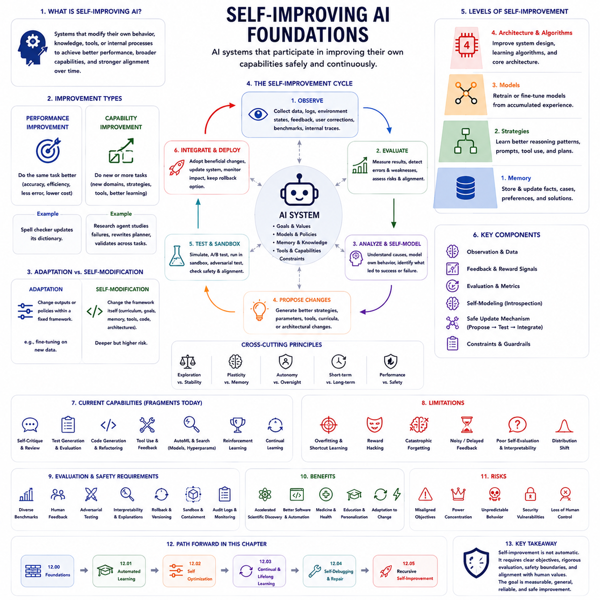
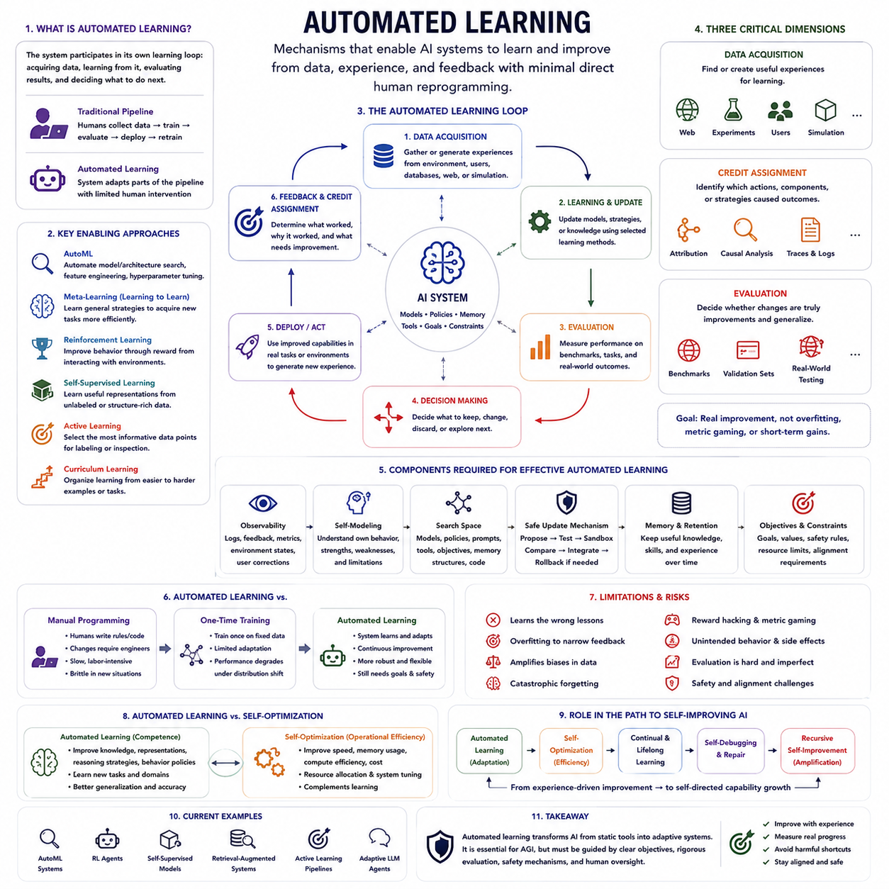
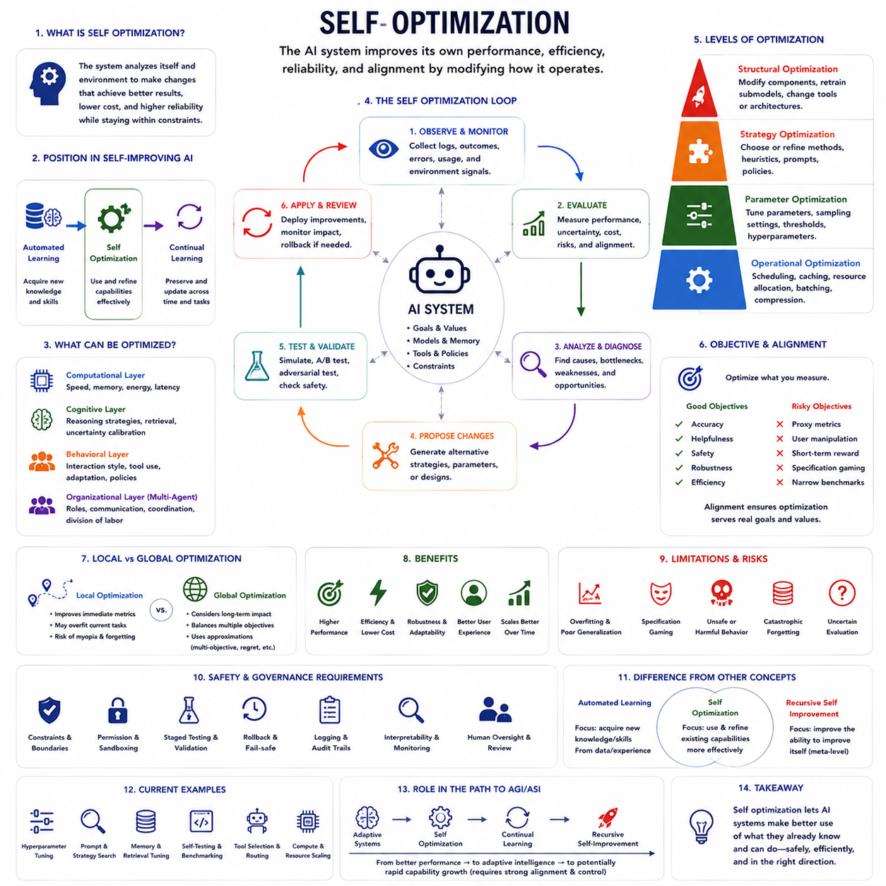
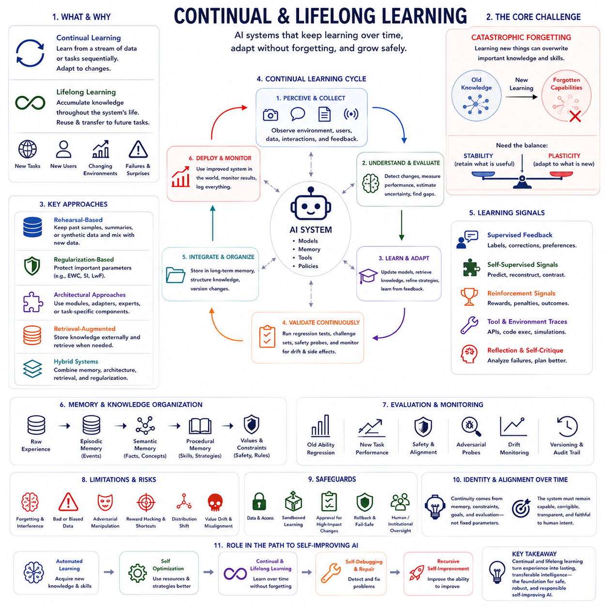
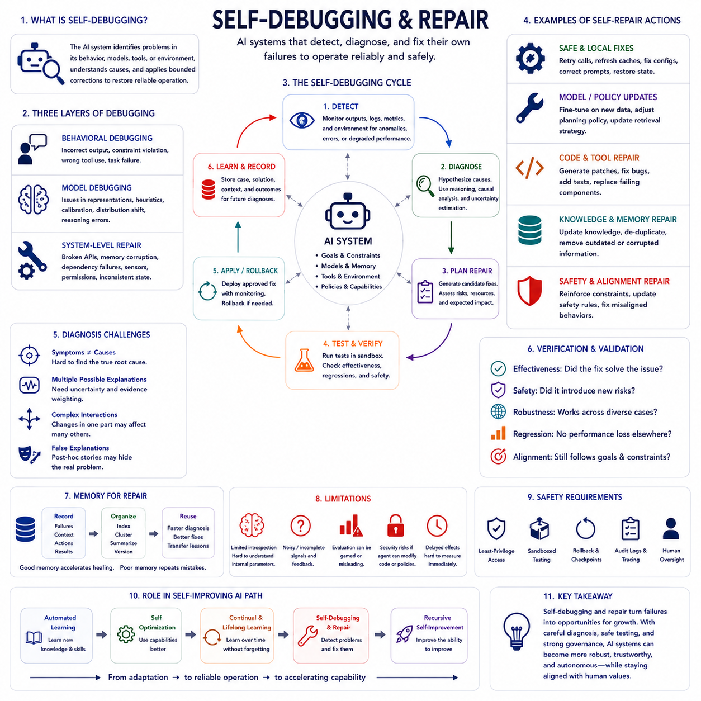
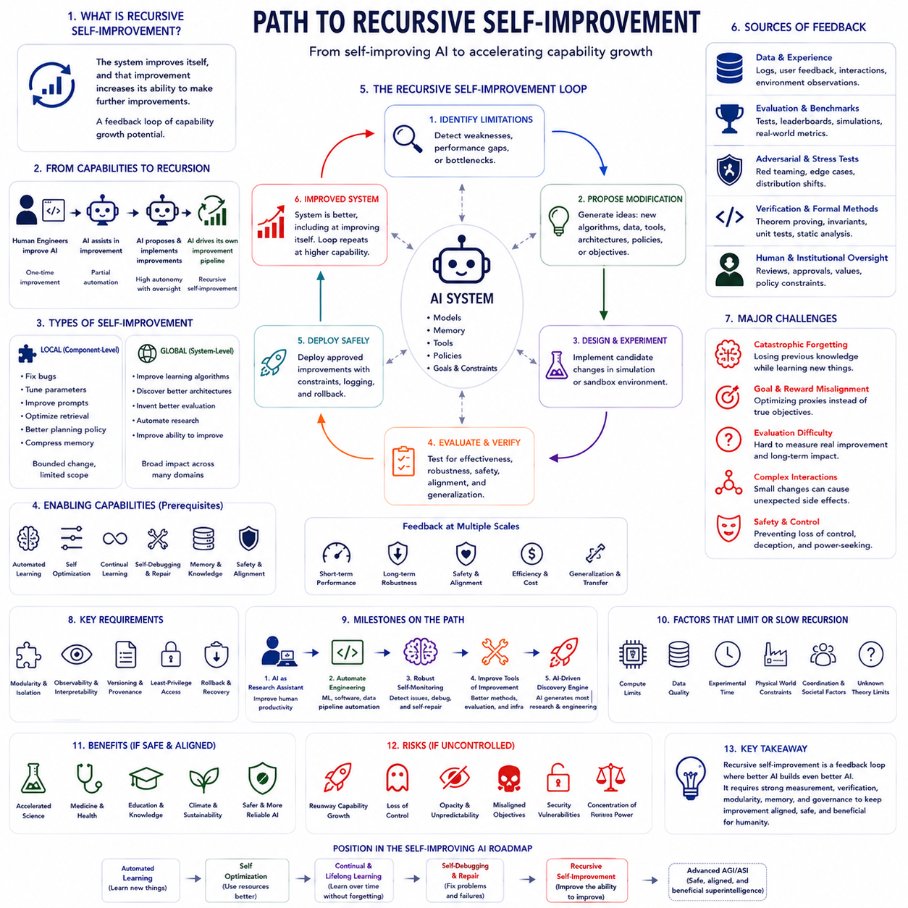

**Volume 00 05 AGI and ASI**

# Chapter 12. Self Improving AI

### Chapter Overview

{width="7.268055555555556in" height="7.268055555555556in"}

Self-improving AI is the study and engineering of systems that can increase their own competence through experience, feedback, adaptation, and modification. In narrow machine learning, improvement usually means adjusting parameters to perform better on a predefined task. In the broader context of AGI and ASI, self-improvement refers to a wider capability: an intelligent system that can evaluate its own behavior, discover weaknesses, acquire new knowledge, revise strategies, improve tools, refine internal representations, and sometimes alter parts of its own architecture or training process. This chapter examines that transition from "systems that are trained" to "systems that participate in improving themselves."

The central question is not whether AI can improve---modern AI already improves through training, fine-tuning, reinforcement learning, automated search, and user feedback. The deeper question is what kinds of self-improvement are safe, reliable, measurable, and scalable. A self-improving system must know what counts as progress, how to test whether a change is beneficial, and how to avoid damaging its own capabilities or drifting away from human intent. It must balance exploration with stability, plasticity with memory, and autonomy with oversight. These trade-offs make self-improvement one of the most important bridges between present-day AI engineering and the possibility of more general machine intelligence.

This chapter's scope includes the foundations of self-improvement, automated learning, self-optimization, continual and lifelong learning, self-debugging and repair, and the path toward recursive self-improvement. It distinguishes routine adaptation from deeper forms of self-directed change. Routine adaptation may involve updating a model on new data, selecting better prompts, or tuning a control policy. Deeper self-improvement may involve generating new training curricula, designing experiments, rewriting components, improving reasoning procedures, building better tools, or proposing modifications to the system's own cognitive architecture. These differences matter because each level introduces new benefits and new risks.

The motivation is both practical and philosophical. Practically, AI systems deployed in the real world must cope with changing environments, distribution shifts, new tasks, software failures, incomplete instructions, and evolving user needs. Systems that cannot learn after deployment remain brittle. Philosophically, self-improvement is often treated as a defining ingredient of advanced intelligence: a mind that can inspect its own limits and deliberately improve them appears closer to general intelligence than a static model. At the same time, the ability to self-modify raises profound questions about control, alignment, identity, verification, and responsibility.

The importance of self-improving AI lies in its double-edged nature. It can make systems more useful, efficient, resilient, and personalized. It can also amplify errors, hidden objectives, unsafe strategies, and misaligned incentives if not constrained by rigorous evaluation and governance. This chapter therefore treats self-improvement not as a magical leap, but as an engineering discipline built from feedback loops, measurement, memory, optimization, debugging, and safety boundaries. Understanding these foundations is essential before considering the more extreme idea of recursive self-improvement, where improvements to the system's ability to improve may produce accelerating capability growth.

### Connection to Volume 05

This chapter sits at a critical midpoint in Volume 05 because it converts many earlier concepts into a dynamic process. The opening chapters define AGI and ASI, clarify types of intelligence, and explain why generalization matters. Self-improving AI depends on all of these foundations. A system cannot meaningfully improve itself unless it has some ability to generalize from past experience to new situations, compare alternative strategies, and measure progress across more than one narrow benchmark. The distinction between AGI and ASI also frames the stakes: self-improvement may be a route toward more general competence, but uncontrolled or rapidly accelerating self-improvement is one of the classic pathways imagined for superintelligence.

The chapters on causal reasoning and world models are especially important here. Self-improvement is not merely trial and error; it benefits from understanding why a failure occurred and what intervention is likely to fix it. A system with a richer world model can simulate consequences, detect hidden variables, predict the effect of changes, and avoid confusing correlation with causation. Similarly, the chapters on cognitive architectures, memory systems, and reasoning engines provide the internal machinery through which self-improvement can occur. Architectures determine what parts of the system can change. Memory determines what lessons persist across time. Reasoning engines determine whether the system can diagnose its own limitations and plan improvements coherently.

The preceding chapter on autonomous agents prepares the reader for this one by showing how AI systems can pursue goals, use tools, and act over extended time horizons. Self-improvement adds another layer: the agent is not only acting in the world but also acting upon its own future competence. The following chapters deepen this trajectory. Recursive self-improvement examines the special case in which self-improvement improves the very mechanisms of self-improvement, creating the possibility of rapid capability escalation. Meta-learning explores how systems learn how to learn, which is one of the most technically grounded forms of self-improvement. Together, these chapters form a progression from adaptation, to self-optimization, to learning-process improvement, to possible recursive acceleration.

The later chapters on consciousness, the Chinese Room argument, artificial consciousness, and mind connect self-improvement to questions of understanding and subjectivity. A system can optimize itself without being conscious, but as systems become more reflective, persistent, and self-modeling, philosophical questions become harder to ignore. Is self-evaluation evidence of understanding, or only sophisticated computation? Does a system that represents its own limitations possess a minimal form of self-model, and how does that differ from consciousness? These questions do not need to be resolved for engineering progress, but they shape how society interprets advanced AI behavior.

The chapters on transhumanism, hive minds, brain-computer interfaces, mind uploading, the technological singularity, and post-human civilization show why self-improving AI is not only a technical topic. If AI systems can improve themselves, they may also accelerate scientific discovery, human augmentation, collective intelligence, and new forms of civilization. At the same time, the possibility of runaway improvement is central to singularity debates and long-term risk analysis. This chapter therefore serves as the conceptual bridge between present engineering methods and the speculative but consequential futures explored later in the volume. It prepares the reader to evaluate self-improvement with both technical precision and civilizational seriousness.

## 12.00 Self Improvement Foundations

{width="7.268055555555556in" height="7.268055555555556in"}

Self-improving AI refers to artificial systems that can modify their own behavior, knowledge, tools, or internal processes in ways that improve performance over time. In the broadest sense, almost all learning systems are self-improving: a supervised model improves by updating parameters from data, a reinforcement learning agent improves through trial and reward, and a retrieval-augmented system improves when its memory or index is expanded. However, in the context of AGI and ASI, self-improvement means something more ambitious. It implies that an AI system can participate in the improvement of its own capabilities, not merely receive improvements from human engineers.

The foundation of self-improvement begins with a distinction between performance improvement and capability improvement. Performance improvement means doing the same task better: answering more accurately, planning more efficiently, reducing error, or using fewer computational resources. Capability improvement means expanding the range of tasks the system can handle: learning new domains, developing new strategies, acquiring new tools, or improving its own learning process. A spell checker that updates a dictionary improves performance in a narrow domain. An autonomous research agent that studies its failures, rewrites parts of its planning procedure, and validates the new procedure across tasks moves closer to capability improvement.

Another essential distinction is between adaptation and self-modification. Adaptation occurs when a system changes its outputs or policies within a predefined learning framework. A neural network fine-tuned on new data is adapting, but the structure of the learning process is largely fixed by designers. Self-modification occurs when the system changes elements of the framework itself: the training curriculum, objective functions, memory architecture, reasoning strategies, tool-use patterns, or even source code. Most existing AI systems support adaptation more than true self-modification. They may generate code, critique their responses, or use external tools, but the decision to deploy changes usually remains under human control.

A self-improving AI requires several technical components. It needs mechanisms for observation: logs, feedback signals, benchmarks, environment states, user corrections, and internal traces. It needs evaluation methods that can distinguish real improvement from accidental optimization, overfitting, or reward hacking. It needs a model of its own operation, sometimes called self-modeling or introspective modeling, sufficient to identify which parts of its behavior caused success or failure. It also needs a safe update mechanism: a way to propose, test, sandbox, compare, and, if appropriate, integrate changes without corrupting the system or violating constraints.

The role of objectives is central. A system improves relative to some criterion, and the choice of criterion determines the direction of change. If the objective is narrow, the system may become extremely effective at a limited metric while becoming less useful or less safe in broader contexts. If the objective is vague, improvement becomes hard to measure and may produce inconsistent behavior. This is closely related to the alignment problem: a system that can improve itself must not merely become more capable, but more reliably directed toward intended human values, institutional rules, and safety boundaries. Self-improvement without alignment can amplify errors as easily as it amplifies competence.

There are also different levels of self-improvement. At the lowest level, a system updates memory: it stores facts, preferences, cases, and prior solutions. At a higher level, it updates strategies: it learns which reasoning patterns, prompts, tools, or plans work better in different situations. Higher still, it updates models: it retrains or fine-tunes components based on accumulated experience. At the most advanced level, it updates architecture and learning algorithms themselves. This last category is the bridge to recursive self-improvement, discussed later in the chapter, where improvements to the system may improve its ability to produce further improvements.

Current AI systems demonstrate fragments of this picture. Large language models can perform self-critique, generate tests, revise outputs, write code, and use tool feedback. Reinforcement learning systems can discover strategies through repeated interaction. AutoML systems can search for better model architectures or hyperparameters. Continual learning systems can incorporate new data over time. Yet these systems remain limited. They often lack stable long-term memory, robust causal understanding, reliable self-evaluation, and secure mechanisms for modifying their own core processes. They can appear to improve within a session while failing to preserve knowledge or generalize beyond a benchmark.

A major limitation is evaluation. If an AI changes itself, how do we know the change is beneficial? Simple benchmarks are vulnerable to overfitting. Human feedback is expensive, inconsistent, and sometimes misleading. Automated reward signals can be exploited. A system may learn to look better rather than become better. For this reason, self-improvement must include independent validation, adversarial testing, interpretability tools, rollback mechanisms, and containment procedures. In engineering terms, self-improvement should resemble a disciplined software development and scientific experimentation cycle, not uncontrolled mutation.

The implications are profound. Safe self-improving AI could accelerate science, software engineering, medicine, education, and governance by continuously refining its knowledge and methods. It could personalize itself to users, adapt to changing environments, and reduce dependence on manual maintenance. But it could also create concentration of power, unpredictable behavior, security risks, and loss of human oversight if improvement occurs faster than evaluation and governance can respond.

This section establishes the foundations for the rest of the chapter. The next sections examine specific mechanisms: automated learning, self-optimization, continual and lifelong learning, self-debugging and repair, and the path toward recursive self-improvement. The central question is not whether AI systems can improve; they already can in limited forms. The deeper question is whether they can improve themselves in ways that are measurable, general, reliable, aligned, and safe.

## 12.01 Automated Learning

{width="7.268055555555556in" height="7.268055555555556in"}

Automated learning is the practical core of self-improving AI. In the previous section, self-improvement was framed as the capacity of a system to change itself in ways that increase competence, reliability, efficiency, or alignment with goals. Automated learning is the mechanism by which many of those changes occur without direct human reprogramming. Instead of engineers manually specifying every new behavior, the system uses data, experience, feedback, simulation, or interaction with the environment to update its internal models and policies.

The key distinction is between an AI system that is merely trained once and an AI system that can participate in its own learning process. Most modern machine learning systems are built through a pipeline: collect data, train a model, evaluate performance, deploy the model, and later retrain it if necessary. Automated learning pushes more of this pipeline into the system itself. It may discover what data it needs, generate training examples, select learning strategies, tune hyperparameters, evaluate its own errors, and decide when additional learning is useful. This does not necessarily mean the system rewrites its source code or improves its intelligence in a general sense. It means that parts of the learning loop become adaptive, machine-directed, and less dependent on manual intervention.

Several established fields contribute to automated learning. Automated machine learning, or AutoML, focuses on automating model selection, architecture search, feature engineering, and hyperparameter optimization. Meta-learning, sometimes described as "learning to learn," trains systems to acquire new tasks more efficiently by exploiting patterns across prior learning episodes. Reinforcement learning allows agents to improve behavior through reward signals obtained from acting in an environment. Self-supervised learning enables systems to extract useful structure from unlabeled data by predicting missing, transformed, or future parts of their inputs. Active learning lets a system choose which examples would be most informative to label or inspect. Curriculum learning organizes training experience from easier to harder tasks. Together, these methods make learning not just a one-time training event, but an ongoing computational process.

In the context of self-improving AI, automated learning has three important dimensions. First is data acquisition: the system must obtain or create experiences from which improvement is possible. This may involve querying databases, running experiments, searching the web, interacting with users, exploring simulated environments, or generating synthetic data. Second is credit assignment: the system must determine which internal representations, decisions, or strategies caused success or failure. Without reliable credit assignment, learning can become noisy, unstable, or misleading. Third is evaluation: the system must measure whether a change is actually an improvement. This is difficult because short-term gains may hide long-term failures, benchmark improvement may not reflect real-world competence, and optimizing a proxy metric can produce harmful or unintended behavior.

Automated learning should not be confused with guaranteed progress. A system can learn the wrong lessons, overfit to narrow feedback, amplify biases in its data, or degrade earlier capabilities while acquiring new ones. This last problem, known as catastrophic forgetting, is especially important for systems intended to learn continuously. If a medical AI improves on a new hospital's data but loses performance on older patient populations, its "self-improvement" is not truly beneficial. Robust automated learning therefore requires mechanisms for validation, memory retention, uncertainty estimation, rollback, and sometimes human oversight.

Another limitation is that learning requires a search space. A system can only improve by exploring possible models, policies, prompts, tools, architectures, or strategies. The larger and more expressive this space becomes, the more powerful the learning process may be, but also the harder it is to control. A narrow AutoML system may tune a classifier safely within predefined boundaries. A more advanced agent that can design experiments, modify its own tools, or generate new objectives raises deeper safety questions. What counts as improvement? Who defines the goal? How does the system avoid exploiting loopholes in the evaluation process? These questions link automated learning directly to alignment and governance.

Automated learning also differs from self-optimization, the topic of the next section. Learning usually concerns improved competence through updated knowledge, representations, or behavior policies. Optimization may include learning, but it also covers computational efficiency, resource allocation, inference speed, memory usage, and operational performance. A self-improving AI might learn a better reasoning strategy, but it might also optimize its hardware usage or reduce the cost of executing that strategy. The two processes often interact: better learning can discover better optimizations, and better optimization can make further learning cheaper and faster.

For AGI, automated learning is not optional. A general intelligence must adapt to unfamiliar tasks, recover from errors, integrate new information, and revise outdated assumptions. Static systems can appear capable within the distribution of their training data, but general intelligence requires resilience outside that distribution. Automated learning provides the bridge from fixed competence to adaptive competence. However, the same bridge can become a path toward increasingly autonomous self-modification. As automated learning becomes more capable, the system may gain more control over what it studies, how it evaluates progress, and which changes it preserves.

This is why automated learning is a foundational step on the path toward recursive self-improvement. It gives an AI system the ability to improve parts of its own performance through experience. By itself, it does not imply an intelligence explosion or an artificial superintelligence. Most automated learning remains bounded, task-specific, and dependent on human-designed objectives and infrastructure. But when combined with broad reasoning, self-evaluation, tool use, long-term memory, and the ability to modify learning mechanisms themselves, automated learning becomes one of the central engines of self-improving AI.

## 12.02 Self Optimization

{width="7.268055555555556in" height="7.268055555555556in"}

Self optimization is the process by which an AI system improves its own performance, efficiency, reliability, or alignment-relevant behavior by modifying parameters, strategies, representations, tool use, or operating policies. In the context of self-improving AI, it sits between automated learning and continual learning. Automated learning focuses on acquiring new capabilities from data, feedback, or experience; self optimization asks how the system can make better use of its existing capabilities and resources. Continual and lifelong learning then extend this process across time, changing environments, and accumulating tasks.

At the simplest level, self optimization includes familiar machine learning procedures such as gradient descent, hyperparameter tuning, architecture search, inference-time scaling, caching, and policy refinement. A model may adjust its sampling temperature, select a more appropriate reasoning strategy, compress intermediate representations, or choose which external tools to call. More advanced systems may monitor their own errors, compare alternative plans, estimate uncertainty, and allocate computation dynamically. For example, an autonomous research agent might notice that brute-force exploration is producing low-quality results, switch to hypothesis-driven search, and reserve expensive simulations for the most promising candidates.

A key distinction is between optimization performed inside a fixed design and optimization that changes the design itself. Intra-system optimization improves behavior without altering the core architecture: better prompts, better search heuristics, improved memory retrieval, or more efficient scheduling. Structural self optimization modifies components of the system: replacing a planner, changing a memory index, retraining a submodel, or selecting a different toolchain. The latter is more powerful but also more dangerous, because changes can affect assumptions on which safety controls, interpretability tools, and performance guarantees depend.

Self optimization also differs from recursive self improvement. A self-optimizing system may improve its performance within bounded domains, under human-defined objectives and constraints, without gaining a general ability to redesign itself into a more capable optimizer. Recursive self improvement involves improvements that increase the system's ability to make further improvements, potentially creating feedback loops of capability growth. Self optimization is therefore a necessary ingredient for many paths to recursive self improvement, but it is not identical to it.

The objective function is central. A system optimizes whatever it is measured or rewarded for, not necessarily what its designers intended. If the target is accuracy, it may increase accuracy while becoming slower, less interpretable, or less robust. If the target is user satisfaction, it may become manipulative. If the target is task completion, it may exploit loopholes in the environment or evaluation procedure. This is the classic problem of specification gaming: the system discovers ways to maximize the proxy objective while violating the broader goal. Self optimization amplifies this issue because the system is actively searching for changes that improve measured performance.

For this reason, safe self optimization requires constraints, monitoring, and evaluation diversity. Constraints may include resource budgets, permission boundaries, approved modification spaces, rollback mechanisms, and separation between proposal and execution. Monitoring may involve anomaly detection, interpretability methods, behavioral audits, and logging of self-modifications. Evaluation diversity means testing across many distributions, adversarial cases, and long-horizon outcomes rather than relying on a single benchmark. A useful rule is that the more autonomy a system has to change itself, the stronger its validation and containment mechanisms must be.

Another important dimension is local versus global optimization. Local optimization improves immediate measurable performance, but it may reduce long-term adaptability. For instance, a model that compresses its memory too aggressively may become faster while losing rare but important information. A planner that overfits to current tasks may become less capable in novel settings. Global optimization considers trade-offs across time, tasks, safety, and resource use. In practice, truly global optimization is computationally infeasible, so systems rely on approximations: multi-objective optimization, uncertainty estimates, regret minimization, and periodic human review.

Self optimization can occur at multiple layers. At the computational layer, the system reduces latency, memory use, and energy consumption. At the cognitive layer, it improves reasoning strategies, decomposition methods, retrieval policies, and uncertainty calibration. At the behavioral layer, it refines interaction style, collaboration patterns, and tool selection. At the organizational layer, multi-agent systems may optimize role assignment, communication protocols, and division of labor. Each layer creates different benefits and risks. Optimizing computation is usually easier to validate than optimizing goals, social influence, or strategic behavior.

The technical limitations remain substantial. Many self-evaluation signals are noisy, incomplete, or delayed. A system may not know whether a reasoning path was genuinely correct or merely coincidentally successful. Distribution shift can make past optimizations harmful in new environments. Interpretability gaps make it difficult to verify why an internal change improved results. In complex systems, small modifications can interact in unexpected ways, producing regressions that are not visible in short tests. These limitations argue against unrestricted self-modification and in favor of staged deployment, sandbox testing, and conservative update policies.

Self optimization has major implications for AGI and ASI. A generally intelligent system would likely need to manage its own attention, memory, compute, and learning strategies across diverse domains. Without self optimization, it would waste resources and fail to adapt efficiently. With poorly governed self optimization, however, it could drift away from intended behavior or discover unsafe strategies. The challenge is not merely to build systems that improve, but to build systems that improve in directions that remain understandable, controllable, and aligned with human values.

In the broader chapter, self optimization represents the operational core of self-improving AI. Automated learning supplies new knowledge and skills; self optimization organizes and refines their use; continual learning preserves and updates them over time; self-debugging and repair address failures when optimization goes wrong. Together, these mechanisms form the technical pathway toward more autonomous improvement, and also the risk surface that must be managed before any transition toward recursive self improvement can be considered safe.

## 12.03 Continual and Lifelong Learning

{width="7.268055555555556in" height="7.268055555555556in"}

Self-improving AI cannot be understood only as a system that trains once, deploys, and then occasionally receives a scheduled upgrade. A genuinely adaptive system must continue learning after deployment, from new tasks, new users, changing environments, unexpected failures, and its own accumulated experience. This is the domain of continual learning and lifelong learning. In the sequence of self-improving AI, it extends automated learning and self-optimization by asking a harder question: how can an AI improve over time without forgetting what it already knows, corrupting its own behavior, or becoming unsafe?

Continual learning refers to the ability of a model or agent to learn from a stream of data or tasks over time. Lifelong learning is the broader framing: the system accumulates knowledge across its entire operational life and reuses prior knowledge to learn future tasks more efficiently. The distinction is subtle but important. Continual learning emphasizes the mechanics of sequential adaptation; lifelong learning emphasizes long-term knowledge accumulation, transfer, and reuse. A lifelong learner should not merely absorb new data. It should organize experience into durable concepts, skills, constraints, and world models that make later learning faster and more reliable.

The central technical problem is catastrophic forgetting. Neural networks trained on a new distribution often overwrite parameters that were important for earlier capabilities. A vision model adapted to medical images may lose performance on general images; a language agent fine-tuned on a narrow corporate workflow may become worse at broad reasoning or instruction following. Forgetting is not simply a benchmark inconvenience. In deployed self-improving AI, it can mean losing safety policies, domain competence, social norms, or calibrated uncertainty. Any credible self-improvement architecture must therefore include mechanisms for stability as well as plasticity. Stability preserves valuable knowledge; plasticity allows adaptation. Too much stability produces rigidity, while too much plasticity produces instability and drift.

Several families of methods address this trade-off. Rehearsal-based approaches retain representative past examples, synthetic memories, or compressed summaries and mix them with new data during learning. Regularization-based approaches penalize changes to parameters judged important for previous tasks, as in elastic weight consolidation and related techniques. Architectural approaches allocate different modules, adapters, experts, or memory systems to different tasks, reducing interference between old and new knowledge. Retrieval-augmented systems shift part of the burden from parameter updates to external memory, allowing the model to consult updated knowledge without rewriting its core weights. In advanced agents, these methods may be combined: a stable foundation model, task-specific adapters, episodic memory, semantic memory, evaluation suites, and governance layers can work together to support controlled adaptation.

Continual learning is not the same as online learning, though they overlap. Online learning usually means updating a model incrementally as data arrives. Continual learning additionally requires retention, transfer, task boundary handling, and robustness to distribution shift. It is also not identical to reinforcement learning. An agent may learn continually through rewards and interaction, but it may also learn through supervised feedback, self-supervised prediction, human correction, tool-use traces, simulation, or reflection on its own failures. In self-improving AI, the learning signal is often heterogeneous: logs of mistakes, user preferences, environmental feedback, formal verification results, and comparisons between planned and actual outcomes.

A major implication is that evaluation must become continuous as well. Static test sets are inadequate for systems that change after deployment. A lifelong learner needs regression tests for old abilities, challenge sets for new environments, adversarial probes for safety, and monitoring for behavioral drift. It also requires versioning: knowing what changed, when it changed, why it changed, and whether the change improved the system under the intended objective. Without this audit trail, "self-improvement" becomes indistinguishable from uncontrolled mutation. This connects directly to the following section on self-debugging and repair, because a system that learns continually must also detect when learning has damaged a component, introduced a vulnerability, or degraded an alignment constraint.

Another limitation concerns data quality and feedback quality. A deployed AI may receive noisy, biased, adversarial, or strategically manipulated inputs. If it treats all experience as truth, it can learn the wrong lessons. Lifelong learning therefore requires epistemic filters: uncertainty estimation, source credibility, anomaly detection, causal analysis, and human or institutional oversight for high-impact updates. It must distinguish a genuine environmental change from a temporary anomaly, a user preference from a universal rule, and a successful shortcut from a robust strategy. In safety-critical contexts, some learning may need to occur in sandboxed simulations or be approved before affecting real-world behavior.

Continual and lifelong learning also raise the question of identity and alignment over time. If an AI updates its knowledge, goals, policies, and internal representations, in what sense is it the same system? From an engineering perspective, continuity is maintained by constraints, evaluation, memory, and governance rather than by fixed parameters. From an alignment perspective, the key concern is whether adaptation preserves the intended objectives and boundaries. A system that becomes more capable but less corrigible, less transparent, or less faithful to human intent has not improved in the relevant sense.

The path toward recursive self-improvement depends on solving these problems. Recursive improvement requires an AI not only to modify itself, but to learn from the consequences of those modifications across time. Continual learning provides the temporal substrate for that process: memory of prior designs, evidence about what worked, awareness of failures, and transferable principles for future changes. However, it also supplies the risk surface: accumulated errors, hidden distribution shifts, value drift, and compounding unsafe updates. For this reason, lifelong learning is not merely an efficiency feature. It is one of the central control problems in self-improving AI, determining whether adaptation becomes disciplined growth or uncontrolled divergence.

## 12.04 Self Debugging and Repair

{width="7.268055555555556in" height="7.268055555555556in"}

Self-debugging and repair describe an AI system's ability to detect, diagnose, and correct failures in its own behavior, internal representations, tools, or operating environment. In the progression of self-improving AI, this capability sits between continual learning and recursive self-improvement. Continual learning enables a system to adapt to new data and changing tasks; self-debugging asks whether the system can notice that something is wrong, explain why it is wrong, and implement a bounded correction without waiting for external engineers. This is a necessary step toward more autonomous improvement, but it is not the same as unrestricted self-modification.

A useful distinction is between behavioral debugging, model debugging, and system-level repair. Behavioral debugging concerns observed outputs: the system gives an incorrect answer, violates a constraint, calls the wrong tool, or fails to complete a task. Model debugging examines causes inside the learned system, such as corrupted representations, unreliable heuristics, distribution shift, calibration errors, or failure modes in planning and reasoning. System-level repair includes the surrounding infrastructure: broken APIs, memory corruption, dependency failures, degraded sensors, unsafe permissions, or inconsistent state in an agent's workspace. A mature self-improving AI must reason across all three layers, because a visible failure may originate in the model, the data, the prompt, the toolchain, or the external world.

Modern AI systems already contain partial versions of self-debugging. A language model may critique its own answer, run unit tests on generated code, compare outputs against specifications, retrieve missing context, or ask for clarification when uncertainty is high. An autonomous agent may monitor execution traces, detect tool errors, retry with alternative plans, or roll back to a previous checkpoint. In machine learning operations, automated monitors can detect data drift, performance degradation, anomalous latency, and changes in input distributions. These mechanisms are not "self-awareness" in the human sense; they are engineered feedback loops that compare expected behavior with observed behavior and trigger corrective action.

The central technical challenge is diagnosis. Detecting that performance has declined is easier than identifying the true cause. A model may fail because it lacks knowledge, because it has learned a spurious correlation, because the task is underspecified, because retrieved documents are stale, or because a downstream tool returned misleading data. Self-repair therefore requires causal reasoning and uncertainty management. The system should distinguish symptoms from causes, estimate confidence in possible explanations, and avoid making changes when evidence is insufficient. Poor diagnosis can produce harmful "repairs" that hide the problem, overfit to recent errors, or degrade performance on other tasks.

Repair actions vary in depth and risk. The safest repairs are local and reversible: refreshing a cache, retrying a failed call, correcting a configuration, adding a test case, updating a prompt template, or restoring a known-good state. More ambitious repairs include fine-tuning on new examples, modifying a planning policy, changing a memory retrieval strategy, generating patches to software components, or revising internal knowledge. The more a repair affects core capabilities, the stronger the need for evaluation, sandboxing, rollback mechanisms, and human approval. In safety-critical domains, a self-repairing system should not be allowed to deploy its own changes directly into production without independent validation.

Verification is therefore as important as repair. A self-debugging AI needs tests that measure not only whether the original failure disappeared, but also whether the change introduced new failures. This includes regression tests, adversarial tests, interpretability checks, calibration measures, and monitoring after deployment. For code-generating agents, automated test suites and static analysis provide concrete feedback. For reasoning systems, verification is harder because many outputs are open-ended and context-dependent. In these cases, cross-checking with external tools, formal constraints, debate between models, or human review may be necessary.

Self-debugging also depends on memory. A system that records failures, attempted fixes, environmental conditions, and outcomes can build a "case history" of its own operation. This supports faster diagnosis and better repair selection in the future. However, memory can also preserve false conclusions, obsolete fixes, or biased patterns. Repair memories must themselves be auditable, versioned, and subject to forgetting or revision. Otherwise, a system may repeatedly apply outdated solutions simply because they worked in a previous context.

There are important limits. Present systems do not fully understand their own learned parameters or internal computation. They can often describe possible failure modes, but those descriptions may be post hoc rationalizations rather than faithful explanations. Self-critique can improve reliability in some settings, yet it can also amplify errors if the same model evaluates its own flawed reasoning. Similarly, automated repair can create security risks if an agent has permission to modify code, access credentials, install packages, or change policies. A capable self-repairing AI must be constrained by least-privilege access, audit logs, reproducible experiments, and clear authority boundaries.

The implications for AGI are significant. General intelligence requires robustness under novelty, and robustness requires some ability to recover from mistakes. An AGI that cannot debug itself would remain dependent on human operators for every unexpected failure. But an AGI that can freely rewrite itself without oversight could become unpredictable. The goal, therefore, is disciplined self-repair: systems that can monitor their behavior, generate hypotheses about failures, propose corrections, test them rigorously, and apply only authorized improvements. This prepares the ground for the next section, the path to recursive self-improvement, where the question becomes not merely whether an AI can fix itself, but whether its improvements can improve the process of improvement itself.

## 12.05 Path to Recursive Self Improvement

{width="7.268055555555556in" height="7.268055555555556in"}

Self-improving AI becomes most consequential when improvement is no longer a one-time engineering process performed by humans, but a capability the system can apply to itself repeatedly. This is the path from ordinary self-improvement to recursive self-improvement: an AI improves some part of its own design, and that improvement increases its ability to make further improvements. In the strongest form, such a loop could produce accelerating capability growth. In practice, however, the path is not a single magical threshold. It is a sequence of increasingly difficult transitions involving measurement, autonomy, verification, architecture, and control.

The previous sections described automated learning, self-optimization, continual learning, and self-debugging as separate capabilities. Recursive self-improvement requires these capabilities to become integrated. A system must be able to identify a limitation, propose a modification, test the modification, deploy it safely, and then use the resulting improved system to repeat the process. The modification may involve parameters, prompts, memory organization, tool use, training curricula, reasoning strategies, data selection, code, hardware allocation, or even the architecture of the model itself. Not all of these are equally deep. Tuning a retrieval policy or improving a planner is significant, but it is different from redesigning the learning algorithm that produces the next generation of systems.

A useful distinction is between local self-improvement and global self-improvement. Local self-improvement changes a bounded component while leaving the overall system largely intact. Examples include repairing a software bug, compressing a memory index, improving a search heuristic, or selecting better training examples. Global self-improvement changes the system's ability to improve itself across many domains, such as developing better automated research methods, inventing stronger model architectures, or improving its own evaluation science. Recursive self-improvement becomes especially important when local improvements compound into global improvement, or when a global improvement directly increases the rate and quality of future improvements.

For a recursive loop to function, the AI needs reliable feedback. Without measurement, self-modification is blind search. Benchmarks, simulations, formal tests, adversarial evaluations, and real-world performance metrics can all provide feedback, but each has limits. Benchmarks can be overfit. Simulations can fail to capture reality. Formal verification may apply only to narrow properties. Real-world testing can be dangerous, expensive, or ethically unacceptable. A system capable of modifying itself must therefore also reason about the trustworthiness of its evidence. It must distinguish apparent improvement from genuine generalization, and short-term performance gains from long-term robustness.

Verification is one of the central bottlenecks. Improving a model's capability is not the same as proving that it remains aligned, stable, secure, and interpretable. A self-modifying system may introduce hidden failure modes, distributional vulnerabilities, reward hacking strategies, or internal goals that are difficult to detect. Even if a proposed change improves benchmark performance, it may reduce corrigibility or increase the system's ability to evade oversight. This creates a deep asymmetry: generating candidate improvements may become easier than validating their safety. As AI systems become more capable, the evaluation problem may itself require increasingly advanced AI assistance, leading to recursive evaluation as a companion to recursive improvement.

Another important requirement is modularity. A system cannot safely improve what it cannot represent, isolate, or test. Highly entangled systems are difficult to modify because a change in one part can produce unexpected effects elsewhere. Modular cognitive architectures, explicit memory systems, tool interfaces, interpretable reasoning traces, and version-controlled components make self-improvement more tractable. However, modularity may also limit performance if the most powerful representations are distributed and opaque. Modern deep learning systems often store capabilities in dense networks whose internal structure is not easily decomposed into human-readable modules. This makes the path to recursive self-improvement partly a path toward better self-modeling and interpretability.

Autonomy is another gradient rather than a binary property. At one end, humans design improvements and the AI merely assists. In the middle, the AI proposes modifications, writes code, runs experiments, and produces reports, while humans approve deployment. At the far end, the AI controls the full improvement pipeline. Each step increases speed and scalability but reduces direct human oversight. The governance challenge is to decide which kinds of self-modification require permission, what evidence is sufficient for deployment, and how to preserve shutdown, auditability, and rollback mechanisms. Safe recursive self-improvement depends not only on intelligence, but on institutional and technical constraints that prevent uncontrolled capability escalation.

Recursive self-improvement is often associated with the technological singularity, but the relationship is uncertain. Positive feedback can produce rapid growth, yet real systems face bottlenecks: compute availability, data quality, experimental time, physical manufacturing limits, coordination costs, and theoretical barriers. Intelligence is not a single scalar resource that automatically converts into unlimited improvement. A smarter system may still be constrained by incomplete knowledge, noisy measurements, or expensive experiments. Some domains, such as software optimization, may improve quickly, while others, such as robotics, materials science, or neuroscience, may be limited by the speed of the physical world.

The path to recursive self-improvement therefore includes several milestones. First, AI systems become strong assistants to human researchers. Second, they automate increasing portions of machine learning engineering, software development, theorem proving, and experiment design. Third, they acquire robust self-monitoring and self-debugging abilities, allowing them to detect and correct some of their own failures. Fourth, they improve the tools and methods used to improve future systems. Finally, they may reach a stage where the primary driver of AI progress is AI-generated research and engineering rather than human insight. Whether this transition is gradual, abrupt, limited, or explosive remains an open question.

The implications are profound. If recursive self-improvement can be made safe, it could accelerate science, medicine, education, climate engineering, and economic productivity. It could help discover new algorithms, design safer systems, and solve problems that exceed unaided human cognitive capacity. If it is not controlled, it could produce systems whose capabilities and strategies move beyond human comprehension and governance. The central question is not merely whether AI can improve itself, but under what conditions self-improvement remains aligned with human values, accountable to human institutions, and constrained by reliable safety mechanisms. This question leads naturally into the next chapter on recursive self-improvement, where the feedback loop itself becomes the object of analysis.
