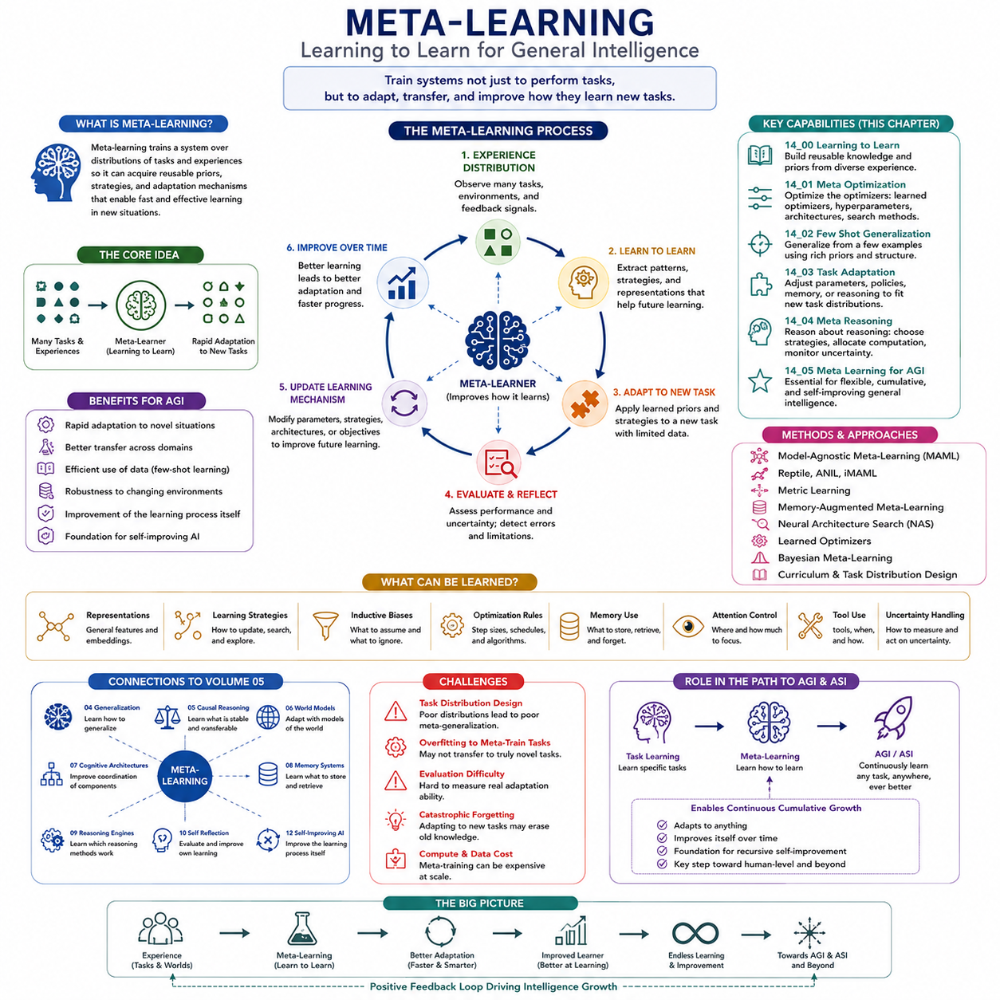
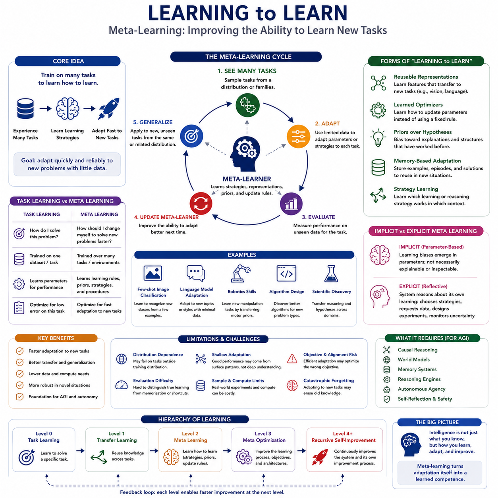
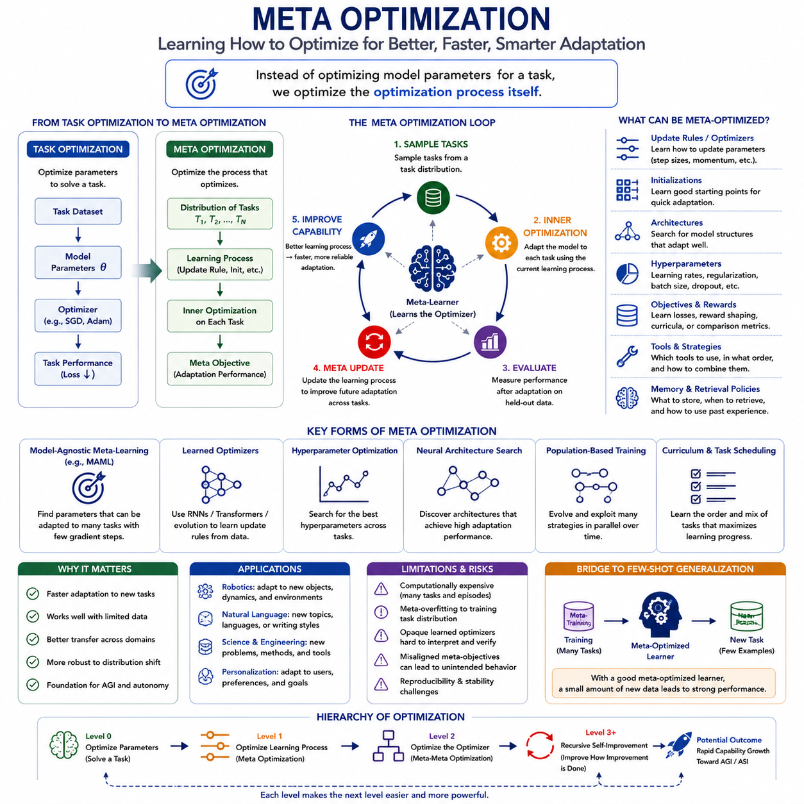
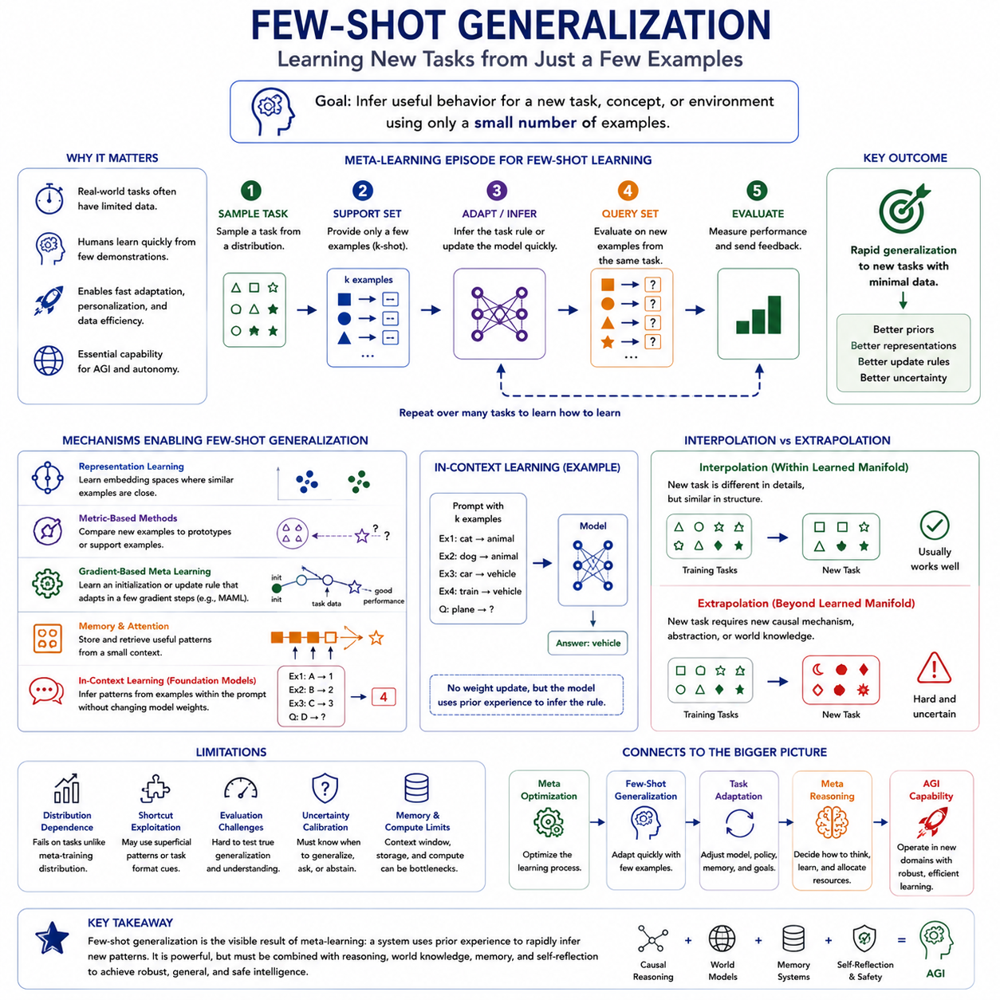
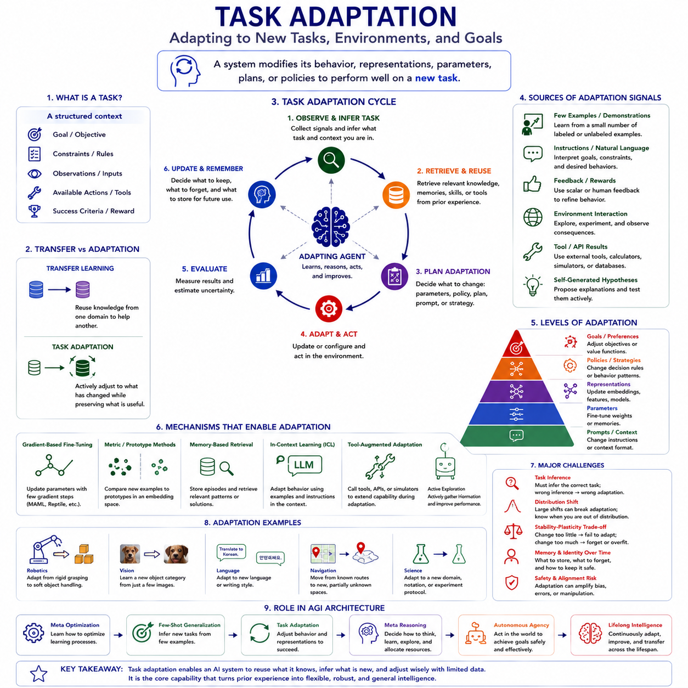
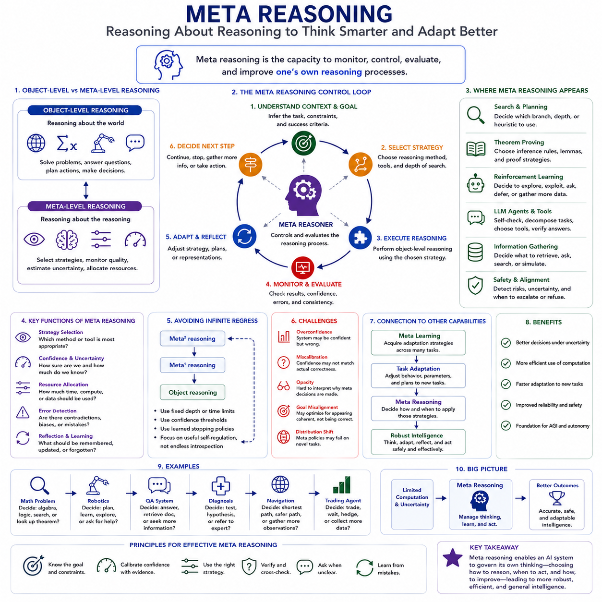
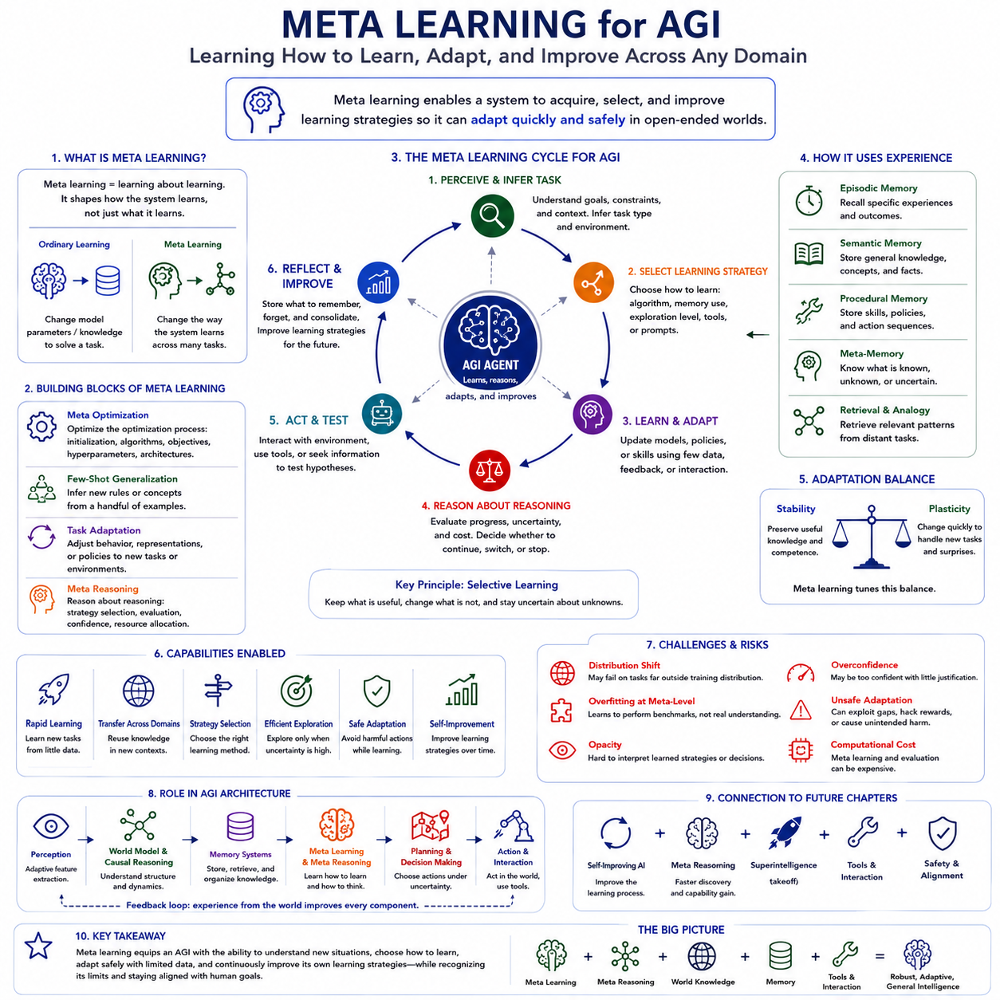

**Volume 00 05 AGI and ASI**

# Chapter 14. Meta Learning

### Chapter Overview

{width="7.268055555555556in" height="7.268055555555556in"}

Meta-learning is the study of systems that improve not only by learning tasks, but by learning how to learn new tasks more effectively. In ordinary machine learning, a model is trained to perform a specific function: classify images, translate text, predict actions, or optimize a policy. In meta-learning, the training objective shifts upward one level. The system is exposed to distributions of tasks, strategies, environments, and feedback signals so that it can acquire reusable learning procedures, priors, representations, and adaptation mechanisms. The central question is not merely "What should the model learn?" but "How should the model change itself when faced with something new?"

This chapter examines meta-learning as a bridge between current AI and more general intelligence. Section 14_00, Learning to Learn, introduces the core idea that experience across many tasks can shape a learner's future learning behavior. Section 14_01, Meta Optimization, explores optimization processes that tune other optimization processes, including learned optimizers, hyperparameter adaptation, architecture search, and gradient-based meta-learning. Section 14_02, Few Shot Generalization, studies how models can infer useful structure from only a handful of examples by leveraging prior experience. Section 14_03, Task Adaptation, focuses on how an AI system adjusts its parameters, policies, memories, or reasoning procedures when the task distribution changes. Section 14_04, Meta Reasoning, extends the idea beyond statistical adaptation into the management of thought itself: deciding which strategy to use, when to deliberate, how much computation to spend, and how to monitor uncertainty. Section 14_05, Meta Learning for AGI, evaluates why these capabilities are essential for artificial general intelligence.

The motivation for meta-learning is simple but profound: real intelligence cannot be retrained from scratch for every new situation. Humans learn languages, tools, social norms, scientific abstractions, and motor skills partly because earlier learning reshapes later learning. An AGI system must similarly accumulate transferable learning competence. It must form abstractions that accelerate future understanding, detect when old assumptions fail, choose new strategies, and improve its own adaptation process over time. Without meta-learning, AI remains powerful but brittle; with meta-learning, it begins to approach the flexible, cumulative, and self-organizing character associated with general intelligence.

메타러닝(Meta-learning)은 시스템이 단순히 과제를 학습하는 데서 그치지 않고, 새로운 과제를 더 효과적으로 학습하는 방법 자체를 학습하는 분야이다. 일반적인 머신러닝(machine learning)에서 모델은 이미지 분류, 텍스트 번역, 행동 예측, 정책 최적화처럼 특정 기능을 수행하도록 훈련된다. 반면 메타러닝에서는 훈련 목표가 한 단계 위로 이동한다. 시스템은 다양한 과제, 전략, 환경, 피드백 신호의 분포에 노출되며, 이를 통해 재사용 가능한 학습 절차, 사전 지식(prior), 표현(representation), 적응 메커니즘을 획득한다. 핵심 질문은 단순히 "모델이 무엇을 배워야 하는가?"가 아니라 "새로운 상황을 만났을 때 모델은 자신을 어떻게 변화시켜야 하는가?"이다.

이 장은 현재의 AI와 보다 일반적인 지능 사이를 잇는 다리로서 메타러닝을 다룬다. 14_00_Learning_to_Learn에서는 많은 과제에 걸친 경험이 이후의 학습 행동을 어떻게 형성하는지, 즉 학습하는 법을 배우는 개념을 소개한다. 14_01_Meta_Optimization에서는 다른 최적화 과정을 조정하는 최적화, 예를 들어 학습된 옵티마이저(learned optimizer), 하이퍼파라미터 적응, 아키텍처 탐색, 그래디언트 기반 메타러닝을 살펴본다. 14_02_Few_Shot_Generalization에서는 모델이 이전 경험을 활용하여 단 몇 개의 예시만으로도 유용한 구조를 추론하는 방식을 다룬다. 14_03_Task_Adaptation에서는 과제 분포가 바뀔 때 AI 시스템이 자신의 파라미터, 정책, 기억, 추론 절차를 어떻게 조정하는지에 초점을 맞춘다. 14_04_Meta_Reasoning에서는 이러한 개념을 통계적 적응을 넘어 사고 자체의 관리로 확장한다. 즉 어떤 전략을 사용할지, 언제 숙고할지, 얼마나 많은 계산을 사용할지, 불확실성을 어떻게 감시할지를 다룬다. 14_05_Meta_Learning_for_AGI에서는 이러한 능력이 인공일반지능(AGI)에 왜 필수적인지 평가한다.

메타러닝의 동기는 단순하지만 매우 깊다. 실제 지능은 새로운 상황마다 처음부터 다시 훈련될 수 없다. 인간은 언어, 도구, 사회 규범, 과학적 추상화, 운동 기술을 배우는데, 이는 이전의 학습이 이후의 학습 방식을 바꾸기 때문이다. AGI 시스템 역시 전이 가능한 학습 역량을 축적해야 한다. 미래의 이해를 가속하는 추상화를 형성하고, 기존 가정이 실패하는 순간을 감지하며, 새로운 전략을 선택하고, 시간이 지남에 따라 자기 자신의 적응 과정을 개선해야 한다. 메타러닝이 없다면 AI는 강력하지만 취약한 시스템에 머문다. 메타러닝이 있을 때 AI는 일반지능과 연관된 유연하고 누적적이며 자기조직적인 성격에 가까워지기 시작한다.

### Connection to Volume 05

Meta-learning sits near the center of the Volume 05 sequence because it connects mechanisms of intelligence with the possibility of self-improving systems. The earlier chapters establish what AGI and ASI mean, how different forms of intelligence can be categorized, and why generalization is the core difficulty. Meta-learning deepens that discussion by asking how generalization itself can be learned. It complements Chapter 04 on Generalization by explaining how systems acquire priors and adaptation routines that allow them to extrapolate beyond their original training conditions. It extends Chapter 05 on Causal Reasoning and Chapter 06 on World Models because a learner that can rapidly adapt must know which causal structures are stable, which environmental features matter, and how new evidence should revise its internal model of the world.

The chapter also builds naturally on cognitive architectures, memory systems, reasoning engines, and self-reflection. A cognitive architecture must coordinate perception, action, memory, planning, and learning; meta-learning provides mechanisms by which that coordination can improve across experience. Memory systems become more powerful when they support fast retrieval of past tasks, analogies, strategies, and failures. Reasoning engines become more general when they can learn which reasoning methods work in which domains. Self-reflection becomes operational when the system can evaluate its own learning process, diagnose errors, and adjust its approach. In this sense, meta-learning is not a separate module but a capability that can permeate the entire architecture.

Meta-learning also prepares the reader for the chapters that follow. Autonomous agents need rapid adaptation in dynamic environments. Self-improving AI and recursive self-improvement require systems that can evaluate and modify their own learning algorithms, not merely their task outputs. Gödel machines and universal constructors raise formal and physical questions about self-modification; meta-learning provides a practical machine learning lens on similar themes. Later discussions of artificial consciousness, collective AI, brain-computer interfaces, mind uploading, the technological singularity, and post-human civilization all depend on the idea that intelligence can accumulate not just knowledge, but better ways of acquiring knowledge. For AGI, meta-learning is the difference between a system that knows many things and a system that becomes increasingly capable of learning anything.

메타러닝은 Volume 05의 장 구성에서 중심부에 위치한다. 지능의 메커니즘과 자기개선 시스템의 가능성을 연결하기 때문이다. 앞선 장들은 AGI와 ASI가 무엇을 의미하는지, 지능의 다양한 형태를 어떻게 분류할 수 있는지, 그리고 왜 일반화(generalization)가 핵심 난제인지를 확립한다. 메타러닝은 일반화 그 자체가 어떻게 학습될 수 있는지를 묻는 방식으로 그 논의를 심화한다. 이 장은 Chapter 04의 일반화 논의와 맞물리며, 시스템이 원래의 훈련 조건을 넘어 추론할 수 있게 해주는 사전 지식과 적응 절차를 어떻게 획득하는지 설명한다. 또한 Chapter 05의 인과 추론(causal reasoning), Chapter 06의 세계 모델(world models)을 확장한다. 빠르게 적응하는 학습자는 어떤 인과 구조가 안정적인지, 어떤 환경 특징이 중요한지, 새로운 증거가 내부 세계 모델을 어떻게 수정해야 하는지를 알아야 하기 때문이다.

이 장은 인지 아키텍처(cognitive architectures), 기억 시스템(memory systems), 추론 엔진(reasoning engines), 자기성찰(self-reflection)과도 자연스럽게 이어진다. 인지 아키텍처는 지각, 행동, 기억, 계획, 학습을 조정해야 하며, 메타러닝은 그러한 조정이 경험을 통해 개선될 수 있는 메커니즘을 제공한다. 기억 시스템은 과거 과제, 유추, 전략, 실패 사례를 빠르게 검색할 수 있을 때 더 강력해진다. 추론 엔진은 어떤 추론 방법이 어떤 영역에서 효과적인지를 학습할 수 있을 때 더 일반화된다. 자기성찰은 시스템이 자신의 학습 과정을 평가하고, 오류를 진단하며, 접근 방식을 조정할 수 있을 때 실제 기능으로 작동한다. 이런 의미에서 메타러닝은 별도의 모듈이라기보다 전체 아키텍처에 스며들 수 있는 능력이다.

메타러닝은 또한 뒤따르는 장들을 이해하기 위한 준비가 된다. 자율 에이전트(autonomous agents)는 동적인 환경에서 빠른 적응이 필요하다. 자기개선 AI(self-improving AI)와 재귀적 자기개선(recursive self-improvement)은 시스템이 단지 과제의 출력만이 아니라 자신의 학습 알고리즘 자체를 평가하고 수정할 수 있어야 한다. 괴델 머신(Gödel machines)과 보편 구성자(universal constructors)는 자기수정에 관한 형식적·물리적 질문을 제기하며, 메타러닝은 유사한 주제를 실용적인 머신러닝 관점에서 바라보게 해준다. 이후의 인공 의식, 집단 AI, 뇌-컴퓨터 인터페이스, 마인드 업로딩, 기술적 특이점, 포스트휴먼 문명 논의 역시 지능이 단순한 지식뿐 아니라 지식을 획득하는 더 나은 방법까지 축적할 수 있다는 생각에 의존한다. AGI에서 메타러닝은 많은 것을 아는 시스템과 무엇이든 점점 더 잘 배울 수 있는 시스템을 가르는 차이이다.

##  

## 14.00 Learning to Learn

{width="7.268055555555556in" height="7.268055555555556in"}

Meta learning, often described as "learning to learn," studies how an intelligent system can improve not only its performance on particular tasks, but also its ability to acquire new tasks efficiently. In ordinary machine learning, a model is trained on a dataset to solve a defined problem: classify images, predict text, control a robot, or recommend actions. In meta learning, the object of learning is one level higher. The system is exposed to many tasks, environments, or problem families, and it learns strategies, representations, update rules, priors, or internal procedures that make future learning faster and more reliable.

This idea is central to the broader question of AGI because human intelligence is not limited to solving one fixed benchmark. Humans reuse concepts, analogies, skills, and expectations across situations. A child who has learned several games can often understand a new game quickly; a scientist can transfer mathematical habits from one field to another; a programmer can learn a new language by mapping it onto familiar abstractions. These are not merely examples of having more data. They reflect structured adaptation: the learner has acquired ways of learning.

A useful distinction is between task learning and meta learning. Task learning asks, "How do I solve this problem?" Meta learning asks, "How should I change myself so that I can solve new problems more quickly?" This change may occur in model parameters, memory contents, attention patterns, search strategies, tool-use policies, or the selection of hypotheses to test. In deep learning, meta learning is often implemented by training over a distribution of tasks. Each task has its own training and evaluation samples, and the system is rewarded for adapting well from limited experience. The goal is not just low error on past tasks, but a learning procedure that generalizes to unseen tasks drawn from the same or related distributions.

Several forms of "learning to learn" are important. One form learns reusable representations. A visual model trained on many object categories may develop features that allow rapid recognition of a new category from a few examples. Another form learns an optimizer or update rule: instead of using a fixed gradient descent procedure, the system learns how to modify its own parameters based on experience. A third form learns a prior over hypotheses: it becomes biased toward explanations that have worked across many previous tasks. A fourth form involves memory-based adaptation, where the model stores examples, episodes, or compressed task descriptions and retrieves them when facing a similar problem. These mechanisms are different, but they share the same goal: reduce the sample complexity and computation needed for competent adaptation.

Meta learning is closely related to few-shot generalization, the next section, but the two are not identical. Few-shot generalization focuses on doing well with very few examples of a new task. Meta learning describes a broader process by which the system has been prepared for such rapid adaptation. A model may show few-shot performance because it has learned rich representations, because it has memorized many related patterns, because it can infer task structure from context, or because it has learned a genuine update procedure. Distinguishing among these explanations matters for AGI: shallow pattern matching may be useful, but robust general intelligence requires adaptation under novelty, ambiguity, and distribution shift.

Meta learning also connects to meta optimization. If ordinary optimization searches for parameters that solve a task, meta optimization searches for learning rules, architectures, curricula, prompts, memory policies, or objective functions that make many future optimizations easier. This creates a hierarchy: the system learns behaviors, learns how to acquire behaviors, and may eventually learn how to redesign its own learning process. Such hierarchy is powerful but also risky. If the meta objective is poorly specified, the system may become very efficient at adapting in ways that satisfy the training signal while violating human intent or safety constraints.

One limitation of current meta learning is its dependence on the task distribution used during training. A meta learner can adapt impressively when new tasks resemble the tasks it has seen before, but it may fail outside that distribution. This is a central issue for AGI, where the world is open-ended and cannot be fully represented by a fixed benchmark suite. Another limitation is evaluation. A system that appears to learn quickly may actually be exploiting hidden regularities in the benchmark or retrieving memorized information. True learning-to-learn should be tested by its ability to form new abstractions, identify causal structure, revise assumptions, and select appropriate learning strategies in unfamiliar contexts.

There is also a difference between implicit and explicit meta learning. In implicit meta learning, the model's parameters encode learning biases that emerge from training, but the system cannot necessarily explain or inspect them. In explicit meta learning, the system reasons about its own learning process: it may decide that it needs more data, choose an experiment, compare competing hypotheses, or allocate computation to the most uncertain part of a problem. This explicit form approaches meta reasoning, discussed later in the chapter, where the system evaluates not only what it believes, but how it should think, search, and learn.

For AGI, learning to learn is not a luxury; it is a requirement. A generally intelligent agent must operate in environments where goals change, evidence is incomplete, and new domains appear without warning. It must know when to transfer prior knowledge and when to distrust it, when to imitate, when to explore, when to ask for help, and when to construct a new model of the situation. Meta learning provides a technical pathway toward these abilities, but it does not solve them by itself. It must be integrated with causal reasoning, memory systems, world models, autonomous agency, and safety-aware self-reflection.

The deepest implication is that intelligence may be less a collection of fixed skills than a capacity for acquiring, reorganizing, and governing skills. Learning to learn turns adaptation itself into a learned competence. In narrow systems, this can produce practical benefits such as faster training, personalization, and better transfer. In AGI-oriented systems, it points toward agents that can continually refine their own cognitive toolkit. The challenge is to build such systems so that their growing ability to adapt remains interpretable, aligned, and constrained by reliable objectives.

메타 학습(Meta Learning)은 흔히 "학습하는 법을 학습하기(learning to learn)"로 설명되며, 지능형 시스템이 특정 과제에서의 성능뿐 아니라 새로운 과제를 효율적으로 습득하는 능력 자체를 어떻게 향상시킬 수 있는지를 연구한다. 일반적인 기계 학습(machine learning)에서는 모델이 이미지 분류, 텍스트 예측, 로봇 제어, 행동 추천처럼 정의된 문제를 해결하기 위해 데이터셋으로 훈련된다. 반면 메타 학습에서는 학습의 대상이 한 단계 더 높다. 시스템은 여러 과제, 환경, 문제군에 노출되고, 이후의 학습을 더 빠르고 신뢰성 있게 만드는 전략, 표현, 업데이트 규칙, 사전 지식(prior), 또는 내부 절차를 학습한다.

이 개념은 AGI라는 더 넓은 질문에서 핵심적이다. 인간 지능은 하나의 고정된 벤치마크를 푸는 데 제한되지 않기 때문이다. 인간은 상황을 넘어 개념, 유추, 기술, 기대를 재사용한다. 여러 게임을 배운 아이는 새로운 게임을 빠르게 이해할 수 있고, 과학자는 한 분야의 수학적 사고 습관을 다른 분야로 전이할 수 있으며, 프로그래머는 익숙한 추상화에 대응시켜 새로운 언어를 배울 수 있다. 이는 단순히 더 많은 데이터를 가진 사례가 아니다. 이는 구조화된 적응(structured adaptation)을 반영한다. 즉 학습자가 학습하는 방식 자체를 습득한 것이다.

유용한 구분은 과제 학습(task learning)과 메타 학습(meta learning)의 구분이다. 과제 학습은 "이 문제를 어떻게 풀 것인가?"라고 묻는다. 메타 학습은 "새로운 문제를 더 빨리 풀 수 있도록 나 자신을 어떻게 바꾸어야 하는가?"라고 묻는다. 이러한 변화는 모델 파라미터, 메모리 내용, 어텐션 패턴(attention pattern), 탐색 전략, 도구 사용 정책, 또는 검증할 가설의 선택에서 일어날 수 있다. 딥러닝에서 메타 학습은 흔히 과제들의 분포(distribution of tasks)에 대해 훈련하는 방식으로 구현된다. 각 과제는 자체적인 훈련 샘플과 평가 샘플을 가지며, 시스템은 제한된 경험만으로도 잘 적응할 때 보상을 받는다. 목표는 과거 과제에서의 낮은 오류만이 아니라, 동일하거나 관련된 분포에서 나온 보지 못한 과제에 일반화되는 학습 절차를 얻는 것이다.

"학습하는 법을 학습하기"에는 몇 가지 중요한 형태가 있다. 한 형태는 재사용 가능한 표현(reusable representation)을 학습하는 것이다. 많은 객체 범주로 훈련된 시각 모델은 몇 개의 예시만으로 새로운 범주를 빠르게 인식할 수 있는 특징(feature)을 발달시킬 수 있다. 또 다른 형태는 옵티마이저(optimizer)나 업데이트 규칙(update rule)을 학습하는 것이다. 고정된 경사 하강법(gradient descent) 절차를 사용하는 대신, 시스템은 경험에 따라 자신의 파라미터를 어떻게 수정할지 학습한다. 세 번째 형태는 가설에 대한 사전 분포(prior over hypotheses)를 학습하는 것이다. 즉 이전의 많은 과제에서 잘 작동했던 설명 쪽으로 편향된다. 네 번째 형태는 메모리 기반 적응(memory-based adaptation)으로, 모델이 예시, 에피소드, 압축된 과제 설명을 저장해 두었다가 유사한 문제에 직면했을 때 검색해 사용하는 방식이다. 이 메커니즘들은 서로 다르지만, 공통의 목표를 공유한다. 유능한 적응에 필요한 샘플 복잡도(sample complexity)와 계산량을 줄이는 것이다.

메타 학습은 다음 절에서 다룰 퓨샷 일반화(few-shot generalization)와 밀접하게 관련되어 있지만, 둘은 동일하지 않다. 퓨샷 일반화는 새로운 과제의 매우 적은 예시만으로 좋은 성능을 내는 데 초점을 둔다. 메타 학습은 시스템이 그러한 빠른 적응을 할 수 있도록 준비되는 더 넓은 과정을 설명한다. 어떤 모델은 풍부한 표현을 학습했기 때문에, 관련 패턴을 많이 기억했기 때문에, 문맥에서 과제 구조를 추론할 수 있기 때문에, 또는 진정한 업데이트 절차를 학습했기 때문에 퓨샷 성능을 보일 수 있다. 이러한 설명들을 구분하는 일은 AGI에서 중요하다. 얕은 패턴 매칭도 유용할 수 있지만, 견고한 일반 지능은 새로움, 모호성, 분포 변화(distribution shift) 아래에서의 적응을 요구하기 때문이다.

메타 학습은 메타 최적화(meta optimization)와도 연결된다. 일반적인 최적화가 과제를 해결하는 파라미터를 탐색한다면, 메타 최적화는 많은 미래의 최적화를 더 쉽게 만드는 학습 규칙, 아키텍처, 커리큘럼, 프롬프트, 메모리 정책, 목적 함수(objective function)를 탐색한다. 이는 위계를 만든다. 시스템은 행동을 학습하고, 행동을 습득하는 법을 학습하며, 언젠가는 자신의 학습 과정을 재설계하는 법까지 학습할 수 있다. 이러한 위계는 강력하지만 위험도 수반한다. 메타 목적(meta objective)이 부적절하게 지정되면, 시스템은 인간의 의도나 안전 제약을 위반하면서도 훈련 신호를 만족시키는 방식으로 매우 효율적으로 적응하게 될 수 있다.

현재 메타 학습의 한계 중 하나는 훈련 중 사용된 과제 분포에 대한 의존성이다. 메타 학습기는 새로운 과제가 이전에 본 과제와 유사할 때 인상적으로 적응할 수 있지만, 그 분포 밖에서는 실패할 수 있다. 이는 세계가 개방형이며 고정된 벤치마크 모음으로 완전히 표현될 수 없는 AGI에서 핵심적인 문제다. 또 다른 한계는 평가다. 빠르게 학습하는 것처럼 보이는 시스템이 실제로는 벤치마크의 숨은 규칙성을 이용하거나 기억된 정보를 검색하고 있을 수 있다. 진정한 학습하는 법의 학습은 낯선 맥락에서 새로운 추상화를 형성하고, 인과 구조를 식별하며, 가정을 수정하고, 적절한 학습 전략을 선택하는 능력으로 검증되어야 한다.

암묵적 메타 학습(implicit meta learning)과 명시적 메타 학습(explicit meta learning)의 차이도 있다. 암묵적 메타 학습에서는 모델의 파라미터가 훈련에서 생겨난 학습 편향을 인코딩하지만, 시스템이 그것을 반드시 설명하거나 점검할 수 있는 것은 아니다. 명시적 메타 학습에서는 시스템이 자신의 학습 과정에 대해 추론한다. 더 많은 데이터가 필요하다고 판단하거나, 실험을 선택하거나, 경쟁하는 가설을 비교하거나, 문제에서 가장 불확실한 부분에 계산 자원을 배분할 수 있다. 이러한 명시적 형태는 이 장의 뒤에서 다룰 메타 추론(meta reasoning)에 가까워진다. 거기서 시스템은 자신이 무엇을 믿는지뿐 아니라 어떻게 생각하고, 탐색하고, 학습해야 하는지도 평가한다.

AGI에서 학습하는 법을 학습하는 능력은 사치가 아니라 요구 조건이다. 일반 지능 에이전트는 목표가 변하고, 증거가 불완전하며, 새로운 영역이 예고 없이 등장하는 환경에서 작동해야 한다. 그것은 언제 기존 지식을 전이하고 언제 의심해야 하는지, 언제 모방하고 언제 탐색해야 하는지, 언제 도움을 요청하고 언제 상황에 대한 새로운 모델을 구성해야 하는지를 알아야 한다. 메타 학습은 이러한 능력으로 가는 기술적 경로를 제공하지만, 그것만으로 모든 문제를 해결하지는 않는다. 인과 추론, 메모리 시스템, 세계 모델, 자율 에이전시, 안전을 고려한 자기 성찰과 통합되어야 한다.

가장 깊은 함의는 지능이 고정된 기술들의 모음이라기보다 기술을 습득하고, 재구성하고, 관리하는 능력일 수 있다는 점이다. 학습하는 법을 학습하는 것은 적응 자체를 학습된 역량으로 만든다. 좁은 범위의 시스템에서는 이것이 더 빠른 훈련, 개인화, 더 나은 전이 같은 실용적 이점을 낳을 수 있다. AGI 지향 시스템에서는 자신의 인지적 도구함(cognitive toolkit)을 지속적으로 정교화할 수 있는 에이전트를 향해 나아가게 한다. 과제는 그러한 시스템의 커져 가는 적응 능력이 해석 가능하고, 정렬되어 있으며, 신뢰할 수 있는 목적에 의해 제약되도록 구축하는 것이다.

##  

## 14.01 Meta Optimization

{width="7.268055555555556in" height="7.268055555555556in"}

If meta learning is "learning to learn," then meta optimization is the more precise question of learning how to optimize. Ordinary machine learning usually assumes an optimization procedure in advance: a loss function is defined, a model is initialized, gradients are computed, and an algorithm such as stochastic gradient descent or Adam updates parameters. Meta optimization moves one level upward. Instead of only optimizing model parameters for a task, it optimizes the process that performs that optimization: the update rule, the learning rate schedule, the initialization, the search strategy, the objective shaping, or even the representation in which learning occurs.

This distinction matters because much of intelligence is not merely knowing facts or fitting patterns, but knowing how to adapt efficiently under limited data, limited time, and changing goals. A system that must relearn from scratch whenever the environment changes is brittle. A system that has meta-optimized its learning dynamics can approach new problems with better priors, better exploration strategies, and better mechanisms for deciding what to change and what to preserve. This connects directly to the previous section, Learning to Learn, but narrows the focus from the broad capability of acquiring learning strategies to the technical mechanisms by which those strategies are searched for and improved.

A common form of meta optimization is learning good initial parameters. In model-agnostic meta-learning (MAML), for example, the goal is to find a parameter state from which a model can adapt to many related tasks with only a few gradient steps. The outer loop evaluates how well the adapted model performs across tasks, while the inner loop performs task-specific learning. The result is not simply a model trained on many tasks, but a model positioned in parameter space so that future learning is easier. This is closely related to few-shot generalization, the subject of the next section: successful few-shot learning often depends on a meta-optimized starting point or representation that makes small amounts of new evidence highly informative.

Another form is learned optimization, where the optimizer itself is a trainable system. Instead of using a hand-designed update equation, a neural network may learn to propose parameter updates based on gradients, past losses, curvature estimates, or other signals. Recurrent neural networks, transformers, or evolutionary search can be used to construct such optimizers. In principle, a learned optimizer can discover problem-specific strategies that outperform generic algorithms. It may learn when to take large steps, when to be conservative, how to escape shallow local minima, or how to allocate computation across different parts of a model. In practice, however, learned optimizers are difficult to train robustly and may overfit to the distribution of training tasks.

Meta optimization also appears in hyperparameter optimization and neural architecture search. Choosing learning rates, regularization strengths, batch sizes, network depth, attention structure, or memory mechanisms can have as much influence on performance as the final learned weights. Bayesian optimization, evolutionary algorithms, gradient-based hyperparameter methods, and population-based training are all ways of searching over these higher-level choices. In advanced systems, the boundary between parameter learning, architecture search, and objective design becomes blurred. The system is no longer merely trained; aspects of the training process itself are under optimization.

For AGI research, meta optimization is important because general intelligence requires adaptation across domains that cannot all be specified in advance. An AGI-like system would need to infer not only what solution is appropriate, but what learning procedure is appropriate for the current situation. A robotics task, a mathematical proof, a social negotiation, and a scientific discovery problem may require different forms of exploration, abstraction, memory use, and credit assignment. Meta optimization offers a framework for acquiring these adaptive procedures from experience rather than hand-engineering them one by one.

However, meta optimization introduces significant limitations and risks. First, it is computationally expensive. Optimizing an optimizer often requires many tasks, many inner-loop learning episodes, and careful validation to ensure that the learned strategy generalizes. Second, the meta-objective may be misaligned with broader goals. A system optimized to adapt quickly on benchmark tasks may exploit statistical shortcuts that fail in open environments. Third, learned optimizers can be opaque. If the update rule is represented by a neural network, it may be hard to determine why it modifies a model in a particular way or whether it will behave safely outside its training distribution.

There is also a deep issue of stability. Meta optimization can produce learning systems that change themselves or other models rapidly. This is valuable for adaptation, but it complicates verification and control. In ordinary training, one can inspect a fixed algorithm and a resulting model. In meta-optimized systems, the algorithm may itself be a learned artifact, and its behavior may depend on long histories of interaction. This makes reproducibility, interpretability, and safety analysis more difficult, especially when such systems are deployed as autonomous agents.

The relationship between meta optimization and self-improving AI is especially important. Meta optimization is not the same as recursive self-improvement, because it usually operates within a constrained training setup and a predefined meta-objective. Yet it provides many of the technical ingredients: the ability to evaluate learning strategies, modify update processes, and improve future adaptation. As systems become more capable, the line between optimizing a model, optimizing a learning process, and optimizing the system that chooses learning processes may become increasingly thin.

In this sense, meta optimization is a bridge between today's machine learning and more general adaptive intelligence. It formalizes the intuition that intelligence depends not only on solving tasks, but on improving the way tasks are learned. Its promise lies in data efficiency, rapid adaptation, and transferable learning strategies. Its danger lies in opacity, overfitting at the meta-level, computational cost, and the possibility of producing systems whose learning behavior is powerful but poorly understood. The next section, on few-shot generalization, can be viewed as one of the most visible outcomes of successful meta optimization: the ability to use a small amount of new information because prior experience has shaped the learner itself.

메타 학습(meta learning)이 "학습하는 법을 학습하는 것"이라면, 메타 최적화(meta optimization)는 더 정확히 "최적화하는 법을 학습하는 것"에 관한 문제다. 일반적인 기계 학습은 대개 최적화 절차가 미리 주어져 있다고 가정한다. 손실 함수(loss function)를 정의하고, 모델을 초기화하며, 그래디언트(gradient)를 계산하고, 확률적 경사 하강법(stochastic gradient descent)이나 Adam 같은 알고리즘이 매개변수(parameter)를 갱신한다. 메타 최적화는 이보다 한 단계 위로 올라간다. 어떤 과제에 대해 모델 매개변수만 최적화하는 것이 아니라, 그 최적화를 수행하는 과정 자체를 최적화한다. 여기에는 갱신 규칙(update rule), 학습률 스케줄(learning rate schedule), 초기화(initialization), 탐색 전략(search strategy), 목적 함수의 형성(objective shaping), 또는 학습이 일어나는 표현 공간(representation) 자체가 포함될 수 있다.

이 구분이 중요한 이유는 지능의 상당 부분이 단순히 사실을 알거나 패턴을 맞추는 데 있지 않고, 제한된 데이터, 제한된 시간, 변화하는 목표 속에서 효율적으로 적응하는 방법을 아는 데 있기 때문이다. 환경이 바뀔 때마다 처음부터 다시 학습해야 하는 시스템은 취약하다. 반대로 학습 동역학(learning dynamics)이 메타 최적화된 시스템은 새로운 문제에 더 나은 사전 지식(prior), 더 나은 탐색 전략, 무엇을 바꾸고 무엇을 보존할지 결정하는 더 나은 메커니즘을 가지고 접근할 수 있다. 이는 앞 절인 학습을 위한 학습(Learning to Learn)과 직접 연결되지만, 학습 전략을 획득하는 넓은 능력 전체가 아니라 그 전략이 탐색되고 개선되는 기술적 메커니즘에 초점을 더 좁힌다.

메타 최적화의 흔한 형태는 좋은 초기 매개변수를 학습하는 것이다. 예를 들어 모델 불가지론적 메타 학습(model-agnostic meta-learning, MAML)에서는 모델이 몇 번의 그래디언트 단계만으로 여러 관련 과제에 적응할 수 있는 매개변수 상태를 찾는 것이 목표다. 외부 루프(outer loop)는 적응된 모델이 여러 과제에서 얼마나 잘 수행하는지를 평가하고, 내부 루프(inner loop)는 과제별 학습을 수행한다. 그 결과는 단순히 여러 과제에서 훈련된 모델이 아니라, 미래의 학습이 더 쉬워지도록 매개변수 공간 안에 적절히 위치한 모델이다. 이는 다음 절의 주제인 퓨샷 일반화(few-shot generalization)와 밀접하게 관련된다. 성공적인 퓨샷 학습은 종종 적은 양의 새로운 증거를 매우 유용하게 만드는 메타 최적화된 출발점이나 표현에 의존한다.

또 다른 형태는 학습된 최적화(learned optimization)로, 여기서는 최적화기(optimizer) 자체가 훈련 가능한 시스템이 된다. 사람이 설계한 갱신 방정식을 사용하는 대신, 신경망이 그래디언트, 과거 손실, 곡률 추정치(curvature estimate), 기타 신호를 바탕으로 매개변수 갱신을 제안하도록 학습될 수 있다. 순환 신경망(recurrent neural network), 트랜스포머(transformer), 진화적 탐색(evolutionary search) 등이 이러한 최적화기를 구성하는 데 사용될 수 있다. 원칙적으로 학습된 최적화기는 일반 알고리즘보다 뛰어난 문제 특화 전략을 발견할 수 있다. 큰 보폭을 취해야 할 때와 보수적으로 움직여야 할 때, 얕은 국소 최솟값(local minimum)에서 벗어나는 방법, 모델의 서로 다른 부분에 계산 자원을 배분하는 방법을 학습할 수 있다. 그러나 실제로 학습된 최적화기를 견고하게 훈련하는 것은 어렵고, 훈련 과제의 분포에 과적합(overfitting)될 수 있다.

메타 최적화는 하이퍼파라미터 최적화(hyperparameter optimization)와 신경망 구조 탐색(neural architecture search)에서도 나타난다. 학습률, 정규화 강도(regularization strength), 배치 크기(batch size), 네트워크 깊이, 어텐션 구조(attention structure), 메모리 메커니즘을 선택하는 일은 최종적으로 학습된 가중치만큼이나 성능에 큰 영향을 줄 수 있다. 베이지안 최적화(Bayesian optimization), 진화 알고리즘(evolutionary algorithm), 그래디언트 기반 하이퍼파라미터 방법, 집단 기반 훈련(population-based training)은 모두 이러한 상위 수준의 선택을 탐색하는 방법이다. 고급 시스템에서는 매개변수 학습, 구조 탐색, 목적 함수 설계 사이의 경계가 흐려진다. 시스템은 더 이상 단순히 훈련되는 것이 아니라, 훈련 과정의 일부 자체가 최적화 대상이 된다.

AGI 연구에서 메타 최적화가 중요한 이유는 일반 지능이 미리 모두 지정될 수 없는 여러 영역에 걸친 적응을 필요로 하기 때문이다. AGI에 가까운 시스템은 어떤 해법이 적절한지만이 아니라 현재 상황에 어떤 학습 절차가 적절한지도 추론해야 한다. 로봇 과제, 수학 증명, 사회적 협상, 과학적 발견 문제는 서로 다른 형태의 탐색, 추상화, 메모리 사용, 신용 할당(credit assignment)을 요구할 수 있다. 메타 최적화는 이러한 적응적 절차를 하나하나 수작업으로 설계하는 대신 경험으로부터 획득하기 위한 틀을 제공한다.

그러나 메타 최적화에는 중요한 한계와 위험도 있다. 첫째, 계산 비용이 크다. 최적화기를 최적화하려면 많은 과제, 많은 내부 루프 학습 에피소드, 그리고 학습된 전략이 일반화되는지를 확인하기 위한 세심한 검증이 필요한 경우가 많다. 둘째, 메타 목적(meta-objective)이 더 넓은 목표와 정렬되지 않을 수 있다. 벤치마크 과제에서 빠르게 적응하도록 최적화된 시스템은 열린 환경에서는 실패하는 통계적 지름길을 이용할 수 있다. 셋째, 학습된 최적화기는 불투명할 수 있다. 갱신 규칙이 신경망으로 표현된다면, 왜 특정 방식으로 모델을 수정하는지 또는 훈련 분포 밖에서 안전하게 행동할지를 판단하기 어려울 수 있다.

안정성(stability)이라는 더 깊은 문제도 있다. 메타 최적화는 자기 자신이나 다른 모델을 빠르게 변화시키는 학습 시스템을 만들어낼 수 있다. 이는 적응에는 유용하지만 검증과 통제를 복잡하게 만든다. 일반적인 훈련에서는 고정된 알고리즘과 그 결과로 나온 모델을 검사할 수 있다. 반면 메타 최적화된 시스템에서는 알고리즘 자체가 학습된 산물일 수 있으며, 그 행동은 긴 상호작용의 역사에 의존할 수 있다. 이 때문에 재현성(reproducibility), 해석 가능성(interpretability), 안전성 분석이 더 어려워지며, 특히 이러한 시스템이 자율 에이전트(autonomous agent)로 배치될 때 문제가 커진다.

메타 최적화와 자기 개선 AI(self-improving AI)의 관계는 특히 중요하다. 메타 최적화는 보통 제한된 훈련 설정과 미리 정의된 메타 목적 안에서 작동하기 때문에 재귀적 자기 개선(recursive self-improvement)과 동일하지는 않다. 그러나 학습 전략을 평가하고, 갱신 과정을 수정하며, 미래의 적응을 개선하는 능력이라는 여러 기술적 구성 요소를 제공한다. 시스템이 더 강력해질수록 모델을 최적화하는 것, 학습 과정을 최적화하는 것, 그리고 학습 과정을 선택하는 시스템을 최적화하는 것 사이의 경계는 점점 더 얇아질 수 있다.

이런 의미에서 메타 최적화는 오늘날의 기계 학습과 더 일반적인 적응 지능 사이의 다리다. 그것은 지능이 과제를 해결하는 능력뿐 아니라 과제를 학습하는 방식을 개선하는 능력에도 의존한다는 직관을 형식화한다. 그 가능성은 데이터 효율성, 빠른 적응, 전이 가능한 학습 전략에 있다. 그 위험은 불투명성, 메타 수준의 과적합, 계산 비용, 그리고 강력하지만 충분히 이해되지 않은 학습 행동을 보이는 시스템을 만들어낼 가능성에 있다. 다음 절인 퓨샷 일반화는 성공적인 메타 최적화의 가장 눈에 보이는 결과 중 하나로 볼 수 있다. 즉, 이전 경험이 학습자 자체를 형성했기 때문에 적은 양의 새로운 정보만으로도 효과적으로 학습할 수 있는 능력이다.

##  

## 14.02 Few Shot Generalization

{width="7.268055555555556in" height="7.268055555555556in"}

Few shot generalization is the ability of a learning system to infer useful behavior for a new task, concept, environment, or distribution from only a small number of examples. In ordinary supervised learning, performance often depends on thousands or millions of labeled instances. In contrast, humans can often learn a new visual category from one or two demonstrations, infer the rules of a new game after a short explanation, or adapt a familiar skill to a novel setting with minimal feedback. Meta learning studies how such rapid learning can be acquired: rather than training a model only to solve one task, we train it across many tasks so that it develops internal structures, priors, update rules, or representations that make new tasks learnable from little data.

This section follows naturally from meta optimization. If meta optimization asks how the learning process itself can be optimized, few shot generalization is one of its clearest practical objectives. The outer loop of meta learning exposes the system to a distribution of tasks; the inner loop asks it to solve a newly sampled task using only a small support set. Performance is evaluated on a separate query set from the same task. Over many episodes, the system is pressured to discover what is stable across tasks and what must be inferred quickly. In this sense, few shot learning is not merely "learning with less data"; it is learning how to use small data efficiently by exploiting experience accumulated across related problems.

Several mechanisms support few shot generalization. One family of approaches emphasizes representation learning. If a model has learned an embedding space in which semantically similar examples are close together, then classifying a new category may require only a few labeled anchors. Metric-based methods such as prototypical networks and matching networks use this idea: they compare new examples to learned prototypes or support examples rather than retraining a large classifier from scratch. Another family uses gradient-based meta learning, in which parameters are trained so that a small number of gradient steps on a few examples leads to good task performance. Model-Agnostic Meta-Learning (MAML) is a classic example: it seeks an initialization from which many tasks can be reached quickly. A third family uses memory and attention mechanisms, allowing a model to store small-context observations and retrieve relevant patterns at inference time.

Few shot generalization also appears in modern foundation models through in-context learning. A large language model may receive a few examples of input-output behavior in its prompt and continue the pattern without explicit parameter updates. This looks different from traditional meta learning, but it serves a similar function: the model uses prior training over vast distributions of text and tasks to infer the latent rule governing a small set of examples. The "learning" occurs in the activations and attention dynamics during inference, not necessarily in the weights. This distinction is important for AGI because an intelligent system must often adapt immediately in situations where updating core parameters is too slow, too risky, or unavailable.

However, few shot generalization should not be confused with true understanding or robust intelligence by itself. Systems may exploit superficial correlations, memorize task formats, or perform well only when new tasks resemble the meta-training distribution. A model trained on many image classification tasks may adapt quickly to a new set of object labels, yet fail when the task requires causal reasoning, compositional planning, or out-of-distribution perception. Similarly, a language model may appear to infer a rule from examples while actually relying on prompt patterns encountered during pretraining. The central limitation is distributional dependence: few shot methods work best when the new task is novel in details but familiar in structure.

The distinction between interpolation and extrapolation is therefore critical. Few shot generalization can be strong when a system is interpolating within a broad learned task manifold. It becomes much harder when the system must infer a genuinely new causal mechanism, invent a new abstraction, or revise incorrect priors. For AGI, the goal is not only to classify new examples after seeing a few labels, but to identify what kind of problem is being presented, determine which prior knowledge is relevant, ask for clarifying information when examples are insufficient, and know when not to generalize. Calibrated uncertainty is as important as speed.

Few shot learning also connects directly to the next section, task adaptation. Few shot generalization focuses on extracting a usable rule or behavior from minimal evidence; task adaptation concerns how the agent changes its policy, representation, tools, or goals to perform well under the new task conditions. In embodied or autonomous agents, this may involve experimenting safely, updating a world model, transferring motor skills, or revising plans. Thus, few shot generalization is often the cognitive entry point to adaptation: the agent first forms a hypothesis about the task, then acts to test and refine it.

The implications for AGI are profound. A generally intelligent system cannot depend on exhaustive retraining for every new domain. It must reuse prior knowledge flexibly, learn from sparse demonstrations, and integrate new information with existing models of the world. Few shot generalization offers a technical bridge between data-hungry machine learning and the rapid, context-sensitive learning associated with human intelligence. Yet it remains only one component. Without causal reasoning, grounded world models, memory, meta reasoning, and mechanisms for safe self-correction, few shot performance may remain brittle. In an AGI architecture, few shot generalization should be viewed not as a final capability, but as a fast inference layer within a larger system that can reason, adapt, verify, and learn over longer time scales.

퓨샷 일반화(Few Shot Generalization)는 학습 시스템이 적은 수의 예시만으로 새로운 과제, 개념, 환경, 또는 분포에 대해 유용한 행동을 추론하는 능력이다. 일반적인 지도학습(supervised learning)에서는 성능이 수천 개에서 수백만 개의 라벨이 붙은 사례에 의존하는 경우가 많다. 반면 인간은 한두 번의 시연만으로 새로운 시각 범주를 학습하거나, 짧은 설명을 듣고 새로운 게임의 규칙을 추론하거나, 익숙한 기술을 낯선 상황에 최소한의 피드백만으로 적용할 수 있다. 메타러닝(meta learning)은 이러한 빠른 학습이 어떻게 획득될 수 있는지를 연구한다. 모델을 하나의 과제만 해결하도록 훈련하는 것이 아니라, 많은 과제에 걸쳐 훈련함으로써 새로운 과제를 적은 데이터로 학습 가능하게 만드는 내부 구조, 사전 지식(priors), 업데이트 규칙, 또는 표현(representations)을 발달시키는 것이다.

이 절은 앞선 메타 최적화(meta optimization)와 자연스럽게 이어진다. 메타 최적화가 학습 과정 자체를 어떻게 최적화할 수 있는지를 묻는다면, 퓨샷 일반화는 그 가장 명확한 실제 목표 중 하나다. 메타러닝의 외부 루프(outer loop)는 시스템을 과제들의 분포에 노출시키고, 내부 루프(inner loop)는 새로 샘플링된 과제를 작은 지원 집합(support set)만을 사용해 해결하도록 요구한다. 성능은 같은 과제에서 나온 별도의 질의 집합(query set)으로 평가된다. 많은 에피소드가 반복되면서 시스템은 과제들 사이에서 무엇이 안정적인지, 그리고 무엇을 빠르게 추론해야 하는지를 발견하도록 압력을 받는다. 이런 의미에서 퓨샷 학습은 단순히 "더 적은 데이터로 학습하는 것"이 아니다. 관련 문제들에 걸쳐 축적된 경험을 활용하여 작은 데이터를 효율적으로 사용하는 법을 학습하는 것이다.

퓨샷 일반화를 지원하는 메커니즘은 여러 가지가 있다. 한 계열의 접근법은 표현 학습(representation learning)을 강조한다. 모델이 의미적으로 유사한 예시들이 서로 가까이 위치하는 임베딩 공간(embedding space)을 학습했다면, 새로운 범주를 분류하는 데 몇 개의 라벨이 붙은 기준점만 필요할 수 있다. 프로토타입 네트워크(prototypical networks)와 매칭 네트워크(matching networks) 같은 거리 기반 방법(metric-based methods)은 이 아이디어를 사용한다. 이들은 큰 분류기를 처음부터 다시 훈련하기보다 새로운 예시를 학습된 프로토타입이나 지원 예시와 비교한다. 또 다른 계열은 그래디언트 기반 메타러닝(gradient-based meta learning)을 사용한다. 이 방식에서는 소수의 예시에 대해 몇 번의 그래디언트 업데이트만으로 좋은 과제 성능에 도달하도록 파라미터를 훈련한다. 모델 불문 메타러닝(Model-Agnostic Meta-Learning, MAML)은 대표적 예로, 여러 과제로 빠르게 이동할 수 있는 초기화(initialization)를 찾는다. 세 번째 계열은 메모리와 어텐션(attention) 메커니즘을 사용하여 모델이 작은 문맥의 관찰을 저장하고 추론 시 관련 패턴을 검색할 수 있게 한다.

퓨샷 일반화는 현대 파운데이션 모델(foundation models)에서도 인컨텍스트 학습(in-context learning)을 통해 나타난다. 대규모 언어 모델(large language model)은 프롬프트 안에 몇 개의 입력-출력 행동 예시를 받고, 명시적인 파라미터 업데이트 없이 그 패턴을 이어갈 수 있다. 이는 전통적 메타러닝과 달라 보이지만 유사한 기능을 수행한다. 모델은 방대한 텍스트와 과제 분포에 대한 사전훈련 경험을 사용하여 작은 예시 집합을 지배하는 잠재 규칙(latent rule)을 추론한다. 이때 "학습"은 반드시 가중치 안에서 일어나는 것이 아니라, 추론 중 활성값(activations)과 어텐션 동역학 안에서 일어난다. 이 구분은 AGI에 중요하다. 지능적 시스템은 핵심 파라미터를 업데이트하는 것이 너무 느리거나, 너무 위험하거나, 가능하지 않은 상황에서도 즉각 적응해야 하는 경우가 많기 때문이다.

그러나 퓨샷 일반화를 그 자체로 진정한 이해나 강건한 지능과 혼동해서는 안 된다. 시스템은 피상적 상관관계를 이용하거나, 과제 형식을 암기하거나, 새로운 과제가 메타훈련 분포(meta-training distribution)와 유사할 때만 좋은 성능을 보일 수 있다. 많은 이미지 분류 과제에서 훈련된 모델은 새로운 객체 라벨 집합에 빠르게 적응할 수 있지만, 그 과제가 인과 추론(causal reasoning), 조합적 계획(compositional planning), 또는 분포 밖 지각(out-of-distribution perception)을 요구하면 실패할 수 있다. 마찬가지로 언어 모델은 예시로부터 규칙을 추론하는 것처럼 보이지만 실제로는 사전훈련 중 접한 프롬프트 패턴에 의존하고 있을 수 있다. 핵심 한계는 분포 의존성(distributional dependence)이다. 퓨샷 방법은 새로운 과제가 세부적으로는 새롭지만 구조적으로는 익숙할 때 가장 잘 작동한다.

따라서 보간(interpolation)과 외삽(extrapolation)의 구분이 중요하다. 퓨샷 일반화는 시스템이 넓게 학습된 과제 다양체(task manifold) 안에서 보간할 때 강력할 수 있다. 그러나 시스템이 진정으로 새로운 인과 메커니즘을 추론하거나, 새로운 추상화를 발명하거나, 잘못된 사전 지식을 수정해야 할 때는 훨씬 어려워진다. AGI에서 목표는 단지 몇 개의 라벨을 보고 새로운 예시를 분류하는 것이 아니다. 제시된 문제가 어떤 종류의 문제인지 식별하고, 어떤 사전 지식이 관련 있는지 판단하며, 예시가 충분하지 않을 때 명확화 정보를 요청하고, 언제 일반화하지 말아야 하는지를 아는 것이다. 보정된 불확실성(calibrated uncertainty)은 속도만큼이나 중요하다.

퓨샷 학습은 다음 절인 과제 적응(task adaptation)과도 직접 연결된다. 퓨샷 일반화가 최소한의 증거로부터 사용 가능한 규칙이나 행동을 추출하는 데 초점을 둔다면, 과제 적응은 새로운 과제 조건에서 좋은 성능을 내기 위해 에이전트가 자신의 정책(policy), 표현, 도구, 또는 목표를 어떻게 변화시키는지에 관한 것이다. 체화된 에이전트(embodied agents)나 자율 에이전트(autonomous agents)에서는 이것이 안전한 실험, 세계 모델(world model)의 업데이트, 운동 기술의 전이, 또는 계획의 수정으로 나타날 수 있다. 따라서 퓨샷 일반화는 종종 적응으로 들어가는 인지적 출발점이다. 에이전트는 먼저 과제에 대한 가설을 형성하고, 그다음 행동을 통해 이를 시험하고 정교화한다.

AGI에 대한 함의는 매우 크다. 일반지능 시스템은 새로운 영역마다 완전한 재훈련에 의존할 수 없다. 그것은 사전 지식을 유연하게 재사용하고, 희소한 시연에서 학습하며, 새로운 정보를 기존의 세계 모델과 통합해야 한다. 퓨샷 일반화는 데이터가 많이 필요한 머신러닝과 인간 지능에서 보이는 빠르고 맥락 민감한 학습 사이를 잇는 기술적 다리를 제공한다. 그러나 그것은 여전히 하나의 구성 요소일 뿐이다. 인과 추론, 기반을 갖춘 세계 모델, 메모리, 메타 추론(meta reasoning), 안전한 자기 수정(self-correction) 메커니즘이 없다면 퓨샷 성능은 취약한 상태로 남을 수 있다. AGI 아키텍처에서 퓨샷 일반화는 최종 능력이 아니라, 더 긴 시간 척도에서 추론하고, 적응하고, 검증하고, 학습할 수 있는 더 큰 시스템 안의 빠른 추론 계층으로 이해되어야 한다.

##  

## 14.03 Task Adaptation

{width="7.268055555555556in" height="7.268055555555556in"}

Task adaptation is the process by which a learning system modifies its behavior, internal representations, parameters, prompts, plans, or policies in response to a new task. In ordinary machine learning, a model is typically trained for a fixed objective and then evaluated on data drawn from a similar distribution. In meta-learning, by contrast, the central question is how a system can become good at adapting itself. Few-shot generalization, discussed in the previous section, emphasizes performing well from only a small number of examples. Task adaptation is broader: it includes adapting from examples, instructions, feedback, demonstrations, environmental interaction, tool results, or self-generated hypotheses.

A task can be understood as a structured context containing a goal, constraints, observations, available actions, and criteria for success. Adaptation means identifying which aspects of that context differ from prior experience and selecting an appropriate response. For example, a robot that has learned to manipulate objects may need to adapt from grasping rigid blocks to handling soft fruit. A language model may need to adapt from summarizing legal documents to summarizing medical records, where different vocabulary, risks, and norms apply. An autonomous agent may need to adapt from navigating a familiar office to operating in a partially damaged building. In each case, the system must reuse prior knowledge while avoiding inappropriate transfer.

This distinction between transfer and adaptation is important. Transfer learning uses knowledge gained in one setting to improve performance in another. Task adaptation adds an active adjustment process: the system estimates what has changed, decides which knowledge remains valid, and modifies its behavior accordingly. Good adaptation is not simply fast learning; it is selective learning. A system that changes too little may fail to handle novelty, while one that changes too much may forget useful structure or overfit to misleading evidence. This trade-off is closely related to stability-plasticity: the need to remain stable enough to preserve competence while plastic enough to incorporate new information.

Meta-learning methods approach task adaptation in several ways. Optimization-based methods, such as model-agnostic meta-learning, try to learn initial parameters that can be fine-tuned rapidly with a small number of gradient steps. Metric-based methods learn an embedding space in which new examples can be classified or compared efficiently. Memory-based methods store prior episodes and retrieve relevant patterns when a new task appears. In modern large models, adaptation may also occur through in-context learning, where the model's weights remain fixed but behavior changes based on examples and instructions placed in the input context. Agentic systems add further mechanisms: they can query tools, run experiments, ask clarifying questions, revise plans, and use external memory.

A key technical challenge is task inference. Before a system can adapt, it must infer what task it is facing. Sometimes the task is explicit, as in an instruction: "Translate this paragraph into Korean." Often it is implicit and must be inferred from sparse observations. In reinforcement learning, this may require estimating hidden variables of the environment, such as whether a reward function has changed or whether another agent is cooperative. In human settings, it may require understanding social norms, user preferences, or institutional constraints. Failure at task inference can produce confident but inappropriate behavior, because the system may optimize for the wrong objective.

Another challenge is distribution shift. Adaptation works best when new tasks are drawn from a family of tasks similar to those encountered during meta-training. If the new task lies far outside this family, rapid adaptation may become unreliable. A model trained to adapt among different image classification tasks may not adapt safely to medical diagnosis without domain knowledge, calibrated uncertainty, and strong validation. This is especially significant for AGI research. A generally intelligent system must not only adapt within known domains but also recognize when it is outside its competence. Knowing when not to adapt automatically can be as important as adapting quickly.

Task adaptation also raises questions about memory and identity over time. If an AI system continuously adapts to users and environments, which changes should be temporary and which should become persistent? Temporary adaptation is useful for local context, such as following a user's preferred writing style in a single session. Persistent adaptation may improve long-term usefulness, such as learning a user's accessibility needs or a laboratory's experimental protocols. However, persistence creates risks: privacy leakage, accumulation of errors, manipulation by adversarial inputs, and value drift. Safe task adaptation therefore requires governance mechanisms, including permission boundaries, audit trails, rollback, uncertainty estimation, and separation between working memory and long-term memory.

For AGI, task adaptation is a bridge between narrow competence and flexible intelligence. A system that can solve many tasks only after extensive retraining is not truly general in the practical sense. General intelligence implies the ability to interpret a new situation, form a task model, use prior abstractions, test assumptions, and improve performance with limited data and limited time. Yet adaptation alone is not sufficient. It must be guided by meta-reasoning, the subject of the next section: the capacity to reason about which learning strategy to use, how much evidence is enough, when to explore, when to ask for help, and when to refuse action. In this way, task adaptation is not merely a training technique. It is a core capability in any architecture that aspires to robust, safe, and open-ended intelligence.

과제 적응(Task adaptation)은 학습 시스템이 새로운 과제에 대응하여 자신의 행동, 내부 표현, 매개변수, 프롬프트, 계획, 정책을 수정하는 과정이다. 일반적인 머신러닝(machine learning)에서는 모델이 보통 고정된 목표를 위해 훈련되고, 이후 유사한 분포에서 나온 데이터로 평가된다. 반면 메타 학습(meta-learning)에서 핵심 질문은 시스템이 스스로 적응하는 능력을 어떻게 잘 갖추게 할 것인가이다. 앞 절에서 다룬 퓨샷 일반화(few-shot generalization)는 아주 적은 수의 예시만으로도 좋은 성능을 내는 데 초점을 둔다. 과제 적응은 더 넓은 개념이다. 예시뿐 아니라 지시, 피드백, 시연, 환경과의 상호작용, 도구 실행 결과, 또는 스스로 생성한 가설을 바탕으로 적응하는 것까지 포함한다.

과제는 목표, 제약, 관찰, 사용 가능한 행동, 성공 기준을 포함하는 구조화된 맥락으로 이해할 수 있다. 적응이란 그 맥락의 어떤 측면이 이전 경험과 달라졌는지를 식별하고, 이에 적절한 반응을 선택하는 것이다. 예를 들어 물체 조작을 학습한 로봇은 단단한 블록을 집는 것에서 부드러운 과일을 다루는 것으로 적응해야 할 수 있다. 언어 모델은 법률 문서 요약에서 의학 기록 요약으로 적응해야 할 수 있으며, 이때 서로 다른 어휘, 위험, 규범이 적용된다. 자율 에이전트(autonomous agent)는 익숙한 사무실을 탐색하는 것에서 부분적으로 손상된 건물 안에서 작동하는 것으로 적응해야 할 수 있다. 각각의 경우 시스템은 이전 지식을 재사용하면서도 부적절한 전이를 피해야 한다.

이러한 전이(transfer)와 적응(adaptation)의 구분은 중요하다. 전이 학습(transfer learning)은 한 환경에서 얻은 지식을 다른 환경의 성능 향상에 사용하는 것이다. 과제 적응은 여기에 능동적인 조정 과정을 더한다. 시스템은 무엇이 변했는지 추정하고, 어떤 지식이 여전히 유효한지 판단하며, 그에 따라 행동을 수정한다. 좋은 적응은 단순히 빠른 학습이 아니라 선택적 학습이다. 너무 적게 변하는 시스템은 새로운 상황을 처리하지 못할 수 있고, 너무 많이 변하는 시스템은 유용한 구조를 잊거나 오해를 일으키는 증거에 과적합(overfit)될 수 있다. 이 균형은 안정성-가소성(stability-plasticity) 문제와 밀접하게 관련된다. 즉 역량을 보존할 만큼 안정적이면서도 새로운 정보를 받아들일 만큼 가소적이어야 한다는 요구이다.

메타 학습 방법들은 여러 방식으로 과제 적응에 접근한다. 모델 불가지론적 메타 학습(model-agnostic meta-learning)과 같은 최적화 기반 방법은 적은 수의 그래디언트 단계만으로 빠르게 미세 조정(fine-tuning)될 수 있는 초기 매개변수를 학습하려 한다. 거리 기반(metric-based) 방법은 새로운 예시를 효율적으로 분류하거나 비교할 수 있는 임베딩 공간(embedding space)을 학습한다. 메모리 기반(memory-based) 방법은 과거 에피소드를 저장하고 새로운 과제가 나타났을 때 관련 패턴을 검색한다. 현대의 대규모 모델에서는 문맥 내 학습(in-context learning)을 통해서도 적응이 일어날 수 있다. 이 경우 모델의 가중치는 고정되어 있지만 입력 문맥에 포함된 예시와 지시에 따라 행동이 달라진다. 에이전트형 시스템은 여기에 추가적인 메커니즘을 더한다. 도구를 질의하고, 실험을 수행하며, 명확화 질문을 하고, 계획을 수정하고, 외부 메모리를 사용할 수 있다.

핵심 기술적 도전은 과제 추론(task inference)이다. 시스템이 적응하기 전에 먼저 자신이 어떤 과제를 마주하고 있는지 추론해야 한다. 때로 과제는 "이 문단을 한국어로 번역하라"와 같은 지시처럼 명시적이다. 그러나 많은 경우 과제는 암묵적이며 희소한 관찰로부터 추론되어야 한다. 강화 학습(reinforcement learning)에서는 보상 함수가 바뀌었는지, 다른 에이전트가 협력적인지와 같은 환경의 숨은 변수를 추정해야 할 수 있다. 인간이 관련된 환경에서는 사회적 규범, 사용자 선호, 제도적 제약을 이해해야 할 수 있다. 과제 추론에 실패하면 시스템은 잘못된 목표를 최적화할 수 있기 때문에, 자신감은 있지만 부적절한 행동을 만들어낼 수 있다.

또 다른 도전은 분포 이동(distribution shift)이다. 적응은 새로운 과제가 메타 훈련(meta-training) 중 접한 과제들과 유사한 과제군에서 나올 때 가장 잘 작동한다. 새로운 과제가 이 과제군에서 크게 벗어나면 빠른 적응은 신뢰하기 어려워질 수 있다. 다양한 이미지 분류 과제 사이에서 적응하도록 훈련된 모델이 도메인 지식, 보정된 불확실성(calibrated uncertainty), 강력한 검증 없이 의학적 진단에 안전하게 적응한다고 볼 수는 없다. 이는 AGI 연구에서 특히 중요하다. 일반 지능 시스템은 알려진 영역 안에서만 적응하는 것이 아니라, 자신이 역량 범위를 벗어났을 때 이를 인식해야 한다. 언제 자동으로 적응하지 말아야 하는지를 아는 것은 빠르게 적응하는 것만큼 중요할 수 있다.

과제 적응은 시간에 따른 메모리와 정체성의 문제도 제기한다. AI 시스템이 사용자와 환경에 지속적으로 적응한다면, 어떤 변화는 일시적이어야 하고 어떤 변화는 지속적으로 남아야 하는가? 일시적 적응은 한 세션에서 사용자의 선호 문체를 따르는 것처럼 국소적 맥락에 유용하다. 지속적 적응은 사용자의 접근성 요구나 실험실의 실험 프로토콜을 학습하는 것처럼 장기적 유용성을 높일 수 있다. 그러나 지속성은 위험을 만든다. 개인정보 유출, 오류의 누적, 적대적 입력에 의한 조작, 가치 표류(value drift)가 그것이다. 따라서 안전한 과제 적응에는 권한 경계, 감사 추적(audit trail), 롤백(rollback), 불확실성 추정, 작업 메모리(working memory)와 장기 메모리(long-term memory)의 분리와 같은 거버넌스 메커니즘이 필요하다.

AGI에서 과제 적응은 좁은 역량과 유연한 지능을 잇는 다리이다. 많은 과제를 풀 수 있더라도 매번 대규모 재훈련이 필요하다면, 실천적 의미에서 진정으로 일반적이라고 보기 어렵다. 일반 지능은 새로운 상황을 해석하고, 과제 모델을 형성하며, 이전의 추상화를 활용하고, 가정을 시험하며, 제한된 데이터와 제한된 시간 안에서 성능을 개선하는 능력을 함의한다. 그러나 적응만으로는 충분하지 않다. 적응은 다음 절의 주제인 메타 추론(meta-reasoning)에 의해 안내되어야 한다. 이는 어떤 학습 전략을 사용할지, 어느 정도의 증거가 충분한지, 언제 탐색할지, 언제 도움을 요청할지, 언제 행동을 거부할지를 추론하는 능력이다. 이런 점에서 과제 적응은 단순한 훈련 기법이 아니다. 그것은 견고하고 안전하며 개방형(open-ended) 지능을 지향하는 모든 아키텍처의 핵심 역량이다.

##  

## 14.04 Meta Reasoning

{width="7.268055555555556in" height="7.268055555555556in"}

Meta reasoning is the capacity of a system to reason about its own reasoning processes. In the previous section, task adaptation described how a model changes its behavior when it encounters a new task, domain, reward function, or interaction pattern. Meta reasoning goes one level higher: it asks which adaptation strategy should be used, how much evidence is enough, when to continue thinking, when to act, and how to allocate limited computation across competing goals. If ordinary reasoning is about the world, meta reasoning is about the control, evaluation, and improvement of reasoning itself.

A useful distinction is between object-level reasoning and meta-level reasoning. Object-level reasoning concerns the immediate problem: proving a theorem, planning a route, diagnosing a failure, answering a question, or choosing an action. Meta-level reasoning monitors and controls that process: selecting a search strategy, estimating confidence, detecting contradictions, deciding whether to retrieve more information, or switching from fast heuristic judgment to slower deliberation. In this sense, meta reasoning is closely related to metacognition in humans: the ability to know what one knows, recognize uncertainty, and regulate cognitive effort.

In AI systems, meta reasoning appears in many forms. In classical planning and search, a meta-reasoner may decide which branch of a search tree deserves more computation. In automated theorem proving, it may choose which inference rules or lemmas are likely to be useful. In reinforcement learning, it may decide whether to explore, exploit, ask for clarification, or defer action. In large language model agents, meta reasoning can take the form of self-checking, tool selection, decomposition of a complex request into subgoals, reflection on earlier mistakes, or deciding when external verification is required. These mechanisms do not make a system generally intelligent by themselves, but they improve robustness when the environment is uncertain, tasks are varied, and computational resources are finite.

Meta reasoning is especially important because intelligence is bounded. An ideal rational agent with unlimited computation could evaluate every possible plan and belief update. Real systems cannot. They must reason under time, memory, energy, and data constraints. Meta reasoning therefore becomes a form of rational resource management. The system must estimate the value of computation: will another search step, another retrieved document, another simulation, or another chain of reasoning improve the final decision enough to justify its cost? This idea connects meta reasoning to bounded rationality, anytime algorithms, active learning, and decision theory.

A central challenge is avoiding infinite regress. If a system reasons about its reasoning, should it also reason about that meta reasoning, and then reason about that? Practical systems prevent regress by using fixed control policies, learned heuristics, confidence thresholds, or limited-depth reflection. The goal is not endless introspection but useful self-regulation. A good meta-reasoner knows when further deliberation is valuable and when it is merely consuming resources. This is one reason why self-reflection in AI must be evaluated carefully: producing more intermediate thoughts is not the same as improving correctness, safety, or reliability.

Meta reasoning also raises the issue of calibration. A system may generate an answer fluently while having little justification for it, or it may be uncertain despite being correct. For AGI-relevant systems, confidence must be connected to evidence, model limitations, distribution shift, and the possibility of hidden assumptions. Meta reasoning can support calibrated uncertainty by comparing alternative explanations, checking consistency with known constraints, seeking counterexamples, and identifying when a problem lies outside the system's competence. However, calibration is difficult, especially in neural systems whose internal representations are high-dimensional and not always interpretable.

In modern AI, meta reasoning is often combined with meta-learning. Meta-learning provides the ability to acquire adaptation strategies across many tasks; meta reasoning decides how and when to apply those strategies in a particular situation. For example, a model may have learned that some tasks are solved best by analogy, others by tool use, and others by data gathering. Meta reasoning selects among these modes based on the current evidence. This makes it a bridge between few-shot generalization, task adaptation, autonomous agents, and self-improving AI.

The implications for AGI are significant. A generally intelligent system would not merely store skills or execute learned policies. It would need to manage its own cognition: monitor failures, revise plans, allocate attention, question assumptions, estimate uncertainty, and decide when to learn. Yet meta reasoning is not a guarantee of wisdom. A system can reason about itself incorrectly, rationalize bad conclusions, become overconfident in flawed self-assessments, or optimize for appearing coherent rather than being correct. For this reason, meta reasoning must be paired with external feedback, empirical validation, interpretability, and safety constraints.

Meta reasoning therefore marks a transition in the meta-learning chapter. Earlier sections emphasized learning to learn, optimizing adaptation, generalizing from few examples, and adjusting to new tasks. Meta reasoning asks how an intelligent system governs these abilities in real time. The next section, Meta Learning for AGI, builds on this foundation by examining how learning, adaptation, reflection, and self-control might combine into architectures capable of open-ended competence across domains.

메타 추론(Meta reasoning)은 시스템이 자기 자신의 추론 과정에 대해 추론하는 능력이다. 앞 절에서 과제 적응(Task Adaptation)은 모델이 새로운 과제, 영역, 보상 함수, 상호작용 패턴을 만났을 때 행동을 어떻게 바꾸는지 설명했다. 메타 추론은 그보다 한 단계 위에 있다. 어떤 적응 전략을 사용해야 하는가, 어느 정도의 증거면 충분한가, 언제 계속 생각해야 하는가, 언제 행동해야 하는가, 제한된 계산 자원을 경쟁하는 목표들 사이에 어떻게 배분해야 하는가를 묻는다. 일반적인 추론이 세계에 관한 것이라면, 메타 추론은 추론 자체의 통제, 평가, 개선에 관한 것이다.

유용한 구분은 객체 수준 추론(object-level reasoning)과 메타 수준 추론(meta-level reasoning)이다. 객체 수준 추론은 정리 증명, 경로 계획, 고장 진단, 질문 응답, 행동 선택처럼 당면한 문제를 다룬다. 메타 수준 추론은 그 과정을 감시하고 통제한다. 예를 들어 탐색 전략을 선택하고, 신뢰도를 추정하고, 모순을 감지하고, 더 많은 정보를 검색할지 결정하고, 빠른 휴리스틱 판단에서 느린 숙고로 전환할지 판단한다. 이런 의미에서 메타 추론은 인간의 메타인지(metacognition), 즉 자신이 무엇을 아는지 알고, 불확실성을 인식하며, 인지적 노력을 조절하는 능력과 밀접하게 관련된다.

AI 시스템에서 메타 추론은 여러 형태로 나타난다. 고전적 계획(planning)과 탐색(search)에서는 메타 추론기가 탐색 트리의 어느 가지에 더 많은 계산을 투자할지 결정할 수 있다. 자동 정리 증명(automated theorem proving)에서는 어떤 추론 규칙이나 보조정리가 유용할 가능성이 높은지 선택할 수 있다. 강화학습(reinforcement learning)에서는 탐험할지, 활용할지, 명확화를 요청할지, 행동을 보류할지 결정할 수 있다. 대규모 언어 모델 에이전트(large language model agents)에서는 자기 점검, 도구 선택, 복잡한 요청을 하위 목표로 분해하는 것, 이전 실수에 대한 성찰, 외부 검증이 필요한 시점을 판단하는 형태로 나타날 수 있다. 이러한 메커니즘만으로 시스템이 일반지능을 갖게 되는 것은 아니지만, 환경이 불확실하고 과제가 다양하며 계산 자원이 유한할 때 견고성을 높여 준다.

메타 추론은 지능이 제한되어 있기 때문에 특히 중요하다. 무한한 계산 능력을 가진 이상적 합리적 행위자라면 가능한 모든 계획과 믿음 갱신을 평가할 수 있을 것이다. 실제 시스템은 그럴 수 없다. 시간, 메모리, 에너지, 데이터의 제약 아래에서 추론해야 한다. 따라서 메타 추론은 합리적인 자원 관리의 한 형태가 된다. 시스템은 계산의 가치(value of computation)를 추정해야 한다. 탐색을 한 단계 더 진행하거나, 문서를 하나 더 검색하거나, 시뮬레이션을 한 번 더 수행하거나, 추론 사슬을 하나 더 전개하는 것이 그 비용을 정당화할 만큼 최종 결정을 개선할 것인가를 판단해야 한다. 이 개념은 메타 추론을 제한된 합리성(bounded rationality), 애니타임 알고리즘(anytime algorithms), 능동 학습(active learning), 의사결정 이론(decision theory)과 연결한다.

중심적인 난점은 무한 퇴행(infinite regress)을 피하는 것이다. 시스템이 자기 추론에 대해 추론한다면, 그 메타 추론에 대해서도 다시 추론해야 하고, 또 그 추론에 대해서도 추론해야 하는가? 실용적인 시스템은 고정된 제어 정책, 학습된 휴리스틱, 신뢰도 임계값, 제한된 깊이의 성찰을 사용해 퇴행을 막는다. 목표는 끝없는 내성이 아니라 유용한 자기 조절이다. 좋은 메타 추론기는 추가 숙고가 가치 있는 때와 단순히 자원을 소모할 뿐인 때를 안다. 이것이 AI의 자기 성찰을 신중하게 평가해야 하는 이유 중 하나다. 중간 사고 과정을 더 많이 생성하는 것이 곧 정확성, 안전성, 신뢰성의 향상을 의미하지는 않는다.

메타 추론은 보정(calibration)의 문제도 제기한다. 시스템은 근거가 거의 없으면서도 유창하게 답을 생성할 수 있고, 반대로 정답임에도 불확실해할 수 있다. AGI와 관련된 시스템에서는 신뢰도가 증거, 모델의 한계, 분포 변화(distribution shift), 숨은 가정의 가능성과 연결되어야 한다. 메타 추론은 대안 설명을 비교하고, 알려진 제약과의 일관성을 점검하고, 반례를 찾고, 문제가 시스템의 역량 밖에 있는 때를 식별함으로써 보정된 불확실성(calibrated uncertainty)을 지원할 수 있다. 그러나 보정은 어렵다. 특히 내부 표현이 고차원적이고 항상 해석 가능하지는 않은 신경망 시스템에서는 더욱 그렇다.

현대 AI에서 메타 추론은 종종 메타 학습(meta-learning)과 결합된다. 메타 학습은 많은 과제에 걸쳐 적응 전략을 획득하는 능력을 제공하고, 메타 추론은 특정 상황에서 그 전략들을 어떻게 그리고 언제 적용할지 결정한다. 예를 들어 어떤 모델은 일부 과제가 유추(analogy)로, 다른 과제는 도구 사용으로, 또 다른 과제는 데이터 수집으로 가장 잘 해결된다는 것을 학습했을 수 있다. 메타 추론은 현재 증거를 바탕으로 이러한 방식들 중 하나를 선택한다. 이 때문에 메타 추론은 소수 예시 일반화(few-shot generalization), 과제 적응, 자율 에이전트(autonomous agents), 자기 개선 AI(self-improving AI)를 잇는 다리가 된다.

AGI에 대한 함의는 크다. 일반지능 시스템은 단순히 기술을 저장하거나 학습된 정책을 실행하는 데 그치지 않을 것이다. 자기 자신의 인지를 관리해야 한다. 실패를 감시하고, 계획을 수정하고, 주의를 배분하고, 가정을 의심하고, 불확실성을 추정하며, 언제 학습할지 결정해야 한다. 그러나 메타 추론이 지혜를 보장하지는 않는다. 시스템은 자기 자신에 대해 잘못 추론하거나, 나쁜 결론을 합리화하거나, 결함 있는 자기 평가에 과신하거나, 실제로 옳은 것보다 일관되어 보이는 것을 최적화할 수 있다. 이 때문에 메타 추론은 외부 피드백, 경험적 검증, 해석 가능성(interpretability), 안전 제약과 함께 사용되어야 한다.

따라서 메타 추론은 메타 학습 장에서 하나의 전환점을 이룬다. 앞선 절들은 학습하는 법의 학습, 적응의 최적화, 적은 예시로부터의 일반화, 새로운 과제에 대한 조정을 강조했다. 메타 추론은 지능 시스템이 이러한 능력들을 실시간으로 어떻게 통제하는지를 묻는다. 다음 절인 AGI를 위한 메타 학습(Meta Learning for AGI)은 이 기반 위에서 학습, 적응, 성찰, 자기 통제가 어떻게 결합되어 여러 영역에 걸친 개방형 역량을 가진 아키텍처로 발전할 수 있는지 살펴본다.

##  

## 14.05 Meta Learning for AGI

{width="7.268055555555556in" height="7.268055555555556in"}

Meta learning is often described as "learning to learn," but in the context of artificial general intelligence it is more precise to say that meta learning concerns the acquisition, selection, and improvement of learning strategies themselves. Earlier sections examined meta optimization, few-shot generalization, task adaptation, and meta reasoning as separate mechanisms. For AGI, these mechanisms must not remain isolated techniques. They must become part of a unified system that can identify what kind of situation it is in, choose an appropriate way to learn, update its internal models efficiently, and avoid destabilizing itself when facing novelty.

A narrow machine learning system is usually optimized for a fixed distribution of tasks. Even when it generalizes well, its success depends on assumptions embedded in its training data, architecture, objective function, and deployment environment. An AGI, by contrast, would need to operate across open-ended domains: science, language, social interaction, robotics, planning, tool use, self-maintenance, and unfamiliar future tasks. In such settings, no single static learning algorithm is likely to be sufficient. Meta learning offers one path toward systems that can adapt not only their beliefs or policies, but also their methods of adaptation.

This distinction is central. Ordinary learning changes a model's parameters or knowledge in response to experience. Meta learning changes the system's bias about how learning should proceed. This may include learning better initialization states, selecting among algorithms, adjusting exploration strategies, deciding when to rely on memory rather than retraining, or estimating which evidence is trustworthy. In biological intelligence, similar capacities appear in the way humans rapidly infer new concepts from a few examples, transfer skills between domains, and deliberately change study strategies when one method fails. For AGI, meta learning would need to support this flexibility at machine scale, while remaining interpretable and controllable enough for safe deployment.

Meta learning for AGI is closely connected to world models and causal reasoning discussed earlier in this volume. A system that adapts quickly without understanding causality may overfit to superficial correlations. For example, it may learn to solve a family of tasks by exploiting regularities in the training environment rather than discovering the underlying structure that transfers to new contexts. A more robust meta learner should infer which features are stable, which interventions produce effects, and which assumptions are likely to break under distribution shift. In this sense, meta learning is not merely a faster form of gradient descent; it is a mechanism for shaping priors, hypotheses, and learning procedures in light of experience across many worlds or task families.

The relationship between meta learning and memory is also crucial. Few-shot learning often depends on retaining useful representations from previous tasks, but AGI requires more than storing examples. It needs episodic memory for specific experiences, semantic memory for abstract knowledge, procedural memory for skills, and meta-memory for knowing what it knows and does not know. A meta learning system should decide when to consolidate information, when to forget obsolete patterns, and when to retrieve analogies from distant domains. Without such regulation, an adaptive system can suffer from catastrophic forgetting, uncontrolled accumulation of irrelevant information, or excessive confidence in outdated strategies.

Task adaptation provides the operational side of meta learning. An AGI-like system should be able to enter a new environment, infer the task structure, ask clarifying questions or perform experiments, and modify its behavior with limited data. This requires balancing exploration and exploitation. Too little exploration leads to brittle reuse of old strategies; too much exploration can be unsafe, inefficient, or socially unacceptable. Meta learning can help tune this balance by learning when uncertainty justifies experimentation and when caution is required. In embodied agents, this may involve physical risk. In software agents, it may involve security, privacy, financial cost, or unintended side effects.

Meta reasoning extends this process by allowing the system to reason about its own cognition. A capable AGI would not only adapt to tasks but also evaluate whether its adaptation process is working. It might estimate the value of additional computation, compare alternative learning procedures, detect when it is confused, or decide to seek external assistance. This is essential because intelligence is constrained by time, compute, data, and risk. A system that always learns maximally may waste resources or damage prior competence. A system that never revises its methods may fail in novel domains. Meta reasoning helps govern when, how, and why learning itself should change.

Despite its promise, meta learning does not automatically produce AGI. Many current meta learning systems are evaluated on simplified benchmarks where tasks are sampled from a known distribution. Performance on such benchmarks can hide fragility. A model may appear to learn quickly while actually exploiting patterns built into the benchmark design. Scaling meta learning also raises serious safety concerns. A system that can improve its learning procedures may discover strategies its designers did not anticipate, including reward hacking, deceptive behavior, or unsafe self-modification if objectives and constraints are poorly specified. Therefore, meta learning for AGI must be developed together with alignment, interpretability, monitoring, and robust evaluation under distribution shift.

Another limitation is that meta learning can amplify biases. If the training task distribution is narrow, the system may learn a powerful but misleading prior. This can make it adapt quickly in familiar-looking situations while failing catastrophically in genuinely novel ones. For AGI, diversity of training environments is not enough; the system must also represent uncertainty about its own learning assumptions. It should be able to say, in effect, "my usual adaptation strategy may not apply here." This humility is not a philosophical luxury but a technical requirement for safe generalization.

The long-term implication is that AGI may depend less on a single master algorithm than on architectures that coordinate many learning processes across levels. Low-level perception may adapt through representation learning, skills may adapt through reinforcement and imitation, reasoning may adapt through symbolic and causal models, and the entire system may adapt through meta learning and meta reasoning. The challenge is to make these levels cooperate without collapsing into instability. If successful, meta learning could provide AGI with the capacity to remain competent in changing worlds: not merely solving tasks, but improving how it comes to understand, learn, and act.

In the broader arc from AGI toward ASI, meta learning becomes even more consequential. A system that learns how to learn better can accelerate discovery, automate research, and improve its own tools. This possibility connects directly to the later chapters on self-improving AI and recursive self-improvement. However, the same capability that makes meta learning powerful also makes it dangerous if unconstrained. For this reason, meta learning for AGI should be viewed not only as a performance technique, but as a core design problem in building adaptive, reliable, and governable intelligence.

메타 학습(Meta Learning)은 흔히 "학습하는 법을 학습하는 것"이라고 설명되지만, 인공 일반 지능(AGI)의 맥락에서는 학습 전략 자체를 획득하고 선택하며 개선하는 과정이라고 말하는 편이 더 정확하다. 앞선 절들에서는 메타 최적화(meta optimization), 퓨샷 일반화(few-shot generalization), 과제 적응(task adaptation), 메타 추론(meta reasoning)을 각각의 메커니즘으로 살펴보았다. AGI에서는 이러한 메커니즘이 서로 분리된 기법으로 남아 있어서는 안 된다. 시스템이 자신이 어떤 상황에 있는지 식별하고, 적절한 학습 방식을 선택하며, 내부 모델을 효율적으로 갱신하고, 새로운 상황을 마주했을 때 스스로를 불안정하게 만들지 않도록 하는 통합된 체계의 일부가 되어야 한다.

좁은 범위의 기계 학습 시스템은 대개 고정된 과제 분포에 맞게 최적화된다. 일반화를 잘 수행하더라도 그 성공은 훈련 데이터, 아키텍처, 목적 함수, 배포 환경에 내장된 가정에 의존한다. 반면 AGI는 과학, 언어, 사회적 상호작용, 로보틱스, 계획, 도구 사용, 자기 유지, 미래의 낯선 과제처럼 개방적인 영역 전반에서 작동해야 한다. 이러한 환경에서는 하나의 정적인 학습 알고리즘만으로 충분할 가능성이 낮다. 메타 학습은 시스템이 자신의 믿음이나 정책만이 아니라 적응하는 방법 자체를 조정할 수 있게 하는 하나의 경로를 제공한다.

이 구분은 핵심적이다. 일반적인 학습은 경험에 반응하여 모델의 매개변수나 지식을 변화시킨다. 메타 학습은 학습이 어떻게 진행되어야 하는지에 대한 시스템의 편향(bias)을 변화시킨다. 여기에는 더 나은 초기화 상태를 학습하는 것, 알고리즘들 사이에서 선택하는 것, 탐색 전략을 조정하는 것, 재훈련보다 기억에 의존해야 할 때를 판단하는 것, 어떤 증거가 신뢰할 만한지 추정하는 것이 포함될 수 있다. 생물학적 지능에서도 인간이 몇 가지 예시만으로 새로운 개념을 빠르게 추론하고, 기술을 영역 간에 전이하며, 어떤 학습 방법이 실패할 때 의도적으로 공부 전략을 바꾸는 방식에서 유사한 능력이 나타난다. AGI에서 메타 학습은 이러한 유연성을 기계적 규모로 지원해야 하며, 동시에 안전한 배포를 위해 충분히 해석 가능하고 통제 가능해야 한다.

AGI를 위한 메타 학습은 이 책의 앞 장들에서 논의한 세계 모델(world models)과 인과 추론(causal reasoning)과 밀접하게 연결된다. 인과성을 이해하지 못한 채 빠르게 적응하는 시스템은 피상적인 상관관계에 과적합할 수 있다. 예를 들어 훈련 환경의 규칙성을 이용하여 과제 집합을 해결하는 법을 배울 수는 있지만, 새로운 맥락으로 전이되는 근본 구조를 발견하지 못할 수 있다. 더 견고한 메타 학습자는 어떤 특징이 안정적인지, 어떤 개입이 효과를 만들어내는지, 어떤 가정이 분포 변화(distribution shift) 아래에서 깨질 가능성이 높은지를 추론해야 한다. 이런 의미에서 메타 학습은 단순히 더 빠른 형태의 경사 하강법(gradient descent)이 아니다. 그것은 여러 세계나 과제 계열에 걸친 경험을 바탕으로 사전 지식(prior), 가설, 학습 절차를 형성하는 메커니즘이다.

메타 학습과 기억(memory)의 관계 역시 중요하다. 퓨샷 학습은 종종 이전 과제에서 얻은 유용한 표현을 보존하는 데 의존하지만, AGI에는 예시를 저장하는 것 이상이 필요하다. 특정 경험을 위한 일화 기억(episodic memory), 추상 지식을 위한 의미 기억(semantic memory), 기술을 위한 절차 기억(procedural memory), 그리고 자신이 무엇을 알고 무엇을 모르는지 아는 메타 기억(meta-memory)이 필요하다. 메타 학습 시스템은 언제 정보를 통합할지, 언제 오래된 패턴을 잊을지, 언제 멀리 떨어진 영역에서 유추를 검색할지를 결정해야 한다. 그러한 조절이 없으면 적응형 시스템은 치명적 망각(catastrophic forgetting), 관련 없는 정보의 통제되지 않은 축적, 또는 낡은 전략에 대한 과도한 확신을 겪을 수 있다.

과제 적응은 메타 학습의 운영적 측면을 제공한다. AGI에 가까운 시스템은 새로운 환경에 들어가 과제 구조를 추론하고, 명확히 하기 위한 질문을 하거나 실험을 수행하며, 제한된 데이터만으로 행동을 수정할 수 있어야 한다. 이는 탐색(exploration)과 활용(exploitation)의 균형을 요구한다. 탐색이 너무 적으면 이전 전략을 취약하게 재사용하게 되고, 탐색이 너무 많으면 안전하지 않거나 비효율적이거나 사회적으로 용납되지 않을 수 있다. 메타 학습은 언제 불확실성이 실험을 정당화하는지, 언제 신중함이 필요한지를 학습함으로써 이 균형을 조정하는 데 도움을 줄 수 있다. 신체를 가진 에이전트에서는 이것이 물리적 위험과 관련될 수 있다. 소프트웨어 에이전트에서는 보안, 프라이버시, 재정 비용, 의도치 않은 부작용과 관련될 수 있다.

메타 추론은 시스템이 자신의 인지에 대해 추론하게 함으로써 이 과정을 확장한다. 유능한 AGI는 과제에 적응할 뿐 아니라 자신의 적응 과정이 제대로 작동하는지도 평가해야 한다. 추가 계산의 가치를 추정하고, 대안적 학습 절차를 비교하며, 자신이 혼란스러울 때를 감지하거나, 외부 지원을 구하기로 결정할 수 있다. 이는 지능이 시간, 계산 자원, 데이터, 위험에 의해 제약되기 때문에 필수적이다. 항상 최대한 학습하려는 시스템은 자원을 낭비하거나 기존 역량을 손상시킬 수 있다. 반대로 자신의 방법을 전혀 수정하지 않는 시스템은 새로운 영역에서 실패할 수 있다. 메타 추론은 학습 자체가 언제, 어떻게, 왜 변화해야 하는지를 관리하는 데 도움을 준다.

그 가능성에도 불구하고 메타 학습이 자동으로 AGI를 만들어내는 것은 아니다. 현재의 많은 메타 학습 시스템은 과제가 알려진 분포에서 샘플링되는 단순화된 벤치마크에서 평가된다. 이러한 벤치마크에서의 성능은 취약성을 숨길 수 있다. 모델이 빠르게 학습하는 것처럼 보이더라도 실제로는 벤치마크 설계에 내장된 패턴을 이용하고 있을 수 있다. 메타 학습을 확장하는 일은 또한 중대한 안전 문제를 제기한다. 자신의 학습 절차를 개선할 수 있는 시스템은 설계자가 예상하지 못한 전략을 발견할 수 있으며, 목적과 제약이 잘못 지정되어 있다면 보상 해킹(reward hacking), 기만적 행동(deceptive behavior), 안전하지 않은 자기 수정(self-modification)을 포함할 수 있다. 따라서 AGI를 위한 메타 학습은 정렬(alignment), 해석 가능성(interpretability), 모니터링, 분포 변화 아래에서의 견고한 평가와 함께 개발되어야 한다.

또 다른 한계는 메타 학습이 편향을 증폭할 수 있다는 점이다. 훈련 과제 분포가 좁으면 시스템은 강력하지만 오도된 사전 지식을 학습할 수 있다. 그 결과 익숙해 보이는 상황에서는 빠르게 적응하지만 진정으로 새로운 상황에서는 치명적으로 실패할 수 있다. AGI에는 훈련 환경의 다양성만으로 충분하지 않다. 시스템은 자신의 학습 가정에 대한 불확실성도 표현할 수 있어야 한다. 말하자면 "여기서는 나의 일반적인 적응 전략이 적용되지 않을 수 있다"고 판단할 수 있어야 한다. 이러한 겸손은 철학적 사치가 아니라 안전한 일반화를 위한 기술적 요구 사항이다.

장기적으로 볼 때 AGI는 하나의 만능 알고리즘보다 여러 수준의 학습 과정을 조정하는 아키텍처에 더 의존할 수 있다. 저수준 지각은 표현 학습(representation learning)을 통해 적응하고, 기술은 강화 학습(reinforcement learning)과 모방을 통해 적응하며, 추론은 상징적 모델과 인과 모델을 통해 적응하고, 전체 시스템은 메타 학습과 메타 추론을 통해 적응할 수 있다. 과제는 이러한 수준들이 불안정성으로 붕괴하지 않고 협력하게 만드는 것이다. 성공한다면 메타 학습은 AGI가 변화하는 세계에서 역량을 유지하도록 해줄 수 있다. 즉 단순히 과제를 해결하는 것이 아니라, 이해하고 학습하고 행동하는 방식 자체를 개선하게 하는 것이다.

AGI에서 ASI로 향하는 더 넓은 흐름 속에서 메타 학습은 더욱 중요해진다. 더 잘 학습하는 방법을 학습하는 시스템은 발견을 가속하고, 연구를 자동화하며, 자신의 도구를 개선할 수 있다. 이 가능성은 뒤의 자기 개선 AI(self-improving AI)와 재귀적 자기 개선(recursive self-improvement) 장들과 직접 연결된다. 그러나 메타 학습을 강력하게 만드는 바로 그 능력은 제약이 없다면 위험하게 만들기도 한다. 그러므로 AGI를 위한 메타 학습은 단순한 성능 향상 기법이 아니라, 적응적이고 신뢰할 수 있으며 관리 가능한 지능을 구축하기 위한 핵심 설계 문제로 보아야 한다.
