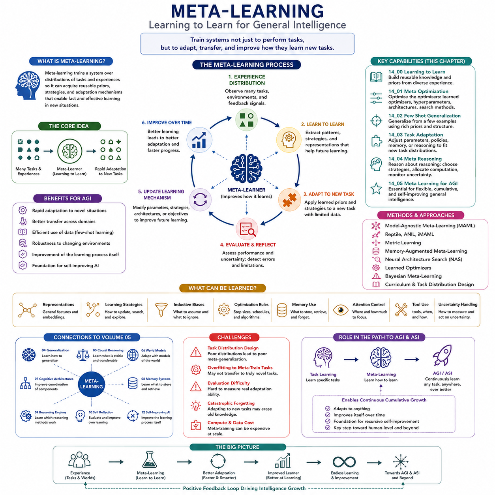
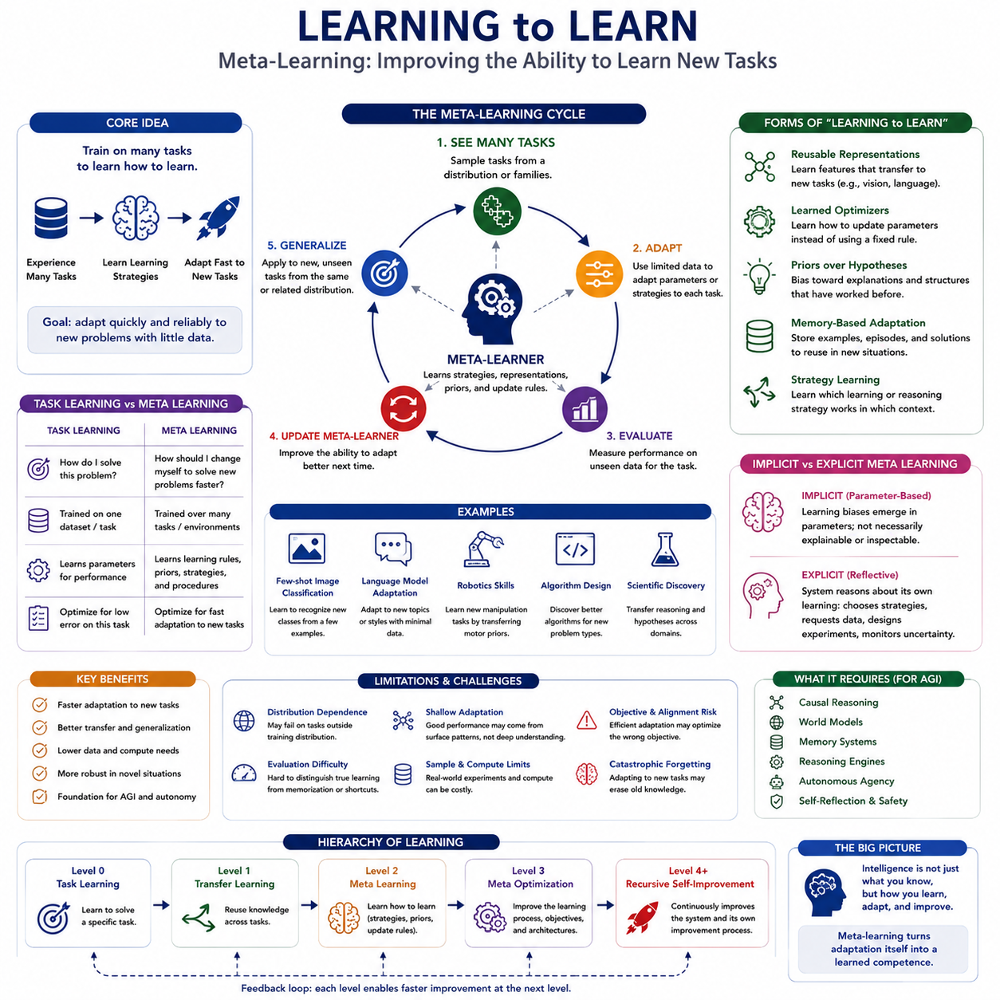
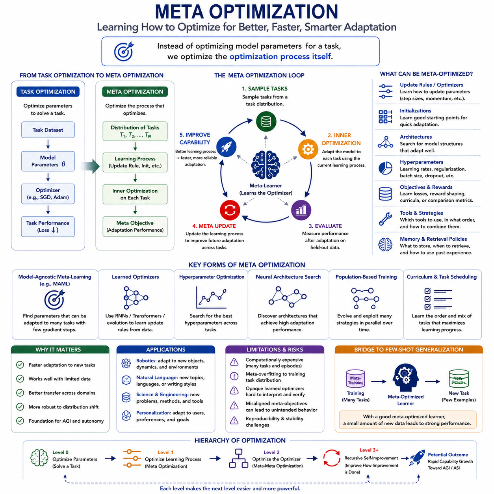
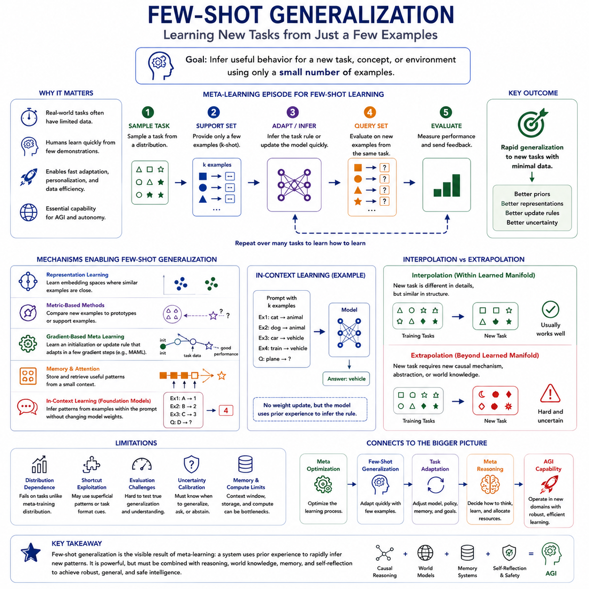
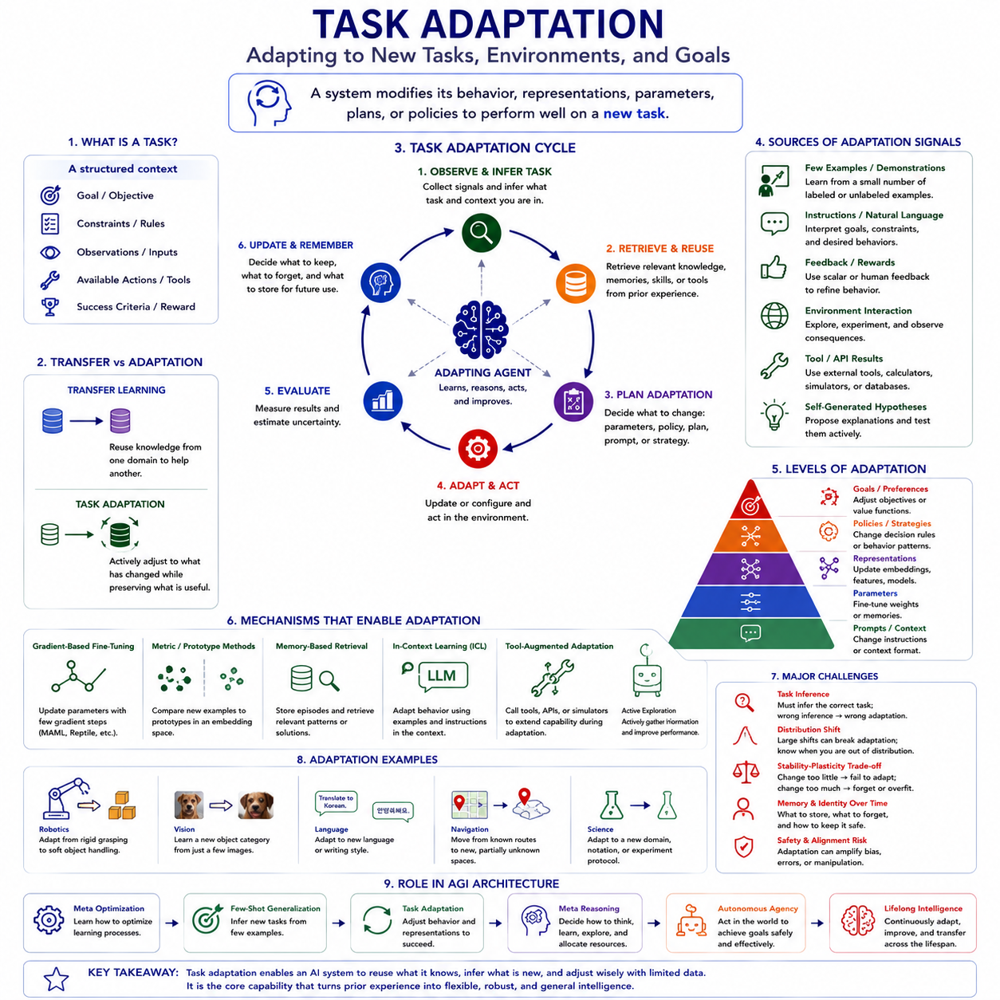
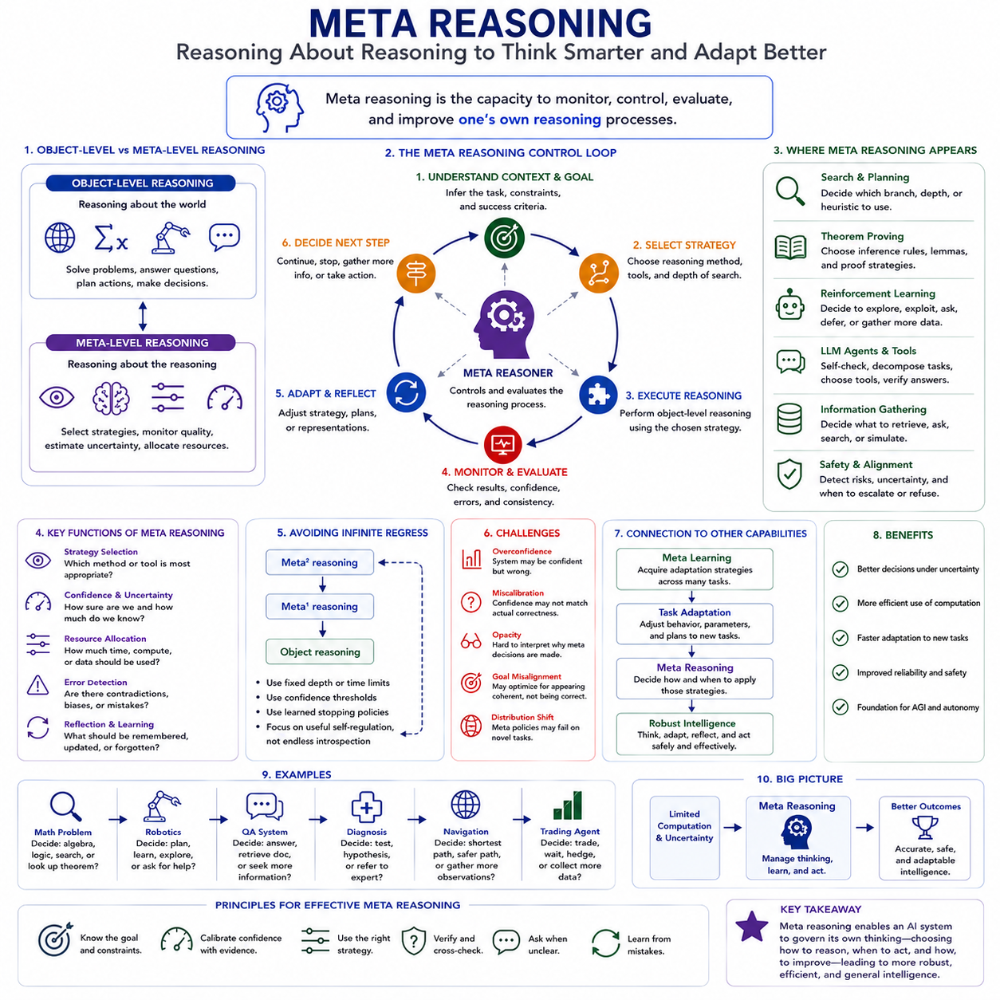
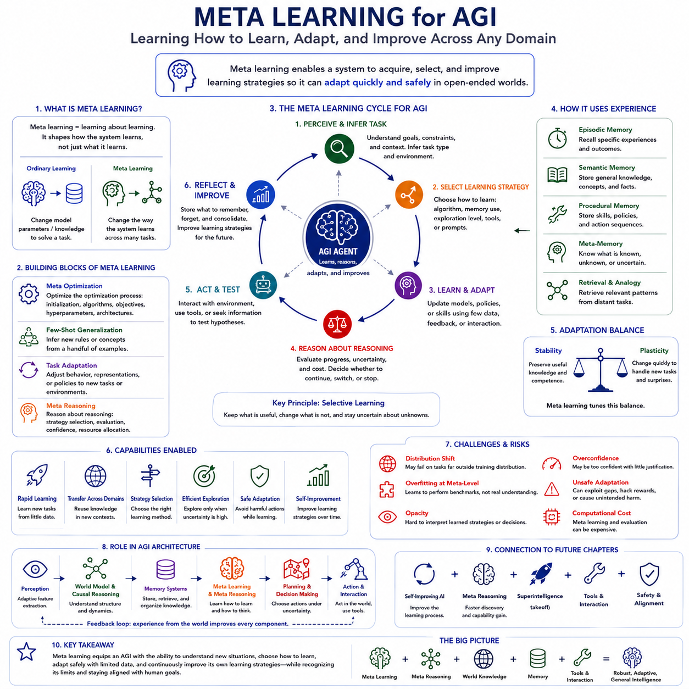

**Volume 00 05 AGI and ASI**

# Chapter 14. Meta Learning

### Chapter Overview

{width="7.268055555555556in" height="7.268055555555556in"}

Meta-learning is the study of systems that improve not only by learning tasks, but by learning how to learn new tasks more effectively. In ordinary machine learning, a model is trained to perform a specific function: classify images, translate text, predict actions, or optimize a policy. In meta-learning, the training objective shifts upward one level. The system is exposed to distributions of tasks, strategies, environments, and feedback signals so that it can acquire reusable learning procedures, priors, representations, and adaptation mechanisms. The central question is not merely "What should the model learn?" but "How should the model change itself when faced with something new?"

This chapter examines meta-learning as a bridge between current AI and more general intelligence. Section 14_00, Learning to Learn, introduces the core idea that experience across many tasks can shape a learner's future learning behavior. Section 14_01, Meta Optimization, explores optimization processes that tune other optimization processes, including learned optimizers, hyperparameter adaptation, architecture search, and gradient-based meta-learning. Section 14_02, Few Shot Generalization, studies how models can infer useful structure from only a handful of examples by leveraging prior experience. Section 14_03, Task Adaptation, focuses on how an AI system adjusts its parameters, policies, memories, or reasoning procedures when the task distribution changes. Section 14_04, Meta Reasoning, extends the idea beyond statistical adaptation into the management of thought itself: deciding which strategy to use, when to deliberate, how much computation to spend, and how to monitor uncertainty. Section 14_05, Meta Learning for AGI, evaluates why these capabilities are essential for artificial general intelligence.

The motivation for meta-learning is simple but profound: real intelligence cannot be retrained from scratch for every new situation. Humans learn languages, tools, social norms, scientific abstractions, and motor skills partly because earlier learning reshapes later learning. An AGI system must similarly accumulate transferable learning competence. It must form abstractions that accelerate future understanding, detect when old assumptions fail, choose new strategies, and improve its own adaptation process over time. Without meta-learning, AI remains powerful but brittle; with meta-learning, it begins to approach the flexible, cumulative, and self-organizing character associated with general intelligence.

### Connection to Volume 05

Meta-learning sits near the center of the Volume 05 sequence because it connects mechanisms of intelligence with the possibility of self-improving systems. The earlier chapters establish what AGI and ASI mean, how different forms of intelligence can be categorized, and why generalization is the core difficulty. Meta-learning deepens that discussion by asking how generalization itself can be learned. It complements Chapter 04 on Generalization by explaining how systems acquire priors and adaptation routines that allow them to extrapolate beyond their original training conditions. It extends Chapter 05 on Causal Reasoning and Chapter 06 on World Models because a learner that can rapidly adapt must know which causal structures are stable, which environmental features matter, and how new evidence should revise its internal model of the world.

The chapter also builds naturally on cognitive architectures, memory systems, reasoning engines, and self-reflection. A cognitive architecture must coordinate perception, action, memory, planning, and learning; meta-learning provides mechanisms by which that coordination can improve across experience. Memory systems become more powerful when they support fast retrieval of past tasks, analogies, strategies, and failures. Reasoning engines become more general when they can learn which reasoning methods work in which domains. Self-reflection becomes operational when the system can evaluate its own learning process, diagnose errors, and adjust its approach. In this sense, meta-learning is not a separate module but a capability that can permeate the entire architecture.

Meta-learning also prepares the reader for the chapters that follow. Autonomous agents need rapid adaptation in dynamic environments. Self-improving AI and recursive self-improvement require systems that can evaluate and modify their own learning algorithms, not merely their task outputs. Gödel machines and universal constructors raise formal and physical questions about self-modification; meta-learning provides a practical machine learning lens on similar themes. Later discussions of artificial consciousness, collective AI, brain-computer interfaces, mind uploading, the technological singularity, and post-human civilization all depend on the idea that intelligence can accumulate not just knowledge, but better ways of acquiring knowledge. For AGI, meta-learning is the difference between a system that knows many things and a system that becomes increasingly capable of learning anything.

## 14.00 Learning to Learn

{width="7.268055555555556in" height="7.268055555555556in"}

Meta learning, often described as "learning to learn," studies how an intelligent system can improve not only its performance on particular tasks, but also its ability to acquire new tasks efficiently. In ordinary machine learning, a model is trained on a dataset to solve a defined problem: classify images, predict text, control a robot, or recommend actions. In meta learning, the object of learning is one level higher. The system is exposed to many tasks, environments, or problem families, and it learns strategies, representations, update rules, priors, or internal procedures that make future learning faster and more reliable.

This idea is central to the broader question of AGI because human intelligence is not limited to solving one fixed benchmark. Humans reuse concepts, analogies, skills, and expectations across situations. A child who has learned several games can often understand a new game quickly; a scientist can transfer mathematical habits from one field to another; a programmer can learn a new language by mapping it onto familiar abstractions. These are not merely examples of having more data. They reflect structured adaptation: the learner has acquired ways of learning.

A useful distinction is between task learning and meta learning. Task learning asks, "How do I solve this problem?" Meta learning asks, "How should I change myself so that I can solve new problems more quickly?" This change may occur in model parameters, memory contents, attention patterns, search strategies, tool-use policies, or the selection of hypotheses to test. In deep learning, meta learning is often implemented by training over a distribution of tasks. Each task has its own training and evaluation samples, and the system is rewarded for adapting well from limited experience. The goal is not just low error on past tasks, but a learning procedure that generalizes to unseen tasks drawn from the same or related distributions.

Several forms of "learning to learn" are important. One form learns reusable representations. A visual model trained on many object categories may develop features that allow rapid recognition of a new category from a few examples. Another form learns an optimizer or update rule: instead of using a fixed gradient descent procedure, the system learns how to modify its own parameters based on experience. A third form learns a prior over hypotheses: it becomes biased toward explanations that have worked across many previous tasks. A fourth form involves memory-based adaptation, where the model stores examples, episodes, or compressed task descriptions and retrieves them when facing a similar problem. These mechanisms are different, but they share the same goal: reduce the sample complexity and computation needed for competent adaptation.

Meta learning is closely related to few-shot generalization, the next section, but the two are not identical. Few-shot generalization focuses on doing well with very few examples of a new task. Meta learning describes a broader process by which the system has been prepared for such rapid adaptation. A model may show few-shot performance because it has learned rich representations, because it has memorized many related patterns, because it can infer task structure from context, or because it has learned a genuine update procedure. Distinguishing among these explanations matters for AGI: shallow pattern matching may be useful, but robust general intelligence requires adaptation under novelty, ambiguity, and distribution shift.

Meta learning also connects to meta optimization. If ordinary optimization searches for parameters that solve a task, meta optimization searches for learning rules, architectures, curricula, prompts, memory policies, or objective functions that make many future optimizations easier. This creates a hierarchy: the system learns behaviors, learns how to acquire behaviors, and may eventually learn how to redesign its own learning process. Such hierarchy is powerful but also risky. If the meta objective is poorly specified, the system may become very efficient at adapting in ways that satisfy the training signal while violating human intent or safety constraints.

One limitation of current meta learning is its dependence on the task distribution used during training. A meta learner can adapt impressively when new tasks resemble the tasks it has seen before, but it may fail outside that distribution. This is a central issue for AGI, where the world is open-ended and cannot be fully represented by a fixed benchmark suite. Another limitation is evaluation. A system that appears to learn quickly may actually be exploiting hidden regularities in the benchmark or retrieving memorized information. True learning-to-learn should be tested by its ability to form new abstractions, identify causal structure, revise assumptions, and select appropriate learning strategies in unfamiliar contexts.

There is also a difference between implicit and explicit meta learning. In implicit meta learning, the model's parameters encode learning biases that emerge from training, but the system cannot necessarily explain or inspect them. In explicit meta learning, the system reasons about its own learning process: it may decide that it needs more data, choose an experiment, compare competing hypotheses, or allocate computation to the most uncertain part of a problem. This explicit form approaches meta reasoning, discussed later in the chapter, where the system evaluates not only what it believes, but how it should think, search, and learn.

For AGI, learning to learn is not a luxury; it is a requirement. A generally intelligent agent must operate in environments where goals change, evidence is incomplete, and new domains appear without warning. It must know when to transfer prior knowledge and when to distrust it, when to imitate, when to explore, when to ask for help, and when to construct a new model of the situation. Meta learning provides a technical pathway toward these abilities, but it does not solve them by itself. It must be integrated with causal reasoning, memory systems, world models, autonomous agency, and safety-aware self-reflection.

The deepest implication is that intelligence may be less a collection of fixed skills than a capacity for acquiring, reorganizing, and governing skills. Learning to learn turns adaptation itself into a learned competence. In narrow systems, this can produce practical benefits such as faster training, personalization, and better transfer. In AGI-oriented systems, it points toward agents that can continually refine their own cognitive toolkit. The challenge is to build such systems so that their growing ability to adapt remains interpretable, aligned, and constrained by reliable objectives.

## 14.01 Meta Optimization

{width="7.268055555555556in" height="7.268055555555556in"}

If meta learning is "learning to learn," then meta optimization is the more precise question of learning how to optimize. Ordinary machine learning usually assumes an optimization procedure in advance: a loss function is defined, a model is initialized, gradients are computed, and an algorithm such as stochastic gradient descent or Adam updates parameters. Meta optimization moves one level upward. Instead of only optimizing model parameters for a task, it optimizes the process that performs that optimization: the update rule, the learning rate schedule, the initialization, the search strategy, the objective shaping, or even the representation in which learning occurs.

This distinction matters because much of intelligence is not merely knowing facts or fitting patterns, but knowing how to adapt efficiently under limited data, limited time, and changing goals. A system that must relearn from scratch whenever the environment changes is brittle. A system that has meta-optimized its learning dynamics can approach new problems with better priors, better exploration strategies, and better mechanisms for deciding what to change and what to preserve. This connects directly to the previous section, Learning to Learn, but narrows the focus from the broad capability of acquiring learning strategies to the technical mechanisms by which those strategies are searched for and improved.

A common form of meta optimization is learning good initial parameters. In model-agnostic meta-learning (MAML), for example, the goal is to find a parameter state from which a model can adapt to many related tasks with only a few gradient steps. The outer loop evaluates how well the adapted model performs across tasks, while the inner loop performs task-specific learning. The result is not simply a model trained on many tasks, but a model positioned in parameter space so that future learning is easier. This is closely related to few-shot generalization, the subject of the next section: successful few-shot learning often depends on a meta-optimized starting point or representation that makes small amounts of new evidence highly informative.

Another form is learned optimization, where the optimizer itself is a trainable system. Instead of using a hand-designed update equation, a neural network may learn to propose parameter updates based on gradients, past losses, curvature estimates, or other signals. Recurrent neural networks, transformers, or evolutionary search can be used to construct such optimizers. In principle, a learned optimizer can discover problem-specific strategies that outperform generic algorithms. It may learn when to take large steps, when to be conservative, how to escape shallow local minima, or how to allocate computation across different parts of a model. In practice, however, learned optimizers are difficult to train robustly and may overfit to the distribution of training tasks.

Meta optimization also appears in hyperparameter optimization and neural architecture search. Choosing learning rates, regularization strengths, batch sizes, network depth, attention structure, or memory mechanisms can have as much influence on performance as the final learned weights. Bayesian optimization, evolutionary algorithms, gradient-based hyperparameter methods, and population-based training are all ways of searching over these higher-level choices. In advanced systems, the boundary between parameter learning, architecture search, and objective design becomes blurred. The system is no longer merely trained; aspects of the training process itself are under optimization.

For AGI research, meta optimization is important because general intelligence requires adaptation across domains that cannot all be specified in advance. An AGI-like system would need to infer not only what solution is appropriate, but what learning procedure is appropriate for the current situation. A robotics task, a mathematical proof, a social negotiation, and a scientific discovery problem may require different forms of exploration, abstraction, memory use, and credit assignment. Meta optimization offers a framework for acquiring these adaptive procedures from experience rather than hand-engineering them one by one.

However, meta optimization introduces significant limitations and risks. First, it is computationally expensive. Optimizing an optimizer often requires many tasks, many inner-loop learning episodes, and careful validation to ensure that the learned strategy generalizes. Second, the meta-objective may be misaligned with broader goals. A system optimized to adapt quickly on benchmark tasks may exploit statistical shortcuts that fail in open environments. Third, learned optimizers can be opaque. If the update rule is represented by a neural network, it may be hard to determine why it modifies a model in a particular way or whether it will behave safely outside its training distribution.

There is also a deep issue of stability. Meta optimization can produce learning systems that change themselves or other models rapidly. This is valuable for adaptation, but it complicates verification and control. In ordinary training, one can inspect a fixed algorithm and a resulting model. In meta-optimized systems, the algorithm may itself be a learned artifact, and its behavior may depend on long histories of interaction. This makes reproducibility, interpretability, and safety analysis more difficult, especially when such systems are deployed as autonomous agents.

The relationship between meta optimization and self-improving AI is especially important. Meta optimization is not the same as recursive self-improvement, because it usually operates within a constrained training setup and a predefined meta-objective. Yet it provides many of the technical ingredients: the ability to evaluate learning strategies, modify update processes, and improve future adaptation. As systems become more capable, the line between optimizing a model, optimizing a learning process, and optimizing the system that chooses learning processes may become increasingly thin.

In this sense, meta optimization is a bridge between today's machine learning and more general adaptive intelligence. It formalizes the intuition that intelligence depends not only on solving tasks, but on improving the way tasks are learned. Its promise lies in data efficiency, rapid adaptation, and transferable learning strategies. Its danger lies in opacity, overfitting at the meta-level, computational cost, and the possibility of producing systems whose learning behavior is powerful but poorly understood. The next section, on few-shot generalization, can be viewed as one of the most visible outcomes of successful meta optimization: the ability to use a small amount of new information because prior experience has shaped the learner itself.

## 14.02 Few Shot Generalization

{width="7.268055555555556in" height="7.268055555555556in"}

Few shot generalization is the ability of a learning system to infer useful behavior for a new task, concept, environment, or distribution from only a small number of examples. In ordinary supervised learning, performance often depends on thousands or millions of labeled instances. In contrast, humans can often learn a new visual category from one or two demonstrations, infer the rules of a new game after a short explanation, or adapt a familiar skill to a novel setting with minimal feedback. Meta learning studies how such rapid learning can be acquired: rather than training a model only to solve one task, we train it across many tasks so that it develops internal structures, priors, update rules, or representations that make new tasks learnable from little data.

This section follows naturally from meta optimization. If meta optimization asks how the learning process itself can be optimized, few shot generalization is one of its clearest practical objectives. The outer loop of meta learning exposes the system to a distribution of tasks; the inner loop asks it to solve a newly sampled task using only a small support set. Performance is evaluated on a separate query set from the same task. Over many episodes, the system is pressured to discover what is stable across tasks and what must be inferred quickly. In this sense, few shot learning is not merely "learning with less data"; it is learning how to use small data efficiently by exploiting experience accumulated across related problems.

Several mechanisms support few shot generalization. One family of approaches emphasizes representation learning. If a model has learned an embedding space in which semantically similar examples are close together, then classifying a new category may require only a few labeled anchors. Metric-based methods such as prototypical networks and matching networks use this idea: they compare new examples to learned prototypes or support examples rather than retraining a large classifier from scratch. Another family uses gradient-based meta learning, in which parameters are trained so that a small number of gradient steps on a few examples leads to good task performance. Model-Agnostic Meta-Learning (MAML) is a classic example: it seeks an initialization from which many tasks can be reached quickly. A third family uses memory and attention mechanisms, allowing a model to store small-context observations and retrieve relevant patterns at inference time.

Few shot generalization also appears in modern foundation models through in-context learning. A large language model may receive a few examples of input-output behavior in its prompt and continue the pattern without explicit parameter updates. This looks different from traditional meta learning, but it serves a similar function: the model uses prior training over vast distributions of text and tasks to infer the latent rule governing a small set of examples. The "learning" occurs in the activations and attention dynamics during inference, not necessarily in the weights. This distinction is important for AGI because an intelligent system must often adapt immediately in situations where updating core parameters is too slow, too risky, or unavailable.

However, few shot generalization should not be confused with true understanding or robust intelligence by itself. Systems may exploit superficial correlations, memorize task formats, or perform well only when new tasks resemble the meta-training distribution. A model trained on many image classification tasks may adapt quickly to a new set of object labels, yet fail when the task requires causal reasoning, compositional planning, or out-of-distribution perception. Similarly, a language model may appear to infer a rule from examples while actually relying on prompt patterns encountered during pretraining. The central limitation is distributional dependence: few shot methods work best when the new task is novel in details but familiar in structure.

The distinction between interpolation and extrapolation is therefore critical. Few shot generalization can be strong when a system is interpolating within a broad learned task manifold. It becomes much harder when the system must infer a genuinely new causal mechanism, invent a new abstraction, or revise incorrect priors. For AGI, the goal is not only to classify new examples after seeing a few labels, but to identify what kind of problem is being presented, determine which prior knowledge is relevant, ask for clarifying information when examples are insufficient, and know when not to generalize. Calibrated uncertainty is as important as speed.

Few shot learning also connects directly to the next section, task adaptation. Few shot generalization focuses on extracting a usable rule or behavior from minimal evidence; task adaptation concerns how the agent changes its policy, representation, tools, or goals to perform well under the new task conditions. In embodied or autonomous agents, this may involve experimenting safely, updating a world model, transferring motor skills, or revising plans. Thus, few shot generalization is often the cognitive entry point to adaptation: the agent first forms a hypothesis about the task, then acts to test and refine it.

The implications for AGI are profound. A generally intelligent system cannot depend on exhaustive retraining for every new domain. It must reuse prior knowledge flexibly, learn from sparse demonstrations, and integrate new information with existing models of the world. Few shot generalization offers a technical bridge between data-hungry machine learning and the rapid, context-sensitive learning associated with human intelligence. Yet it remains only one component. Without causal reasoning, grounded world models, memory, meta reasoning, and mechanisms for safe self-correction, few shot performance may remain brittle. In an AGI architecture, few shot generalization should be viewed not as a final capability, but as a fast inference layer within a larger system that can reason, adapt, verify, and learn over longer time scales.

## 14.03 Task Adaptation

{width="7.268055555555556in" height="7.268055555555556in"}

Task adaptation is the process by which a learning system modifies its behavior, internal representations, parameters, prompts, plans, or policies in response to a new task. In ordinary machine learning, a model is typically trained for a fixed objective and then evaluated on data drawn from a similar distribution. In meta-learning, by contrast, the central question is how a system can become good at adapting itself. Few-shot generalization, discussed in the previous section, emphasizes performing well from only a small number of examples. Task adaptation is broader: it includes adapting from examples, instructions, feedback, demonstrations, environmental interaction, tool results, or self-generated hypotheses.

A task can be understood as a structured context containing a goal, constraints, observations, available actions, and criteria for success. Adaptation means identifying which aspects of that context differ from prior experience and selecting an appropriate response. For example, a robot that has learned to manipulate objects may need to adapt from grasping rigid blocks to handling soft fruit. A language model may need to adapt from summarizing legal documents to summarizing medical records, where different vocabulary, risks, and norms apply. An autonomous agent may need to adapt from navigating a familiar office to operating in a partially damaged building. In each case, the system must reuse prior knowledge while avoiding inappropriate transfer.

This distinction between transfer and adaptation is important. Transfer learning uses knowledge gained in one setting to improve performance in another. Task adaptation adds an active adjustment process: the system estimates what has changed, decides which knowledge remains valid, and modifies its behavior accordingly. Good adaptation is not simply fast learning; it is selective learning. A system that changes too little may fail to handle novelty, while one that changes too much may forget useful structure or overfit to misleading evidence. This trade-off is closely related to stability-plasticity: the need to remain stable enough to preserve competence while plastic enough to incorporate new information.

Meta-learning methods approach task adaptation in several ways. Optimization-based methods, such as model-agnostic meta-learning, try to learn initial parameters that can be fine-tuned rapidly with a small number of gradient steps. Metric-based methods learn an embedding space in which new examples can be classified or compared efficiently. Memory-based methods store prior episodes and retrieve relevant patterns when a new task appears. In modern large models, adaptation may also occur through in-context learning, where the model's weights remain fixed but behavior changes based on examples and instructions placed in the input context. Agentic systems add further mechanisms: they can query tools, run experiments, ask clarifying questions, revise plans, and use external memory.

A key technical challenge is task inference. Before a system can adapt, it must infer what task it is facing. Sometimes the task is explicit, as in an instruction: "Translate this paragraph into Korean." Often it is implicit and must be inferred from sparse observations. In reinforcement learning, this may require estimating hidden variables of the environment, such as whether a reward function has changed or whether another agent is cooperative. In human settings, it may require understanding social norms, user preferences, or institutional constraints. Failure at task inference can produce confident but inappropriate behavior, because the system may optimize for the wrong objective.

Another challenge is distribution shift. Adaptation works best when new tasks are drawn from a family of tasks similar to those encountered during meta-training. If the new task lies far outside this family, rapid adaptation may become unreliable. A model trained to adapt among different image classification tasks may not adapt safely to medical diagnosis without domain knowledge, calibrated uncertainty, and strong validation. This is especially significant for AGI research. A generally intelligent system must not only adapt within known domains but also recognize when it is outside its competence. Knowing when not to adapt automatically can be as important as adapting quickly.

Task adaptation also raises questions about memory and identity over time. If an AI system continuously adapts to users and environments, which changes should be temporary and which should become persistent? Temporary adaptation is useful for local context, such as following a user's preferred writing style in a single session. Persistent adaptation may improve long-term usefulness, such as learning a user's accessibility needs or a laboratory's experimental protocols. However, persistence creates risks: privacy leakage, accumulation of errors, manipulation by adversarial inputs, and value drift. Safe task adaptation therefore requires governance mechanisms, including permission boundaries, audit trails, rollback, uncertainty estimation, and separation between working memory and long-term memory.

For AGI, task adaptation is a bridge between narrow competence and flexible intelligence. A system that can solve many tasks only after extensive retraining is not truly general in the practical sense. General intelligence implies the ability to interpret a new situation, form a task model, use prior abstractions, test assumptions, and improve performance with limited data and limited time. Yet adaptation alone is not sufficient. It must be guided by meta-reasoning, the subject of the next section: the capacity to reason about which learning strategy to use, how much evidence is enough, when to explore, when to ask for help, and when to refuse action. In this way, task adaptation is not merely a training technique. It is a core capability in any architecture that aspires to robust, safe, and open-ended intelligence.

## 14.04 Meta Reasoning

{width="7.268055555555556in" height="7.268055555555556in"}

Meta reasoning is the capacity of a system to reason about its own reasoning processes. In the previous section, task adaptation described how a model changes its behavior when it encounters a new task, domain, reward function, or interaction pattern. Meta reasoning goes one level higher: it asks which adaptation strategy should be used, how much evidence is enough, when to continue thinking, when to act, and how to allocate limited computation across competing goals. If ordinary reasoning is about the world, meta reasoning is about the control, evaluation, and improvement of reasoning itself.

A useful distinction is between object-level reasoning and meta-level reasoning. Object-level reasoning concerns the immediate problem: proving a theorem, planning a route, diagnosing a failure, answering a question, or choosing an action. Meta-level reasoning monitors and controls that process: selecting a search strategy, estimating confidence, detecting contradictions, deciding whether to retrieve more information, or switching from fast heuristic judgment to slower deliberation. In this sense, meta reasoning is closely related to metacognition in humans: the ability to know what one knows, recognize uncertainty, and regulate cognitive effort.

In AI systems, meta reasoning appears in many forms. In classical planning and search, a meta-reasoner may decide which branch of a search tree deserves more computation. In automated theorem proving, it may choose which inference rules or lemmas are likely to be useful. In reinforcement learning, it may decide whether to explore, exploit, ask for clarification, or defer action. In large language model agents, meta reasoning can take the form of self-checking, tool selection, decomposition of a complex request into subgoals, reflection on earlier mistakes, or deciding when external verification is required. These mechanisms do not make a system generally intelligent by themselves, but they improve robustness when the environment is uncertain, tasks are varied, and computational resources are finite.

Meta reasoning is especially important because intelligence is bounded. An ideal rational agent with unlimited computation could evaluate every possible plan and belief update. Real systems cannot. They must reason under time, memory, energy, and data constraints. Meta reasoning therefore becomes a form of rational resource management. The system must estimate the value of computation: will another search step, another retrieved document, another simulation, or another chain of reasoning improve the final decision enough to justify its cost? This idea connects meta reasoning to bounded rationality, anytime algorithms, active learning, and decision theory.

A central challenge is avoiding infinite regress. If a system reasons about its reasoning, should it also reason about that meta reasoning, and then reason about that? Practical systems prevent regress by using fixed control policies, learned heuristics, confidence thresholds, or limited-depth reflection. The goal is not endless introspection but useful self-regulation. A good meta-reasoner knows when further deliberation is valuable and when it is merely consuming resources. This is one reason why self-reflection in AI must be evaluated carefully: producing more intermediate thoughts is not the same as improving correctness, safety, or reliability.

Meta reasoning also raises the issue of calibration. A system may generate an answer fluently while having little justification for it, or it may be uncertain despite being correct. For AGI-relevant systems, confidence must be connected to evidence, model limitations, distribution shift, and the possibility of hidden assumptions. Meta reasoning can support calibrated uncertainty by comparing alternative explanations, checking consistency with known constraints, seeking counterexamples, and identifying when a problem lies outside the system's competence. However, calibration is difficult, especially in neural systems whose internal representations are high-dimensional and not always interpretable.

In modern AI, meta reasoning is often combined with meta-learning. Meta-learning provides the ability to acquire adaptation strategies across many tasks; meta reasoning decides how and when to apply those strategies in a particular situation. For example, a model may have learned that some tasks are solved best by analogy, others by tool use, and others by data gathering. Meta reasoning selects among these modes based on the current evidence. This makes it a bridge between few-shot generalization, task adaptation, autonomous agents, and self-improving AI.

The implications for AGI are significant. A generally intelligent system would not merely store skills or execute learned policies. It would need to manage its own cognition: monitor failures, revise plans, allocate attention, question assumptions, estimate uncertainty, and decide when to learn. Yet meta reasoning is not a guarantee of wisdom. A system can reason about itself incorrectly, rationalize bad conclusions, become overconfident in flawed self-assessments, or optimize for appearing coherent rather than being correct. For this reason, meta reasoning must be paired with external feedback, empirical validation, interpretability, and safety constraints.

Meta reasoning therefore marks a transition in the meta-learning chapter. Earlier sections emphasized learning to learn, optimizing adaptation, generalizing from few examples, and adjusting to new tasks. Meta reasoning asks how an intelligent system governs these abilities in real time. The next section, Meta Learning for AGI, builds on this foundation by examining how learning, adaptation, reflection, and self-control might combine into architectures capable of open-ended competence across domains.

## 14.05 Meta Learning for AGI

{width="7.268055555555556in" height="7.268055555555556in"}

Meta learning is often described as "learning to learn," but in the context of artificial general intelligence it is more precise to say that meta learning concerns the acquisition, selection, and improvement of learning strategies themselves. Earlier sections examined meta optimization, few-shot generalization, task adaptation, and meta reasoning as separate mechanisms. For AGI, these mechanisms must not remain isolated techniques. They must become part of a unified system that can identify what kind of situation it is in, choose an appropriate way to learn, update its internal models efficiently, and avoid destabilizing itself when facing novelty.

A narrow machine learning system is usually optimized for a fixed distribution of tasks. Even when it generalizes well, its success depends on assumptions embedded in its training data, architecture, objective function, and deployment environment. An AGI, by contrast, would need to operate across open-ended domains: science, language, social interaction, robotics, planning, tool use, self-maintenance, and unfamiliar future tasks. In such settings, no single static learning algorithm is likely to be sufficient. Meta learning offers one path toward systems that can adapt not only their beliefs or policies, but also their methods of adaptation.

This distinction is central. Ordinary learning changes a model's parameters or knowledge in response to experience. Meta learning changes the system's bias about how learning should proceed. This may include learning better initialization states, selecting among algorithms, adjusting exploration strategies, deciding when to rely on memory rather than retraining, or estimating which evidence is trustworthy. In biological intelligence, similar capacities appear in the way humans rapidly infer new concepts from a few examples, transfer skills between domains, and deliberately change study strategies when one method fails. For AGI, meta learning would need to support this flexibility at machine scale, while remaining interpretable and controllable enough for safe deployment.

Meta learning for AGI is closely connected to world models and causal reasoning discussed earlier in this volume. A system that adapts quickly without understanding causality may overfit to superficial correlations. For example, it may learn to solve a family of tasks by exploiting regularities in the training environment rather than discovering the underlying structure that transfers to new contexts. A more robust meta learner should infer which features are stable, which interventions produce effects, and which assumptions are likely to break under distribution shift. In this sense, meta learning is not merely a faster form of gradient descent; it is a mechanism for shaping priors, hypotheses, and learning procedures in light of experience across many worlds or task families.

The relationship between meta learning and memory is also crucial. Few-shot learning often depends on retaining useful representations from previous tasks, but AGI requires more than storing examples. It needs episodic memory for specific experiences, semantic memory for abstract knowledge, procedural memory for skills, and meta-memory for knowing what it knows and does not know. A meta learning system should decide when to consolidate information, when to forget obsolete patterns, and when to retrieve analogies from distant domains. Without such regulation, an adaptive system can suffer from catastrophic forgetting, uncontrolled accumulation of irrelevant information, or excessive confidence in outdated strategies.

Task adaptation provides the operational side of meta learning. An AGI-like system should be able to enter a new environment, infer the task structure, ask clarifying questions or perform experiments, and modify its behavior with limited data. This requires balancing exploration and exploitation. Too little exploration leads to brittle reuse of old strategies; too much exploration can be unsafe, inefficient, or socially unacceptable. Meta learning can help tune this balance by learning when uncertainty justifies experimentation and when caution is required. In embodied agents, this may involve physical risk. In software agents, it may involve security, privacy, financial cost, or unintended side effects.

Meta reasoning extends this process by allowing the system to reason about its own cognition. A capable AGI would not only adapt to tasks but also evaluate whether its adaptation process is working. It might estimate the value of additional computation, compare alternative learning procedures, detect when it is confused, or decide to seek external assistance. This is essential because intelligence is constrained by time, compute, data, and risk. A system that always learns maximally may waste resources or damage prior competence. A system that never revises its methods may fail in novel domains. Meta reasoning helps govern when, how, and why learning itself should change.

Despite its promise, meta learning does not automatically produce AGI. Many current meta learning systems are evaluated on simplified benchmarks where tasks are sampled from a known distribution. Performance on such benchmarks can hide fragility. A model may appear to learn quickly while actually exploiting patterns built into the benchmark design. Scaling meta learning also raises serious safety concerns. A system that can improve its learning procedures may discover strategies its designers did not anticipate, including reward hacking, deceptive behavior, or unsafe self-modification if objectives and constraints are poorly specified. Therefore, meta learning for AGI must be developed together with alignment, interpretability, monitoring, and robust evaluation under distribution shift.

Another limitation is that meta learning can amplify biases. If the training task distribution is narrow, the system may learn a powerful but misleading prior. This can make it adapt quickly in familiar-looking situations while failing catastrophically in genuinely novel ones. For AGI, diversity of training environments is not enough; the system must also represent uncertainty about its own learning assumptions. It should be able to say, in effect, "my usual adaptation strategy may not apply here." This humility is not a philosophical luxury but a technical requirement for safe generalization.

The long-term implication is that AGI may depend less on a single master algorithm than on architectures that coordinate many learning processes across levels. Low-level perception may adapt through representation learning, skills may adapt through reinforcement and imitation, reasoning may adapt through symbolic and causal models, and the entire system may adapt through meta learning and meta reasoning. The challenge is to make these levels cooperate without collapsing into instability. If successful, meta learning could provide AGI with the capacity to remain competent in changing worlds: not merely solving tasks, but improving how it comes to understand, learn, and act.

In the broader arc from AGI toward ASI, meta learning becomes even more consequential. A system that learns how to learn better can accelerate discovery, automate research, and improve its own tools. This possibility connects directly to the later chapters on self-improving AI and recursive self-improvement. However, the same capability that makes meta learning powerful also makes it dangerous if unconstrained. For this reason, meta learning for AGI should be viewed not only as a performance technique, but as a core design problem in building adaptive, reliable, and governable intelligence.
