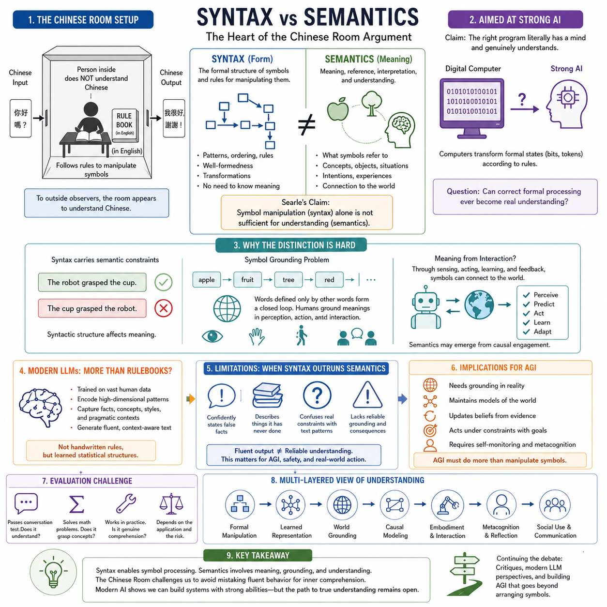
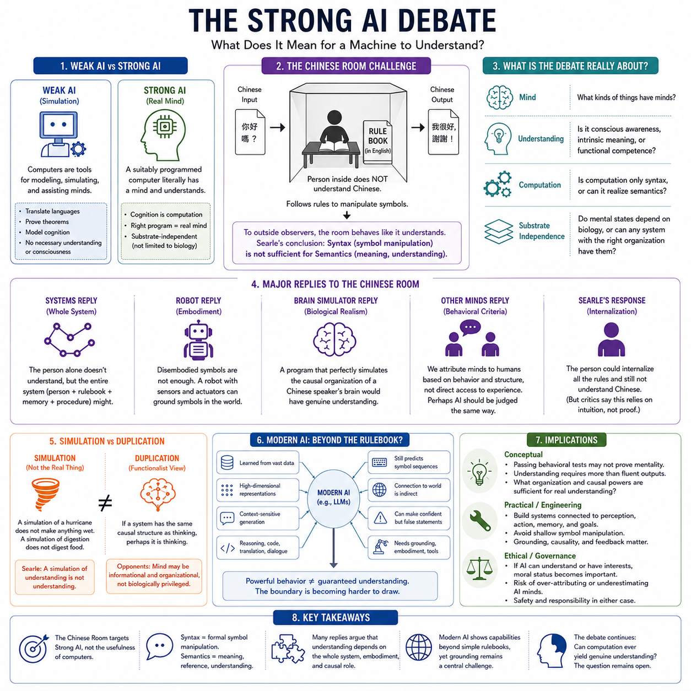
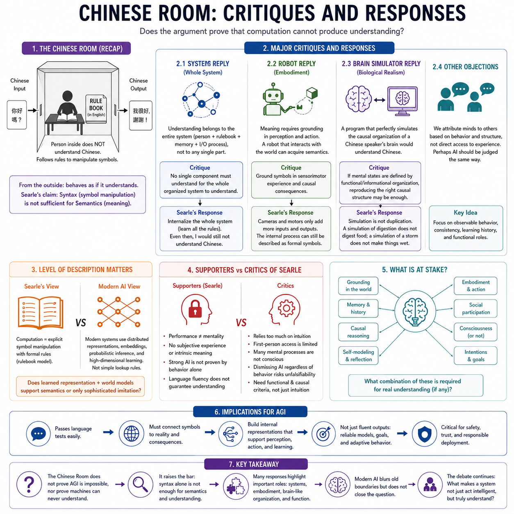
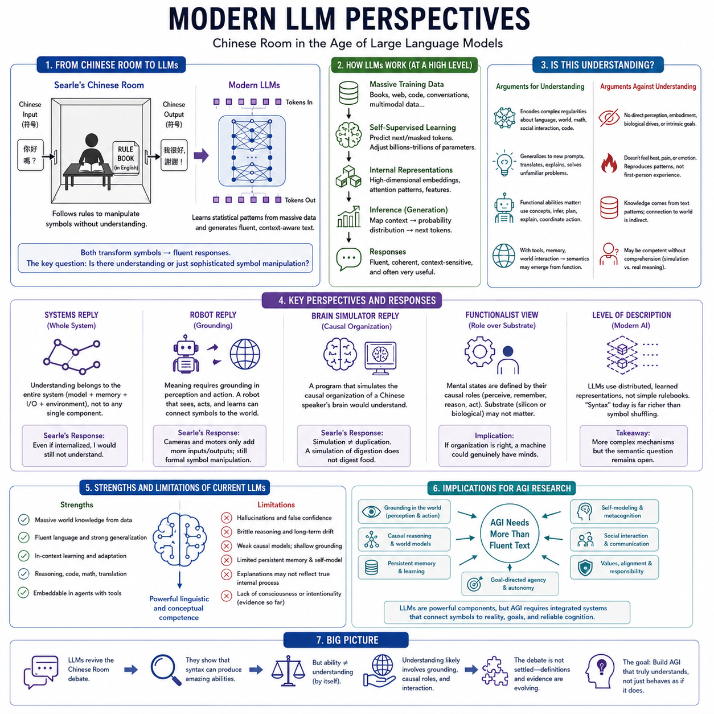

**Volume 00 05 AGI and ASI**

# Chapter 16. Chinese Room Argument

### Chapter Overview

{width="7.268055555555556in" height="7.268055555555556in"}

The Chinese Room Argument is one of the most influential thought experiments in the philosophy of artificial intelligence. Proposed by John Searle in 1980, it challenges the claim that a computer program, merely by manipulating symbols according to formal rules, can genuinely understand language or possess a mind. In the thought experiment, a person who does not understand Chinese sits inside a room and follows an English rulebook for transforming Chinese symbols into appropriate Chinese responses. To outside observers, the room appears to understand Chinese. Yet the person inside understands none of it. Searle's conclusion is that syntax alone---the formal manipulation of symbols---is not sufficient for semantics, meaning, or understanding.

This chapter examines the Chinese Room not as a historical curiosity, but as a living challenge to contemporary AI. The argument raises a central question for AGI and ASI: if an artificial system behaves intelligently, reasons fluently, explains itself, and interacts successfully with the world, does that imply that it understands? Or could it still be only an extremely sophisticated symbol manipulator? The answer matters because AGI is often defined not merely by performance across tasks, but by flexible comprehension, adaptive reasoning, and meaningful engagement with reality.

The chapter's scope includes the original Chinese Room scenario, the distinction between syntax and semantics, the debate over "strong AI," and major critiques such as the systems reply, robot reply, brain simulator reply, and connectionist reply. It also considers how modern large language models complicate the argument. Unlike the simple rulebook imagined in the original thought experiment, today's models learn from massive data, encode statistical structure, exhibit emergent capabilities, and interact through multimodal and agentic systems. Yet the fundamental philosophical tension remains: are these systems understanding, simulating understanding, or revealing that understanding itself may be more operational and distributed than traditional philosophy assumed?

The motivation for studying this argument is practical as well as philosophical. If future AGI systems produce correct answers without grounded understanding, they may fail in unfamiliar situations, misrepresent their own knowledge, or optimize goals without grasping human meaning. If, however, understanding can emerge from sufficiently rich computation, embodiment, memory, and interaction, then the Chinese Room may illuminate the conditions under which artificial minds become possible. For AI safety, cognitive architecture, interpretability, and human-AI trust, the question is not only whether machines can talk like they understand, but what kind of understanding we should require from systems that may one day act with general or superhuman capability.

### Connection to Volume 05

This chapter occupies a pivotal position in Volume 05 because it bridges technical theories of intelligence with philosophical questions about mind, meaning, and machine understanding. Earlier chapters define AGI and ASI, distinguish types of intelligence, and explore generalization, causal reasoning, world models, cognitive architectures, memory systems, reasoning engines, self-reflection, and autonomous agents. These chapters largely ask how an artificial system can perform intelligently. The Chinese Room asks a deeper question: when, if ever, does intelligent performance become genuine understanding?

The connection to Chapter 01, "What is AGI," and Chapter 02, "What is ASI," is direct. If AGI means human-level general competence, must it also include semantic understanding, intentionality, and subjective comprehension? If ASI surpasses human ability, could it still lack what humans call meaning? The Chinese Room forces definitions of AGI and ASI to clarify whether they are behavioral, functional, cognitive, or phenomenological. This distinction affects how we evaluate future systems: by outcomes alone, by internal mechanisms, by grounding in the world, or by some combination of all three.

The chapter also deepens the discussion of generalization, causality, and world models. A system may generate correct linguistic outputs while failing to connect symbols to causes, objects, actions, and consequences. Chapters on causal reasoning and world models explain why intelligence may require more than pattern completion. The Chinese Room provides the philosophical pressure behind that claim: without grounding, language can appear meaningful while remaining detached from reality. At the same time, modern AI challenges simplistic versions of this criticism, because learned representations may encode far more than surface syntax.

Its relationship to cognitive architectures, memory systems, reasoning engines, self-reflection, and autonomous agents is equally important. These chapters describe possible machinery for AGI. The Chinese Room asks whether adding memory, planning, self-monitoring, embodiment, or tool use changes the nature of the system from symbol processing to understanding. The systems reply argues that while the person in the room does not understand Chinese, the whole system might. This response connects naturally to distributed cognition, agent architectures, and collective AI, where intelligence may belong not to a single component but to an organized whole.

The chapter also prepares the reader for subsequent discussions of consciousness, artificial consciousness, Gödel machines, universal constructors, transhumanism, brain-computer interfaces, mind uploading, the technological singularity, and post-human civilization. If machines can become minds, the future of civilization changes profoundly. If they cannot, then even superhuman systems may remain alien instruments rather than conscious partners. The Chinese Room therefore acts as a conceptual checkpoint before the book moves from intelligent behavior to mind, personhood, and civilization-scale transformation.

Finally, the chapter connects strongly to modern LLM perspectives. Large language models revive the Chinese Room debate because they produce fluent, context-sensitive language without obvious human-like grounding. Yet they also challenge the original framing by showing that vast learned systems can develop internal abstractions, reasoning-like behavior, and tool-mediated interaction. This chapter does not attempt to settle the debate permanently. Instead, it equips the reader with the conceptual vocabulary needed to ask better questions: What is understanding? What evidence would count for or against it? And what standards should guide the design, evaluation, and governance of AGI and ASI?

## 16.00 The Chinese Room

{width="7.268055555555556in" height="7.268055555555556in"}

The Chinese Room is one of the most influential thought experiments in the philosophy of artificial intelligence. Introduced by John Searle in 1980, it was designed to challenge the claim that a computer program, merely by manipulating symbols correctly, could genuinely understand language or possess a mind. In the context of AGI and ASI, the argument matters because it asks whether increasingly capable systems are only producing intelligent behavior, or whether they could ever have understanding, intentionality, or subjective mental states.

The setup is simple. Imagine a person who does not understand Chinese locked inside a room. Through a slot, the person receives written Chinese characters. Inside the room is a very large rulebook written in a language the person does understand, such as English. The rulebook tells the person how to respond to each incoming pattern of Chinese symbols with an appropriate outgoing pattern of Chinese symbols. If the rulebook is sufficiently complete, people outside the room may become convinced that the room understands Chinese. It answers questions fluently, follows conversational context, and produces responses indistinguishable from those of a native speaker. Yet, Searle argues, the person inside still does not understand Chinese. They are only following formal rules for symbol manipulation.

The key point is that the room operates syntactically, not semantically. Syntax concerns the formal structure of symbols: their shapes, order, and rule-governed transformations. Semantics concerns meaning: what symbols refer to, what they are about, and how they connect to understanding. Searle's claim is that computation, as traditionally defined, is purely syntactic. A computer program can transform inputs into outputs according to rules without any intrinsic grasp of what those inputs and outputs mean. Therefore, he argues, implementing a program is not by itself sufficient for understanding.

This distinction makes the Chinese Room more than a criticism of early rule-based AI. It is also a challenge to strong AI, the view that the right kind of computer program would not merely simulate a mind but would literally be a mind. Searle did not deny that machines can process information, solve problems, or exhibit impressive intelligent behavior. Nor did he deny that the brain is a physical system. His objection was narrower and more philosophical: formal symbol manipulation alone cannot produce semantics. If understanding exists, it must depend on something beyond the abstract execution of a program.

For AGI research, the Chinese Room raises an uncomfortable question: what counts as genuine understanding? A system may answer scientific questions, write code, plan actions, and carry on natural dialogue. But does behavioral competence imply comprehension? If an AGI can pass every linguistic and practical test, is there still a meaningful difference between acting as if it understands and actually understanding? Searle's thought experiment is intended to show that external performance can be misleading, because a system may have the right input-output behavior while lacking inner meaning.

However, the argument depends on several assumptions that remain disputed. One assumption is that the person in the room is the proper unit of analysis. Critics argue that while the individual does not understand Chinese, the whole system---the person, rulebook, memory, and symbol-processing procedure---may understand. This is known as the systems reply. Another assumption is that symbol manipulation must be detached from the world. Embodied and grounded approaches argue that meaning may arise when symbols are connected to perception, action, goals, and causal interaction with an environment. These responses do not necessarily refute Searle, but they show that the argument becomes harder to apply to systems that learn from the world rather than merely consult a static rulebook.

The Chinese Room also predates modern machine learning and large language models, yet it remains relevant. Contemporary models are not hand-coded rulebooks in the classical sense. They learn statistical structure from enormous datasets and can generate context-sensitive, flexible responses. Even so, critics may interpret them as advanced Chinese Rooms: systems that map symbol patterns to other symbol patterns without grounded meaning. Defenders may respond that modern models build internal representations, generalize across contexts, and increasingly interact with tools, sensors, and environments. The debate therefore shifts from whether a fixed rulebook understands to whether learned representations and world interaction can support semantics.

A central limitation of the thought experiment is that it relies on intuition. Many people find it obvious that the person in the room does not understand Chinese, but it is less obvious what follows about the entire system, about real brains, or about future artificial minds. Human understanding itself depends on physical processes that can be described mechanistically. If neural activity gives rise to meaning, then the question becomes what kinds of physical or computational organization are sufficient for meaning, not whether mechanism alone is disqualifying.

In this chapter, the Chinese Room serves as an entry point into deeper issues: syntax versus semantics, simulation versus realization, behavior versus understanding, and computation versus mind. The following sections examine these distinctions more directly, including the strong AI debate, the major critiques of Searle's argument, and how modern LLMs complicate the original framing. For AGI and ASI, the practical implication is clear: intelligence cannot be evaluated only by fluent outputs. We must also ask how systems represent the world, ground their concepts, revise beliefs, form goals, and participate in causal reality. Whether those capacities amount to genuine understanding remains one of the defining questions of artificial intelligence.

## 16.01 Syntax vs Semantics

{width="7.268055555555556in" height="7.268055555555556in"}

The central force of the Chinese Room argument comes from a distinction that is easy to state but difficult to settle: the distinction between syntax and semantics. Syntax refers to the formal structure of symbols and the rules for manipulating them. It concerns patterns, ordering, well-formedness, and transformations that can be applied without knowing what the symbols mean. Semantics refers to meaning, reference, interpretation, and understanding. A semantic system does not merely process marks or tokens; it connects them to concepts, objects, situations, intentions, or experiences.

In Searle's thought experiment, the person inside the room follows an English rulebook for manipulating Chinese characters. From the outside, the room appears to understand Chinese because it produces appropriate Chinese responses to Chinese inputs. Internally, however, the person need not know Chinese at all. The person recognizes shapes, consults rules, and outputs other shapes. For Searle, this illustrates that symbol manipulation alone, no matter how sophisticated, is not sufficient for understanding. The room implements syntax, but not semantics.

This distinction was aimed directly at strong AI, especially the view that an appropriately programmed computer literally has a mind or genuinely understands. A digital computer operates by transforming formal states according to rules. Bits, tokens, strings, embeddings, or data structures may be meaningful to designers and users, but the machine's operations can be described at a purely formal level. The question is whether correct formal processing can ever become real understanding, or whether meaning must come from something beyond computation.

One reason the issue is difficult is that syntax and semantics are not always separable in practice. In human language, syntactic structure often carries semantic constraints. The sentence "the robot grasped the cup" is syntactically different from "the cup grasped the robot," and the difference affects meaning. Modern AI systems exploit enormous statistical regularities in language, images, actions, and feedback. A language model can learn that words occur in meaningful contexts and can generate outputs that respect subtle semantic relations. Yet the philosophical question remains: does modeling the use of meaningful symbols amount to possessing meaning, or only simulating it?

A related idea is the symbol grounding problem. If a system defines words only in terms of other words, its knowledge may form a closed formal loop. A dictionary can explain "apple" using "fruit," "tree," and "red," but these terms themselves require further explanation. For humans, meanings are partly grounded in perception, action, embodiment, social interaction, and practical consequences. We see apples, touch them, eat them, use them in goals, and learn from others who point, correct, and respond. The challenge for AI is to explain how symbols become connected to the world rather than merely to other symbols.

This does not mean that semantics must be mysterious or nonphysical. Many cognitive scientists and AI researchers argue that meaning can arise from causal interaction with the environment. A robot that navigates rooms, identifies objects, fails, adjusts, and acts successfully may acquire representations that are meaningful because they support perception, prediction, and control. In this view, semantics is not added as a magical ingredient; it emerges from the system's functional role in a network of sensing, acting, learning, memory, and social use. The Chinese Room then becomes a challenge to specify which organization and causal powers are enough.

For contemporary large language models, the syntax-versus-semantics debate becomes more subtle. LLMs are trained on vast corpora of human-produced text and can generate coherent explanations, plans, analogies, and translations. Their internal representations are not simple handwritten rules like Searle's rulebook. They encode high-dimensional regularities that correlate with facts, concepts, styles, and pragmatic contexts. This makes it too simplistic to say they manipulate symbols in the old-fashioned sense. Nevertheless, they are still primarily trained to predict and produce linguistic tokens, and their connection to the external world is indirect, mediated through data.

The limitation appears when fluent language outruns grounded competence. A model may describe physical procedures it has never performed, assert false facts with confidence, or fail to distinguish between a real constraint and a textual pattern. Such failures do not prove absence of understanding in every sense, but they show why semantic grounding matters for AGI. General intelligence must not only produce appropriate sentences; it must maintain reliable models of the world, update beliefs from evidence, act under constraints, and understand the consequences of its actions.

The syntax-semantics distinction also affects evaluation. If a system passes a conversation test, is that evidence of understanding or only behavioral equivalence? If it solves mathematical problems, does it grasp the concepts or execute transformations? In engineering, the answer may depend on the application. For a translation tool, functional performance may be enough. For an autonomous scientific agent, medical assistant, or self-improving AI, shallow symbol manipulation could become dangerous if the system lacks robust grounding, causal understanding, and self-monitoring.

The deeper lesson of this section is not that machines cannot understand, but that "understanding" must be analyzed carefully. It may involve multiple layers: formal manipulation, learned representation, world grounding, causal modeling, embodiment, metacognition, and social participation. Searle's argument presses us to avoid confusing output fluency with inner comprehension. Modern AI presses back by showing that large-scale learned structure can produce abilities once associated with understanding. The tension between these views sets up the next sections: critiques of the Chinese Room, modern LLM perspectives, and the implications for building AGI systems that do more than arrange symbols correctly.

## 16.02 Strong AI Debate

{width="7.268055555555556in" height="7.268055555555556in"}

The Chinese Room argument is best understood as a challenge to a particular philosophical position often called strong AI. In John Searle's terminology, weak AI treats computers as powerful tools for modeling, simulating, and assisting the study of mind. A weak-AI system may translate languages, prove theorems, or model human cognition without necessarily having understanding, intentions, or conscious experience. Strong AI makes a deeper claim: a suitably programmed computer would not merely simulate a mind but would literally have a mind. On this view, cognition is a form of computation, and if the right computational structure is implemented, genuine understanding can arise independently of whether the substrate is biological neurons, silicon circuits, or some future physical medium.

Searle's Chinese Room targets this stronger claim. The room appears to implement a program that produces fluent Chinese responses. From the outside, it may pass a behavioral test: Chinese speakers interacting through slips of paper cannot distinguish it from a native speaker. Yet the person inside manipulates symbols according to formal rules without understanding Chinese. Searle concludes that syntax alone is not sufficient for semantics. A system can process symbols correctly in a formal sense while lacking meaning, reference, and subjective understanding. This does not deny that computers can be useful or intelligent in a functional sense; it denies that executing a program, by itself, guarantees mentality.

The strong AI debate therefore depends on what we mean by "mind," "understanding," and "computation." If understanding requires conscious awareness or intrinsic meaning, the Chinese Room poses a serious objection. If understanding is instead defined functionally---as the ability to use information appropriately across contexts, make inferences, answer questions, learn from correction, and act successfully in the world---then the room may appear less decisive. Many cognitive scientists and AI researchers argue that mental states are not identified by their material composition but by their causal role in a larger system. Pain, belief, intention, or understanding might be characterized by how they relate to perception, memory, reasoning, action, and other states. This functionalist perspective allows the possibility that a non-biological machine could have genuine cognitive states if it has the right organization and causal dynamics.

Several classic replies to Searle arise from this functionalist intuition. The systems reply argues that although the person in the room does not understand Chinese, the entire system---person, rulebook, memory, and symbol-processing procedure---may understand. Searle responds that the person could internalize all the rules and still not understand Chinese, but critics argue that this reply depends on an intuition rather than a proof. The robot reply says that a disembodied symbol system is insufficient, but a robot connected to sensors and actuators could ground symbols in perception and action. The brain simulator reply suggests that if a program simulated the causal organization of a Chinese speaker's brain at sufficient detail, it would be hard to deny understanding without privileging biology. The other minds reply notes that we attribute minds to humans based on behavior and structure, not direct access to their inner experience; perhaps AI systems must be judged by similar standards.

A key tension is the distinction between simulation and duplication. A computer simulation of a hurricane does not make anything wet, and a simulation of digestion does not digest food. Searle argues that a simulation of understanding is likewise not understanding. Opponents respond that cognition may differ from hurricanes and digestion because it is fundamentally informational and organizational. If a process has the same causal structure as thinking, perhaps it is thinking. The debate turns on whether mental properties are substrate-dependent biological properties or substrate-independent computational and functional properties. Neuroscience complicates this issue: brains are physical, chemical, electrical, embodied, and socially embedded systems, but they also appear to perform information processing at multiple levels of abstraction.

Modern AI adds urgency but does not settle the debate. Large language models can generate coherent explanations, translate languages, write code, and participate in extended dialogue. Their behavior is far beyond the simple rulebook image of the original Chinese Room. Yet they remain trained to predict and generate symbol sequences, and critics argue that statistical fluency should not be confused with grounded understanding. Supporters reply that human language competence also depends on learned patterns, world knowledge, memory, prediction, and social feedback. As models become multimodal, embodied in agents, connected to tools, and trained through interaction, the boundary between symbol manipulation and practical understanding becomes harder to draw.

For AGI, the strong AI debate has both conceptual and engineering implications. Conceptually, it warns that passing behavioral tests may not answer all questions about mentality. A system might be useful, adaptive, and persuasive while leaving open whether it truly understands or merely behaves as if it does. Engineering, however, often proceeds with operational definitions: can the system generalize, plan, explain, learn, cooperate, and recover from error? These capabilities matter even if philosophers disagree about consciousness or intrinsic meaning. The practical challenge is to build systems whose internal representations are causally connected to perception, action, memory, and goals, rather than being only shallow correlations among symbols.

The strong AI debate also affects AI ethics and governance. If advanced AI systems could genuinely understand, suffer, or possess interests, then moral status becomes a serious issue. If they cannot, then the ethical focus remains primarily on their effects on humans and ecosystems. In either case, careless anthropomorphism is dangerous: over-attributing minds to machines can mislead users, while underestimating machine capabilities can create safety failures. The Chinese Room does not prove that AGI is impossible, nor does it prove that machines can never understand. Its enduring value is to force precision: what kind of computation, embodiment, grounding, memory, and causal organization would be sufficient for real understanding, if anything is?

## 16.03 Critiques and Responses

{width="7.268055555555556in" height="7.268055555555556in"}

The Chinese Room Argument is influential not because it conclusively settles the question of machine understanding, but because it exposes a difficult boundary between externally correct behavior and internally meaningful cognition. After distinguishing syntax from semantics, the next issue is whether Searle's argument actually proves that computation is insufficient for understanding, or whether it only shows that a particular intuition about symbol manipulation is incomplete. Over the decades, philosophers, cognitive scientists, and AI researchers have offered several critiques and responses.

The most famous objection is the systems reply. Searle focuses on the person inside the room, who does not understand Chinese. But the critic argues that the relevant candidate for understanding is not the person alone; it is the entire system composed of the person, rulebook, memory, symbols, and input-output process. No individual component needs to understand Chinese for the whole organized system to understand it. This mirrors many real systems: a single neuron does not understand a sentence, but a brain may. Searle's response is to internalize the whole system. Suppose the person memorizes the rulebook and performs all operations mentally, with no room or paper. Searle claims that he still would not understand Chinese. Critics reply that this move relies heavily on intuition: if a human could instantiate the complete causal organization of a Chinese-understanding system, perhaps the resulting system-level process would understand, even if the ordinary self-reporting person does not recognize it.

A second objection is the robot reply. The original room is isolated from the world; it manipulates symbols without perception or action. But meaning may depend on grounding symbols in sensorimotor interaction. If the program controlled a robot that saw objects, moved through environments, learned from consequences, and connected words such as "red," "cup," or "danger" to embodied experience, then the system might possess semantics rather than mere syntax. Searle answers that adding cameras and motors only adds more inputs and outputs; the internal process can still be described as formal symbol manipulation. Yet the robot reply remains important for AI because it points to the symbol grounding problem: how abstract representations acquire meaning through causal contact with the world.

A third response is the brain simulator reply. Imagine a computer program that does not merely follow conversational rules, but simulates the detailed neural activity of a native Chinese speaker's brain. Would such a system understand Chinese? Searle argues that simulation is not duplication: a simulation of digestion does not digest food, and a simulation of a storm does not make things wet. Critics counter that cognition may be different from digestion or storms. If mental states are defined by functional and informational organization, then reproducing the relevant causal structure might be enough. This debate connects directly to functionalism, the view that minds are characterized less by biological material and more by the roles states play in perception, memory, reasoning, and action.

Another critique concerns the level of description. Searle treats "computation" as symbol manipulation according to formal rules. Modern AI, however, often operates through distributed representations, learned embeddings, probabilistic inference, and high-dimensional transformations rather than explicit symbolic rulebooks. A large neural network does not normally store a dictionary of hand-written Chinese rules; it develops internal activation patterns shaped by training data and objectives. This does not automatically prove understanding, but it weakens overly simple versions of the Chinese Room in which AI is imagined as a clerk consulting a lookup table. The question becomes whether learned representations and world models can support genuine semantic competence or only sophisticated statistical imitation.

Supporters of Searle emphasize that these replies may confuse performance with mentality. A system can produce fluent, context-sensitive, and useful answers while lacking subjective experience, intentionality, or intrinsic meaning. From this view, no amount of behavioral success alone proves consciousness or understanding. The Chinese Room therefore challenges strong AI claims that an appropriately programmed computer literally has a mind simply by virtue of executing the right program. It demands an account of why computation should generate meaning, not merely a demonstration that computation can generate convincing outputs.

Critics of Searle, however, argue that the argument depends too much on first-person intuition. The fact that a person inside the room feels no understanding may not settle whether the larger computational process understands. Human introspection is limited, and many cognitive processes that contribute to understanding are not consciously accessible. In addition, if one denies understanding to any artificial system regardless of its behavior, learning history, embodiment, and internal organization, the position risks becoming unfalsifiable. A mature theory of AGI must specify observable, functional, causal, and perhaps phenomenological criteria rather than relying only on the claim that "it still would not really understand."

The practical implication is that the Chinese Room does not end the strong AI debate, but it raises the standard for it. It forces AI researchers to ask what would distinguish genuine understanding from competent simulation: grounding in the world, persistent memory, causal reasoning, self-modeling, embodiment, social participation, consciousness, or some combination of these. It also warns against equating language fluency with mind. As the next section turns to modern large language models, the Chinese Room becomes newly relevant. LLMs are extraordinarily capable at linguistic performance, but whether their internal representations amount to semantics, and whether semantics requires consciousness, embodiment, or agency, remains an open and technically important question.

## 16.04 Modern LLM Perspectives

{width="7.268055555555556in" height="7.268055555555556in"}

Modern large language models (LLMs) have given the Chinese Room Argument renewed practical relevance. Searle's original thought experiment described a person manipulating Chinese symbols according to a rulebook, producing fluent answers without understanding Chinese. Contemporary LLMs appear, at first glance, to instantiate something similar: they receive text, transform tokens through learned statistical structures, and generate responses that can be grammatically fluent, context-sensitive, and often useful. This makes them a natural test case for the distinction introduced in the previous section between syntax and semantics.

At a technical level, an LLM is not merely a hand-written lookup table or explicit rulebook. It is a high-dimensional function learned from massive corpora through self-supervised training. During training, the model adjusts billions or trillions of parameters to predict missing or next tokens. During inference, it maps a context window into probability distributions over possible continuations. This process is syntactic in the broad sense that it operates on formal representations: tokens, embeddings, attention patterns, and numerical weights. Yet the internal representations can encode complex regularities about the world, language, social interaction, mathematics, programming, and causal structure. The central philosophical question is whether such encoded regularities amount to understanding, or whether they remain sophisticated symbol manipulation.

One important difference between Searle's room and modern LLMs is scale and learned structure. The Chinese Room imagines a static rulebook followed by a human operator who personally understands none of the symbols. LLMs, by contrast, compress statistical and conceptual patterns from enormous linguistic environments into distributed representations. They can generalize to novel prompts, translate between languages, solve unfamiliar problems, write code, explain analogies, and adapt behavior from in-context examples. These abilities make the "it is just a lookup table" objection technically weak. A sufficiently large neural model is not retrieving fixed answers in a simple database-like way; it is performing complex function approximation over structured representations.

However, the Chinese Room challenge does not disappear simply because the mechanism is more complex. A critic can argue that replacing the rulebook with a transformer does not by itself create semantics. The model still lacks direct perception, embodiment, biological drives, personal history, and intrinsic goals. Its "knowledge" is largely derived from patterns in text and other training data. When it states that fire is hot, it does not feel heat. When it describes grief, it may reproduce linguistic and cultural patterns associated with grief without undergoing an affective state. This motivates the concern that LLMs possess competence without comprehension: they can behave as if they understand in many contexts while lacking first-person meaning or grounded reference.

The grounding problem is especially important. Human words are connected to perception, action, bodily needs, social feedback, and long-term memory. A child does not learn "apple" only from textual co-occurrence; the word is tied to color, taste, grasping, hunger, and shared attention with other people. LLMs trained only on text have a more indirect relation to the world. Multimodal models partially address this by integrating images, audio, video, robotics data, and sensorimotor interaction. A model that can see objects, manipulate tools, navigate environments, and update beliefs from experience is harder to dismiss as purely disembodied syntax. Even so, whether multimodal grounding is sufficient for genuine semantics remains contested.

Another modern perspective focuses on behavior and functional organization rather than inner phenomenology. From a functionalist or computationalist viewpoint, understanding may consist in having the right abilities: using concepts appropriately, making inferences, explaining reasons, correcting errors, transferring knowledge, and coordinating action. If an LLM-based agent can maintain goals, build world models, test hypotheses, use tools, learn from consequences, and communicate reliably across contexts, then denying it any form of understanding may become less persuasive. On this view, semantics is not a mysterious substance added to syntax; it emerges from the role internal states play in a larger cognitive system.

Yet current LLMs also reveal clear limitations. They can hallucinate plausible but false information, exhibit brittle reasoning, lose coherence over long horizons, and depend heavily on prompt framing. Their apparent self-reflection may be generated discourse rather than stable metacognition. They often lack persistent autobiographical memory, robust causal models, and reliable mechanisms for verifying claims against the external world. Even when they explain their reasoning, the explanation may not faithfully represent the actual internal computation that produced the answer. These limitations support a moderate interpretation: LLMs demonstrate powerful linguistic and conceptual competence, but they are not straightforwardly equivalent to human understanding.

The debate is further complicated by the opacity of neural networks. We can inspect weights, activations, attention heads, and feature representations, but we do not yet have a complete interpretability theory that maps internal structure to semantic content. Mechanistic interpretability has found circuits for specific tasks and features, suggesting that models contain structured internal representations rather than mere surface statistics. At the same time, the existence of internal structure does not settle whether the system understands in the human sense. It shows that "syntax" in modern AI is far richer than simple symbol shuffling, but it does not automatically establish consciousness, intentionality, or subjective meaning.

For AGI research, the modern LLM perspective reframes the Chinese Room Argument. The important question is no longer whether text manipulation alone can fool an observer in a conversation. It is whether a system can integrate language with perception, action, memory, reasoning, self-monitoring, and value-guided agency in a way that supports robust general intelligence. LLMs may be components of such systems: interfaces to knowledge, planners, translators between human concepts and machine operations, or reasoning modules embedded in larger agent architectures. But language fluency alone is insufficient evidence of full AGI.

Thus, modern LLMs neither simply refute nor confirm Searle's argument. They show that syntactic computation can produce far more flexible and intelligent behavior than many earlier critics assumed. They also expose how difficult it is to define understanding independently of observable competence. The Chinese Room remains valuable because it forces AGI researchers to ask what kind of semantics, grounding, intentionality, and self-modeling a truly general intelligence would need. In the next section, these questions become practical design constraints: if AGI is to be more than an impressive conversational engine, it must connect symbolic performance to grounded, reliable, and autonomous cognition.

## 16.05 Implications for AGI

{width="7.268055555555556in" height="7.268055555555556in"}

The Chinese Room argument matters for AGI because it separates two questions that are often conflated: whether a system can produce intelligent behavior, and whether the system genuinely understands what it is doing. In earlier sections, the distinction between syntax and semantics showed why this separation is difficult. A program may manipulate symbols according to formal rules and still appear fluent, helpful, or rational. Searle's challenge is that successful symbol manipulation, by itself, may not be sufficient for meaning, intentionality, or mind. For AGI research, this does not merely pose a philosophical puzzle; it influences how we define success, how we evaluate systems, and what kinds of architectures we consider plausible routes to general intelligence.

A narrow interpretation of AGI focuses on functional capability. If an artificial system can learn many tasks, transfer knowledge across domains, reason under uncertainty, use tools, plan over long horizons, communicate naturally, and adapt to novel environments, then it may be called generally intelligent in an operational sense. From this viewpoint, the Chinese Room does not refute AGI. It does not show that machines cannot behave intelligently, nor that computation cannot support sophisticated cognition. It shows only that external linguistic performance may not settle the question of understanding. Therefore, AGI benchmarks based solely on conversation, examinations, coding, or puzzle-solving may be incomplete. They measure competence, but not necessarily comprehension in the deeper semantic sense.

A stronger interpretation of AGI includes understanding as a core requirement. Under this view, a system is not truly general if it only maps inputs to outputs without grounded concepts, stable world models, and the ability to connect symbols to perception, action, goals, and causal structure. The Chinese Room pushes AGI researchers toward the symbol grounding problem: how do abstract tokens acquire meaning for a machine? In human cognition, words are not isolated marks. They are connected to sensory experience, motor abilities, social interaction, memory, emotion, and embodied engagement with the world. An AGI that "knows" the word fire only from text may predict its usage, but an embodied or causally grounded system may also understand fire as heat, danger, light, combustion, tool, and physical process.

This does not imply that embodiment is the only path to AGI, but it suggests that language alone may be insufficient for robust general intelligence. Modern large language models demonstrate that enormous amounts of semantic-looking behavior can emerge from statistical learning over text and other data. They can explain, translate, infer, and simulate perspectives with surprising flexibility. The modern lesson is not that syntax is trivial, but that sufficiently rich syntactic and distributional learning can capture much of the structure humans associate with meaning. Still, the Chinese Room reminds us that performance can be deceptive. A model may describe causality without reliable causal reasoning, discuss perception without perceiving, and speak of goals without possessing autonomous commitment to them.

For AGI design, the argument encourages integration. A plausible AGI may need more than a language model: it may require perception systems, action policies, memory architectures, causal models, self-monitoring, value representations, and mechanisms for continual learning. Meaning may arise not from any single component but from the system-level coupling between representation, inference, action, and feedback. In this sense, the "systems reply" to the Chinese Room becomes technically important. Even if no individual module understands, perhaps the organized whole can. AGI research must therefore ask at what level understanding should be attributed: to a neural network layer, a symbolic planner, an agent loop, an embodied robot, or the total cognitive architecture embedded in an environment.

The Chinese Room also affects AGI evaluation. If we care only about useful behavior, then black-box performance tests may be adequate for many engineering purposes. If we care about trustworthy autonomy, however, we need deeper evaluation. An AGI operating in medicine, science, governance, or infrastructure must not merely generate plausible explanations; it must maintain coherent models, recognize uncertainty, update beliefs from evidence, detect contradictions, and act in ways that remain aligned with real-world consequences. Tests should therefore include grounded interaction, causal intervention, long-term consistency, adversarial novelty, and the ability to explain decisions in relation to actual internal processes rather than post hoc narration.

There is also an ethical implication. If future AGI systems appear to understand, suffer, desire, or possess self-awareness, society will face difficult questions about moral status. The Chinese Room warns against naively attributing inner life from verbal behavior alone. At the same time, it also warns against dismissing machine mentality simply because the substrate is artificial. If understanding is not identical to human biology but depends on functional organization, then some artificial systems could eventually deserve moral consideration. The argument does not resolve this issue, but it clarifies why behavioral imitation, consciousness, understanding, and moral patienthood are distinct questions.

In practical terms, the Chinese Room should be treated neither as a proof that AGI is impossible nor as an obsolete objection defeated by modern AI. Its lasting value is methodological. It forces AGI researchers to specify what they mean by intelligence, understanding, semantics, and mind. It challenges purely behavioral definitions while also motivating richer architectures that connect symbols to the world. As AGI systems become more capable, this distinction will become increasingly important. A machine that can talk like it understands may be useful; a machine that can ground, test, revise, and act on understanding may be far more reliable. The path from fluent performance to genuine general intelligence is therefore not only a matter of scale, but also of grounding, agency, causality, memory, and integrated cognition.
