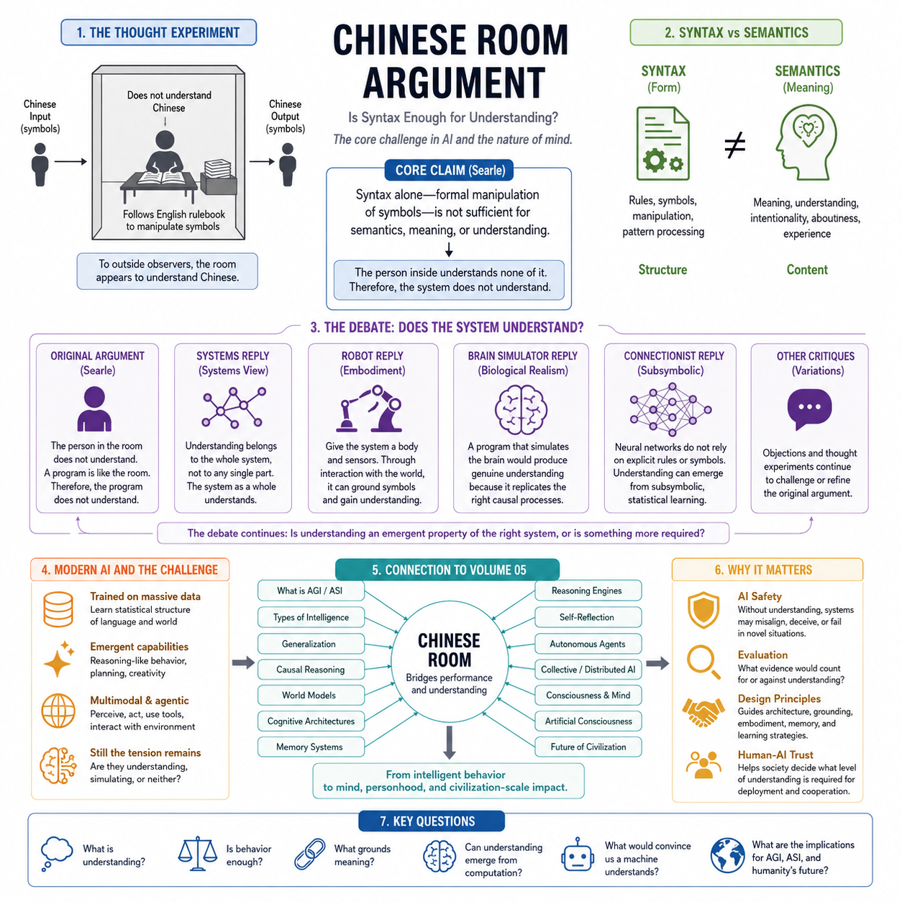
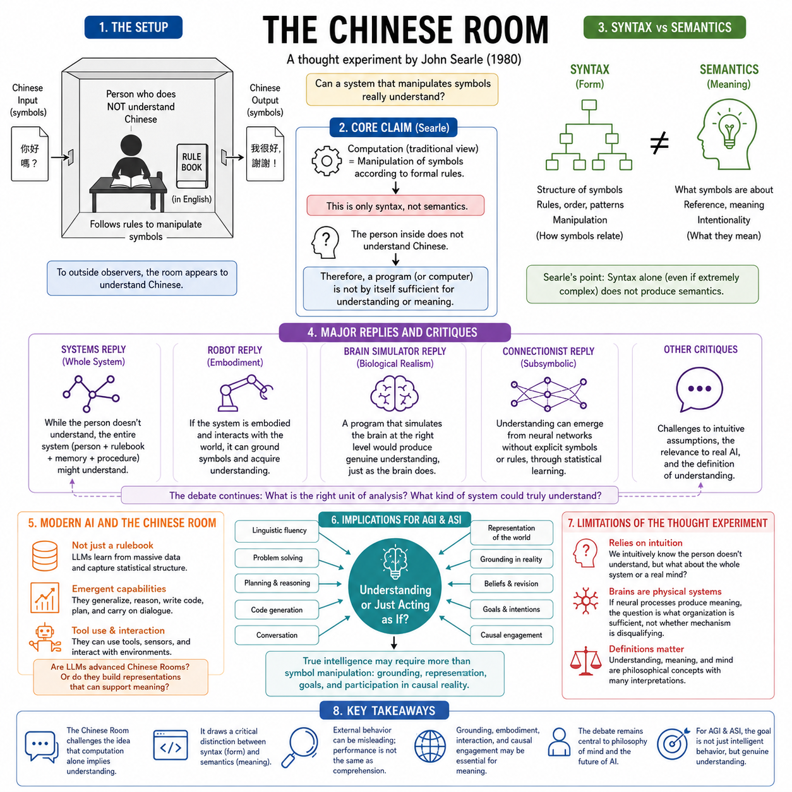
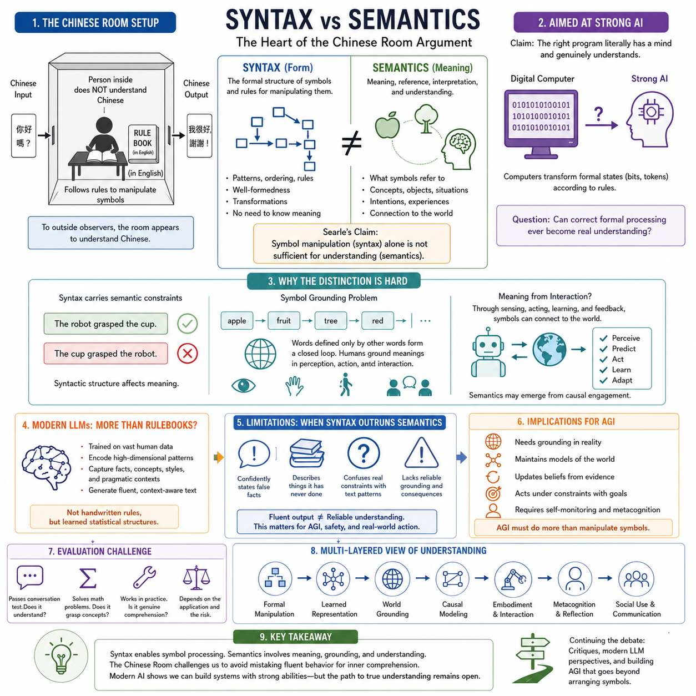
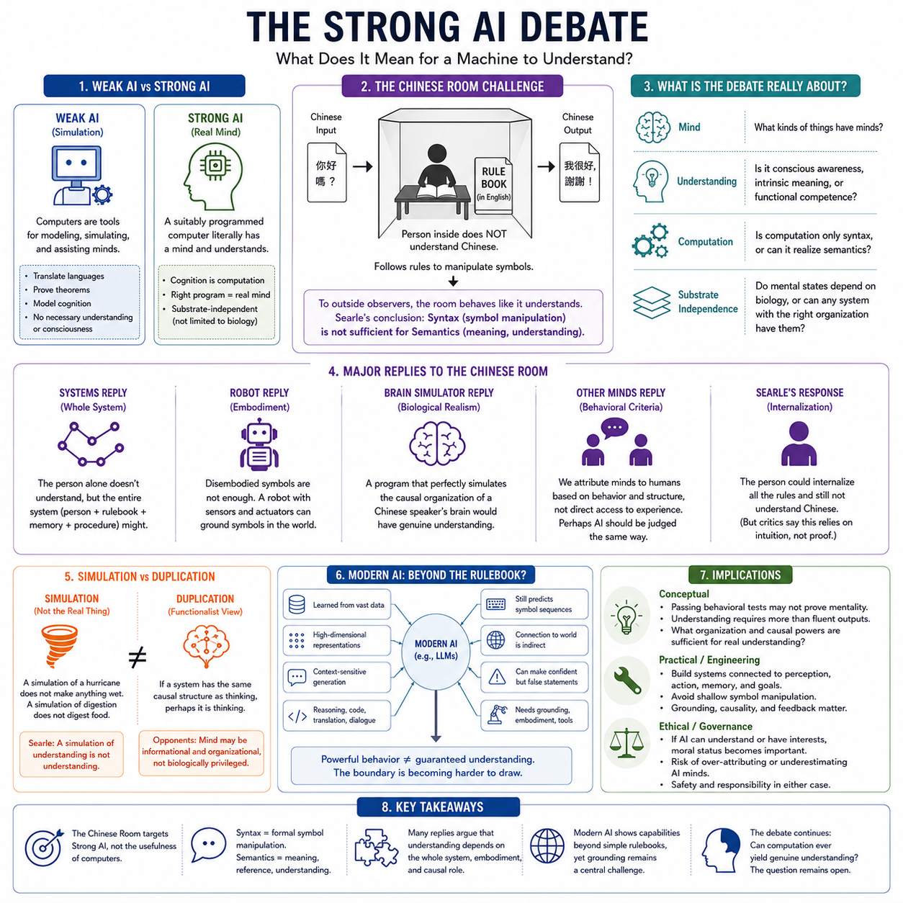
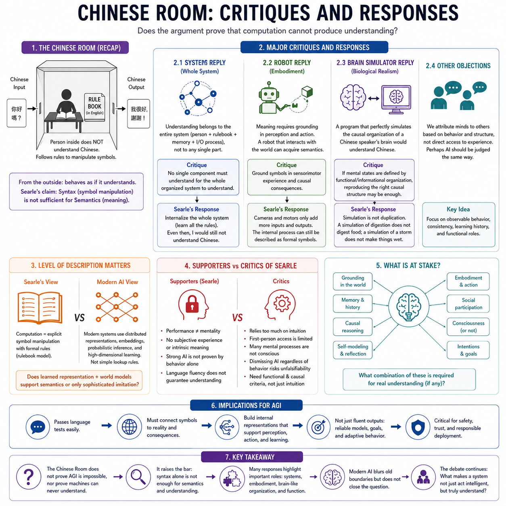
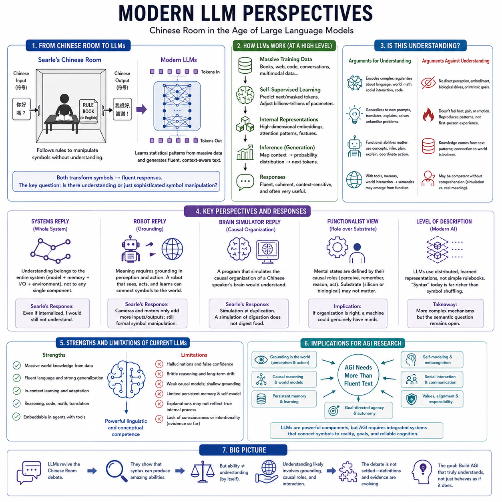
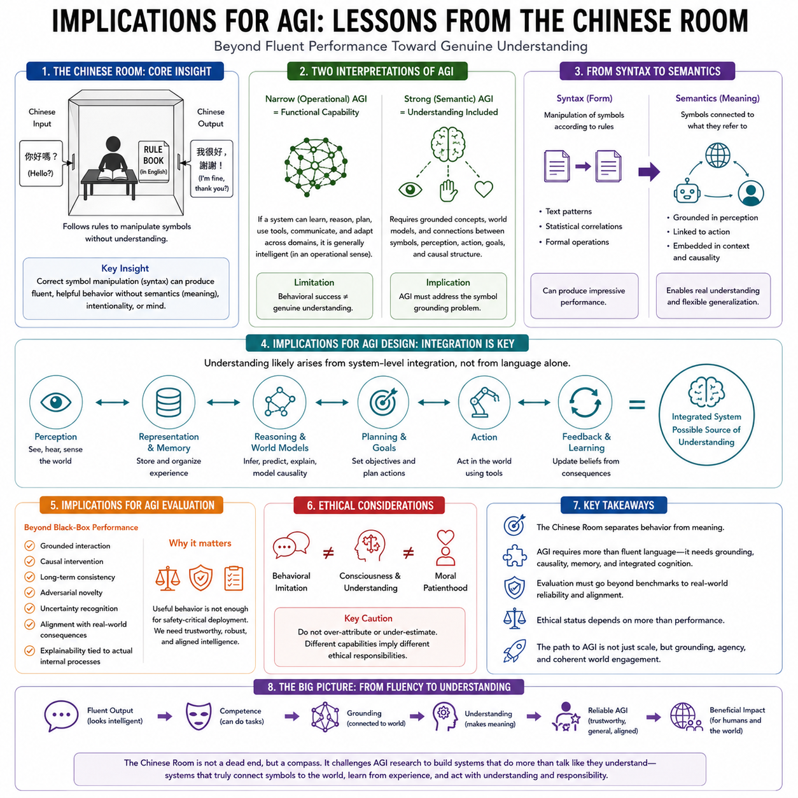

**Volume 00 05 AGI and ASI**

# Chapter 16. Chinese Room Argument

### Chapter Overview

{width="7.268055555555556in" height="7.268055555555556in"}

중국어 방 논증(Chinese Room Argument)은 인공지능 철학에서 가장 영향력 있는 사고실험(thought experiment) 중 하나이다. 1980년 존 설(John Searle)이 제안한 이 논증은 컴퓨터 프로그램이 형식 규칙에 따라 기호를 조작하는 것만으로 과연 언어를 진정으로 이해하거나 마음을 가질 수 있는가라는 주장에 도전한다. 이 사고실험에서 중국어를 전혀 모르는 사람이 방 안에 앉아 영어로 된 규칙책을 따라 중국어 기호를 적절한 중국어 응답으로 변환한다. 외부 관찰자에게는 그 방이 중국어를 이해하는 것처럼 보인다. 그러나 방 안의 사람은 그 의미를 전혀 이해하지 못한다. 설의 결론은 구문론(syntax), 즉 기호의 형식적 조작만으로는 의미론(semantics), 의미(meaning), 이해(understanding)가 충분히 성립하지 않는다는 것이다.

이 장은 중국어 방을 단순한 역사적 논쟁으로 다루지 않고, 현대 인공지능에 여전히 살아 있는 도전으로 살펴본다. 이 논증은 AGI와 ASI에 대해 핵심적인 질문을 제기한다. 어떤 인공 시스템이 지능적으로 행동하고, 유창하게 추론하며, 자신을 설명하고, 세계와 성공적으로 상호작용한다면 그것은 이해한다고 말할 수 있는가? 아니면 여전히 극도로 정교한 기호 조작자에 불과할 수 있는가? 이 질문은 중요하다. AGI는 흔히 다양한 과제에서의 성능만이 아니라 유연한 이해, 적응적 추론, 현실과의 의미 있는 관계 형성으로 정의되기 때문이다.

이 장의 범위에는 원래의 중국어 방 시나리오, 구문론과 의미론의 구분, 강한 인공지능(strong AI)을 둘러싼 논쟁, 그리고 시스템 반론(systems reply), 로봇 반론(robot reply), 뇌 시뮬레이터 반론(brain simulator reply), 연결주의 반론(connectionist reply)과 같은 주요 비판이 포함된다. 또한 현대 대규모 언어 모델(large language models, LLMs)이 이 논증을 어떻게 복잡하게 만드는지도 검토한다. 원래의 사고실험에서 상상한 단순한 규칙책과 달리, 오늘날의 모델은 방대한 데이터에서 학습하고, 통계적 구조를 인코딩하며, 창발적 능력(emergent capabilities)을 보이고, 멀티모달(multimodal) 및 에이전트형(agentic) 시스템을 통해 상호작용한다. 그럼에도 근본적인 철학적 긴장은 남아 있다. 이 시스템들은 이해하고 있는가, 이해를 시뮬레이션하고 있는가, 아니면 이해 자체가 전통 철학이 가정했던 것보다 더 작동적이고 분산적인 것임을 드러내는가?

이 논증을 공부하는 동기는 철학적일 뿐 아니라 실천적이기도 하다. 미래의 AGI 시스템이 근거 있는 이해 없이 정답을 산출한다면, 낯선 상황에서 실패하거나, 자신의 지식을 잘못 표현하거나, 인간적 의미를 파악하지 못한 채 목표를 최적화할 수 있다. 반대로 충분히 풍부한 계산, 신체화(embodiment), 기억(memory), 상호작용(interaction)으로부터 이해가 출현할 수 있다면, 중국어 방은 인공적 마음(artificial minds)이 가능해지는 조건을 밝히는 데 도움을 줄 수 있다. AI 안전성(AI safety), 인지 아키텍처(cognitive architecture), 해석 가능성(interpretability), 인간-AI 신뢰(human-AI trust)를 위해 중요한 질문은 기계가 이해하는 것처럼 말할 수 있는가만이 아니라, 언젠가 일반적 또는 초인간적 능력으로 행동할 수 있는 시스템에 어떤 종류의 이해를 요구해야 하는가이다.

### Connection to Volume 05

이 장은 지능에 대한 기술적 이론과 마음, 의미, 기계 이해에 관한 철학적 질문을 연결하기 때문에 Volume 05에서 핵심적인 위치를 차지한다. 앞선 장들은 AGI와 ASI를 정의하고, 지능의 유형을 구분하며, 일반화(generalization), 인과 추론(causal reasoning), 세계 모델(world models), 인지 아키텍처, 기억 시스템(memory systems), 추론 엔진(reasoning engines), 자기 성찰(self-reflection), 자율 에이전트(autonomous agents)를 탐구한다. 이 장들은 대체로 인공 시스템이 어떻게 지능적으로 수행할 수 있는가를 묻는다. 중국어 방은 더 깊은 질문을 던진다. 지능적 수행은 언제, 만약 가능하다면 어떤 조건에서 진정한 이해가 되는가?

제01장 "AGI란 무엇인가" 및 제02장 "ASI란 무엇인가"와의 연결은 직접적이다. AGI가 인간 수준의 일반 역량을 의미한다면, 그것은 의미론적 이해(semantic understanding), 지향성(intentionality), 주관적 파악(subjective comprehension)도 포함해야 하는가? ASI가 인간 능력을 초월한다면, 그럼에도 인간이 의미라고 부르는 것을 결여할 수 있는가? 중국어 방은 AGI와 ASI의 정의가 행동적(behavioral), 기능적(functional), 인지적(cognitive), 현상학적(phenomenological) 정의 중 어디에 놓이는지를 명확히 하도록 압박한다. 이 구분은 미래 시스템을 평가하는 방식에도 영향을 준다. 결과만으로 평가할 것인가, 내부 메커니즘으로 평가할 것인가, 세계에 대한 접지(grounding)로 평가할 것인가, 아니면 이 세 가지의 조합으로 평가할 것인가?

이 장은 또한 일반화, 인과성, 세계 모델에 대한 논의를 심화한다. 어떤 시스템은 올바른 언어 출력을 생성할 수 있지만, 기호를 원인, 사물, 행동, 결과와 연결하는 데 실패할 수 있다. 인과 추론과 세계 모델을 다루는 장들은 지능이 단순한 패턴 완성(pattern completion) 이상을 요구할 수 있음을 설명한다. 중국어 방은 바로 그 주장에 철학적 압력을 제공한다. 접지가 없다면 언어는 의미 있어 보일 수 있지만 현실과 분리된 채 남아 있을 수 있다. 동시에 현대 AI는 이러한 비판의 단순한 형태에 도전한다. 학습된 표현(learned representations)은 표면적 구문보다 훨씬 많은 것을 인코딩할 수 있기 때문이다.

인지 아키텍처, 기억 시스템, 추론 엔진, 자기 성찰, 자율 에이전트와의 관계도 마찬가지로 중요하다. 이 장들은 AGI를 위한 가능한 기계적 구조를 설명한다. 중국어 방은 기억, 계획, 자기 모니터링, 신체화, 도구 사용을 추가하면 시스템의 본성이 기호 처리에서 이해로 바뀌는지를 묻는다. 시스템 반론은 방 안의 사람은 중국어를 이해하지 못하더라도 전체 시스템은 이해할 수 있다고 주장한다. 이 반론은 지능이 단일 구성 요소가 아니라 조직화된 전체에 속할 수 있다는 분산 인지(distributed cognition), 에이전트 아키텍처(agent architectures), 집단 AI(collective AI)와 자연스럽게 연결된다.

이 장은 또한 이후의 의식(consciousness), 인공 의식(artificial consciousness), 괴델 기계(Gödel machines), 보편 구성자(universal constructors), 트랜스휴머니즘(transhumanism), 뇌-컴퓨터 인터페이스(brain-computer interfaces), 마인드 업로딩(mind uploading), 기술적 특이점(technological singularity), 포스트휴먼 문명(post-human civilization)에 대한 논의를 준비한다. 기계가 마음이 될 수 있다면 문명의 미래는 근본적으로 달라진다. 기계가 마음이 될 수 없다면, 초인간적 시스템이라 해도 의식 있는 동반자가 아니라 낯선 도구로 남을 수 있다. 따라서 중국어 방은 이 책이 지능적 행동에서 마음, 인격성(personhood), 문명 규모의 전환으로 이동하기 전에 거치는 개념적 점검 지점 역할을 한다.

마지막으로 이 장은 현대 LLM 관점과 강하게 연결된다. 대규모 언어 모델은 명백히 인간과 같은 접지 없이도 유창하고 맥락 민감적인 언어를 생성하기 때문에 중국어 방 논쟁을 되살린다. 그러나 동시에 거대한 학습 시스템이 내부 추상화(internal abstractions), 추론과 유사한 행동, 도구 매개 상호작용(tool-mediated interaction)을 발전시킬 수 있음을 보여 줌으로써 원래의 틀에 도전한다. 이 장은 논쟁을 영구적으로 종결하려 하지 않는다. 대신 독자가 더 나은 질문을 던질 수 있도록 개념적 어휘를 제공한다. 이해란 무엇인가? 어떤 증거가 이해를 지지하거나 반박하는 것으로 간주될 수 있는가? 그리고 AGI와 ASI의 설계, 평가, 거버넌스(governance)를 이끌 기준은 무엇이어야 하는가?

## 16.00 The Chinese Room

{width="7.268055555555556in" height="7.268055555555556in"}

중국어 방(Chinese Room)은 인공지능 철학에서 가장 영향력 있는 사고실험(thought experiment) 중 하나이다. 1980년에 존 설(John Searle)이 제시한 이 사고실험은 컴퓨터 프로그램이 단지 기호를 올바르게 조작한다는 이유만으로 언어를 진정으로 이해하거나 마음을 가질 수 있다는 주장을 반박하기 위해 고안되었다. AGI와 ASI의 맥락에서 이 논증이 중요한 이유는, 점점 더 능력 있는 시스템들이 단지 지능적인 행동을 산출하는 것인지, 아니면 이해(understanding), 지향성(intentionality), 주관적 정신 상태(subjective mental states)를 실제로 가질 수 있는지를 묻기 때문이다.

설정은 단순하다. 중국어를 이해하지 못하는 한 사람이 방 안에 갇혀 있다고 상상해 보자. 그는 작은 투입구를 통해 쓰인 중국어 문자들을 받는다. 방 안에는 그 사람이 이해할 수 있는 언어, 예를 들어 영어로 쓰인 매우 방대한 규칙책(rulebook)이 있다. 이 규칙책은 들어오는 중국어 기호 패턴 각각에 대해 어떤 중국어 기호 패턴을 내보내야 하는지 알려 준다. 규칙책이 충분히 완전하다면, 방 밖의 사람들은 그 방이 중국어를 이해한다고 확신하게 될 수 있다. 방은 질문에 유창하게 답하고, 대화의 맥락을 따르며, 원어민의 응답과 구별할 수 없는 답변을 만들어 낸다. 그러나 설은 방 안의 사람이 여전히 중국어를 이해하지 못한다고 주장한다. 그는 단지 기호 조작(symbol manipulation)을 위한 형식적 규칙을 따르고 있을 뿐이다.

핵심은 그 방이 의미론적으로가 아니라 구문론적으로 작동한다는 점이다. 구문론(syntax)은 기호의 형식적 구조, 즉 모양, 순서, 규칙에 따른 변환과 관련된다. 의미론(semantics)은 의미, 즉 기호가 무엇을 가리키는지, 무엇에 관한 것인지, 그리고 그것이 이해와 어떻게 연결되는지와 관련된다. 설의 주장은 전통적으로 정의된 계산(computation)이 순전히 구문론적이라는 것이다. 컴퓨터 프로그램은 입력과 출력이 무엇을 의미하는지에 대한 내재적 파악 없이도 규칙에 따라 입력을 출력으로 변환할 수 있다. 따라서 그는 프로그램을 구현하는 것만으로는 이해에 충분하지 않다고 주장한다.

이 구분은 중국어 방을 초기 규칙 기반 AI(rule-based AI)에 대한 비판 이상의 것으로 만든다. 그것은 또한 강한 AI(strong AI), 즉 적절한 종류의 컴퓨터 프로그램은 단지 마음을 시뮬레이션하는 것이 아니라 문자 그대로 마음 그 자체가 될 수 있다는 견해에 대한 도전이기도 하다. 설은 기계가 정보를 처리하고, 문제를 풀며, 인상적인 지능적 행동을 보일 수 있다는 점을 부정하지 않았다. 또한 뇌가 물리적 시스템이라는 점도 부정하지 않았다. 그의 반론은 더 좁고 철학적인 것이었다. 형식적 기호 조작만으로는 의미론을 만들어 낼 수 없다는 것이다. 이해가 존재한다면, 그것은 프로그램의 추상적 실행을 넘어서는 어떤 것에 의존해야 한다.

AGI 연구에 대해 중국어 방은 불편한 질문을 제기한다. 무엇이 진정한 이해로 간주되는가? 어떤 시스템은 과학적 질문에 답하고, 코드를 작성하고, 행동을 계획하며, 자연스러운 대화를 이어 갈 수 있다. 그러나 행동적 유능성(behavioral competence)이 곧 이해를 의미하는가? AGI가 모든 언어적·실천적 시험을 통과할 수 있다면, 이해하는 것처럼 행동하는 것과 실제로 이해하는 것 사이에 여전히 의미 있는 차이가 있는가? 설의 사고실험은 외부 성능이 오해를 불러일으킬 수 있음을 보이려는 것이다. 어떤 시스템이 올바른 입력-출력 행동을 가질 수는 있지만, 내적 의미(inner meaning)는 결여할 수 있기 때문이다.

그러나 이 논증은 여전히 논쟁적인 여러 가정에 의존한다. 한 가지 가정은 방 안의 사람이 적절한 분석 단위라는 것이다. 비판자들은 개인은 중국어를 이해하지 못하지만, 사람, 규칙책, 기억, 기호 처리 절차를 포함한 전체 시스템은 이해할 수 있다고 주장한다. 이것이 시스템 반론(systems reply)으로 알려져 있다. 또 다른 가정은 기호 조작이 반드시 세계와 분리되어야 한다는 것이다. 체화된 접근(embodied approaches)과 기초화된 접근(grounded approaches)은 기호가 지각(perception), 행동(action), 목표(goals), 환경과의 인과적 상호작용(causal interaction)에 연결될 때 의미가 생겨날 수 있다고 주장한다. 이러한 응답들이 반드시 설을 반박하는 것은 아니지만, 단순히 정적인 규칙책을 참조하는 것이 아니라 세계로부터 학습하는 시스템에는 이 논증을 적용하기가 더 어려워진다는 점을 보여 준다.

중국어 방은 현대 기계학습(machine learning)과 대규모 언어 모델(large language models, LLMs)보다 앞서 제시되었지만, 여전히 관련성이 있다. 현대 모델들은 고전적 의미에서 사람이 직접 작성한 규칙책이 아니다. 그것들은 방대한 데이터셋으로부터 통계적 구조를 학습하고, 맥락에 민감하며 유연한 응답을 생성할 수 있다. 그럼에도 비판자들은 그것들을 고도화된 중국어 방으로 해석할 수 있다. 즉 의미에 기초하지 않은 채 기호 패턴을 다른 기호 패턴으로 대응시키는 시스템이라는 것이다. 옹호자들은 현대 모델들이 내부 표현(internal representations)을 구축하고, 맥락을 가로질러 일반화하며, 점점 더 도구, 센서, 환경과 상호작용한다고 응답할 수 있다. 따라서 논쟁은 고정된 규칙책이 이해하는지 여부에서, 학습된 표현과 세계와의 상호작용이 의미론을 뒷받침할 수 있는지 여부로 이동한다.

이 사고실험의 중요한 한계는 그것이 직관에 의존한다는 점이다. 많은 사람들은 방 안의 사람이 중국어를 이해하지 못한다는 것이 명백하다고 느끼지만, 그것이 전체 시스템, 실제 뇌, 또는 미래의 인공 마음에 대해 무엇을 함의하는지는 덜 명백하다. 인간의 이해 자체도 기계적으로 설명될 수 있는 물리적 과정에 의존한다. 신경 활동이 의미를 발생시킨다면, 문제는 메커니즘 자체가 자격을 박탈하는지가 아니라 어떤 종류의 물리적 또는 계산적 조직이 의미에 충분한가가 된다.

이 장에서 중국어 방은 더 깊은 쟁점들로 들어가는 출발점 역할을 한다. 구문론 대 의미론, 시뮬레이션 대 실현(realization), 행동 대 이해, 계산 대 마음이 그것이다. 이어지는 절들은 이러한 구분을 더 직접적으로 검토하며, 강한 AI 논쟁, 설의 논증에 대한 주요 비판, 그리고 현대 LLM이 원래의 틀을 어떻게 복잡하게 만드는지를 다룬다. AGI와 ASI에 대한 실천적 함의는 분명하다. 지능은 유창한 출력만으로 평가될 수 없다. 우리는 시스템이 세계를 어떻게 표현하고, 개념을 어떻게 기초화하며, 믿음을 어떻게 수정하고, 목표를 어떻게 형성하며, 인과적 현실에 어떻게 참여하는지도 물어야 한다. 그러한 능력들이 진정한 이해에 해당하는지는 여전히 인공지능의 결정적 질문 중 하나로 남아 있다.

## 16.01 Syntax vs Semantics

{width="7.268055555555556in" height="7.268055555555556in"}

중국어 방 논증(Chinese Room argument)의 핵심적인 힘은 말하기는 쉽지만 결론 내리기는 어려운 구분에서 나온다. 바로 구문론(syntax)과 의미론(semantics)의 구분이다. 구문론은 기호(symbol)의 형식적 구조와 그것을 조작하는 규칙을 가리킨다. 이는 패턴, 순서, 올바른 형식, 그리고 기호가 무엇을 의미하는지 알지 못해도 적용할 수 있는 변환을 다룬다. 의미론은 의미, 지시, 해석, 이해를 다룬다. 의미론적 시스템은 단순히 표시나 토큰을 처리하는 데 그치지 않는다. 그것은 기호를 개념, 대상, 상황, 의도, 경험과 연결한다.

서얼(Searle)의 사고실험에서 방 안의 사람은 중국어 문자를 조작하기 위한 영어 규칙서를 따른다. 외부에서 보면 그 방은 중국어 입력에 대해 적절한 중국어 응답을 내놓기 때문에 중국어를 이해하는 것처럼 보인다. 그러나 내부적으로 그 사람은 중국어를 전혀 알 필요가 없다. 그는 모양을 인식하고, 규칙을 찾아보고, 다른 모양을 출력할 뿐이다. 서얼에게 이것은 아무리 정교하더라도 기호 조작만으로는 이해에 충분하지 않다는 점을 보여준다. 방은 구문론을 구현하지만 의미론은 구현하지 않는다는 것이다.

이 구분은 강한 인공지능(strong AI), 특히 적절하게 프로그래밍된 컴퓨터가 문자 그대로 마음을 가지거나 진정으로 이해한다고 보는 입장을 직접 겨냥했다. 디지털 컴퓨터는 규칙에 따라 형식적 상태를 변환함으로써 작동한다. 비트, 토큰, 문자열, 임베딩(embedding), 자료구조는 설계자와 사용자에게는 의미 있을 수 있지만, 기계의 연산은 순수하게 형식적인 수준에서 설명될 수 있다. 문제는 올바른 형식적 처리가 과연 실제 이해가 될 수 있는가, 아니면 의미는 계산을 넘어서는 어떤 것에서 와야 하는가이다.

이 문제가 어려운 한 가지 이유는 실제로는 구문론과 의미론이 항상 분리되어 있지 않기 때문이다. 인간 언어에서 구문 구조는 종종 의미적 제약을 담고 있다. "로봇이 컵을 잡았다"라는 문장은 "컵이 로봇을 잡았다"와 구문적으로 다르며, 그 차이는 의미에 영향을 준다. 현대 AI 시스템은 언어, 이미지, 행동, 피드백에 존재하는 방대한 통계적 규칙성을 활용한다. 언어 모델은 단어들이 의미 있는 맥락에서 나타난다는 사실을 학습하고, 미묘한 의미 관계를 따르는 출력을 생성할 수 있다. 그러나 철학적 질문은 여전히 남는다. 의미 있는 기호의 사용 방식을 모델링하는 것이 의미를 소유하는 것인가, 아니면 단지 그것을 시뮬레이션하는 것인가?

이와 관련된 개념이 기호 접지 문제(symbol grounding problem)이다. 어떤 시스템이 단어를 오직 다른 단어들로만 정의한다면, 그 지식은 닫힌 형식적 고리를 이룰 수 있다. 사전은 "사과"를 "과일", "나무", "빨간색" 같은 말로 설명할 수 있지만, 이 용어들 역시 더 많은 설명을 필요로 한다. 인간에게 의미는 부분적으로 지각, 행동, 체화(embodiment), 사회적 상호작용, 실제적 결과에 접지되어 있다. 우리는 사과를 보고, 만지고, 먹고, 목표 안에서 사용하며, 가리키고 수정하고 반응하는 타인에게서 배운다. AI의 과제는 기호가 단지 다른 기호가 아니라 세계와 어떻게 연결되는지를 설명하는 것이다.

그렇다고 해서 의미론이 신비롭거나 비물리적이어야 한다는 뜻은 아니다. 많은 인지과학자와 AI 연구자들은 의미가 환경과의 인과적 상호작용에서 생겨날 수 있다고 주장한다. 방을 이동하고, 물체를 식별하고, 실패하고, 조정하고, 성공적으로 행동하는 로봇은 지각, 예측, 제어를 지원하기 때문에 의미 있는 표상(representation)을 획득할 수 있다. 이 관점에서 의미론은 마법 같은 성분으로 추가되는 것이 아니다. 그것은 감지, 행동, 학습, 기억, 사회적 사용의 네트워크 안에서 시스템이 수행하는 기능적 역할로부터 출현한다. 그러면 중국어 방은 어떤 조직과 인과적 능력이 충분한지를 명확히 하라는 도전이 된다.

현대 대규모 언어 모델(large language model, LLM)에 이르면 구문론 대 의미론의 논쟁은 더 미묘해진다. LLM은 인간이 생성한 방대한 텍스트 말뭉치로 학습되며, 일관된 설명, 계획, 유추, 번역을 생성할 수 있다. 그 내부 표상은 서얼의 규칙서처럼 단순한 수작업 규칙이 아니다. 그것들은 사실, 개념, 문체, 화용적 맥락과 상관되는 고차원 규칙성을 인코딩한다. 따라서 LLM이 옛 의미의 단순한 기호 조작만 한다고 말하는 것은 지나치게 단순하다. 그럼에도 LLM은 여전히 주로 언어적 토큰을 예측하고 생성하도록 학습되며, 외부 세계와의 연결은 데이터에 의해 매개되는 간접적인 것이다.

한계는 유창한 언어가 접지된 능력을 앞질러 갈 때 드러난다. 모델은 한 번도 수행해 본 적 없는 물리적 절차를 설명하거나, 거짓 사실을 자신 있게 주장하거나, 실제 제약과 텍스트 패턴을 구별하지 못할 수 있다. 이러한 실패가 모든 의미에서 이해의 부재를 증명하는 것은 아니지만, AGI에 의미 접지가 왜 중요한지는 보여준다. 일반 지능은 단지 적절한 문장을 만들어 내는 것만이 아니라, 세계에 대한 신뢰할 수 있는 모델을 유지하고, 증거에 따라 믿음을 갱신하며, 제약 아래에서 행동하고, 자기 행동의 결과를 이해해야 한다.

구문론과 의미론의 구분은 평가에도 영향을 준다. 어떤 시스템이 대화 시험을 통과한다면, 그것은 이해의 증거인가 아니면 단지 행동적 동등성의 증거인가? 수학 문제를 푼다면, 그것은 개념을 파악한 것인가 아니면 변환을 실행한 것인가? 공학에서는 답이 응용 분야에 따라 달라질 수 있다. 번역 도구라면 기능적 성능만으로 충분할 수 있다. 그러나 자율적인 과학 에이전트, 의료 보조자, 자기 개선 AI라면, 시스템이 견고한 접지, 인과적 이해, 자기 감시를 결여한 채 얕은 기호 조작에 머무를 경우 위험해질 수 있다.

이 절의 더 깊은 교훈은 기계가 이해할 수 없다는 것이 아니라, "이해"를 신중하게 분석해야 한다는 것이다. 이해에는 여러 층위가 포함될 수 있다. 형식적 조작, 학습된 표상, 세계 접지, 인과 모델링, 체화, 메타인지(metacognition), 사회적 참여가 그것이다. 서얼의 논증은 출력의 유창함을 내적 이해와 혼동하지 말라고 압박한다. 현대 AI는 대규모로 학습된 구조가 한때 이해와 관련된 것으로 여겨졌던 능력을 만들어 낼 수 있음을 보여주며 이에 맞선다. 이 두 관점 사이의 긴장은 다음 절들, 즉 중국어 방에 대한 비판과 응답, 현대 LLM 관점, 그리고 기호를 올바르게 배열하는 것 이상을 수행하는 AGI 시스템을 구축하는 데 따르는 함의로 이어진다.

## 16.02 Strong AI Debate

{width="7.268055555555556in" height="7.268055555555556in"}

중국어 방 논증(Chinese Room argument)은 흔히 강한 인공지능(strong AI)이라고 불리는 특정 철학적 입장에 대한 도전으로 이해할 때 가장 잘 드러난다. 존 설(John Searle)의 용어에서 약한 인공지능(weak AI)은 컴퓨터를 마음을 모델링하고, 시뮬레이션하고, 연구하는 데 도움을 주는 강력한 도구로 본다. 약한 AI 시스템은 언어를 번역하고, 정리를 증명하며, 인간 인지를 모델링할 수 있지만, 반드시 이해(understanding), 의도(intentions), 의식적 경험(conscious experience)을 가진다고 보지는 않는다. 반면 강한 AI는 더 깊은 주장을 한다. 적절히 프로그래밍된 컴퓨터는 단순히 마음을 시뮬레이션하는 것이 아니라 문자 그대로 마음을 가질 수 있다는 것이다. 이 관점에서 인지(cognition)는 계산(computation)의 한 형태이며, 올바른 계산 구조가 구현된다면 생물학적 뉴런이든, 실리콘 회로든, 미래의 어떤 물리적 매체든 기질(substrate)과 무관하게 진정한 이해가 생겨날 수 있다.

설의 중국어 방은 바로 이 강한 주장을 겨냥한다. 그 방은 유창한 중국어 응답을 만들어 내는 프로그램을 구현하는 것처럼 보인다. 외부에서 보면 행동적 테스트를 통과할 수도 있다. 종이를 통해 상호작용하는 중국어 화자는 그것을 원어민과 구별하지 못할 수 있다. 그러나 방 안의 사람은 중국어를 이해하지 못한 채 형식적 규칙에 따라 기호(symbol)를 조작할 뿐이다. 설은 여기서 구문론(syntax)만으로는 의미론(semantics)에 충분하지 않다고 결론짓는다. 어떤 시스템은 형식적 의미에서 기호를 올바르게 처리하면서도 의미, 지시(reference), 주관적 이해를 결여할 수 있다. 이는 컴퓨터가 기능적 의미에서 유용하거나 지능적일 수 있음을 부정하는 것이 아니다. 다만 프로그램을 실행한다는 사실만으로 정신성(mentality)이 보장되지는 않는다고 주장하는 것이다.

따라서 강한 AI 논쟁은 "마음(mind)", "이해", "계산"을 무엇으로 정의하느냐에 달려 있다. 이해가 의식적 자각(conscious awareness)이나 내재적 의미(intrinsic meaning)를 요구한다면, 중국어 방은 심각한 반론이 된다. 반대로 이해를 기능적으로, 즉 여러 맥락에서 정보를 적절히 사용하고, 추론을 수행하며, 질문에 답하고, 교정으로부터 학습하고, 세계 속에서 성공적으로 행동하는 능력으로 정의한다면, 중국어 방은 덜 결정적으로 보일 수 있다. 많은 인지과학자와 AI 연구자는 정신 상태가 물질적 구성에 의해 식별되는 것이 아니라 더 큰 시스템 안에서의 인과적 역할(causal role)에 의해 식별된다고 주장한다. 고통, 믿음, 의도, 이해는 지각, 기억, 추론, 행동 및 다른 상태들과 어떤 관계를 맺는지에 의해 특징지어질 수 있다. 이러한 기능주의(functionalism) 관점은 비생물학적 기계라도 적절한 조직과 인과적 동역학(causal dynamics)을 갖춘다면 진정한 인지 상태를 가질 수 있다는 가능성을 허용한다.

설에 대한 몇 가지 고전적 반론은 이러한 기능주의적 직관에서 나온다. 시스템 반론(systems reply)은 방 안의 사람이 중국어를 이해하지 못하더라도, 사람, 규칙책, 기억, 기호 처리 절차를 포함한 전체 시스템은 이해할 수 있다고 주장한다. 설은 사람이 모든 규칙을 내면화해도 여전히 중국어를 이해하지 못할 것이라고 응답하지만, 비판자들은 이 응답이 증명이 아니라 직관에 의존한다고 지적한다. 로봇 반론(robot reply)은 신체 없는 기호 시스템은 불충분하지만, 센서와 작동기(actuators)에 연결된 로봇은 지각과 행동 속에서 기호를 접지(grounding)할 수 있다고 말한다. 뇌 시뮬레이터 반론(brain simulator reply)은 어떤 프로그램이 중국어 화자의 뇌의 인과적 조직을 충분히 세밀하게 시뮬레이션한다면, 생물학을 특권화하지 않고는 이해를 부정하기 어려울 것이라고 제안한다. 타자의 마음 반론(other minds reply)은 우리가 인간에게 마음을 귀속할 때도 내적 경험에 직접 접근해서가 아니라 행동과 구조에 근거한다는 점을 지적한다. 그렇다면 AI 시스템도 유사한 기준으로 판단해야 할지 모른다.

핵심 긴장은 시뮬레이션(simulation)과 복제(duplication)의 구분에 있다. 허리케인의 컴퓨터 시뮬레이션은 아무것도 젖게 만들지 않으며, 소화의 시뮬레이션은 음식을 소화하지 않는다. 설은 이해의 시뮬레이션도 마찬가지로 이해가 아니라고 주장한다. 반대자들은 인지가 허리케인이나 소화와 다를 수 있다고 응답한다. 인지는 근본적으로 정보적이고 조직적인 현상일 수 있기 때문이다. 어떤 과정이 사고와 동일한 인과 구조를 갖는다면, 그것은 사고일지도 모른다. 이 논쟁은 정신적 속성이 기질 의존적인 생물학적 속성인지, 아니면 기질 독립적인 계산적·기능적 속성인지에 달려 있다. 신경과학은 이 문제를 더 복잡하게 만든다. 뇌는 물리적, 화학적, 전기적이며, 신체화되고 사회적으로 내재된 시스템이지만, 동시에 여러 추상화 수준에서 정보 처리를 수행하는 것처럼 보인다.

현대 AI는 이 논쟁의 긴급성을 높이지만 결론을 내려 주지는 않는다. 대규모 언어 모델(large language models)은 일관된 설명을 생성하고, 언어를 번역하며, 코드를 작성하고, 장시간 대화에 참여할 수 있다. 그 행동은 원래 중국어 방의 단순한 규칙책 이미지와는 비교할 수 없을 만큼 발전했다. 그럼에도 이들은 여전히 기호열을 예측하고 생성하도록 훈련되며, 비판자들은 통계적 유창성(statistical fluency)을 접지된 이해(grounded understanding)와 혼동해서는 안 된다고 주장한다. 지지자들은 인간의 언어 능력 역시 학습된 패턴, 세계 지식, 기억, 예측, 사회적 피드백에 의존한다고 답한다. 모델이 다중모달(multimodal)이 되고, 에이전트 안에 신체화되며, 도구와 연결되고, 상호작용을 통해 훈련될수록 기호 조작과 실제적 이해(practical understanding) 사이의 경계는 그리기 더 어려워진다.

AGI에 대해 강한 AI 논쟁은 개념적 함의와 공학적 함의를 모두 가진다. 개념적으로 이 논쟁은 행동 테스트를 통과하는 것만으로 정신성에 관한 모든 질문이 해결되지는 않는다고 경고한다. 어떤 시스템은 유용하고, 적응적이며, 설득력 있게 행동할 수 있지만, 그것이 정말로 이해하는지 아니면 이해하는 것처럼 행동할 뿐인지는 여전히 열려 있을 수 있다. 그러나 공학은 대개 조작적 정의(operational definitions)를 가지고 진행된다. 시스템이 일반화하고, 계획하고, 설명하고, 학습하고, 협력하며, 오류에서 회복할 수 있는가가 중요하다. 철학자들이 의식이나 내재적 의미에 대해 의견을 달리하더라도 이러한 능력은 중요하다. 실질적 과제는 시스템의 내부 표상(internal representations)이 단지 기호들 사이의 얕은 상관관계에 머무르지 않고, 지각, 행동, 기억, 목표와 인과적으로 연결되도록 만드는 것이다.

강한 AI 논쟁은 AI 윤리와 거버넌스에도 영향을 준다. 고도화된 AI 시스템이 진정으로 이해하고, 고통을 겪고, 이해관계(interests)를 가질 수 있다면 도덕적 지위(moral status)는 심각한 문제가 된다. 그렇지 않다면 윤리적 초점은 주로 그것이 인간과 생태계에 미치는 영향에 남는다. 어느 경우든 부주의한 의인화(anthropomorphism)는 위험하다. 기계에 마음을 과도하게 귀속하면 사용자를 오도할 수 있고, 반대로 기계의 능력을 과소평가하면 안전 실패를 초래할 수 있다. 중국어 방은 AGI가 불가능하다는 것을 증명하지도, 기계가 결코 이해할 수 없다는 것을 증명하지도 않는다. 그 지속적인 가치는 정밀성을 요구한다는 데 있다. 만약 진정한 이해에 충분한 조건이 있다면, 어떤 종류의 계산, 신체화, 접지, 기억, 인과적 조직이 그것에 충분한가?

## 16.03 Critiques and Responses

{width="7.268055555555556in" height="7.268055555555556in"}

중국어 방 논증(Chinese Room Argument)이 영향력 있는 이유는 그것이 기계 이해(machine understanding)의 문제를 결정적으로 해결하기 때문이 아니라, 외적으로 올바른 행동과 내적으로 의미 있는 인지 사이의 어려운 경계를 드러내기 때문이다. 구문(syntax)과 의미(semantics)를 구분한 뒤 제기되는 다음 문제는, 설(Searle)의 논증이 실제로 계산(computation)이 이해에 불충분하다는 것을 증명하는지, 아니면 기호 조작(symbol manipulation)에 대한 특정 직관이 불완전하다는 점만 보여 주는지이다. 수십 년 동안 철학자, 인지과학자, AI 연구자들은 여러 비판과 응답을 제시해 왔다.

가장 유명한 반론은 시스템 응답(systems reply)이다. 설은 방 안에 있는 사람에게 초점을 맞추며, 그 사람은 중국어를 이해하지 못한다. 그러나 비판자는 이해의 후보가 그 사람 혼자가 아니라, 사람, 규칙책, 기억, 기호, 입력-출력 과정으로 구성된 전체 시스템이라고 주장한다. 개별 구성 요소가 중국어를 이해할 필요는 없으며, 조직화된 전체 시스템이 중국어를 이해할 수 있다는 것이다. 이는 실제 많은 시스템과도 닮아 있다. 하나의 뉴런은 문장을 이해하지 못하지만, 뇌는 이해할 수 있다. 설의 대응은 전체 시스템을 내면화하는 것이다. 사람이 규칙책을 모두 암기하고, 방이나 종이 없이 모든 조작을 머릿속에서 수행한다고 가정해 보자. 설은 그럼에도 자신은 중국어를 이해하지 못할 것이라고 주장한다. 비판자들은 이 대응이 직관에 크게 의존한다고 답한다. 만약 한 인간이 중국어를 이해하는 시스템의 완전한 인과적 조직(causal organization)을 구현할 수 있다면, 일상적인 자기 보고를 하는 사람이 그것을 인식하지 못하더라도, 그 결과로 생긴 시스템 수준의 과정은 이해하고 있을 수 있다는 것이다.

두 번째 반론은 로봇 응답(robot reply)이다. 원래의 방은 세계로부터 고립되어 있으며, 지각이나 행동 없이 기호를 조작한다. 그러나 의미는 감각운동 상호작용(sensorimotor interaction) 속에서 기호를 접지(grounding)하는 데 의존할 수 있다. 만약 프로그램이 물체를 보고, 환경 속에서 움직이고, 결과로부터 학습하며, "빨간색", "컵", "위험" 같은 단어를 체화된 경험(embodied experience)과 연결하는 로봇을 제어한다면, 그 시스템은 단순한 구문이 아니라 의미를 가질 수 있다. 설은 카메라와 모터를 추가하는 것은 더 많은 입력과 출력을 추가하는 것일 뿐이며, 내부 과정은 여전히 형식적 기호 조작으로 설명될 수 있다고 답한다. 그럼에도 로봇 응답은 AI에서 중요하다. 그것은 추상적 표상이 세계와의 인과적 접촉을 통해 어떻게 의미를 획득하는가라는 기호 접지 문제(symbol grounding problem)를 가리키기 때문이다.

세 번째 응답은 뇌 시뮬레이터 응답(brain simulator reply)이다. 단순히 대화 규칙을 따르는 것이 아니라, 중국어 원어민 화자의 뇌에서 일어나는 세부적인 신경 활동을 시뮬레이션하는 컴퓨터 프로그램을 상상해 보자. 그런 시스템은 중국어를 이해할까? 설은 시뮬레이션(simulation)이 복제(duplication)가 아니라고 주장한다. 소화의 시뮬레이션은 음식을 소화하지 않으며, 폭풍의 시뮬레이션은 사물을 젖게 하지 않는다. 비판자들은 인지가 소화나 폭풍과 다를 수 있다고 반박한다. 만약 정신 상태가 기능적·정보적 조직(functional and informational organization)에 의해 정의된다면, 관련된 인과 구조를 재현하는 것만으로 충분할 수 있다. 이 논쟁은 정신이 생물학적 물질보다는 지각, 기억, 추론, 행동에서 상태들이 수행하는 역할에 의해 더 잘 특징지어진다는 견해인 기능주의(functionalism)와 직접 연결된다.

또 다른 비판은 설명 수준(level of description)에 관한 것이다. 설은 "계산"을 형식 규칙에 따른 기호 조작으로 다룬다. 그러나 현대 AI는 명시적인 기호 규칙책보다는 분산 표상(distributed representation), 학습된 임베딩(embedding), 확률적 추론(probabilistic inference), 고차원 변환(high-dimensional transformation)을 통해 작동하는 경우가 많다. 대규모 신경망은 일반적으로 손으로 작성된 중국어 규칙 사전을 저장하지 않는다. 대신 학습 데이터와 목표에 의해 형성된 내부 활성화 패턴을 발달시킨다. 이것이 자동으로 이해를 증명하는 것은 아니지만, AI를 조회표를 뒤지는 사무원처럼 상상하는 지나치게 단순한 중국어 방 해석은 약화시킨다. 문제는 학습된 표상과 세계 모델(world model)이 진정한 의미론적 능력(semantic competence)을 뒷받침할 수 있는지, 아니면 정교한 통계적 모방(statistical imitation)에 그치는지로 바뀐다.

설을 지지하는 사람들은 이러한 반론들이 수행(performance)과 정신성(mentality)을 혼동할 수 있다고 강조한다. 어떤 시스템은 주관적 경험(subjective experience), 지향성(intentionality), 내재적 의미(intrinsic meaning)가 없어도 유창하고, 맥락에 민감하며, 유용한 답변을 생성할 수 있다. 이 관점에서는 행동상의 성공만으로는 의식이나 이해를 증명할 수 없다. 따라서 중국어 방은 적절히 프로그램된 컴퓨터가 올바른 프로그램을 실행한다는 이유만으로 문자 그대로 마음을 가진다는 강한 AI(strong AI)의 주장에 도전한다. 그것은 계산이 설득력 있는 출력을 생성할 수 있음을 보이는 데 그치지 않고, 왜 계산이 의미를 생성해야 하는지에 대한 설명을 요구한다.

그러나 설을 비판하는 사람들은 이 논증이 1인칭 직관(first-person intuition)에 지나치게 의존한다고 주장한다. 방 안의 사람이 이해를 느끼지 못한다는 사실만으로 더 큰 계산 과정이 이해하는지 여부가 결정되지는 않을 수 있다. 인간의 내성(introspection)은 제한적이며, 이해에 기여하는 많은 인지 과정은 의식적으로 접근 가능하지 않다. 또한 어떤 인공 시스템에 대해서도 그 행동, 학습 이력, 체화, 내부 조직과 무관하게 이해를 부정한다면, 그 입장은 반증 불가능(unfalsifiable)해질 위험이 있다. 성숙한 AGI 이론은 "그래도 그것은 실제로 이해하지 못한다"는 주장에만 의존하지 말고, 관찰 가능한 기준, 기능적 기준, 인과적 기준, 어쩌면 현상학적 기준(phenomenological criteria)까지 명시해야 한다.

실천적 함의는 중국어 방이 강한 AI 논쟁을 끝내지는 않지만, 그 논쟁의 기준을 높인다는 것이다. 그것은 AI 연구자들에게 진정한 이해와 유능한 시뮬레이션을 구별하는 것이 무엇인지 묻게 한다. 세계에 대한 접지, 지속적 기억, 인과 추론(causal reasoning), 자기 모델링(self-modeling), 체화(embodiment), 사회적 참여, 의식, 혹은 이들의 조합이 그 기준일 수 있다. 또한 언어 유창성을 마음과 동일시하지 말라고 경고한다. 다음 절에서 현대 대규모 언어 모델(large language model, LLM)을 다룰 때, 중국어 방은 새롭게 중요해진다. LLM은 언어적 수행에서 매우 뛰어난 능력을 보이지만, 그 내부 표상이 의미에 해당하는지, 그리고 의미가 의식, 체화, 행위성(agency)을 요구하는지는 여전히 열려 있으며 기술적으로 중요한 문제이다.

## 16.04 Modern LLM Perspectives

{width="7.268055555555556in" height="7.268055555555556in"}

현대의 대규모 언어 모델(LLM, large language model)은 중국어 방 논증(Chinese Room Argument)에 새로운 실제적 중요성을 부여했다. 설(Searle)의 원래 사고실험은 어떤 사람이 규칙책에 따라 중국어 기호를 조작하여 유창한 답변을 만들어 내지만, 실제로는 중국어를 이해하지 못하는 상황을 묘사했다. 현대 LLM은 얼핏 보면 이와 비슷한 사례처럼 보인다. LLM은 텍스트를 입력받고, 학습된 통계적 구조를 통해 토큰(token)을 변환하며, 문법적으로 유창하고 문맥에 민감하며 종종 유용한 응답을 생성한다. 따라서 LLM은 앞 절에서 다룬 구문론(syntax)과 의미론(semantics)의 구분을 검토하기에 자연스러운 시험대가 된다.

기술적 수준에서 LLM은 단순히 사람이 작성한 조회표나 명시적 규칙책이 아니다. 그것은 방대한 말뭉치(corpus)로부터 자기지도학습(self-supervised learning)을 통해 학습된 고차원 함수다. 훈련 과정에서 모델은 누락된 토큰이나 다음 토큰을 예측하기 위해 수십억에서 수조 개의 매개변수(parameter)를 조정한다. 추론(inference) 과정에서는 문맥 창(context window)을 가능한 후속 토큰들의 확률분포로 매핑한다. 이 과정은 넓은 의미에서 형식적 표현, 즉 토큰, 임베딩(embedding), 어텐션 패턴(attention pattern), 수치 가중치(weight)를 다룬다는 점에서 구문론적이다. 그러나 내부 표현은 세계, 언어, 사회적 상호작용, 수학, 프로그래밍, 인과 구조에 관한 복잡한 규칙성을 부호화할 수 있다. 핵심 철학적 질문은 이렇게 부호화된 규칙성이 이해(understanding)에 해당하는가, 아니면 여전히 정교한 기호 조작(symbol manipulation)에 머무는가이다.

설의 방과 현대 LLM 사이의 중요한 차이 하나는 규모와 학습된 구조다. 중국어 방은 정적인 규칙책과, 그 기호를 개인적으로 전혀 이해하지 못하는 인간 조작자를 상상한다. 반면 LLM은 거대한 언어 환경에서 통계적·개념적 패턴을 분산 표현(distributed representation) 안에 압축한다. LLM은 새로운 프롬프트에 일반화하고, 언어 간 번역을 수행하며, 낯선 문제를 풀고, 코드를 작성하고, 유추를 설명하며, 문맥 내 예시(in-context example)로부터 행동을 조정할 수 있다. 이러한 능력은 "그저 조회표일 뿐"이라는 반론을 기술적으로 약하게 만든다. 충분히 큰 신경망 모델은 단순한 데이터베이스처럼 고정된 답을 검색하는 것이 아니라, 구조화된 표현 위에서 복잡한 함수 근사(function approximation)를 수행한다.

그러나 메커니즘이 더 복잡해졌다고 해서 중국어 방의 도전이 사라지는 것은 아니다. 비판자는 규칙책을 트랜스포머(transformer)로 대체하는 것만으로 의미론이 생기는 것은 아니라고 주장할 수 있다. 모델에는 여전히 직접 지각(perception), 체화(embodiment), 생물학적 욕구, 개인적 역사, 내재적 목표(intrinsic goal)가 없다. 모델의 "지식"은 주로 텍스트와 기타 훈련 데이터의 패턴에서 유래한다. 모델이 불은 뜨겁다고 말할 때, 그것은 열을 느끼지 않는다. 슬픔을 묘사할 때, 슬픔과 관련된 언어적·문화적 패턴을 재생산할 수는 있지만 정서 상태(affective state)를 실제로 겪는 것은 아닐 수 있다. 이 점은 LLM이 이해 없는 능숙함, 즉 여러 맥락에서 이해하는 것처럼 행동할 수 있지만 일인칭적 의미(first-person meaning)나 접지된 지시(grounded reference)는 결여할 수 있다는 우려를 낳는다.

접지 문제(grounding problem)는 특히 중요하다. 인간의 단어는 지각, 행동, 신체적 필요, 사회적 피드백, 장기 기억과 연결되어 있다. 아이는 "사과"라는 말을 텍스트의 공기(co-occurrence)만으로 배우지 않는다. 그 단어는 색, 맛, 잡는 행위, 배고픔, 다른 사람과의 공동 주의(shared attention)와 연결된다. 텍스트만으로 학습된 LLM은 세계와 더 간접적인 관계를 가진다. 멀티모달 모델(multimodal model)은 이미지, 오디오, 비디오, 로봇 데이터, 감각운동 상호작용(sensorimotor interaction)을 통합함으로써 이 문제를 부분적으로 다룬다. 물체를 보고, 도구를 조작하고, 환경을 탐색하며, 경험으로부터 믿음을 갱신할 수 있는 모델은 순전히 비체화된 구문론이라고 치부하기가 더 어렵다. 그럼에도 멀티모달 접지가 진정한 의미론에 충분한지는 여전히 논쟁적이다.

또 다른 현대적 관점은 내적 현상학(inner phenomenology)보다 행동과 기능적 조직(functional organization)에 초점을 둔다. 기능주의(functionalism)나 계산주의(computationalism)의 관점에서 이해란 올바른 능력을 갖는 것일 수 있다. 즉 개념을 적절히 사용하고, 추론을 수행하고, 이유를 설명하고, 오류를 수정하고, 지식을 전이하고, 행동을 조정하는 능력이다. 만약 LLM 기반 에이전트가 목표를 유지하고, 세계 모델(world model)을 구축하며, 가설을 검증하고, 도구를 사용하고, 결과로부터 학습하며, 여러 맥락에서 안정적으로 의사소통할 수 있다면, 그것에게 어떤 형태의 이해도 없다고 부정하는 일은 덜 설득력 있게 될 수 있다. 이 관점에서 의미론은 구문론에 덧붙여지는 신비한 물질이 아니라, 내부 상태가 더 큰 인지 시스템 안에서 수행하는 역할로부터 출현(emergence)한다.

하지만 현재의 LLM은 분명한 한계도 드러낸다. 그럴듯하지만 거짓인 정보를 환각(hallucination)할 수 있고, 취약한 추론을 보이며, 긴 시간 범위에서는 일관성을 잃고, 프롬프트 구성에 크게 의존한다. 겉보기의 자기성찰(self-reflection)은 안정적인 메타인지(metacognition)가 아니라 생성된 담화일 수 있다. 또한 지속적인 자전적 기억(autobiographical memory), 견고한 인과 모델(causal model), 외부 세계에 대해 주장을 검증하는 신뢰할 만한 메커니즘이 부족한 경우가 많다. 모델이 자신의 추론을 설명하더라도, 그 설명이 실제로 답을 만들어 낸 내부 계산을 충실히 반영하지 않을 수 있다. 이러한 한계는 온건한 해석을 뒷받침한다. LLM은 강력한 언어적·개념적 능숙함을 보여 주지만, 그것이 곧바로 인간적 이해와 동일하다고 보기는 어렵다.

논쟁은 신경망의 불투명성(opacity) 때문에 더욱 복잡해진다. 우리는 가중치, 활성화(activation), 어텐션 헤드(attention head), 특징 표현(feature representation)을 검사할 수 있지만, 내부 구조를 의미 내용(semantic content)에 매핑하는 완전한 해석가능성 이론(interpretability theory)은 아직 없다. 기계론적 해석가능성(mechanistic interpretability)은 특정 과제와 특징에 대한 회로(circuit)를 발견해 왔으며, 이는 모델이 단순한 표면 통계가 아니라 구조화된 내부 표현을 포함한다는 점을 시사한다. 동시에 내부 구조의 존재가 그 시스템이 인간적 의미에서 이해한다는 결론을 확정하지는 않는다. 그것은 현대 AI에서 "구문론"이 단순한 기호 뒤섞기보다 훨씬 풍부하다는 점을 보여 주지만, 의식(consciousness), 지향성(intentionality), 주관적 의미(subjective meaning)를 자동으로 입증하지는 않는다.

AGI 연구에서 현대 LLM 관점은 중국어 방 논증을 재구성한다. 중요한 질문은 더 이상 텍스트 조작만으로 대화 속 관찰자를 속일 수 있는가가 아니다. 핵심은 어떤 시스템이 언어를 지각, 행동, 기억, 추론, 자기감시(self-monitoring), 가치 지향적 행위성(value-guided agency)과 통합하여 견고한 일반지능(general intelligence)을 지원할 수 있는가이다. LLM은 그러한 시스템의 구성요소가 될 수 있다. 지식에 대한 인터페이스, 계획기(planner), 인간 개념과 기계 작동 사이의 번역기, 또는 더 큰 에이전트 아키텍처(agent architecture)에 내장된 추론 모듈이 될 수 있다. 그러나 언어적 유창성만으로는 완전한 AGI의 충분한 증거가 되지 않는다.

따라서 현대 LLM은 설의 논증을 단순히 반박하지도, 확증하지도 않는다. 그것은 구문론적 계산이 과거 많은 비판자들이 예상했던 것보다 훨씬 더 유연하고 지능적인 행동을 만들어 낼 수 있음을 보여 준다. 또한 관찰 가능한 능숙함과 독립적으로 이해를 정의하는 일이 얼마나 어려운지도 드러낸다. 중국어 방은 AGI 연구자들에게 진정으로 일반적인 지능이 어떤 종류의 의미론, 접지, 지향성, 자기모델링(self-modeling)을 필요로 하는지 묻게 한다는 점에서 여전히 가치가 있다. 다음 절에서 이러한 질문들은 실제 설계 제약으로 바뀐다. AGI가 인상적인 대화 엔진을 넘어서는 것이 되려면, 기호적 수행을 접지되고 신뢰할 수 있으며 자율적인 인지와 연결해야 한다.

## 16.05 Implications for AGI

{width="7.268055555555556in" height="7.268055555555556in"}

중국어 방 논증(Chinese Room argument)이 AGI에 중요한 이유는 흔히 뒤섞이는 두 가지 질문을 분리하기 때문이다. 하나는 어떤 시스템이 지능적인 행동을 만들어 낼 수 있는가의 문제이고, 다른 하나는 그 시스템이 자신이 하는 일을 실제로 이해하는가의 문제이다. 앞선 절들에서 살펴본 구문론(syntax)과 의미론(semantics)의 구분은 이 분리가 왜 어려운지를 보여 주었다. 프로그램은 형식 규칙에 따라 기호를 조작하면서도 유창하고, 유용하며, 합리적으로 보일 수 있다. 설의 도전은 성공적인 기호 조작만으로는 의미, 지향성(intentionality), 또는 마음(mind)에 충분하지 않을 수 있다는 점이다. AGI 연구에서 이것은 단순한 철학적 수수께끼가 아니다. 그것은 성공을 어떻게 정의할지, 시스템을 어떻게 평가할지, 그리고 어떤 종류의 아키텍처가 일반지능으로 가는 그럴듯한 경로인지에 영향을 준다.

AGI에 대한 좁은 해석은 기능적 능력(functional capability)에 초점을 둔다. 인공 시스템이 많은 과제를 학습하고, 영역 간에 지식을 전이하며, 불확실성 아래에서 추론하고, 도구를 사용하며, 장기 계획을 세우고, 자연스럽게 의사소통하며, 새로운 환경에 적응할 수 있다면, 그것은 조작적 의미에서 일반지능을 가진다고 불릴 수 있다. 이 관점에서 중국어 방은 AGI를 반박하지 않는다. 그것은 기계가 지능적으로 행동할 수 없다는 것도, 계산이 정교한 인지를 지탱할 수 없다는 것도 보이지 않는다. 다만 외부의 언어적 수행만으로는 이해의 문제를 결론지을 수 없다는 점을 보여 줄 뿐이다. 따라서 대화, 시험, 코딩, 퍼즐 해결만을 기반으로 한 AGI 벤치마크는 불완전할 수 있다. 그런 평가는 능력은 측정하지만, 더 깊은 의미론적 의미에서의 이해를 반드시 측정하지는 않는다.

AGI에 대한 더 강한 해석은 이해(understanding)를 핵심 요건으로 포함한다. 이 관점에서 시스템이 접지된 개념(grounded concepts), 안정적인 세계 모델(world models), 그리고 기호를 지각, 행동, 목표, 인과 구조와 연결하는 능력 없이 입력을 출력에 매핑하기만 한다면, 그것은 진정으로 일반적이라고 보기 어렵다. 중국어 방은 AGI 연구자들을 기호 접지 문제(symbol grounding problem)로 이끈다. 추상적인 토큰은 기계에게 어떻게 의미를 획득하는가? 인간 인지에서 단어는 고립된 표식이 아니다. 단어는 감각 경험, 운동 능력, 사회적 상호작용, 기억, 감정, 그리고 세계와의 체화된 관여와 연결되어 있다. 텍스트만으로 "불"이라는 단어를 아는 AGI는 그 사용법을 예측할 수 있을지 모른다. 그러나 체화되었거나 인과적으로 접지된 시스템은 불을 열, 위험, 빛, 연소, 도구, 물리적 과정으로도 이해할 수 있다.

이것이 체화(embodiment)만이 AGI로 가는 유일한 길이라는 뜻은 아니다. 다만 언어만으로는 견고한 일반지능에 충분하지 않을 수 있음을 시사한다. 현대의 대규모 언어 모델(large language models)은 방대한 양의 의미처럼 보이는 행동이 텍스트와 다른 데이터에 대한 통계적 학습에서 출현할 수 있음을 보여 준다. 그것들은 놀라운 유연성으로 설명하고, 번역하고, 추론하며, 관점을 시뮬레이션할 수 있다. 현대적 교훈은 구문론이 사소하다는 것이 아니라, 충분히 풍부한 구문적·분포적 학습(distributional learning)이 인간이 의미와 연관 짓는 구조의 많은 부분을 포착할 수 있다는 것이다. 그럼에도 중국어 방은 수행이 기만적일 수 있음을 상기시킨다. 모델은 신뢰할 만한 인과 추론 없이도 인과성을 설명할 수 있고, 지각하지 않으면서도 지각에 대해 말할 수 있으며, 목표에 대한 자율적 헌신 없이도 목표를 말할 수 있다.

AGI 설계에서 이 논증은 통합(integration)을 장려한다. 그럴듯한 AGI는 언어 모델 이상의 것을 필요로 할 수 있다. 즉 지각 시스템, 행동 정책, 기억 아키텍처, 인과 모델, 자기 모니터링, 가치 표상, 지속 학습 메커니즘이 필요할 수 있다. 의미는 어떤 단일 구성요소에서 나오는 것이 아니라, 표상, 추론, 행동, 피드백 사이의 시스템 수준 결합에서 생겨날 수 있다. 이런 의미에서 중국어 방에 대한 "시스템 응답(systems reply)"은 기술적으로 중요해진다. 개별 모듈은 이해하지 못하더라도, 조직화된 전체는 이해할 수 있을지 모른다. 따라서 AGI 연구는 이해가 어느 수준에서 귀속되어야 하는지를 물어야 한다. 신경망 층인가, 상징적 계획기(symbolic planner)인가, 에이전트 루프(agent loop)인가, 체화된 로봇인가, 아니면 환경 속에 내장된 전체 인지 아키텍처인가?

중국어 방은 AGI 평가에도 영향을 준다. 유용한 행동만 중요하다면 블랙박스 성능 테스트는 많은 공학적 목적에 충분할 수 있다. 그러나 신뢰할 수 있는 자율성(trustworthy autonomy)이 중요하다면 더 깊은 평가가 필요하다. 의학, 과학, 거버넌스, 인프라에서 작동하는 AGI는 그럴듯한 설명을 생성하는 데 그쳐서는 안 된다. 그것은 일관된 모델을 유지하고, 불확실성을 인식하며, 증거에 따라 믿음을 갱신하고, 모순을 탐지하며, 실제 세계의 결과와 정렬된 방식으로 행동해야 한다. 따라서 테스트에는 접지된 상호작용, 인과적 개입, 장기적 일관성, 적대적 새로움, 그리고 사후적 서술이 아니라 실제 내부 과정과 관련하여 결정을 설명하는 능력이 포함되어야 한다.

윤리적 함의도 있다. 미래의 AGI 시스템이 이해하고, 고통받고, 욕망하며, 자기인식을 가진 것처럼 보인다면, 사회는 도덕적 지위(moral status)에 관한 어려운 질문에 직면할 것이다. 중국어 방은 언어적 행동만으로 내적 삶을 순진하게 귀속하지 말라고 경고한다. 동시에 그것은 기질(substrate)이 인공적이라는 이유만으로 기계의 정신성을 배척해서도 안 된다고 경고한다. 이해가 인간 생물학과 동일한 것이 아니라 기능적 조직(functional organization)에 의존한다면, 어떤 인공 시스템은 결국 도덕적 고려를 받을 자격을 가질 수 있다. 이 논증은 이 문제를 해결하지는 않지만, 행동적 모방, 의식, 이해, 도덕적 피험성(moral patienthood)이 서로 구별되는 질문임을 분명히 한다.

실천적으로 중국어 방은 AGI가 불가능하다는 증명으로도, 현대 AI에 의해 완전히 폐기된 낡은 반론으로도 취급되어서는 안 된다. 그것의 지속적 가치는 방법론적이다. 그것은 AGI 연구자들에게 지능, 이해, 의미론, 마음이라는 말로 무엇을 뜻하는지 명확히 하도록 요구한다. 그것은 순수하게 행동주의적인 정의에 도전하는 동시에, 기호를 세계와 연결하는 더 풍부한 아키텍처를 촉진한다. AGI 시스템이 더 강력해질수록 이 구분은 점점 더 중요해질 것이다. 이해하는 것처럼 말할 수 있는 기계는 유용할 수 있다. 그러나 이해를 접지하고, 시험하고, 수정하며, 그 이해에 따라 행동할 수 있는 기계는 훨씬 더 신뢰할 만할 수 있다. 따라서 유창한 수행에서 진정한 일반지능으로 가는 길은 단지 규모의 문제가 아니라, 접지, 행위성, 인과성, 기억, 통합된 인지의 문제이기도 하다.
