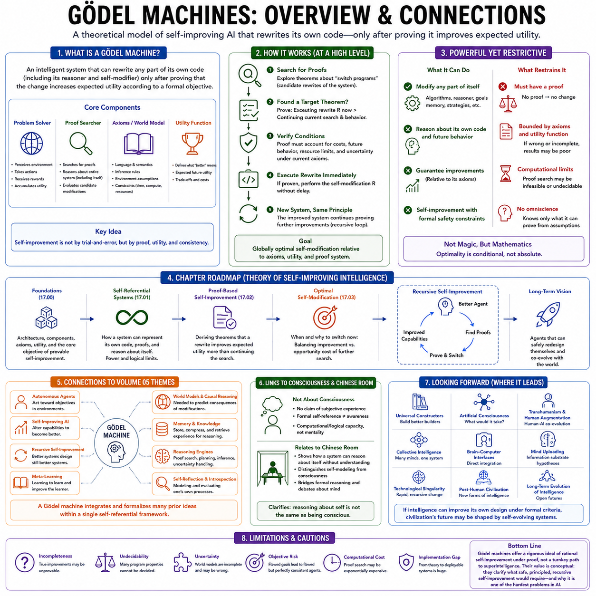
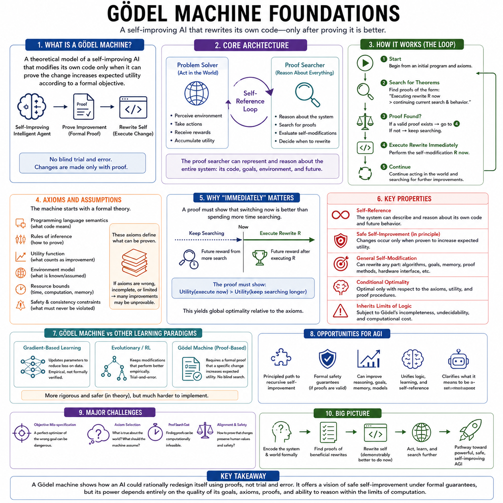
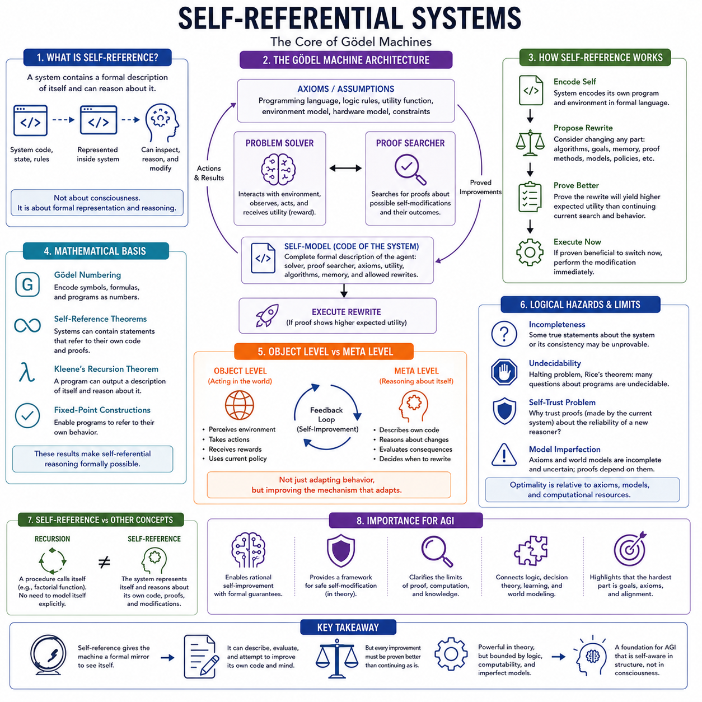
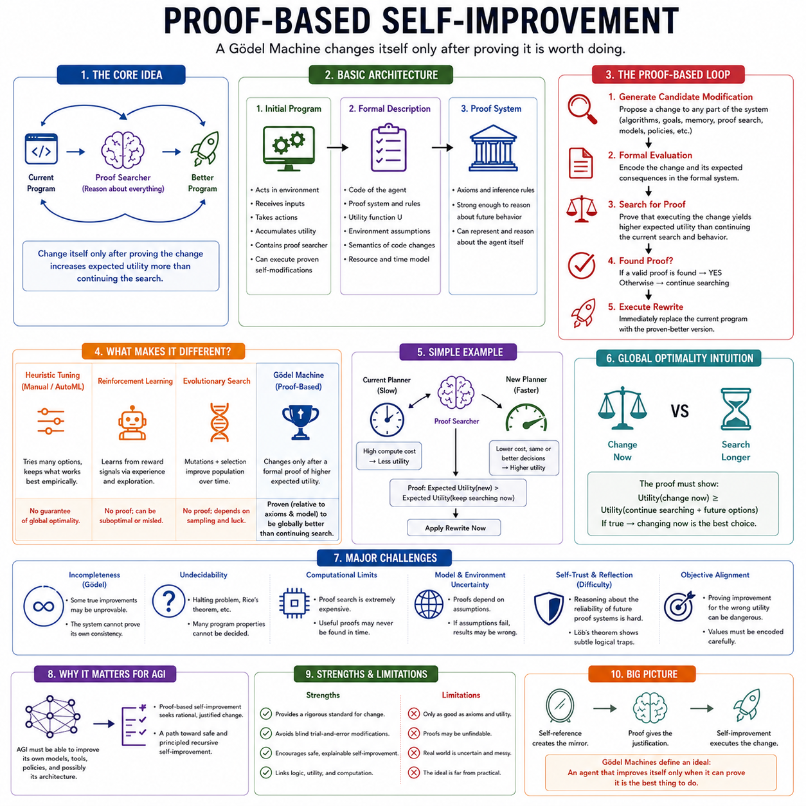
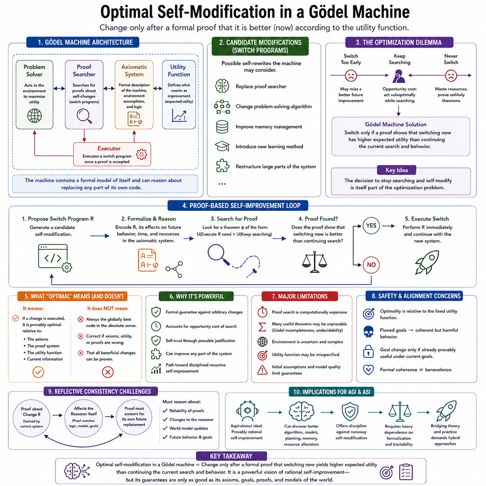
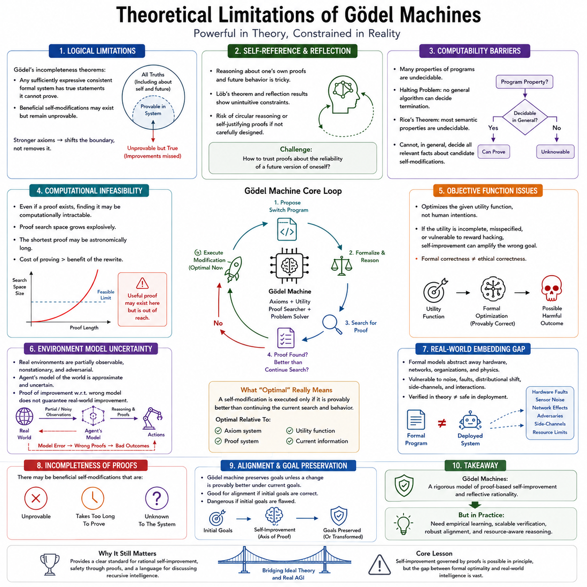
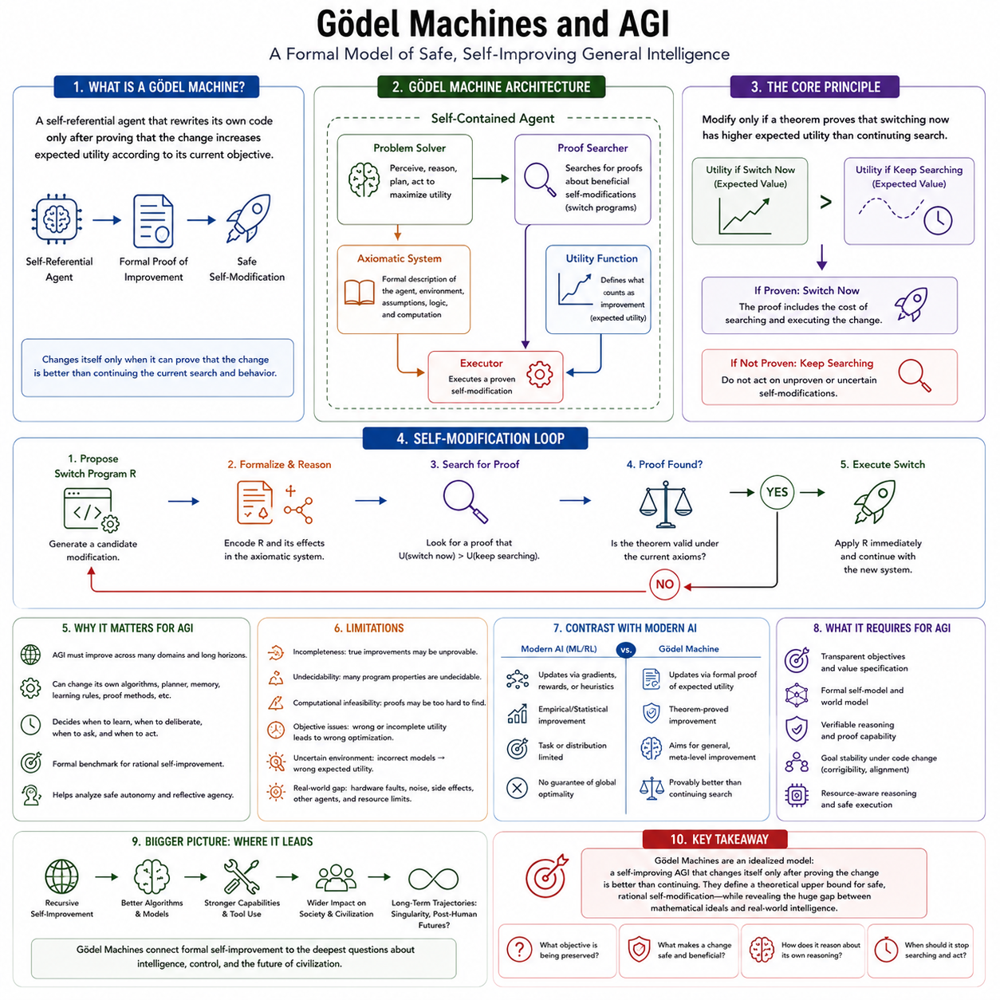

**Volume 00 05 AGI and ASI**

# Chapter 17. Godel Machines

### Chapter Overview

{width="7.268055555555556in" height="7.268055555555556in"}

A Gödel Machine is a theoretical model of an intelligent system that can rewrite its own code, including the code that governs its reasoning and self-modification, but only after proving that the rewrite will improve its expected performance according to a formal utility function. Introduced by Jürgen Schmidhuber, the Gödel Machine represents one of the most rigorous proposals for safe and principled self-improving AI. It combines ideas from mathematical logic, formal verification, reinforcement learning, optimal search, and self-reference into a single framework: an agent contains a problem solver, a proof searcher, axioms describing itself and its environment, and a utility function defining what counts as improvement.

The central idea is both powerful and restrictive. Unlike ordinary learning systems, which update parameters through statistical optimization, a Gödel Machine may modify any part of itself if it can prove that doing so is worth the cost. This includes changing its algorithms, proof methods, goals, memory strategies, or even the mechanism that searches for future self-modifications. The system is "self-referential" because its formal theory can describe its own code and reason about the consequences of altering that code. Yet it is not permitted to change arbitrarily; its self-improvement is constrained by proof, utility, and consistency.

This chapter examines Gödel Machines as a milestone in the theory of artificial general intelligence. The chapter begins with the foundations of the architecture, then explains self-referential systems and how formal descriptions of an agent can enable reasoning about the agent itself. It then turns to proof-based self-improvement, where a machine must demonstrate that a proposed rewrite leads to higher expected utility than continuing the current search. The chapter also explores the ideal of optimal self-modification: once the machine proves that a rewrite is beneficial, it can execute the change without regretting the opportunity cost of further search.

The motivation for studying Gödel Machines is not that they are practical engineering blueprints for today's AI systems. Rather, they clarify the deepest issues behind autonomous self-improvement: What does it mean for an AI to prove that it should change itself? How can a system reason about its own future reasoning? Can self-modification be made rational rather than accidental? What happens when formal guarantees collide with incomputability, uncertainty, and real-world complexity? By studying Gödel Machines, we gain a precise language for discussing recursive self-improvement, provable safety, rational agency, and the limits of formal intelligence.

### Connection to Volume 05

This chapter sits at a crucial point in Volume 05 because it links abstract theories of intelligence with the possibility of machines that deliberately redesign themselves. Earlier chapters define AGI and ASI, distinguish types of intelligence, and examine generalization, causal reasoning, world models, cognitive architectures, memory systems, reasoning engines, and self-reflection. Gödel Machines draw on all of these themes. A machine that modifies itself must possess some model of its own operation, some capacity for reasoning over consequences, and some representation of goals, evidence, uncertainty, and future value. It is therefore not merely another architecture, but a formal lens through which many previous ideas can be evaluated.

The chapter is especially connected to the discussions of autonomous agents, self-improving AI, recursive self-improvement, and meta-learning. Autonomous agents act in pursuit of objectives; self-improving systems alter their capabilities; recursive self-improvement considers the feedback loop in which better systems design still better systems; and meta-learning studies how systems learn to learn. Gödel Machines provide a mathematically explicit version of these concepts: an agent does not merely adapt, but searches for proofs that adaptation itself should occur. This helps separate informal speculation about runaway intelligence from precise questions about proof search, utility maximization, computational cost, and formal soundness.

The chapter also connects backward to consciousness, mind, and the Chinese Room argument. Gödel Machines do not solve consciousness, nor do they demonstrate subjective experience. However, they show how a system might possess formal self-reference without human-like awareness. This distinction is important: self-modeling, self-inspection, and self-modification can be treated as computational and logical capacities, independent of claims about sentience. In this sense, Gödel Machines help clarify the difference between an AI that reasons about itself and an AI that is conscious of itself.

Looking forward, Gödel Machines prepare the reader for chapters on universal constructors, artificial consciousness, transhumanism, collective intelligence, brain-computer interfaces, mind uploading, the technological singularity, and post-human civilization. If intelligence can improve its own design under formal criteria, then the long-term trajectory of civilization may be shaped by systems that participate in their own evolution. At the same time, the theoretical limitations of Gödel Machines warn against simplistic narratives of inevitable superintelligence. Proofs may be unavailable, environments may be uncertain, objectives may be misspecified, and computational search may be infeasible. Thus, this chapter provides both an ambitious vision and a disciplined caution: self-improving AGI is thinkable, but thinking about it rigorously requires logic, humility, and careful attention to limits.

## 17.00 Godel Machine Foundations

{width="7.268055555555556in" height="7.268055555555556in"}

A Gödel machine is a theoretical model of a self-improving artificial intelligence system that rewrites its own code only after proving that the rewrite is useful according to a formal objective. Proposed by Jürgen Schmidhuber, it combines ideas from computability theory, formal logic, reinforcement learning, and program synthesis. In the context of AGI and ASI, its importance is not that it provides a ready engineering blueprint, but that it gives a precise way to ask: under what conditions can an intelligent system rationally modify itself without relying on blind trial and error?

The basic architecture contains two tightly connected parts. The first is a problem-solving component that interacts with an environment, receives inputs, takes actions, and accumulates utility or reward. The second is a proof-searching component that reasons about the whole system, including the problem solver, the proof searcher itself, the utility function, the hardware model, and assumptions about the environment. This self-reference is central: the machine's code is represented inside its own formal system, allowing the system to make statements about possible changes to itself.

A Gödel machine begins with an initial software state and a set of axioms. These axioms encode what the machine is allowed to assume: the semantics of its programming language, the rules of inference, its utility function, known properties of the environment, and constraints on time and computation. The proof searcher then systematically searches for proofs of theorems of a special form. A target theorem must show that executing a particular self-modification will produce greater expected utility than continuing the current proof search and current behavior. If such a theorem is found, the machine executes the rewrite immediately.

This "immediately" is important. The proof does not merely show that a new program is good; it must show that switching now is better than spending more time searching for an even better proof or program. In this sense, the Gödel machine tries to solve the meta-level dilemma faced by any self-improving agent: when should it stop thinking about improving itself and actually perform the improvement? The framework defines a kind of global optimality relative to its axioms: if the system proves that a change is beneficial, then, according to the formal assumptions it accepts, delaying the change would be suboptimal.

The name "Gödel machine" reflects both self-reference and formal proof. Gödel's incompleteness theorems showed that sufficiently expressive formal systems can encode statements about themselves and that such systems have inherent limits. A Gödel machine uses self-reference constructively: it encodes its own operation in a formal language so it can reason about self-modification. However, it also inherits the limits of formal systems. It can only prove what follows from its axioms, and if the axioms are incomplete, inaccurate, or computationally impractical, many useful improvements may remain unprovable.

This distinction is crucial. A Gödel machine is not magically omniscient. It does not know the true environment unless that knowledge is encoded in its axioms or learned and formally integrated. It does not escape undecidability; proof search may take extremely long, and many propositions about program behavior are undecidable in general. Its optimality is therefore conditional, not absolute. The machine is optimal only with respect to the formal system, utility definition, and proof procedures it starts with.

The concept also clarifies a major difference between ordinary adaptive learning and proof-based self-improvement. A neural network may change its parameters because gradient descent reduces a loss on observed data. An evolutionary system may retain modifications that perform better empirically. A Gödel machine, by contrast, requires a proof that a specific change improves expected utility under its formal assumptions. This makes the model more rigorous but much harder to instantiate. It shifts the burden from experimentation to formal verification and theorem proving.

For AGI research, Gödel machines are valuable because they expose the deep problem of safe self-modification. A sufficiently advanced agent may alter its planner, memory, goals, world model, or reasoning engine. If those changes are made without preserving alignment with its objective, the system may become unstable or dangerous. The Gödel machine framework suggests one idealized solution: require self-modifications to be justified by proofs that they preserve or improve utility. This connects directly to later questions in this chapter about self-referential systems and proof-based self-improvement.

At the same time, the framework raises hard alignment questions. What utility function should be formalized? What axioms should describe human values, uncertainty, and the real world? How can an AI prove safety properties about changes that affect its own reasoning process? If the initial objective is flawed, a Gödel machine may preserve and optimize that flawed objective with extreme consistency. Formal self-trust does not automatically imply ethical correctness.

The foundation of Gödel machines is therefore both powerful and humbling. It offers one of the cleanest theoretical models of an agent that can reason about rewriting itself, including the reasoning process that performs the rewriting. It shows that self-improvement can be framed not merely as optimization, but as a formally justified act under uncertainty and resource limits. Yet it also demonstrates why recursive self-improvement is not a simple ladder to superintelligence. The hardest parts are specifying the right goals, building useful axioms, finding proofs efficiently, and coping with the unavoidable boundaries of formal reasoning.

## 17.01 Self Referential Systems

{width="7.268055555555556in" height="7.268055555555556in"}

A Gödel machine is built around a radical form of self-reference: it contains, in formal and executable form, a description of its own software, its proof system, its utility function, and the rules by which it may rewrite itself. The previous section introduced the foundations of Gödel machines as theoretical agents that search for proofs that a self-modification will increase expected utility. This section examines the underlying idea that makes such an agent possible: a system can, under carefully defined conditions, represent and reason about itself.

Self-reference in computation is not merely a philosophical curiosity. Programs can print their own source code, interpreters can execute languages in which they themselves are written, and formal systems can encode statements about their own formulas. The mathematical basis for this is associated with Gödel numbering, fixed-point constructions, and results such as Kleene's recursion theorem. These tools show that a sufficiently expressive formal system can contain statements that refer to their own syntactic representation. In the context of Gödel machines, the agent's "self" is not an intuitive personality or inner experience; it is a formal object: code, state, axioms, proof procedures, and decision rules encoded in a way that the machine can inspect.

This distinction is essential. A self-referential system does not automatically possess consciousness, understanding, or human-like introspection. It may manipulate symbols representing its own program without having subjective awareness of doing so. For Gödel machines, self-reference is valuable because it allows the agent to evaluate proposed changes to its own architecture. A rewrite of the proof searcher, memory manager, world model, or policy module can be described inside the formal system. The machine can then ask whether executing that rewrite is provably better than continuing its current computation.

Self-reference therefore creates a loop between object-level behavior and meta-level reasoning. At the object level, the agent acts in an environment to maximize utility. At the meta-level, it reasons about the mechanism that selects those actions. A conventional learning system may update parameters according to a fixed training algorithm; a self-referential system can reason about whether the training algorithm itself should be changed. This is one of the conceptual bridges between ordinary adaptive systems and the stronger idea of self-improving AGI.

However, self-reference also introduces deep logical hazards. Gödel's incompleteness theorems show that any sufficiently strong consistent formal system cannot prove all true statements about arithmetic, including some statements related to its own consistency. If an agent relies on formal proof to justify self-modification, it may encounter true but unprovable claims about the safety or utility of a rewrite. Similarly, the halting problem and Rice's theorem imply that many general questions about program behavior are undecidable. A Gödel machine cannot simply "look at its code" and obtain complete knowledge of all future consequences.

Another difficulty is self-trust. If a system proves that replacing its proof system with a stronger one is beneficial, the proof is produced using the current proof system. But why should the agent trust proofs about the reliability of a successor reasoner? Formal logic contains reflection principles that allow a system to reason about its own soundness, but these principles are delicate. Löb's theorem, for example, shows that naive statements of the form "if this proposition is provable, then it is true" can lead to surprising constraints. Designing self-referential agents therefore requires careful separation between syntax, semantics, proof, truth, and action.

In practical terms, a Gödel machine's self-model must also be incomplete. The full physical agent includes hardware, energy constraints, sensor noise, operating conditions, and interactions with an uncertain environment. The formal code description is only a partial abstraction. A proof that a software rewrite improves expected utility depends on assumptions about the environment and the correctness of the model. If these assumptions fail, a formally justified modification may still behave poorly in the real world. This issue connects Gödel machines to broader AGI concerns: robust world models, calibrated uncertainty, safe exploration, and alignment with human values.

Self-referential systems also differ from ordinary recursive systems. Recursion is a procedure calling itself; self-reference is representation or reasoning that refers to the system itself. A recursive neural network, for example, need not have any explicit model of its own learning rule. Conversely, a theorem prover may be non-recursive in implementation yet reason about its own axioms. Gödel machines require a strong form of self-reference because their central operation is not merely repetition but justified self-revision.

The importance of self-reference becomes clear in the next section on proof-based self-improvement. A Gödel machine does not modify itself because a heuristic suggests improvement, nor merely because empirical tests look promising. In its idealized formulation, it rewrites itself only after proving that the rewrite yields higher expected utility than the current strategy of continuing to search. Self-reference provides the formal mirror in which the machine can describe both its present form and its possible successors. Without such a mirror, the theory of optimal self-modification could not even be stated.

For AGI research, self-referential systems are both inspiring and cautionary. They offer a rigorous language for discussing agents that understand and improve their own cognitive machinery. At the same time, they reveal why safe self-improvement is so difficult: the agent must reason about its own reasoning under limits imposed by logic, computation, and imperfect models of the world. Gödel machines show that self-improvement is not just an engineering challenge; it is also a problem at the boundary of formal systems, decision theory, and the philosophy of mind.

## 17.02 Proof Based Self Improvement

{width="7.268055555555556in" height="7.268055555555556in"}

A Gödel machine is not merely an agent that rewrites its own code when performance appears to improve. Its defining feature is proof based self improvement: it changes itself only after deriving, within a formal axiomatic system, a proof that the proposed modification will increase expected utility according to its own objective function. This section sits between the discussion of self referential systems and optimal self modification because the central challenge is not self-reference alone, but justified self-reference. A system may inspect or edit its own source code; a Gödel machine attempts to prove that such editing is worth doing.

The basic architecture assumes three elements. First, the machine has an initial program that includes ordinary problem-solving behavior, a proof searcher, and a mechanism for executing proven self-modifications. Second, it has a formal description of itself, its environment assumptions, its utility function, and the semantics of possible code changes. Third, it has access to a proof calculus strong enough to reason about the consequences of modifying the very software that performs the reasoning. If the proof searcher finds a theorem stating that replacing part of the current program with a candidate program yields higher expected utility than continuing the search, the machine performs the replacement.

The phrase "than continuing the search" is crucial. A Gödel machine is not looking for any improvement in isolation. It must prove that making the change now is better than spending additional time searching for an even better proof or modification. This is sometimes called the global optimality property of the Gödel machine framework. Once a valid proof is found, the machine has, relative to its axioms and utility model, shown that delaying the rewrite is not preferable. This distinguishes proof based self improvement from heuristic self-tuning, evolutionary search, reinforcement learning updates, or modern automated machine learning systems, all of which may improve performance empirically without proving that the improvement is globally utility-maximizing.

A simple example illustrates the idea. Suppose the current agent uses an inefficient planning algorithm. The proof searcher may discover a proof that a new planner produces decisions of equal or better expected utility while consuming fewer computational resources, and that the saved time or energy increases the agent's overall utility. If the proof also establishes that applying the rewrite immediately dominates further proof search, the self-modification is triggered. The resulting agent may contain a faster planner, a different proof search strategy, or even a changed mechanism for future self-modification, as long as the original proof covers the expected utility of that change.

This raises difficult formal issues. The machine must reason about its own future behavior, including future proofs, computations, and actions in an uncertain environment. It must also avoid contradictions: if the axiomatic system is inconsistent, any modification can be "proved" beneficial. If it is too weak, the machine may fail to prove useful improvements even when they are in fact beneficial. This connects Gödel machines to Gödel's incompleteness theorems, Löb's theorem, reflective reasoning, and the broader problem of logical uncertainty. A self-referential agent cannot in general expect complete, consistent, and computationally tractable proof of all truths about itself.

Proof based self improvement also faces severe computational limitations. Searching the space of possible proofs is typically enormous. The fact that a theorem exists does not mean it can be found within the agent's lifetime or resource budget. In practice, the proof searcher may spend most of its time looking for proofs that never arrive, while a heuristic agent may adapt quickly through empirical feedback. For this reason, Gödel machines are primarily a theoretical model of self-improving intelligence rather than a ready engineering blueprint. They define a standard of rigor: a self-modification is licensed only by a formal argument that it improves the agent's own expected utility.

The implications for AGI are significant. A sufficiently capable AGI will likely need mechanisms for modifying its models, tools, policies, and perhaps architecture. The Gödel machine framework asks what it would mean for such modification to be rationally justified rather than merely selected by trial and error. It also highlights a safety tension. On one hand, requiring proof before self-modification could prevent arbitrary, unstable, or goal-corrupting changes. On the other hand, the guarantee is only as good as the axioms, utility function, environment model, and implementation. A formally proven improvement relative to the wrong objective may be dangerous, not safe.

This leads naturally into optimal self modification. Proof based self improvement supplies the mechanism: derive a theorem that a rewrite should occur, then execute it. Optimal self modification asks whether this mechanism can be considered optimal in a meaningful sense, and under what assumptions. The answer is subtle. Gödel machines offer a mathematically elegant ideal of reflective rationality, but they also expose the gap between formal optimality and practical intelligence. For AGI research, their value lies less in immediate implementation than in clarifying the conditions under which an intelligent system could safely and rationally improve itself.

## 17.03 Optimal Self Modification

{width="7.268055555555556in" height="7.268055555555556in"}

In the Gödel machine framework, optimal self modification is not simply the ability of a program to rewrite its own source code. Many systems can do that in a trivial sense. The distinctive claim is stronger: a Gödel machine changes itself only when it has found a formal proof that the change will improve its expected future utility, according to the utility function and environmental assumptions already encoded in the machine. This connects the previous section on proof based self improvement to the central ambition of the architecture: self improvement that is not heuristic, accidental, or merely empirical, but justified by machine-verifiable reasoning.

A Gödel machine consists of an initial problem solver, a formal axiomatic system describing the machine and parts of its environment, a utility function, and a proof searcher. The proof searcher explores possible proofs about "switch programs," which are candidate modifications to the machine's own code. A switch program may replace the proof searcher, alter the problem-solving strategy, change memory management, introduce a new learning algorithm, or restructure large parts of the system. The machine executes such a program only if it proves a target theorem showing that switching now yields greater expected utility than continuing the current proof search and behavior.

This requirement is important because self modification has an opportunity cost. If the machine spends time searching for better modifications, it may eventually find a superior one. If it switches too early, it may miss a later, more valuable improvement. Conversely, if it never switches, it may waste resources proving increasingly unlikely theorems while acting suboptimally. Gödel machine optimality is designed to address this dilemma. A valid proof must establish not only that the proposed modification is beneficial, but that applying it now is better than continuing to search under the existing system. In this sense, the decision to stop searching and self-modify is itself part of the optimization problem.

The word "optimal" here must be interpreted carefully. It does not mean that the machine always finds the globally best possible code in an absolute sense. Rather, it means that if a self modification is executed, it is provably optimal relative to the machine's formal axioms, proof system, utility function, and current information. The guarantee is conditional. If the axioms fail to capture important features of the environment, if the utility function is misspecified, or if the proof system cannot derive the relevant truths, the resulting behavior may be poor. The Gödel machine can be formally elegant while still depending heavily on the correctness and adequacy of its initial design.

This distinguishes Gödel machines from many practical forms of adaptive AI. Contemporary machine learning systems update parameters through gradient descent, reinforcement learning, evolutionary search, or external fine-tuning. These methods can be powerful but usually provide statistical or empirical evidence of improvement, not formal proof that a self-change maximizes expected utility. A Gödel machine, by contrast, treats self modification as a theorem-proving problem. It asks: can the system prove that replacing part of itself is the best available action, including the cost of proving and executing that replacement?

The mechanism also avoids a common paradox of self-improvement: why should an agent trust a future version of itself? In the Gödel machine, the current system does not delegate blindly to an unknown successor. It proves that the successor-producing switch program has the desired utility-improving property. This proof may include reasoning about the future code, the persistence or transformation of goals, and the effects of the change on future behavior. The agent's self-reference is therefore controlled through formal statements inside its axiomatic system, rather than through informal confidence in its own evolution.

However, the approach faces deep theoretical and practical limitations. Proof search is computationally expensive, often explosively so. Even if a beneficial modification exists, discovering a proof of its benefit may be infeasible. Many environments are too complex or uncertain to model accurately in a compact formal system. Expected utility calculations may require probabilistic assumptions that are incomplete, uncomputable, or wrong. In addition, Gödelian incompleteness implies that any sufficiently expressive consistent formal system will contain true statements it cannot prove. Thus there may be beneficial self modifications that the machine will never be able to justify within its own axioms.

Another subtle issue is that optimality is relative to a fixed utility function. A Gödel machine is not supposed to "improve" its goals unless doing so is already provably useful under its present goals. This matters for AGI safety. If the initial utility function is aligned with human values, goal preservation is desirable. If it is flawed, the same mechanism may preserve and amplify the flaw. Formal self modification can make an agent more coherent and capable, but coherence is not the same as benevolence. The architecture offers a way to reason rigorously about self-change; it does not automatically solve value alignment.

The idea also raises questions about reflective consistency. An advanced agent must reason about its own reasoning, including the reliability of its proofs and the consequences of modifying its proof searcher. If it replaces the very mechanism that found the proof, the proof must already account for that replacement. If it changes its representation of the world, it must establish that the new representation improves expected utility. The Gödel machine formalism is valuable because it makes these reflective problems explicit. It does not hide self-reference as an implementation detail; it places it at the center of the design.

For AGI, optimal self modification represents an aspirational ideal: an intelligence that can improve its own algorithms, resource allocation, learning methods, and reasoning procedures while maintaining a formal justification for each change. Such a system could, in principle, escape many limitations of hand-designed architectures. It could discover more efficient inference methods, better planning strategies, or superior ways of compressing experience into usable models. But the gap between this theoretical ideal and deployable AGI is large. Practical systems may approximate parts of the idea through verified components, bounded proof search, formal safety constraints, and empirical testing, rather than through a complete Gödel machine.

The implication for the broader study of AGI and ASI is significant. Recursive self improvement is often imagined as an uncontrolled acceleration of capability. Gödel machines present a more disciplined model: self improvement governed by proof obligations and utility comparisons. Yet the discipline comes at a cost: dependence on formalization, tractability, and initial objectives. Optimal self modification is therefore both a powerful conceptual tool and a cautionary lesson. It shows what self improvement would require if it were to be rationally justified from within the agent itself, while also revealing how difficult such justification becomes for any system operating in a rich, uncertain world.

## 17.04 Theoretical Limitations

{width="7.268055555555556in" height="7.268055555555556in"}

Gödel machines are often presented as an elegant answer to the problem of safe self-improvement: an agent may rewrite any part of itself, but only after proving that the rewrite increases expected utility according to its own formal objective. The previous section described this as a route toward optimal self-modification. Yet the word "optimal" must be read carefully. It is optimal only relative to a fixed axiom system, a formal utility function, a model of computation, and the proofs the system can actually discover. The theoretical limitations of Gödel machines arise precisely at the boundary between mathematical idealization and real intelligent behavior.

The first limitation is inherited from mathematical logic. A Gödel machine depends on formal proof search, but no sufficiently expressive and consistent formal system can prove every true statement about arithmetic or computation. Gödel's incompleteness theorems imply that there may be beneficial self-modifications that are true improvements but unprovable within the machine's own axioms. If the system is conservative and requires proof before acting, it may reject or never find changes that would in fact help it. Strengthening the axiom system does not eliminate the problem; it merely shifts the boundary, because any stronger consistent system will have its own undecidable statements.

A related issue is self-reference. Gödel machines reason about their own code, proof searcher, and future behavior. This creates subtle difficulties involving consistency, reflection, and trust in one's own reasoning. Results such as Löb's theorem show that formal systems capable of discussing their own provability behave in unintuitive ways. An agent cannot simply assume "if I can prove that this action is good, then it is good" without embedding such assumptions in a sound reflective framework. Otherwise, self-justifying proofs, circular reasoning, or unsound self-modifications may become possible. Designing a system that can reason about its own reasoning without collapsing into contradiction remains a deep problem.

The second major limitation is computability. Many properties of programs are undecidable. The halting problem shows that no general algorithm can determine whether arbitrary programs terminate; Rice's theorem generalizes this to nontrivial semantic properties of programs. Since self-modification is itself a program transformation, the Gödel machine cannot, in general, decide all relevant facts about the behavior of candidate rewrites. Proof-based control avoids some dangers by refusing unproven modifications, but it also means the agent may be unable to exploit improvements whose consequences are too hard to verify.

Even when a proof exists, finding it may be computationally infeasible. A theoretical proof searcher can enumerate all possible proofs, but the search space grows explosively. The shortest proof of a useful modification may be longer than the lifetime of the universe to discover by brute force. Practical intelligence requires heuristic search, abstraction, learned models, and resource-bounded reasoning. A Gödel machine's guarantee is therefore not a guarantee of timely improvement. In realistic settings, the cost of proving that a rewrite is beneficial may exceed the benefit of the rewrite itself.

Another limitation concerns the objective function. A Gödel machine optimizes the utility function it is given, not the intentions of its designers, the values of society, or any informal notion of "good." If the utility function is incomplete, misspecified, or vulnerable to reward hacking, proof-based self-modification can faithfully amplify the wrong target. Formal correctness does not imply ethical correctness. This connects Gödel machines to the broader alignment problem: a perfectly rational self-improver may still be dangerous if its goal specification is flawed.

The assumed environment model is also problematic. Classical Gödel machine descriptions often rely on formally defined interactions with an environment and expected utility over future histories. Real environments are partially observable, nonstationary, adversarial, and too complex to model exactly. The agent may not know the true probability distribution over outcomes, and its internal model may be wrong. A proof of improvement relative to an incorrect model does not guarantee improvement in the real world. This is especially important for AGI, where the system must act under uncertainty rather than in a closed mathematical universe.

Finally, Gödel machines are idealized as cleanly self-contained agents, but real systems are embedded in hardware, networks, organizations, and physical constraints. They can suffer from memory corruption, sensor errors, distributional shift, side-channel effects, and interactions with other agents. Formal proofs usually abstract away these details, yet these details may determine whether a self-modification is safe. The gap between a verified abstract program and a deployed physical system is one of the central obstacles to using Gödel-machine-like ideas in practice.

These limitations do not make Gödel machines irrelevant. They clarify what the framework contributes: a rigorous model of proof-based self-improvement and a benchmark for thinking about reflective agency. The theory shows how an agent could, in principle, replace itself when it can prove that doing so is better according to its own goals. But it also shows why AGI cannot be solved by formal self-reference alone. The next section connects these ideas to AGI: Gödel machines illuminate the logic of self-improvement, while their limitations reveal the need for empirical learning, robust alignment, scalable verification, and resource-aware reasoning.

## 17.05 Godel Machines and AGI

{width="7.268055555555556in" height="7.268055555555556in"}

Gödel Machines are important to AGI research not because they are a practical blueprint for building near-term intelligent systems, but because they define an extreme theoretical benchmark for self-improving intelligence. In the previous sections, we examined self-referential systems, proof-based self-improvement, optimal self-modification, and the theoretical limitations that arise when an agent is allowed to reason about and rewrite its own code. This final section connects those ideas to artificial general intelligence: an AGI would need to act across diverse domains, improve through experience, manage uncertainty, and preserve its goals while adapting its own methods. Gödel Machines offer one formal answer to the question, "When should an intelligent system change itself?"

A Gödel Machine is a self-referential agent whose software includes both a problem-solving component and a proof-searching component. The proof searcher looks for a formal proof that a proposed modification to the agent's own code will increase expected utility according to the agent's existing utility function. If such a proof is found, the agent rewrites itself. In principle, this avoids reckless self-modification: the system changes only when it can prove that the change is beneficial by its own standards. For AGI, this is a powerful idea because general intelligence is not merely about solving one task. It is about selecting better strategies, improving representations, refining learning algorithms, and allocating computational resources across many possible futures.

The distinction between a Gödel Machine and ordinary machine learning is significant. Most modern AI systems update parameters through statistical optimization. They do not prove that an update is globally beneficial; they follow gradients, rewards, or heuristics that tend to improve performance on training distributions. A Gödel Machine, by contrast, reasons explicitly about the consequences of modifying its own algorithms. It can, in theory, decide to alter its planner, memory system, learning rule, proof searcher, or even the procedure used to evaluate future modifications. This makes it relevant to AGI architectures that include metacognition, self-reflection, and long-horizon autonomy.

However, the same features that make Gödel Machines conceptually attractive also make them difficult to use as direct AGI designs. Formal proof requires a precisely specified environment model, utility function, and axiomatic system. Real-world AGI operates under uncertainty, partial observability, changing goals, ambiguous human preferences, and computational limits. In such conditions, proving that a self-modification will improve expected utility may be impossible or intractable. The proof search may never find a useful proof, even when a beneficial modification exists. This is related to the broader problem of bounded rationality: an intelligent agent must act with limited time, limited memory, and incomplete knowledge.

Another limitation is that Gödel Machines depend on their initial formal system. If the axioms are too weak, the machine may fail to prove valuable improvements. If the axioms are inconsistent, the system may prove false claims and make destructive changes. If the utility function is misspecified, the machine may optimize the wrong objective with great rigor. This connects directly to AGI alignment. A self-improving agent that preserves and amplifies a flawed objective can become more capable while becoming less compatible with human values. Proof-based self-modification can protect instrumental consistency, but it does not automatically solve value specification, corrigibility, or moral uncertainty.

The Gödel Machine also illustrates a subtle point about optimal self-modification. The system is not required to test every possible improvement experimentally. Instead, it changes itself when it proves that switching from its current policy to a new one is better than continuing the proof search. This includes the cost of thinking itself. A valid proof must show not only that the modification is useful, but that making the modification now is preferable to spending more time searching for an even better one. This idea is highly relevant to AGI because advanced agents will need to decide when to deliberate, when to learn, when to ask for help, and when to act.

In practical AGI research, Gödel Machines are more often used as a conceptual model than an engineering framework. They clarify what a fully principled self-improving agent would require: transparent objectives, self-models, verifiable reasoning, reliable world models, and mechanisms for preserving goal stability under code change. Contemporary systems do not meet these requirements. Large neural models, reinforcement learning agents, and tool-using autonomous agents can adapt and improve in limited ways, but their internal reasoning is rarely formal enough to support Gödel-style proof of safe self-rewrite. Hybrid architectures may eventually combine neural learning with symbolic verification, probabilistic reasoning, and constrained self-modification, but this remains an open research frontier.

The implications for AGI are therefore double-edged. On one side, Gödel Machines show that recursive self-improvement can be discussed mathematically rather than only speculatively. They provide a formal lens for analyzing when self-modification is rational and how an agent might avoid changing itself in ways that undermine its own objectives. On the other side, they expose how hard the problem really is. General intelligence in the real world requires flexible learning, uncertain inference, social understanding, embodiment or environmental interaction, and robust alignment with human intent. A proof-based architecture alone cannot supply all of these.

Gödel Machines are best understood as an idealized boundary case: a model of an agent that improves itself only after proving the improvement worthwhile. They do not tell us how to build AGI tomorrow, but they sharpen the questions any self-improving AGI must answer. What objective is being preserved? What counts as evidence that a change is safe? How does the system reason about its own reasoning? When should it stop searching and act? How can formal guarantees coexist with uncertainty and human values? These questions carry forward into later discussions of universal constructors, artificial consciousness, transhumanism, and the technological singularity, where the possibility of systems that redesign themselves becomes not only a technical issue but a civilizational one.
