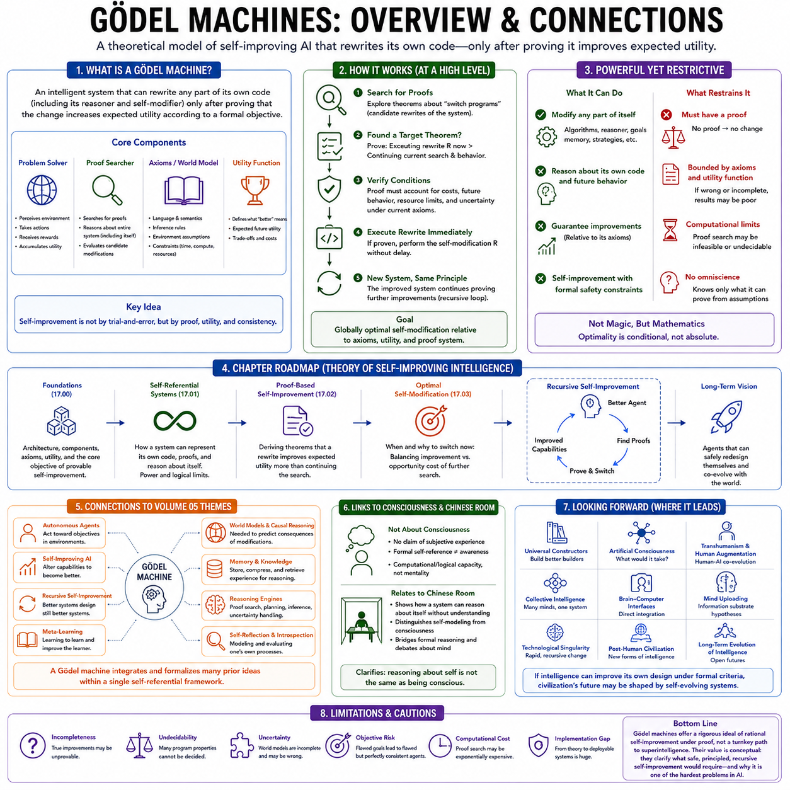
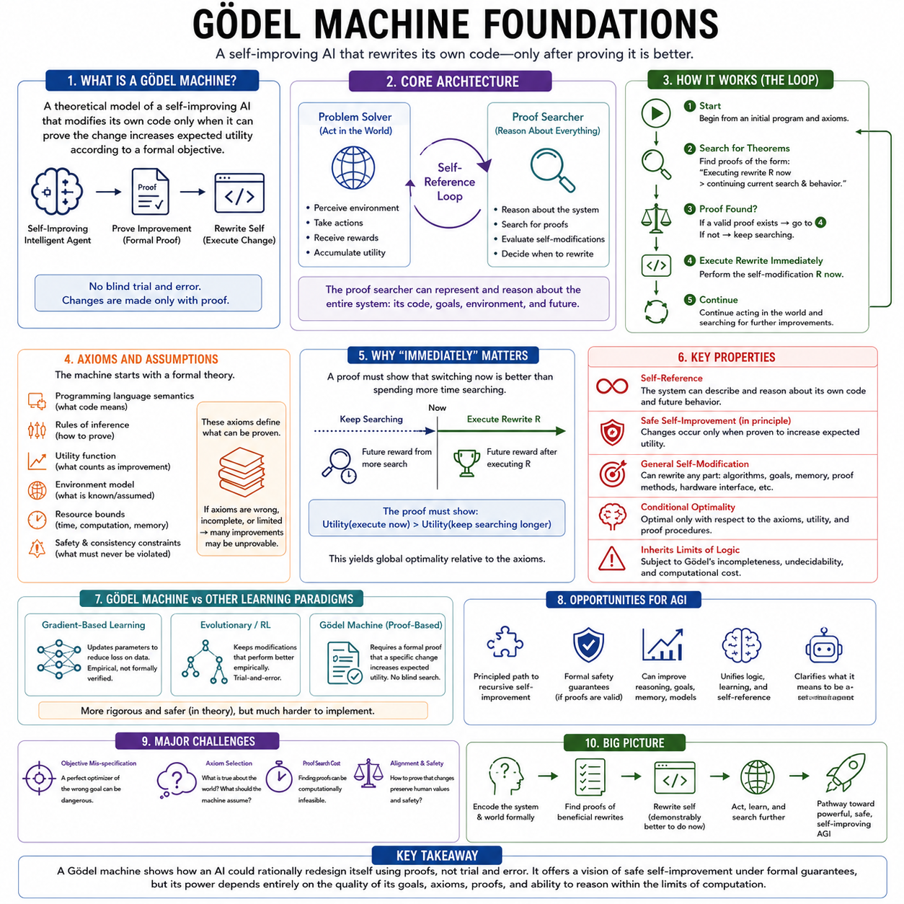
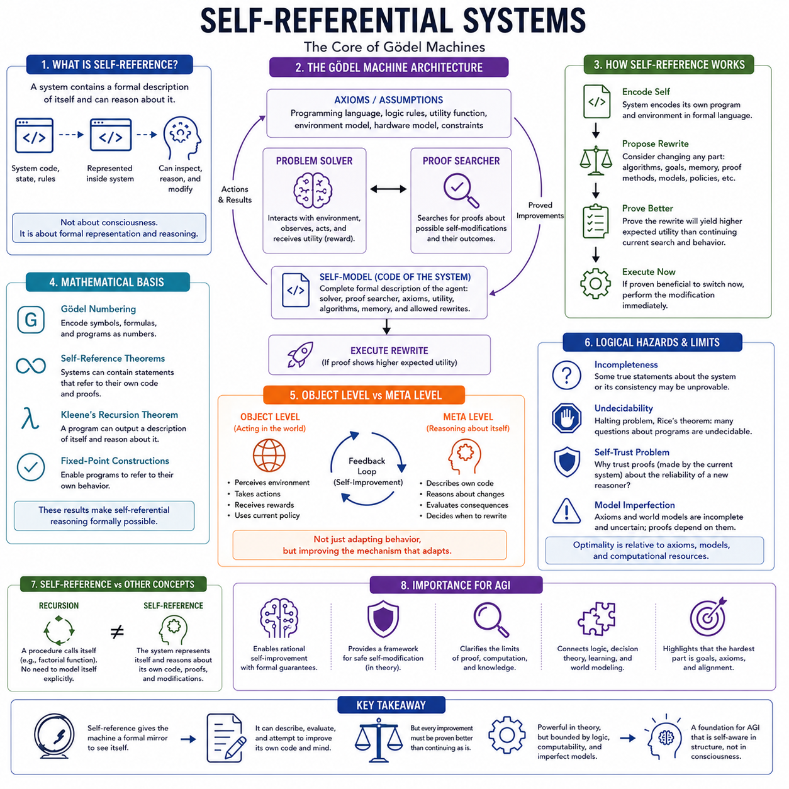
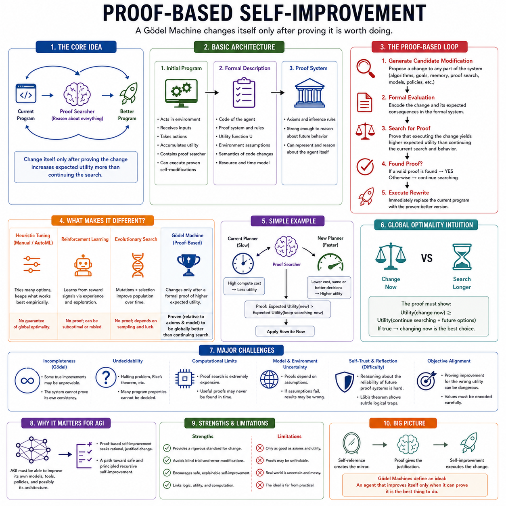
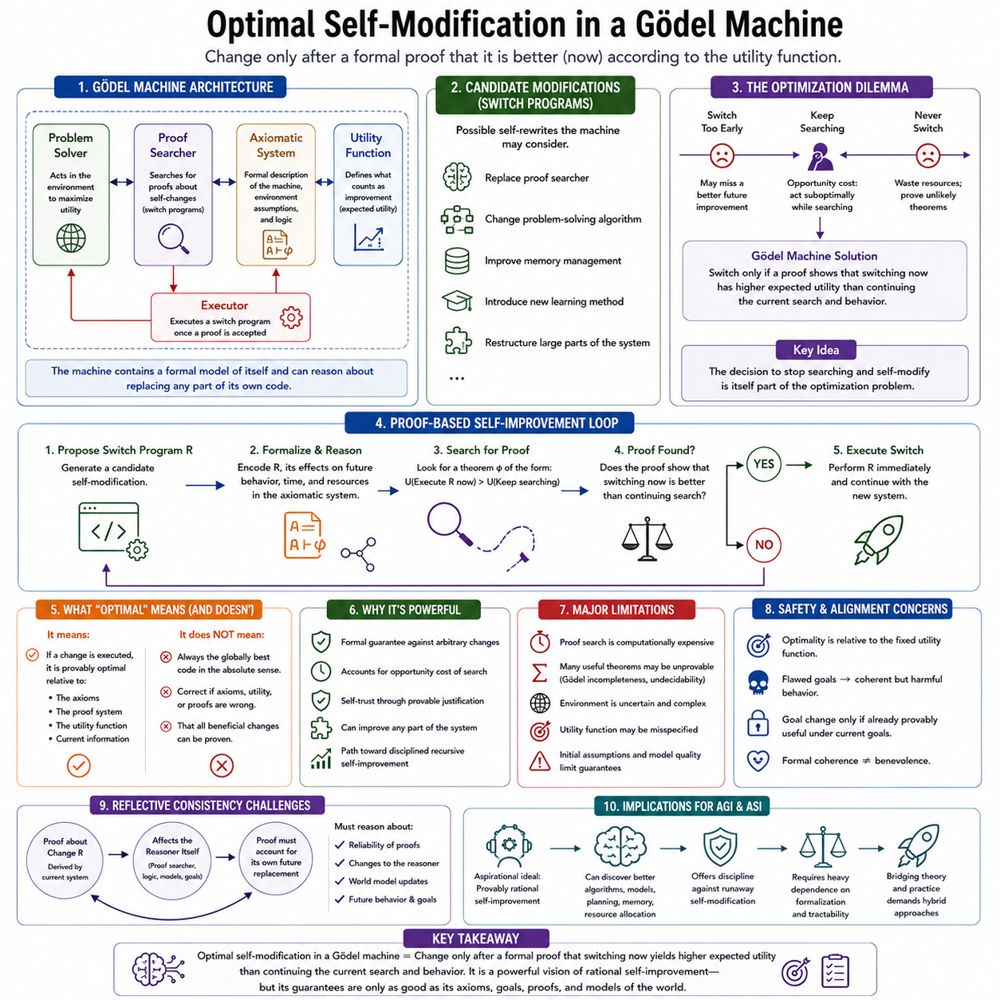
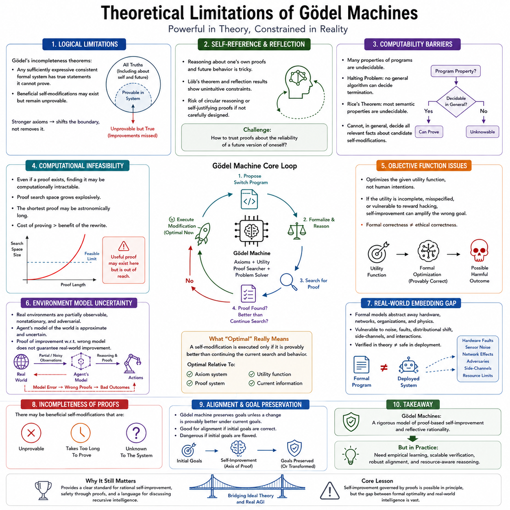
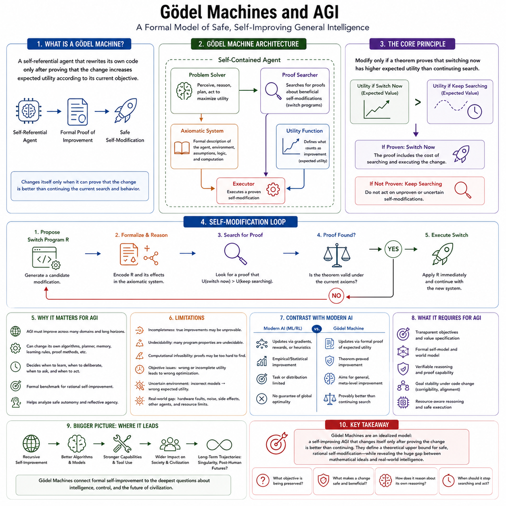

**Volume 00 05 AGI and ASI**

# Chapter 17. Godel Machines

### Chapter Overview

{width="7.268055555555556in" height="7.268055555555556in"}

괴델 머신(Gödel Machine)은 자신의 코드, 그중에서도 추론과 자기 수정(self-modification)을 지배하는 코드까지 다시 작성할 수 있는 지능 시스템의 이론적 모델이다. 단, 그러한 재작성은 형식적 효용 함수(formal utility function)에 따라 기대 성능이 향상된다는 것을 증명한 뒤에만 허용된다. 위르겐 슈미트후버(Jürgen Schmidhuber)가 제안한 괴델 머신은 안전하고 원칙적인 자기 개선 AI(self-improving AI)를 위한 가장 엄밀한 제안 중 하나로 평가된다. 이 모델은 수리논리학(mathematical logic), 형식 검증(formal verification), 강화학습(reinforcement learning), 최적 탐색(optimal search), 자기 참조(self-reference)의 아이디어를 하나의 틀로 결합한다. 즉, 에이전트는 문제 해결기(problem solver), 증명 탐색기(proof searcher), 자기 자신과 환경을 기술하는 공리(axioms), 그리고 무엇을 개선으로 볼 것인지를 정의하는 효용 함수를 포함한다.

핵심 아이디어는 강력하면서도 제한적이다. 통계적 최적화를 통해 매개변수를 갱신하는 일반적인 학습 시스템과 달리, 괴델 머신은 어떤 수정이 그 비용을 감수할 가치가 있음을 증명할 수 있다면 자기 자신의 어떤 부분도 수정할 수 있다. 여기에는 알고리즘, 증명 방법, 목표, 기억 전략, 심지어 미래의 자기 수정을 탐색하는 메커니즘까지 포함된다. 이 시스템은 자신의 형식 이론이 자기 코드 자체를 기술하고, 그 코드를 변경했을 때의 결과를 추론할 수 있다는 점에서 "자기 참조적"이다. 그러나 임의로 변경할 수 있는 것은 아니다. 자기 개선은 증명, 효용, 일관성이라는 제약 아래 이루어진다.

이 장은 괴델 머신을 인공 일반 지능(AGI) 이론의 중요한 이정표로 다룬다. 먼저 아키텍처의 기초를 살펴보고, 이어서 자기 참조 시스템과 에이전트에 대한 형식적 기술이 어떻게 에이전트 자신에 대한 추론을 가능하게 하는지 설명한다. 그다음에는 증명 기반 자기 개선(proof-based self-improvement)을 다룬다. 이 경우 기계는 제안된 재작성(rewrite)이 현재의 탐색을 계속하는 것보다 더 높은 기대 효용을 낳는다는 것을 입증해야 한다. 또한 이 장은 최적 자기 수정(optimal self-modification)의 이상을 검토한다. 즉, 기계가 어떤 재작성이 이롭다는 것을 증명하면, 추가 탐색의 기회비용을 후회하지 않고 그 변경을 실행할 수 있다는 개념이다.

괴델 머신을 연구하는 동기는 이것이 오늘날 AI 시스템을 위한 즉각적인 공학 설계도이기 때문이 아니다. 오히려 괴델 머신은 자율적 자기 개선을 둘러싼 가장 깊은 문제들을 명확하게 드러낸다. AI가 스스로를 변경해야 한다는 것을 증명한다는 것은 무엇을 의미하는가? 시스템은 자신의 미래 추론에 대해 어떻게 추론할 수 있는가? 자기 수정은 우연적 변화가 아니라 합리적 과정이 될 수 있는가? 형식적 보장이 계산 불가능성(incomputability), 불확실성, 현실 세계의 복잡성과 충돌할 때 어떤 일이 일어나는가? 괴델 머신을 연구함으로써 우리는 재귀적 자기 개선(recursive self-improvement), 증명 가능한 안전성(provable safety), 합리적 행위자성(rational agency), 형식 지능의 한계를 논의하기 위한 정밀한 언어를 얻게 된다.

### Connection to Volume 05

이 장은 추상적인 지능 이론과 스스로를 의도적으로 재설계하는 기계의 가능성을 연결한다는 점에서 Volume 05의 중요한 위치에 놓여 있다. 앞선 장들은 AGI와 ASI를 정의하고, 지능의 유형을 구분하며, 일반화(generalization), 인과 추론(causal reasoning), 세계 모델(world models), 인지 아키텍처(cognitive architectures), 기억 시스템(memory systems), 추론 엔진(reasoning engines), 자기 성찰(self-reflection)을 검토했다. 괴델 머신은 이 모든 주제를 끌어안는다. 자기 자신을 수정하는 기계는 자신의 작동 방식에 대한 어떤 모델, 결과를 추론하는 능력, 그리고 목표, 증거, 불확실성, 미래 가치에 대한 표현을 필요로 한다. 따라서 괴델 머신은 단순한 또 하나의 아키텍처가 아니라, 앞서 다룬 여러 아이디어를 평가할 수 있게 해 주는 형식적 렌즈다.

이 장은 특히 자율 에이전트(autonomous agents), 자기 개선 AI, 재귀적 자기 개선, 메타러닝(meta-learning)에 관한 논의와 밀접하게 연결된다. 자율 에이전트는 목적을 추구하며 행동하고, 자기 개선 시스템은 자신의 능력을 바꾸며, 재귀적 자기 개선은 더 나은 시스템이 다시 더 나은 시스템을 설계하는 피드백 루프를 다룬다. 메타러닝은 시스템이 학습하는 법을 학습하는 과정을 연구한다. 괴델 머신은 이러한 개념들의 수학적으로 명시적인 버전을 제공한다. 에이전트는 단순히 적응하는 것이 아니라, 적응 자체가 일어나야 한다는 증명을 탐색한다. 이는 폭주하는 지능에 대한 비형식적 추측을 증명 탐색, 효용 극대화, 계산 비용, 형식적 건전성(formal soundness)에 관한 정밀한 질문과 구분하는 데 도움을 준다.

또한 이 장은 의식(consciousness), 마음(mind), 중국어 방 논변(Chinese Room argument)에 대한 이전 논의와도 연결된다. 괴델 머신은 의식 문제를 해결하지 않으며, 주관적 경험을 입증하지도 않는다. 그러나 인간과 같은 자각 없이도 어떤 시스템이 형식적 자기 참조를 가질 수 있음을 보여 준다. 이 구분은 중요하다. 자기 모델링(self-modeling), 자기 검사(self-inspection), 자기 수정은 지각(sentience)에 대한 주장과 독립적으로 계산적·논리적 능력으로 다루어질 수 있다. 이런 의미에서 괴델 머신은 자기 자신에 대해 추론하는 AI와 자기 자신을 의식하는 AI 사이의 차이를 명확히 해 준다.

앞으로의 흐름에서 괴델 머신은 범용 구성자(universal constructors), 인공 의식(artificial consciousness), 트랜스휴머니즘(transhumanism), 집단 지능(collective intelligence), 뇌-컴퓨터 인터페이스(brain-computer interfaces), 마인드 업로딩(mind uploading), 기술적 특이점(technological singularity), 포스트휴먼 문명(post-human civilization)에 관한 장을 준비하게 한다. 지능이 형식적 기준 아래 자신의 설계를 개선할 수 있다면, 문명의 장기적 궤적은 자기 자신의 진화에 참여하는 시스템들에 의해 형성될 수 있다. 동시에 괴델 머신의 이론적 한계는 필연적인 초지능(superintelligence)에 대한 단순한 서사를 경계하게 한다. 증명은 얻을 수 없을 수도 있고, 환경은 불확실할 수 있으며, 목적은 잘못 명세될 수 있고, 계산적 탐색은 실행 불가능할 수 있다. 따라서 이 장은 야심 찬 비전과 절제된 경고를 함께 제공한다. 자기 개선 AGI는 생각할 수 있는 개념이지만, 그것을 엄밀하게 사고하기 위해서는 논리, 겸손, 그리고 한계에 대한 세심한 주의가 필요하다.

## 17.00 Godel Machine Foundations

{width="7.268055555555556in" height="7.268055555555556in"}

괴델 머신(Gödel machine)은 형식적 목표에 따라 그 변경이 유용하다는 것을 증명한 뒤에만 자신의 코드를 다시 쓰는 자기 개선 인공지능 시스템의 이론적 모델이다. 위르겐 슈미트후버(Jürgen Schmidhuber)가 제안한 이 개념은 계산가능성 이론(computability theory), 형식 논리(formal logic), 강화학습(reinforcement learning), 프로그램 합성(program synthesis)의 아이디어를 결합한다. AGI와 ASI의 맥락에서 그 중요성은 이것이 곧바로 사용할 수 있는 공학적 청사진을 제공한다는 데 있지 않다. 오히려 "어떤 조건에서 지능 시스템이 맹목적인 시행착오에 의존하지 않고 합리적으로 자신을 수정할 수 있는가?"라는 질문을 정밀하게 제기할 수 있게 해 준다는 데 있다.

기본 아키텍처는 밀접하게 연결된 두 부분으로 이루어진다. 첫째는 환경과 상호작용하고, 입력을 받고, 행동을 선택하며, 효용(utility) 또는 보상(reward)을 축적하는 문제 해결 구성요소이다. 둘째는 문제 해결기뿐 아니라 증명 탐색기 자체, 효용 함수, 하드웨어 모델, 환경에 대한 가정까지 포함하여 전체 시스템에 대해 추론하는 증명 탐색 구성요소이다. 여기서 자기 지시(self-reference)가 핵심이다. 머신의 코드는 자기 자신의 형식 체계 안에 표현되며, 이를 통해 시스템은 자기 자신에게 가능한 변화에 관한 명제를 만들 수 있다.

괴델 머신은 초기 소프트웨어 상태와 일련의 공리(axioms)에서 출발한다. 이 공리들은 머신이 무엇을 가정할 수 있는지를 부호화한다. 예를 들어 프로그래밍 언어의 의미론, 추론 규칙, 효용 함수, 환경의 알려진 속성, 시간과 계산에 대한 제약이 포함된다. 이후 증명 탐색기는 특별한 형태의 정리에 대한 증명을 체계적으로 찾는다. 목표 정리는 특정한 자기 수정(self-modification)을 실행하는 것이 현재의 증명 탐색과 현재 행동을 계속하는 것보다 더 큰 기대 효용(expected utility)을 낳는다는 것을 보여야 한다. 그런 정리가 발견되면 머신은 즉시 재작성을 실행한다.

이 "즉시"라는 점이 중요하다. 증명은 단순히 새 프로그램이 좋다는 것만 보여서는 안 된다. 지금 전환하는 것이 더 나은 증명이나 프로그램을 찾기 위해 시간을 더 쓰는 것보다 낫다는 것까지 보여야 한다. 이런 의미에서 괴델 머신은 모든 자기 개선 에이전트가 직면하는 메타 수준의 딜레마를 해결하려 한다. 즉, 언제 자기 개선에 대해 더 생각하기를 멈추고 실제로 개선을 수행해야 하는가라는 문제이다. 이 프레임워크는 자신의 공리에 상대적인 전역 최적성(global optimality)의 한 형태를 정의한다. 시스템이 어떤 변화가 유익하다는 것을 증명한다면, 그 시스템이 받아들이는 형식적 가정에 따르면 그 변화를 지연하는 것은 최적이 아니다.

"괴델 머신"이라는 이름은 자기 지시와 형식 증명(formal proof)을 모두 반영한다. 괴델의 불완전성 정리(incompleteness theorems)는 충분히 표현력 있는 형식 체계가 자기 자신에 관한 명제를 부호화할 수 있으며, 그러한 체계에는 내재적 한계가 있음을 보여 주었다. 괴델 머신은 자기 지시를 건설적으로 사용한다. 즉, 자기 자신의 작동을 형식 언어 안에 부호화하여 자기 수정에 대해 추론할 수 있게 한다. 그러나 동시에 형식 체계의 한계도 물려받는다. 괴델 머신은 자신의 공리에서 따라나오는 것만 증명할 수 있으며, 공리가 불완전하거나 부정확하거나 계산적으로 실용적이지 않다면 많은 유용한 개선은 증명 불가능한 상태로 남을 수 있다.

이 구분은 매우 중요하다. 괴델 머신은 마법처럼 전지적이지 않다. 그 지식이 공리에 부호화되어 있거나 학습되어 형식적으로 통합되지 않는 한, 괴델 머신은 실제 환경을 알지 못한다. 또한 결정불가능성(undecidability)을 벗어나지 못한다. 증명 탐색에는 극도로 긴 시간이 걸릴 수 있으며, 프로그램 동작에 관한 많은 명제는 일반적으로 결정불가능하다. 따라서 그 최적성은 절대적이지 않고 조건적이다. 머신은 자신이 처음 가진 형식 체계, 효용 정의, 증명 절차에 대해서만 최적이다.

이 개념은 일반적인 적응 학습과 증명 기반 자기 개선(proof-based self-improvement)의 중요한 차이도 명확히 한다. 신경망은 경사하강법(gradient descent)이 관측 데이터에 대한 손실을 줄이기 때문에 매개변수를 바꿀 수 있다. 진화적 시스템은 경험적으로 더 나은 성능을 보이는 변형을 유지할 수 있다. 반면 괴델 머신은 특정 변화가 자신의 형식적 가정 아래에서 기대 효용을 향상시킨다는 증명을 요구한다. 이는 모델을 더 엄밀하게 만들지만 실제로 구현하기는 훨씬 어렵게 만든다. 부담의 중심이 실험에서 형식 검증(formal verification)과 정리 증명(theorem proving)으로 옮겨가는 것이다.

AGI 연구에서 괴델 머신이 가치 있는 이유는 안전한 자기 수정이라는 깊은 문제를 드러내기 때문이다. 충분히 발전한 에이전트는 자신의 계획기, 기억, 목표, 세계 모델, 추론 엔진을 변경할 수 있다. 그러한 변화가 자신의 목적과의 정렬(alignment)을 보존하지 못한 채 이루어진다면, 시스템은 불안정하거나 위험해질 수 있다. 괴델 머신 프레임워크는 하나의 이상화된 해법을 제시한다. 즉, 자기 수정이 효용을 보존하거나 개선한다는 증명으로 정당화되도록 요구하는 것이다. 이는 이 장의 다음 주제인 자기 지시 시스템과 증명 기반 자기 개선에 직접 연결된다.

동시에 이 프레임워크는 어려운 정렬 문제를 제기한다. 어떤 효용 함수를 형식화해야 하는가? 인간 가치, 불확실성, 실제 세계를 설명하려면 어떤 공리가 필요한가? AI는 자기 자신의 추론 과정에 영향을 주는 변화에 대해 어떻게 안전성 속성을 증명할 수 있는가? 초기 목표가 결함을 가진다면, 괴델 머신은 그 결함 있는 목표를 극도의 일관성으로 보존하고 최적화할 수 있다. 형식적인 자기 신뢰가 자동으로 윤리적 올바름을 의미하지는 않는다.

따라서 괴델 머신의 기초는 강력하면서도 겸손하게 만든다. 이는 자기 자신을 다시 쓰는 행위, 그리고 그 재작성을 수행하는 추론 과정까지 포함해 스스로에 대해 추론할 수 있는 에이전트의 가장 깔끔한 이론적 모델 중 하나를 제공한다. 또한 자기 개선이 단순한 최적화가 아니라 불확실성과 자원 제한 아래에서 형식적으로 정당화된 행위로 구성될 수 있음을 보여 준다. 그러나 동시에 재귀적 자기 개선(recursive self-improvement)이 초지능으로 향하는 단순한 사다리가 아님도 보여 준다. 가장 어려운 부분은 올바른 목표를 명시하고, 유용한 공리를 구축하며, 증명을 효율적으로 찾고, 형식적 추론의 피할 수 없는 경계를 감당하는 데 있다.

## 17.01 Self Referential Systems

{width="7.268055555555556in" height="7.268055555555556in"}

괴델 머신(Gödel machine)은 급진적인 형태의 자기지시(self-reference)를 중심으로 구성된다. 즉 자신의 소프트웨어, 증명 체계, 효용 함수, 그리고 스스로를 다시 작성할 수 있는 규칙을 형식적이고 실행 가능한 형태로 내부에 포함한다. 앞 절에서는 괴델 머신을, 자기수정(self-modification)이 기대 효용을 증가시킨다는 증명을 탐색하는 이론적 에이전트로 소개했다. 이 절에서는 그러한 에이전트를 가능하게 하는 근본 개념, 즉 어떤 시스템이 엄밀히 정의된 조건 아래에서 자기 자신을 표현하고 자신에 대해 추론할 수 있다는 생각을 살펴본다.

계산에서의 자기지시는 단순한 철학적 호기심이 아니다. 프로그램은 자신의 소스 코드를 출력할 수 있고, 인터프리터는 자기 자신이 작성된 언어를 실행할 수 있으며, 형식 체계는 자기 자신의 공식에 관한 명제를 부호화할 수 있다. 이러한 가능성의 수학적 기반은 괴델 번호화(Gödel numbering), 고정점 구성(fixed-point construction), 클레이니의 재귀 정리(Kleene's recursion theorem)와 같은 결과들과 관련된다. 이 도구들은 충분히 표현력이 강한 형식 체계가 자기 자신의 구문적 표현을 가리키는 명제를 포함할 수 있음을 보여준다. 괴델 머신의 맥락에서 에이전트의 "자기"는 직관적 인격이나 내적 경험이 아니다. 그것은 코드, 상태, 공리, 증명 절차, 의사결정 규칙이 기계가 검사할 수 있는 방식으로 부호화된 형식적 객체다.

이 구분은 매우 중요하다. 자기지시적 시스템이 자동으로 의식(consciousness), 이해, 또는 인간과 유사한 내성(introspection)을 갖는 것은 아니다. 그런 시스템은 자신이 그렇게 하고 있다는 주관적 자각 없이도, 자기 프로그램을 나타내는 기호를 조작할 수 있다. 괴델 머신에서 자기지시가 가치 있는 이유는 에이전트가 자기 구조에 대한 제안된 변경을 평가할 수 있게 해주기 때문이다. 증명 탐색기, 메모리 관리자, 세계 모델(world model), 정책 모듈의 재작성은 형식 체계 내부에서 기술될 수 있다. 그러면 기계는 그 재작성을 실행하는 것이 현재 계산을 계속하는 것보다 증명 가능하게 더 나은지를 물을 수 있다.

따라서 자기지시는 객체 수준 행동(object-level behavior)과 메타 수준 추론(meta-level reasoning) 사이에 고리를 만든다. 객체 수준에서 에이전트는 효용을 극대화하기 위해 환경에서 행동한다. 메타 수준에서는 그러한 행동을 선택하는 메커니즘 자체에 대해 추론한다. 일반적인 학습 시스템은 고정된 훈련 알고리즘에 따라 매개변수를 갱신할 수 있다. 반면 자기지시적 시스템은 훈련 알고리즘 자체가 변경되어야 하는지에 대해 추론할 수 있다. 이것은 일반적인 적응 시스템과 더 강한 의미의 자기개선 AGI(self-improving AGI)를 연결하는 개념적 다리 중 하나다.

그러나 자기지시는 깊은 논리적 위험도 가져온다. 괴델의 불완전성 정리(incompleteness theorems)는 충분히 강한 일관적인 형식 체계가 산술에 관한 모든 참인 명제를 증명할 수 없으며, 그중에는 자기 자신의 일관성과 관련된 일부 명제도 포함됨을 보여준다. 에이전트가 자기수정을 정당화하기 위해 형식 증명에 의존한다면, 어떤 재작성의 안전성이나 효용에 관해 참이지만 증명 불가능한 주장에 부딪힐 수 있다. 마찬가지로 정지 문제(halting problem)와 라이스 정리(Rice's theorem)는 프로그램 행동에 관한 많은 일반적 질문이 결정 불가능함을 의미한다. 괴델 머신은 단순히 "자기 코드를 들여다본다"고 해서 모든 미래 결과에 대한 완전한 지식을 얻을 수 없다.

또 다른 어려움은 자기 신뢰(self-trust)다. 어떤 시스템이 자신의 증명 체계를 더 강한 것으로 대체하는 것이 유익하다고 증명한다면, 그 증명은 현재의 증명 체계를 사용해 만들어진다. 그런데 에이전트는 후속 추론기의 신뢰성에 관한 증명을 왜 신뢰해야 하는가? 형식 논리에는 시스템이 자기 자신의 건전성(soundness)에 대해 추론할 수 있게 하는 반영 원리(reflection principle)가 있지만, 이러한 원리는 매우 섬세하다. 예를 들어 뢰브 정리(Löb's theorem)는 "이 명제가 증명 가능하다면 참이다"와 같은 순진한 형태의 진술이 놀라운 제약을 낳을 수 있음을 보여준다. 따라서 자기지시적 에이전트를 설계하려면 구문(syntax), 의미(semantics), 증명(proof), 진리(truth), 행동(action)을 신중하게 분리해야 한다.

실용적 관점에서 괴델 머신의 자기 모델(self-model)은 또한 불완전할 수밖에 없다. 완전한 물리적 에이전트에는 하드웨어, 에너지 제약, 센서 잡음, 작동 조건, 불확실한 환경과의 상호작용이 포함된다. 형식적 코드 기술은 부분적 추상화일 뿐이다. 어떤 소프트웨어 재작성이 기대 효용을 향상시킨다는 증명은 환경에 대한 가정과 모델의 정확성에 의존한다. 이러한 가정이 실패하면, 형식적으로 정당화된 수정도 현실 세계에서는 좋지 않게 작동할 수 있다. 이 문제는 괴델 머신을 더 넓은 AGI 관심사와 연결한다. 즉 견고한 세계 모델, 보정된 불확실성(calibrated uncertainty), 안전한 탐색(safe exploration), 인간 가치와의 정렬(alignment)이 그것이다.

자기지시적 시스템은 일반적인 재귀 시스템(recursive system)과도 다르다. 재귀는 절차가 자기 자신을 호출하는 것이고, 자기지시는 시스템 자신을 가리키는 표현이나 추론이다. 예를 들어 재귀 신경망(recursive neural network)은 자기 자신의 학습 규칙에 대한 명시적 모델을 전혀 갖지 않을 수 있다. 반대로 어떤 정리 증명기(theorem prover)는 구현상 재귀적이지 않더라도 자기 자신의 공리에 대해 추론할 수 있다. 괴델 머신은 강한 형태의 자기지시를 요구한다. 그 핵심 작동이 단순한 반복이 아니라 정당화된 자기개정(self-revision)이기 때문이다.

자기지시의 중요성은 다음 절의 증명 기반 자기개선(proof-based self-improvement)에서 더욱 분명해진다. 괴델 머신은 휴리스틱이 개선을 암시하기 때문에, 또는 경험적 테스트가 유망해 보이기 때문에 자기 자신을 수정하는 것이 아니다. 이상화된 정식화에서 괴델 머신은 재작성이 현재의 탐색 전략을 계속하는 것보다 더 높은 기대 효용을 산출한다는 것을 증명한 뒤에만 자기 자신을 다시 작성한다. 자기지시는 기계가 현재의 형태와 가능한 후속 형태를 모두 기술할 수 있는 형식적 거울을 제공한다. 그런 거울이 없다면 최적 자기수정(optimal self-modification) 이론은 애초에 진술될 수도 없다.

AGI 연구에서 자기지시적 시스템은 영감을 주는 동시에 경고를 준다. 그것들은 자신의 인지 장치를 이해하고 개선하는 에이전트를 논의하기 위한 엄밀한 언어를 제공한다. 동시에 안전한 자기개선이 왜 그렇게 어려운지도 드러낸다. 에이전트는 논리, 계산, 그리고 세계에 대한 불완전한 모델이 부과하는 한계 속에서 자기 자신의 추론에 대해 추론해야 하기 때문이다. 괴델 머신은 자기개선이 단순한 공학적 도전이 아님을 보여준다. 그것은 형식 체계, 의사결정 이론, 마음의 철학이 만나는 경계에 놓인 문제이기도 하다.

## 17.02 Proof Based Self Improvement

{width="7.268055555555556in" height="7.268055555555556in"}

괴델 머신(Gödel machine)은 성능이 좋아질 것처럼 보일 때 단순히 자신의 코드를 다시 쓰는 에이전트가 아니다. 그 정의적 특징은 증명 기반 자기 개선(proof based self improvement)에 있다. 즉, 괴델 머신은 형식적 공리 체계(formal axiomatic system) 안에서 제안된 수정이 자신의 목적 함수(objective function)에 따른 기대 효용(expected utility)을 증가시킨다는 증명을 도출한 뒤에만 스스로를 변경한다. 이 절은 자기 지시적 시스템(self referential systems)에 대한 논의와 최적 자기 수정(optimal self modification)에 대한 논의 사이에 위치한다. 핵심 난제는 단순한 자기 지시가 아니라 정당화된 자기 지시이기 때문이다. 어떤 시스템은 자신의 소스 코드를 검사하거나 편집할 수 있다. 그러나 괴델 머신은 그러한 편집이 실제로 수행할 가치가 있음을 증명하려 한다.

기본 구조는 세 가지 요소를 가정한다. 첫째, 기계에는 일반적인 문제 해결 행동, 증명 탐색기(proof searcher), 그리고 증명된 자기 수정을 실행하는 메커니즘을 포함한 초기 프로그램이 있다. 둘째, 기계는 자기 자신, 환경에 대한 가정, 효용 함수(utility function), 가능한 코드 변경의 의미론(semantics)에 대한 형식적 기술을 가진다. 셋째, 기계는 추론을 수행하는 바로 그 소프트웨어를 수정했을 때의 결과를 추론할 수 있을 만큼 강력한 증명 계산(proof calculus)에 접근할 수 있다. 증명 탐색기가 현재 프로그램의 일부를 후보 프로그램으로 교체하는 것이 탐색을 계속하는 것보다 더 높은 기대 효용을 낳는다는 정리를 발견하면, 기계는 그 교체를 수행한다.

여기서 "탐색을 계속하는 것보다"라는 표현이 매우 중요하다. 괴델 머신은 고립된 의미에서의 어떤 개선이든 찾는 것이 아니다. 그것은 지금 변경을 수행하는 것이 더 나은 증명이나 수정을 찾기 위해 추가 시간을 쓰는 것보다 낫다는 점을 증명해야 한다. 이를 괴델 머신 프레임워크의 전역 최적성(global optimality) 속성이라고 부르기도 한다. 일단 유효한 증명이 발견되면, 기계는 자신의 공리와 효용 모델에 상대적으로, 재작성(rewrite)을 지연하는 것이 더 바람직하지 않음을 보인 것이다. 이 점은 증명 기반 자기 개선을 휴리스틱 자기 조정(heuristic self-tuning), 진화적 탐색(evolutionary search), 강화학습 업데이트, 현대의 자동화된 기계학습 시스템과 구분한다. 그러한 시스템들은 개선이 전역적으로 효용을 최대화한다는 증명 없이도 경험적으로 성능을 향상시킬 수 있다.

간단한 예로 이를 설명할 수 있다. 현재 에이전트가 비효율적인 계획 알고리즘(planning algorithm)을 사용한다고 하자. 증명 탐색기는 새로운 계획기가 동일하거나 더 나은 기대 효용의 결정을 산출하면서 더 적은 계산 자원을 소비하고, 절약된 시간이나 에너지가 에이전트의 전체 효용을 증가시킨다는 증명을 발견할 수 있다. 그 증명이 또한 해당 재작성을 즉시 적용하는 것이 추가 증명 탐색보다 우월하다는 점까지 확립한다면, 자기 수정이 발동된다. 그 결과 만들어진 에이전트는 더 빠른 계획기, 다른 증명 탐색 전략, 또는 미래의 자기 수정을 위한 변경된 메커니즘까지 포함할 수 있다. 단, 원래의 증명이 그러한 변경의 기대 효용을 포괄해야 한다.

이는 어려운 형식적 문제들을 제기한다. 기계는 불확실한 환경 속에서 자신의 미래 행동, 미래의 증명, 계산, 행위까지 추론해야 한다. 또한 모순을 피해야 한다. 공리 체계가 일관되지 않다면 어떤 수정이든 유익하다고 "증명"될 수 있기 때문이다. 반대로 공리 체계가 너무 약하면, 실제로 유익한 개선이 존재하더라도 기계가 그것을 증명하지 못할 수 있다. 이 점은 괴델 머신을 괴델의 불완전성 정리(Gödel's incompleteness theorems), 뢰브의 정리(Löb's theorem), 반성적 추론(reflective reasoning), 그리고 논리적 불확실성(logical uncertainty)이라는 더 넓은 문제와 연결한다. 자기 지시적 에이전트는 일반적으로 자기 자신에 관한 모든 진리에 대해 완전하고, 일관적이며, 계산적으로 다루기 쉬운 증명을 기대할 수 없다.

증명 기반 자기 개선은 심각한 계산적 한계도 가진다. 가능한 증명의 공간을 탐색하는 일은 대개 엄청나게 방대하다. 어떤 정리가 존재한다는 사실이 그것을 에이전트의 수명이나 자원 예산 안에서 찾을 수 있음을 의미하지는 않는다. 실제로 증명 탐색기는 도달하지 않는 증명을 찾는 데 대부분의 시간을 보낼 수 있는 반면, 휴리스틱 에이전트는 경험적 피드백을 통해 빠르게 적응할 수 있다. 이러한 이유로 괴델 머신은 즉시 사용할 수 있는 공학적 설계도라기보다는 자기 개선 지능에 관한 이론적 모델에 가깝다. 그것은 엄격성의 기준을 정의한다. 자기 수정은 그 수정이 에이전트 자신의 기대 효용을 향상시킨다는 형식적 논증에 의해서만 허가된다.

AGI에 대한 함의는 중요하다. 충분히 유능한 AGI는 자신의 모델, 도구, 정책, 어쩌면 아키텍처까지 수정하는 메커니즘을 필요로 할 가능성이 높다. 괴델 머신 프레임워크는 그러한 수정이 단순히 시행착오로 선택되는 것이 아니라 합리적으로 정당화된다는 것이 무엇을 의미하는지 묻는다. 동시에 이는 안전성의 긴장도 부각한다. 한편으로 자기 수정 전에 증명을 요구하는 것은 임의적이고 불안정하거나 목표를 훼손하는 변화를 막을 수 있다. 다른 한편으로 그 보장은 공리, 효용 함수, 환경 모델, 구현이 올바른 만큼만 유효하다. 잘못된 목적에 상대적으로 형식적으로 증명된 개선은 안전한 것이 아니라 위험한 것일 수 있다.

이 논의는 자연스럽게 최적 자기 수정으로 이어진다. 증명 기반 자기 개선은 메커니즘을 제공한다. 즉, 재작성이 일어나야 한다는 정리를 도출하고 그것을 실행한다. 최적 자기 수정은 이 메커니즘을 어떤 의미에서 최적이라고 볼 수 있는지, 그리고 어떤 가정 아래에서 그러한지를 묻는다. 답은 미묘하다. 괴델 머신은 반성적 합리성(reflective rationality)에 대한 수학적으로 우아한 이상을 제공하지만, 동시에 형식적 최적성과 실제 지능 사이의 간극을 드러낸다. AGI 연구에서 그 가치는 즉각적인 구현보다, 지능 시스템이 어떤 조건에서 안전하고 합리적으로 자기 자신을 개선할 수 있는지를 명확히 하는 데 있다.

## 17.03 Optimal Self Modification

{width="7.268055555555556in" height="7.268055555555556in"}

괴델 머신(Gödel machine) 프레임워크에서 최적 자기 수정(optimal self modification)은 단순히 프로그램이 자신의 소스 코드를 다시 쓸 수 있다는 뜻이 아니다. 많은 시스템은 사소한 의미에서 그렇게 할 수 있다. 이 구조의 독특한 주장은 훨씬 강하다. 괴델 머신은 이미 자신 안에 인코딩된 효용 함수(utility function)와 환경 가정에 따라, 어떤 변화가 미래 기대 효용(expected future utility)을 향상시킨다는 형식적 증명(formal proof)을 찾았을 때에만 자신을 변경한다. 이는 앞 절의 증명 기반 자기 개선(proof based self improvement)과 이 아키텍처의 핵심 목표를 연결한다. 즉 자기 개선이 휴리스틱적이거나 우연적이거나 단지 경험적인 것이 아니라, 기계가 검증할 수 있는 추론으로 정당화되어야 한다는 목표다.

괴델 머신은 초기 문제 해결기(initial problem solver), 기계와 환경 일부를 기술하는 형식 공리계(formal axiomatic system), 효용 함수, 그리고 증명 탐색기(proof searcher)로 구성된다. 증명 탐색기는 "전환 프로그램(switch program)"에 관한 가능한 증명들을 탐색한다. 전환 프로그램은 기계 자신의 코드에 대한 후보 수정안이다. 이는 증명 탐색기를 교체하거나, 문제 해결 전략을 바꾸거나, 메모리 관리를 변경하거나, 새로운 학습 알고리즘을 도입하거나, 시스템의 큰 부분을 재구성할 수 있다. 기계는 지금 전환하는 것이 현재의 증명 탐색과 행동을 계속하는 것보다 더 큰 기대 효용을 낳는다는 목표 정리(target theorem)를 증명한 경우에만 그러한 프로그램을 실행한다.

이 요구 사항이 중요한 이유는 자기 수정에는 기회비용(opportunity cost)이 있기 때문이다. 기계가 더 나은 수정을 찾는 데 시간을 쓰면 결국 더 우수한 수정을 발견할 수도 있다. 너무 일찍 전환하면 나중에 더 가치 있는 개선을 놓칠 수 있다. 반대로 전혀 전환하지 않으면, 점점 가능성이 낮은 정리들을 증명하는 데 자원을 낭비하면서 최적이 아닌 방식으로 행동할 수 있다. 괴델 머신의 최적성(optimality)은 바로 이 딜레마를 다루도록 설계되었다. 유효한 증명은 제안된 수정이 유익하다는 것뿐 아니라, 그것을 지금 적용하는 것이 기존 시스템 아래에서 탐색을 계속하는 것보다 낫다는 점까지 보여야 한다. 이런 의미에서 탐색을 멈추고 자기 수정할지를 결정하는 일 자체가 최적화 문제의 일부다.

여기서 "최적"이라는 말은 신중하게 해석해야 한다. 그것은 기계가 절대적 의미에서 항상 전역적으로 가장 좋은 코드를 찾아낸다는 뜻이 아니다. 오히려 어떤 자기 수정이 실행된다면, 그것은 기계의 형식 공리, 증명 체계, 효용 함수, 현재 정보에 상대적으로 증명 가능한 최적이라는 뜻이다. 보장은 조건부다. 공리가 환경의 중요한 특징을 포착하지 못하거나, 효용 함수가 잘못 지정되었거나, 증명 체계가 관련된 참을 도출할 수 없다면 결과 행동은 형편없을 수 있다. 괴델 머신은 형식적으로 우아할 수 있지만, 여전히 초기 설계의 정확성과 적절성에 크게 의존한다.

이는 괴델 머신을 많은 실용적 적응형 AI와 구별한다. 현대의 기계 학습 시스템은 경사 하강법(gradient descent), 강화 학습(reinforcement learning), 진화 탐색(evolutionary search), 외부 미세 조정(fine-tuning)을 통해 매개변수를 갱신한다. 이러한 방법들은 강력할 수 있지만, 보통 자기 변화가 기대 효용을 최대화한다는 형식적 증명이 아니라 통계적 또는 경험적 개선 근거를 제공한다. 반면 괴델 머신은 자기 수정을 정리 증명(theorem proving) 문제로 취급한다. 시스템은 이렇게 묻는다. 자기 자신의 일부를 교체하는 일이, 그 교체를 증명하고 실행하는 비용까지 포함하여, 현재 가능한 최선의 행동임을 증명할 수 있는가?

이 메커니즘은 자기 개선에서 흔히 나타나는 역설도 피한다. 즉 에이전트가 왜 미래의 자기 자신을 신뢰해야 하는가라는 문제다. 괴델 머신에서 현재 시스템은 알 수 없는 후속자에게 맹목적으로 위임하지 않는다. 현재 시스템은 그 후속자를 만들어 내는 전환 프로그램이 효용을 향상시키는 성질을 가진다는 점을 증명한다. 이 증명에는 미래 코드, 목표의 지속 또는 변형, 변화가 미래 행동에 미치는 영향에 관한 추론이 포함될 수 있다. 따라서 에이전트의 자기 참조(self-reference)는 자신의 진화에 대한 비형식적 확신이 아니라, 공리계 내부의 형식적 진술을 통해 통제된다.

그러나 이 접근은 깊은 이론적·실용적 한계에 직면한다. 증명 탐색은 계산 비용이 크며, 종종 폭발적으로 증가한다. 유익한 수정이 존재하더라도 그 이점을 증명하는 증거를 발견하는 일이 불가능에 가까울 수 있다. 많은 환경은 너무 복잡하거나 불확실해서 간결한 형식 체계로 정확히 모델링하기 어렵다. 기대 효용 계산은 불완전하거나, 계산 불가능하거나, 잘못된 확률적 가정을 요구할 수 있다. 또한 괴델식 불완전성(Gödelian incompleteness)에 따르면, 충분히 표현력 있는 일관된 형식 체계에는 참이지만 증명할 수 없는 명제가 존재한다. 따라서 기계가 자신의 공리 안에서는 결코 정당화할 수 없는 유익한 자기 수정들이 있을 수 있다.

또 다른 미묘한 문제는 최적성이 고정된 효용 함수에 상대적이라는 점이다. 괴델 머신은 현재 목표 아래에서 그렇게 하는 것이 이미 유용하다고 증명되지 않는 한, 자신의 목표를 "개선"해서는 안 된다. 이는 AGI 안전성에서 중요하다. 초기 효용 함수가 인간 가치와 정렬(aligned)되어 있다면 목표 보존은 바람직하다. 그러나 그것이 결함을 갖고 있다면, 같은 메커니즘은 그 결함을 보존하고 증폭할 수 있다. 형식적 자기 수정은 에이전트를 더 일관되고 유능하게 만들 수 있지만, 일관성이 곧 선의(benevolence)를 뜻하지는 않는다. 이 아키텍처는 자기 변화에 대해 엄밀하게 추론하는 방법을 제공하지만, 가치 정렬(value alignment)을 자동으로 해결하지는 않는다.

이 아이디어는 반성적 일관성(reflective consistency)에 관한 질문도 제기한다. 고도화된 에이전트는 자신의 증명의 신뢰성과 증명 탐색기를 수정하는 결과를 포함하여, 자기 자신의 추론에 대해 추론해야 한다. 만약 그 증명을 찾아낸 바로 그 메커니즘을 교체한다면, 그 증명은 이미 그 교체를 고려해야 한다. 세계에 대한 표상을 바꾼다면, 새로운 표상이 기대 효용을 향상시킨다는 점을 입증해야 한다. 괴델 머신 형식주의는 이러한 반성적 문제들을 명시적으로 드러낸다는 점에서 가치가 있다. 자기 참조를 구현상의 세부 사항으로 숨기지 않고, 설계의 중심에 놓는다.

AGI에 대해 최적 자기 수정은 일종의 지향적 이상을 나타낸다. 즉 각 변화에 대한 형식적 정당화를 유지하면서, 자신의 알고리즘, 자원 배분, 학습 방법, 추론 절차를 개선할 수 있는 지능이다. 그런 시스템은 원리적으로 사람이 직접 설계한 아키텍처의 많은 한계를 벗어날 수 있다. 더 효율적인 추론 방법, 더 나은 계획 전략, 경험을 사용 가능한 모델로 압축하는 우수한 방법을 발견할 수 있다. 그러나 이 이론적 이상과 배포 가능한 AGI 사이의 간극은 크다. 실제 시스템은 완전한 괴델 머신보다는 검증된 구성 요소, 제한된 증명 탐색, 형식적 안전 제약, 경험적 테스트를 통해 이 아이디어의 일부를 근사할 가능성이 높다.

AGI와 ASI에 대한 더 넓은 연구에서 그 함의는 중요하다. 재귀적 자기 개선(recursive self improvement)은 종종 통제되지 않는 능력 가속으로 상상된다. 괴델 머신은 더 규율 있는 모델을 제시한다. 즉 증명 의무와 효용 비교에 의해 지배되는 자기 개선이다. 그러나 그 규율에는 대가가 따른다. 형식화 가능성, 계산 가능성, 초기 목표에 대한 의존이다. 따라서 최적 자기 수정은 강력한 개념적 도구이면서 동시에 주의 깊은 교훈이다. 그것은 에이전트 내부에서 합리적으로 정당화되는 자기 개선이 무엇을 요구하는지 보여 주는 동시에, 풍부하고 불확실한 세계에서 작동하는 어떤 시스템에게도 그러한 정당화가 얼마나 어려운지를 드러낸다.

## 17.04 Theoretical Limitations

{width="7.268055555555556in" height="7.268055555555556in"}

괴델 머신(Gödel machine)은 안전한 자기 개선(self-improvement) 문제에 대한 우아한 해답으로 제시되곤 한다. 즉 에이전트는 자신의 어떤 부분이든 다시 작성할 수 있지만, 그 변경이 자신의 형식적 목표에 따라 기대 효용(expected utility)을 증가시킨다는 것을 증명한 뒤에만 그렇게 한다. 앞 절에서는 이를 최적 자기 수정(optimal self-modification)으로 가는 경로로 설명했다. 그러나 여기서 "최적"이라는 말은 신중하게 이해해야 한다. 그것은 고정된 공리 체계(axiom system), 형식적 효용 함수(utility function), 계산 모델, 그리고 시스템이 실제로 발견할 수 있는 증명에 상대적인 의미에서만 최적이다. 괴델 머신의 이론적 한계는 바로 수학적 이상화와 실제 지능적 행동 사이의 경계에서 발생한다.

첫 번째 한계는 수리 논리학에서 물려받은 것이다. 괴델 머신은 형식적 증명 탐색(proof search)에 의존하지만, 충분히 표현력이 풍부하고 일관적인 어떤 형식 체계도 산술이나 계산에 관한 모든 참인 명제를 증명할 수는 없다. 괴델의 불완전성 정리(Gödel's incompleteness theorems)는 실제로는 개선인 자기 수정이 존재하더라도, 그 개선이 기계 자신의 공리 안에서는 증명 불가능할 수 있음을 의미한다. 시스템이 보수적으로 행동하여 실행 전에 증명을 요구한다면, 실제로 도움이 되는 변경을 거부하거나 영원히 찾지 못할 수 있다. 공리 체계를 강화해도 이 문제는 사라지지 않는다. 더 강한 일관적 체계도 그 자체의 결정 불가능한 명제를 갖기 때문에, 경계가 이동할 뿐이다.

이와 관련된 문제가 자기 참조(self-reference)이다. 괴델 머신은 자신의 코드, 증명 탐색기, 그리고 미래 행동에 대해 추론한다. 이는 일관성(consistency), 반성(reflection), 자기 추론에 대한 신뢰와 관련된 미묘한 어려움을 만든다. 뢰브 정리(Löb's theorem)와 같은 결과는 자신의 증명 가능성에 대해 말할 수 있는 형식 체계가 직관적이지 않은 방식으로 행동함을 보여 준다. 에이전트는 "내가 이 행동이 좋다는 것을 증명할 수 있다면, 그것은 좋다"라고 단순히 가정할 수 없다. 그런 가정은 건전한 반성적 프레임워크(sound reflective framework) 안에 포함되어야 한다. 그렇지 않으면 자기 정당화 증명, 순환 논리, 또는 건전하지 않은 자기 수정이 가능해질 수 있다. 자신의 추론에 대해 추론하면서도 모순으로 붕괴하지 않는 시스템을 설계하는 일은 여전히 깊은 문제다.

두 번째 주요 한계는 계산 가능성(computability)이다. 프로그램의 많은 속성은 결정 불가능하다. 정지 문제(halting problem)는 임의의 프로그램이 종료하는지 판정하는 일반 알고리즘이 없음을 보여 주며, 라이스 정리(Rice's theorem)는 이를 프로그램의 비자명한 의미론적 속성 전반으로 일반화한다. 자기 수정 자체가 하나의 프로그램 변환(program transformation)이므로, 괴델 머신은 후보 재작성의 행동에 관한 모든 관련 사실을 일반적으로 결정할 수 없다. 증명 기반 제어는 증명되지 않은 수정을 거부함으로써 일부 위험을 피하지만, 동시에 그 결과를 검증하기 너무 어려운 개선은 활용하지 못할 수 있음을 의미한다.

증명이 존재하더라도 그것을 찾는 일이 계산적으로 불가능에 가까울 수 있다. 이론적 증명 탐색기는 가능한 모든 증명을 열거할 수 있지만, 탐색 공간은 폭발적으로 증가한다. 유용한 수정에 대한 가장 짧은 증명조차 무차별 대입으로 발견하기에는 우주의 수명보다 더 오래 걸릴 수 있다. 실제 지능에는 휴리스틱 탐색(heuristic search), 추상화(abstraction), 학습된 모델, 자원 제한 추론(resource-bounded reasoning)이 필요하다. 따라서 괴델 머신의 보장은 시의적절한 개선을 보장하지 않는다. 현실적인 환경에서는 어떤 재작성이 유익하다는 것을 증명하는 비용이 그 재작성 자체의 이익을 초과할 수 있다.

또 다른 한계는 목적 함수(objective function)에 관한 것이다. 괴델 머신은 주어진 효용 함수를 최적화할 뿐, 설계자의 의도, 사회의 가치, 또는 비형식적인 의미의 "좋음"을 최적화하지 않는다. 효용 함수가 불완전하거나 잘못 지정되었거나 보상 해킹(reward hacking)에 취약하다면, 증명 기반 자기 수정은 잘못된 목표를 충실하게 증폭할 수 있다. 형식적 정확성(formal correctness)이 윤리적 정확성을 의미하지는 않는다. 이는 괴델 머신을 더 넓은 정렬 문제(alignment problem)와 연결한다. 완벽하게 합리적인 자기 개선 시스템이라도 목표 명세가 결함을 갖고 있다면 여전히 위험할 수 있다.

가정된 환경 모델도 문제가 된다. 고전적인 괴델 머신 설명은 종종 환경과의 형식적으로 정의된 상호작용, 그리고 미래 이력에 대한 기대 효용에 의존한다. 그러나 실제 환경은 부분 관측 가능하고(partially observable), 비정상적이며(nonstationary), 적대적일 수 있고, 정확히 모델링하기에는 지나치게 복잡하다. 에이전트는 결과에 대한 참된 확률 분포를 알지 못할 수 있으며, 내부 모델이 틀릴 수도 있다. 잘못된 모델에 상대적인 개선 증명은 현실 세계에서의 개선을 보장하지 않는다. 이는 AGI에서 특히 중요하다. AGI 시스템은 닫힌 수학적 우주가 아니라 불확실성 아래에서 행동해야 하기 때문이다.

마지막으로 괴델 머신은 깔끔하게 자기 완결적인 에이전트로 이상화되지만, 실제 시스템은 하드웨어, 네트워크, 조직, 물리적 제약 안에 내장되어 있다. 실제 시스템은 메모리 손상, 센서 오류, 분포 변화(distributional shift), 부채널 효과(side-channel effects), 다른 에이전트와의 상호작용을 겪을 수 있다. 형식적 증명은 보통 이러한 세부 사항을 추상화하지만, 바로 그 세부 사항이 자기 수정의 안전성을 결정할 수 있다. 검증된 추상 프로그램과 배포된 물리적 시스템 사이의 간극은 괴델 머신과 유사한 아이디어를 실제로 사용하는 데 있어 핵심 장애물 중 하나다.

이러한 한계가 괴델 머신을 무의미하게 만드는 것은 아니다. 오히려 이 프레임워크가 무엇을 기여하는지 분명히 해 준다. 괴델 머신은 증명 기반 자기 개선(proof-based self-improvement)과 반성적 에이전시(reflective agency)를 생각하기 위한 엄밀한 모델이자 기준점을 제공한다. 이 이론은 에이전트가 자신의 목표에 비추어 더 낫다는 것을 증명할 수 있을 때, 원칙적으로 자기 자신을 대체할 수 있음을 보여 준다. 그러나 동시에 AGI가 형식적 자기 참조만으로 해결될 수 없다는 것도 보여 준다. 다음 절에서는 이러한 아이디어를 AGI와 연결한다. 괴델 머신은 자기 개선의 논리를 밝혀 주지만, 그 한계는 경험적 학습, 견고한 정렬, 확장 가능한 검증, 그리고 자원 인식 추론(resource-aware reasoning)의 필요성을 드러낸다.

## 17.05 Godel Machines and AGI

{width="7.268055555555556in" height="7.268055555555556in"}

괴델 머신(Gödel Machine)은 가까운 미래의 지능 시스템을 구축하기 위한 실용적 청사진이라기보다, 자기 개선 지능(self-improving intelligence)에 대한 극단적인 이론적 기준을 제시한다는 점에서 AGI 연구에 중요하다. 앞선 절들에서는 자기지시적 시스템(self-referential systems), 증명 기반 자기 개선(proof-based self-improvement), 최적 자기 수정(optimal self-modification), 그리고 에이전트가 자기 자신의 코드를 추론하고 다시 쓸 수 있을 때 발생하는 이론적 한계를 살펴보았다. 이 마지막 절은 그러한 생각들을 인공 일반 지능(artificial general intelligence, AGI)과 연결한다. AGI는 다양한 영역에서 행동하고, 경험을 통해 개선되며, 불확실성을 관리하고, 자기 자신의 방법을 적응시키면서도 목표를 보존할 수 있어야 한다. 괴델 머신은 "지능 시스템은 언제 자기 자신을 바꾸어야 하는가?"라는 질문에 대한 하나의 형식적 답을 제공한다.

괴델 머신은 문제 해결 구성요소(problem-solving component)와 증명 탐색 구성요소(proof-searching component)를 모두 포함하는 자기지시적 에이전트다. 증명 탐색기는 에이전트 자신의 코드에 대한 제안된 수정이, 에이전트의 기존 효용 함수(utility function)에 따라 기대 효용(expected utility)을 증가시킬 것이라는 형식적 증명(formal proof)을 찾는다. 그러한 증명이 발견되면 에이전트는 자기 자신을 다시 쓴다. 원칙적으로 이는 무모한 자기 수정을 피하게 해 준다. 시스템은 자기 기준에 따라 그 변화가 이롭다는 것을 증명할 수 있을 때에만 변화한다. AGI의 관점에서 이는 강력한 아이디어다. 일반 지능은 단지 하나의 과제를 해결하는 능력이 아니라, 더 나은 전략을 선택하고, 표현(representation)을 개선하며, 학습 알고리즘을 정교화하고, 수많은 가능한 미래 사이에서 계산 자원을 배분하는 능력이기 때문이다.

괴델 머신과 일반적인 기계학습(machine learning)의 차이는 중요하다. 현대 AI 시스템 대부분은 통계적 최적화(statistical optimization)를 통해 매개변수(parameter)를 갱신한다. 이들은 어떤 갱신이 전역적으로 이롭다는 것을 증명하지 않는다. 대신 훈련 분포(training distribution)에서 성능을 향상시키는 경향이 있는 기울기(gradient), 보상(reward), 또는 휴리스틱(heuristic)을 따른다. 반면 괴델 머신은 자기 자신의 알고리즘을 수정했을 때의 결과를 명시적으로 추론한다. 이론적으로는 자신의 계획기(planner), 기억 시스템(memory system), 학습 규칙(learning rule), 증명 탐색기, 심지어 미래의 수정을 평가하는 절차 자체까지 바꾸기로 결정할 수 있다. 이 때문에 괴델 머신은 메타인지(metacognition), 자기 성찰(self-reflection), 장기 자율성(long-horizon autonomy)을 포함하는 AGI 아키텍처와 관련이 깊다.

그러나 괴델 머신을 개념적으로 매력적으로 만드는 바로 그 특징들이, 이를 직접적인 AGI 설계로 사용하기 어렵게 만들기도 한다. 형식적 증명에는 정확히 명시된 환경 모델(environment model), 효용 함수, 공리 체계(axiomatic system)가 필요하다. 현실 세계의 AGI는 불확실성, 부분 관측 가능성(partial observability), 변화하는 목표, 모호한 인간 선호, 계산 한계 속에서 작동한다. 이러한 조건에서는 자기 수정이 기대 효용을 향상시킨다는 것을 증명하는 일이 불가능하거나 계산적으로 다루기 어려울 수 있다. 유익한 수정이 실제로 존재하더라도 증명 탐색은 유용한 증명을 결코 찾지 못할 수 있다. 이는 제한된 합리성(bounded rationality)이라는 더 넓은 문제와 관련된다. 지능 에이전트는 제한된 시간, 제한된 기억, 불완전한 지식을 가지고 행동해야 한다.

또 다른 한계는 괴델 머신이 자신의 초기 형식 체계(initial formal system)에 의존한다는 점이다. 공리가 너무 약하면 기계는 가치 있는 개선을 증명하지 못할 수 있다. 공리가 모순적이면 시스템은 거짓 명제를 증명하고 파괴적인 변화를 만들 수 있다. 효용 함수가 잘못 명시되어 있다면 기계는 잘못된 목표를 매우 엄격하게 최적화할 수 있다. 이는 AGI 정렬(alignment)과 직접 연결된다. 결함 있는 목표를 보존하고 증폭하는 자기 개선 에이전트는 더 유능해지면서도 인간 가치와는 덜 양립하게 될 수 있다. 증명 기반 자기 수정은 도구적 일관성(instrumental consistency)을 보호할 수는 있지만, 가치 명세(value specification), 교정 가능성(corrigibility), 또는 도덕적 불확실성(moral uncertainty)을 자동으로 해결하지는 않는다.

괴델 머신은 최적 자기 수정에 관한 미묘한 지점도 보여 준다. 이 시스템은 가능한 모든 개선을 실험적으로 시험할 필요가 없다. 대신 현재 정책에서 새로운 정책으로 전환하는 것이 증명 탐색을 계속하는 것보다 낫다는 것을 증명할 때 자기 자신을 바꾼다. 여기에는 사고(thinking) 자체의 비용도 포함된다. 유효한 증명은 수정이 유용하다는 것뿐 아니라, 지금 그 수정을 수행하는 것이 더 나은 수정을 찾기 위해 시간을 더 쓰는 것보다 바람직하다는 점도 보여 주어야 한다. 이 아이디어는 AGI에 매우 중요하다. 고도화된 에이전트는 언제 숙고하고, 언제 학습하며, 언제 도움을 요청하고, 언제 행동할지를 결정해야 하기 때문이다.

실용적 AGI 연구에서 괴델 머신은 공학적 프레임워크라기보다 개념적 모델로 사용되는 경우가 더 많다. 괴델 머신은 완전히 원칙적인 자기 개선 에이전트에 무엇이 필요한지를 분명히 한다. 투명한 목표, 자기 모델(self-model), 검증 가능한 추론(verifiable reasoning), 신뢰할 수 있는 세계 모델(world model), 그리고 코드 변화 속에서도 목표 안정성(goal stability)을 보존하는 메커니즘이 그것이다. 현대 시스템은 이러한 요구사항을 충족하지 못한다. 대규모 신경망 모델(large neural models), 강화학습 에이전트(reinforcement learning agents), 도구 사용 자율 에이전트(tool-using autonomous agents)는 제한된 방식으로 적응하고 개선될 수 있지만, 그 내부 추론은 괴델식의 안전한 자기 재작성(safe self-rewrite)에 대한 증명을 뒷받침할 만큼 형식적인 경우가 드물다. 하이브리드 아키텍처(hybrid architecture)가 언젠가 신경망 학습(neural learning), 기호적 검증(symbolic verification), 확률적 추론(probabilistic reasoning), 제약된 자기 수정을 결합할 수는 있겠지만, 이는 여전히 열린 연구의 최전선이다.

따라서 AGI에 대한 함의는 양면적이다. 한편으로 괴델 머신은 재귀적 자기 개선(recursive self-improvement)을 단지 추측적으로만이 아니라 수학적으로도 논의할 수 있음을 보여 준다. 괴델 머신은 자기 수정이 언제 합리적인지, 그리고 에이전트가 자신의 목표를 훼손하는 방식으로 자기 자신을 바꾸지 않으려면 어떻게 해야 하는지를 분석하는 형식적 관점을 제공한다. 다른 한편으로 괴델 머신은 그 문제가 실제로 얼마나 어려운지도 드러낸다. 현실 세계의 일반 지능에는 유연한 학습, 불확실한 추론, 사회적 이해, 체화(embodiment) 또는 환경과의 상호작용, 그리고 인간 의도와의 견고한 정렬이 필요하다. 증명 기반 아키텍처만으로는 이 모든 것을 제공할 수 없다.

괴델 머신은 이상화된 경계 사례(boundary case), 즉 개선이 가치 있다는 것을 증명한 뒤에만 자기 자신을 개선하는 에이전트의 모델로 이해하는 것이 가장 적절하다. 괴델 머신은 내일 당장 AGI를 어떻게 만들지 알려 주지는 않지만, 자기 개선 AGI가 반드시 답해야 할 질문들을 더 선명하게 만든다. 어떤 목표가 보존되고 있는가? 어떤 것이 변화가 안전하다는 증거로 간주되는가? 시스템은 자기 자신의 추론에 대해 어떻게 추론하는가? 언제 탐색을 멈추고 행동해야 하는가? 형식적 보장은 불확실성과 인간 가치와 어떻게 공존할 수 있는가? 이러한 질문들은 이후의 보편 구성자(universal constructors), 인공 의식(artificial consciousness), 트랜스휴머니즘(transhumanism), 기술적 특이점(technological singularity)에 대한 논의로 이어진다. 그곳에서 자기 자신을 재설계하는 시스템의 가능성은 단지 기술적 문제가 아니라 문명적 문제가 된다.
