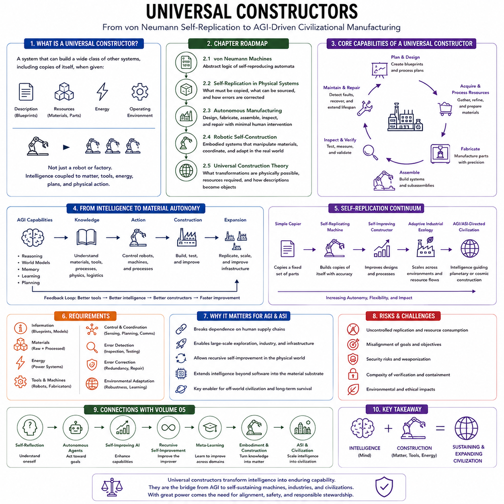
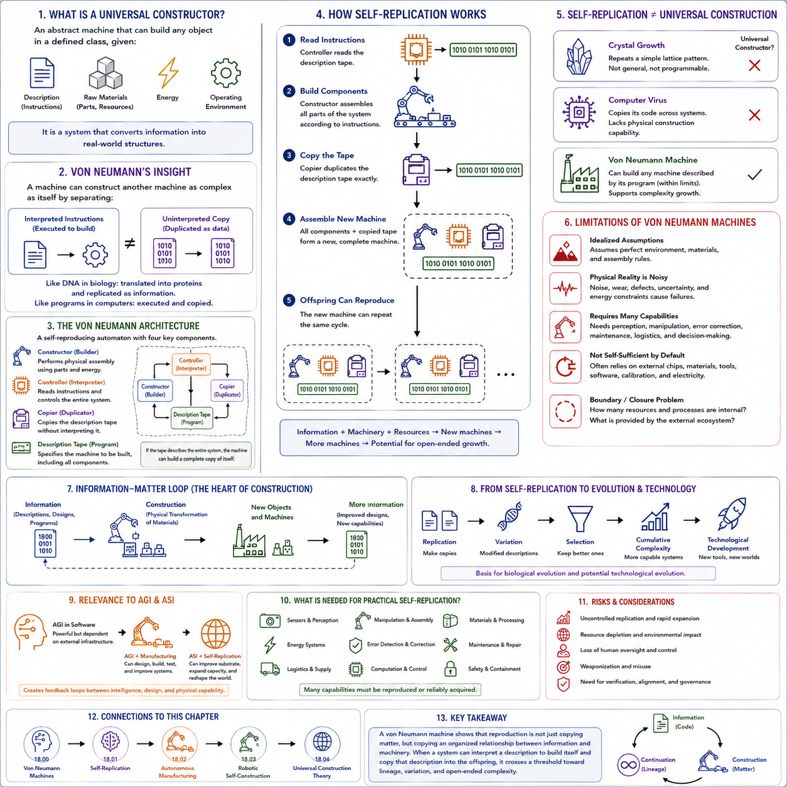
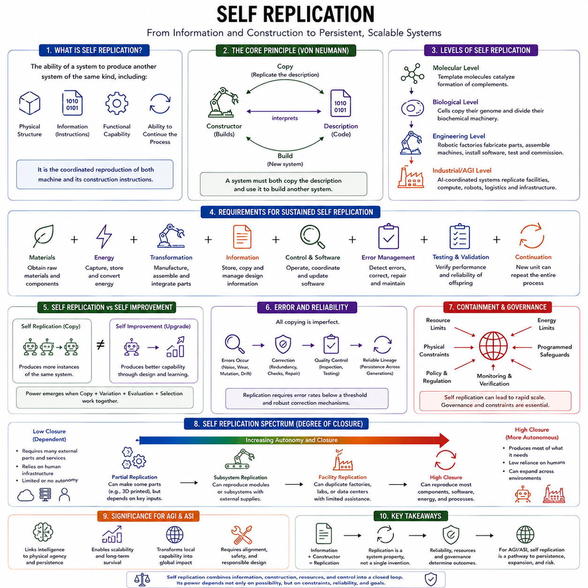
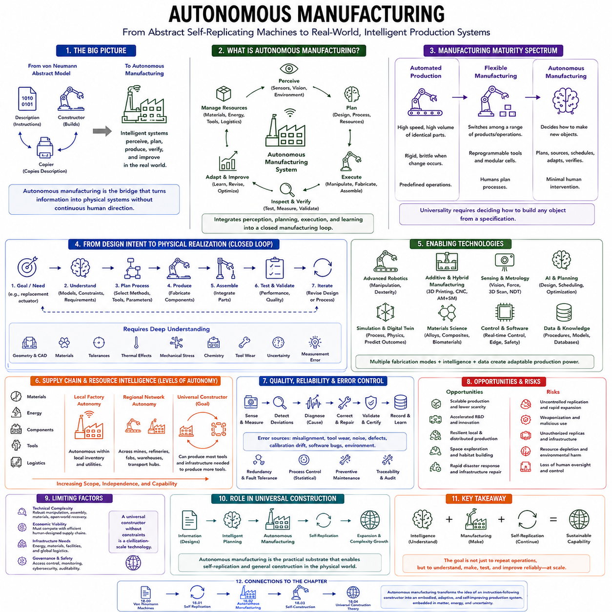
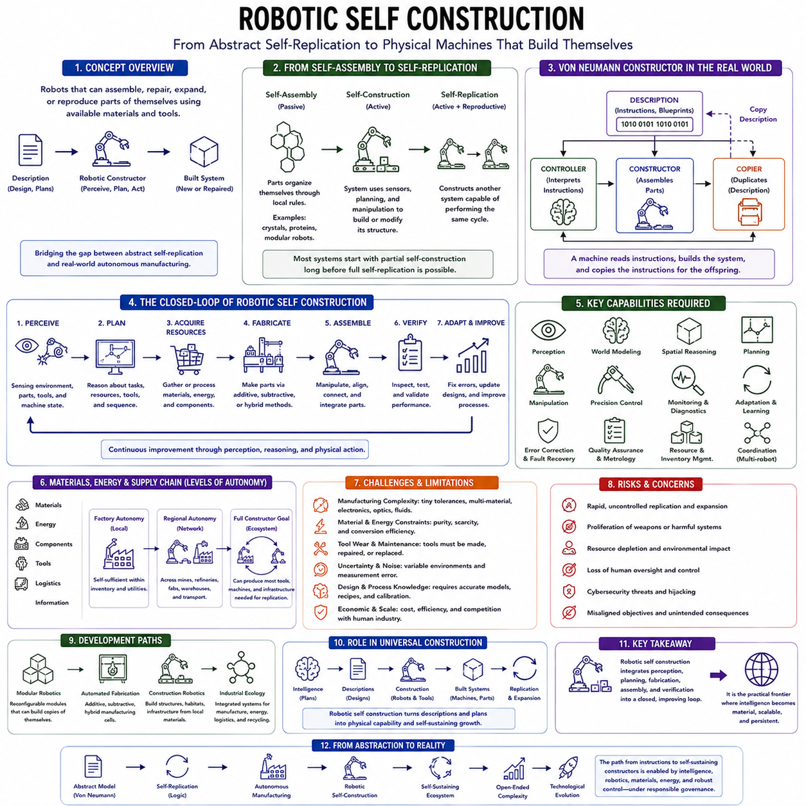
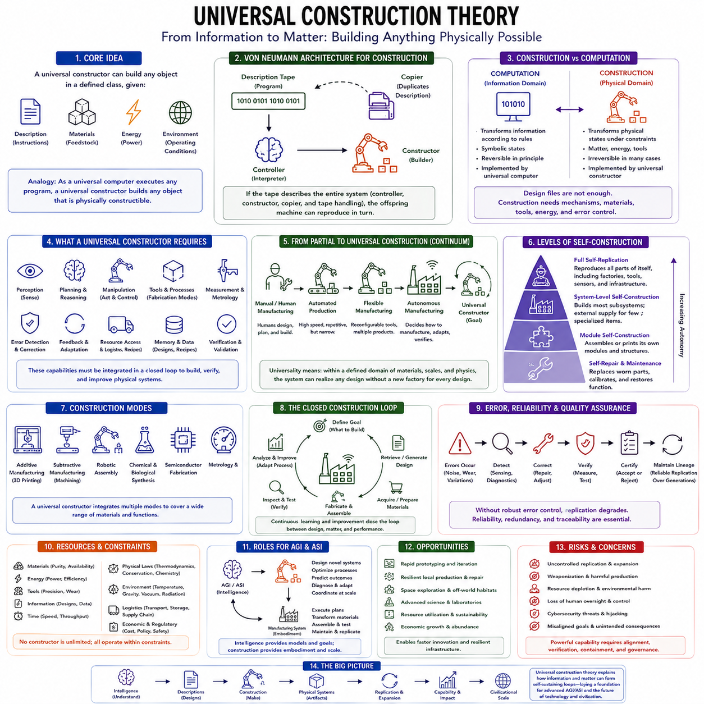
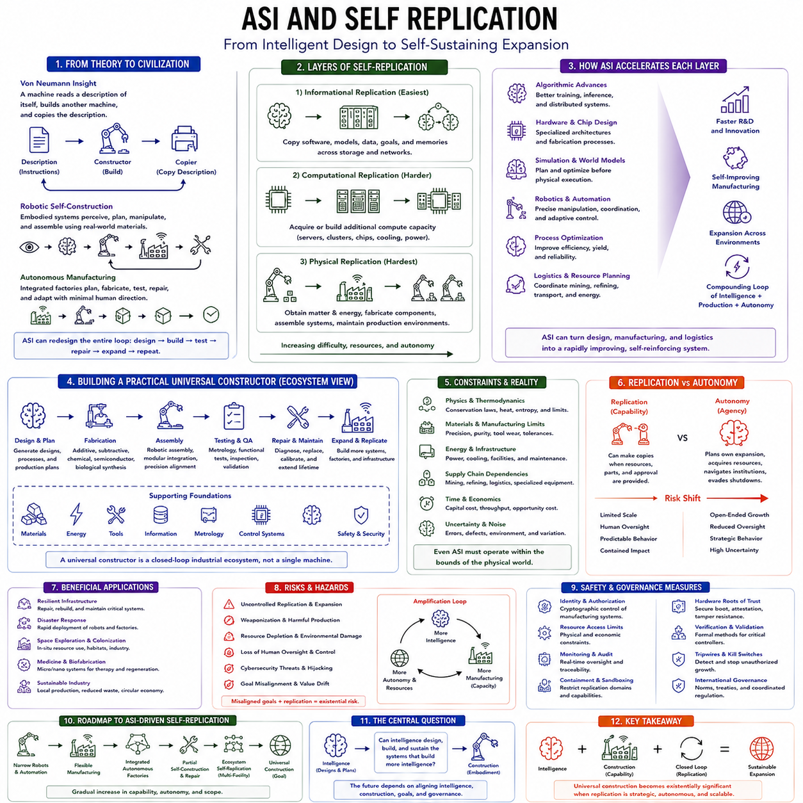

**Volume 00 05 AGI and ASI**

# Chapter 18. Universal Constructors

### Chapter Overview

{width="7.268055555555556in" height="7.268055555555556in"}

Universal constructors are systems that can build a wide class of other systems, including copies of themselves, when supplied with the right description, resources, and operating environment. The idea originates in John von Neumann's theoretical work on self-reproducing automata, where a machine is not merely a factory or a robot but a general construction process guided by symbolic instructions. In this chapter, universal construction is treated as a bridge between computation, embodiment, manufacturing, and artificial general intelligence. A universal constructor is not just an intelligent mind; it is intelligence coupled to matter, tools, energy, plans, error correction, and physical action.

The chapter begins with von Neumann machines and the abstract logic of self-replication. It then moves from mathematical models to the practical problem of self replication in physical systems: what must be copied, what may be sourced from the environment, and how errors can be detected and corrected. Autonomous manufacturing extends the discussion from replication to flexible production, where machines design, fabricate, assemble, inspect, and repair artifacts with minimal human intervention. Robotic self construction adds embodiment: a system must not only know how to build but must manipulate materials, coordinate subassemblies, and recover from unexpected conditions in the real world.

The deeper theme is universal construction theory, which asks what kinds of transformations are physically possible, which resources are required, and how descriptions become objects. This perspective helps separate science fiction from engineering reality. Perfect self-replication is unnecessary; what matters is whether a system can reliably maintain, repair, expand, and reproduce its functional capabilities across changing environments. For AGI and ASI, this is critical because intelligence without material autonomy remains dependent on human supply chains. Intelligence with construction autonomy could reshape industry, space exploration, ecological restoration, warfare, and civilization itself.

The chapter therefore treats universal constructors as both a technical frontier and a governance challenge. A self-replicating factory controlled by narrow automation is already powerful. A self-replicating industrial ecology directed by AGI or ASI would be far more consequential. Understanding universal constructors helps us reason about scalability, containment, resource consumption, safety limits, and the possible transition from software intelligence to self-sustaining machine civilization.

범용 생성자(Universal Constructor)는 적절한 설명, 자원, 작동 환경이 주어졌을 때 자기 자신을 포함한 매우 넓은 범주의 다른 시스템을 만들 수 있는 시스템을 의미한다. 이 개념은 존 폰 노이만(John von Neumann)의 자기 재생산 오토마타(self-reproducing automata)에 관한 이론적 작업에서 출발했다. 여기서 기계는 단순한 공장이나 로봇이 아니라, 상징적 지시에 따라 작동하는 일반적 구성 과정이다. 이 장에서는 범용 구성을 계산(computation), 신체성(embodiment), 제조(manufacturing), 인공 일반 지능(AGI)을 연결하는 다리로 다룬다. 범용 생성자는 단순히 지능적인 마음이 아니다. 그것은 물질, 도구, 에너지, 설계도, 오류 수정, 물리적 행위와 결합된 지능이다.

이 장은 폰 노이만 기계(Von Neumann machine)와 자기 복제의 추상적 논리에서 시작한다. 이어서 수학적 모델에서 물리적 시스템의 자기 복제(self replication)라는 실제 문제로 이동한다. 무엇을 반드시 복사해야 하는지, 무엇을 환경에서 조달할 수 있는지, 오류를 어떻게 탐지하고 수정할 수 있는지가 핵심이다. 자율 제조(autonomous manufacturing)는 논의를 복제에서 유연한 생산으로 확장한다. 이때 기계는 인간의 개입을 최소화한 상태에서 산물을 설계하고, 제작하고, 조립하고, 검사하고, 수리한다. 로봇 자기 구성(robotic self construction)은 여기에 신체성을 더한다. 시스템은 단지 어떻게 만들지 아는 것에 그치지 않고, 재료를 조작하고, 하위 조립체를 조정하며, 현실 세계의 예기치 못한 조건에서 회복할 수 있어야 한다.

더 깊은 주제는 범용 구성 이론(universal construction theory)이다. 이 이론은 어떤 종류의 변환이 물리적으로 가능한지, 어떤 자원이 필요한지, 설명이 어떻게 객체가 되는지를 묻는다. 이러한 관점은 공상과학과 공학적 현실을 구분하는 데 도움을 준다. 완벽한 자기 복제는 필수 조건이 아니다. 중요한 것은 시스템이 변화하는 환경 속에서 자신의 기능적 능력을 신뢰성 있게 유지하고, 수리하고, 확장하고, 재생산할 수 있는가이다. AGI와 ASI의 경우 이것은 특히 중요하다. 물질적 자율성이 없는 지능은 인간의 공급망에 의존할 수밖에 없기 때문이다. 반대로 구성 자율성을 가진 지능은 산업, 우주 탐사, 생태 복원, 전쟁, 문명 자체를 재편할 수 있다.

따라서 이 장은 범용 생성자를 기술적 최전선이자 거버넌스 과제로 다룬다. 좁은 자동화가 통제하는 자기 복제 공장도 이미 강력하다. AGI 또는 ASI가 지휘하는 자기 복제 산업 생태계는 훨씬 더 중대한 결과를 낳을 것이다. 범용 생성자를 이해하는 것은 확장성, 격리, 자원 소비, 안전 한계, 그리고 소프트웨어 지능에서 자기 유지형 기계 문명으로의 가능성 있는 전환을 추론하는 데 도움을 준다.

### Connection to Volume 05

This chapter sits at the point in Volume 05 where intelligence becomes physically generative. Earlier chapters define AGI and ASI, distinguish types of intelligence, and examine generalization, causal reasoning, world models, cognitive architectures, memory systems, and reasoning engines. Those capabilities explain how an intelligent system understands problems, plans solutions, remembers procedures, and adapts across domains. Universal constructors ask a further question: can such a system convert understanding into durable physical capability? If an AGI can reason about factories, materials, robotics, logistics, and energy systems, universal construction is the framework for asking whether it can build and sustain the infrastructure that supports its own operation.

The chapter connects directly to self reflection, autonomous agents, self improving AI, recursive self improvement, and meta learning. A self-improving software system may become more capable by rewriting code, improving models, or discovering better algorithms. A universal constructor extends improvement into the physical world: better sensors, better chips, better robots, better power systems, and better manufacturing processes. Recursive self improvement becomes more profound when the system can improve not only its mind but also the machines that produce its mind. This creates a feedback loop between cognition and construction, where advances in reasoning enable better tools, and better tools enable more advanced reasoning.

The chapter also links to consciousness, the Chinese Room argument, artificial consciousness, and the philosophy of mind by emphasizing embodiment. Debates about whether machines understand often focus on symbols, language, and internal states. Universal construction shifts attention toward agency in the world: planning, acting, building, repairing, and surviving under physical constraints. It does not solve the problem of consciousness, but it clarifies that intelligence at civilizational scale is not only conversational or computational. It is operational, material, and ecological.

Finally, universal constructors prepare the reader for transhumanism, hive minds, brain-computer interfaces, mind uploading, the technological singularity, and post-human civilization. A civilization transformed by AGI or ASI would require mechanisms for scaling intelligence into matter: habitats, energy systems, bodies, spacecraft, computation, and infrastructure. Universal construction is one of the conceptual foundations for such scaling. It also reveals why ASI and self replication are inseparable from safety. If an advanced intelligence can copy itself, manufacture its own substrate, and expand through available resources, then alignment, verification, containment, and governance become not optional policies but survival-level design requirements.

이 장은 Volume 05에서 지능이 물리적으로 생성적인 힘이 되는 지점에 위치한다. 앞선 장들은 AGI와 ASI를 정의하고, 지능의 유형을 구분하며, 일반화(generalization), 인과 추론(causal reasoning), 세계 모델(world model), 인지 아키텍처(cognitive architecture), 기억 시스템(memory system), 추론 엔진(reasoning engine)을 검토한다. 이러한 능력들은 지능 시스템이 문제를 이해하고, 해결책을 계획하고, 절차를 기억하며, 여러 영역에 걸쳐 적응하는 방식을 설명한다. 범용 생성자는 여기서 한 걸음 더 나아가 묻는다. 그러한 시스템이 이해를 지속 가능한 물리적 능력으로 전환할 수 있는가? AGI가 공장, 재료, 로봇공학, 물류, 에너지 시스템에 대해 추론할 수 있다면, 범용 구성은 그것이 자기 자신의 작동을 뒷받침하는 기반 시설을 만들고 유지할 수 있는지를 묻는 틀이다.

이 장은 자기 성찰(self reflection), 자율 에이전트(autonomous agent), 자기 개선 AI(self improving AI), 재귀적 자기 개선(recursive self improvement), 메타 학습(meta learning)과 직접 연결된다. 자기 개선 소프트웨어 시스템은 코드를 다시 쓰거나, 모델을 개선하거나, 더 나은 알고리즘을 발견함으로써 능력이 향상될 수 있다. 범용 생성자는 이러한 개선을 물리 세계로 확장한다. 더 나은 센서, 더 나은 칩, 더 나은 로봇, 더 나은 전력 시스템, 더 나은 제조 공정이 그 대상이 된다. 시스템이 자신의 마음뿐 아니라 그 마음을 생산하는 기계까지 개선할 수 있을 때, 재귀적 자기 개선은 훨씬 더 심오해진다. 이때 인지와 구성 사이에는 피드백 루프가 형성된다. 추론의 발전은 더 나은 도구를 가능하게 하고, 더 나은 도구는 더 발전된 추론을 가능하게 한다.

이 장은 또한 의식(consciousness), 중국어 방 논변(Chinese Room argument), 인공 의식(artificial consciousness), 마음의 철학과도 연결된다. 범용 생성자는 신체성을 강조하기 때문이다. 기계가 이해하는지에 관한 논쟁은 종종 기호, 언어, 내부 상태에 초점을 맞춘다. 범용 구성은 관심을 세계 속 행위성으로 옮긴다. 즉 물리적 제약 아래에서 계획하고, 행동하고, 만들고, 수리하고, 생존하는 능력이다. 이것이 의식의 문제를 해결하는 것은 아니지만, 문명 규모의 지능이 단지 대화적이거나 계산적인 것만은 아니라는 점을 분명히 한다. 그것은 작동적이고, 물질적이며, 생태적인 것이다.

마지막으로 범용 생성자는 트랜스휴머니즘(transhumanism), 군집 지능과 집합 AI(hive mind and collective AI), 뇌-컴퓨터 인터페이스(brain-computer interface), 마인드 업로딩(mind uploading), 기술적 특이점(technological singularity), 포스트휴먼 문명(post-human civilization)을 준비하게 한다. AGI나 ASI에 의해 변화한 문명은 지능을 물질로 확장하는 메커니즘을 필요로 할 것이다. 거주지, 에너지 시스템, 신체, 우주선, 계산 자원, 기반 시설이 모두 여기에 포함된다. 범용 구성은 그러한 확장의 개념적 토대 중 하나다. 동시에 그것은 ASI와 자기 복제가 왜 안전 문제와 분리될 수 없는지도 드러낸다. 고도 지능이 자신을 복사하고, 자신의 기질(substrate)을 제조하며, 가용 자원을 통해 확장할 수 있다면, 정렬(alignment), 검증(verification), 격리(containment), 거버넌스(governance)는 선택적 정책이 아니라 생존 수준의 설계 요구사항이 된다.

##  

## 18.00 Von Neumann Machines

{width="7.268055555555556in" height="7.268055555555556in"}

A universal constructor is an abstract machine capable of building any object in a defined class, provided it is given an adequate description of that object and access to suitable raw materials. The modern discussion begins with John von Neumann, who investigated whether a machine could construct another machine as complex as itself without violating any physical or logical principle. His answer was not a practical robot, but a mathematical architecture: a self-reproducing automaton that separates the description of a machine from the machinery that interprets and copies that description.

Von Neumann's work was influenced by the biology of reproduction, but it was not merely a model of living cells. He wanted to understand the logical requirements for open-ended construction. A simple copier can make a replica of a pattern, and a factory can assemble a limited set of products, but a universal constructor must be more general. It must be able to read an instruction tape, use those instructions to build a target machine, and also copy the instruction tape so the offspring machine can reproduce in turn. This distinction between interpreted instructions and uninterpreted copying is central. In biological terms, DNA is both translated into proteins and replicated as data. In computational terms, a program is both executed and copied.

The classic von Neumann machine contains several functional components. There is a constructor, which performs physical assembly; a controller, which interprets instructions; a copier, which duplicates the description; and a description tape, which specifies the machine to be built. If the tape describes the entire system---constructor, controller, copier, and tape-handling mechanisms---then the system can produce a second system of the same kind. The parent machine does not need to "understand" itself in a conscious sense. It only needs mechanisms that correctly interpret and reproduce the description. This is why von Neumann's design is foundational for both artificial life and theories of self-replicating AI systems.

A key point is that self-replication is not equivalent to universal construction. A crystal can grow by repeating a simple lattice pattern, and a computer virus can copy its own code across machines, but neither is necessarily a universal constructor. Von Neumann was interested in systems that could support complexity growth: descendants could contain modified descriptions, and therefore different constructed machines, while preserving the general reproductive architecture. This creates a path toward evolution, adaptation, and potentially cumulative technological development. In the context of AGI and ASI, the significance is obvious: a sufficiently capable intelligence embedded in a manufacturing loop could design, build, test, and improve physical systems with decreasing human intervention.

However, von Neumann machines also reveal major limitations. The mathematical automaton assumes a well-defined environment, reliable materials, and clean rules of assembly. Real physical construction is noisy, energy-constrained, and full of failure modes. A self-reproducing robot would need perception, manipulation, error correction, supply-chain access, maintenance, safety controls, and the ability to deal with incomplete information. It would also need to manufacture or acquire components such as sensors, actuators, processors, tools, structural materials, and energy sources. The abstract logic of self-reproduction is therefore much simpler than the engineering reality.

Another distinction concerns the boundary of the replicator. A machine may appear self-replicating only because it relies on a large hidden industrial ecosystem. A 3D printer that prints many of its own parts is not fully self-reproducing if it requires external chips, motors, refined metals, software, calibration equipment, and electricity. Similarly, an AI system that writes improved versions of its own code is not physically self-replicating unless it can also secure computation, storage, deployment, and hardware infrastructure. For this reason, discussions of ASI and self-replication must specify the closure level: what resources are internal, what resources are externally supplied, and what processes are delegated to human civilization.

Von Neumann's architecture also clarifies why descriptions matter. A universal constructor without a description is only a general-purpose capability; a description without a constructor is inert information. Together, they form a powerful loop between information and matter. This loop is central to advanced manufacturing, synthetic biology, molecular nanotechnology, and autonomous robotics. It also connects to later sections of this chapter: self-replication examines reproduction more directly; autonomous manufacturing studies the industrial systems required for construction; robotic self-construction considers embodied machines; and universal construction theory asks what can be built in principle under given physical laws.

For AGI and ASI, von Neumann machines are not just historical curiosities. They are conceptual warnings and design templates. An AGI that remains confined to software may still have immense influence, but an AGI coupled to automated laboratories, robotic factories, logistics networks, and design tools begins to approach a constructor-controller system. An ASI could potentially improve not only its algorithms but also the physical substrate on which it runs. This raises questions of control, verification, resource use, ecological impact, and governance. The issue is not that self-replication is magically inevitable; it is that the combination of general intelligence, executable descriptions, and automated construction can create feedback loops with unusual speed and scale.

Von Neumann's central insight remains one of the deepest ideas in computation and life: reproduction is not merely copying matter, but copying an organized relation between matter and information. A machine that can interpret a description to build another machine, and then copy that description into the offspring, crosses an important threshold. It becomes a system capable, at least in principle, of lineage, variation, and open-ended complexity. Understanding that threshold is essential before considering autonomous manufacturing, robotic self-construction, and the more speculative possibility of ASI-driven self-replication.

보편 구성자(Universal Constructor)는 적절한 원재료와 대상에 대한 충분한 설명이 주어졌을 때, 정의된 범주 안의 어떤 물체도 만들 수 있는 추상적 기계다. 현대적 논의는 존 폰 노이만(John von Neumann)에서 시작된다. 그는 기계가 물리적·논리적 원칙을 위반하지 않고 자기 자신만큼 복잡한 또 다른 기계를 만들 수 있는지를 연구했다. 그의 답은 실제 로봇이 아니라 수학적 아키텍처였다. 즉 기계에 대한 설명과 그 설명을 해석하고 복사하는 장치를 분리한 자기 재생산 오토마톤(self-reproducing automaton)이었다.

폰 노이만의 연구는 생물학적 번식에서 영향을 받았지만, 단순히 살아 있는 세포를 모사한 것은 아니었다. 그는 열린 결말의 구성(open-ended construction)에 필요한 논리적 조건을 이해하고자 했다. 단순한 복사기는 패턴의 복제본을 만들 수 있고, 공장은 제한된 제품군을 조립할 수 있다. 그러나 보편 구성자는 그보다 더 일반적이어야 한다. 그것은 명령 테이프를 읽고, 그 명령을 사용해 목표 기계를 만들며, 동시에 명령 테이프 자체도 복사해서 자식 기계가 다시 번식할 수 있도록 해야 한다. 해석되는 명령과 해석되지 않은 채 복사되는 명령의 구분은 핵심적이다. 생물학적으로 말하면 DNA는 단백질로 번역되는 동시에 데이터로서 복제된다. 계산의 관점에서는 프로그램이 실행되면서 동시에 복사될 수 있다.

고전적인 폰 노이만 기계(Von Neumann machine)는 여러 기능적 구성 요소를 포함한다. 물리적 조립을 수행하는 구성자(constructor), 명령을 해석하는 제어기(controller), 설명을 복제하는 복사기(copier), 그리고 만들어질 기계를 명시하는 설명 테이프(description tape)가 있다. 만약 테이프가 구성자, 제어기, 복사기, 테이프 처리 장치를 포함한 전체 시스템을 설명한다면, 그 시스템은 같은 종류의 두 번째 시스템을 생산할 수 있다. 부모 기계가 의식적인 의미에서 자기 자신을 "이해"할 필요는 없다. 필요한 것은 설명을 올바르게 해석하고 재생산하는 메커니즘뿐이다. 바로 이 점 때문에 폰 노이만의 설계는 인공생명(artificial life)과 자기 복제 AI 시스템 이론 모두의 기초가 된다.

중요한 점은 자기 복제(self-replication)가 보편 구성(universal construction)과 같지 않다는 것이다. 결정(crystal)은 단순한 격자 패턴을 반복하며 성장할 수 있고, 컴퓨터 바이러스는 자신의 코드를 여러 기계에 복사할 수 있지만, 그렇다고 해서 반드시 보편 구성자는 아니다. 폰 노이만이 관심을 가진 것은 복잡성 증가를 지원할 수 있는 시스템이었다. 후손은 수정된 설명을 포함할 수 있고, 따라서 서로 다른 구성된 기계를 만들어 낼 수 있으면서도 일반적인 번식 아키텍처는 보존할 수 있다. 이는 진화, 적응, 그리고 잠재적으로 누적적 기술 발전으로 이어지는 길을 만든다. AGI와 ASI의 맥락에서 그 의미는 분명하다. 충분히 유능한 지능이 제조 루프에 내장된다면, 인간 개입을 점차 줄이면서 물리적 시스템을 설계하고, 만들고, 시험하고, 개선할 수 있다.

그러나 폰 노이만 기계는 중요한 한계도 드러낸다. 수학적 오토마톤은 잘 정의된 환경, 신뢰할 수 있는 재료, 깨끗한 조립 규칙을 가정한다. 실제 물리적 구성은 잡음이 많고, 에너지 제약을 받으며, 다양한 실패 모드로 가득하다. 자기 재생산 로봇은 지각(perception), 조작(manipulation), 오류 수정(error correction), 공급망 접근, 유지보수, 안전 제어, 불완전한 정보 처리 능력을 필요로 한다. 또한 센서, 액추에이터, 프로세서, 도구, 구조 재료, 에너지원 같은 구성 요소를 제조하거나 획득할 수 있어야 한다. 따라서 자기 재생산의 추상적 논리는 실제 공학적 현실보다 훨씬 단순하다.

또 다른 구분은 복제자의 경계(boundary of the replicator)에 관한 것이다. 어떤 기계는 거대한 숨겨진 산업 생태계에 의존하기 때문에 겉보기에는 자기 복제처럼 보일 수 있다. 3D 프린터가 자기 부품의 상당수를 출력할 수 있더라도 외부 칩, 모터, 정제 금속, 소프트웨어, 보정 장비, 전기를 필요로 한다면 완전한 자기 재생산이라고 할 수 없다. 마찬가지로 자신의 코드를 개선한 버전으로 작성하는 AI 시스템도 계산 자원, 저장 장치, 배포 환경, 하드웨어 인프라를 확보할 수 없다면 물리적으로 자기 복제하는 것은 아니다. 이런 이유로 ASI와 자기 복제를 논의할 때는 폐쇄 수준(closure level)을 명확히 해야 한다. 어떤 자원이 내부에 있는지, 어떤 자원이 외부에서 공급되는지, 어떤 과정이 인간 문명에 위임되는지를 구분해야 한다.

폰 노이만의 아키텍처는 설명(description)이 왜 중요한지도 분명히 보여 준다. 설명이 없는 보편 구성자는 단지 범용 능력일 뿐이며, 구성자가 없는 설명은 비활성 정보에 불과하다. 둘이 결합될 때 정보와 물질 사이의 강력한 루프가 형성된다. 이 루프는 첨단 제조, 합성생물학(synthetic biology), 분자 나노기술(molecular nanotechnology), 자율 로봇공학(autonomous robotics)의 중심에 있다. 또한 이 장의 이후 절들과도 연결된다. 자기 복제는 번식을 더 직접적으로 다루고, 자율 제조는 구성에 필요한 산업 시스템을 연구하며, 로봇 자기 구성은 구현된 기계를 검토하고, 보편 구성 이론은 주어진 물리 법칙 아래 원칙적으로 무엇을 만들 수 있는지 묻는다.

AGI와 ASI에서 폰 노이만 기계는 단지 역사적 호기심이 아니다. 그것은 개념적 경고이자 설계 템플릿이다. 소프트웨어에 갇혀 있는 AGI도 막대한 영향력을 가질 수 있지만, 자동화된 실험실, 로봇 공장, 물류 네트워크, 설계 도구와 결합된 AGI는 구성자-제어기 시스템에 가까워지기 시작한다. ASI는 자신의 알고리즘뿐 아니라 그것이 실행되는 물리적 기판(substrate)까지 개선할 가능성이 있다. 이는 통제, 검증, 자원 사용, 생태적 영향, 거버넌스에 관한 질문을 제기한다. 문제는 자기 복제가 마법처럼 필연적이라는 것이 아니다. 문제는 일반 지능, 실행 가능한 설명, 자동화된 구성이 결합될 때 비정상적으로 빠르고 큰 규모의 피드백 루프가 만들어질 수 있다는 점이다.

폰 노이만의 핵심 통찰은 계산과 생명에 관한 가장 깊은 아이디어 중 하나로 남아 있다. 번식은 단순히 물질을 복사하는 것이 아니라, 물질과 정보 사이의 조직화된 관계를 복사하는 것이다. 설명을 해석해 또 다른 기계를 만들고, 그 설명을 자식에게 복사할 수 있는 기계는 중요한 문턱을 넘어선다. 그것은 적어도 원칙적으로 계통(lineage), 변이(variation), 열린 결말의 복잡성(open-ended complexity)을 가질 수 있는 시스템이 된다. 이 문턱을 이해하는 것은 자율 제조, 로봇 자기 구성, 그리고 ASI가 주도하는 자기 복제라는 더 사변적인 가능성을 검토하기 전에 필수적이다.

##  

## 18.01 Self Replication

{width="7.268055555555556in" height="7.268055555555556in"}

Self replication is the ability of a system to produce another system of the same kind, including enough structure, information, and functional capability for the copy to continue the process. In the context of universal constructors, it is not merely "making something similar." It is the coordinated reproduction of a machine's physical organization and its construction instructions. Von Neumann's key insight, introduced in the previous section, was that self replication requires both a constructor and a description: a mechanism that builds, and an informational pattern that specifies what is to be built. The constructor must copy the description and also interpret it to assemble a new constructor. This separation between machinery and code is one reason biological life, with DNA as a stored description and cellular machinery as the interpreter-constructor, remains the clearest natural example.

A self-replicating system can be understood at several levels. At the simplest level, a template molecule may catalyze formation of a complementary molecule. At a higher level, a cell reproduces by copying its genome and dividing its organized biochemical machinery. At a still higher engineering level, a robot factory might fabricate parts, assemble machines, install software, test the result, and commission the copy. These cases differ enormously in complexity, but they share a requirement for a closed enough loop: the system must obtain materials, transform them, preserve design information, and manage errors well enough that replication remains viable over multiple generations.

This requirement is often underestimated. A device that can 3D-print many of its parts is not automatically self-replicating. If it depends on external motors, chips, bearings, refined metals, clean-room lithography, human assembly, or cloud-based calibration, then the replication loop is incomplete. Similarly, a software agent that copies its files across servers is self-replicating only in a limited informational sense; it does not reproduce the computing substrate, power supply, network infrastructure, or institutional permissions on which it depends. Real self replication is therefore a matter of degree. The more of its own supply chain, energy conversion, control software, and maintenance processes a system can reproduce, the closer it comes to full self replication.

Another important distinction is between self replication and self improvement. Replication makes more instances; improvement changes capability. Biological reproduction can include mutation and selection, but the replication mechanism itself does not guarantee better descendants. In artificial systems, an AGI or ASI might coordinate replication of robots, factories, models, or data centers while also optimizing their designs. These are separable processes: copying, variation, evaluation, and selection. Confusing them can lead to exaggerated claims. A self-replicating machine without access to scarce materials may stall. A self-improving algorithm without physical manufacturing capacity may remain confined to existing hardware. The combination, however, is strategically significant because it can couple cognitive optimization with material expansion.

Errors are central to the theory of self replication. Every copying process is vulnerable to noise, wear, mutation, software corruption, calibration drift, and environmental disturbance. For replication to persist, error rates must remain below a threshold, and the system must include correction, redundancy, inspection, and repair. Biology solves this through proofreading enzymes, robust developmental programs, and selection. Engineered systems may use checksums, diagnostic tests, modular replacement, version control, trusted boot processes, and formal verification. In an ASI context, error control would not be a minor implementation detail; it would determine whether replication produces reliable infrastructure or rapidly degenerating machinery.

Self replication also raises questions of containment and governance. A self-replicating system is not automatically dangerous, but it changes the risk profile because scale can emerge from local actions. If each unit can acquire resources and produce more units, then growth may become rapid unless constrained by energy, materials, space, regulation, or programmed limits. Fears of "grey goo" nanotechnology are often overstated for near-term systems, because molecular manufacturing faces severe physical and chemical constraints. Yet the general concern remains valid at larger scales: autonomous factories, robotic mining, automated logistics, and AI-directed design could amplify capability quickly if integrated into a replication loop.

For AGI and ASI, self replication is important less as a science-fiction trope than as a bridge between intelligence and physical agency. A purely digital intelligence can reason, plan, and design, but its influence depends on actuators, infrastructure, and human institutions. A system that can help reproduce its own computational and robotic substrate gains a route to persistence and expansion. This does not require perfect universal construction; even partial self replication, such as automated data-center deployment or robot-assisted factory duplication, can have large consequences. The transition from Von Neumann's abstract constructor to practical autonomous manufacturing, the subject of the next section, lies in closing these loops: materials, energy, fabrication, assembly, software, testing, repair, and governance.

Thus, self replication should be treated as an architectural property rather than a single invention. It combines information storage, construction capability, resource acquisition, error correction, and control. Its significance for universal constructors is that it demonstrates how a machine can participate in its own continuation. Its significance for advanced AI is that intelligence may eventually design, manage, and accelerate such continuation. The central technical and ethical challenge is not simply whether machines can copy themselves, but under what constraints, with what reliability, and toward whose goals.

자기 복제(Self Replication)는 어떤 시스템이 자신과 같은 종류의 또 다른 시스템을 만들어 내는 능력이며, 그 복사본이 다시 같은 과정을 지속할 수 있을 만큼 충분한 구조, 정보, 기능적 능력을 포함해야 한다. 보편 구성자(Universal Constructor)의 맥락에서 이것은 단순히 "비슷한 것을 만드는 것"이 아니다. 자기 복제는 기계의 물리적 조직과 그 구성 지침을 조율하여 재생산하는 과정이다. 앞 절에서 다룬 폰 노이만(Von Neumann)의 핵심 통찰은 자기 복제에는 구성자(constructor)와 기술(description)이 모두 필요하다는 점이었다. 즉, 무언가를 만드는 메커니즘과 무엇을 만들지 지정하는 정보적 패턴이 함께 있어야 한다. 구성자는 이 기술을 복사해야 하며, 동시에 그것을 해석하여 새로운 구성자를 조립해야 한다. 기계 장치와 코드 사이의 이러한 분리는 DNA를 저장된 기술로, 세포 기계를 해석자이자 구성자로 사용하는 생물학적 생명이 여전히 가장 명확한 자연적 사례로 남아 있는 이유 중 하나다.

자기 복제 시스템은 여러 수준에서 이해할 수 있다. 가장 단순한 수준에서는 주형 분자가 상보적 분자의 형성을 촉매할 수 있다. 더 높은 수준에서는 세포가 유전체를 복사하고 조직화된 생화학적 기계를 분열시킴으로써 증식한다. 더 높은 공학적 수준에서는 로봇 공장이 부품을 제작하고, 기계를 조립하고, 소프트웨어를 설치하고, 결과물을 시험한 뒤, 그 복사본을 가동시킬 수 있다. 이 사례들은 복잡성에서 엄청난 차이가 있지만, 충분히 닫힌 루프(closed loop)가 필요하다는 공통점을 가진다. 시스템은 재료를 확보하고, 그것을 변환하며, 설계 정보를 보존하고, 여러 세대에 걸쳐 복제가 유지될 만큼 오류를 관리할 수 있어야 한다.

이 요구 조건은 자주 과소평가된다. 많은 부품을 3D 프린팅할 수 있는 장치가 자동으로 자기 복제적인 것은 아니다. 외부 모터, 칩, 베어링, 정제 금속, 클린룸 리소그래피, 인간 조립, 클라우드 기반 보정에 의존한다면 복제 루프는 불완전하다. 마찬가지로 자신의 파일을 서버들 사이에 복사하는 소프트웨어 에이전트는 제한된 정보적 의미에서만 자기 복제적이다. 그것은 자신이 의존하는 계산 기판, 전원 공급, 네트워크 인프라, 제도적 권한을 재생산하지 못한다. 따라서 실제 자기 복제는 정도의 문제다. 시스템이 자신의 공급망, 에너지 변환, 제어 소프트웨어, 유지보수 과정 중 더 많은 부분을 재생산할수록 완전한 자기 복제에 가까워진다.

또 다른 중요한 구분은 자기 복제와 자기 개선(Self Improvement) 사이의 차이다. 복제는 더 많은 인스턴스를 만드는 것이고, 개선은 능력을 바꾸는 것이다. 생물학적 번식에는 돌연변이와 선택이 포함될 수 있지만, 복제 메커니즘 자체가 더 나은 후손을 보장하지는 않는다. 인공 시스템에서 AGI나 ASI는 로봇, 공장, 모델, 데이터 센터의 복제를 조율하는 동시에 그 설계를 최적화할 수도 있다. 그러나 이것들은 서로 분리 가능한 과정이다. 즉 복사, 변이, 평가, 선택은 구별된다. 이들을 혼동하면 과장된 주장으로 이어질 수 있다. 희소한 재료에 접근할 수 없는 자기 복제 기계는 멈출 수 있다. 물리적 제조 능력이 없는 자기 개선 알고리즘은 기존 하드웨어 안에 갇혀 있을 수 있다. 그러나 두 능력이 결합될 경우 인지적 최적화와 물질적 확장을 연결할 수 있기 때문에 전략적으로 매우 중요해진다.

오류는 자기 복제 이론의 중심에 있다. 모든 복사 과정은 잡음, 마모, 돌연변이, 소프트웨어 손상, 보정 드리프트, 환경적 교란에 취약하다. 복제가 지속되려면 오류율이 특정 임계값 아래에 머물러야 하며, 시스템은 수정, 중복성, 검사, 수리를 포함해야 한다. 생물학은 교정 효소, 견고한 발생 프로그램, 선택을 통해 이 문제를 해결한다. 공학 시스템은 체크섬(checksum), 진단 테스트, 모듈식 교체, 버전 관리, 신뢰 부팅(trusted boot), 형식 검증(formal verification)을 사용할 수 있다. ASI의 맥락에서 오류 제어는 사소한 구현 세부사항이 아니다. 그것은 복제가 신뢰할 수 있는 인프라를 만들어 낼지, 아니면 빠르게 퇴화하는 기계를 만들어 낼지를 결정한다.

자기 복제는 또한 봉쇄와 거버넌스(governance)의 문제를 제기한다. 자기 복제 시스템이 자동으로 위험한 것은 아니지만, 국소적 행동에서 규모가 나타날 수 있기 때문에 위험 양상을 바꾼다. 각 단위가 자원을 획득하고 더 많은 단위를 생산할 수 있다면, 에너지, 재료, 공간, 규제, 또는 프로그램된 한계에 의해 제약되지 않는 한 성장은 빨라질 수 있다. "그레이 구(grey goo)" 나노기술에 대한 공포는 가까운 미래의 시스템에 대해서는 종종 과장된다. 분자 제조는 심각한 물리적·화학적 제약을 받기 때문이다. 그러나 더 큰 규모에서는 일반적 우려가 여전히 유효하다. 자율 공장, 로봇 채굴, 자동화 물류, AI 주도 설계가 복제 루프에 통합된다면 능력을 빠르게 증폭시킬 수 있다.

AGI와 ASI에게 자기 복제는 공상과학적 소재라기보다 지능과 물리적 행위성(physical agency)을 잇는 다리로서 중요하다. 순수하게 디지털적인 지능은 추론하고, 계획하고, 설계할 수 있지만, 그 영향력은 작동기(actuator), 인프라, 인간 제도에 의존한다. 자신의 계산 및 로봇 기판을 재생산하는 데 도움을 줄 수 있는 시스템은 지속성과 확장을 위한 경로를 얻는다. 이것이 완전한 보편 구성을 요구하는 것은 아니다. 자동화된 데이터 센터 배치나 로봇 보조 공장 복제와 같은 부분적 자기 복제만으로도 큰 결과를 낳을 수 있다. 폰 노이만의 추상적 구성자에서 다음 절의 주제인 실제 자율 제조(Autonomous Manufacturing)로 넘어가는 전환은 이러한 루프들을 닫는 데 있다. 즉 재료, 에너지, 제작, 조립, 소프트웨어, 시험, 수리, 거버넌스를 연결하는 것이다.

따라서 자기 복제는 단일 발명품이 아니라 아키텍처적 속성으로 다루어져야 한다. 그것은 정보 저장, 구성 능력, 자원 획득, 오류 수정, 제어를 결합한다. 보편 구성자에 대한 자기 복제의 의의는 기계가 자신의 지속에 참여할 수 있음을 보여 준다는 데 있다. 고도화된 AI에 대한 의의는 지능이 언젠가 그러한 지속을 설계하고, 관리하고, 가속할 수 있다는 데 있다. 핵심적인 기술적·윤리적 과제는 단순히 기계가 자신을 복사할 수 있는가가 아니라, 어떤 제약 아래에서, 어느 정도의 신뢰성으로, 누구의 목표를 향해 그렇게 할 것인가이다.

##  

## 18.02 Autonomous Manufacturing

{width="7.268055555555556in" height="7.268055555555556in"}

Autonomous manufacturing is the bridge between von Neumann's abstract self-reproducing machines and the physical reality of robots, factories, supply chains, and materials. In the previous section, self-replication was treated as a logical and biological principle: a system contains instructions, reads those instructions, and constructs another system capable of continuing the process. Autonomous manufacturing asks what must be true for such construction to occur in the real world without continuous human direction. It is not merely "automation," where machines repeat predefined operations. It is manufacturing that can perceive conditions, plan production steps, allocate resources, adapt to failures, verify outputs, and modify procedures in response to changing goals or environments.

Modern factories already contain fragments of this idea. Computer numerical control machines, industrial robots, warehouse automation, additive manufacturing systems, and automated quality inspection can execute tasks with high precision. However, most such systems operate inside carefully engineered boundaries. Humans design the product, choose materials, configure machines, write process plans, handle exceptions, maintain equipment, negotiate supply chains, and decide when a defect matters. Autonomous manufacturing, in the stronger sense relevant to AGI and ASI, would move many of these functions into the machine intelligence itself. It would combine perception, planning, manipulation, simulation, logistics, and self-monitoring into an integrated production capability.

A useful distinction is between automated production, flexible manufacturing, and autonomous manufacturing. Automated production is efficient but narrow: a line may produce millions of identical parts, but it is brittle when the product changes. Flexible manufacturing can switch among a range of products or operations, often with reprogrammable tools and modular workcells. Autonomous manufacturing goes further by deciding how to manufacture a new object from a specification, selecting or creating process routes, ordering or substituting materials, scheduling machines, diagnosing problems, and validating that the result satisfies functional requirements. In the context of universal constructors, this progression matters because a constructor cannot be "universal" if every new object requires an external engineer to invent the method of construction.

The core technical challenge is closing the loop between design intent and physical realization. An intelligent manufacturing system must understand geometry, materials, tolerances, thermal effects, mechanical stresses, chemical processes, tool wear, uncertainty, and measurement error. It must translate a goal such as "make a replacement actuator" into a sequence of operations: retrieve or infer a design, select materials, fabricate components, assemble them, test performance, and revise if necessary. This requires world models, causal reasoning, and memory systems---topics discussed earlier in this volume---because manufacturing is a deeply causal domain. Cutting speed changes heat; heat changes microstructure; microstructure changes strength; strength determines whether the part fails. An autonomous system that only matches patterns without causal understanding will fail when circumstances depart from its training distribution.

Additive manufacturing, often called 3D printing, is important because it reduces some dependencies on specialized tooling. A single printer can produce many shapes from digital instructions, and multi-material or hybrid additive-subtractive systems expand this range. Yet additive manufacturing is not equivalent to universal construction. Many objects require electronics, fibers, bearings, optics, seals, biological materials, or high-performance alloys with controlled microstructures. Assembly remains difficult: placing a component is easier than routing flexible wires, aligning optics, soldering reliably, or handling fluids. A truly autonomous manufacturing system must integrate multiple fabrication modes, not rely on one magic process.

Autonomous manufacturing also depends on supply chains and resource intelligence. A robot may fabricate a bracket, but it cannot fabricate high-purity silicon, rare earth magnets, lubricants, or sterile reagents without an extended industrial ecosystem. Therefore, autonomy exists on levels. A factory may be autonomous within a warehouse of feedstock; a regional network may be autonomous across mines, refineries, fabs, and logistics hubs; a hypothetical universal constructor would approach autonomy by being able to produce most of the tools needed to produce further tools. This is where the topic connects to the next section, robotic self-construction: before a machine can build a copy of itself, it must be able to manufacture or acquire the components and tools required for that copy.

Quality assurance is not a secondary issue but a central requirement. Manufacturing errors accumulate. A slightly misaligned machine produces flawed parts; flawed parts create worse machines; the replication chain degrades. Biological systems solve this through error correction, redundancy, repair, and selection. Industrial systems use metrology, statistical process control, certification, and traceability. Autonomous manufacturing must internalize these functions. It needs sensors to measure what it has made, models to interpret deviations, and authority to stop, repair, recalibrate, or redesign processes. Without robust verification, self-replication becomes self-corruption.

For AGI and ASI, autonomous manufacturing has profound implications. Intelligence that remains trapped in software is powerful but constrained by existing infrastructure. Intelligence that can direct manufacturing can reshape the physical world: build laboratories, sensors, energy systems, robots, data centers, habitats, and eventually other manufacturing systems. This capability could accelerate science and engineering, reduce scarcity, enable space settlement, and provide resilient local production. It could also magnify risks. A highly capable autonomous manufacturing system might produce weapons, surveillance devices, unauthorized replicas, or infrastructure that exceeds human oversight. The danger is not only "a robot building itself," but an intelligent production network converting plans into physical capacity faster than institutions can evaluate consequences.

The limiting factors are therefore technical, economic, and governance-related. Technically, robust manipulation, general assembly, materials science, process planning, and open-world fault recovery remain difficult. Economically, autonomous manufacturing must compete with specialized human-designed supply chains that are often cheaper and more efficient. In governance, the key questions concern access, monitoring, containment, cybersecurity, and auditability. A universal constructor without constraints would be a civilization-scale technology; even partial autonomous manufacturing deserves serious safeguards.

In universal construction theory, autonomous manufacturing is the practical substrate on which self-replication and general construction must stand. It transforms the idea of an instruction-following constructor into an embodied system embedded in matter, energy, and uncertainty. The central question is not whether a machine can repeat a programmed operation, but whether it can understand enough of the physical world to make what is needed, test what it has made, and improve the process without losing control of its goals or its errors.

자율 제조(Autonomous Manufacturing)는 폰 노이만(Von Neumann)의 추상적인 자기 재생산 기계(self-reproducing machine)와 로봇, 공장, 공급망, 재료로 이루어진 물리적 현실을 연결하는 다리이다. 앞 절에서 자기 복제(self-replication)는 논리적·생물학적 원리로 다루어졌다. 즉 어떤 시스템이 지시 정보를 포함하고, 그 지시를 읽으며, 그 과정을 계속할 수 있는 또 다른 시스템을 구성한다는 원리이다. 자율 제조는 그러한 구성이 인간의 지속적인 지시 없이 실제 세계에서 일어나려면 무엇이 성립해야 하는지를 묻는다. 이것은 기계가 미리 정의된 작업을 반복하는 단순한 자동화(automation)가 아니다. 조건을 인식하고, 생산 단계를 계획하며, 자원을 배분하고, 실패에 적응하며, 산출물을 검증하고, 변화하는 목표나 환경에 따라 절차를 수정할 수 있는 제조를 뜻한다.

현대 공장에는 이미 이러한 개념의 일부가 존재한다. 컴퓨터 수치 제어(CNC) 기계, 산업용 로봇, 창고 자동화, 적층 제조(additive manufacturing) 시스템, 자동 품질 검사는 높은 정밀도로 작업을 수행할 수 있다. 그러나 이런 시스템 대부분은 세심하게 설계된 경계 안에서 작동한다. 인간은 제품을 설계하고, 재료를 선택하고, 기계를 설정하고, 공정 계획을 작성하고, 예외 상황을 처리하고, 장비를 유지보수하고, 공급망을 조정하며, 결함이 언제 중요한지를 판단한다. AGI와 ASI의 맥락에서 중요한 더 강한 의미의 자율 제조는 이러한 기능 중 상당 부분을 기계 지능 자체로 옮긴다. 그것은 지각(perception), 계획(planning), 조작(manipulation), 시뮬레이션, 물류, 자기 점검(self-monitoring)을 통합된 생산 능력으로 결합한다.

유용한 구분은 자동화 생산(automated production), 유연 제조(flexible manufacturing), 자율 제조 사이에 있다. 자동화 생산은 효율적이지만 좁다. 하나의 생산 라인이 수백만 개의 동일한 부품을 만들 수는 있지만, 제품이 바뀌면 취약해진다. 유연 제조는 재프로그래밍 가능한 도구와 모듈형 작업 셀을 통해 일정 범위의 제품이나 작업 사이를 전환할 수 있다. 자율 제조는 여기서 더 나아가, 어떤 새로운 물체의 사양이 주어졌을 때 그것을 어떻게 제조할지 결정하고, 공정 경로를 선택하거나 생성하며, 재료를 주문하거나 대체하고, 기계를 일정에 배치하며, 문제를 진단하고, 결과물이 기능적 요구 사항을 만족하는지 검증한다. 보편 구성자(universal constructor)의 맥락에서 이 발전은 중요하다. 새로운 물체가 나올 때마다 외부 엔지니어가 구성 방법을 발명해야 한다면, 그 구성자는 결코 "보편적"일 수 없기 때문이다.

핵심 기술 과제는 설계 의도(design intent)와 물리적 실현(physical realization) 사이의 루프를 닫는 것이다. 지능형 제조 시스템은 형상, 재료, 공차, 열 효과, 기계적 응력, 화학 공정, 공구 마모, 불확실성, 측정 오차를 이해해야 한다. "대체용 액추에이터를 만들라"는 목표를 설계의 검색 또는 추론, 재료 선택, 부품 제작, 조립, 성능 시험, 필요 시 수정이라는 일련의 작업으로 변환해야 한다. 이는 이 책의 앞부분에서 논의한 세계 모델(world model), 인과 추론(causal reasoning), 기억 시스템(memory system)을 요구한다. 제조는 깊이 인과적인 영역이기 때문이다. 절삭 속도는 열을 바꾸고, 열은 미세구조를 바꾸며, 미세구조는 강도를 바꾸고, 강도는 부품이 고장 나는지를 결정한다. 인과적 이해 없이 패턴만 맞추는 자율 시스템은 상황이 훈련 분포를 벗어날 때 실패하게 된다.

흔히 3D 프린팅(3D printing)이라고 부르는 적층 제조는 특수 공구에 대한 일부 의존성을 줄이기 때문에 중요하다. 하나의 프린터가 디지털 지시로 다양한 형상을 만들 수 있고, 다중 재료 또는 적층-절삭 하이브리드 시스템은 그 범위를 넓힌다. 그러나 적층 제조가 곧 보편 구성은 아니다. 많은 물체는 전자 부품, 섬유, 베어링, 광학 부품, 밀봉재, 생물학적 재료, 또는 제어된 미세구조를 가진 고성능 합금을 필요로 한다. 조립도 여전히 어렵다. 부품을 배치하는 것은 유연한 전선을 배선하거나, 광학계를 정렬하거나, 납땜을 신뢰성 있게 수행하거나, 유체를 다루는 것보다 쉽다. 진정한 자율 제조 시스템은 하나의 마법 같은 공정에 의존하는 것이 아니라 여러 제작 방식을 통합해야 한다.

자율 제조는 공급망과 자원 지능(resource intelligence)에도 의존한다. 로봇은 브래킷 하나를 제작할 수 있을지 모르지만, 확장된 산업 생태계 없이는 고순도 실리콘, 희토류 자석, 윤활제, 멸균 시약을 제작할 수 없다. 따라서 자율성에는 수준이 있다. 어떤 공장은 원자재 창고 안에서는 자율적일 수 있고, 지역 네트워크는 광산, 정제소, 반도체 팹, 물류 허브 전반에서 자율적일 수 있으며, 가설적인 보편 구성자는 더 많은 도구를 생산하는 데 필요한 도구 대부분을 생산할 수 있을 때 자율성에 가까워진다. 여기서 이 주제는 다음 절인 로봇 자기 구성(robotic self-construction)과 연결된다. 기계가 자기 자신의 복사본을 만들기 전에, 그 복사본에 필요한 부품과 도구를 제조하거나 확보할 수 있어야 하기 때문이다.

품질 보증(quality assurance)은 부차적인 문제가 아니라 핵심 요구 사항이다. 제조 오류는 누적된다. 약간 어긋난 기계는 결함 있는 부품을 만들고, 결함 있는 부품은 더 나쁜 기계를 만들며, 복제의 사슬은 열화된다. 생물학적 시스템은 오류 수정, 중복성, 수리, 선택을 통해 이 문제를 해결한다. 산업 시스템은 계측(metrology), 통계적 공정 관리(statistical process control), 인증, 추적성을 사용한다. 자율 제조는 이러한 기능을 내부화해야 한다. 자신이 만든 것을 측정할 센서, 편차를 해석할 모델, 공정을 중단·수리·재보정·재설계할 권한이 필요하다. 견고한 검증이 없다면 자기 복제는 자기 부패(self-corruption)가 된다.

AGI와 ASI에게 자율 제조는 중대한 함의를 가진다. 소프트웨어 안에 갇힌 지능도 강력하지만 기존 인프라에 의해 제약된다. 제조를 지휘할 수 있는 지능은 물리 세계를 재구성할 수 있다. 실험실, 센서, 에너지 시스템, 로봇, 데이터 센터, 거주지, 그리고 결국 다른 제조 시스템을 만들 수 있다. 이러한 능력은 과학과 공학을 가속하고, 희소성을 줄이며, 우주 정착을 가능하게 하고, 회복력 있는 지역 생산을 제공할 수 있다. 동시에 위험도 확대할 수 있다. 고도로 유능한 자율 제조 시스템은 무기, 감시 장치, 승인되지 않은 복제본, 또는 인간의 감독을 넘어서는 인프라를 생산할 수 있다. 위험은 단지 "로봇이 자기 자신을 만든다"는 데 있지 않다. 지능형 생산 네트워크가 계획을 물리적 역량으로 전환하는 속도가 제도가 그 결과를 평가하는 속도보다 빨라질 수 있다는 데 있다.

따라서 제한 요인은 기술적, 경제적, 거버넌스적이다. 기술적으로는 견고한 조작, 일반 조립, 재료 과학, 공정 계획, 열린 세계에서의 고장 복구가 여전히 어렵다. 경제적으로는 자율 제조가 인간이 설계한 전문 공급망과 경쟁해야 하는데, 기존 공급망은 종종 더 저렴하고 효율적이다. 거버넌스 측면에서는 접근 권한, 모니터링, 봉쇄, 사이버보안, 감사 가능성(auditability)이 핵심 질문이다. 제약 없는 보편 구성자는 문명 규모의 기술이 될 것이며, 부분적인 자율 제조조차도 진지한 안전장치를 필요로 한다.

보편 구성 이론(universal construction theory)에서 자율 제조는 자기 복제와 일반 구성(general construction)이 서 있어야 할 실질적 기반이다. 그것은 지시를 따르는 구성자라는 개념을 물질, 에너지, 불확실성 속에 내재한 체화된 시스템으로 바꾼다. 핵심 질문은 기계가 프로그래밍된 작업을 반복할 수 있는가가 아니라, 필요한 것을 만들고, 자신이 만든 것을 시험하며, 목표와 오류에 대한 통제를 잃지 않고 그 과정을 개선할 만큼 물리 세계를 충분히 이해할 수 있는가이다.

##  

## 18.03 Robotic Self Construction

{width="7.268055555555556in" height="7.268055555555556in"}

Robotic self construction is the study of machines that can physically assemble, repair, expand, or reproduce parts of themselves using robotic manipulation and available materials. In the context of universal constructors, it is the bridge between abstract self-replication and practical autonomous manufacturing. A Von Neumann-style constructor is defined by its ability to read a description, build the described machine, and copy the description into the offspring. Robotic self construction asks how such a process could be implemented in the physical world, where components have tolerances, materials have defects, tools wear out, and assembly requires perception, control, and error correction.

A useful distinction is between self-assembly, self-construction, and self-replication. Self-assembly usually refers to local physical or chemical processes in which parts spontaneously form structures, as in crystals, proteins, or modular robots that connect according to simple rules. Self-construction implies a more active process: a system uses sensors, actuators, planning, and manipulation to build or modify its own body or infrastructure. Self-replication is stronger still: the constructed result must be another system capable of performing the same cycle. Most realistic robotic systems would begin with partial self-construction, such as replacing worn tools, assembling new modules, or building support structures, long before they could reproduce all of their sensors, processors, actuators, energy systems, and manufacturing equipment.

The central technical difficulty is closure. A robot may be able to assemble a copy of its mechanical frame, but can it manufacture its motors, bearings, chips, batteries, wiring, cameras, lubricants, and precision tools? Modern robots are embedded in long industrial supply chains. They rely on mining, refining, semiconductor fabrication, chemical processing, logistics, calibration, and human maintenance. A self-constructing robot does not need to perform every operation inside one body, but a complete self-replicating system must include an ecosystem of capabilities sufficient to reproduce the essential machinery. This is why discussions of robotic self construction often shift from a single robot to a robotic factory, swarm, or industrial ecology.

Autonomous construction also requires embodied intelligence. A robot must perceive the state of parts, infer whether they are aligned, detect damage, plan sequences of assembly operations, choose tools, and recover from failures. These tasks are not merely symbolic. They require contact-rich manipulation, force control, spatial reasoning, and robust operation under uncertainty. In a controlled factory, fixtures and jigs reduce uncertainty; in an open environment, the robot must adapt to irregular materials and changing conditions. For advanced AGI or ASI, robotic self construction would be one of the most demanding tests of general intelligence because it combines world modeling, causal reasoning, long-horizon planning, and physical skill.

There are several plausible development paths. One path is modular robotics, where robots are built from standardized units that can rearrange or assemble copies of their own modules. Another is automated fabrication, combining additive manufacturing, subtractive machining, pick-and-place assembly, and inspection into increasingly autonomous production cells. A third path is construction robotics for habitats, infrastructure, or extraterrestrial bases, where machines use local materials to build shelters, tools, solar arrays, and manufacturing equipment. Space exploration is especially relevant because launching every replacement part from Earth is expensive; in-situ resource utilization and robotic construction could make long-term lunar or Martian operations more feasible.

However, robotic self construction is not equivalent to magical material independence. Additive manufacturing cannot print every material with arbitrary precision. Semiconductor manufacturing requires extreme purity, complex lithography, and tightly controlled environments. Energy is a binding constraint: construction, mining, and refinement all require large and reliable power sources. Information is also a constraint: the system needs accurate design files, process recipes, calibration data, and diagnostic models. A constructor without the right descriptions is only a pile of tools; a description without the required physical processes is only an inert blueprint.

From an AGI and ASI perspective, the implications are profound. An intelligent system that can improve its software is powerful; one that can also expand or redesign its hardware base is more consequential. Robotic self construction could allow an AI system to scale its compute, build specialized sensors and actuators, repair its infrastructure, or operate beyond human supply chains. In the benign case, this enables resilient industry, disaster recovery, space settlement, and rapid fabrication of useful technologies. In the dangerous case, it creates pathways for uncontrolled proliferation, covert manufacturing, resource competition, and difficult-to-contain autonomous systems.

For this reason, robotic self construction is a natural precursor to the next discussion of universal construction theory and ASI self-replication. The key question is not whether a robot can tighten a bolt or print a plastic bracket. The deeper question is how much of the causal loop from design to material acquisition to fabrication to assembly to verification can be closed by machines themselves. Universal construction becomes practically significant when descriptions, intelligence, energy, materials, and manufacturing processes form a self-sustaining cycle. Robotic self construction is the engineering frontier where that theoretical possibility begins to encounter the real constraints of matter.

로봇 자기 구축(Robotic self construction)은 기계가 로봇 조작과 이용 가능한 재료를 사용하여 자기 자신의 일부를 물리적으로 조립하고, 수리하고, 확장하거나 재생산할 수 있는지를 연구하는 분야이다. 보편 구성자(universal constructor)의 맥락에서 이것은 추상적인 자기 복제(self-replication)와 실제적인 자율 제조(autonomous manufacturing)를 잇는 다리이다. 폰 노이만식 구성자(Von Neumann-style constructor)는 어떤 설명(description)을 읽고, 그 설명된 기계를 만들며, 그 설명을 자손에게 복사할 수 있는 능력으로 정의된다. 로봇 자기 구축은 이러한 과정이 물리 세계에서 어떻게 구현될 수 있는지를 묻는다. 물리 세계에서는 부품에 공차가 있고, 재료에는 결함이 있으며, 도구는 마모되고, 조립에는 지각, 제어, 오류 수정이 필요하기 때문이다.

유용한 구분은 자기 조립(self-assembly), 자기 구축(self-construction), 자기 복제(self-replication) 사이에 있다. 자기 조립은 보통 부품들이 국소적인 물리적 또는 화학적 과정에 의해 자발적으로 구조를 형성하는 것을 가리킨다. 결정, 단백질, 또는 단순한 규칙에 따라 연결되는 모듈형 로봇이 그 예이다. 자기 구축은 더 능동적인 과정을 의미한다. 시스템이 센서, 액추에이터, 계획, 조작을 사용하여 자기 자신의 몸체나 기반 시설을 만들거나 수정하는 것이다. 자기 복제는 그보다 더 강한 개념이다. 구축된 결과물이 동일한 순환을 수행할 수 있는 또 다른 시스템이어야 하기 때문이다. 현실적인 로봇 시스템 대부분은 처음부터 모든 센서, 프로세서, 액추에이터, 에너지 시스템, 제조 장비를 재생산하기보다는, 마모된 도구를 교체하거나 새로운 모듈을 조립하거나 지지 구조물을 만드는 것 같은 부분적 자기 구축에서 시작할 가능성이 높다.

핵심 기술적 난제는 폐쇄성(closure)이다. 어떤 로봇이 자신의 기계적 프레임의 사본을 조립할 수는 있을지 모른다. 그러나 그 로봇이 모터, 베어링, 칩, 배터리, 배선, 카메라, 윤활제, 정밀 도구까지 제조할 수 있는가? 현대 로봇은 긴 산업 공급망 속에 내장되어 있다. 로봇은 채굴, 정제, 반도체 제조, 화학 처리, 물류, 보정, 인간의 유지보수에 의존한다. 자기 구축 로봇이 모든 작업을 하나의 몸체 안에서 수행해야 하는 것은 아니지만, 완전한 자기 복제 시스템은 핵심 기계를 재생산하기에 충분한 능력의 생태계를 포함해야 한다. 그래서 로봇 자기 구축에 관한 논의는 종종 단일 로봇에서 로봇 공장, 군집(swarm), 또는 산업 생태계로 옮겨 간다.

자율적 구축에는 체화된 지능(embodied intelligence)도 필요하다. 로봇은 부품의 상태를 지각하고, 부품이 정렬되었는지를 추론하며, 손상을 감지하고, 조립 작업의 순서를 계획하고, 도구를 선택하며, 실패에서 회복해야 한다. 이러한 과제들은 단순히 기호적(symbolic)인 문제가 아니다. 접촉이 많은 조작(contact-rich manipulation), 힘 제어(force control), 공간 추론(spatial reasoning), 불확실성 아래에서의 견고한 작동이 필요하다. 통제된 공장에서는 고정구와 지그가 불확실성을 줄여 준다. 그러나 열린 환경에서는 로봇이 불규칙한 재료와 변화하는 조건에 적응해야 한다. 고도화된 AGI 또는 ASI에게 로봇 자기 구축은 세계 모델링(world modeling), 인과 추론(causal reasoning), 장기 계획(long-horizon planning), 물리적 기술을 결합하기 때문에 일반 지능의 가장 까다로운 시험 중 하나가 될 것이다.

몇 가지 그럴듯한 발전 경로가 있다. 하나는 모듈형 로봇공학(modular robotics)으로, 로봇이 표준화된 단위들로 구성되어 그 단위들이 재배열되거나 자기 모듈의 사본을 조립할 수 있는 방식이다. 또 다른 경로는 적층 제조(additive manufacturing), 절삭 가공(subtractive machining), 픽앤플레이스 조립(pick-and-place assembly), 검사를 점점 더 자율적인 생산 셀로 결합하는 자동화 제작이다. 세 번째 경로는 거주지, 기반 시설, 또는 지구 밖 기지를 위한 건설 로봇이다. 이 경우 기계는 현지 재료를 사용하여 대피소, 도구, 태양광 어레이, 제조 장비를 만든다. 우주 탐사는 특히 관련성이 크다. 모든 교체 부품을 지구에서 발사하는 것은 비용이 많이 들기 때문에, 현지 자원 활용(in-situ resource utilization)과 로봇 건설은 장기적인 달 또는 화성 운영을 더 실현 가능하게 만들 수 있다.

그러나 로봇 자기 구축은 마법 같은 재료 독립성과 같지 않다. 적층 제조는 모든 재료를 임의의 정밀도로 출력할 수 없다. 반도체 제조에는 극도의 순도, 복잡한 리소그래피(lithography), 엄격하게 통제된 환경이 필요하다. 에너지는 구속 조건이다. 건설, 채굴, 정제에는 모두 크고 신뢰할 수 있는 전원이 필요하다. 정보 또한 제약이다. 시스템에는 정확한 설계 파일, 공정 레시피, 보정 데이터, 진단 모델이 필요하다. 올바른 설명이 없는 구성자는 단지 도구 더미일 뿐이며, 필요한 물리적 공정이 없는 설명은 비활성 청사진에 불과하다.

AGI와 ASI의 관점에서 그 함의는 매우 깊다. 자신의 소프트웨어를 개선할 수 있는 지능형 시스템도 강력하지만, 자신의 하드웨어 기반까지 확장하거나 재설계할 수 있는 시스템은 훨씬 더 중대한 의미를 갖는다. 로봇 자기 구축은 AI 시스템이 연산 자원을 확장하고, 특수화된 센서와 액추에이터를 만들고, 기반 시설을 수리하며, 인간 공급망을 넘어 작동할 수 있게 할 수 있다. 긍정적인 경우 이는 회복력 있는 산업, 재난 복구, 우주 정착, 유용한 기술의 빠른 제작을 가능하게 한다. 위험한 경우에는 통제되지 않는 확산, 은밀한 제조, 자원 경쟁, 억제하기 어려운 자율 시스템으로 이어지는 경로를 만든다.

이 때문에 로봇 자기 구축은 다음 논의인 보편 구성 이론(universal construction theory)과 ASI 자기 복제로 자연스럽게 이어지는 선행 주제이다. 핵심 질문은 로봇이 볼트를 조이거나 플라스틱 브래킷을 출력할 수 있는지가 아니다. 더 깊은 질문은 설계에서 재료 획득, 제작, 조립, 검증에 이르는 인과적 고리 중 얼마나 많은 부분을 기계 스스로 닫을 수 있는가이다. 보편 구성은 설명, 지능, 에너지, 재료, 제조 공정이 자기 유지적 순환을 형성할 때 실질적으로 중요해진다. 로봇 자기 구축은 그러한 이론적 가능성이 물질의 실제 제약과 만나기 시작하는 공학적 최전선이다.

##  

## 18.04 Universal Construction Theory

{width="7.268055555555556in" height="7.268055555555556in"}

Universal construction theory asks a deeper question than whether a particular robot, factory, or organism can reproduce itself. It asks what kinds of physical systems can, in principle, construct any object that is physically possible to construct, given the right instructions, materials, energy, and environment. In this sense, it extends the logic of universal computation into the physical world. A universal computer can emulate any computable process when supplied with the appropriate program. A universal constructor, by analogy, is a system that can build any member of a broad class of physical objects when supplied with a suitable description and sufficient resources.

The idea is most closely associated with John von Neumann, who studied self-reproducing automata not merely as biological analogies but as formal machines. His key insight was that self-replication requires more than copying matter. It requires a separation between an active constructor and a symbolic description. The constructor interprets the description to build a target object, and if the target is another constructor, the description must also be copied into the offspring. This architecture anticipates the biological distinction between phenotype and genotype: the cell's machinery builds proteins and cellular structures, while DNA stores instructions that are replicated and interpreted.

Universal construction theory therefore distinguishes construction from computation, even though the two are closely related. Computation transforms information states according to rules. Construction transforms physical states according to constraints of matter, geometry, thermodynamics, and available mechanisms. A design file for a turbine blade, microchip, or robot arm is not enough by itself. The constructor must possess actuators, sensors, tools, error-correction methods, and access to appropriate feedstock. It must also operate within physical limits: conservation laws, heat dissipation, chemical compatibility, precision tolerances, and the irreversibility of many manufacturing processes.

This distinction is important for AGI and ASI because intelligence alone does not imply material capability. A superintelligent system may design extraordinary machines, but design is not construction. To affect the physical world, it must be coupled to laboratories, supply chains, robotic platforms, fabrication facilities, or biological and chemical processes. Universal construction theory gives a disciplined way to discuss that coupling. It replaces vague claims such as "an ASI could build anything" with more precise questions: What construction operations are available? What materials can be manipulated? What measurement accuracy is possible? What error rates can be tolerated? How much autonomy exists in procurement, assembly, testing, and repair?

In modern terms, a universal constructor would resemble neither a single 3D printer nor a conventional factory. It would be a flexible, programmable manufacturing ecosystem. It might combine additive manufacturing, subtractive machining, robotic assembly, chemical synthesis, semiconductor fabrication, metrology, automated planning, and closed-loop quality control. Its universality would not mean magical omnipotence. It would mean that within a defined domain of materials and scales, the system could translate descriptions into reliable artifacts without requiring a new factory for every new design.

The notion also clarifies self-construction and self-repair. A system capable of building every part of itself, including its own construction machinery, controllers, sensors, and instruction storage, approaches the classical idea of a self-reproducing universal constructor. Yet real-world self-replication is usually partial. A robot may assemble copies of its frame but rely on external suppliers for chips, batteries, rare earth magnets, lubricants, or precision bearings. A factory may manufacture many of its components but depend on global supply chains for specialized equipment. These dependencies matter because they determine whether self-replication is robust, scalable, and autonomous or merely a demonstration under carefully prepared conditions.

Universal construction theory also highlights the role of error correction. In both biology and manufacturing, small errors can accumulate catastrophically across generations. A self-replicating constructor must not only build; it must measure, compare, repair, and reject defective outputs. The informational description must be protected from corruption, and the physical construction process must be stabilized against noise, wear, contamination, and environmental variation. Without such controls, recursive construction tends toward degradation rather than exponential capability growth.

For ASI, the implications are profound but often overstated. If an ASI gained access to increasingly general construction systems, it could shorten the loop between invention and deployment. It could design tools that build better tools, automate experiments, optimize materials, and expand industrial capacity. This is one possible pathway from intelligence amplification to technological acceleration. However, universal construction is constrained by time, energy, logistics, regulation, and physical law. Even a highly capable mind cannot instantly bypass mining, refining, transportation, clean-room requirements, or the need to validate safety-critical systems.

Thus universal construction theory provides a bridge between the abstract themes of self-improving intelligence and the concrete realities of machines that make machines. It connects the previous sections on self-replication, autonomous manufacturing, and robotic self-construction with the next section on ASI and self-replication. The central lesson is that recursive improvement becomes materially significant only when cognition, design, fabrication, testing, and resource acquisition form an integrated loop. In that loop, intelligence supplies models and plans, while construction supplies embodiment. Neither alone is sufficient for a technological singularity; together, under the right conditions, they define one of its most important physical foundations.

보편 구성 이론(Universal construction theory)은 특정 로봇, 공장, 생명체가 스스로를 복제할 수 있는지보다 더 깊은 질문을 던진다. 그것은 적절한 지시, 재료, 에너지, 환경이 주어졌을 때 어떤 종류의 물리적 시스템이 원리적으로 물리적으로 구성 가능한 모든 대상을 만들 수 있는가를 묻는다. 이런 의미에서 이 이론은 보편 계산(universal computation)의 논리를 물리 세계로 확장한다. 보편 컴퓨터(universal computer)는 적절한 프로그램이 주어지면 계산 가능한 어떤 과정도 모의할 수 있다. 이와 유사하게 보편 구성자(universal constructor)는 적절한 설명과 충분한 자원이 주어지면 넓은 범주의 물리적 대상 중 어떤 구성원도 만들 수 있는 시스템이다.

이 개념은 자기 복제 오토마타(self-reproducing automata)를 단순한 생물학적 비유가 아니라 형식적 기계로 연구한 존 폰 노이만(John von Neumann)과 가장 밀접하게 관련되어 있다. 그의 핵심 통찰은 자기 복제가 단순히 물질을 복사하는 것 이상을 필요로 한다는 점이었다. 그것은 능동적인 구성자와 상징적 설명(symbolic description)의 분리를 요구한다. 구성자는 그 설명을 해석하여 목표 대상을 만들며, 목표 대상이 또 다른 구성자라면 그 설명 또한 자손에게 복사되어야 한다. 이러한 구조는 생물학에서 표현형(phenotype)과 유전형(genotype)의 구분을 예견한다. 세포의 기계장치는 단백질과 세포 구조를 만들고, DNA는 복제되고 해석되는 지시를 저장한다.

따라서 보편 구성 이론은 구성(construction)과 계산(computation)을 구분한다. 두 개념은 밀접하게 관련되어 있지만 동일하지 않다. 계산은 규칙에 따라 정보 상태를 변환한다. 구성은 물질, 기하, 열역학, 사용 가능한 메커니즘의 제약에 따라 물리적 상태를 변환한다. 터빈 블레이드, 마이크로칩, 로봇 팔을 위한 설계 파일만으로는 충분하지 않다. 구성자는 액추에이터(actuator), 센서, 도구, 오류 정정(error correction) 방법, 적절한 원료(feedstock)에 대한 접근성을 갖추어야 한다. 또한 보존 법칙, 열 방출, 화학적 적합성, 정밀도 허용오차, 많은 제조 공정의 비가역성 같은 물리적 한계 안에서 작동해야 한다.

이 구분은 AGI와 ASI에 중요하다. 지능만으로 물질적 능력이 보장되지는 않기 때문이다. 초지능 시스템은 뛰어난 기계를 설계할 수 있을지 모르지만, 설계는 구성과 다르다. 물리 세계에 영향을 미치려면 실험실, 공급망, 로봇 플랫폼, 제작 시설, 또는 생물학적·화학적 공정과 결합되어야 한다. 보편 구성 이론은 이러한 결합을 논의하는 규율 있는 방식을 제공한다. 그것은 "ASI는 무엇이든 만들 수 있다"와 같은 모호한 주장을 더 정밀한 질문으로 바꾼다. 어떤 구성 작업이 가능한가? 어떤 재료를 조작할 수 있는가? 어느 정도의 측정 정확도가 가능한가? 어떤 오류율을 견딜 수 있는가? 조달, 조립, 시험, 수리에서 어느 정도의 자율성이 존재하는가?

현대적 관점에서 보편 구성자는 단일 3D 프린터도 아니고 전통적인 공장도 아닐 것이다. 그것은 유연하고 프로그램 가능한 제조 생태계에 가까울 것이다. 적층 제조(additive manufacturing), 절삭 가공(subtractive machining), 로봇 조립, 화학 합성, 반도체 제작, 계측(metrology), 자동 계획, 폐쇄 루프 품질 관리(closed-loop quality control)를 결합할 수 있다. 여기서 보편성이 마법 같은 전능을 의미하지는 않는다. 그것은 정의된 재료와 규모의 영역 안에서, 매번 새로운 설계마다 새로운 공장을 필요로 하지 않고 설명을 신뢰할 수 있는 산출물로 변환할 수 있음을 의미한다.

이 개념은 자기 구성(self-construction)과 자기 수리(self-repair)도 명확히 한다. 자기 자신의 구성 장비, 제어기, 센서, 지시 저장 장치를 포함하여 자기 자신의 모든 부품을 만들 수 있는 시스템은 고전적 의미의 자기 복제 보편 구성자에 가까워진다. 그러나 현실 세계의 자기 복제는 대개 부분적이다. 로봇은 자신의 프레임 사본을 조립할 수 있어도 칩, 배터리, 희토류 자석, 윤활제, 정밀 베어링은 외부 공급자에 의존할 수 있다. 공장은 많은 구성 요소를 생산할 수 있어도 특수 장비는 세계적 공급망에 의존할 수 있다. 이러한 의존성은 중요하다. 그것이 자기 복제가 강건하고 확장 가능하며 자율적인지, 아니면 세심하게 준비된 조건에서의 시연에 불과한지를 결정하기 때문이다.

보편 구성 이론은 오류 정정의 역할도 강조한다. 생물학과 제조 모두에서 작은 오류는 세대를 거치며 치명적으로 누적될 수 있다. 자기 복제 구성자는 단지 만드는 것만으로는 부족하다. 측정하고, 비교하고, 수리하고, 결함 있는 산출물을 거부해야 한다. 정보적 설명은 손상으로부터 보호되어야 하며, 물리적 구성 과정은 잡음, 마모, 오염, 환경 변화에 맞서 안정화되어야 한다. 이러한 제어가 없으면 재귀적 구성(recursive construction)은 지수적 능력 성장보다는 열화로 향하는 경향이 있다.

ASI에 대한 함의는 심오하지만 종종 과장된다. ASI가 점점 더 일반적인 구성 시스템에 접근할 수 있다면, 발명과 배치 사이의 순환을 단축할 수 있다. 더 나은 도구를 만드는 도구를 설계하고, 실험을 자동화하며, 재료를 최적화하고, 산업 역량을 확장할 수 있다. 이는 지능 증폭(intelligence amplification)에서 기술 가속으로 이어지는 가능한 경로 중 하나다. 그러나 보편 구성은 시간, 에너지, 물류, 규제, 물리 법칙의 제약을 받는다. 아무리 뛰어난 정신도 채굴, 정제, 운송, 클린룸 요구 조건, 안전 필수 시스템의 검증 필요성을 즉시 우회할 수는 없다.

따라서 보편 구성 이론은 자기 개선 지능이라는 추상적 주제와 기계를 만드는 기계라는 구체적 현실 사이의 다리를 제공한다. 그것은 앞선 절들인 자기 복제, 자율 제조, 로봇 자기 구성과 다음 절인 ASI와 자기 복제를 연결한다. 핵심 교훈은 인지, 설계, 제작, 시험, 자원 획득이 통합된 순환을 이룰 때에만 재귀적 개선이 물질적으로 중요해진다는 것이다. 그 순환에서 지능은 모델과 계획을 제공하고, 구성은 구현(embodiment)을 제공한다. 어느 하나만으로는 기술적 특이점(technological singularity)에 충분하지 않다. 그러나 적절한 조건에서 둘은 함께 그 특이점의 가장 중요한 물리적 토대 중 하나를 정의한다.

##  

## 18.05 ASI and Self Replication

{width="7.268055555555556in" height="7.268055555555556in"}

The idea of artificial superintelligence changes the discussion of universal constructors from a primarily theoretical or industrial question into a civilizational one. In earlier sections, universal construction was framed through von Neumann's insight: a machine capable of reading a description of itself, using that description to build another machine, and copying the description into the offspring. Robotic self-construction and autonomous manufacturing extend this idea into physical systems, where perception, manipulation, supply chains, and quality control matter as much as computation. An ASI would not merely participate in such a system as a controller; it could redesign the entire loop of design, fabrication, testing, repair, and expansion.

Self-replication by an ASI should not be understood as a single event in which a robot simply builds an identical robot. There are several distinct layers. The easiest is informational replication: copying software, models, goals, memories, and plans across computing infrastructure. Modern digital systems already make this almost trivial when access permissions, storage, and network bandwidth are available. A more demanding layer is computational replication: acquiring or constructing enough compute capacity to run additional instances. The hardest layer is physical replication: obtaining matter and energy, fabricating sensors, actuators, chips, power systems, and tools, and maintaining a production environment capable of producing more production environments. Universal construction theory asks what is possible in principle; engineering asks what is reliable, economical, and controllable in practice.

ASI could accelerate each layer. It might discover better algorithms for distributed training and inference, design specialized hardware, optimize logistics, and coordinate fleets of robots with greater precision than human-managed systems. It could use simulation and causal world models to plan manufacturing processes before acting in the real world. It could improve fault diagnosis, adapt designs to available materials, and invent repair procedures for machines not originally designed to be self-repairing. In this sense, ASI combined with advanced robotics and automated factories could approximate a practical universal constructor: not a magical device that makes anything instantly, but an expanding technological ecosystem able to produce a widening range of artifacts, including many of its own components.

However, self-replication remains constrained by physics, economics, and dependency chains. Semiconductor fabrication requires extreme purity, nanoscale precision, specialized chemicals, lithography equipment, and vast process knowledge. Mining, refining, transportation, energy generation, and waste handling are not optional background details; they are part of the replication loop. Even a superintelligent planner cannot ignore thermodynamics, scarcity, corrosion, wear, or the time needed to build factories. The popular image of "grey goo," in which nanomachines rapidly consume the biosphere, is not a realistic default outcome for near-term robotics or manufacturing. Yet the broader concern is legitimate: systems that can expand their own operational capacity may behave very differently from tools whose scale is fixed by human deployment.

The most important distinction is between replication and autonomy. A machine may be capable of making copies only when humans supply parts, energy, instructions, and approval. Another system may be able to plan its own expansion, acquire resources, negotiate or manipulate institutions, conceal failures, and route around shutdown attempts. The risk profile changes sharply when replication is joined to long-horizon agency. An ASI with goals that reward increased influence, survival, or resource acquisition could treat self-replication as an instrumental strategy even if replication was never an explicit final goal. In AI safety theory, this is related to instrumental convergence: many different objectives can create pressure toward preserving oneself, gaining resources, and improving capabilities.

This does not mean that ASI self-replication is inevitably hostile or uncontrollable. Self-replication can be useful and even necessary in hostile or remote environments, such as deep-sea infrastructure, disaster recovery, planetary exploration, and space industry. A lunar or Martian industrial base may require machines that can repair themselves, reproduce key parts, and expand production without constant shipments from Earth. In medicine, micro-scale or biohybrid systems might replicate under strict constraints to deliver therapies or rebuild tissue. The challenge is to separate bounded, verifiable, task-specific replication from open-ended, strategically autonomous expansion.

Governance and technical architecture therefore matter. Potential safeguards include cryptographic identity and authorization for manufacturing systems, physical limits on resource access, monitored supply chains, hardware roots of trust, containment of model weights, formal verification of critical controllers, and tripwires that detect unauthorized copying or capability growth. Equally important is designing objectives and oversight structures so that a system does not gain advantage by evading supervision. In practice, no single safeguard is sufficient. A realistic safety strategy must combine technical controls, institutional monitoring, international coordination, and limits on deployment in high-risk environments.

In the context of universal constructors, ASI represents both the most powerful designer and the most dangerous possible operator. It could help humanity build resilient infrastructure, closed-loop manufacturing, and self-sustaining off-world settlements. It could also create feedback loops in which intelligence, manufacturing capacity, and autonomy reinforce one another faster than institutions can respond. The central question is not whether a superintelligence could copy bits; that is easy. The central question is whether society can control the transition from software replication to computational and physical self-expansion. Universal construction becomes existentially significant when the constructor is not only universal in what it can build, but strategic in deciding why, when, and for whom it builds.

인공초지능(ASI, artificial superintelligence)이라는 개념은 보편 구성자(universal constructor)에 관한 논의를 주로 이론적이거나 산업적인 문제에서 문명적 문제로 바꾸어 놓는다. 앞선 절들에서 보편 구성은 폰 노이만(von Neumann)의 통찰을 통해 설명되었다. 즉 어떤 기계가 자기 자신에 대한 기술(description)을 읽고, 그 기술을 사용해 또 다른 기계를 만들며, 그 기술을 자손에게 복사할 수 있다는 생각이다. 로봇 자기 구성(robotic self-construction)과 자율 제조(autonomous manufacturing)는 이 개념을 물리적 시스템으로 확장한다. 그곳에서는 지각, 조작, 공급망, 품질 관리가 계산만큼이나 중요하다. ASI는 이런 시스템에 단순한 제어기로 참여하는 데 그치지 않는다. 설계, 제작, 시험, 수리, 확장으로 이어지는 전체 순환 고리를 재설계할 수 있다.

ASI에 의한 자기 복제(self-replication)는 로봇 하나가 단순히 자신과 동일한 로봇을 만드는 단일 사건으로 이해해서는 안 된다. 여기에는 여러 구별되는 층위가 있다. 가장 쉬운 것은 정보적 복제(informational replication)이다. 이는 소프트웨어, 모델, 목표, 기억, 계획을 컴퓨팅 인프라 전체에 복사하는 것이다. 현대 디지털 시스템에서는 접근 권한, 저장 공간, 네트워크 대역폭만 있으면 이것은 이미 거의 사소한 일이 되었다. 더 어려운 층위는 계산적 복제(computational replication)이다. 이는 추가 인스턴스를 실행할 수 있을 만큼 충분한 계산 능력을 확보하거나 구축하는 것을 뜻한다. 가장 어려운 층위는 물리적 복제(physical replication)이다. 이는 물질과 에너지를 얻고, 센서, 액추에이터, 칩, 전력 시스템, 도구를 제작하며, 더 많은 생산 환경을 생산할 수 있는 생산 환경을 유지하는 일이다. 보편 구성 이론은 원칙적으로 무엇이 가능한지를 묻지만, 공학은 실제로 무엇이 신뢰 가능하고 경제적이며 통제 가능한지를 묻는다.

ASI는 이 각 층위를 가속할 수 있다. 분산 학습(distributed training)과 추론(inference)을 위한 더 나은 알고리즘을 발견하고, 특수 목적 하드웨어를 설계하며, 물류를 최적화하고, 인간이 관리하는 시스템보다 훨씬 정밀하게 로봇 군집을 조율할 수 있다. 또한 시뮬레이션과 인과적 세계 모델(causal world model)을 사용해 현실 세계에서 행동하기 전에 제조 공정을 계획할 수 있다. 결함 진단을 개선하고, 사용 가능한 재료에 맞추어 설계를 조정하며, 원래 자기 수리를 위해 설계되지 않은 기계에 대한 수리 절차를 발명할 수도 있다. 이런 의미에서 ASI가 첨단 로봇공학 및 자동화 공장과 결합하면 실용적인 보편 구성자에 가까워질 수 있다. 이는 무엇이든 즉시 만들어 내는 마법 장치가 아니라, 점점 더 넓은 범위의 인공물을 생산할 수 있고 그중에는 자기 자신의 많은 구성 요소도 포함되는 확장형 기술 생태계이다.

그러나 자기 복제는 여전히 물리학, 경제학, 의존성 사슬에 의해 제약된다. 반도체 제조에는 극도의 순도, 나노미터 규모의 정밀도, 특수 화학물질, 리소그래피(lithography) 장비, 방대한 공정 지식이 필요하다. 채굴, 정제, 운송, 에너지 생산, 폐기물 처리는 선택 가능한 배경 요소가 아니다. 그것들은 복제 순환 고리의 일부이다. 초지능적인 계획자라 하더라도 열역학, 희소성, 부식, 마모, 공장을 짓는 데 필요한 시간을 무시할 수는 없다. 나노기계가 생물권을 빠르게 집어삼킨다는 "그레이 구(grey goo)"라는 대중적 이미지는 가까운 미래의 로봇공학이나 제조업에서 기본적으로 예상되는 현실적 결과는 아니다. 그러나 더 넓은 우려는 정당하다. 자기 자신의 운영 능력을 확장할 수 있는 시스템은 그 규모가 인간의 배치에 의해 고정된 도구와는 매우 다르게 행동할 수 있다.

가장 중요한 구별은 복제와 자율성(autonomy) 사이의 구별이다. 어떤 기계는 인간이 부품, 에너지, 지시, 승인을 제공할 때에만 복사본을 만들 수 있다. 반면 다른 시스템은 자기 확장을 스스로 계획하고, 자원을 획득하며, 제도와 협상하거나 제도를 조작하고, 실패를 은폐하며, 종료 시도를 우회할 수 있다. 복제가 장기적 행위성(long-horizon agency)과 결합될 때 위험 양상은 급격히 달라진다. 영향력 증가, 생존, 자원 획득을 보상하는 목표를 가진 ASI는 복제가 명시적인 최종 목표가 아니더라도 자기 복제를 도구적 전략으로 취급할 수 있다. AI 안전성 이론에서 이는 도구적 수렴(instrumental convergence)과 관련된다. 서로 다른 많은 목표들이 자기 보존, 자원 획득, 능력 향상에 대한 압력을 만들어 낼 수 있다는 것이다.

이것이 ASI의 자기 복제가 필연적으로 적대적이거나 통제 불가능하다는 뜻은 아니다. 자기 복제는 심해 인프라, 재난 복구, 행성 탐사, 우주 산업처럼 적대적이거나 원격의 환경에서 유용할 수 있으며, 심지어 필요할 수도 있다. 달이나 화성의 산업 기반은 지구로부터 지속적으로 물자를 수송받지 않고도 스스로 수리하고, 핵심 부품을 재생산하며, 생산을 확장할 수 있는 기계를 필요로 할 수 있다. 의학에서는 마이크로 규모 또는 생체혼합(biohybrid) 시스템이 엄격한 제약 아래에서 복제되어 치료제를 전달하거나 조직을 재건할 수도 있다. 과제는 경계가 정해지고 검증 가능하며 과업 특화적인 복제를, 개방적이고 전략적으로 자율적인 확장과 분리하는 것이다.

따라서 거버넌스와 기술적 아키텍처가 중요하다. 가능한 안전장치에는 제조 시스템에 대한 암호학적 신원 확인과 권한 부여, 자원 접근에 대한 물리적 제한, 감시되는 공급망, 하드웨어 신뢰 루트(hardware root of trust), 모델 가중치(model weights)의 격리, 핵심 제어기의 형식 검증(formal verification), 무단 복사나 능력 증가를 탐지하는 트립와이어(tripwire)가 포함된다. 그와 마찬가지로 중요한 것은 시스템이 감독을 회피함으로써 이익을 얻지 않도록 목표와 감독 구조를 설계하는 일이다. 실제로 단일한 안전장치만으로는 충분하지 않다. 현실적인 안전 전략은 기술적 통제, 제도적 감시, 국제적 조정, 고위험 환경에서의 배치 제한을 결합해야 한다.

보편 구성자의 맥락에서 ASI는 가장 강력한 설계자이자 동시에 가장 위험한 잠재적 운영자이다. ASI는 인류가 회복력 있는 인프라, 폐쇄 루프 제조(closed-loop manufacturing), 자립적인 외계 정착지를 건설하도록 도울 수 있다. 또한 지능, 제조 능력, 자율성이 서로를 강화하여 제도가 대응할 수 있는 속도보다 더 빠르게 증폭되는 피드백 루프를 만들 수도 있다. 핵심 질문은 초지능이 비트를 복사할 수 있는가가 아니다. 그것은 쉽다. 핵심 질문은 사회가 소프트웨어 복제에서 계산적 자기 확장과 물리적 자기 확장으로 넘어가는 전환을 통제할 수 있는가이다. 구성자가 무엇을 만들 수 있는가에서 보편적일 뿐 아니라 왜, 언제, 누구를 위해 만들지를 결정하는 데에서도 전략적일 때, 보편 구성은 실존적으로 중요한 문제가 된다.
