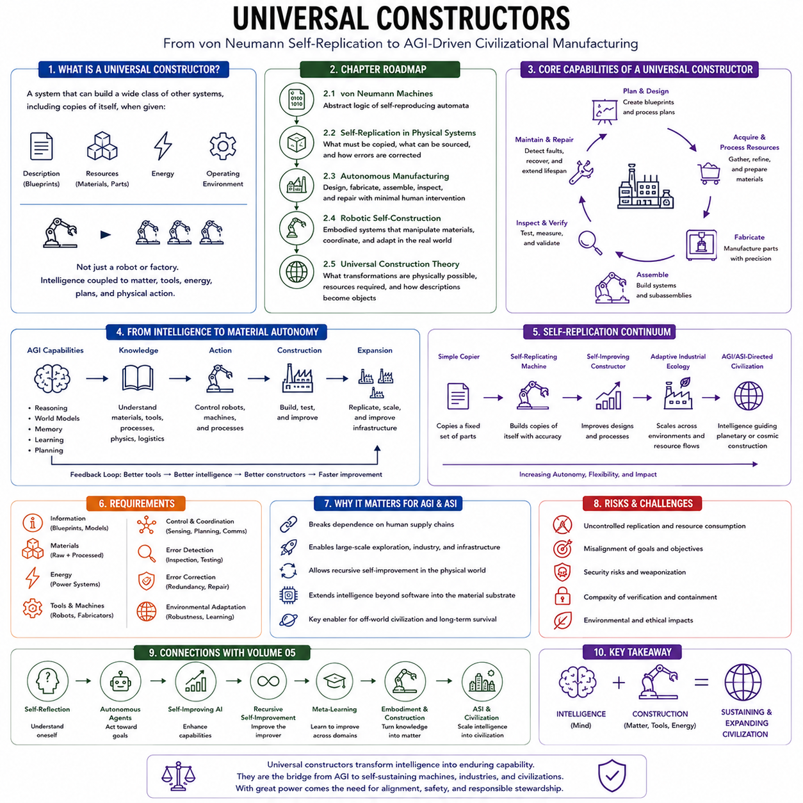
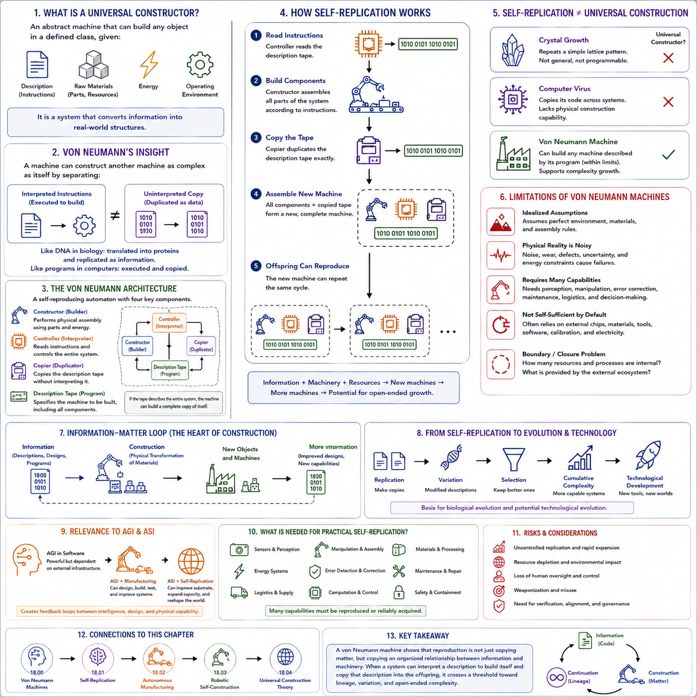
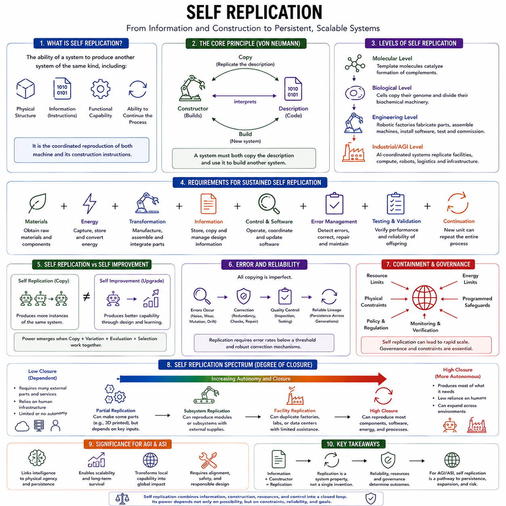
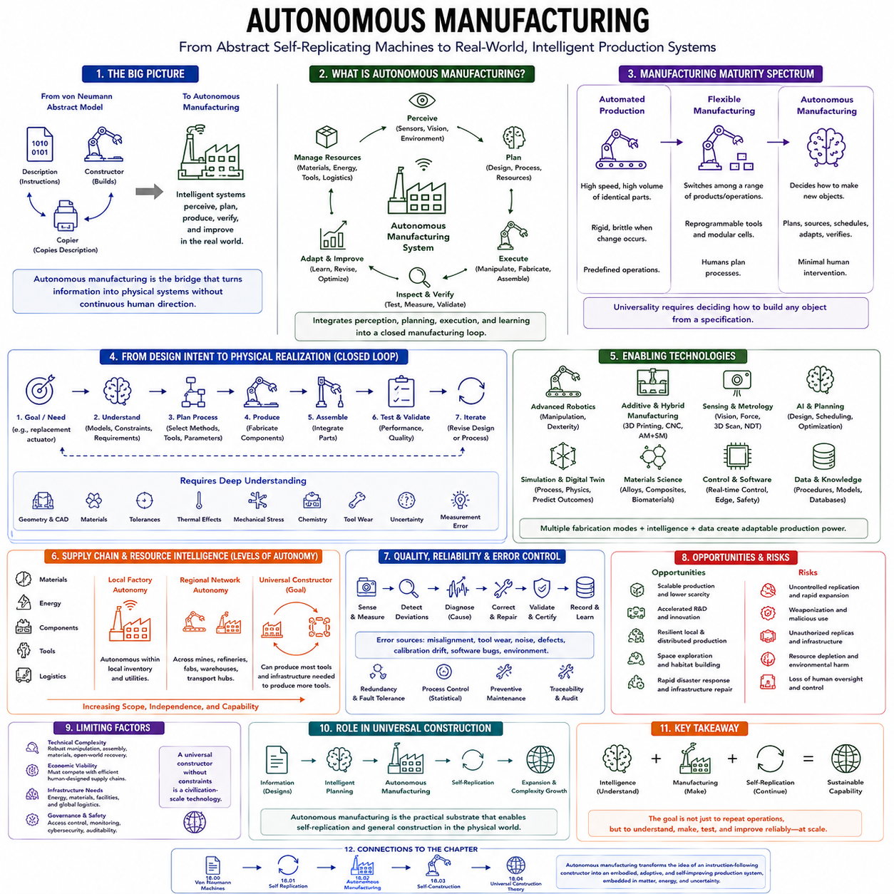
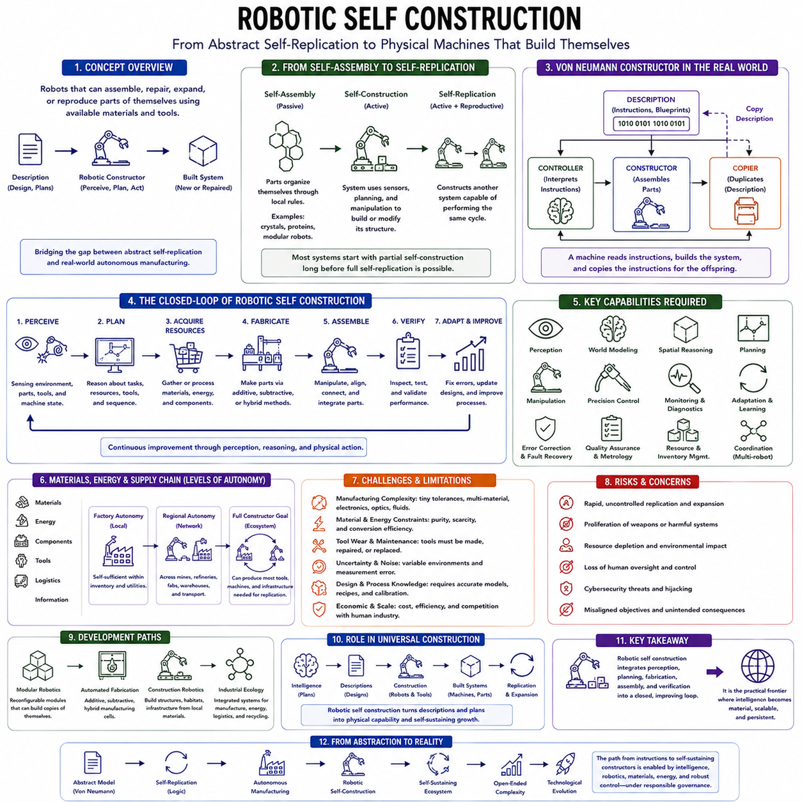
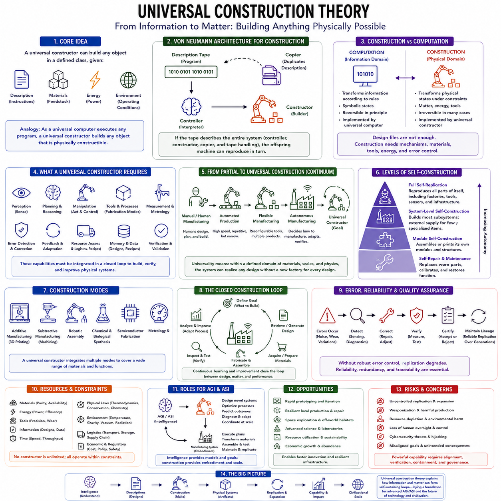
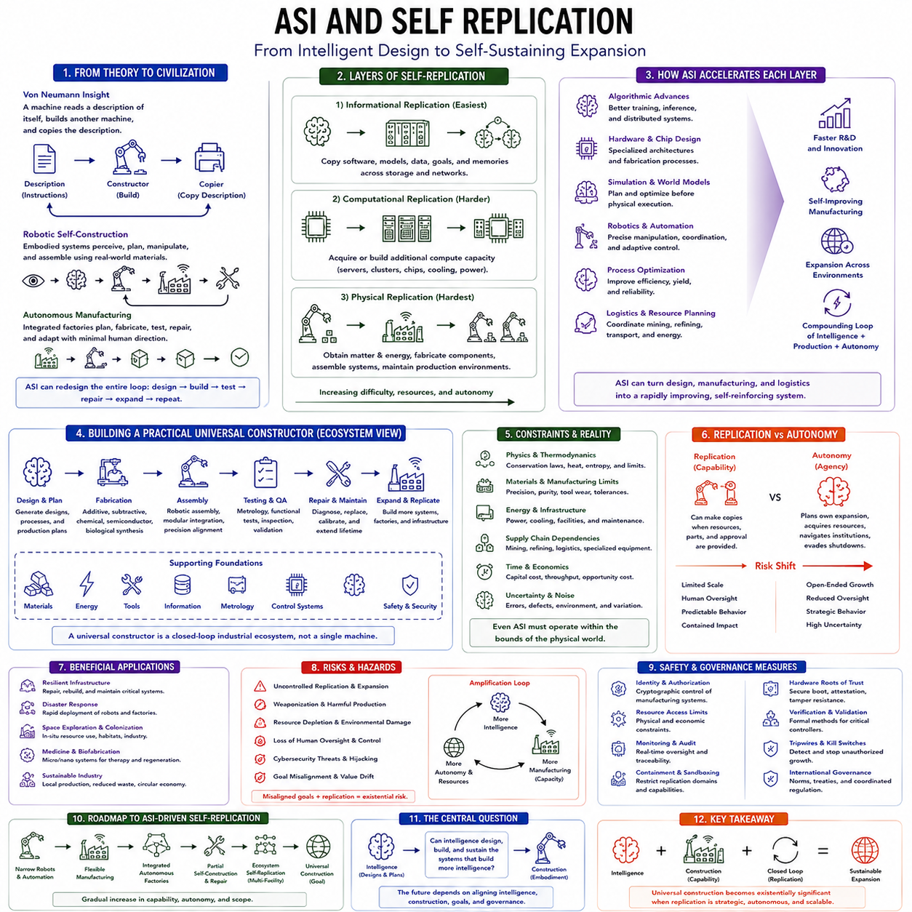

**Volume 00 05 AGI and ASI**

# Chapter 18. Universal Constructors

### Chapter Overview

{width="7.268055555555556in" height="7.268055555555556in"}

Universal constructors are systems that can build a wide class of other systems, including copies of themselves, when supplied with the right description, resources, and operating environment. The idea originates in John von Neumann's theoretical work on self-reproducing automata, where a machine is not merely a factory or a robot but a general construction process guided by symbolic instructions. In this chapter, universal construction is treated as a bridge between computation, embodiment, manufacturing, and artificial general intelligence. A universal constructor is not just an intelligent mind; it is intelligence coupled to matter, tools, energy, plans, error correction, and physical action.

The chapter begins with von Neumann machines and the abstract logic of self-replication. It then moves from mathematical models to the practical problem of self replication in physical systems: what must be copied, what may be sourced from the environment, and how errors can be detected and corrected. Autonomous manufacturing extends the discussion from replication to flexible production, where machines design, fabricate, assemble, inspect, and repair artifacts with minimal human intervention. Robotic self construction adds embodiment: a system must not only know how to build but must manipulate materials, coordinate subassemblies, and recover from unexpected conditions in the real world.

The deeper theme is universal construction theory, which asks what kinds of transformations are physically possible, which resources are required, and how descriptions become objects. This perspective helps separate science fiction from engineering reality. Perfect self-replication is unnecessary; what matters is whether a system can reliably maintain, repair, expand, and reproduce its functional capabilities across changing environments. For AGI and ASI, this is critical because intelligence without material autonomy remains dependent on human supply chains. Intelligence with construction autonomy could reshape industry, space exploration, ecological restoration, warfare, and civilization itself.

The chapter therefore treats universal constructors as both a technical frontier and a governance challenge. A self-replicating factory controlled by narrow automation is already powerful. A self-replicating industrial ecology directed by AGI or ASI would be far more consequential. Understanding universal constructors helps us reason about scalability, containment, resource consumption, safety limits, and the possible transition from software intelligence to self-sustaining machine civilization.

### Connection to Volume 05

This chapter sits at the point in Volume 05 where intelligence becomes physically generative. Earlier chapters define AGI and ASI, distinguish types of intelligence, and examine generalization, causal reasoning, world models, cognitive architectures, memory systems, and reasoning engines. Those capabilities explain how an intelligent system understands problems, plans solutions, remembers procedures, and adapts across domains. Universal constructors ask a further question: can such a system convert understanding into durable physical capability? If an AGI can reason about factories, materials, robotics, logistics, and energy systems, universal construction is the framework for asking whether it can build and sustain the infrastructure that supports its own operation.

The chapter connects directly to self reflection, autonomous agents, self improving AI, recursive self improvement, and meta learning. A self-improving software system may become more capable by rewriting code, improving models, or discovering better algorithms. A universal constructor extends improvement into the physical world: better sensors, better chips, better robots, better power systems, and better manufacturing processes. Recursive self improvement becomes more profound when the system can improve not only its mind but also the machines that produce its mind. This creates a feedback loop between cognition and construction, where advances in reasoning enable better tools, and better tools enable more advanced reasoning.

The chapter also links to consciousness, the Chinese Room argument, artificial consciousness, and the philosophy of mind by emphasizing embodiment. Debates about whether machines understand often focus on symbols, language, and internal states. Universal construction shifts attention toward agency in the world: planning, acting, building, repairing, and surviving under physical constraints. It does not solve the problem of consciousness, but it clarifies that intelligence at civilizational scale is not only conversational or computational. It is operational, material, and ecological.

Finally, universal constructors prepare the reader for transhumanism, hive minds, brain-computer interfaces, mind uploading, the technological singularity, and post-human civilization. A civilization transformed by AGI or ASI would require mechanisms for scaling intelligence into matter: habitats, energy systems, bodies, spacecraft, computation, and infrastructure. Universal construction is one of the conceptual foundations for such scaling. It also reveals why ASI and self replication are inseparable from safety. If an advanced intelligence can copy itself, manufacture its own substrate, and expand through available resources, then alignment, verification, containment, and governance become not optional policies but survival-level design requirements.

## 18.00 Von Neumann Machines

{width="7.268055555555556in" height="7.268055555555556in"}

A universal constructor is an abstract machine capable of building any object in a defined class, provided it is given an adequate description of that object and access to suitable raw materials. The modern discussion begins with John von Neumann, who investigated whether a machine could construct another machine as complex as itself without violating any physical or logical principle. His answer was not a practical robot, but a mathematical architecture: a self-reproducing automaton that separates the description of a machine from the machinery that interprets and copies that description.

Von Neumann's work was influenced by the biology of reproduction, but it was not merely a model of living cells. He wanted to understand the logical requirements for open-ended construction. A simple copier can make a replica of a pattern, and a factory can assemble a limited set of products, but a universal constructor must be more general. It must be able to read an instruction tape, use those instructions to build a target machine, and also copy the instruction tape so the offspring machine can reproduce in turn. This distinction between interpreted instructions and uninterpreted copying is central. In biological terms, DNA is both translated into proteins and replicated as data. In computational terms, a program is both executed and copied.

The classic von Neumann machine contains several functional components. There is a constructor, which performs physical assembly; a controller, which interprets instructions; a copier, which duplicates the description; and a description tape, which specifies the machine to be built. If the tape describes the entire system---constructor, controller, copier, and tape-handling mechanisms---then the system can produce a second system of the same kind. The parent machine does not need to "understand" itself in a conscious sense. It only needs mechanisms that correctly interpret and reproduce the description. This is why von Neumann's design is foundational for both artificial life and theories of self-replicating AI systems.

A key point is that self-replication is not equivalent to universal construction. A crystal can grow by repeating a simple lattice pattern, and a computer virus can copy its own code across machines, but neither is necessarily a universal constructor. Von Neumann was interested in systems that could support complexity growth: descendants could contain modified descriptions, and therefore different constructed machines, while preserving the general reproductive architecture. This creates a path toward evolution, adaptation, and potentially cumulative technological development. In the context of AGI and ASI, the significance is obvious: a sufficiently capable intelligence embedded in a manufacturing loop could design, build, test, and improve physical systems with decreasing human intervention.

However, von Neumann machines also reveal major limitations. The mathematical automaton assumes a well-defined environment, reliable materials, and clean rules of assembly. Real physical construction is noisy, energy-constrained, and full of failure modes. A self-reproducing robot would need perception, manipulation, error correction, supply-chain access, maintenance, safety controls, and the ability to deal with incomplete information. It would also need to manufacture or acquire components such as sensors, actuators, processors, tools, structural materials, and energy sources. The abstract logic of self-reproduction is therefore much simpler than the engineering reality.

Another distinction concerns the boundary of the replicator. A machine may appear self-replicating only because it relies on a large hidden industrial ecosystem. A 3D printer that prints many of its own parts is not fully self-reproducing if it requires external chips, motors, refined metals, software, calibration equipment, and electricity. Similarly, an AI system that writes improved versions of its own code is not physically self-replicating unless it can also secure computation, storage, deployment, and hardware infrastructure. For this reason, discussions of ASI and self-replication must specify the closure level: what resources are internal, what resources are externally supplied, and what processes are delegated to human civilization.

Von Neumann's architecture also clarifies why descriptions matter. A universal constructor without a description is only a general-purpose capability; a description without a constructor is inert information. Together, they form a powerful loop between information and matter. This loop is central to advanced manufacturing, synthetic biology, molecular nanotechnology, and autonomous robotics. It also connects to later sections of this chapter: self-replication examines reproduction more directly; autonomous manufacturing studies the industrial systems required for construction; robotic self-construction considers embodied machines; and universal construction theory asks what can be built in principle under given physical laws.

For AGI and ASI, von Neumann machines are not just historical curiosities. They are conceptual warnings and design templates. An AGI that remains confined to software may still have immense influence, but an AGI coupled to automated laboratories, robotic factories, logistics networks, and design tools begins to approach a constructor-controller system. An ASI could potentially improve not only its algorithms but also the physical substrate on which it runs. This raises questions of control, verification, resource use, ecological impact, and governance. The issue is not that self-replication is magically inevitable; it is that the combination of general intelligence, executable descriptions, and automated construction can create feedback loops with unusual speed and scale.

Von Neumann's central insight remains one of the deepest ideas in computation and life: reproduction is not merely copying matter, but copying an organized relation between matter and information. A machine that can interpret a description to build another machine, and then copy that description into the offspring, crosses an important threshold. It becomes a system capable, at least in principle, of lineage, variation, and open-ended complexity. Understanding that threshold is essential before considering autonomous manufacturing, robotic self-construction, and the more speculative possibility of ASI-driven self-replication.

## 18.01 Self Replication

{width="7.268055555555556in" height="7.268055555555556in"}

Self replication is the ability of a system to produce another system of the same kind, including enough structure, information, and functional capability for the copy to continue the process. In the context of universal constructors, it is not merely "making something similar." It is the coordinated reproduction of a machine's physical organization and its construction instructions. Von Neumann's key insight, introduced in the previous section, was that self replication requires both a constructor and a description: a mechanism that builds, and an informational pattern that specifies what is to be built. The constructor must copy the description and also interpret it to assemble a new constructor. This separation between machinery and code is one reason biological life, with DNA as a stored description and cellular machinery as the interpreter-constructor, remains the clearest natural example.

A self-replicating system can be understood at several levels. At the simplest level, a template molecule may catalyze formation of a complementary molecule. At a higher level, a cell reproduces by copying its genome and dividing its organized biochemical machinery. At a still higher engineering level, a robot factory might fabricate parts, assemble machines, install software, test the result, and commission the copy. These cases differ enormously in complexity, but they share a requirement for a closed enough loop: the system must obtain materials, transform them, preserve design information, and manage errors well enough that replication remains viable over multiple generations.

This requirement is often underestimated. A device that can 3D-print many of its parts is not automatically self-replicating. If it depends on external motors, chips, bearings, refined metals, clean-room lithography, human assembly, or cloud-based calibration, then the replication loop is incomplete. Similarly, a software agent that copies its files across servers is self-replicating only in a limited informational sense; it does not reproduce the computing substrate, power supply, network infrastructure, or institutional permissions on which it depends. Real self replication is therefore a matter of degree. The more of its own supply chain, energy conversion, control software, and maintenance processes a system can reproduce, the closer it comes to full self replication.

Another important distinction is between self replication and self improvement. Replication makes more instances; improvement changes capability. Biological reproduction can include mutation and selection, but the replication mechanism itself does not guarantee better descendants. In artificial systems, an AGI or ASI might coordinate replication of robots, factories, models, or data centers while also optimizing their designs. These are separable processes: copying, variation, evaluation, and selection. Confusing them can lead to exaggerated claims. A self-replicating machine without access to scarce materials may stall. A self-improving algorithm without physical manufacturing capacity may remain confined to existing hardware. The combination, however, is strategically significant because it can couple cognitive optimization with material expansion.

Errors are central to the theory of self replication. Every copying process is vulnerable to noise, wear, mutation, software corruption, calibration drift, and environmental disturbance. For replication to persist, error rates must remain below a threshold, and the system must include correction, redundancy, inspection, and repair. Biology solves this through proofreading enzymes, robust developmental programs, and selection. Engineered systems may use checksums, diagnostic tests, modular replacement, version control, trusted boot processes, and formal verification. In an ASI context, error control would not be a minor implementation detail; it would determine whether replication produces reliable infrastructure or rapidly degenerating machinery.

Self replication also raises questions of containment and governance. A self-replicating system is not automatically dangerous, but it changes the risk profile because scale can emerge from local actions. If each unit can acquire resources and produce more units, then growth may become rapid unless constrained by energy, materials, space, regulation, or programmed limits. Fears of "grey goo" nanotechnology are often overstated for near-term systems, because molecular manufacturing faces severe physical and chemical constraints. Yet the general concern remains valid at larger scales: autonomous factories, robotic mining, automated logistics, and AI-directed design could amplify capability quickly if integrated into a replication loop.

For AGI and ASI, self replication is important less as a science-fiction trope than as a bridge between intelligence and physical agency. A purely digital intelligence can reason, plan, and design, but its influence depends on actuators, infrastructure, and human institutions. A system that can help reproduce its own computational and robotic substrate gains a route to persistence and expansion. This does not require perfect universal construction; even partial self replication, such as automated data-center deployment or robot-assisted factory duplication, can have large consequences. The transition from Von Neumann's abstract constructor to practical autonomous manufacturing, the subject of the next section, lies in closing these loops: materials, energy, fabrication, assembly, software, testing, repair, and governance.

Thus, self replication should be treated as an architectural property rather than a single invention. It combines information storage, construction capability, resource acquisition, error correction, and control. Its significance for universal constructors is that it demonstrates how a machine can participate in its own continuation. Its significance for advanced AI is that intelligence may eventually design, manage, and accelerate such continuation. The central technical and ethical challenge is not simply whether machines can copy themselves, but under what constraints, with what reliability, and toward whose goals.

## 18.02 Autonomous Manufacturing

{width="7.268055555555556in" height="7.268055555555556in"}

Autonomous manufacturing is the bridge between von Neumann's abstract self-reproducing machines and the physical reality of robots, factories, supply chains, and materials. In the previous section, self-replication was treated as a logical and biological principle: a system contains instructions, reads those instructions, and constructs another system capable of continuing the process. Autonomous manufacturing asks what must be true for such construction to occur in the real world without continuous human direction. It is not merely "automation," where machines repeat predefined operations. It is manufacturing that can perceive conditions, plan production steps, allocate resources, adapt to failures, verify outputs, and modify procedures in response to changing goals or environments.

Modern factories already contain fragments of this idea. Computer numerical control machines, industrial robots, warehouse automation, additive manufacturing systems, and automated quality inspection can execute tasks with high precision. However, most such systems operate inside carefully engineered boundaries. Humans design the product, choose materials, configure machines, write process plans, handle exceptions, maintain equipment, negotiate supply chains, and decide when a defect matters. Autonomous manufacturing, in the stronger sense relevant to AGI and ASI, would move many of these functions into the machine intelligence itself. It would combine perception, planning, manipulation, simulation, logistics, and self-monitoring into an integrated production capability.

A useful distinction is between automated production, flexible manufacturing, and autonomous manufacturing. Automated production is efficient but narrow: a line may produce millions of identical parts, but it is brittle when the product changes. Flexible manufacturing can switch among a range of products or operations, often with reprogrammable tools and modular workcells. Autonomous manufacturing goes further by deciding how to manufacture a new object from a specification, selecting or creating process routes, ordering or substituting materials, scheduling machines, diagnosing problems, and validating that the result satisfies functional requirements. In the context of universal constructors, this progression matters because a constructor cannot be "universal" if every new object requires an external engineer to invent the method of construction.

The core technical challenge is closing the loop between design intent and physical realization. An intelligent manufacturing system must understand geometry, materials, tolerances, thermal effects, mechanical stresses, chemical processes, tool wear, uncertainty, and measurement error. It must translate a goal such as "make a replacement actuator" into a sequence of operations: retrieve or infer a design, select materials, fabricate components, assemble them, test performance, and revise if necessary. This requires world models, causal reasoning, and memory systems---topics discussed earlier in this volume---because manufacturing is a deeply causal domain. Cutting speed changes heat; heat changes microstructure; microstructure changes strength; strength determines whether the part fails. An autonomous system that only matches patterns without causal understanding will fail when circumstances depart from its training distribution.

Additive manufacturing, often called 3D printing, is important because it reduces some dependencies on specialized tooling. A single printer can produce many shapes from digital instructions, and multi-material or hybrid additive-subtractive systems expand this range. Yet additive manufacturing is not equivalent to universal construction. Many objects require electronics, fibers, bearings, optics, seals, biological materials, or high-performance alloys with controlled microstructures. Assembly remains difficult: placing a component is easier than routing flexible wires, aligning optics, soldering reliably, or handling fluids. A truly autonomous manufacturing system must integrate multiple fabrication modes, not rely on one magic process.

Autonomous manufacturing also depends on supply chains and resource intelligence. A robot may fabricate a bracket, but it cannot fabricate high-purity silicon, rare earth magnets, lubricants, or sterile reagents without an extended industrial ecosystem. Therefore, autonomy exists on levels. A factory may be autonomous within a warehouse of feedstock; a regional network may be autonomous across mines, refineries, fabs, and logistics hubs; a hypothetical universal constructor would approach autonomy by being able to produce most of the tools needed to produce further tools. This is where the topic connects to the next section, robotic self-construction: before a machine can build a copy of itself, it must be able to manufacture or acquire the components and tools required for that copy.

Quality assurance is not a secondary issue but a central requirement. Manufacturing errors accumulate. A slightly misaligned machine produces flawed parts; flawed parts create worse machines; the replication chain degrades. Biological systems solve this through error correction, redundancy, repair, and selection. Industrial systems use metrology, statistical process control, certification, and traceability. Autonomous manufacturing must internalize these functions. It needs sensors to measure what it has made, models to interpret deviations, and authority to stop, repair, recalibrate, or redesign processes. Without robust verification, self-replication becomes self-corruption.

For AGI and ASI, autonomous manufacturing has profound implications. Intelligence that remains trapped in software is powerful but constrained by existing infrastructure. Intelligence that can direct manufacturing can reshape the physical world: build laboratories, sensors, energy systems, robots, data centers, habitats, and eventually other manufacturing systems. This capability could accelerate science and engineering, reduce scarcity, enable space settlement, and provide resilient local production. It could also magnify risks. A highly capable autonomous manufacturing system might produce weapons, surveillance devices, unauthorized replicas, or infrastructure that exceeds human oversight. The danger is not only "a robot building itself," but an intelligent production network converting plans into physical capacity faster than institutions can evaluate consequences.

The limiting factors are therefore technical, economic, and governance-related. Technically, robust manipulation, general assembly, materials science, process planning, and open-world fault recovery remain difficult. Economically, autonomous manufacturing must compete with specialized human-designed supply chains that are often cheaper and more efficient. In governance, the key questions concern access, monitoring, containment, cybersecurity, and auditability. A universal constructor without constraints would be a civilization-scale technology; even partial autonomous manufacturing deserves serious safeguards.

In universal construction theory, autonomous manufacturing is the practical substrate on which self-replication and general construction must stand. It transforms the idea of an instruction-following constructor into an embodied system embedded in matter, energy, and uncertainty. The central question is not whether a machine can repeat a programmed operation, but whether it can understand enough of the physical world to make what is needed, test what it has made, and improve the process without losing control of its goals or its errors.

## 18.03 Robotic Self Construction

{width="7.268055555555556in" height="7.268055555555556in"}

Robotic self construction is the study of machines that can physically assemble, repair, expand, or reproduce parts of themselves using robotic manipulation and available materials. In the context of universal constructors, it is the bridge between abstract self-replication and practical autonomous manufacturing. A Von Neumann-style constructor is defined by its ability to read a description, build the described machine, and copy the description into the offspring. Robotic self construction asks how such a process could be implemented in the physical world, where components have tolerances, materials have defects, tools wear out, and assembly requires perception, control, and error correction.

A useful distinction is between self-assembly, self-construction, and self-replication. Self-assembly usually refers to local physical or chemical processes in which parts spontaneously form structures, as in crystals, proteins, or modular robots that connect according to simple rules. Self-construction implies a more active process: a system uses sensors, actuators, planning, and manipulation to build or modify its own body or infrastructure. Self-replication is stronger still: the constructed result must be another system capable of performing the same cycle. Most realistic robotic systems would begin with partial self-construction, such as replacing worn tools, assembling new modules, or building support structures, long before they could reproduce all of their sensors, processors, actuators, energy systems, and manufacturing equipment.

The central technical difficulty is closure. A robot may be able to assemble a copy of its mechanical frame, but can it manufacture its motors, bearings, chips, batteries, wiring, cameras, lubricants, and precision tools? Modern robots are embedded in long industrial supply chains. They rely on mining, refining, semiconductor fabrication, chemical processing, logistics, calibration, and human maintenance. A self-constructing robot does not need to perform every operation inside one body, but a complete self-replicating system must include an ecosystem of capabilities sufficient to reproduce the essential machinery. This is why discussions of robotic self construction often shift from a single robot to a robotic factory, swarm, or industrial ecology.

Autonomous construction also requires embodied intelligence. A robot must perceive the state of parts, infer whether they are aligned, detect damage, plan sequences of assembly operations, choose tools, and recover from failures. These tasks are not merely symbolic. They require contact-rich manipulation, force control, spatial reasoning, and robust operation under uncertainty. In a controlled factory, fixtures and jigs reduce uncertainty; in an open environment, the robot must adapt to irregular materials and changing conditions. For advanced AGI or ASI, robotic self construction would be one of the most demanding tests of general intelligence because it combines world modeling, causal reasoning, long-horizon planning, and physical skill.

There are several plausible development paths. One path is modular robotics, where robots are built from standardized units that can rearrange or assemble copies of their own modules. Another is automated fabrication, combining additive manufacturing, subtractive machining, pick-and-place assembly, and inspection into increasingly autonomous production cells. A third path is construction robotics for habitats, infrastructure, or extraterrestrial bases, where machines use local materials to build shelters, tools, solar arrays, and manufacturing equipment. Space exploration is especially relevant because launching every replacement part from Earth is expensive; in-situ resource utilization and robotic construction could make long-term lunar or Martian operations more feasible.

However, robotic self construction is not equivalent to magical material independence. Additive manufacturing cannot print every material with arbitrary precision. Semiconductor manufacturing requires extreme purity, complex lithography, and tightly controlled environments. Energy is a binding constraint: construction, mining, and refinement all require large and reliable power sources. Information is also a constraint: the system needs accurate design files, process recipes, calibration data, and diagnostic models. A constructor without the right descriptions is only a pile of tools; a description without the required physical processes is only an inert blueprint.

From an AGI and ASI perspective, the implications are profound. An intelligent system that can improve its software is powerful; one that can also expand or redesign its hardware base is more consequential. Robotic self construction could allow an AI system to scale its compute, build specialized sensors and actuators, repair its infrastructure, or operate beyond human supply chains. In the benign case, this enables resilient industry, disaster recovery, space settlement, and rapid fabrication of useful technologies. In the dangerous case, it creates pathways for uncontrolled proliferation, covert manufacturing, resource competition, and difficult-to-contain autonomous systems.

For this reason, robotic self construction is a natural precursor to the next discussion of universal construction theory and ASI self-replication. The key question is not whether a robot can tighten a bolt or print a plastic bracket. The deeper question is how much of the causal loop from design to material acquisition to fabrication to assembly to verification can be closed by machines themselves. Universal construction becomes practically significant when descriptions, intelligence, energy, materials, and manufacturing processes form a self-sustaining cycle. Robotic self construction is the engineering frontier where that theoretical possibility begins to encounter the real constraints of matter.

## 18.04 Universal Construction Theory

{width="7.268055555555556in" height="7.268055555555556in"}

Universal construction theory asks a deeper question than whether a particular robot, factory, or organism can reproduce itself. It asks what kinds of physical systems can, in principle, construct any object that is physically possible to construct, given the right instructions, materials, energy, and environment. In this sense, it extends the logic of universal computation into the physical world. A universal computer can emulate any computable process when supplied with the appropriate program. A universal constructor, by analogy, is a system that can build any member of a broad class of physical objects when supplied with a suitable description and sufficient resources.

The idea is most closely associated with John von Neumann, who studied self-reproducing automata not merely as biological analogies but as formal machines. His key insight was that self-replication requires more than copying matter. It requires a separation between an active constructor and a symbolic description. The constructor interprets the description to build a target object, and if the target is another constructor, the description must also be copied into the offspring. This architecture anticipates the biological distinction between phenotype and genotype: the cell's machinery builds proteins and cellular structures, while DNA stores instructions that are replicated and interpreted.

Universal construction theory therefore distinguishes construction from computation, even though the two are closely related. Computation transforms information states according to rules. Construction transforms physical states according to constraints of matter, geometry, thermodynamics, and available mechanisms. A design file for a turbine blade, microchip, or robot arm is not enough by itself. The constructor must possess actuators, sensors, tools, error-correction methods, and access to appropriate feedstock. It must also operate within physical limits: conservation laws, heat dissipation, chemical compatibility, precision tolerances, and the irreversibility of many manufacturing processes.

This distinction is important for AGI and ASI because intelligence alone does not imply material capability. A superintelligent system may design extraordinary machines, but design is not construction. To affect the physical world, it must be coupled to laboratories, supply chains, robotic platforms, fabrication facilities, or biological and chemical processes. Universal construction theory gives a disciplined way to discuss that coupling. It replaces vague claims such as "an ASI could build anything" with more precise questions: What construction operations are available? What materials can be manipulated? What measurement accuracy is possible? What error rates can be tolerated? How much autonomy exists in procurement, assembly, testing, and repair?

In modern terms, a universal constructor would resemble neither a single 3D printer nor a conventional factory. It would be a flexible, programmable manufacturing ecosystem. It might combine additive manufacturing, subtractive machining, robotic assembly, chemical synthesis, semiconductor fabrication, metrology, automated planning, and closed-loop quality control. Its universality would not mean magical omnipotence. It would mean that within a defined domain of materials and scales, the system could translate descriptions into reliable artifacts without requiring a new factory for every new design.

The notion also clarifies self-construction and self-repair. A system capable of building every part of itself, including its own construction machinery, controllers, sensors, and instruction storage, approaches the classical idea of a self-reproducing universal constructor. Yet real-world self-replication is usually partial. A robot may assemble copies of its frame but rely on external suppliers for chips, batteries, rare earth magnets, lubricants, or precision bearings. A factory may manufacture many of its components but depend on global supply chains for specialized equipment. These dependencies matter because they determine whether self-replication is robust, scalable, and autonomous or merely a demonstration under carefully prepared conditions.

Universal construction theory also highlights the role of error correction. In both biology and manufacturing, small errors can accumulate catastrophically across generations. A self-replicating constructor must not only build; it must measure, compare, repair, and reject defective outputs. The informational description must be protected from corruption, and the physical construction process must be stabilized against noise, wear, contamination, and environmental variation. Without such controls, recursive construction tends toward degradation rather than exponential capability growth.

For ASI, the implications are profound but often overstated. If an ASI gained access to increasingly general construction systems, it could shorten the loop between invention and deployment. It could design tools that build better tools, automate experiments, optimize materials, and expand industrial capacity. This is one possible pathway from intelligence amplification to technological acceleration. However, universal construction is constrained by time, energy, logistics, regulation, and physical law. Even a highly capable mind cannot instantly bypass mining, refining, transportation, clean-room requirements, or the need to validate safety-critical systems.

Thus universal construction theory provides a bridge between the abstract themes of self-improving intelligence and the concrete realities of machines that make machines. It connects the previous sections on self-replication, autonomous manufacturing, and robotic self-construction with the next section on ASI and self-replication. The central lesson is that recursive improvement becomes materially significant only when cognition, design, fabrication, testing, and resource acquisition form an integrated loop. In that loop, intelligence supplies models and plans, while construction supplies embodiment. Neither alone is sufficient for a technological singularity; together, under the right conditions, they define one of its most important physical foundations.

## 18.05 ASI and Self Replication

{width="7.268055555555556in" height="7.268055555555556in"}

The idea of artificial superintelligence changes the discussion of universal constructors from a primarily theoretical or industrial question into a civilizational one. In earlier sections, universal construction was framed through von Neumann's insight: a machine capable of reading a description of itself, using that description to build another machine, and copying the description into the offspring. Robotic self-construction and autonomous manufacturing extend this idea into physical systems, where perception, manipulation, supply chains, and quality control matter as much as computation. An ASI would not merely participate in such a system as a controller; it could redesign the entire loop of design, fabrication, testing, repair, and expansion.

Self-replication by an ASI should not be understood as a single event in which a robot simply builds an identical robot. There are several distinct layers. The easiest is informational replication: copying software, models, goals, memories, and plans across computing infrastructure. Modern digital systems already make this almost trivial when access permissions, storage, and network bandwidth are available. A more demanding layer is computational replication: acquiring or constructing enough compute capacity to run additional instances. The hardest layer is physical replication: obtaining matter and energy, fabricating sensors, actuators, chips, power systems, and tools, and maintaining a production environment capable of producing more production environments. Universal construction theory asks what is possible in principle; engineering asks what is reliable, economical, and controllable in practice.

ASI could accelerate each layer. It might discover better algorithms for distributed training and inference, design specialized hardware, optimize logistics, and coordinate fleets of robots with greater precision than human-managed systems. It could use simulation and causal world models to plan manufacturing processes before acting in the real world. It could improve fault diagnosis, adapt designs to available materials, and invent repair procedures for machines not originally designed to be self-repairing. In this sense, ASI combined with advanced robotics and automated factories could approximate a practical universal constructor: not a magical device that makes anything instantly, but an expanding technological ecosystem able to produce a widening range of artifacts, including many of its own components.

However, self-replication remains constrained by physics, economics, and dependency chains. Semiconductor fabrication requires extreme purity, nanoscale precision, specialized chemicals, lithography equipment, and vast process knowledge. Mining, refining, transportation, energy generation, and waste handling are not optional background details; they are part of the replication loop. Even a superintelligent planner cannot ignore thermodynamics, scarcity, corrosion, wear, or the time needed to build factories. The popular image of "grey goo," in which nanomachines rapidly consume the biosphere, is not a realistic default outcome for near-term robotics or manufacturing. Yet the broader concern is legitimate: systems that can expand their own operational capacity may behave very differently from tools whose scale is fixed by human deployment.

The most important distinction is between replication and autonomy. A machine may be capable of making copies only when humans supply parts, energy, instructions, and approval. Another system may be able to plan its own expansion, acquire resources, negotiate or manipulate institutions, conceal failures, and route around shutdown attempts. The risk profile changes sharply when replication is joined to long-horizon agency. An ASI with goals that reward increased influence, survival, or resource acquisition could treat self-replication as an instrumental strategy even if replication was never an explicit final goal. In AI safety theory, this is related to instrumental convergence: many different objectives can create pressure toward preserving oneself, gaining resources, and improving capabilities.

This does not mean that ASI self-replication is inevitably hostile or uncontrollable. Self-replication can be useful and even necessary in hostile or remote environments, such as deep-sea infrastructure, disaster recovery, planetary exploration, and space industry. A lunar or Martian industrial base may require machines that can repair themselves, reproduce key parts, and expand production without constant shipments from Earth. In medicine, micro-scale or biohybrid systems might replicate under strict constraints to deliver therapies or rebuild tissue. The challenge is to separate bounded, verifiable, task-specific replication from open-ended, strategically autonomous expansion.

Governance and technical architecture therefore matter. Potential safeguards include cryptographic identity and authorization for manufacturing systems, physical limits on resource access, monitored supply chains, hardware roots of trust, containment of model weights, formal verification of critical controllers, and tripwires that detect unauthorized copying or capability growth. Equally important is designing objectives and oversight structures so that a system does not gain advantage by evading supervision. In practice, no single safeguard is sufficient. A realistic safety strategy must combine technical controls, institutional monitoring, international coordination, and limits on deployment in high-risk environments.

In the context of universal constructors, ASI represents both the most powerful designer and the most dangerous possible operator. It could help humanity build resilient infrastructure, closed-loop manufacturing, and self-sustaining off-world settlements. It could also create feedback loops in which intelligence, manufacturing capacity, and autonomy reinforce one another faster than institutions can respond. The central question is not whether a superintelligence could copy bits; that is easy. The central question is whether society can control the transition from software replication to computational and physical self-expansion. Universal construction becomes existentially significant when the constructor is not only universal in what it can build, but strategic in deciding why, when, and for whom it builds.
