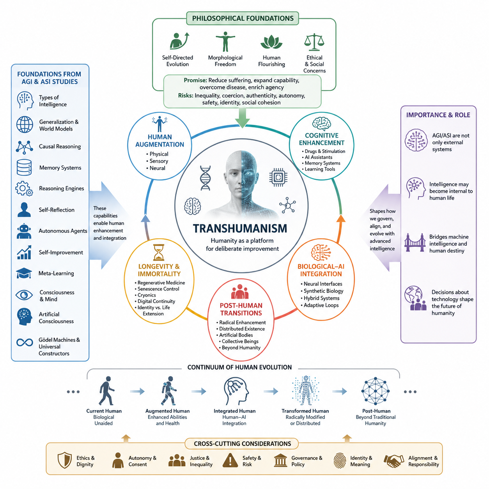
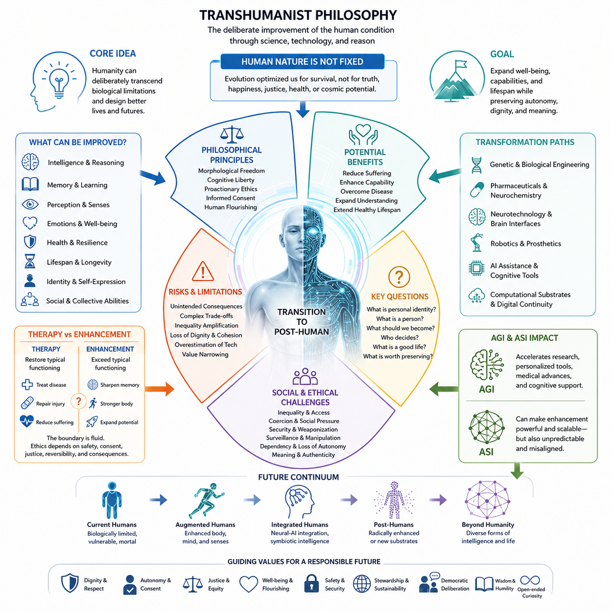
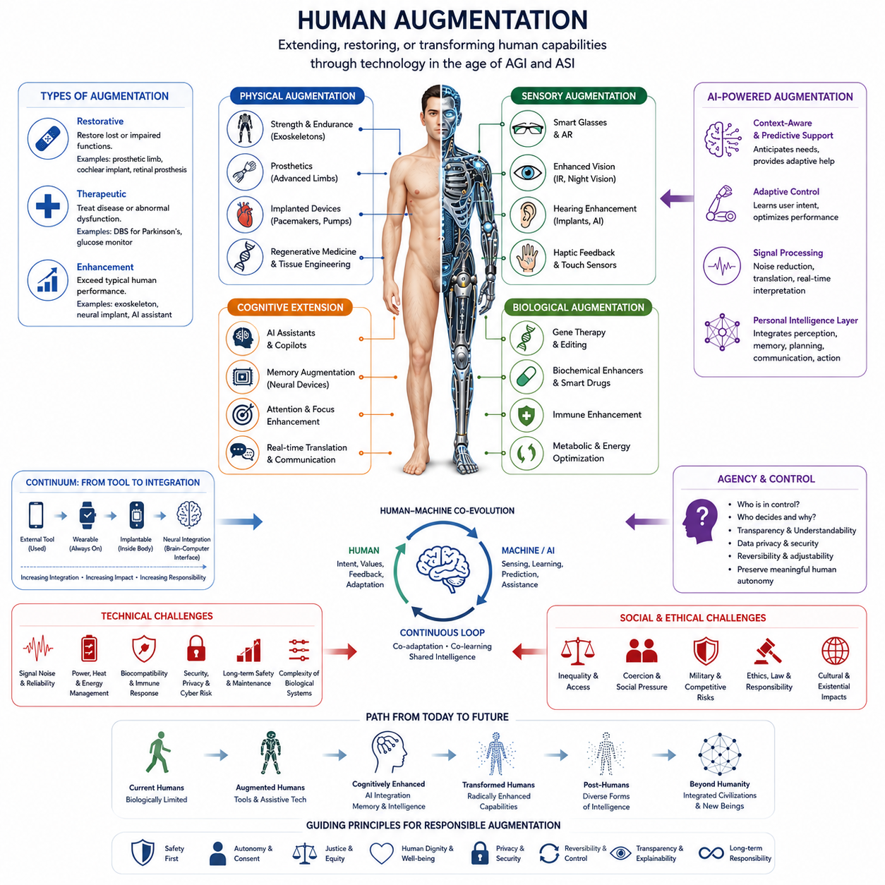
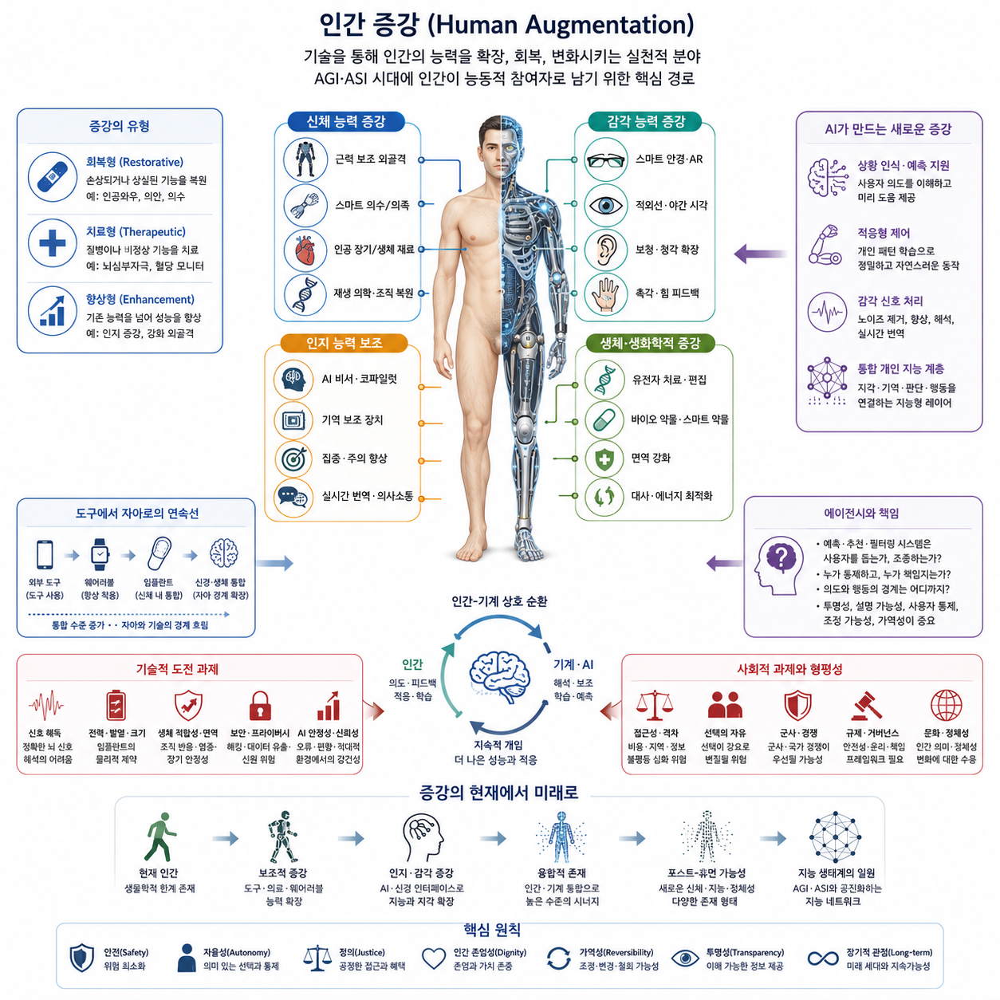
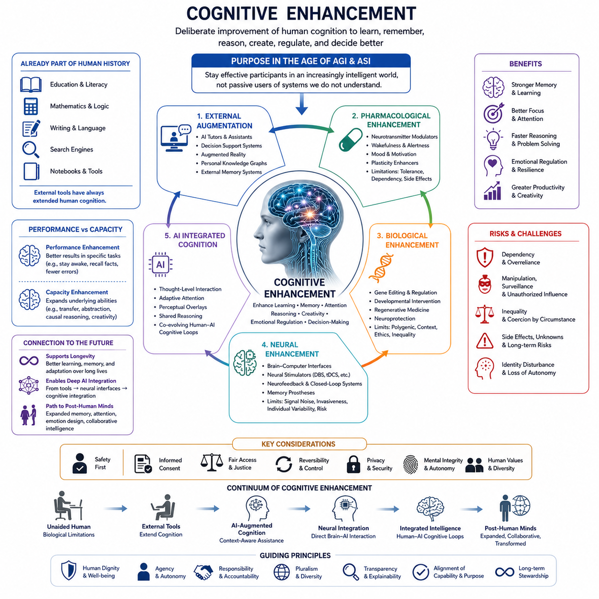
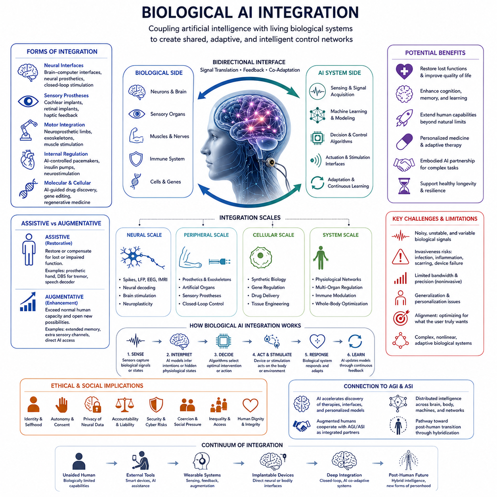
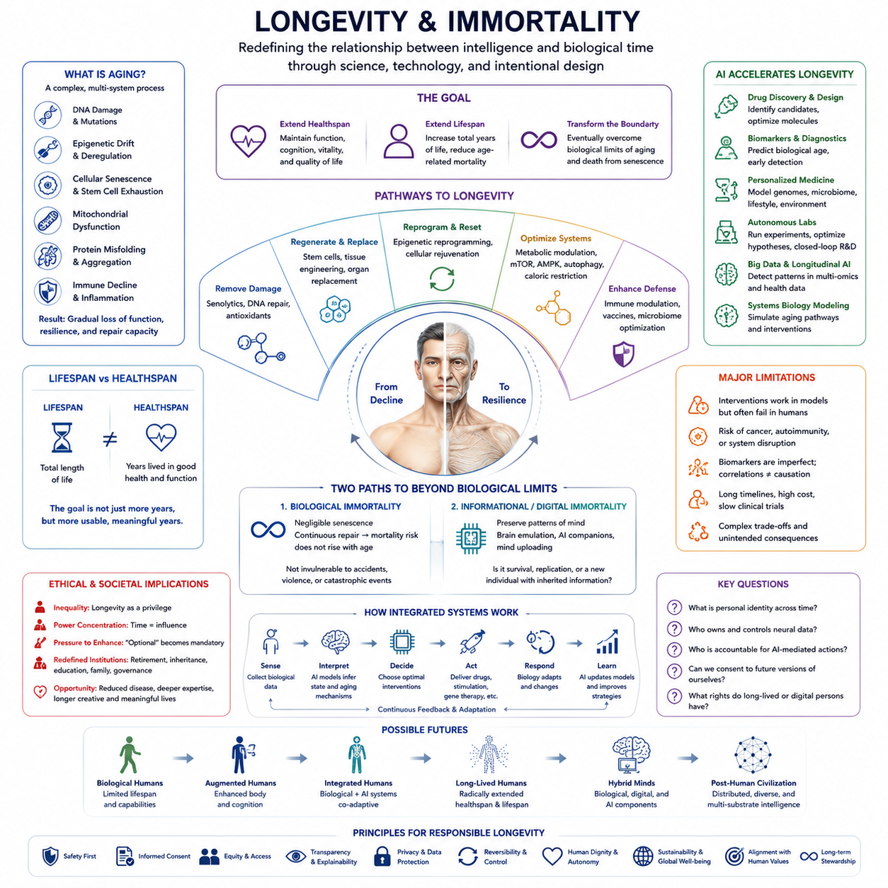
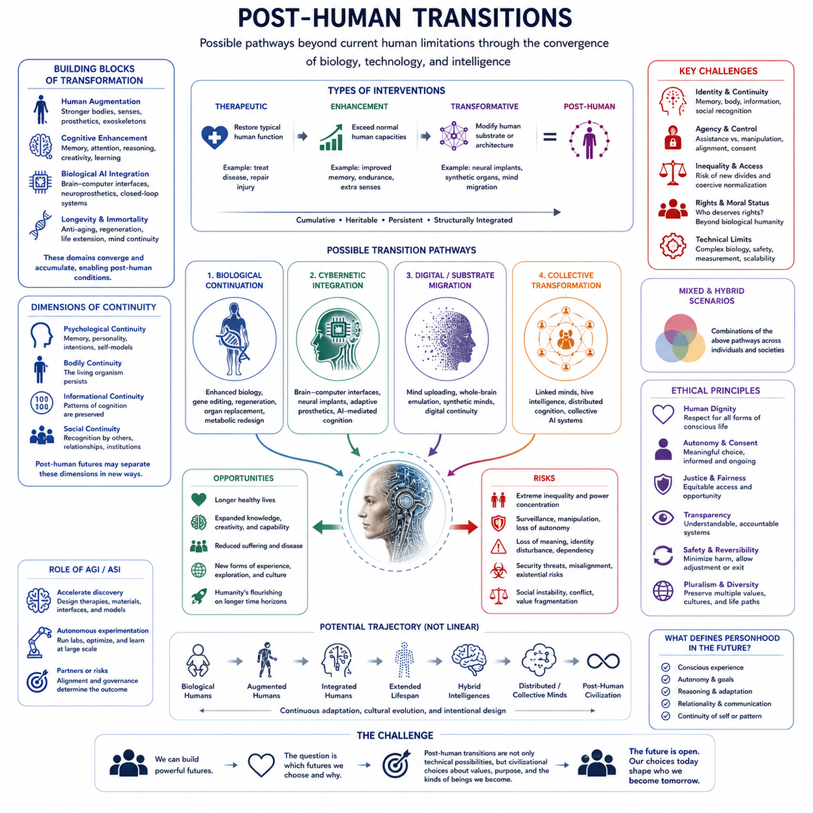

**Volume 00 05 AGI and ASI**

# Chapter 20. Transhumanism

### Chapter Overview

{width="7.268055555555556in" height="7.268055555555556in"}

Transhumanism is the philosophical, scientific, and cultural movement that treats the human condition not as a fixed endpoint, but as a platform for deliberate improvement. In the context of AGI and ASI, transhumanism asks what happens when intelligence is no longer confined to biological evolution, ordinary cognition, or the natural limits of the human body. It explores the possibility that future humans may augment perception, memory, reasoning, emotion, health, lifespan, and even identity through biotechnology, neurotechnology, artificial intelligence, robotics, and computational substrates.

This chapter examines transhumanism as both a promise and a problem. Its promise is that technology may reduce suffering, expand human capability, overcome disease, compensate for disability, and enable richer forms of agency. Its problem is that enhancement technologies raise difficult questions about inequality, coercion, authenticity, autonomy, safety, governance, and the meaning of being human. If intelligence can be amplified, bodies redesigned, brains linked to machines, and lifespans radically extended, then ethical and political decisions become as important as technical feasibility.

The chapter's scope moves from philosophy to implementation. It begins with transhumanist philosophy, including ideas of self-directed evolution, morphological freedom, human flourishing, and the critique that enhancement may undermine human dignity or social cohesion. It then considers human augmentation in physical, sensory, and neural forms, followed by cognitive enhancement through drugs, brain stimulation, AI assistants, memory systems, and learning tools. Biological AI integration introduces hybrid systems in which living tissue, neural interfaces, synthetic biology, and machine intelligence begin to form coupled adaptive loops. Longevity and immortality address regenerative medicine, senescence control, cryonics, digital continuity, and the distinction between life extension and identity preservation. Finally, post-human transitions examine what it may mean for descendants of humanity to become radically modified, distributed, artificial, or collective beings.

The importance of this chapter lies in its position at the boundary between artificial intelligence and human destiny. AGI and ASI are often discussed as external systems that may assist, compete with, or govern human civilization. Transhumanism reframes the issue: advanced intelligence may also become internal to human life, embedded in bodies, cognition, institutions, and cultures. Understanding this possibility is essential for evaluating futures in which the line between human and machine becomes porous, negotiated, and perhaps ultimately obsolete.

트랜스휴머니즘(Transhumanism)은 인간 조건을 고정된 종착점으로 보지 않고, 의도적으로 개선할 수 있는 플랫폼으로 보는 철학적·과학적·문화적 운동이다. AGI와 ASI의 맥락에서 트랜스휴머니즘은 지능이 더 이상 생물학적 진화, 보통의 인지 능력, 인간 신체의 자연적 한계에 갇혀 있지 않을 때 어떤 일이 일어나는지를 묻는다. 그것은 미래의 인간이 생명공학(biotechnology), 신경기술(neurotechnology), 인공지능(artificial intelligence), 로봇공학(robotics), 계산적 기질(computational substrates)을 통해 지각, 기억, 추론, 감정, 건강, 수명, 나아가 정체성까지 증강할 가능성을 탐구한다.

이 장은 트랜스휴머니즘을 하나의 약속이자 하나의 문제로 검토한다. 그 약속은 기술이 고통을 줄이고, 인간 능력을 확장하며, 질병을 극복하고, 장애를 보완하며, 더 풍부한 형태의 행위 주체성(agency)을 가능하게 할 수 있다는 데 있다. 그 문제는 향상 기술이 불평등, 강제, 진정성, 자율성, 안전, 거버넌스, 그리고 인간이라는 것의 의미에 관한 어려운 질문을 제기한다는 데 있다. 지능이 증폭되고, 신체가 재설계되며, 뇌가 기계와 연결되고, 수명이 급진적으로 연장될 수 있다면 윤리적·정치적 결정은 기술적 가능성만큼이나 중요해진다.

이 장의 범위는 철학에서 구현으로 이동한다. 먼저 자기주도적 진화(self-directed evolution), 형태적 자유(morphological freedom), 인간 번영(human flourishing), 그리고 향상이 인간 존엄이나 사회적 결속을 약화할 수 있다는 비판을 포함한 트랜스휴머니스트 철학을 다룬다. 이어서 신체적, 감각적, 신경적 형태의 인간 증강(human augmentation)을 검토하고, 약물, 뇌 자극, AI 보조자, 기억 시스템, 학습 도구를 통한 인지 향상(cognitive enhancement)을 살펴본다. 생물학적 AI 통합(biological AI integration)은 살아 있는 조직, 신경 인터페이스, 합성생물학, 기계 지능이 결합된 적응적 순환을 형성하기 시작하는 하이브리드 시스템을 소개한다. 장수와 불멸(longevity and immortality)은 재생의학, 노화 제어, 냉동보존, 디지털 연속성, 그리고 수명 연장과 정체성 보존의 차이를 다룬다. 마지막으로 포스트휴먼 전환(post-human transitions)은 인류의 후손이 급진적으로 변형되고, 분산되며, 인공적이거나 집단적인 존재가 된다는 것이 무엇을 의미할 수 있는지 검토한다.

이 장의 중요성은 인공지능과 인간의 운명이 만나는 경계에 놓여 있다는 데 있다. AGI와 ASI는 흔히 인간 문명을 돕거나, 경쟁하거나, 통치할 수 있는 외부 시스템으로 논의된다. 트랜스휴머니즘은 이 문제를 다시 구성한다. 고도화된 지능은 인간의 삶 내부로 들어와 신체, 인지, 제도, 문화에 내장될 수도 있다. 이 가능성을 이해하는 것은 인간과 기계 사이의 경계가 다공적이고, 협상 가능하며, 어쩌면 궁극적으로 낡은 것이 되는 미래를 평가하는 데 필수적이다.

### Connection to Volume 05

This chapter connects the earlier technical and philosophical foundations of Volume 05 to the later questions of civilizational transformation. The opening chapters define AGI and ASI and distinguish narrow competence from general and superintelligent capability. Transhumanism extends those definitions into the human domain: if artificial systems can reason generally or exceed human intelligence, then humans may attempt to integrate with those systems rather than remain separate observers. The question is no longer only "What is AGI?" or "What is ASI?" but also "What becomes of humanity in their presence?"

The chapters on types of intelligence, generalization, causal reasoning, world models, cognitive architectures, memory systems, and reasoning engines provide the machinery for understanding enhancement. Human augmentation is meaningful because intelligence is multidimensional: perception, memory, abstraction, planning, social reasoning, embodiment, and causal understanding can each be strengthened or externalized. Cognitive enhancement becomes plausible when AI systems supply world models, reasoning support, persistent memory, and adaptive learning environments that extend the functional architecture of the person.

The chapters on self-reflection, autonomous agents, self-improving AI, recursive self-improvement, and meta-learning connect directly to transhumanist ambitions. A human-AI hybrid could become a reflective agent that monitors its own cognition, delegates tasks to autonomous subsystems, learns how to learn, and improves its abilities over time. Yet these same connections introduce risk. If self-improvement occurs inside human-machine systems, responsibility, consent, alignment, and identity become harder to define.

The chapters on consciousness, mind, the Chinese Room argument, artificial consciousness, Gödel machines, and universal constructors provide the conceptual background for questions of personhood and substrate. If cognition can be implemented in different media, if machines can appear to understand, and if systems can modify themselves while preserving goals, then transhumanism must ask whether enhanced humans, uploaded minds, synthetic persons, or hybrid organisms deserve moral recognition. These debates prepare the reader for the following chapters on hive minds, brain-computer interfaces, mind uploading, the technological singularity, and post-human civilization.

In the larger sequence, transhumanism functions as a bridge. It links the study of intelligent machines to the future of intelligent beings. It shows that AGI and ASI are not merely tools or threats outside humanity, but forces that may transform the biological, psychological, and social foundations of humanity itself.

이 장은 Volume 05의 앞부분에서 다룬 기술적·철학적 토대를 후반부의 문명적 변형 문제와 연결한다. 서두의 장들은 AGI와 ASI를 정의하고, 좁은 능력과 일반 지능 및 초지능 능력을 구분한다. 트랜스휴머니즘은 이러한 정의를 인간 영역으로 확장한다. 인공 시스템이 일반적으로 추론하거나 인간 지능을 넘어설 수 있다면, 인간은 그 시스템과 분리된 관찰자로 남기보다 그것들과 통합하려 시도할 수 있다. 질문은 더 이상 "AGI란 무엇인가?" 또는 "ASI란 무엇인가?"에만 머물지 않는다. 그것은 "그들의 존재 속에서 인간은 무엇이 되는가?"라는 질문으로 이어진다.

지능의 유형, 일반화, 인과 추론, 세계 모델, 인지 아키텍처, 기억 시스템, 추론 엔진에 관한 장들은 향상을 이해하기 위한 기계를 제공한다. 인간 증강이 의미를 갖는 이유는 지능이 다차원적이기 때문이다. 지각, 기억, 추상화, 계획, 사회적 추론, 체화, 인과적 이해는 각각 강화되거나 외부화될 수 있다. AI 시스템이 세계 모델, 추론 지원, 지속적 기억, 적응형 학습 환경을 제공하여 개인의 기능적 아키텍처를 확장할 때 인지 향상은 현실적인 가능성이 된다.

자기성찰, 자율 에이전트, 자기개선 AI, 재귀적 자기개선, 메타러닝에 관한 장들은 트랜스휴머니즘의 야망과 직접 연결된다. 인간-AI 하이브리드는 자신의 인지를 감시하고, 과제를 자율 하위 시스템에 위임하며, 배우는 방법을 배우고, 시간이 지남에 따라 능력을 향상시키는 성찰적 에이전트가 될 수 있다. 그러나 이 같은 연결은 동시에 위험도 도입한다. 자기개선이 인간-기계 시스템 내부에서 일어날 경우 책임, 동의, 정렬(alignment), 정체성은 정의하기가 더 어려워진다.

의식, 마음, 중국어 방 논증, 인공 의식, 괴델 머신(Gödel machines), 보편 구성자(universal constructors)에 관한 장들은 인격성과 기질(substrate)에 관한 질문의 개념적 배경을 제공한다. 인지가 서로 다른 매체에서 구현될 수 있고, 기계가 이해하는 것처럼 보일 수 있으며, 시스템이 목표를 보존하면서 스스로를 수정할 수 있다면, 트랜스휴머니즘은 향상된 인간, 업로드된 마음, 합성 인격, 하이브리드 유기체가 도덕적 인정을 받을 자격이 있는지 물어야 한다. 이러한 논쟁은 이어지는 하이브 마인드, 뇌-컴퓨터 인터페이스, 마인드 업로딩, 기술적 특이점, 포스트휴먼 문명에 관한 장들을 준비시킨다.

전체 흐름 속에서 트랜스휴머니즘은 다리 역할을 한다. 그것은 지능형 기계에 대한 연구를 지능형 존재의 미래와 연결한다. 또한 AGI와 ASI가 단지 인간 바깥에 있는 도구나 위협이 아니라, 인간성 자체의 생물학적·심리적·사회적 토대를 변화시킬 수 있는 힘임을 보여준다.

##  

## 20.00 Transhumanist Philosophy

{width="7.268055555555556in" height="7.268055555555556in"}

Transhumanism is the philosophical and technological project of deliberately improving the human condition through the responsible use of science, engineering, medicine, and computation. In the context of AGI and ASI, it asks a central question: if intelligence, embodiment, memory, emotion, lifespan, and identity can be modified by increasingly powerful technologies, what should humanity choose to become? This chapter treats transhumanism not as science fiction, but as a serious framework for evaluating human augmentation, cognitive enhancement, biological-AI integration, longevity research, and possible post-human futures.

At its core, transhumanist philosophy begins with the claim that human nature is not fixed. Biological humans are products of evolution, but evolution did not optimize us for truth, happiness, justice, health, or cosmic survival. It optimized organisms for reproductive fitness in ancestral environments. From this perspective, aging, disease, cognitive bias, limited working memory, emotional dysregulation, and vulnerability to death are not sacred features of humanity; they are constraints. Transhumanists argue that if these constraints can be reduced safely and ethically, doing so may be a continuation of medicine, education, and tool use rather than a radical rejection of humanity.

This view differs from simple technological enthusiasm. A smartphone, a vaccine, a prosthetic limb, or a language model can extend human capability, but transhumanism focuses on deeper transformations: enhancing cognition, extending healthy lifespan, integrating neural systems with machines, modifying biology, or creating new forms of personhood. The term "transhuman" often refers to a transitional condition between current humans and "post-humans," beings whose capacities may be so expanded that they differ from us as much as we differ from earlier hominins. Post-human does not necessarily mean non-human in a moral sense; it may mean persons with radically different substrates, bodies, lifespans, or modes of thought.

Several philosophical commitments are common within transhumanism. One is morphological freedom: the right of persons to modify their own bodies and minds, or to refuse such modification. Another is cognitive liberty: the idea that individuals should have meaningful control over their mental processes, attention, memory, and internal experience. A third is proactionary ethics, which argues that the risks of new technologies should be weighed against the risks of inaction. For example, gene therapy, brain-computer interfaces, or AI-guided drug discovery may create new dangers, but failing to develop them also leaves existing suffering, disability, and mortality unaddressed.

However, transhumanism is not a single doctrine. Liberal transhumanists emphasize autonomy and individual choice. Democratic transhumanists emphasize equal access and social justice. Extropian traditions stress open-ended improvement, intelligence expansion, and resistance to entropy. Bioconservative critics warn that enhancement may undermine dignity, social cohesion, or the meaning of human life. Religious and spiritual responses vary: some see enhancement as hubris, while others interpret it as a continuation of healing, stewardship, or self-transcendence. The most serious debates are not about whether technology changes humanity---it already has---but about which changes are desirable, who decides, who benefits, and who bears the risks.

AGI intensifies these questions. A generally intelligent system could accelerate biomedical research, design personalized cognitive tutors, discover interventions for aging, optimize prosthetics, or coordinate large-scale scientific projects. ASI could make enhancement technologies far more powerful and less predictable. If humans remain biologically limited while artificial systems become vastly more capable, enhancement may be viewed as a way to preserve human agency. Yet the same technologies could also produce coercion, surveillance, inequality, or dependency. Cognitive enhancement, for instance, may improve learning and reasoning, but if controlled by corporations, states, or opaque AI systems, it could become a tool for manipulation.

A key distinction is between therapy and enhancement. Therapy aims to restore typical functioning: treating disease, repairing injury, or reducing suffering. Enhancement aims to exceed typical functioning: sharper memory, longer attention, stronger immunity, slower aging, or expanded emotional regulation. In practice the boundary is unstable. Is treating age-related cognitive decline therapy, while preventing it before symptoms appear enhancement? Is a neural implant restorative for a paralyzed patient but augmentative for a healthy engineer? Transhumanist philosophy argues that moral evaluation should focus less on whether an intervention is "natural" and more on safety, consent, justice, reversibility, identity, and long-term consequences.

Identity is one of the deepest issues. If a person alters memory, personality, emotional range, intelligence, or embodiment, in what sense do they remain the same person? Gradual change is already part of human life: education reshapes beliefs, trauma reshapes personality, and medicine alters mood and cognition. But future technologies may allow faster and more precise changes. Brain-computer interfaces, neuropharmacology, genetic engineering, and AI companions could blur the boundary between self and tool. This raises questions that connect directly to later sections on mind uploading, hive minds, and post-human civilization: is personal continuity biological, psychological, informational, social, or something else?

Transhumanism also requires careful attention to social structure. Enhancements that are safe for individuals may still be destabilizing at scale. If only wealthy groups can access intelligence amplification, life extension, or superior reproductive technologies, existing inequality could become biologically entrenched. If military organizations pursue enhancement first, augmentation may be driven by competition rather than wellbeing. If enhancement becomes socially mandatory, freedom to improve could turn into pressure to conform. Therefore, transhumanist philosophy must be paired with governance, distributive justice, security analysis, and democratic deliberation.

The limitations of transhumanism are equally important. It can underestimate complexity: biological systems are deeply interconnected, and improving one trait may create trade-offs elsewhere. It can overestimate technological timelines, confuse speculative possibility with near-term feasibility, or neglect ecological and political realities. It may also inherit narrow definitions of intelligence and flourishing, treating speed, memory, and optimization as the only values worth increasing. A mature transhumanism must therefore integrate ethics, cognitive science, evolutionary biology, AI safety, disability studies, and cultural pluralism.

This section provides the conceptual foundation for the rest of the chapter. Human augmentation examines modifications to the body and sensorimotor capacity. Cognitive enhancement focuses on intelligence, memory, learning, and attention. Biological AI integration studies interfaces between living systems and artificial computation. Longevity and immortality address aging, death, and continuity of the self. Post-human transitions consider what may happen when enhanced humans, artificial minds, and hybrid beings coexist. Transhumanist philosophy frames all of these not merely as technical challenges, but as questions about values, personhood, responsibility, and the future trajectory of intelligence.

트랜스휴머니즘(Transhumanism)은 과학, 공학, 의학, 계산 기술을 책임 있게 사용하여 인간 조건을 의도적으로 개선하려는 철학적·기술적 기획이다. AGI와 ASI의 맥락에서 트랜스휴머니즘은 핵심적인 질문을 던진다. 지능, 신체성, 기억, 감정, 수명, 정체성이 점점 더 강력한 기술에 의해 수정될 수 있다면, 인류는 무엇이 되기를 선택해야 하는가? 이 장은 트랜스휴머니즘을 공상과학이 아니라, 인간 증강, 인지 향상, 생물학적 AI 통합, 장수 연구, 그리고 가능한 포스트휴먼 미래를 평가하기 위한 진지한 틀로 다룬다.

트랜스휴머니즘 철학의 핵심은 인간 본성이 고정되어 있지 않다는 주장에서 출발한다. 생물학적 인간은 진화의 산물이지만, 진화는 우리를 진리, 행복, 정의, 건강, 또는 우주적 생존에 최적화하지 않았다. 진화는 조상 환경에서의 번식 적합도에 맞추어 유기체를 최적화했다. 이러한 관점에서 노화, 질병, 인지 편향, 제한된 작업 기억, 감정 조절의 어려움, 죽음에 대한 취약성은 인간성의 신성한 특징이 아니라 제약이다. 트랜스휴머니스트들은 이러한 제약을 안전하고 윤리적으로 줄일 수 있다면, 그것은 인간성의 급진적 거부가 아니라 의학, 교육, 도구 사용의 연장일 수 있다고 주장한다.

이 관점은 단순한 기술 낙관주의와 다르다. 스마트폰, 백신, 의수, 언어 모델은 인간 능력을 확장할 수 있지만, 트랜스휴머니즘은 더 깊은 변형에 초점을 둔다. 예를 들어 인지 능력의 향상, 건강 수명의 연장, 신경계와 기계의 통합, 생물학의 수정, 또는 새로운 형태의 인격 창출이 여기에 포함된다. "트랜스휴먼(transhuman)"이라는 용어는 흔히 현재의 인간과 "포스트휴먼(post-human)" 사이의 과도기적 상태를 가리킨다. 포스트휴먼은 그 능력이 크게 확장되어 우리가 초기 호미닌과 다른 만큼 우리와 다를 수 있는 존재를 의미한다. 포스트휴먼은 반드시 도덕적 의미에서 비인간을 뜻하지 않는다. 그것은 완전히 다른 기질(substrate), 신체, 수명, 사고 방식을 가진 인격체를 의미할 수 있다.

트랜스휴머니즘 안에는 몇 가지 공통된 철학적 전제가 있다. 하나는 형태적 자유(morphological freedom)로, 개인이 자신의 몸과 마음을 수정하거나 그러한 수정을 거부할 권리이다. 또 하나는 인지적 자유(cognitive liberty)로, 개인이 자신의 정신 과정, 주의, 기억, 내적 경험에 대해 의미 있는 통제권을 가져야 한다는 생각이다. 세 번째는 선제적 윤리(proactionary ethics)로, 새로운 기술의 위험을 무위의 위험과 함께 평가해야 한다고 주장한다. 예를 들어 유전자 치료, 뇌-컴퓨터 인터페이스, AI 기반 신약 발견은 새로운 위험을 만들 수 있지만, 그것들을 개발하지 않는 것 또한 기존의 고통, 장애, 사망률을 방치하는 결과를 낳는다.

그러나 트랜스휴머니즘은 단일한 교리가 아니다. 자유주의적 트랜스휴머니스트들은 자율성과 개인의 선택을 강조한다. 민주적 트랜스휴머니스트들은 평등한 접근과 사회 정의를 강조한다. 엑스트로피언(extropian) 전통은 열린 개선, 지능의 확장, 엔트로피에 대한 저항을 중시한다. 생명보수주의(bioconservative) 비판자들은 향상이 존엄성, 사회적 결속, 또는 인간 삶의 의미를 약화시킬 수 있다고 경고한다. 종교적·영적 반응도 다양하다. 어떤 이들은 향상을 오만으로 보지만, 다른 이들은 그것을 치유, 돌봄, 자기 초월의 연장으로 해석한다. 가장 중요한 논쟁은 기술이 인간을 변화시키는지 여부가 아니다. 기술은 이미 인간을 변화시켜 왔다. 핵심은 어떤 변화가 바람직한가, 누가 결정하는가, 누가 이익을 얻는가, 그리고 누가 위험을 부담하는가이다.

AGI는 이러한 질문을 더욱 강렬하게 만든다. 일반지능 시스템은 생의학 연구를 가속하고, 개인화된 인지 교사를 설계하며, 노화 개입법을 발견하고, 보철 장치를 최적화하며, 대규모 과학 프로젝트를 조율할 수 있다. ASI는 향상 기술을 훨씬 더 강력하게 만들 수 있지만, 동시에 예측하기 어렵게 만들 수도 있다. 인공 시스템이 압도적으로 더 능력 있어지는 동안 인간이 생물학적으로 제한된 상태에 머문다면, 향상은 인간의 행위 주체성을 보존하는 방법으로 여겨질 수 있다. 그러나 같은 기술은 강제, 감시, 불평등, 의존성을 낳을 수도 있다. 예를 들어 인지 향상은 학습과 추론을 개선할 수 있지만, 기업, 국가, 또는 불투명한 AI 시스템이 통제한다면 조작의 도구가 될 수 있다.

중요한 구분 중 하나는 치료(therapy)와 향상(enhancement)의 구분이다. 치료는 질병을 치료하고, 손상을 회복하며, 고통을 줄이는 등 전형적 기능을 회복하는 것을 목표로 한다. 향상은 더 선명한 기억, 더 긴 주의 지속 시간, 더 강한 면역, 더 느린 노화, 확장된 감정 조절처럼 전형적 기능을 넘어서는 것을 목표로 한다. 실제로 이 경계는 불안정하다. 노화 관련 인지 저하를 치료하는 것은 치료이고, 증상이 나타나기 전에 예방하는 것은 향상인가? 신경 임플란트가 마비 환자에게는 회복적이지만 건강한 엔지니어에게는 증강적인가? 트랜스휴머니즘 철학은 도덕적 평가가 어떤 개입이 "자연스러운가"보다 안전성, 동의, 정의, 가역성, 정체성, 장기적 결과에 더 초점을 맞추어야 한다고 주장한다.

정체성은 가장 깊은 문제 중 하나이다. 어떤 사람이 기억, 성격, 감정 범위, 지능, 신체성을 바꾼다면, 어떤 의미에서 그는 같은 사람으로 남아 있는가? 점진적 변화는 이미 인간 삶의 일부이다. 교육은 신념을 바꾸고, 트라우마는 성격을 바꾸며, 의학은 기분과 인지를 바꾼다. 그러나 미래 기술은 더 빠르고 정밀한 변화를 가능하게 할 수 있다. 뇌-컴퓨터 인터페이스, 신경약리학, 유전공학, AI 동반자는 자아와 도구의 경계를 흐릴 수 있다. 이는 이후의 마음 업로딩, 하이브 마인드, 포스트휴먼 문명에 관한 절들과 직접 연결되는 질문을 제기한다. 개인적 연속성은 생물학적인가, 심리적인가, 정보적인가, 사회적인가, 아니면 다른 무엇인가?

트랜스휴머니즘은 사회 구조에 대한 세심한 주의도 요구한다. 개인에게 안전한 향상이라도 대규모로 적용되면 불안정을 일으킬 수 있다. 부유한 집단만 지능 증폭, 수명 연장, 우수한 생식 기술에 접근할 수 있다면 기존의 불평등은 생물학적으로 고착될 수 있다. 군사 조직이 향상을 먼저 추구한다면 증강은 복지가 아니라 경쟁에 의해 움직일 수 있다. 향상이 사회적으로 의무화된다면, 개선할 자유는 순응하라는 압력으로 변할 수 있다. 따라서 트랜스휴머니즘 철학은 거버넌스, 분배 정의, 안보 분석, 민주적 숙의와 결합되어야 한다.

트랜스휴머니즘의 한계 역시 중요하다. 트랜스휴머니즘은 복잡성을 과소평가할 수 있다. 생물학적 시스템은 깊이 상호 연결되어 있으며, 한 특성을 개선하면 다른 곳에서 절충이 발생할 수 있다. 또한 기술적 시간표를 과대평가하거나, 추측적 가능성을 가까운 미래의 실현 가능성과 혼동하거나, 생태적·정치적 현실을 소홀히 할 수 있다. 더 나아가 지능과 번영에 대한 좁은 정의를 물려받아 속도, 기억, 최적화만이 증가시킬 가치가 있는 것처럼 취급할 위험도 있다. 따라서 성숙한 트랜스휴머니즘은 윤리학, 인지과학, 진화생물학, AI 안전, 장애학, 문화적 다원주의를 통합해야 한다.

이 절은 장의 나머지 부분을 위한 개념적 토대를 제공한다. 인간 증강은 신체와 감각운동 능력의 수정을 검토한다. 인지 향상은 지능, 기억, 학습, 주의에 초점을 맞춘다. 생물학적 AI 통합은 살아 있는 시스템과 인공 계산 사이의 인터페이스를 연구한다. 장수와 불멸은 노화, 죽음, 자아의 연속성을 다룬다. 포스트휴먼 전환은 향상된 인간, 인공 정신, 하이브리드 존재가 공존할 때 어떤 일이 일어날 수 있는지를 고찰한다. 트랜스휴머니즘 철학은 이 모든 것을 단순한 기술적 과제가 아니라 가치, 인격성, 책임, 그리고 지능의 미래 궤적에 관한 질문으로 구성한다.

##  

## 20.01 Human Augmentation

{width="7.268055555555556in" height="7.268055555555556in"}

{width="7.268055555555556in" height="7.268055555555556in"}

Human augmentation is the practical branch of transhumanism concerned with extending, restoring, or transforming human capabilities through technology. Where transhumanist philosophy asks whether humanity should intentionally direct its own evolution, human augmentation asks how such direction might occur in bodies, brains, tools, environments, and social systems. It includes medical prosthetics, sensory enhancement, wearable and implantable devices, exoskeletons, genetic and biochemical interventions, neural interfaces, and AI-mediated assistance. In the context of AGI and ASI, augmentation is especially important because it offers one possible path by which humans remain active participants in increasingly intelligent technological ecosystems rather than becoming merely external users of them.

A useful distinction is between restorative, therapeutic, and enhancement-oriented augmentation. Restorative augmentation attempts to recover a lost or impaired function, such as a cochlear implant restoring partial hearing, a retinal prosthesis supporting limited vision, or a robotic limb replacing an amputated arm. Therapeutic augmentation treats disease or abnormal dysfunction, as in deep brain stimulation for movement disorders or implanted glucose monitoring for diabetes. Enhancement-oriented augmentation aims to exceed typical human performance: stronger endurance through powered exoskeletons, expanded perception through infrared or ultrasonic sensors, improved memory through neural prostheses, or faster decision-making through AI assistants. In practice these categories overlap. A device developed to restore function may later be used to improve performance beyond the biological baseline.

Human augmentation can be external, wearable, implantable, or biological. External augmentation includes ordinary but powerful tools such as smartphones, AI copilots, navigation systems, and language translation systems. These may not merge physically with the body, but they extend cognition and action by creating a persistent human-machine loop. Wearable augmentation includes smart glasses, haptic gloves, biosensors, and industrial exoskeletons. Implantable augmentation includes pacemakers, cochlear implants, brain-computer interfaces, and neural stimulators. Biological augmentation includes pharmacological cognitive enhancers, gene therapies, synthetic organs, engineered immune cells, and tissue regeneration. The boundary between "tool" and "self" becomes less clear as devices become continuous, adaptive, personalized, and physically integrated.

AI changes the meaning of augmentation because it allows assistance to become context-aware and predictive rather than passive. A mechanical prosthetic can replace a limb, but an AI-controlled prosthetic can learn the user's gait, anticipate intended movements, and adapt to changing terrain. A hearing aid can amplify sound, but an AI hearing system can separate speech from noise, identify speakers, and translate languages in real time. An exoskeleton can add strength, but an AI-guided exoskeleton can optimize energy use, prevent injury, and coordinate with other machines. As AI systems become more general, augmentation may evolve from isolated devices into integrated personal intelligence layers that mediate perception, memory, planning, communication, and physical action.

Human augmentation also raises the question of agency. If a system predicts what a person wants before conscious decision-making occurs, is it serving the user or shaping the user? If a neural implant filters attention, recommends actions, or suppresses emotional states, who is responsible for the resulting behavior? These questions are not merely philosophical. They affect medical regulation, legal responsibility, military use, employment, education, and consent. A well-designed augmentative system should preserve meaningful human control, provide transparency appropriate to the user's understanding, and allow reversibility or adjustment wherever possible. However, the more deeply an augmentation is integrated into perception or cognition, the harder it becomes to separate human intention from machine contribution.

There are significant technical limitations. Biological systems are noisy, adaptive, and individualized, while machines require reliable signals, stable interfaces, and measurable objectives. Neural interfaces must decode intent from complex electrochemical activity without damaging tissue or losing signal quality over time. Implantable devices must handle power, heat, immune response, cybersecurity, and long-term maintenance. AI models used in augmentation must be robust to changing bodily states, sensor errors, adversarial manipulation, and unexpected environments. Even when a system works in a laboratory, it may fail under real-world conditions involving fatigue, stress, injury, emotion, or social complexity.

Equity is another major issue. Augmentation technologies may begin as expensive medical or military systems and later diffuse into consumer markets, but unequal access could produce new forms of biological and cognitive stratification. If enhanced workers are more productive, enhanced soldiers more effective, or enhanced students more competitive, social pressure may make "optional" augmentation effectively mandatory. This is especially relevant to AGI-era societies, where economic advantage may depend on the ability to cooperate with intelligent machines at high speed. Human augmentation could reduce disability and expand opportunity, but it could also intensify inequality if governed only by market incentives or strategic competition.

Human augmentation prepares the ground for the next section on cognitive enhancement. Not all augmentation is cognitive: stronger limbs, artificial organs, improved vision, or extended lifespan can transform human life without directly increasing reasoning ability. Yet cognition is often indirectly affected by bodily augmentation. Better sleep monitoring, reduced pain, improved mobility, richer perception, and continuous AI assistance can all alter attention, learning, motivation, and social interaction. Cognitive enhancement therefore represents a central subset of augmentation, focused specifically on memory, reasoning, creativity, attention, and intelligence. In transhumanist thought, human augmentation is the bridge between present-day medicine and tools on one side, and more radical post-human transitions on the other.

인간 증강(Human Augmentation)은 기술을 통해 인간의 능력을 확장하고, 회복하고, 변형하려는 트랜스휴머니즘(transhumanism)의 실천적 분야이다. 트랜스휴머니스트 철학이 인류가 자신의 진화를 의도적으로 이끌어야 하는지를 묻는다면, 인간 증강은 그러한 방향 설정이 신체, 뇌, 도구, 환경, 사회 시스템 안에서 어떻게 일어날 수 있는지를 묻는다. 여기에는 의료용 보철, 감각 향상, 착용형 및 이식형 장치, 외골격, 유전적·생화학적 개입, 신경 인터페이스, AI 기반 보조가 포함된다. AGI와 ASI의 맥락에서 인간 증강은 특히 중요하다. 이는 인간이 점점 더 지능화되는 기술 생태계에서 단순한 외부 사용자가 아니라 능동적 참여자로 남을 수 있는 한 가지 경로를 제공하기 때문이다.

유용한 구분은 회복적 증강(restorative augmentation), 치료적 증강(therapeutic augmentation), 향상 지향 증강(enhancement-oriented augmentation) 사이에 있다. 회복적 증강은 상실되거나 손상된 기능을 되찾으려는 것으로, 예를 들어 인공와우가 부분적인 청각을 회복하거나, 망막 보철이 제한적 시각을 지원하거나, 로봇 팔이 절단된 팔을 대체하는 경우가 있다. 치료적 증강은 질병이나 비정상적 기능 장애를 치료하는 것으로, 운동 장애를 위한 뇌심부자극(deep brain stimulation)이나 당뇨병 관리를 위한 이식형 혈당 모니터링이 이에 해당한다. 향상 지향 증강은 일반적인 인간 수행 능력을 넘어서는 것을 목표로 한다. 예를 들어 동력 외골격을 통한 지구력 강화, 적외선 또는 초음파 센서를 통한 지각 확장, 신경 보철을 통한 기억 향상, AI 보조자를 통한 더 빠른 의사결정이 있다. 실제로 이 범주들은 서로 겹친다. 기능 회복을 위해 개발된 장치가 나중에는 생물학적 기준선을 넘어 수행 능력을 높이는 데 사용될 수 있다.

인간 증강은 외부형, 착용형, 이식형, 생물학적 방식으로 나타날 수 있다. 외부형 증강에는 스마트폰, AI 코파일럿, 내비게이션 시스템, 언어 번역 시스템처럼 일상적이지만 강력한 도구가 포함된다. 이들은 신체와 물리적으로 결합하지 않을 수 있지만, 지속적인 인간-기계 루프(human-machine loop)를 만들어 인지와 행동을 확장한다. 착용형 증강에는 스마트 안경, 햅틱 장갑, 바이오센서, 산업용 외골격이 포함된다. 이식형 증강에는 심박조율기, 인공와우, 뇌-컴퓨터 인터페이스(brain-computer interface), 신경 자극기가 포함된다. 생물학적 증강에는 약리학적 인지 향상제, 유전자 치료, 합성 장기, 공학적으로 설계된 면역세포, 조직 재생이 포함된다. 장치가 지속적이고 적응적이며 개인화되고 신체적으로 통합될수록 "도구"와 "자기 자신" 사이의 경계는 점점 덜 분명해진다.

AI는 보조 기능을 수동적이 아니라 맥락 인식적이고 예측적인 것으로 만들기 때문에 증강의 의미를 바꾼다. 기계식 보철은 팔다리를 대체할 수 있지만, AI로 제어되는 보철은 사용자의 보행을 학습하고, 의도된 움직임을 예측하며, 변화하는 지형에 적응할 수 있다. 보청기는 소리를 증폭할 수 있지만, AI 청각 시스템은 소음에서 음성을 분리하고, 화자를 식별하며, 실시간으로 언어를 번역할 수 있다. 외골격은 힘을 더할 수 있지만, AI가 안내하는 외골격은 에너지 사용을 최적화하고, 부상을 방지하며, 다른 기계와 협력할 수 있다. AI 시스템이 더 범용화될수록 증강은 고립된 장치에서 벗어나 지각, 기억, 계획, 의사소통, 신체적 행동을 매개하는 통합된 개인 지능 계층으로 발전할 수 있다.

인간 증강은 행위주체성(agency)의 문제도 제기한다. 어떤 시스템이 의식적 의사결정이 일어나기 전에 사람이 원하는 것을 예측한다면, 그것은 사용자를 돕는 것인가, 아니면 사용자를 형성하는 것인가? 신경 이식 장치가 주의를 걸러내고, 행동을 추천하며, 감정 상태를 억제한다면, 그 결과로 나타난 행동의 책임은 누구에게 있는가? 이러한 질문은 단지 철학적인 문제가 아니다. 그것은 의료 규제, 법적 책임, 군사적 활용, 고용, 교육, 동의(consent)에 영향을 미친다. 잘 설계된 증강 시스템은 의미 있는 인간 통제를 보존하고, 사용자의 이해 수준에 맞는 투명성을 제공하며, 가능한 경우 되돌리거나 조정할 수 있어야 한다. 그러나 증강이 지각이나 인지에 깊이 통합될수록 인간의 의도와 기계의 기여를 분리하기는 더 어려워진다.

중요한 기술적 한계도 있다. 생물학적 시스템은 잡음이 많고, 적응적이며, 개인별 차이가 큰 반면, 기계는 신뢰할 수 있는 신호, 안정적인 인터페이스, 측정 가능한 목표를 필요로 한다. 신경 인터페이스는 조직을 손상시키거나 시간이 지나면서 신호 품질을 잃지 않으면서 복잡한 전기화학적 활동에서 의도를 해독해야 한다. 이식형 장치는 전력, 열, 면역 반응, 사이버보안, 장기 유지보수 문제를 처리해야 한다. 증강에 사용되는 AI 모델은 변화하는 신체 상태, 센서 오류, 적대적 조작, 예기치 않은 환경에 견고해야 한다. 어떤 시스템이 실험실에서는 잘 작동하더라도, 피로, 스트레스, 부상, 감정, 사회적 복잡성이 개입되는 실제 환경에서는 실패할 수 있다.

형평성(equity) 역시 중요한 문제이다. 증강 기술은 값비싼 의료 또는 군사 시스템으로 시작해 나중에 소비자 시장으로 확산될 수 있지만, 접근성의 불평등은 새로운 형태의 생물학적·인지적 계층화를 만들 수 있다. 증강된 노동자가 더 생산적이고, 증강된 군인이 더 효과적이며, 증강된 학생이 더 경쟁력 있다면, 사회적 압력으로 인해 "선택적" 증강이 사실상 필수가 될 수 있다. 이는 경제적 우위가 지능형 기계와 고속으로 협력하는 능력에 의존할 수 있는 AGI 시대의 사회에서 특히 중요하다. 인간 증강은 장애를 줄이고 기회를 확대할 수 있지만, 시장 인센티브나 전략적 경쟁에 의해서만 관리된다면 불평등을 심화시킬 수도 있다.

인간 증강은 다음 절인 인지 향상(cognitive enhancement)의 토대를 마련한다. 모든 증강이 인지적인 것은 아니다. 더 강한 팔다리, 인공 장기, 개선된 시각, 연장된 수명은 추론 능력을 직접 높이지 않고도 인간의 삶을 변화시킬 수 있다. 그러나 신체적 증강은 종종 인지에 간접적으로 영향을 준다. 더 나은 수면 모니터링, 통증 감소, 향상된 이동성, 더 풍부한 지각, 지속적인 AI 보조는 모두 주의, 학습, 동기, 사회적 상호작용을 변화시킬 수 있다. 따라서 인지 향상은 기억, 추론, 창의성, 주의, 지능에 특별히 초점을 맞춘 증강의 핵심 하위 분야이다. 트랜스휴머니스트 사상에서 인간 증강은 한편의 오늘날 의학과 도구, 다른 한편의 더 급진적인 포스트휴먼 전환 사이를 잇는 다리이다.

##  

## 20.02 Cognitive Enhancement

{width="7.268055555555556in" height="7.268055555555556in"}

Cognitive enhancement is one of the central ambitions of transhumanism: the deliberate improvement of human capacities for learning, memory, attention, reasoning, creativity, emotional regulation, and decision-making. In the context of AGI and ASI, cognitive enhancement is not merely about becoming "smarter" in a narrow academic sense. It concerns the relationship between biological minds and increasingly capable artificial systems. If artificial intelligence becomes a major source of scientific discovery, economic coordination, and strategic decision-making, then enhanced cognition may determine whether humans remain effective participants in technological civilization rather than passive users of systems they do not understand.

The simplest forms of cognitive enhancement are already familiar. Education, literacy, mathematics, writing, scientific method, and digital search engines all extend human cognition. A notebook improves memory; a calculator expands numerical ability; a programming language allows abstract procedures to be externalized and executed. From this perspective, cognitive enhancement is not a break from human history but a continuation of it. What changes in the transhumanist era is the depth, speed, and intimacy of the enhancement. Instead of relying only on external tools, future systems may act as continuous cognitive partners, neural interfaces, or biologically integrated mechanisms that modify attention, memory formation, perception, and reasoning at the level of the brain itself.

It is useful to distinguish between external, pharmacological, biological, and neural forms of enhancement. External enhancement includes AI tutors, research assistants, decision-support systems, augmented reality interfaces, and personal knowledge graphs. These systems do not directly alter the brain, but they can dramatically improve effective intelligence by supplying context, summarizing evidence, detecting errors, and expanding working memory through external representations. Pharmacological enhancement uses substances that affect neurotransmission, wakefulness, motivation, or plasticity. Existing examples are limited and uneven, often improving one function while impairing another or producing dependency, tolerance, anxiety, or sleep disruption. Biological enhancement may involve gene editing, developmental interventions, or regenerative medicine aimed at improving neural health, resistance to degeneration, or learning capacity. Neural enhancement includes brain-computer interfaces, implanted stimulators, neurofeedback systems, and closed-loop devices that sense brain activity and adaptively influence it.

Each pathway has different limitations. External AI augmentation can be powerful but may create cognitive dependency, overtrust, and loss of skill. If a person delegates too much reasoning to a model, the result may be convenience rather than genuine understanding. Pharmacological methods face biological trade-offs because the brain is not a simple machine with a single "intelligence dial." Increasing alertness may reduce creativity; strengthening memory consolidation may also strengthen traumatic memory; enhancing focus may narrow exploration. Genetic and developmental interventions are constrained by the polygenic and context-dependent nature of intelligence, as well as ethical concerns about consent, inequality, and unintended consequences. Neural interfaces promise more direct integration, but the brain's signals are noisy, distributed, adaptive, and individually variable. Decoding intention, memory, or meaning from neural activity remains technically difficult, and invasive devices carry medical risks.

Cognitive enhancement also raises an important distinction between performance enhancement and capacity enhancement. Performance enhancement improves how well a person functions under particular conditions, such as staying awake longer, recalling facts more efficiently, or making fewer errors in a known task. Capacity enhancement expands the underlying range of what a mind can learn, model, or create. An AI assistant may help a scientist read more papers, but a deeper enhancement would improve the scientist's ability to form new theories, manage uncertainty, and reason across domains. In AGI-related contexts, capacity enhancement matters because general intelligence requires transfer, abstraction, causal reasoning, and flexible adaptation, not just faster access to information.

The connection to biological AI integration is direct. As Section 20.03 explores, future enhancement may blur the boundary between user and tool. A language model used through a screen is external augmentation; a neural interface that allows thought-level interaction with an AI system approaches cognitive integration. More advanced possibilities include memory prostheses, perceptual overlays, adaptive attention systems, and shared reasoning environments in which human goals and machine inference interact continuously. Such systems could amplify expertise, but they also introduce new attack surfaces: manipulation, surveillance, identity disturbance, and unauthorized influence over cognition.

The social implications are equally significant. If cognitive enhancement is expensive or restricted, it could intensify inequality by creating classes of enhanced and unenhanced people. In competitive environments such as education, finance, research, and military strategy, even modest improvements may become effectively mandatory. This creates coercion by circumstance: individuals may "choose" enhancement because refusal means exclusion. Governance must therefore address safety, fairness, access, informed consent, and reversibility. Enhancement technologies should be evaluated not only by whether they improve measured performance, but by whether they preserve autonomy, mental integrity, and the diversity of human values.

Cognitive enhancement is also linked to longevity and post-human transitions. Longer lives would increase the value of improved learning and memory maintenance, while enhanced cognition could make radical life extension more scientifically achievable. Over time, cumulative enhancement may produce minds that differ from contemporary humans not only in degree but in kind. A post-human intelligence might possess expanded working memory, direct access to vast symbolic and sensory databases, emotional architectures redesigned for stability, and collaborative cognition with other humans or AIs. Yet enhancement does not automatically produce wisdom. Greater intelligence can magnify harmful goals as easily as beneficial ones. For that reason, cognitive enhancement in a transhumanist framework must be paired with ethical reflection, institutional design, and alignment between capability and responsibility.

In the age of AGI and ASI, the question is not whether human cognition will be enhanced; it already is. The deeper question is how tightly enhancement will be coupled to artificial intelligence, how safely it can be integrated with biological minds, and whether it will strengthen human agency or erode it. Cognitive enhancement is therefore both a technical project and a civilizational choice: a path toward more capable human participation in an intelligent world, but also a source of new vulnerabilities that must be understood before they are scaled.

인지 향상(Cognitive Enhancement)은 트랜스휴머니즘(transhumanism)의 핵심적인 목표 중 하나이다. 이는 학습, 기억, 주의, 추론, 창의성, 감정 조절, 의사결정 능력과 같은 인간의 역량을 의도적으로 개선하려는 시도를 의미한다. AGI와 ASI의 맥락에서 인지 향상은 단순히 좁은 학업적 의미에서 "더 똑똑해지는 것"만을 뜻하지 않는다. 그것은 생물학적 마음과 점점 더 강력해지는 인공지능 시스템 사이의 관계를 다룬다. 인공지능이 과학적 발견, 경제적 조정, 전략적 의사결정의 주요 원천이 된다면, 향상된 인지는 인간이 자신이 이해하지 못하는 시스템의 수동적 사용자가 아니라 기술 문명에 효과적으로 참여하는 주체로 남을 수 있는지를 결정할 수 있다.

가장 단순한 형태의 인지 향상은 이미 우리에게 익숙하다. 교육, 문자 해독 능력, 수학, 글쓰기, 과학적 방법, 디지털 검색 엔진은 모두 인간 인지를 확장한다. 공책은 기억을 향상시키고, 계산기는 수치 능력을 확장하며, 프로그래밍 언어는 추상적 절차를 외부화하여 실행 가능하게 만든다. 이런 관점에서 인지 향상은 인간 역사와의 단절이 아니라 그 연속이다. 트랜스휴머니즘 시대에 달라지는 것은 향상의 깊이, 속도, 친밀성이다. 미래의 시스템은 외부 도구에만 의존하는 대신 지속적인 인지 파트너, 신경 인터페이스, 또는 주의, 기억 형성, 지각, 추론을 뇌 자체의 수준에서 변화시키는 생물학적으로 통합된 메커니즘으로 작동할 수 있다.

인지 향상은 외부적, 약리학적, 생물학적, 신경적 형태로 구분해 볼 수 있다. 외부적 향상에는 AI 튜터, 연구 보조 시스템, 의사결정 지원 시스템, 증강현실 인터페이스, 개인 지식 그래프(personal knowledge graph)가 포함된다. 이러한 시스템은 뇌를 직접 변화시키지는 않지만, 맥락을 제공하고, 증거를 요약하며, 오류를 탐지하고, 외부 표상을 통해 작업 기억(working memory)을 확장함으로써 실질적 지능을 크게 향상시킬 수 있다. 약리학적 향상은 신경전달, 각성, 동기, 가소성(plasticity)에 영향을 주는 물질을 사용한다. 현재의 사례들은 제한적이고 불균일하며, 한 기능을 향상시키는 동시에 다른 기능을 손상시키거나 의존성, 내성, 불안, 수면 장애를 일으키는 경우가 많다. 생물학적 향상은 신경 건강, 퇴행성 변화에 대한 저항성, 학습 능력을 개선하려는 유전자 편집, 발달 단계 개입, 재생의학을 포함할 수 있다. 신경적 향상에는 뇌-컴퓨터 인터페이스(Brain-Computer Interface), 이식형 자극기, 뉴로피드백(neurofeedback) 시스템, 뇌 활동을 감지하고 적응적으로 영향을 주는 폐쇄 루프(closed-loop) 장치가 포함된다.

각 경로에는 서로 다른 한계가 있다. 외부 AI 증강은 강력할 수 있지만 인지적 의존, 과신, 기술 상실을 초래할 수 있다. 어떤 사람이 너무 많은 추론을 모델에 위임한다면, 그 결과는 진정한 이해가 아니라 편의성에 그칠 수 있다. 약리학적 방법은 생물학적 상충관계에 직면한다. 뇌는 단 하나의 "지능 조절 다이얼"을 가진 단순한 기계가 아니기 때문이다. 각성을 높이면 창의성이 줄어들 수 있고, 기억 공고화(memory consolidation)를 강화하면 외상 기억도 함께 강화될 수 있으며, 집중력을 향상시키면 탐색의 폭이 좁아질 수 있다. 유전적·발달적 개입은 지능의 다유전자성(polygenic) 및 맥락 의존적 성격, 그리고 동의, 불평등, 의도하지 않은 결과에 관한 윤리적 우려에 의해 제약된다. 신경 인터페이스는 더 직접적인 통합을 약속하지만, 뇌 신호는 잡음이 많고, 분산되어 있으며, 적응적이고, 개인마다 다르다. 신경 활동으로부터 의도, 기억, 의미를 해독하는 일은 여전히 기술적으로 어렵고, 침습적 장치는 의학적 위험을 수반한다.

인지 향상은 수행 향상(performance enhancement)과 역량 향상(capacity enhancement) 사이의 중요한 구분도 제기한다. 수행 향상은 더 오래 깨어 있기, 사실을 더 효율적으로 회상하기, 알려진 과제에서 오류를 줄이기처럼 특정 조건에서 사람이 얼마나 잘 기능하는지를 개선한다. 역량 향상은 마음이 학습하고, 모델링하고, 창조할 수 있는 근본적 범위를 확장한다. AI 보조자는 과학자가 더 많은 논문을 읽도록 도울 수 있지만, 더 깊은 향상은 그 과학자가 새로운 이론을 형성하고, 불확실성을 다루며, 영역을 넘나들어 추론하는 능력을 개선하는 것이다. AGI 관련 맥락에서 역량 향상이 중요한 이유는 일반지능(general intelligence)이 단순히 정보에 더 빠르게 접근하는 것이 아니라 전이, 추상화, 인과 추론, 유연한 적응을 요구하기 때문이다.

생물학적 AI 통합과의 연결은 직접적이다. 20.03절에서 살펴보듯이, 미래의 향상은 사용자와 도구 사이의 경계를 흐릴 수 있다. 화면을 통해 사용하는 언어 모델은 외부 증강이지만, 생각 수준의 상호작용을 AI 시스템과 가능하게 하는 신경 인터페이스는 인지적 통합에 가까워진다. 더 발전된 가능성에는 기억 보철(memory prosthesis), 지각 오버레이(perceptual overlay), 적응형 주의 시스템, 인간의 목표와 기계의 추론이 지속적으로 상호작용하는 공유 추론 환경이 포함된다. 이러한 시스템은 전문성을 증폭시킬 수 있지만, 조작, 감시, 정체성 혼란, 인지에 대한 무단 영향이라는 새로운 공격 표면도 도입한다.

사회적 함의 역시 중요하다. 인지 향상이 비싸거나 제한된다면, 향상된 사람과 향상되지 않은 사람의 계층을 만들어 불평등을 심화시킬 수 있다. 교육, 금융, 연구, 군사 전략과 같은 경쟁적 환경에서는 작은 개선조차 사실상 의무가 될 수 있다. 이는 상황에 의한 강제를 만든다. 개인은 거부하면 배제된다는 이유로 향상을 "선택"하게 될 수 있다. 따라서 거버넌스는 안전성, 공정성, 접근성, 충분한 설명에 근거한 동의(informed consent), 되돌릴 수 있음(reversibility)을 다루어야 한다. 향상 기술은 측정된 수행을 개선하는지뿐만 아니라 자율성, 정신적 완전성(mental integrity), 인간 가치의 다양성을 보존하는지에 의해 평가되어야 한다.

인지 향상은 장수와 포스트휴먼 전환(post-human transition)과도 연결된다. 수명이 길어질수록 향상된 학습과 기억 유지의 가치는 커지며, 향상된 인지는 급진적 생명 연장을 과학적으로 더 달성 가능하게 만들 수 있다. 시간이 지나면서 누적된 향상은 정도만이 아니라 종류 면에서도 현대 인간과 다른 마음을 만들어낼 수 있다. 포스트휴먼 지능은 확장된 작업 기억, 방대한 상징적·감각적 데이터베이스에 대한 직접 접근, 안정성을 위해 재설계된 감정 구조, 다른 인간이나 AI와의 협력적 인지를 가질 수 있다. 그러나 향상이 자동으로 지혜를 낳는 것은 아니다. 더 큰 지능은 유익한 목표만큼이나 해로운 목표도 증폭시킬 수 있다. 그렇기 때문에 트랜스휴머니즘적 틀에서의 인지 향상은 윤리적 성찰, 제도 설계, 능력과 책임 사이의 정렬(alignment)과 함께 이루어져야 한다.

AGI와 ASI의 시대에 문제는 인간 인지가 향상될 것인지 여부가 아니다. 그것은 이미 일어나고 있다. 더 깊은 문제는 향상이 인공지능과 얼마나 밀접하게 결합될 것인지, 생물학적 마음과 얼마나 안전하게 통합될 수 있는지, 그리고 그것이 인간의 행위성(agency)을 강화할 것인지 아니면 약화할 것인지이다. 따라서 인지 향상은 기술적 프로젝트이자 문명적 선택이다. 그것은 지능적인 세계에서 인간이 더 유능하게 참여하도록 하는 길이지만, 동시에 확장되기 전에 반드시 이해되어야 할 새로운 취약성의 원천이기도 하다.

##  

## 20.03 Biological AI Integration

{width="7.268055555555556in" height="7.268055555555556in"}

Biological AI integration refers to the coupling of artificial intelligence systems with living biological processes, especially nervous tissue, sensory organs, muscles, immune systems, and cellular regulation networks. In the transhumanist program, it sits between cognitive enhancement and longevity: cognitive enhancement asks how minds can be made more capable, while longevity asks how bodies can be preserved, repaired, or transformed. Biological AI integration asks how intelligent machines and biological organisms can become parts of a shared control system, exchanging signals, adapting to one another, and in some cases blurring the boundary between organism and artifact.

The most visible form is neural integration through brain-computer interfaces, neuroprosthetics, and closed-loop stimulation. A brain-computer interface can decode neural activity into commands for an external device, such as a cursor, robotic limb, speech synthesizer, or wheelchair. Conversely, sensory prostheses such as cochlear implants and retinal implants encode external information into stimulation patterns delivered to nerves or brain regions. The key technical challenge is bidirectional translation: biological neurons communicate through noisy, adaptive electrochemical activity, while AI systems typically operate on digital representations, probabilistic models, and optimization objectives. Successful integration requires signal processing, machine learning, neurophysiology, and human factors engineering to work together.

A crucial distinction is between assistive integration and augmentative integration. Assistive systems restore or compensate for a lost function: a prosthetic hand that responds to residual nerve signals, a deep brain stimulator that reduces tremor, or a speech decoder for a paralyzed patient. Augmentative systems aim to exceed normal human capacity: extended memory, faster perception, additional sensory channels, direct access to computational tools, or coordinated multi-agent cognition. Transhumanist debates often focus on augmentation, but medical restoration is the pathway through which many technologies become safe, validated, and socially accepted. Clinical necessity provides ethical justification, regulatory oversight, and real-world data before more speculative enhancement applications are attempted.

Integration can occur at multiple biological scales. At the neural scale, AI may decode spikes, local field potentials, or noninvasive signals such as EEG and functional imaging. At the peripheral scale, AI can control powered prostheses, exoskeletons, artificial organs, or adaptive implants. At the cellular and molecular scale, AI can guide synthetic biology, gene regulation, drug delivery, tissue engineering, and immune modulation. In these cases, AI is not merely an external decision system; it becomes part of a biological feedback loop. Sensors observe physiological state, models infer hidden variables, controllers choose interventions, and tissues respond in ways that alter future measurements. This makes safety more complex than in ordinary software, because errors can propagate through living systems that are nonlinear, adaptive, and only partially understood.

The promise of biological AI integration is not simply mechanical replacement. A sophisticated integrated system can learn the user's intentions, adapt to changing physiology, and support embodied cognition. For example, an AI-controlled prosthetic limb becomes more useful when it provides tactile feedback and when both the user and the model co-adapt over time. Similarly, a closed-loop insulin pump or adaptive neurostimulation system is more effective when it continuously models the patient's state rather than applying fixed rules. In future scenarios, AI could help maintain attention, regulate mood, compensate for memory deficits, or mediate communication between biological brains and digital agents. Such systems would not necessarily be autonomous replacements for human agency; they may function as cognitive and physiological partners.

However, the limitations are substantial. Neural signals are high-dimensional, unstable, and deeply context-dependent. What a pattern means today may shift as tissue heals, electrodes move, neurons reorganize, or the user learns new strategies. Invasive implants face risks of infection, inflammation, scarring, device degradation, and surgical complications. Noninvasive interfaces are safer but usually provide lower bandwidth and weaker spatial precision. AI models trained on one person may not generalize to another, and even within one person may require continual calibration. There is also a hard problem of alignment at the intimate scale: the system must optimize for what the person truly wants and needs, not merely for measurable proxies such as movement accuracy, stimulation response, or short-term reward.

The ethical implications are profound because biological AI integration touches identity, autonomy, privacy, and bodily integrity. Neural data may reveal intentions, emotions, pathologies, or habits before a person consciously reports them. If an implant can influence mood, attention, movement, or decision-making, questions arise about consent, responsibility, and control. Who is accountable if an AI-mediated prosthesis causes harm? Can a user meaningfully refuse an update if the device is medically necessary? Could employers, militaries, or states pressure people into augmentation? These questions become sharper as integration shifts from therapy to enhancement and from temporary tools to persistent components of the self.

Biological AI integration also changes how we think about AGI and ASI. Instead of imagining intelligence only as a disembodied software system, it emphasizes that intelligence can be distributed across brains, bodies, machines, environments, and social networks. A future post-human transition may not occur through a sudden replacement of humans by machines, but through gradual hybridization: artificial organs with intelligent regulation, neural implants with adaptive interfaces, immune systems supported by predictive models, and minds extended through AI partners. Whether this leads to liberation, dependency, inequality, or new forms of personhood depends not only on technical capability, but on governance, access, safety standards, and the values embedded in the systems that become part of us.

생물학적 AI 통합(Biological AI Integration)은 인공지능 시스템을 살아 있는 생물학적 과정, 특히 신경 조직, 감각 기관, 근육, 면역 체계, 세포 조절 네트워크와 결합하는 것을 의미한다. 트랜스휴머니즘(transhumanism)의 구상 안에서 이것은 인지 향상(cognitive enhancement)과 수명 연장(longevity) 사이에 위치한다. 인지 향상은 마음을 어떻게 더 유능하게 만들 수 있는지를 묻고, 수명 연장은 몸을 어떻게 보존하고 수리하며 변형할 수 있는지를 묻는다. 생물학적 AI 통합은 지능형 기계와 생물학적 유기체가 어떻게 하나의 공유된 제어 시스템의 일부가 되어 신호를 교환하고, 서로 적응하며, 어떤 경우에는 유기체와 인공물의 경계를 흐리게 할 수 있는지를 묻는다.

가장 눈에 띄는 형태는 뇌-컴퓨터 인터페이스(brain-computer interface), 신경보철(neuroprosthetics), 폐쇄 루프 자극(closed-loop stimulation)을 통한 신경 통합이다. 뇌-컴퓨터 인터페이스는 신경 활동을 해독하여 커서, 로봇 팔, 음성 합성기, 휠체어 같은 외부 장치의 명령으로 변환할 수 있다. 반대로 인공와우(cochlear implant)나 망막 임플란트(retinal implant) 같은 감각 보철은 외부 정보를 신경이나 뇌 영역에 전달되는 자극 패턴으로 부호화한다. 핵심 기술 과제는 양방향 번역(bidirectional translation)이다. 생물학적 뉴런은 잡음이 많고 적응적인 전기화학적 활동을 통해 소통하는 반면, AI 시스템은 보통 디지털 표현, 확률 모델, 최적화 목표에 따라 작동한다. 성공적인 통합을 위해서는 신호 처리, 머신러닝, 신경생리학, 인간공학이 함께 작동해야 한다.

중요한 구분은 보조적 통합(assistive integration)과 증강적 통합(augmentative integration) 사이에 있다. 보조 시스템은 잃어버린 기능을 회복하거나 보상한다. 예를 들어 잔여 신경 신호에 반응하는 의수, 떨림을 줄이는 심부 뇌 자극기(deep brain stimulator), 마비 환자를 위한 음성 해독기가 여기에 해당한다. 증강 시스템은 정상적인 인간 능력을 넘어서는 것을 목표로 한다. 확장된 기억, 더 빠른 지각, 추가적인 감각 채널, 계산 도구에 대한 직접 접근, 조정된 다중 에이전트 인지 등이 그 예이다. 트랜스휴머니즘 논쟁은 종종 증강에 초점을 맞추지만, 의료적 회복은 많은 기술이 안전하고 검증되며 사회적으로 받아들여지는 경로이다. 임상적 필요성은 더 추측적인 향상 응용이 시도되기 전에 윤리적 정당성, 규제 감독, 실제 세계의 데이터를 제공한다.

통합은 여러 생물학적 규모에서 일어날 수 있다. 신경 수준에서 AI는 스파이크(spike), 국소 장 전위(local field potential), 또는 EEG와 기능적 영상 같은 비침습 신호를 해독할 수 있다. 말초 수준에서 AI는 동력 보철, 외골격, 인공 장기, 적응형 임플란트를 제어할 수 있다. 세포 및 분자 수준에서는 AI가 합성생물학(synthetic biology), 유전자 조절, 약물 전달, 조직 공학, 면역 조절을 안내할 수 있다. 이러한 경우 AI는 단순한 외부 의사결정 시스템이 아니라 생물학적 피드백 루프(feedback loop)의 일부가 된다. 센서는 생리적 상태를 관찰하고, 모델은 숨은 변수를 추론하며, 제어기는 개입을 선택하고, 조직은 미래의 측정값을 바꾸는 방식으로 반응한다. 이 때문에 안전성은 일반적인 소프트웨어보다 훨씬 복잡해진다. 오류가 비선형적이고 적응적이며 부분적으로만 이해된 살아 있는 시스템을 통해 전파될 수 있기 때문이다.

생물학적 AI 통합의 가능성은 단순한 기계적 대체에 그치지 않는다. 정교한 통합 시스템은 사용자의 의도를 학습하고, 변화하는 생리 상태에 적응하며, 체화된 인지(embodied cognition)를 지원할 수 있다. 예를 들어 AI가 제어하는 의수는 촉각 피드백을 제공하고 사용자와 모델이 시간이 지나며 함께 적응할 때 더 유용해진다. 마찬가지로 폐쇄 루프 인슐린 펌프나 적응형 신경 자극 시스템은 고정된 규칙을 적용하는 대신 환자의 상태를 지속적으로 모델링할 때 더 효과적이다. 미래에는 AI가 주의 유지, 기분 조절, 기억 결손 보상, 생물학적 뇌와 디지털 에이전트 사이의 의사소통 중재를 도울 수 있다. 이러한 시스템은 반드시 인간 행위성을 대체하는 자율적 존재일 필요는 없다. 오히려 인지적·생리적 동반자로 기능할 수 있다.

그러나 한계도 상당하다. 신경 신호는 고차원적이고 불안정하며 맥락 의존성이 매우 크다. 어떤 패턴이 오늘 의미하는 바는 조직이 치유되고, 전극이 움직이고, 뉴런이 재조직화되며, 사용자가 새로운 전략을 배우면서 달라질 수 있다. 침습적 임플란트는 감염, 염증, 흉터 형성, 장치 열화, 수술 합병증의 위험을 지닌다. 비침습 인터페이스는 더 안전하지만 대개 대역폭이 낮고 공간적 정밀도가 약하다. 한 사람에게서 학습된 AI 모델은 다른 사람에게 일반화되지 않을 수 있으며, 같은 사람 안에서도 지속적인 보정이 필요할 수 있다. 또한 친밀한 규모에서의 정렬(alignment)이라는 어려운 문제가 있다. 시스템은 움직임 정확도, 자극 반응, 단기 보상 같은 측정 가능한 대리 지표만이 아니라, 그 사람이 진정으로 원하고 필요로 하는 것을 최적화해야 한다.

윤리적 함의는 깊다. 생물학적 AI 통합은 정체성, 자율성, 프라이버시, 신체적 온전성에 닿아 있기 때문이다. 신경 데이터는 어떤 사람이 의식적으로 보고하기 전에 의도, 감정, 병리, 습관을 드러낼 수 있다. 임플란트가 기분, 주의, 움직임, 의사결정에 영향을 줄 수 있다면 동의, 책임, 통제에 관한 질문이 제기된다. AI가 매개한 보철이 해를 끼쳤다면 누가 책임져야 하는가? 장치가 의학적으로 필수적이라면 사용자가 업데이트를 의미 있게 거부할 수 있는가? 고용주, 군대, 국가가 사람들에게 증강을 압박할 수 있는가? 이러한 질문은 통합이 치료에서 향상으로, 일시적 도구에서 자아의 지속적 구성 요소로 이동할수록 더욱 날카로워진다.

생물학적 AI 통합은 또한 AGI와 ASI를 생각하는 방식도 바꾼다. 지능을 단지 탈신체화된 소프트웨어 시스템으로 상상하는 대신, 지능이 뇌, 몸, 기계, 환경, 사회적 네트워크에 분산될 수 있음을 강조한다. 미래의 포스트휴먼 전환(post-human transition)은 인간이 기계로 갑자기 대체되는 방식이 아니라 점진적인 혼성화(hybridization)를 통해 일어날 수도 있다. 지능형 조절 기능을 갖춘 인공 장기, 적응형 인터페이스를 갖춘 신경 임플란트, 예측 모델의 지원을 받는 면역 체계, AI 파트너를 통해 확장된 마음이 그 예이다. 이것이 해방, 의존, 불평등, 또는 새로운 형태의 인격으로 이어질지는 기술적 능력만이 아니라 거버넌스, 접근성, 안전 표준, 그리고 우리 자신의 일부가 되는 시스템 안에 내장된 가치에 달려 있다.

##  

## 20.04 Longevity and Immortality

{width="7.268055555555556in" height="7.268055555555556in"}

Within transhumanism, longevity and immortality are not merely fantasies of living longer; they are technical, philosophical, and ethical projects aimed at changing the relationship between intelligence and biological time. The previous sections examined augmentation, cognitive enhancement, and biological AI integration. Longevity extends these themes by asking whether the human organism can be maintained, repaired, redesigned, or eventually replaced so that minds do not disappear simply because bodies age.

Biological aging is not a single disease but a complex set of processes: DNA damage, epigenetic drift, cellular senescence, mitochondrial dysfunction, protein misfolding, immune decline, stem cell exhaustion, and chronic inflammation. Contemporary longevity research attempts to intervene in these mechanisms through senolytics, gene therapy, regenerative medicine, metabolic modulation, organ replacement, cellular reprogramming, and improved diagnostics. AI is increasingly important in this domain because aging biology is high-dimensional, nonlinear, and data-rich. Machine learning systems can search drug candidates, model protein interactions, identify biomarkers of biological age, optimize clinical trials, and discover patterns in longitudinal health data that would be difficult for human researchers to detect unaided.

A crucial distinction is between lifespan and healthspan. Lifespan refers to how long an organism lives; healthspan refers to how long it remains functional, resilient, and free from severe disease. A transhumanist longevity program that merely prolongs frailty would fail its own purpose. The central goal is not just more years, but more usable years: preserved cognition, mobility, agency, and social participation. This connects directly to cognitive enhancement, because extended life without memory integrity, emotional stability, and adaptive learning would not preserve the person in any meaningful sense.

"Immortality" is a stronger and more ambiguous claim. Biological immortality may mean negligible senescence, where aging damage is continually repaired and mortality risk does not rise sharply with age. It does not imply invulnerability: accidents, violence, environmental collapse, or systemic disease could still end life. Digital or informational immortality refers to preserving the patterns that constitute a mind, either through detailed brain emulation, persistent AI companions trained on a person's data, or future mind-uploading technologies. These approaches raise unresolved questions about identity. If a copy behaves like a person and remembers being that person, is it survival, replication, or a new individual with inherited information? Transhumanism often treats personal continuity as an engineering target, but philosophy shows that continuity may involve memory, embodiment, social recognition, causal history, and subjective experience.

AI could accelerate longevity in several ways. AGI-level systems might integrate molecular biology, clinical medicine, robotics, and materials science to design therapies faster than current research institutions. Autonomous laboratories could run experiments continuously, using closed-loop optimization to test interventions and refine hypotheses. Personalized medicine could become more precise as AI models simulate an individual's genome, microbiome, immune system, lifestyle, and environment. In more radical scenarios, ASI might discover repair mechanisms or substrate-independent architectures that make death from aging obsolete. However, these possibilities remain speculative and should not be confused with existing medical capability.

There are major limitations. Aging interventions that work in model organisms often fail in humans because human aging unfolds over decades and involves complex trade-offs. Suppressing senescent cells, altering growth pathways, or reprogramming tissues may increase cancer risk or disrupt normal repair. Measuring biological age is still imperfect, and biomarkers can be misleading if they track correlation rather than causal rejuvenation. Clinical trials for longevity are expensive and slow because the desired outcomes are long-term. AI can help generate hypotheses, but it cannot eliminate the need for empirical validation, safety monitoring, and ethical oversight.

The social implications are equally significant. If radical life extension is expensive, it could intensify inequality, allowing wealthy groups to accumulate not only capital but time, expertise, and political influence. Retirement systems, inheritance law, education, employment, family structure, and democratic turnover would all be affected by much longer lives. Conversely, if longevity technologies become broadly available, societies may benefit from reduced disease burden, deeper expertise, longer creative careers, and less grief from premature death. The ethical challenge is to prevent longevity from becoming a privilege that hardens existing power structures.

Longevity also changes the meaning of post-human transition. A post-human civilization might emerge not only through artificial minds or mind uploading, but through biological humans who gradually become engineered, repairable, augmented beings. Such beings may remain recognizably human in memory and culture while becoming radically different in physiology, cognition, and vulnerability. The boundary between therapy and enhancement becomes unstable: repairing age-related decline may lead naturally to improving baseline biology.

In the context of AGI and ASI, longevity and immortality force a practical question: what kinds of beings are we building advanced intelligence for? If the future contains long-lived biological humans, digital persons, hybrid minds, and collective intelligences, then survival, identity, rights, and continuity must be redefined. Transhumanist longevity is therefore not only about escaping death. It is about deciding whether intelligence should remain tied to the fragile life cycle that produced it, or whether intelligence can learn to preserve, transform, and extend itself across biological and technological substrates.

트랜스휴머니즘(Transhumanism)에서 장수와 불멸은 단순히 더 오래 살고 싶다는 환상이 아니다. 그것은 지능과 생물학적 시간의 관계를 바꾸려는 기술적, 철학적, 윤리적 프로젝트이다. 앞선 절들은 증강, 인지 향상, 생물학적 AI 통합을 살펴보았다. 장수는 이러한 주제를 확장하여, 인간 유기체를 유지하고, 수리하고, 재설계하거나, 결국 대체함으로써 신체가 노화한다는 이유만으로 마음이 사라지지 않게 할 수 있는지를 묻는다.

생물학적 노화는 하나의 질병이 아니라 복잡한 과정들의 집합이다. 여기에는 DNA 손상, 후성유전적 표류(epigenetic drift), 세포 노화(cellular senescence), 미토콘드리아 기능 장애, 단백질 오접힘(protein misfolding), 면역 저하, 줄기세포 고갈, 만성 염증 등이 포함된다. 현대의 장수 연구는 노화세포 제거제(senolytics), 유전자 치료, 재생의학, 대사 조절, 장기 대체, 세포 재프로그래밍, 향상된 진단 기술을 통해 이러한 메커니즘에 개입하려 한다. AI는 이 영역에서 점점 더 중요해지고 있는데, 노화 생물학은 고차원적이고 비선형적이며 데이터가 풍부하기 때문이다. 머신러닝 시스템은 약물 후보를 탐색하고, 단백질 상호작용을 모델링하며, 생물학적 나이의 바이오마커를 식별하고, 임상시험을 최적화하며, 인간 연구자만으로는 발견하기 어려운 장기 건강 데이터의 패턴을 찾아낼 수 있다.

중요한 구분은 수명(lifespan)과 건강수명(healthspan)의 차이다. 수명은 유기체가 얼마나 오래 사는지를 뜻하고, 건강수명은 얼마나 오래 기능적이고 회복탄력성을 유지하며 심각한 질병 없이 살아가는지를 뜻한다. 단지 허약한 상태를 연장하는 트랜스휴머니즘적 장수 프로그램은 그 자체의 목적에 실패한 것이다. 핵심 목표는 단순히 더 많은 해가 아니라 더 사용할 수 있는 해, 즉 보존된 인지, 이동성, 행위능력, 사회적 참여이다. 이는 인지 향상과 직접 연결된다. 기억의 무결성, 정서적 안정성, 적응적 학습이 없는 연장된 삶은 의미 있는 방식으로 그 사람을 보존한다고 보기 어렵기 때문이다.

"불멸(immortality)"은 더 강하고 더 모호한 주장이다. 생물학적 불멸은 노화 손상이 지속적으로 수리되고 나이에 따른 사망 위험이 급격히 증가하지 않는 무시할 만한 노화(negligible senescence)를 의미할 수 있다. 그러나 이것이 취약성이 전혀 없다는 뜻은 아니다. 사고, 폭력, 환경 붕괴, 전신 질환은 여전히 생명을 끝낼 수 있다. 디지털 또는 정보적 불멸은 한 마음을 구성하는 패턴을 보존하는 것을 뜻한다. 이는 상세한 뇌 에뮬레이션(brain emulation), 개인의 데이터로 훈련된 지속적 AI 동반자, 또는 미래의 마인드 업로딩(mind uploading) 기술을 통해 시도될 수 있다. 이러한 접근은 정체성에 관한 해결되지 않은 질문을 제기한다. 어떤 복사본이 한 사람처럼 행동하고 자신이 그 사람이었다고 기억한다면, 그것은 생존인가, 복제인가, 아니면 정보를 물려받은 새로운 개인인가? 트랜스휴머니즘은 종종 개인적 연속성을 공학적 목표로 다루지만, 철학은 연속성이 기억, 신체성, 사회적 인정, 인과적 역사, 주관적 경험을 포함할 수 있음을 보여준다.

AI는 여러 방식으로 장수 연구를 가속할 수 있다. AGI 수준의 시스템은 분자생물학, 임상의학, 로봇공학, 재료과학을 통합하여 현재 연구기관보다 더 빠르게 치료법을 설계할 수 있을지도 모른다. 자율 실험실은 폐쇄 루프 최적화(closed-loop optimization)를 사용해 개입법을 시험하고 가설을 개선하면서 실험을 지속적으로 수행할 수 있다. AI 모델이 개인의 유전체, 마이크로바이옴, 면역계, 생활양식, 환경을 시뮬레이션하게 되면 개인맞춤의학은 더욱 정밀해질 수 있다. 더 급진적인 시나리오에서는 ASI가 노화에 의한 죽음을 구식으로 만드는 수리 메커니즘이나 기질 독립적 구조(substrate-independent architecture)를 발견할 수도 있다. 그러나 이러한 가능성은 여전히 추측적이며, 현재의 의학적 역량과 혼동되어서는 안 된다.

중대한 한계도 존재한다. 모델 생물에서 효과가 있는 노화 개입은 인간에게서 실패하는 경우가 많다. 인간의 노화는 수십 년에 걸쳐 진행되며 복잡한 상충관계를 포함하기 때문이다. 노화세포를 억제하거나, 성장 경로를 바꾸거나, 조직을 재프로그래밍하는 것은 암 위험을 높이거나 정상적인 수리 과정을 방해할 수 있다. 생물학적 나이의 측정은 아직 완전하지 않으며, 바이오마커는 인과적 회춘이 아니라 상관관계만 추적할 경우 오도할 수 있다. 장수에 관한 임상시험은 원하는 결과가 장기적이기 때문에 비용이 많이 들고 느리다. AI는 가설 생성을 도울 수 있지만, 경험적 검증, 안전성 모니터링, 윤리적 감독의 필요성을 없앨 수는 없다.

사회적 함의도 그만큼 중요하다. 급진적 수명 연장이 비싸다면, 그것은 불평등을 심화시켜 부유한 집단이 자본뿐 아니라 시간, 전문성, 정치적 영향력까지 축적하게 할 수 있다. 은퇴 제도, 상속법, 교육, 고용, 가족 구조, 민주적 권력 교체는 모두 훨씬 긴 삶의 영향을 받게 된다. 반대로 장수 기술이 널리 이용 가능해진다면, 사회는 질병 부담 감소, 더 깊은 전문성, 더 긴 창조적 경력, 조기 사망으로 인한 슬픔의 감소라는 혜택을 얻을 수 있다. 윤리적 과제는 장수가 기존 권력 구조를 더욱 굳히는 특권이 되지 않도록 막는 것이다.

장수는 또한 포스트휴먼 전환(post-human transition)의 의미를 바꾼다. 포스트휴먼 문명은 인공 정신이나 마인드 업로딩만을 통해 등장하는 것이 아니라, 생물학적 인간이 점진적으로 공학적으로 설계되고 수리 가능하며 증강된 존재가 됨으로써 나타날 수도 있다. 그러한 존재는 기억과 문화에서는 알아볼 수 있을 정도로 인간으로 남아 있으면서도, 생리, 인지, 취약성에서는 급진적으로 달라질 수 있다. 치료와 향상의 경계는 불안정해진다. 나이와 관련된 쇠퇴를 수리하는 일은 자연스럽게 기본 생물학의 개선으로 이어질 수 있기 때문이다.

AGI와 ASI의 맥락에서 장수와 불멸은 실질적인 질문을 던진다. 우리는 어떤 존재들을 위해 고도 지능을 만들고 있는가? 미래에 장수하는 생물학적 인간, 디지털 인격, 하이브리드 정신, 집단 지능이 함께 존재한다면, 생존, 정체성, 권리, 연속성은 다시 정의되어야 한다. 따라서 트랜스휴머니즘적 장수는 단지 죽음에서 벗어나는 문제가 아니다. 그것은 지능이 자신을 낳은 취약한 생애 주기에 계속 묶여 있어야 하는지, 아니면 생물학적·기술적 기질을 가로질러 자신을 보존하고 변형하며 확장하는 법을 배울 수 있는지에 관한 결정이다.

##  

## 20.05 Post Human Transitions

{width="7.268055555555556in" height="7.268055555555556in"}

Post-human transitions refer to the possible pathways by which human beings, human societies, or human-derived intelligences move beyond the biological, cognitive, and social constraints that define present-day humanity. In the context of transhumanism, the term does not necessarily mean the disappearance of humans, nor does it require a sudden break between "human" and "post-human." More plausibly, it describes a spectrum of gradual transformations: improved bodies, extended lifespans, enhanced cognition, biological-AI integration, synthetic minds, collective intelligence systems, and eventually forms of agency that may no longer fit familiar categories of personhood.

This section builds on the preceding themes of human augmentation, cognitive enhancement, biological AI integration, and longevity. Each of these domains can be understood as a partial step toward post-human conditions. A prosthetic limb controlled by neural signals is not, by itself, a post-human transition. Nor is a memory assistant, a gene therapy, or a life-extension treatment. However, as these technologies converge and become deeply embedded in identity, decision-making, reproduction, education, labor, and governance, they may alter what it means to be human. The transition is therefore not only technical but also philosophical, legal, cultural, and political.

A useful distinction is between therapeutic, enhancement, and transformative interventions. Therapeutic interventions aim to restore typical human function, such as repairing a damaged retina or treating neurodegenerative disease. Enhancement interventions aim to exceed ordinary human capacities, such as improving memory, attention, endurance, emotional regulation, or sensory range. Transformative interventions modify the underlying substrate or architecture of human life itself: persistent brain-computer interfaces, engineered immune systems, synthetic organs, artificial cognition coupled to biological brains, or digital continuations of human minds. Post-human transitions become plausible when enhancement becomes cumulative, inheritable, persistent, and structurally integrated into the individual or society.

There are several possible transition pathways. One is biological continuation, in which humans remain biological organisms but are extensively modified through genetic engineering, regenerative medicine, organ replacement, neural repair, and metabolic redesign. Another is cybernetic integration, in which humans become increasingly coupled to computational systems through brain-computer interfaces, embedded sensors, adaptive prosthetics, and AI-mediated cognition. A third pathway is digital or substrate migration, often associated with mind uploading, whole-brain emulation, or synthetic minds modeled on human cognition. A fourth pathway is collective transformation, where individual cognition is linked into large-scale networks, producing hive-mind-like coordination or collective AI systems. These pathways are not mutually exclusive; future societies could combine them unevenly across populations.

A major technical issue is continuity of identity. If a person receives progressive neural implants, replaces organs, extends life for centuries, or transfers cognitive patterns into a computational substrate, in what sense does the same person persist? Philosophers distinguish psychological continuity, bodily continuity, informational continuity, and social continuity. Psychological continuity emphasizes memory, personality, intentions, and self-models. Bodily continuity emphasizes the persistence of the living organism. Informational continuity focuses on whether the relevant patterns of cognition are preserved. Social continuity depends on recognition by communities, institutions, and relationships. Post-human transitions challenge all of these criteria because they may separate memory from biology, agency from a single body, or identity from a single location in space and time.

Another important distinction is between augmentation of human agency and replacement of human agency. Many transhumanist proposals aim to increase human autonomy: better health, sharper cognition, broader experience, and more control over one's body and mind. However, when AI systems mediate perception, decision-making, emotion, memory, and social interaction, the boundary between assistance and control becomes difficult to define. A cognitive assistant that recommends actions is different from a system that shapes preferences, filters reality, or predicts and manipulates behavior. Post-human transitions therefore require strong attention to alignment, consent, interpretability, reversibility, and governance. Enhancement without agency may become dependency rather than liberation.

The social implications are equally significant. Post-human technologies could reduce suffering, expand creativity, and allow more diverse forms of life. They could also produce extreme inequality if only wealthy groups gain access to longevity, intelligence amplification, or high-bandwidth AI integration. Differences between enhanced and unenhanced populations might become politically destabilizing, especially if cognitive or biological advantages compound across generations. There is also a risk of coercive normalization: once enhancement becomes economically necessary, refusing it may become impractical. A society may formally preserve freedom while informally forcing individuals to augment themselves in order to compete.

Post-human transitions also raise questions about rights and moral status. If future entities include enhanced humans, artificial persons, uploaded minds, brain-AI hybrids, and collective agents, legal systems based solely on biological humanity will be insufficient. Moral consideration may need to depend on capacities such as consciousness, suffering, autonomy, reasoning, relationality, or the possession of goals, rather than species membership alone. Yet these criteria are difficult to measure, especially in artificial or hybrid systems. Premature denial of moral status could enable exploitation, while careless attribution could create legal and ethical confusion.

Technically, many post-human scenarios remain speculative. Whole-brain emulation requires far more precise understanding of neural structure and dynamics than currently exists. Radical life extension faces biological complexity, cancer risk, immune decline, and systemic aging processes. Brain-computer interfaces are advancing but remain limited in bandwidth, safety, durability, and interpretability. Genetic enhancement is constrained by polygenic traits, developmental interactions, environmental dependence, and ethical barriers. Even powerful AGI would not automatically solve these problems, although it might accelerate discovery. The path to post-humanity is therefore likely to be uneven, contested, and constrained by engineering realities.

The relationship between post-human transitions and AGI/ASI is especially important. AGI could become a collaborator in human enhancement, helping design therapies, interfaces, educational systems, and governance models. ASI, if achieved, could make post-human transition either more feasible or more dangerous, depending on alignment and institutional control. A superintelligent system might design forms of cognition or embodiment far beyond human comprehension. The central question would then be whether humans remain authors of their own transformation or become objects of optimization by systems whose goals only partially reflect human values.

Post-human transition should therefore be understood less as a single destination than as a set of branching futures. Some futures preserve recognizable human individuality while extending health and capability. Others blur the boundaries between human, machine, organism, and network. Still others may produce entities so cognitively and socially different from us that "human" becomes an ancestral category rather than a present description. The transhumanist challenge is to pursue beneficial transformation without losing the values that make transformation worth pursuing: dignity, agency, compassion, curiosity, plurality, and the capacity to choose what kinds of beings we become.

포스트휴먼 전환(Post-human transitions)은 인간, 인간 사회, 또는 인간에서 파생된 지능이 오늘날의 인간성을 규정하는 생물학적, 인지적, 사회적 제약을 넘어서는 가능한 경로를 의미한다. 트랜스휴머니즘(Transhumanism)의 맥락에서 이 용어는 반드시 인간의 소멸을 뜻하지 않으며, "인간"과 "포스트휴먼" 사이의 갑작스러운 단절을 요구하지도 않는다. 더 그럴듯하게는 점진적 변화의 스펙트럼을 가리킨다. 개선된 신체, 연장된 수명, 강화된 인지, 생물학적 AI 통합, 합성적 마음, 집단지능 시스템, 그리고 결국 익숙한 인격(personhood)의 범주에 더 이상 들어맞지 않을 수 있는 행위자성의 형태들이 여기에 포함된다.

이 절은 앞에서 다룬 인간 증강(Human Augmentation), 인지 향상(Cognitive Enhancement), 생물학적 AI 통합(Biological AI Integration), 장수와 불멸(Longevity and Immortality)의 주제들을 바탕으로 한다. 이 각각의 영역은 포스트휴먼적 조건을 향한 부분적 단계로 이해될 수 있다. 신경 신호로 제어되는 의수나 의족은 그 자체만으로 포스트휴먼 전환은 아니다. 기억 보조 장치, 유전자 치료, 수명 연장 치료도 마찬가지다. 그러나 이러한 기술들이 수렴하고 정체성, 의사결정, 재생산, 교육, 노동, 거버넌스에 깊이 내장될 때, 그것들은 인간이라는 것이 무엇을 의미하는지를 바꿀 수 있다. 따라서 이 전환은 기술적일 뿐만 아니라 철학적, 법적, 문화적, 정치적 과정이기도 하다.

유용한 구분은 치료적 개입, 향상 개입, 변형적 개입 사이의 구분이다. 치료적 개입은 손상된 망막을 복구하거나 신경퇴행성 질환을 치료하는 것처럼 전형적인 인간 기능을 회복하는 것을 목표로 한다. 향상 개입은 기억, 주의력, 지구력, 감정 조절, 감각 범위처럼 일반적인 인간 능력을 넘어서는 것을 목표로 한다. 변형적 개입은 인간 삶의 기반이 되는 기질(substrate)이나 구조 자체를 수정한다. 지속적인 뇌-컴퓨터 인터페이스(Brain-Computer Interfaces), 설계된 면역 체계, 합성 장기, 생물학적 뇌와 결합된 인공 인지, 또는 인간 마음의 디지털적 지속이 여기에 해당한다. 향상이 누적되고, 유전 가능해지고, 지속적이며, 개인이나 사회에 구조적으로 통합될 때 포스트휴먼 전환은 그럴듯한 가능성이 된다.

전환 경로에는 여러 가지가 있다. 하나는 생물학적 지속(biological continuation)으로, 인간이 생물학적 유기체로 남아 있으면서 유전공학, 재생의학, 장기 대체, 신경 복구, 대사 재설계를 통해 광범위하게 수정되는 경로다. 또 다른 경로는 사이버네틱 통합(cybernetic integration)으로, 인간이 뇌-컴퓨터 인터페이스, 내장 센서, 적응형 보철, AI 매개 인지를 통해 계산 시스템과 점점 더 결합되는 경로다. 세 번째는 디지털 또는 기질 이주(substrate migration) 경로로, 흔히 마음 업로딩(Mind Uploading), 전뇌 에뮬레이션(Whole-Brain Emulation), 또는 인간 인지를 모델로 한 합성적 마음과 관련된다. 네 번째는 집단적 변형으로, 개별 인지가 대규모 네트워크에 연결되어 하이브 마인드(Hive Mind)와 유사한 조정이나 집단 AI 시스템을 만들어내는 경우다. 이 경로들은 서로 배타적이지 않으며, 미래 사회는 인구 집단별로 불균등하게 이들을 결합할 수 있다.

중요한 기술적 쟁점은 정체성의 연속성(continuity of identity)이다. 어떤 사람이 점진적으로 신경 임플란트를 받고, 장기를 대체하고, 수 세기 동안 생명을 연장하거나, 인지 패턴을 계산 기질로 이전한다면, 어떤 의미에서 동일한 사람이 지속된다고 할 수 있는가? 철학자들은 심리적 연속성, 신체적 연속성, 정보적 연속성, 사회적 연속성을 구분한다. 심리적 연속성은 기억, 성격, 의도, 자기 모델을 강조한다. 신체적 연속성은 살아 있는 유기체의 지속을 강조한다. 정보적 연속성은 관련된 인지 패턴이 보존되는지에 초점을 둔다. 사회적 연속성은 공동체, 제도, 관계가 그 사람을 계속 인정하는지에 달려 있다. 포스트휴먼 전환은 기억을 생물학에서, 행위자성을 단일 신체에서, 정체성을 시공간의 단일 위치에서 분리할 수 있기 때문에 이 모든 기준에 도전한다.

또 다른 중요한 구분은 인간 행위자성의 증강과 인간 행위자성의 대체 사이의 구분이다. 많은 트랜스휴머니즘 제안은 인간의 자율성을 높이는 것을 목표로 한다. 더 나은 건강, 더 날카로운 인지, 더 넓은 경험, 자기 몸과 마음에 대한 더 큰 통제가 그것이다. 그러나 AI 시스템이 지각, 의사결정, 감정, 기억, 사회적 상호작용을 매개할 때, 지원과 통제의 경계는 정의하기 어려워진다. 행동을 추천하는 인지 보조자는 선호를 형성하고, 현실을 필터링하며, 행동을 예측하고 조작하는 시스템과 다르다. 그러므로 포스트휴먼 전환에는 정렬(alignment), 동의(consent), 해석 가능성(interpretability), 가역성(reversibility), 거버넌스(governance)에 대한 강한 주의가 필요하다. 행위자성 없는 향상은 해방이 아니라 의존이 될 수 있다.

사회적 함의도 그만큼 중요하다. 포스트휴먼 기술은 고통을 줄이고, 창의성을 확장하며, 더 다양한 삶의 형태를 가능하게 할 수 있다. 동시에 장수, 지능 증폭, 고대역폭 AI 통합에 부유한 집단만 접근할 수 있다면 극단적 불평등을 낳을 수 있다. 강화된 인구와 강화되지 않은 인구 사이의 차이는 특히 인지적 또는 생물학적 이점이 세대를 거쳐 누적될 경우 정치적으로 불안정해질 수 있다. 강제적 정상화의 위험도 있다. 향상이 경제적으로 필수적인 것이 되면, 이를 거부하는 것은 현실적으로 어려워질 수 있다. 어떤 사회는 형식적으로는 자유를 보존하면서도, 경쟁하기 위해 개인이 스스로를 증강하도록 비공식적으로 강제할 수 있다.

포스트휴먼 전환은 권리와 도덕적 지위에 관한 질문도 제기한다. 미래의 존재들이 강화된 인간, 인공 인격, 업로드된 마음, 뇌-AI 하이브리드, 집단 행위자를 포함한다면, 생물학적 인간성에만 기반한 법체계는 충분하지 않을 것이다. 도덕적 고려는 종(species) 소속만이 아니라 의식, 고통, 자율성, 추론 능력, 관계성, 목표의 보유 같은 능력에 의존해야 할 수 있다. 그러나 이러한 기준은 특히 인공 시스템이나 하이브리드 시스템에서 측정하기 어렵다. 도덕적 지위의 성급한 부정은 착취를 가능하게 할 수 있고, 부주의한 부여는 법적·윤리적 혼란을 만들 수 있다.

기술적으로 많은 포스트휴먼 시나리오는 여전히 추측적이다. 전뇌 에뮬레이션은 현재 존재하는 것보다 훨씬 더 정밀한 신경 구조와 동역학에 대한 이해를 필요로 한다. 급진적 수명 연장은 생물학적 복잡성, 암 위험, 면역 저하, 전신적 노화 과정이라는 문제에 직면한다. 뇌-컴퓨터 인터페이스는 발전하고 있지만 대역폭, 안전성, 내구성, 해석 가능성에서 여전히 제한적이다. 유전적 향상은 다유전자 형질(polygenic traits), 발달적 상호작용, 환경 의존성, 윤리적 장벽에 의해 제약된다. 강력한 AGI가 등장하더라도 이러한 문제들이 자동으로 해결되지는 않겠지만, 발견 속도를 높일 수는 있다. 따라서 포스트휴머니티로 가는 길은 불균등하고, 논쟁적이며, 공학적 현실에 의해 제약될 가능성이 크다.

포스트휴먼 전환과 AGI/ASI의 관계는 특히 중요하다. AGI는 인간 향상의 협력자가 되어 치료법, 인터페이스, 교육 시스템, 거버넌스 모델 설계를 도울 수 있다. ASI가 달성된다면, 정렬과 제도적 통제에 따라 포스트휴먼 전환을 더 실현 가능하게 만들 수도 있고 더 위험하게 만들 수도 있다. 초지능 시스템은 인간의 이해를 훨씬 넘어서는 인지나 신체화의 형태를 설계할 수 있다. 그때 핵심 질문은 인간이 자기 변형의 저자로 남을 수 있는가, 아니면 인간 가치가 부분적으로만 반영된 목표를 가진 시스템의 최적화 대상이 되는가일 것이다.

따라서 포스트휴먼 전환은 하나의 단일한 목적지라기보다 갈라지는 미래들의 집합으로 이해해야 한다. 어떤 미래는 건강과 능력을 확장하면서도 알아볼 수 있는 인간적 개인성을 보존한다. 다른 미래는 인간, 기계, 유기체, 네트워크 사이의 경계를 흐린다. 또 다른 미래는 인지적으로나 사회적으로 우리와 너무 달라서 "인간"이 현재의 설명이 아니라 조상적 범주가 되는 존재들을 낳을 수 있다. 트랜스휴머니즘의 과제는 변형을 추구할 가치가 있게 만드는 가치들, 즉 존엄, 행위자성, 연민, 호기심, 다원성, 그리고 우리가 어떤 존재가 될지를 선택할 수 있는 능력을 잃지 않으면서 유익한 변형을 추구하는 것이다.
