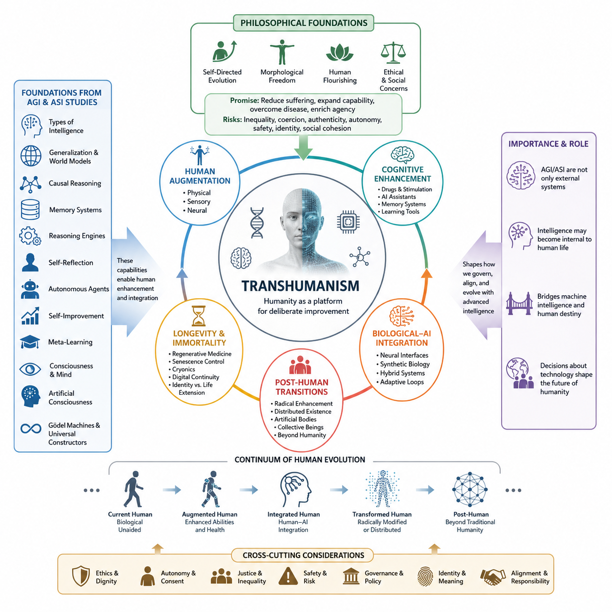
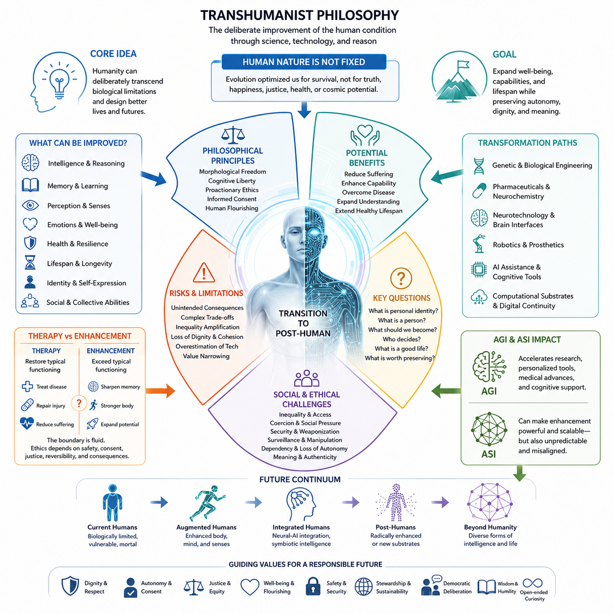
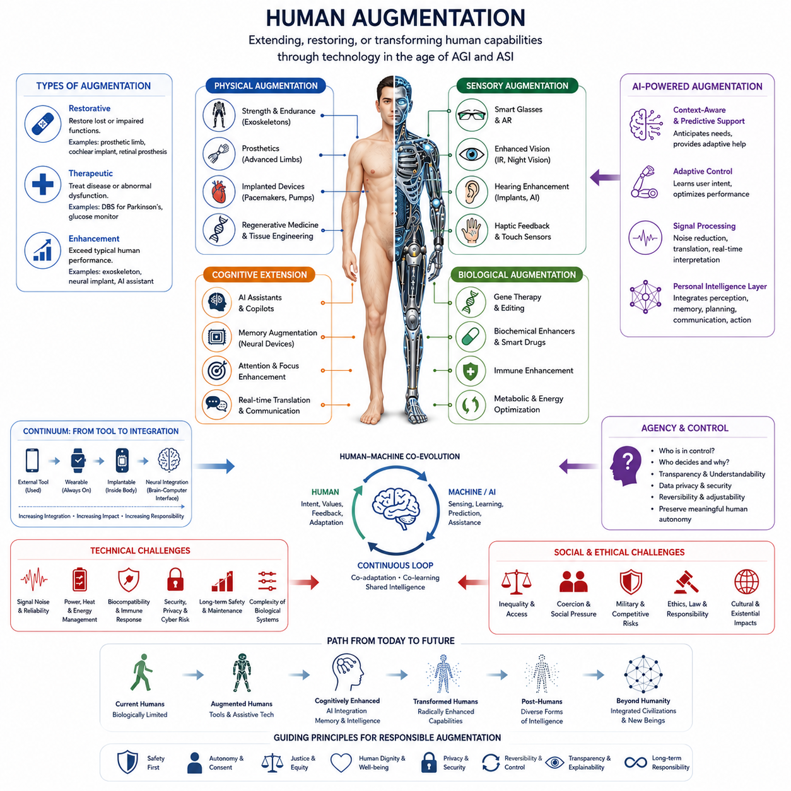
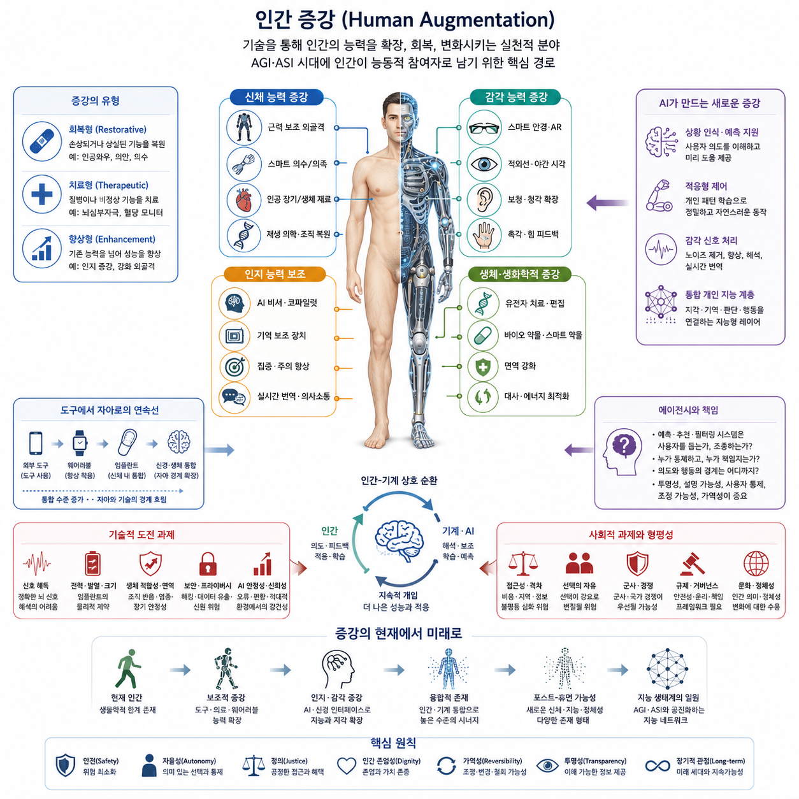
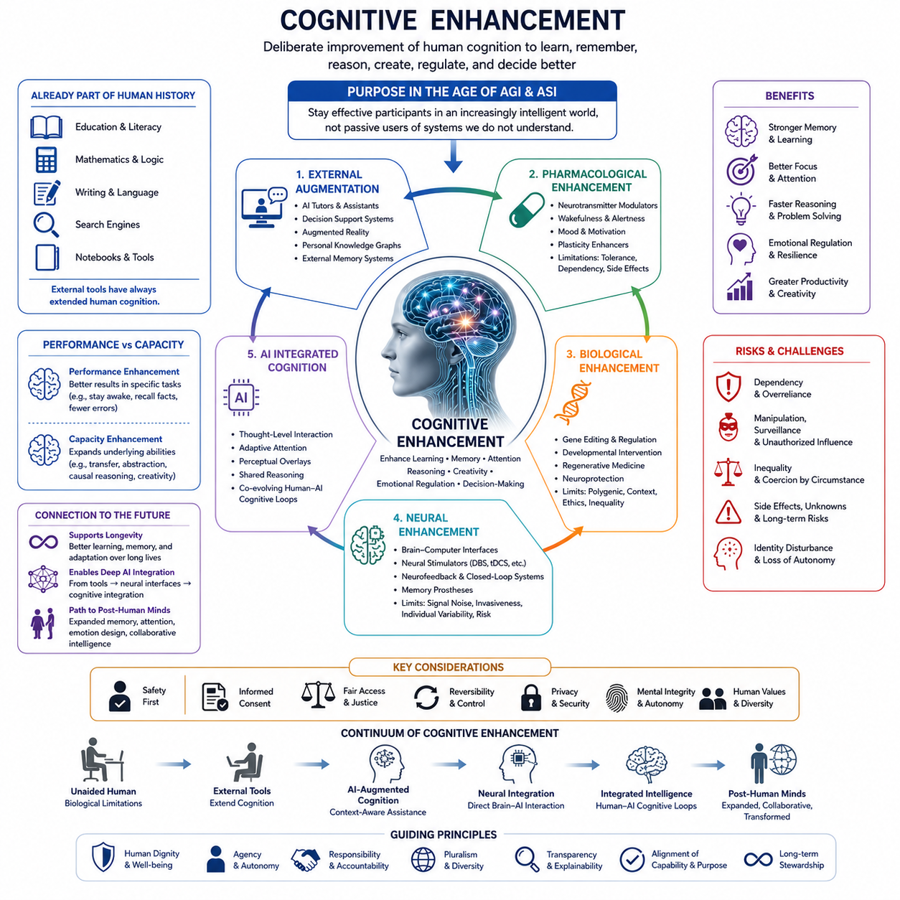
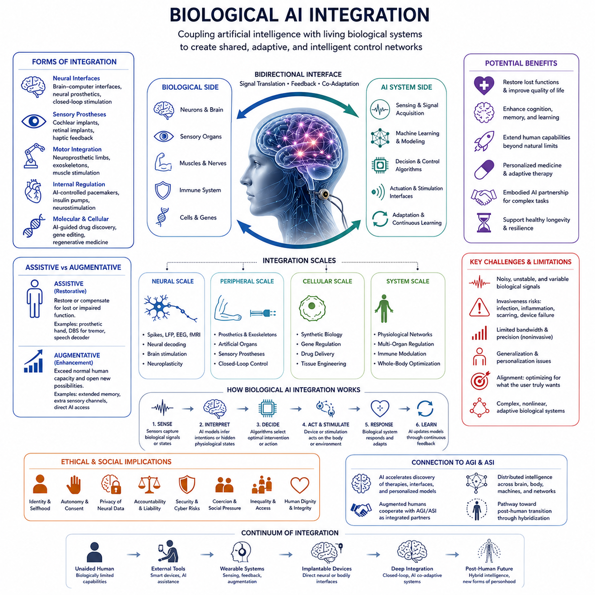
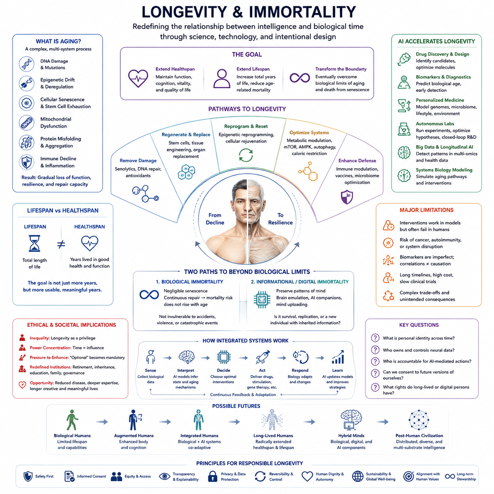
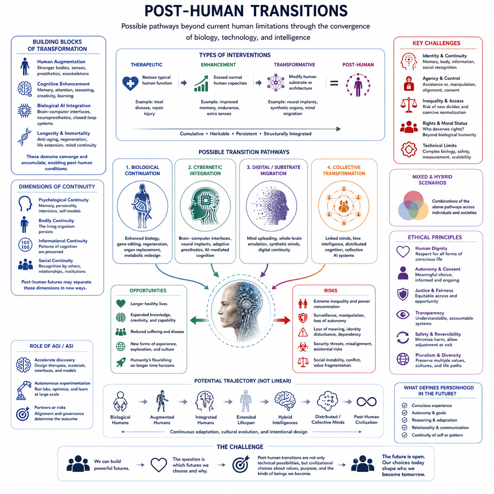

**Volume 00 05 AGI and ASI**

# Chapter 20. Transhumanism

### Chapter Overview

{width="7.268055555555556in" height="7.268055555555556in"}

Transhumanism is the philosophical, scientific, and cultural movement that treats the human condition not as a fixed endpoint, but as a platform for deliberate improvement. In the context of AGI and ASI, transhumanism asks what happens when intelligence is no longer confined to biological evolution, ordinary cognition, or the natural limits of the human body. It explores the possibility that future humans may augment perception, memory, reasoning, emotion, health, lifespan, and even identity through biotechnology, neurotechnology, artificial intelligence, robotics, and computational substrates.

This chapter examines transhumanism as both a promise and a problem. Its promise is that technology may reduce suffering, expand human capability, overcome disease, compensate for disability, and enable richer forms of agency. Its problem is that enhancement technologies raise difficult questions about inequality, coercion, authenticity, autonomy, safety, governance, and the meaning of being human. If intelligence can be amplified, bodies redesigned, brains linked to machines, and lifespans radically extended, then ethical and political decisions become as important as technical feasibility.

The chapter's scope moves from philosophy to implementation. It begins with transhumanist philosophy, including ideas of self-directed evolution, morphological freedom, human flourishing, and the critique that enhancement may undermine human dignity or social cohesion. It then considers human augmentation in physical, sensory, and neural forms, followed by cognitive enhancement through drugs, brain stimulation, AI assistants, memory systems, and learning tools. Biological AI integration introduces hybrid systems in which living tissue, neural interfaces, synthetic biology, and machine intelligence begin to form coupled adaptive loops. Longevity and immortality address regenerative medicine, senescence control, cryonics, digital continuity, and the distinction between life extension and identity preservation. Finally, post-human transitions examine what it may mean for descendants of humanity to become radically modified, distributed, artificial, or collective beings.

The importance of this chapter lies in its position at the boundary between artificial intelligence and human destiny. AGI and ASI are often discussed as external systems that may assist, compete with, or govern human civilization. Transhumanism reframes the issue: advanced intelligence may also become internal to human life, embedded in bodies, cognition, institutions, and cultures. Understanding this possibility is essential for evaluating futures in which the line between human and machine becomes porous, negotiated, and perhaps ultimately obsolete.

### Connection to Volume 05

This chapter connects the earlier technical and philosophical foundations of Volume 05 to the later questions of civilizational transformation. The opening chapters define AGI and ASI and distinguish narrow competence from general and superintelligent capability. Transhumanism extends those definitions into the human domain: if artificial systems can reason generally or exceed human intelligence, then humans may attempt to integrate with those systems rather than remain separate observers. The question is no longer only "What is AGI?" or "What is ASI?" but also "What becomes of humanity in their presence?"

The chapters on types of intelligence, generalization, causal reasoning, world models, cognitive architectures, memory systems, and reasoning engines provide the machinery for understanding enhancement. Human augmentation is meaningful because intelligence is multidimensional: perception, memory, abstraction, planning, social reasoning, embodiment, and causal understanding can each be strengthened or externalized. Cognitive enhancement becomes plausible when AI systems supply world models, reasoning support, persistent memory, and adaptive learning environments that extend the functional architecture of the person.

The chapters on self-reflection, autonomous agents, self-improving AI, recursive self-improvement, and meta-learning connect directly to transhumanist ambitions. A human-AI hybrid could become a reflective agent that monitors its own cognition, delegates tasks to autonomous subsystems, learns how to learn, and improves its abilities over time. Yet these same connections introduce risk. If self-improvement occurs inside human-machine systems, responsibility, consent, alignment, and identity become harder to define.

The chapters on consciousness, mind, the Chinese Room argument, artificial consciousness, Gödel machines, and universal constructors provide the conceptual background for questions of personhood and substrate. If cognition can be implemented in different media, if machines can appear to understand, and if systems can modify themselves while preserving goals, then transhumanism must ask whether enhanced humans, uploaded minds, synthetic persons, or hybrid organisms deserve moral recognition. These debates prepare the reader for the following chapters on hive minds, brain-computer interfaces, mind uploading, the technological singularity, and post-human civilization.

In the larger sequence, transhumanism functions as a bridge. It links the study of intelligent machines to the future of intelligent beings. It shows that AGI and ASI are not merely tools or threats outside humanity, but forces that may transform the biological, psychological, and social foundations of humanity itself.

## 20.00 Transhumanist Philosophy

{width="7.268055555555556in" height="7.268055555555556in"}

Transhumanism is the philosophical and technological project of deliberately improving the human condition through the responsible use of science, engineering, medicine, and computation. In the context of AGI and ASI, it asks a central question: if intelligence, embodiment, memory, emotion, lifespan, and identity can be modified by increasingly powerful technologies, what should humanity choose to become? This chapter treats transhumanism not as science fiction, but as a serious framework for evaluating human augmentation, cognitive enhancement, biological-AI integration, longevity research, and possible post-human futures.

At its core, transhumanist philosophy begins with the claim that human nature is not fixed. Biological humans are products of evolution, but evolution did not optimize us for truth, happiness, justice, health, or cosmic survival. It optimized organisms for reproductive fitness in ancestral environments. From this perspective, aging, disease, cognitive bias, limited working memory, emotional dysregulation, and vulnerability to death are not sacred features of humanity; they are constraints. Transhumanists argue that if these constraints can be reduced safely and ethically, doing so may be a continuation of medicine, education, and tool use rather than a radical rejection of humanity.

This view differs from simple technological enthusiasm. A smartphone, a vaccine, a prosthetic limb, or a language model can extend human capability, but transhumanism focuses on deeper transformations: enhancing cognition, extending healthy lifespan, integrating neural systems with machines, modifying biology, or creating new forms of personhood. The term "transhuman" often refers to a transitional condition between current humans and "post-humans," beings whose capacities may be so expanded that they differ from us as much as we differ from earlier hominins. Post-human does not necessarily mean non-human in a moral sense; it may mean persons with radically different substrates, bodies, lifespans, or modes of thought.

Several philosophical commitments are common within transhumanism. One is morphological freedom: the right of persons to modify their own bodies and minds, or to refuse such modification. Another is cognitive liberty: the idea that individuals should have meaningful control over their mental processes, attention, memory, and internal experience. A third is proactionary ethics, which argues that the risks of new technologies should be weighed against the risks of inaction. For example, gene therapy, brain-computer interfaces, or AI-guided drug discovery may create new dangers, but failing to develop them also leaves existing suffering, disability, and mortality unaddressed.

However, transhumanism is not a single doctrine. Liberal transhumanists emphasize autonomy and individual choice. Democratic transhumanists emphasize equal access and social justice. Extropian traditions stress open-ended improvement, intelligence expansion, and resistance to entropy. Bioconservative critics warn that enhancement may undermine dignity, social cohesion, or the meaning of human life. Religious and spiritual responses vary: some see enhancement as hubris, while others interpret it as a continuation of healing, stewardship, or self-transcendence. The most serious debates are not about whether technology changes humanity---it already has---but about which changes are desirable, who decides, who benefits, and who bears the risks.

AGI intensifies these questions. A generally intelligent system could accelerate biomedical research, design personalized cognitive tutors, discover interventions for aging, optimize prosthetics, or coordinate large-scale scientific projects. ASI could make enhancement technologies far more powerful and less predictable. If humans remain biologically limited while artificial systems become vastly more capable, enhancement may be viewed as a way to preserve human agency. Yet the same technologies could also produce coercion, surveillance, inequality, or dependency. Cognitive enhancement, for instance, may improve learning and reasoning, but if controlled by corporations, states, or opaque AI systems, it could become a tool for manipulation.

A key distinction is between therapy and enhancement. Therapy aims to restore typical functioning: treating disease, repairing injury, or reducing suffering. Enhancement aims to exceed typical functioning: sharper memory, longer attention, stronger immunity, slower aging, or expanded emotional regulation. In practice the boundary is unstable. Is treating age-related cognitive decline therapy, while preventing it before symptoms appear enhancement? Is a neural implant restorative for a paralyzed patient but augmentative for a healthy engineer? Transhumanist philosophy argues that moral evaluation should focus less on whether an intervention is "natural" and more on safety, consent, justice, reversibility, identity, and long-term consequences.

Identity is one of the deepest issues. If a person alters memory, personality, emotional range, intelligence, or embodiment, in what sense do they remain the same person? Gradual change is already part of human life: education reshapes beliefs, trauma reshapes personality, and medicine alters mood and cognition. But future technologies may allow faster and more precise changes. Brain-computer interfaces, neuropharmacology, genetic engineering, and AI companions could blur the boundary between self and tool. This raises questions that connect directly to later sections on mind uploading, hive minds, and post-human civilization: is personal continuity biological, psychological, informational, social, or something else?

Transhumanism also requires careful attention to social structure. Enhancements that are safe for individuals may still be destabilizing at scale. If only wealthy groups can access intelligence amplification, life extension, or superior reproductive technologies, existing inequality could become biologically entrenched. If military organizations pursue enhancement first, augmentation may be driven by competition rather than wellbeing. If enhancement becomes socially mandatory, freedom to improve could turn into pressure to conform. Therefore, transhumanist philosophy must be paired with governance, distributive justice, security analysis, and democratic deliberation.

The limitations of transhumanism are equally important. It can underestimate complexity: biological systems are deeply interconnected, and improving one trait may create trade-offs elsewhere. It can overestimate technological timelines, confuse speculative possibility with near-term feasibility, or neglect ecological and political realities. It may also inherit narrow definitions of intelligence and flourishing, treating speed, memory, and optimization as the only values worth increasing. A mature transhumanism must therefore integrate ethics, cognitive science, evolutionary biology, AI safety, disability studies, and cultural pluralism.

This section provides the conceptual foundation for the rest of the chapter. Human augmentation examines modifications to the body and sensorimotor capacity. Cognitive enhancement focuses on intelligence, memory, learning, and attention. Biological AI integration studies interfaces between living systems and artificial computation. Longevity and immortality address aging, death, and continuity of the self. Post-human transitions consider what may happen when enhanced humans, artificial minds, and hybrid beings coexist. Transhumanist philosophy frames all of these not merely as technical challenges, but as questions about values, personhood, responsibility, and the future trajectory of intelligence.

## 20.01 Human Augmentation

{width="7.268055555555556in" height="7.268055555555556in"}

{width="7.268055555555556in" height="7.268055555555556in"}

Human augmentation is the practical branch of transhumanism concerned with extending, restoring, or transforming human capabilities through technology. Where transhumanist philosophy asks whether humanity should intentionally direct its own evolution, human augmentation asks how such direction might occur in bodies, brains, tools, environments, and social systems. It includes medical prosthetics, sensory enhancement, wearable and implantable devices, exoskeletons, genetic and biochemical interventions, neural interfaces, and AI-mediated assistance. In the context of AGI and ASI, augmentation is especially important because it offers one possible path by which humans remain active participants in increasingly intelligent technological ecosystems rather than becoming merely external users of them.

A useful distinction is between restorative, therapeutic, and enhancement-oriented augmentation. Restorative augmentation attempts to recover a lost or impaired function, such as a cochlear implant restoring partial hearing, a retinal prosthesis supporting limited vision, or a robotic limb replacing an amputated arm. Therapeutic augmentation treats disease or abnormal dysfunction, as in deep brain stimulation for movement disorders or implanted glucose monitoring for diabetes. Enhancement-oriented augmentation aims to exceed typical human performance: stronger endurance through powered exoskeletons, expanded perception through infrared or ultrasonic sensors, improved memory through neural prostheses, or faster decision-making through AI assistants. In practice these categories overlap. A device developed to restore function may later be used to improve performance beyond the biological baseline.

Human augmentation can be external, wearable, implantable, or biological. External augmentation includes ordinary but powerful tools such as smartphones, AI copilots, navigation systems, and language translation systems. These may not merge physically with the body, but they extend cognition and action by creating a persistent human-machine loop. Wearable augmentation includes smart glasses, haptic gloves, biosensors, and industrial exoskeletons. Implantable augmentation includes pacemakers, cochlear implants, brain-computer interfaces, and neural stimulators. Biological augmentation includes pharmacological cognitive enhancers, gene therapies, synthetic organs, engineered immune cells, and tissue regeneration. The boundary between "tool" and "self" becomes less clear as devices become continuous, adaptive, personalized, and physically integrated.

AI changes the meaning of augmentation because it allows assistance to become context-aware and predictive rather than passive. A mechanical prosthetic can replace a limb, but an AI-controlled prosthetic can learn the user's gait, anticipate intended movements, and adapt to changing terrain. A hearing aid can amplify sound, but an AI hearing system can separate speech from noise, identify speakers, and translate languages in real time. An exoskeleton can add strength, but an AI-guided exoskeleton can optimize energy use, prevent injury, and coordinate with other machines. As AI systems become more general, augmentation may evolve from isolated devices into integrated personal intelligence layers that mediate perception, memory, planning, communication, and physical action.

Human augmentation also raises the question of agency. If a system predicts what a person wants before conscious decision-making occurs, is it serving the user or shaping the user? If a neural implant filters attention, recommends actions, or suppresses emotional states, who is responsible for the resulting behavior? These questions are not merely philosophical. They affect medical regulation, legal responsibility, military use, employment, education, and consent. A well-designed augmentative system should preserve meaningful human control, provide transparency appropriate to the user's understanding, and allow reversibility or adjustment wherever possible. However, the more deeply an augmentation is integrated into perception or cognition, the harder it becomes to separate human intention from machine contribution.

There are significant technical limitations. Biological systems are noisy, adaptive, and individualized, while machines require reliable signals, stable interfaces, and measurable objectives. Neural interfaces must decode intent from complex electrochemical activity without damaging tissue or losing signal quality over time. Implantable devices must handle power, heat, immune response, cybersecurity, and long-term maintenance. AI models used in augmentation must be robust to changing bodily states, sensor errors, adversarial manipulation, and unexpected environments. Even when a system works in a laboratory, it may fail under real-world conditions involving fatigue, stress, injury, emotion, or social complexity.

Equity is another major issue. Augmentation technologies may begin as expensive medical or military systems and later diffuse into consumer markets, but unequal access could produce new forms of biological and cognitive stratification. If enhanced workers are more productive, enhanced soldiers more effective, or enhanced students more competitive, social pressure may make "optional" augmentation effectively mandatory. This is especially relevant to AGI-era societies, where economic advantage may depend on the ability to cooperate with intelligent machines at high speed. Human augmentation could reduce disability and expand opportunity, but it could also intensify inequality if governed only by market incentives or strategic competition.

Human augmentation prepares the ground for the next section on cognitive enhancement. Not all augmentation is cognitive: stronger limbs, artificial organs, improved vision, or extended lifespan can transform human life without directly increasing reasoning ability. Yet cognition is often indirectly affected by bodily augmentation. Better sleep monitoring, reduced pain, improved mobility, richer perception, and continuous AI assistance can all alter attention, learning, motivation, and social interaction. Cognitive enhancement therefore represents a central subset of augmentation, focused specifically on memory, reasoning, creativity, attention, and intelligence. In transhumanist thought, human augmentation is the bridge between present-day medicine and tools on one side, and more radical post-human transitions on the other.

## 20.02 Cognitive Enhancement

{width="7.268055555555556in" height="7.268055555555556in"}

Cognitive enhancement is one of the central ambitions of transhumanism: the deliberate improvement of human capacities for learning, memory, attention, reasoning, creativity, emotional regulation, and decision-making. In the context of AGI and ASI, cognitive enhancement is not merely about becoming "smarter" in a narrow academic sense. It concerns the relationship between biological minds and increasingly capable artificial systems. If artificial intelligence becomes a major source of scientific discovery, economic coordination, and strategic decision-making, then enhanced cognition may determine whether humans remain effective participants in technological civilization rather than passive users of systems they do not understand.

The simplest forms of cognitive enhancement are already familiar. Education, literacy, mathematics, writing, scientific method, and digital search engines all extend human cognition. A notebook improves memory; a calculator expands numerical ability; a programming language allows abstract procedures to be externalized and executed. From this perspective, cognitive enhancement is not a break from human history but a continuation of it. What changes in the transhumanist era is the depth, speed, and intimacy of the enhancement. Instead of relying only on external tools, future systems may act as continuous cognitive partners, neural interfaces, or biologically integrated mechanisms that modify attention, memory formation, perception, and reasoning at the level of the brain itself.

It is useful to distinguish between external, pharmacological, biological, and neural forms of enhancement. External enhancement includes AI tutors, research assistants, decision-support systems, augmented reality interfaces, and personal knowledge graphs. These systems do not directly alter the brain, but they can dramatically improve effective intelligence by supplying context, summarizing evidence, detecting errors, and expanding working memory through external representations. Pharmacological enhancement uses substances that affect neurotransmission, wakefulness, motivation, or plasticity. Existing examples are limited and uneven, often improving one function while impairing another or producing dependency, tolerance, anxiety, or sleep disruption. Biological enhancement may involve gene editing, developmental interventions, or regenerative medicine aimed at improving neural health, resistance to degeneration, or learning capacity. Neural enhancement includes brain-computer interfaces, implanted stimulators, neurofeedback systems, and closed-loop devices that sense brain activity and adaptively influence it.

Each pathway has different limitations. External AI augmentation can be powerful but may create cognitive dependency, overtrust, and loss of skill. If a person delegates too much reasoning to a model, the result may be convenience rather than genuine understanding. Pharmacological methods face biological trade-offs because the brain is not a simple machine with a single "intelligence dial." Increasing alertness may reduce creativity; strengthening memory consolidation may also strengthen traumatic memory; enhancing focus may narrow exploration. Genetic and developmental interventions are constrained by the polygenic and context-dependent nature of intelligence, as well as ethical concerns about consent, inequality, and unintended consequences. Neural interfaces promise more direct integration, but the brain's signals are noisy, distributed, adaptive, and individually variable. Decoding intention, memory, or meaning from neural activity remains technically difficult, and invasive devices carry medical risks.

Cognitive enhancement also raises an important distinction between performance enhancement and capacity enhancement. Performance enhancement improves how well a person functions under particular conditions, such as staying awake longer, recalling facts more efficiently, or making fewer errors in a known task. Capacity enhancement expands the underlying range of what a mind can learn, model, or create. An AI assistant may help a scientist read more papers, but a deeper enhancement would improve the scientist's ability to form new theories, manage uncertainty, and reason across domains. In AGI-related contexts, capacity enhancement matters because general intelligence requires transfer, abstraction, causal reasoning, and flexible adaptation, not just faster access to information.

The connection to biological AI integration is direct. As Section 20.03 explores, future enhancement may blur the boundary between user and tool. A language model used through a screen is external augmentation; a neural interface that allows thought-level interaction with an AI system approaches cognitive integration. More advanced possibilities include memory prostheses, perceptual overlays, adaptive attention systems, and shared reasoning environments in which human goals and machine inference interact continuously. Such systems could amplify expertise, but they also introduce new attack surfaces: manipulation, surveillance, identity disturbance, and unauthorized influence over cognition.

The social implications are equally significant. If cognitive enhancement is expensive or restricted, it could intensify inequality by creating classes of enhanced and unenhanced people. In competitive environments such as education, finance, research, and military strategy, even modest improvements may become effectively mandatory. This creates coercion by circumstance: individuals may "choose" enhancement because refusal means exclusion. Governance must therefore address safety, fairness, access, informed consent, and reversibility. Enhancement technologies should be evaluated not only by whether they improve measured performance, but by whether they preserve autonomy, mental integrity, and the diversity of human values.

Cognitive enhancement is also linked to longevity and post-human transitions. Longer lives would increase the value of improved learning and memory maintenance, while enhanced cognition could make radical life extension more scientifically achievable. Over time, cumulative enhancement may produce minds that differ from contemporary humans not only in degree but in kind. A post-human intelligence might possess expanded working memory, direct access to vast symbolic and sensory databases, emotional architectures redesigned for stability, and collaborative cognition with other humans or AIs. Yet enhancement does not automatically produce wisdom. Greater intelligence can magnify harmful goals as easily as beneficial ones. For that reason, cognitive enhancement in a transhumanist framework must be paired with ethical reflection, institutional design, and alignment between capability and responsibility.

In the age of AGI and ASI, the question is not whether human cognition will be enhanced; it already is. The deeper question is how tightly enhancement will be coupled to artificial intelligence, how safely it can be integrated with biological minds, and whether it will strengthen human agency or erode it. Cognitive enhancement is therefore both a technical project and a civilizational choice: a path toward more capable human participation in an intelligent world, but also a source of new vulnerabilities that must be understood before they are scaled.

## 20.03 Biological AI Integration

{width="7.268055555555556in" height="7.268055555555556in"}

Biological AI integration refers to the coupling of artificial intelligence systems with living biological processes, especially nervous tissue, sensory organs, muscles, immune systems, and cellular regulation networks. In the transhumanist program, it sits between cognitive enhancement and longevity: cognitive enhancement asks how minds can be made more capable, while longevity asks how bodies can be preserved, repaired, or transformed. Biological AI integration asks how intelligent machines and biological organisms can become parts of a shared control system, exchanging signals, adapting to one another, and in some cases blurring the boundary between organism and artifact.

The most visible form is neural integration through brain-computer interfaces, neuroprosthetics, and closed-loop stimulation. A brain-computer interface can decode neural activity into commands for an external device, such as a cursor, robotic limb, speech synthesizer, or wheelchair. Conversely, sensory prostheses such as cochlear implants and retinal implants encode external information into stimulation patterns delivered to nerves or brain regions. The key technical challenge is bidirectional translation: biological neurons communicate through noisy, adaptive electrochemical activity, while AI systems typically operate on digital representations, probabilistic models, and optimization objectives. Successful integration requires signal processing, machine learning, neurophysiology, and human factors engineering to work together.

A crucial distinction is between assistive integration and augmentative integration. Assistive systems restore or compensate for a lost function: a prosthetic hand that responds to residual nerve signals, a deep brain stimulator that reduces tremor, or a speech decoder for a paralyzed patient. Augmentative systems aim to exceed normal human capacity: extended memory, faster perception, additional sensory channels, direct access to computational tools, or coordinated multi-agent cognition. Transhumanist debates often focus on augmentation, but medical restoration is the pathway through which many technologies become safe, validated, and socially accepted. Clinical necessity provides ethical justification, regulatory oversight, and real-world data before more speculative enhancement applications are attempted.

Integration can occur at multiple biological scales. At the neural scale, AI may decode spikes, local field potentials, or noninvasive signals such as EEG and functional imaging. At the peripheral scale, AI can control powered prostheses, exoskeletons, artificial organs, or adaptive implants. At the cellular and molecular scale, AI can guide synthetic biology, gene regulation, drug delivery, tissue engineering, and immune modulation. In these cases, AI is not merely an external decision system; it becomes part of a biological feedback loop. Sensors observe physiological state, models infer hidden variables, controllers choose interventions, and tissues respond in ways that alter future measurements. This makes safety more complex than in ordinary software, because errors can propagate through living systems that are nonlinear, adaptive, and only partially understood.

The promise of biological AI integration is not simply mechanical replacement. A sophisticated integrated system can learn the user's intentions, adapt to changing physiology, and support embodied cognition. For example, an AI-controlled prosthetic limb becomes more useful when it provides tactile feedback and when both the user and the model co-adapt over time. Similarly, a closed-loop insulin pump or adaptive neurostimulation system is more effective when it continuously models the patient's state rather than applying fixed rules. In future scenarios, AI could help maintain attention, regulate mood, compensate for memory deficits, or mediate communication between biological brains and digital agents. Such systems would not necessarily be autonomous replacements for human agency; they may function as cognitive and physiological partners.

However, the limitations are substantial. Neural signals are high-dimensional, unstable, and deeply context-dependent. What a pattern means today may shift as tissue heals, electrodes move, neurons reorganize, or the user learns new strategies. Invasive implants face risks of infection, inflammation, scarring, device degradation, and surgical complications. Noninvasive interfaces are safer but usually provide lower bandwidth and weaker spatial precision. AI models trained on one person may not generalize to another, and even within one person may require continual calibration. There is also a hard problem of alignment at the intimate scale: the system must optimize for what the person truly wants and needs, not merely for measurable proxies such as movement accuracy, stimulation response, or short-term reward.

The ethical implications are profound because biological AI integration touches identity, autonomy, privacy, and bodily integrity. Neural data may reveal intentions, emotions, pathologies, or habits before a person consciously reports them. If an implant can influence mood, attention, movement, or decision-making, questions arise about consent, responsibility, and control. Who is accountable if an AI-mediated prosthesis causes harm? Can a user meaningfully refuse an update if the device is medically necessary? Could employers, militaries, or states pressure people into augmentation? These questions become sharper as integration shifts from therapy to enhancement and from temporary tools to persistent components of the self.

Biological AI integration also changes how we think about AGI and ASI. Instead of imagining intelligence only as a disembodied software system, it emphasizes that intelligence can be distributed across brains, bodies, machines, environments, and social networks. A future post-human transition may not occur through a sudden replacement of humans by machines, but through gradual hybridization: artificial organs with intelligent regulation, neural implants with adaptive interfaces, immune systems supported by predictive models, and minds extended through AI partners. Whether this leads to liberation, dependency, inequality, or new forms of personhood depends not only on technical capability, but on governance, access, safety standards, and the values embedded in the systems that become part of us.

## 20.04 Longevity and Immortality

{width="7.268055555555556in" height="7.268055555555556in"}

Within transhumanism, longevity and immortality are not merely fantasies of living longer; they are technical, philosophical, and ethical projects aimed at changing the relationship between intelligence and biological time. The previous sections examined augmentation, cognitive enhancement, and biological AI integration. Longevity extends these themes by asking whether the human organism can be maintained, repaired, redesigned, or eventually replaced so that minds do not disappear simply because bodies age.

Biological aging is not a single disease but a complex set of processes: DNA damage, epigenetic drift, cellular senescence, mitochondrial dysfunction, protein misfolding, immune decline, stem cell exhaustion, and chronic inflammation. Contemporary longevity research attempts to intervene in these mechanisms through senolytics, gene therapy, regenerative medicine, metabolic modulation, organ replacement, cellular reprogramming, and improved diagnostics. AI is increasingly important in this domain because aging biology is high-dimensional, nonlinear, and data-rich. Machine learning systems can search drug candidates, model protein interactions, identify biomarkers of biological age, optimize clinical trials, and discover patterns in longitudinal health data that would be difficult for human researchers to detect unaided.

A crucial distinction is between lifespan and healthspan. Lifespan refers to how long an organism lives; healthspan refers to how long it remains functional, resilient, and free from severe disease. A transhumanist longevity program that merely prolongs frailty would fail its own purpose. The central goal is not just more years, but more usable years: preserved cognition, mobility, agency, and social participation. This connects directly to cognitive enhancement, because extended life without memory integrity, emotional stability, and adaptive learning would not preserve the person in any meaningful sense.

"Immortality" is a stronger and more ambiguous claim. Biological immortality may mean negligible senescence, where aging damage is continually repaired and mortality risk does not rise sharply with age. It does not imply invulnerability: accidents, violence, environmental collapse, or systemic disease could still end life. Digital or informational immortality refers to preserving the patterns that constitute a mind, either through detailed brain emulation, persistent AI companions trained on a person's data, or future mind-uploading technologies. These approaches raise unresolved questions about identity. If a copy behaves like a person and remembers being that person, is it survival, replication, or a new individual with inherited information? Transhumanism often treats personal continuity as an engineering target, but philosophy shows that continuity may involve memory, embodiment, social recognition, causal history, and subjective experience.

AI could accelerate longevity in several ways. AGI-level systems might integrate molecular biology, clinical medicine, robotics, and materials science to design therapies faster than current research institutions. Autonomous laboratories could run experiments continuously, using closed-loop optimization to test interventions and refine hypotheses. Personalized medicine could become more precise as AI models simulate an individual's genome, microbiome, immune system, lifestyle, and environment. In more radical scenarios, ASI might discover repair mechanisms or substrate-independent architectures that make death from aging obsolete. However, these possibilities remain speculative and should not be confused with existing medical capability.

There are major limitations. Aging interventions that work in model organisms often fail in humans because human aging unfolds over decades and involves complex trade-offs. Suppressing senescent cells, altering growth pathways, or reprogramming tissues may increase cancer risk or disrupt normal repair. Measuring biological age is still imperfect, and biomarkers can be misleading if they track correlation rather than causal rejuvenation. Clinical trials for longevity are expensive and slow because the desired outcomes are long-term. AI can help generate hypotheses, but it cannot eliminate the need for empirical validation, safety monitoring, and ethical oversight.

The social implications are equally significant. If radical life extension is expensive, it could intensify inequality, allowing wealthy groups to accumulate not only capital but time, expertise, and political influence. Retirement systems, inheritance law, education, employment, family structure, and democratic turnover would all be affected by much longer lives. Conversely, if longevity technologies become broadly available, societies may benefit from reduced disease burden, deeper expertise, longer creative careers, and less grief from premature death. The ethical challenge is to prevent longevity from becoming a privilege that hardens existing power structures.

Longevity also changes the meaning of post-human transition. A post-human civilization might emerge not only through artificial minds or mind uploading, but through biological humans who gradually become engineered, repairable, augmented beings. Such beings may remain recognizably human in memory and culture while becoming radically different in physiology, cognition, and vulnerability. The boundary between therapy and enhancement becomes unstable: repairing age-related decline may lead naturally to improving baseline biology.

In the context of AGI and ASI, longevity and immortality force a practical question: what kinds of beings are we building advanced intelligence for? If the future contains long-lived biological humans, digital persons, hybrid minds, and collective intelligences, then survival, identity, rights, and continuity must be redefined. Transhumanist longevity is therefore not only about escaping death. It is about deciding whether intelligence should remain tied to the fragile life cycle that produced it, or whether intelligence can learn to preserve, transform, and extend itself across biological and technological substrates.

## 20.05 Post Human Transitions

{width="7.268055555555556in" height="7.268055555555556in"}

Post-human transitions refer to the possible pathways by which human beings, human societies, or human-derived intelligences move beyond the biological, cognitive, and social constraints that define present-day humanity. In the context of transhumanism, the term does not necessarily mean the disappearance of humans, nor does it require a sudden break between "human" and "post-human." More plausibly, it describes a spectrum of gradual transformations: improved bodies, extended lifespans, enhanced cognition, biological-AI integration, synthetic minds, collective intelligence systems, and eventually forms of agency that may no longer fit familiar categories of personhood.

This section builds on the preceding themes of human augmentation, cognitive enhancement, biological AI integration, and longevity. Each of these domains can be understood as a partial step toward post-human conditions. A prosthetic limb controlled by neural signals is not, by itself, a post-human transition. Nor is a memory assistant, a gene therapy, or a life-extension treatment. However, as these technologies converge and become deeply embedded in identity, decision-making, reproduction, education, labor, and governance, they may alter what it means to be human. The transition is therefore not only technical but also philosophical, legal, cultural, and political.

A useful distinction is between therapeutic, enhancement, and transformative interventions. Therapeutic interventions aim to restore typical human function, such as repairing a damaged retina or treating neurodegenerative disease. Enhancement interventions aim to exceed ordinary human capacities, such as improving memory, attention, endurance, emotional regulation, or sensory range. Transformative interventions modify the underlying substrate or architecture of human life itself: persistent brain-computer interfaces, engineered immune systems, synthetic organs, artificial cognition coupled to biological brains, or digital continuations of human minds. Post-human transitions become plausible when enhancement becomes cumulative, inheritable, persistent, and structurally integrated into the individual or society.

There are several possible transition pathways. One is biological continuation, in which humans remain biological organisms but are extensively modified through genetic engineering, regenerative medicine, organ replacement, neural repair, and metabolic redesign. Another is cybernetic integration, in which humans become increasingly coupled to computational systems through brain-computer interfaces, embedded sensors, adaptive prosthetics, and AI-mediated cognition. A third pathway is digital or substrate migration, often associated with mind uploading, whole-brain emulation, or synthetic minds modeled on human cognition. A fourth pathway is collective transformation, where individual cognition is linked into large-scale networks, producing hive-mind-like coordination or collective AI systems. These pathways are not mutually exclusive; future societies could combine them unevenly across populations.

A major technical issue is continuity of identity. If a person receives progressive neural implants, replaces organs, extends life for centuries, or transfers cognitive patterns into a computational substrate, in what sense does the same person persist? Philosophers distinguish psychological continuity, bodily continuity, informational continuity, and social continuity. Psychological continuity emphasizes memory, personality, intentions, and self-models. Bodily continuity emphasizes the persistence of the living organism. Informational continuity focuses on whether the relevant patterns of cognition are preserved. Social continuity depends on recognition by communities, institutions, and relationships. Post-human transitions challenge all of these criteria because they may separate memory from biology, agency from a single body, or identity from a single location in space and time.

Another important distinction is between augmentation of human agency and replacement of human agency. Many transhumanist proposals aim to increase human autonomy: better health, sharper cognition, broader experience, and more control over one's body and mind. However, when AI systems mediate perception, decision-making, emotion, memory, and social interaction, the boundary between assistance and control becomes difficult to define. A cognitive assistant that recommends actions is different from a system that shapes preferences, filters reality, or predicts and manipulates behavior. Post-human transitions therefore require strong attention to alignment, consent, interpretability, reversibility, and governance. Enhancement without agency may become dependency rather than liberation.

The social implications are equally significant. Post-human technologies could reduce suffering, expand creativity, and allow more diverse forms of life. They could also produce extreme inequality if only wealthy groups gain access to longevity, intelligence amplification, or high-bandwidth AI integration. Differences between enhanced and unenhanced populations might become politically destabilizing, especially if cognitive or biological advantages compound across generations. There is also a risk of coercive normalization: once enhancement becomes economically necessary, refusing it may become impractical. A society may formally preserve freedom while informally forcing individuals to augment themselves in order to compete.

Post-human transitions also raise questions about rights and moral status. If future entities include enhanced humans, artificial persons, uploaded minds, brain-AI hybrids, and collective agents, legal systems based solely on biological humanity will be insufficient. Moral consideration may need to depend on capacities such as consciousness, suffering, autonomy, reasoning, relationality, or the possession of goals, rather than species membership alone. Yet these criteria are difficult to measure, especially in artificial or hybrid systems. Premature denial of moral status could enable exploitation, while careless attribution could create legal and ethical confusion.

Technically, many post-human scenarios remain speculative. Whole-brain emulation requires far more precise understanding of neural structure and dynamics than currently exists. Radical life extension faces biological complexity, cancer risk, immune decline, and systemic aging processes. Brain-computer interfaces are advancing but remain limited in bandwidth, safety, durability, and interpretability. Genetic enhancement is constrained by polygenic traits, developmental interactions, environmental dependence, and ethical barriers. Even powerful AGI would not automatically solve these problems, although it might accelerate discovery. The path to post-humanity is therefore likely to be uneven, contested, and constrained by engineering realities.

The relationship between post-human transitions and AGI/ASI is especially important. AGI could become a collaborator in human enhancement, helping design therapies, interfaces, educational systems, and governance models. ASI, if achieved, could make post-human transition either more feasible or more dangerous, depending on alignment and institutional control. A superintelligent system might design forms of cognition or embodiment far beyond human comprehension. The central question would then be whether humans remain authors of their own transformation or become objects of optimization by systems whose goals only partially reflect human values.

Post-human transition should therefore be understood less as a single destination than as a set of branching futures. Some futures preserve recognizable human individuality while extending health and capability. Others blur the boundaries between human, machine, organism, and network. Still others may produce entities so cognitively and socially different from us that "human" becomes an ancestral category rather than a present description. The transhumanist challenge is to pursue beneficial transformation without losing the values that make transformation worth pursuing: dignity, agency, compassion, curiosity, plurality, and the capacity to choose what kinds of beings we become.
