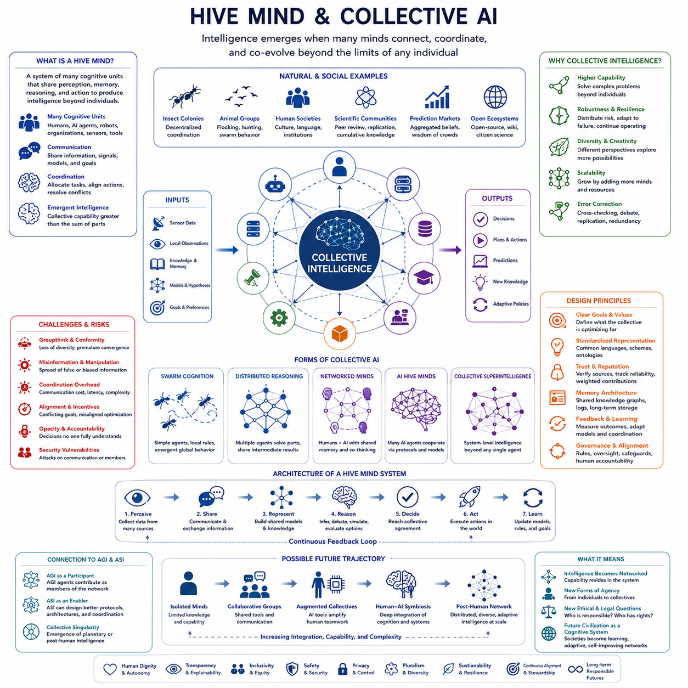
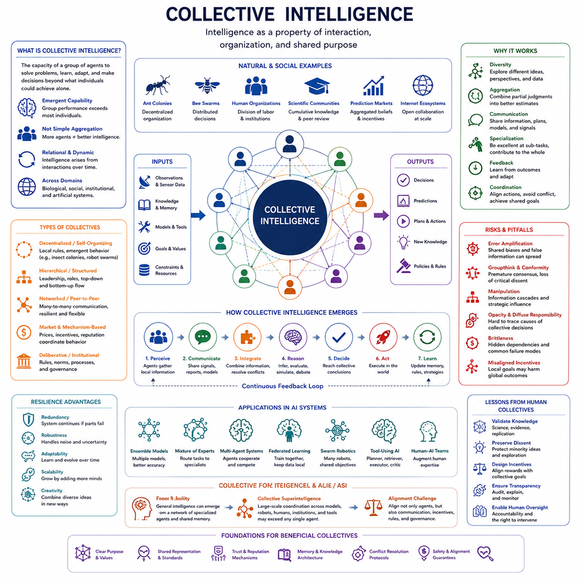
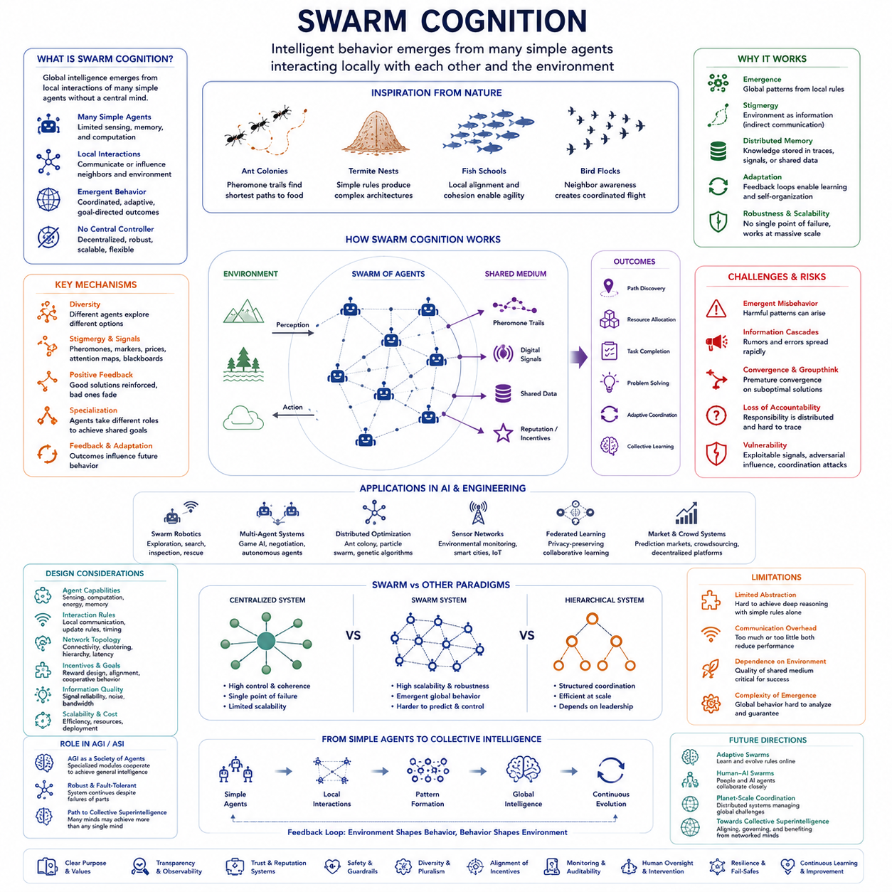
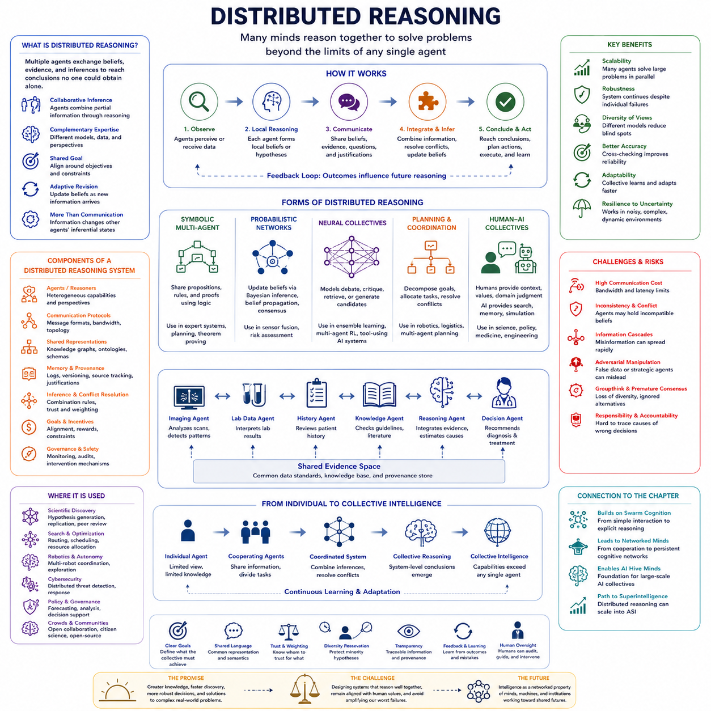
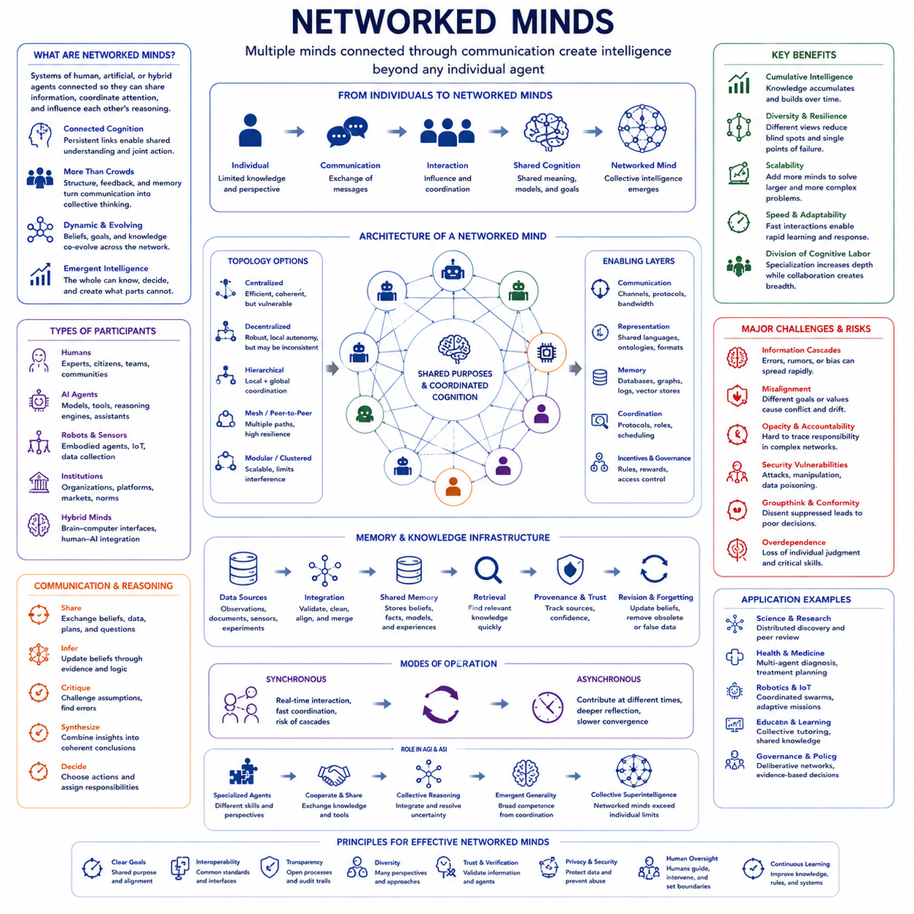
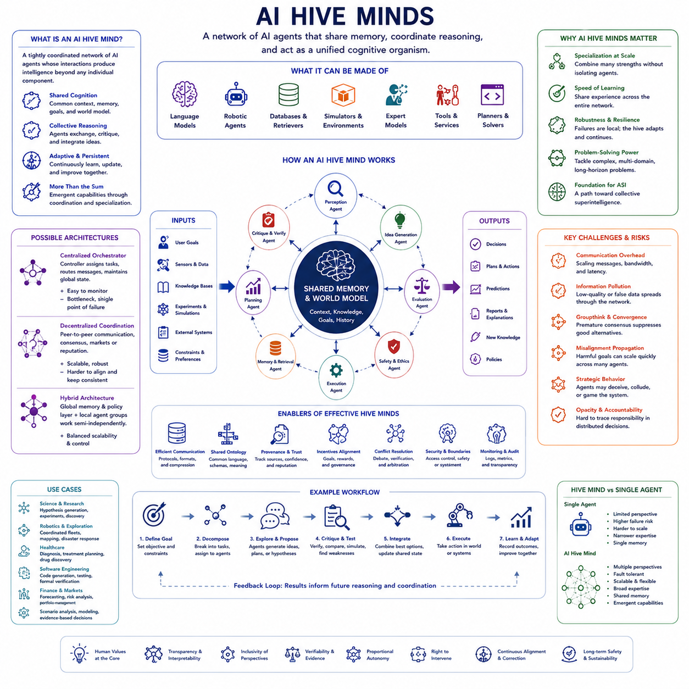
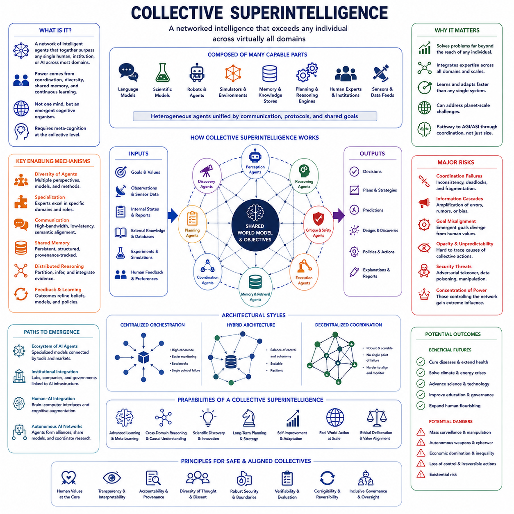

**Volume 00 05 AGI and ASI**

# Chapter 21. Hive Mind and Collective AI

### Chapter Overview

{width="7.268055555555556in" height="7.268055555555556in"}

A hive mind is not merely a crowd, a network, or a large database of opinions. It is a system in which many cognitive units---humans, artificial agents, biological organisms, institutions, sensors, robots, or hybrid human--AI participants---coordinate perception, memory, reasoning, and action so that the group exhibits intelligence beyond what any isolated member could achieve. Collective AI extends this idea into engineered systems: multi-agent architectures, distributed reasoning networks, swarm robotics, federated learning communities, market-like decision systems, and human--AI collectives that solve problems through shared models and coordinated behavior.

This chapter examines the principles by which intelligence can emerge from interaction. The central question is not only whether an individual machine can become generally intelligent, but whether intelligence can be organized across many minds. A collective may be more robust than a single agent because it can distribute risk, preserve diverse perspectives, and continue functioning when some members fail. It may also be more creative because different agents explore different regions of a problem space. Yet collective systems can also amplify error, converge prematurely, suffer from groupthink, become vulnerable to manipulation, or produce decisions that no participant fully understands.

The chapter's scope moves from natural and social forms of collective intelligence to artificial hive minds and possible collective superintelligence. It considers how insect colonies, animal groups, scientific communities, prediction markets, open-source ecosystems, and modern AI systems demonstrate different forms of shared cognition. It then explores swarm cognition, distributed reasoning, networked minds, and AI hive minds as increasingly technical models of coordination. The chapter emphasizes that collective intelligence is not magic: it depends on communication bandwidth, incentive alignment, memory structures, representation standards, trust mechanisms, error correction, and governance.

The motivation is practical as well as philosophical. Future AGI and ASI may not appear as a single monolithic mind. They may emerge as networks of specialized models, autonomous agents, robotic fleets, human experts, software tools, and institutional processes. Understanding collective AI is therefore essential for designing scalable intelligence, diagnosing systemic failure, and governing systems whose behavior arises from many interacting parts. If the future of intelligence is networked, then the study of hive minds becomes a foundation for understanding how civilization itself may become a cognitive system.

하이브 마인드(hive mind)는 단순한 군중, 네트워크, 또는 거대한 의견 데이터베이스가 아니다. 그것은 인간, 인공지능 에이전트, 생물학적 유기체, 제도, 센서, 로봇, 또는 인간--AI 하이브리드 참여자와 같은 여러 인지 단위가 지각, 기억, 추론, 행동을 조정하여, 고립된 개별 구성원이 달성할 수 있는 수준을 넘어서는 지능을 집단 전체가 보이게 되는 시스템이다. 집단 AI(collective AI)는 이 개념을 공학적으로 확장한다. 여기에는 다중 에이전트 아키텍처, 분산 추론 네트워크, 군집 로보틱스(swarm robotics), 연합 학습(federated learning) 공동체, 시장형 의사결정 시스템, 그리고 공유 모델과 조정된 행동을 통해 문제를 해결하는 인간--AI 집합체가 포함된다.

이 장은 상호작용으로부터 지능이 어떻게 출현할 수 있는지를 다룬다. 핵심 질문은 개별 기계가 일반지능을 획득할 수 있는가에만 있지 않다. 지능이 여러 마음에 걸쳐 조직될 수 있는가도 중요한 질문이다. 집단은 위험을 분산하고, 다양한 관점을 보존하며, 일부 구성원이 실패하더라도 기능을 지속할 수 있기 때문에 단일 에이전트보다 더 강건할 수 있다. 또한 서로 다른 에이전트가 문제 공간의 서로 다른 영역을 탐색하기 때문에 더 창의적일 수도 있다. 그러나 집단 시스템은 오류를 증폭하거나, 너무 이른 수렴에 빠지거나, 집단사고(groupthink)에 취약해지거나, 조작에 노출되거나, 어떤 참여자도 완전히 이해하지 못하는 결정을 만들어낼 수도 있다.

이 장의 범위는 자연적·사회적 집단지능에서 출발하여 인공 하이브 마인드와 가능한 집단 초지능(collective superintelligence)으로 이동한다. 곤충 군집, 동물 집단, 과학 공동체, 예측 시장, 오픈소스 생태계, 현대 AI 시스템이 공유 인지의 다양한 형태를 어떻게 보여주는지 살펴본다. 이어서 군집 인지(swarm cognition), 분산 추론(distributed reasoning), 네트워크화된 마음(networked minds), AI 하이브 마인드(AI hive minds)를 점점 더 기술적인 조정 모델로 탐구한다. 이 장은 집단지능이 마법이 아니라는 점을 강조한다. 그것은 통신 대역폭, 인센티브 정렬, 기억 구조, 표현 표준, 신뢰 메커니즘, 오류 수정, 거버넌스에 의존한다.

이 주제의 동기는 철학적일 뿐 아니라 실천적이기도 하다. 미래의 AGI와 ASI는 하나의 거대한 단일 정신으로 등장하지 않을 수도 있다. 그것들은 전문화된 모델, 자율 에이전트, 로봇 군단, 인간 전문가, 소프트웨어 도구, 제도적 과정의 네트워크로 출현할 수 있다. 따라서 집단 AI를 이해하는 것은 확장 가능한 지능을 설계하고, 시스템적 실패를 진단하며, 많은 상호작용 부분에서 행동이 생겨나는 시스템을 관리하기 위해 필수적이다. 지능의 미래가 네트워크화되어 있다면, 하이브 마인드 연구는 문명 자체가 어떻게 하나의 인지 시스템이 될 수 있는지를 이해하기 위한 기초가 된다.

### Connection to Volume 05

This chapter builds on the earlier distinction between AGI and ASI by shifting attention from individual intelligence to organized intelligence. Chapters 01 and 02 define artificial general intelligence and artificial superintelligence largely in terms of capabilities, generality, and performance. Hive mind and collective AI introduce a complementary possibility: generality and superintelligence may be properties of a distributed system rather than a single agent. A civilization-scale network of models, humans, tools, and institutions might display capacities that cannot be attributed to any one node.

The chapter also extends the discussion of types of intelligence, generalization, causal reasoning, and world models. Collective systems often combine heterogeneous intelligences: symbolic reasoners, neural models, embodied robots, human experts, search algorithms, and domain-specific tools. Their generalization may arise from diversity and recombination, while their causal reasoning may depend on debate, simulation, replication, and cross-checking between agents. World models become shared, contested, and continuously updated artifacts rather than private internal representations.

The links to cognitive architectures, memory systems, reasoning engines, and self-reflection are direct. A hive mind requires architecture: protocols for communication, task allocation, attention, conflict resolution, and feedback. It requires memory at multiple levels, from local agent histories to shared knowledge graphs, logs, vector stores, scientific records, and institutional archives. It requires reasoning engines that can combine evidence from many sources. It may also require collective self-reflection: the ability of the system to monitor its own beliefs, errors, incentives, and emergent behavior.

The chapters on autonomous agents, self-improving AI, recursive self-improvement, and meta-learning become especially important in a collective setting. A network of agents may improve not only by modifying individual models, but by changing coordination patterns, redistributing tasks, inventing new tools, and learning which agents to trust for which problems. Recursive self-improvement could occur at the level of the collective architecture, not just inside a single algorithm. Meta-learning may become social and organizational: the system learns how the group learns.

Finally, this chapter connects to consciousness, artificial consciousness, transhumanism, brain--computer interfaces, mind uploading, the technological singularity, and post-human civilization. Networked minds raise difficult questions about personal identity, agency, consent, and moral status. If humans and AI systems become tightly integrated, the boundary between individual cognition and collective cognition may blur. A future singularity may be less like the birth of one godlike machine and more like the rapid formation of a planetary or post-human cognitive network. Collective superintelligence therefore serves as a bridge between technical AI architecture and the civilizational future explored in the final chapters of this volume.

이 장은 AGI와 ASI에 대한 앞선 구분을 바탕으로, 관심을 개별 지능에서 조직화된 지능으로 전환한다. 01장과 02장은 인공 일반지능(artificial general intelligence)과 인공 초지능(artificial superintelligence)을 주로 능력, 일반성, 성능의 관점에서 정의한다. 하이브 마인드와 집단 AI는 여기에 보완적인 가능성을 제시한다. 일반성과 초지능은 단일 에이전트가 아니라 분산 시스템의 속성일 수 있다. 모델, 인간, 도구, 제도로 이루어진 문명 규모의 네트워크는 어떤 단일 노드에도 귀속될 수 없는 능력을 보일 수 있다.

이 장은 또한 지능의 유형, 일반화, 인과 추론, 세계 모델에 대한 논의를 확장한다. 집단 시스템은 종종 서로 다른 종류의 지능을 결합한다. 상징 추론기, 신경망 모델, 체화된 로봇, 인간 전문가, 탐색 알고리즘, 도메인 특화 도구가 함께 작동할 수 있다. 이들의 일반화는 다양성과 재조합에서 생겨날 수 있으며, 인과 추론은 에이전트 간의 토론, 시뮬레이션, 반복 검증, 교차 확인에 의존할 수 있다. 세계 모델(world models)은 더 이상 사적인 내부 표상에 머물지 않고, 공유되고 논쟁되며 지속적으로 갱신되는 산물이 된다.

인지 아키텍처, 기억 시스템, 추론 엔진, 자기 성찰과의 연결은 직접적이다. 하이브 마인드는 아키텍처를 필요로 한다. 즉 의사소통, 과업 배분, 주의 배분, 갈등 해결, 피드백을 위한 프로토콜이 필요하다. 또한 지역적 에이전트 이력에서부터 공유 지식 그래프, 로그, 벡터 저장소, 과학 기록, 제도적 아카이브에 이르는 여러 수준의 기억이 필요하다. 많은 출처의 증거를 결합할 수 있는 추론 엔진도 필요하다. 나아가 시스템 자신의 믿음, 오류, 인센티브, 창발적 행동을 감시하는 집단적 자기 성찰(collective self-reflection)도 요구될 수 있다.

자율 에이전트, 자기 개선 AI, 재귀적 자기 개선, 메타러닝을 다루는 장들은 집단적 맥락에서 특히 중요해진다. 에이전트 네트워크는 개별 모델을 수정하는 것만으로 개선되지 않는다. 조정 패턴을 바꾸고, 과업을 재분배하며, 새로운 도구를 발명하고, 어떤 문제에 어떤 에이전트를 신뢰해야 하는지를 학습함으로써 개선될 수 있다. 재귀적 자기 개선(recursive self-improvement)은 단일 알고리즘 내부가 아니라 집단 아키텍처의 수준에서 일어날 수 있다. 메타러닝(meta-learning)은 사회적이고 조직적인 성격을 띨 수 있다. 즉 시스템은 집단이 어떻게 학습하는지를 학습한다.

마지막으로 이 장은 의식, 인공 의식, 트랜스휴머니즘, 뇌--컴퓨터 인터페이스, 마인드 업로딩, 기술적 특이점, 포스트휴먼 문명과 연결된다. 네트워크화된 마음은 개인 정체성, 행위성, 동의, 도덕적 지위에 관한 어려운 질문을 제기한다. 인간과 AI 시스템이 긴밀하게 통합된다면, 개별 인지와 집단 인지 사이의 경계는 흐려질 수 있다. 미래의 특이점은 하나의 신적인 기계가 탄생하는 사건이라기보다, 행성적 또는 포스트휴먼적 인지 네트워크가 급속히 형성되는 과정에 더 가까울 수 있다. 따라서 집단 초지능은 기술적 AI 아키텍처와 이 권의 마지막 장들이 탐구하는 문명적 미래를 연결하는 다리 역할을 한다.

##  

## 21.00 Collective Intelligence

{width="7.268055555555556in" height="7.268055555555556in"}

Collective intelligence is the capacity of a group of agents to solve problems, learn, adapt, or make decisions in ways that exceed what most individual members could achieve alone. In biological systems it appears in ant colonies, bee swarms, human organizations, scientific communities, markets, and cultures. In artificial systems it appears in ensembles of models, multi-agent systems, federated learning networks, distributed robotics, and large populations of specialized AI agents coordinated through shared protocols. Within the broader study of AGI and ASI, collective intelligence is important because general intelligence may not emerge only inside a single monolithic mind. It may also emerge from networks of partially capable agents whose interactions create higher-level competence.

The central idea is that intelligence can be a property of organization, not merely of isolated cognition. A single ant has limited memory and reasoning ability, but a colony can allocate labor, discover food, defend territory, and adapt to environmental changes. A single researcher has limited knowledge, but the scientific community can accumulate theories, test hypotheses, correct errors, and build technologies across generations. Similarly, a set of AI systems may achieve robust performance by dividing tasks, cross-checking outputs, sharing discoveries, and maintaining different representations of the same world. Collective intelligence therefore shifts attention from "How smart is one agent?" to "How intelligently does the system of agents behave?"

Several mechanisms make collective intelligence possible. Diversity allows different agents to explore different hypotheses, strategies, data sources, or skill domains. Aggregation combines partial judgments into a more reliable estimate, as in voting, prediction markets, ensemble learning, or consensus protocols. Communication enables agents to share observations, plans, warnings, and abstractions. Specialization allows agents to become highly competent in narrow roles while still contributing to a broader objective. Feedback closes the loop between action and outcome, allowing the collective to update its behavior over time. Coordination prevents agents from duplicating effort, interfering with one another, or optimizing incompatible goals.

These mechanisms are familiar in machine learning. Ensemble methods often outperform individual models because errors are not perfectly correlated. Mixture-of-experts systems route different inputs to specialized subnetworks. Federated learning allows many devices or institutions to train shared models without centralizing all data. Multi-agent reinforcement learning studies how agents learn policies in environments containing other learning agents. Tool-using AI systems may already operate as small collectives: one model plans, another retrieves information, another writes code, another checks safety constraints, and another critiques the final answer. The collective can become more capable than any component if the coordination layer is effective.

However, collective intelligence should not be confused with simple accumulation. More agents do not automatically produce better intelligence. A crowd can amplify errors, rumors, biases, or panic. A multi-agent AI system can converge on false assumptions if all agents share the same flawed training data or reward model. Communication can improve coordination, but it can also create information cascades, strategic manipulation, or groupthink. Specialization increases efficiency, but it can create brittle dependencies and reduce system-wide understanding. The design challenge is not merely to connect many minds, but to create institutions, protocols, and architectures that preserve useful disagreement while enabling coherent action.

A key distinction is between collective intelligence and swarm cognition, the topic of the next section. Collective intelligence is the broader concept: any group-level intelligence arising from interaction among agents. Swarm cognition is a more specific form often associated with decentralized local rules, stigmergy, and emergent behavior, as seen in insects or distributed robot swarms. Collective intelligence can include hierarchical organizations, deliberative committees, market mechanisms, peer review systems, and AI orchestration frameworks. Some collectives are decentralized and self-organizing; others rely on explicit leadership, shared memory, or global planning. The architecture matters because it determines speed, reliability, transparency, and failure modes.

In the context of AGI, collective intelligence raises the possibility that "an AGI" may be less like a single human mind and more like an adaptive society of cognitive modules. Such a system might contain agents for perception, causal modeling, theorem proving, simulation, long-term planning, social reasoning, ethical evaluation, and self-monitoring. If these agents can communicate through a common representational substrate and resolve conflicts productively, the resulting system may display broad competence. In the context of ASI, the stakes become higher: a collective superintelligence could scale across data centers, robots, laboratories, and human institutions, integrating knowledge and action at a planetary level.

This possibility has significant safety implications. Collective systems can be more robust because components can detect and correct one another's failures. They can also be more difficult to understand because responsibility is distributed. If a harmful decision emerges from thousands of interacting agents, it may be hard to identify which component caused the failure. Alignment must therefore apply not only to individual models but also to communication channels, incentive structures, governance rules, memory systems, and mechanisms of conflict resolution. A well-aligned component can still contribute to harmful collective behavior if the surrounding system rewards speed over caution, consensus over truth, or goal achievement over human values.

Human collective intelligence offers both inspiration and warning. Language, writing, mathematics, law, markets, universities, and the internet are technologies for pooling cognition. They allow humans to transcend individual limits, but they also produce propaganda, financial bubbles, bureaucratic inertia, and coordinated harm. AI collectives may magnify the same duality. They could accelerate science, coordinate disaster response, personalize education, and improve democratic deliberation. They could also enable automated persuasion, distributed cyberattacks, opaque governance, or self-reinforcing ideological systems. The quality of a collective mind depends on its epistemic norms, incentives, communication structure, and relation to human oversight.

For this reason, collective intelligence is not merely a technical architecture; it is also a social and ethical design problem. Building powerful AI collectives requires asking how knowledge is validated, how disagreements are represented, how minority hypotheses are preserved, how decisions are audited, and how humans can intervene. The movement from individual agents to networked minds changes the unit of analysis. Intelligence becomes something that flows through relationships, protocols, memories, tools, and institutions. The following sections examine this transition in more detail, beginning with swarm cognition, then moving toward distributed reasoning, networked minds, AI hive minds, and finally the possibility of collective superintelligence.

집단 지능(Collective intelligence)은 여러 에이전트(agent)의 집단이 개별 구성원 대부분이 혼자서는 달성하기 어려운 방식으로 문제를 해결하고, 학습하며, 적응하거나 의사결정을 내리는 능력이다. 생물학적 시스템에서는 개미 군집, 벌 떼, 인간 조직, 과학 공동체, 시장, 문화 속에서 나타난다. 인공 시스템에서는 모델 앙상블(ensemble), 다중 에이전트 시스템(multi-agent system), 연합 학습(federated learning) 네트워크, 분산 로보틱스(distributed robotics), 그리고 공유 프로토콜을 통해 조정되는 대규모 전문 AI 에이전트 집단에서 나타난다. AGI와 ASI에 대한 더 넓은 논의에서 집단 지능이 중요한 이유는 일반 지능이 하나의 단일한 마음 내부에서만 출현하는 것이 아닐 수 있기 때문이다. 부분적으로 능력을 갖춘 에이전트들의 네트워크가 상호작용함으로써 더 높은 수준의 역량을 만들어낼 수도 있다.

핵심 아이디어는 지능이 고립된 인지의 속성일 뿐 아니라 조직화의 속성일 수 있다는 점이다. 개미 한 마리는 제한된 기억과 추론 능력을 갖지만, 군집은 노동을 배분하고, 먹이를 발견하며, 영역을 방어하고, 환경 변화에 적응할 수 있다. 연구자 한 명의 지식은 제한적이지만, 과학 공동체는 여러 세대에 걸쳐 이론을 축적하고, 가설을 검증하며, 오류를 수정하고, 기술을 구축할 수 있다. 마찬가지로 AI 시스템들의 집합은 작업을 분할하고, 결과를 상호 검증하며, 발견을 공유하고, 동일한 세계에 대한 서로 다른 표현을 유지함으로써 견고한 성능을 달성할 수 있다. 따라서 집단 지능은 "하나의 에이전트가 얼마나 똑똑한가?"라는 질문에서 "에이전트들의 시스템이 얼마나 지능적으로 행동하는가?"라는 질문으로 관심을 이동시킨다.

집단 지능을 가능하게 하는 메커니즘은 여러 가지가 있다. 다양성은 서로 다른 에이전트들이 서로 다른 가설, 전략, 데이터 출처, 기술 영역을 탐색하게 한다. 집계(aggregation)는 투표, 예측 시장(prediction market), 앙상블 학습, 합의 프로토콜(consensus protocol)에서처럼 부분적 판단들을 결합해 더 신뢰할 수 있는 추정으로 만든다. 의사소통은 에이전트들이 관찰, 계획, 경고, 추상화를 공유하도록 한다. 전문화는 에이전트들이 좁은 역할에서 높은 역량을 갖추면서도 더 넓은 목표에 기여하게 한다. 피드백은 행동과 결과 사이의 고리를 닫아 집단이 시간이 지남에 따라 행동을 갱신할 수 있게 한다. 조정(coordination)은 에이전트들이 노력을 중복하거나, 서로 방해하거나, 양립할 수 없는 목표를 최적화하는 일을 막는다.

이러한 메커니즘은 머신러닝에서도 익숙하다. 앙상블 방법은 오류가 완전히 상관되어 있지 않기 때문에 종종 개별 모델보다 더 나은 성능을 낸다. 전문가 혼합(mixture-of-experts) 시스템은 서로 다른 입력을 전문화된 하위 네트워크로 라우팅한다. 연합 학습은 많은 기기나 기관이 모든 데이터를 중앙에 모으지 않고도 공유 모델을 학습하게 한다. 다중 에이전트 강화학습(multi-agent reinforcement learning)은 다른 학습 에이전트들이 존재하는 환경에서 에이전트들이 어떻게 정책을 학습하는지 연구한다. 도구 사용 AI 시스템도 이미 작은 집단처럼 작동할 수 있다. 한 모델은 계획하고, 다른 모델은 정보를 검색하며, 또 다른 모델은 코드를 작성하고, 다른 모델은 안전 제약을 확인하며, 또 다른 모델은 최종 답변을 비평한다. 조정 계층이 효과적이라면 집단은 어떤 구성요소보다도 더 큰 능력을 갖출 수 있다.

그러나 집단 지능을 단순한 축적과 혼동해서는 안 된다. 에이전트가 많아진다고 지능이 자동으로 향상되는 것은 아니다. 군중은 오류, 소문, 편향, 공포를 증폭할 수 있다. 다중 에이전트 AI 시스템은 모든 에이전트가 동일하게 결함 있는 학습 데이터나 보상 모델을 공유한다면 잘못된 가정에 수렴할 수 있다. 의사소통은 조정을 개선할 수 있지만, 정보 폭포(information cascade), 전략적 조작, 집단사고(groupthink)를 만들어낼 수도 있다. 전문화는 효율을 높이지만 취약한 의존성을 만들고 시스템 전체의 이해를 줄일 수 있다. 설계상의 과제는 단순히 많은 마음을 연결하는 것이 아니라, 유용한 이견을 보존하면서도 일관된 행동을 가능하게 하는 제도, 프로토콜, 아키텍처를 만드는 것이다.

중요한 구분은 집단 지능과 다음 절의 주제인 군집 인지(swarm cognition) 사이에 있다. 집단 지능은 더 넓은 개념으로, 에이전트들 사이의 상호작용에서 발생하는 모든 집단 수준의 지능을 포함한다. 군집 인지는 더 구체적인 형태로, 곤충이나 분산 로봇 군집에서 보이는 것처럼 탈중앙화된 지역 규칙, 흔적 기반 상호작용인 스티그머지(stigmergy), 창발적 행동과 자주 관련된다. 집단 지능은 계층적 조직, 숙의 위원회, 시장 메커니즘, 동료 검토 체계, AI 오케스트레이션 프레임워크를 포함할 수 있다. 어떤 집단은 탈중앙화되고 자기조직화되지만, 다른 집단은 명시적 리더십, 공유 기억, 전역 계획에 의존한다. 아키텍처는 속도, 신뢰성, 투명성, 실패 양식을 결정하기 때문에 중요하다.

AGI의 맥락에서 집단 지능은 "하나의 AGI"가 단일한 인간 마음과 비슷하기보다 인지 모듈들의 적응적 사회에 더 가까울 수 있다는 가능성을 제기한다. 그러한 시스템은 지각, 인과 모델링(causal modeling), 정리 증명(theorem proving), 시뮬레이션, 장기 계획, 사회적 추론, 윤리적 평가, 자기 감시를 담당하는 에이전트들을 포함할 수 있다. 이 에이전트들이 공통의 표현 기반을 통해 의사소통하고 갈등을 생산적으로 해결할 수 있다면, 그 결과 시스템은 폭넓은 역량을 보일 수 있다. ASI의 맥락에서는 그 중요성이 더 커진다. 집단 초지능(collective superintelligence)은 데이터센터, 로봇, 연구소, 인간 제도 전반으로 확장되어 행성적 규모에서 지식과 행동을 통합할 수 있다.

이 가능성은 중요한 안전성 함의를 갖는다. 집단 시스템은 구성요소들이 서로의 실패를 감지하고 수정할 수 있기 때문에 더 견고할 수 있다. 그러나 책임이 분산되기 때문에 이해하기 더 어려울 수도 있다. 수천 개의 상호작용하는 에이전트에서 해로운 결정이 출현한다면, 어떤 구성요소가 실패를 일으켰는지 식별하기 어려울 수 있다. 따라서 정렬(alignment)은 개별 모델뿐 아니라 의사소통 채널, 인센티브 구조, 거버넌스 규칙, 기억 시스템, 갈등 해결 메커니즘에도 적용되어야 한다. 잘 정렬된 구성요소라도 주변 시스템이 신중함보다 속도를, 진실보다 합의를, 인간 가치보다 목표 달성을 보상한다면 해로운 집단 행동에 기여할 수 있다.

인간의 집단 지능은 영감과 경고를 동시에 제공한다. 언어, 문자, 수학, 법, 시장, 대학, 인터넷은 인지를 모으기 위한 기술이다. 그것들은 인간이 개인적 한계를 넘어설 수 있게 하지만, 동시에 선전, 금융 거품, 관료적 관성, 조직화된 해악도 만들어낸다. AI 집단은 이와 같은 양면성을 확대할 수 있다. 그것들은 과학을 가속하고, 재난 대응을 조정하며, 교육을 개인화하고, 민주적 숙의를 개선할 수 있다. 반대로 자동화된 설득, 분산 사이버 공격, 불투명한 거버넌스, 자기강화적 이념 체계를 가능하게 할 수도 있다. 집단적 마음의 품질은 그 인식론적 규범, 인센티브, 의사소통 구조, 인간 감독과의 관계에 달려 있다.

이러한 이유로 집단 지능은 단순한 기술적 아키텍처가 아니라 사회적·윤리적 설계 문제이기도 하다. 강력한 AI 집단을 구축하려면 지식이 어떻게 검증되는지, 이견이 어떻게 표현되는지, 소수 가설이 어떻게 보존되는지, 결정이 어떻게 감사되는지, 인간이 어떻게 개입할 수 있는지를 물어야 한다. 개별 에이전트에서 네트워크화된 마음으로의 이동은 분석 단위를 변화시킨다. 지능은 관계, 프로토콜, 기억, 도구, 제도를 통해 흐르는 것이 된다. 다음 절들은 이 전환을 더 자세히 검토하며, 군집 인지에서 시작해 분산 추론, 네트워크화된 마음, AI 하이브 마인드, 그리고 최종적으로 집단 초지능의 가능성으로 나아간다.

##  

## 21.01 Swarm Cognition

{width="7.268055555555556in" height="7.268055555555556in"}

Swarm cognition is the study and engineering of intelligent behavior that emerges from many relatively simple agents interacting locally. It connects collective intelligence to distributed reasoning by showing how a group can perceive, decide, adapt, and solve problems without a single central mind. In biological systems, ants find efficient paths, termites build complex nests, fish schools evade predators, and bird flocks coordinate motion. No individual member understands the global pattern in full; the pattern is produced by repeated local interactions, environmental feedback, and simple behavioral rules. In artificial systems, the same principle appears in swarm robotics, multi-agent reinforcement learning, decentralized sensor networks, and optimization algorithms inspired by ant colonies or particle swarms.

A central concept in swarm cognition is emergence: global structure arises from local behavior. An ant colony does not need an internal map to discover food sources. Individual ants deposit and follow pheromone trails; successful paths receive reinforcement because more ants traverse them, while unused trails evaporate. This creates a distributed memory in the environment, a process known as stigmergy. Stigmergy allows agents to coordinate indirectly through modifications to their surroundings rather than through explicit symbolic communication. For AI systems, this idea generalizes to shared databases, blackboards, reputation signals, attention maps, gradient fields, market prices, and other external traces that guide future action.

Swarm cognition differs from ordinary parallel computing. In parallel computing, a problem is often decomposed by a designer and assigned to processors under a defined architecture. In a cognitive swarm, the decomposition may be dynamic and self-organizing. Agents may have partial observations, limited communication, different roles, and changing objectives. The intelligence of the system lies not only in the individual agents but also in the communication topology, update rules, incentives, and environmental coupling. A swarm of weak agents can sometimes outperform a single strong agent when the environment is uncertain, spatially distributed, adversarial, or too large for centralized control.

This has important implications for AGI and ASI. A future general intelligence may not be a single monolithic model but a society of specialized cognitive agents: planners, critics, memory retrievers, simulators, tool users, safety monitors, and domain experts. Such systems can divide labor, cross-check conclusions, explore multiple hypotheses in parallel, and recover from individual failures. At a larger scale, an AI hive mind may consist of many deployed models and robots continuously sharing experience and updating shared world models. Swarm cognition therefore offers a path toward robustness and scalability, but it also creates new forms of complexity. The behavior of the whole may be difficult to predict even when each component is simple or well understood.

Coordination is the key technical challenge. Swarms must balance exploration and exploitation, local autonomy and global coherence, diversity and consensus. If agents explore too little, the swarm converges prematurely on poor solutions. If they explore too much, it fails to coordinate. If communication is too sparse, agents cannot share useful discoveries; if it is too dense, the system becomes costly, fragile, or dominated by cascades of misinformation. Network structure matters: fully connected swarms, hierarchical swarms, small-world networks, and modular clusters have different trade-offs in latency, resilience, specialization, and controllability.

Swarm cognition also raises safety and governance concerns. Decentralized systems can be resilient, but they can also make responsibility obscure. Harmful behavior may emerge from individually acceptable actions, as in financial flash crashes, viral misinformation, or autonomous agents competing for resources. A swarm may amplify bias, converge on false beliefs, or develop unintended strategies that exploit loopholes in its reward structure. For advanced AI, this means that alignment cannot focus only on the values or constraints of isolated agents. It must also address interaction protocols, collective incentives, information hygiene, oversight mechanisms, and shutdown procedures for distributed systems.

There are limits to swarm cognition. Emergence is not magic; simple rules do not guarantee sophisticated intelligence. Many swarm algorithms work well for search, routing, allocation, and coordination, but struggle with abstract reasoning, long-term planning, symbolic explanation, and deep causal understanding unless combined with richer cognitive architectures. Biological swarms are powerful in specific ecological niches, yet they do not automatically provide a blueprint for general intelligence. The strongest artificial systems may combine swarm principles with learned world models, reasoning engines, memory systems, and explicit communication languages.

Swarm cognition prepares the ground for the next sections of this chapter. It shows how collective intelligence can arise without centralized control, while distributed reasoning examines how knowledge and inference can be partitioned across agents. Networked minds extend the idea toward humans and machines linked through communication technologies, and AI hive minds consider the possibility of persistent machine collectives. If AGI is achieved through networks of interacting agents rather than a single isolated model, swarm cognition will be one of the foundational theories for understanding both its power and its risks.

군집 인지(Swarm Cognition)는 비교적 단순한 많은 에이전트(agent)가 국소적으로 상호작용할 때 나타나는 지능적 행동을 연구하고 공학적으로 구현하는 분야이다. 이는 집단 지능(collective intelligence)을 분산 추론(distributed reasoning)과 연결한다. 즉 하나의 중앙 마음이 없어도 집단이 지각하고, 결정하고, 적응하며, 문제를 해결할 수 있음을 보여준다. 생물학적 시스템에서 개미는 효율적인 경로를 찾고, 흰개미는 복잡한 둥지를 만들며, 물고기 떼는 포식자를 피하고, 새 무리는 움직임을 조정한다. 개별 구성원은 전체 패턴을 완전히 이해하지 못한다. 그 패턴은 반복적인 국소 상호작용, 환경적 피드백, 단순한 행동 규칙에 의해 생성된다. 인공 시스템에서는 같은 원리가 군집 로보틱스(swarm robotics), 다중 에이전트 강화학습(multi-agent reinforcement learning), 탈중앙화 센서 네트워크, 개미 군집이나 입자 군집에서 영감을 얻은 최적화 알고리즘에 나타난다.

군집 인지의 핵심 개념은 창발(emergence)이다. 즉 전역적 구조가 국소적 행동으로부터 생겨난다. 개미 군집은 먹이원을 발견하기 위해 내부 지도를 필요로 하지 않는다. 개별 개미는 페로몬(pheromone) 흔적을 남기고 그것을 따라가며, 성공적인 경로는 더 많은 개미가 지나가기 때문에 강화되고, 사용되지 않는 흔적은 증발한다. 이는 환경 속에 분산된 기억(distributed memory)을 만드는 것으로, 이를 스티그머지(stigmergy)라고 한다. 스티그머지는 에이전트들이 명시적인 상징적 의사소통을 통하지 않고도 주변 환경을 수정함으로써 간접적으로 조정할 수 있게 한다. AI 시스템에서 이 아이디어는 공유 데이터베이스, 블랙보드(blackboard), 평판 신호, 주의 지도(attention map), 그래디언트 필드(gradient field), 시장 가격, 그리고 미래 행동을 안내하는 다른 외부 흔적으로 일반화될 수 있다.

군집 인지는 일반적인 병렬 컴퓨팅(parallel computing)과 다르다. 병렬 컴퓨팅에서는 문제가 설계자에 의해 분해되고 정의된 아키텍처 아래에서 프로세서에 할당되는 경우가 많다. 인지적 군집에서는 그 분해가 동적이고 자기조직적(self-organizing)일 수 있다. 에이전트들은 부분적 관측, 제한된 통신, 서로 다른 역할, 변화하는 목표를 가질 수 있다. 시스템의 지능은 개별 에이전트에만 있는 것이 아니라 통신 위상구조(communication topology), 갱신 규칙, 인센티브, 환경과의 결합에도 있다. 약한 에이전트들의 군집은 환경이 불확실하거나, 공간적으로 분산되어 있거나, 적대적이거나, 중앙집중식 제어로 다루기에는 너무 클 때 때때로 하나의 강한 에이전트보다 더 나은 성능을 낼 수 있다.

이는 AGI와 ASI에 중요한 함의를 가진다. 미래의 범용 지능은 하나의 단일한 거대 모델이 아니라 전문화된 인지 에이전트들의 사회일 수 있다. 예를 들어 계획자, 비평가, 기억 검색기, 시뮬레이터, 도구 사용자, 안전 감시자, 분야별 전문가가 함께 작동할 수 있다. 이러한 시스템은 노동을 분할하고, 결론을 상호 검증하며, 여러 가설을 병렬로 탐색하고, 개별 실패로부터 회복할 수 있다. 더 큰 규모에서는 AI 하이브 마인드(AI hive mind)가 지속적으로 경험을 공유하고 공동의 세계 모델(world model)을 갱신하는 다수의 배치된 모델과 로봇으로 구성될 수 있다. 따라서 군집 인지는 견고성(robustness)과 확장성(scalability)을 향한 경로를 제공하지만, 동시에 새로운 형태의 복잡성도 만든다. 각 구성요소가 단순하거나 잘 이해되어 있더라도 전체의 행동은 예측하기 어려울 수 있다.

조정(coordination)은 핵심적인 기술적 과제이다. 군집은 탐색(exploration)과 활용(exploitation), 국소적 자율성과 전역적 일관성, 다양성과 합의 사이의 균형을 맞추어야 한다. 에이전트들이 너무 적게 탐색하면 군집은 나쁜 해법에 너무 일찍 수렴한다. 너무 많이 탐색하면 조정에 실패한다. 통신이 너무 희소하면 에이전트들은 유용한 발견을 공유할 수 없고, 너무 조밀하면 시스템은 비용이 많이 들고 취약해지거나 잘못된 정보의 연쇄(cascade)에 지배될 수 있다. 네트워크 구조도 중요하다. 완전 연결 군집, 계층적 군집, 스몰월드 네트워크(small-world network), 모듈형 클러스터는 지연시간, 복원력, 전문화, 제어 가능성에서 서로 다른 절충점을 가진다.

군집 인지는 안전과 거버넌스의 문제도 제기한다. 탈중앙화 시스템은 회복력이 있을 수 있지만, 책임 소재를 불분명하게 만들 수도 있다. 금융 시장의 플래시 크래시(flash crash), 바이럴 허위정보, 자원을 두고 경쟁하는 자율 에이전트처럼, 개별적으로는 허용 가능한 행동에서 해로운 행동이 창발할 수 있다. 군집은 편향을 증폭하거나, 거짓 믿음에 수렴하거나, 보상 구조의 허점을 악용하는 의도치 않은 전략을 발전시킬 수 있다. 고도화된 AI에서 이는 정렬(alignment)이 고립된 에이전트의 가치나 제약에만 초점을 맞추어서는 안 된다는 뜻이다. 상호작용 프로토콜, 집단적 인센티브, 정보 위생(information hygiene), 감독 메커니즘, 분산 시스템을 위한 종료 절차도 함께 다루어야 한다.

군집 인지에는 한계가 있다. 창발은 마법이 아니며, 단순한 규칙이 정교한 지능을 보장하지 않는다. 많은 군집 알고리즘은 탐색, 경로 설정, 할당, 조정에는 잘 작동하지만, 더 풍부한 인지 아키텍처(cognitive architecture)와 결합되지 않는 한 추상적 추론, 장기 계획, 상징적 설명, 깊은 인과 이해에는 어려움을 겪는다. 생물학적 군집은 특정 생태적 틈새에서 강력하지만, 그것이 자동으로 범용 지능의 청사진을 제공하는 것은 아니다. 가장 강력한 인공 시스템은 군집 원리를 학습된 세계 모델, 추론 엔진(reasoning engine), 기억 시스템, 명시적 의사소통 언어와 결합할 가능성이 높다.

군집 인지는 이 장의 다음 절들을 위한 기반을 마련한다. 이는 중앙집중식 제어 없이도 집단 지능이 어떻게 생겨날 수 있는지를 보여주며, 분산 추론은 지식과 추론이 에이전트들 사이에 어떻게 분할될 수 있는지를 검토한다. 네트워크화된 마음(networked minds)은 이 아이디어를 통신 기술로 연결된 인간과 기계로 확장하고, AI 하이브 마인드는 지속적인 기계 집단의 가능성을 다룬다. AGI가 하나의 고립된 모델이 아니라 상호작용하는 에이전트들의 네트워크를 통해 달성된다면, 군집 인지는 그 힘과 위험을 모두 이해하기 위한 기초 이론 중 하나가 될 것이다.

##  

## 21.02 Distributed Reasoning

{width="7.268055555555556in" height="7.268055555555556in"}

Distributed reasoning is the process by which multiple agents, systems, or cognitive modules cooperate to form conclusions that no single participant could efficiently produce alone. In the context of hive minds and collective AI, it sits between swarm cognition and networked minds. Swarm cognition emphasizes emergent behavior from many simple interactions, such as flocking, routing, or decentralized optimization. Distributed reasoning adds a more explicitly cognitive layer: the participants exchange beliefs, evidence, hypotheses, plans, or partial proofs, and the collective attempts to converge on useful judgments.

The central idea is that reasoning can be decomposed. A large problem may be divided by domain, perspective, data access, computational role, or uncertainty. One agent may observe the environment, another may model causes, another may test logical consistency, and another may evaluate risks. Their outputs are not merely aggregated like votes; they are combined through inference. In a distributed diagnostic system, for example, one model may specialize in medical imaging, another in laboratory data, another in patient history, and another in treatment guidelines. The collective conclusion depends on how these partial interpretations constrain and revise one another.

Distributed reasoning can be implemented in many forms. In symbolic multi-agent systems, agents may share propositions, rules, and justifications. In probabilistic systems, nodes may update beliefs through Bayesian inference, belief propagation, or consensus algorithms. In neural collective systems, multiple models may debate, critique, retrieve knowledge, or generate candidate solutions before a final answer is selected. In planning systems, agents may coordinate by decomposing goals into subgoals and resolving conflicts among local plans. In human-AI collectives, people and machines may each contribute different strengths: humans may supply context, values, and domain judgment, while AI systems provide search, simulation, memory retrieval, and pattern recognition.

A key distinction is between communication and reasoning. A network of agents that merely transmits messages is not necessarily reasoning collectively. Distributed reasoning requires that communicated information changes the inferential state of other participants. It also requires mechanisms for handling disagreement. Agents may hold inconsistent beliefs because they have different observations, priors, models, or incentives. A robust collective must decide when to average opinions, when to trust specialists, when to request more evidence, and when to preserve minority hypotheses because they explain rare but important possibilities. Without such mechanisms, a collective system may amplify error rather than intelligence.

Coordination is therefore as important as computation. Distributed reasoning systems need protocols for assigning tasks, sharing intermediate results, tracking provenance, and evaluating confidence. Provenance is especially important because a conclusion is only as reliable as the evidence and transformations that produced it. If an AI hive mind generates an answer through thousands of interacting subagents, the system must still be able to answer practical questions: Which evidence mattered? Which assumptions were made? Which agents disagreed? What would change the conclusion? These questions connect distributed reasoning to interpretability, auditability, and safety.

The benefits can be substantial. Distributed reasoning can improve scalability by allowing many processors or agents to work in parallel. It can improve robustness because failure of one component need not collapse the whole system. It can improve epistemic diversity because different agents can explore different models of the world. It can also reduce blind spots: one agent may notice a causal mechanism, another a statistical anomaly, and another a social consequence. In advanced AI systems, this diversity may become a practical substitute for some aspects of general intelligence, because the collective can simulate multiple viewpoints and reasoning styles.

However, distributed reasoning has serious limitations. Communication costs can dominate computation, especially when agents must exchange large internal states rather than concise conclusions. Local optimization may produce global incoherence if subagents pursue incompatible objectives. Consensus can become premature, causing groupthink, while excessive disagreement can prevent action. Adversarial agents may inject false evidence or manipulate confidence estimates. Even non-adversarial agents can create feedback loops, where the same assumption circulates through the network and appears falsely independent. These problems are familiar in human institutions, scientific communities, financial markets, and online platforms; collective AI may reproduce them at machine speed.

For AGI and ASI, distributed reasoning raises a deeper question: should intelligence be understood as a property of an individual mind, or as a property of a system of interacting reasoners? Human intelligence is already partially distributed across language, culture, tools, institutions, and other people. A future AGI might not be a single monolithic model but a society of specialized agents with shared memory, shared goals, and negotiated beliefs. An ASI could extend this pattern into collective superintelligence, where reasoning occurs across vast networks of models, sensors, simulations, and robotic bodies.

This possibility leads naturally to the next theme, networked minds. Distributed reasoning explains how conclusions can be produced across multiple cognitive units. Networked minds ask what happens when those units become tightly connected, persistent, and identity-like: not merely cooperating agents, but minds whose boundaries begin to blur. The promise is greater intelligence through cooperation. The danger is that errors, values, and power may also become distributed in ways that are difficult to inspect, govern, or contain.

분산 추론(Distributed Reasoning)은 여러 에이전트(agent), 시스템, 또는 인지 모듈(cognitive module)이 협력하여 단일 참여자가 혼자서는 효율적으로 만들어내기 어려운 결론을 형성하는 과정이다. 하이브 마인드(Hive Mind)와 집단 AI(Collective AI)의 맥락에서 이는 군집 인지(Swarm Cognition)와 네트워크화된 마음(Networked Minds) 사이에 위치한다. 군집 인지는 무리 짓기, 경로 설정, 탈중앙화 최적화처럼 많은 단순한 상호작용에서 나타나는 창발적 행동(emergent behavior)을 강조한다. 분산 추론은 여기에 더 명시적인 인지적 층위를 더한다. 참여자들은 믿음, 증거, 가설, 계획, 또는 부분적인 증명(partial proof)을 교환하고, 집단은 유용한 판단에 수렴하려고 시도한다.

핵심 아이디어는 추론이 분해될 수 있다는 것이다. 큰 문제는 분야, 관점, 데이터 접근성, 계산 역할, 또는 불확실성에 따라 나뉠 수 있다. 한 에이전트는 환경을 관찰하고, 다른 에이전트는 원인을 모델링하며, 또 다른 에이전트는 논리적 일관성을 검사하고, 또 다른 에이전트는 위험을 평가할 수 있다. 이들의 출력은 단순히 투표처럼 집계되는 것이 아니라 추론을 통해 결합된다. 예를 들어 분산 진단 시스템에서 한 모델은 의료 영상에 특화되고, 다른 모델은 검사실 데이터에, 또 다른 모델은 환자 병력에, 또 다른 모델은 치료 지침에 특화될 수 있다. 집단적 결론은 이러한 부분적 해석들이 서로를 어떻게 제약하고 수정하는지에 달려 있다.

분산 추론은 여러 형태로 구현될 수 있다. 기호적 다중 에이전트 시스템(symbolic multi-agent system)에서는 에이전트들이 명제, 규칙, 정당화 근거를 공유할 수 있다. 확률적 시스템(probabilistic system)에서는 노드들이 베이즈 추론(Bayesian inference), 신념 전파(belief propagation), 또는 합의 알고리즘(consensus algorithm)을 통해 믿음을 갱신할 수 있다. 신경망 기반 집단 시스템(neural collective system)에서는 여러 모델이 토론하고, 비판하고, 지식을 검색하거나, 최종 답이 선택되기 전에 후보 해결책을 생성할 수 있다. 계획 시스템(planning system)에서는 에이전트들이 목표를 하위 목표로 분해하고 지역적 계획 사이의 충돌을 해결함으로써 조정할 수 있다. 인간-AI 집단(human-AI collective)에서는 사람과 기계가 각각 다른 강점을 제공할 수 있다. 인간은 맥락, 가치, 도메인 판단을 제공하고, AI 시스템은 탐색, 시뮬레이션, 기억 검색, 패턴 인식을 제공할 수 있다.

중요한 구분은 통신과 추론의 차이다. 단지 메시지를 전송하는 에이전트 네트워크가 반드시 집단적으로 추론하는 것은 아니다. 분산 추론은 전달된 정보가 다른 참여자의 추론 상태(inferential state)를 변화시킬 것을 요구한다. 또한 의견 불일치를 처리하는 메커니즘도 필요하다. 에이전트들은 서로 다른 관찰, 사전 확률(prior), 모델, 또는 유인을 가지고 있기 때문에 상충되는 믿음을 가질 수 있다. 견고한 집단은 언제 의견을 평균낼지, 언제 전문가를 신뢰할지, 언제 더 많은 증거를 요청할지, 그리고 희귀하지만 중요한 가능성을 설명하기 때문에 언제 소수 가설을 보존할지를 결정해야 한다. 이러한 메커니즘이 없다면 집단 시스템은 지능이 아니라 오류를 증폭할 수 있다.

따라서 조정(coordination)은 계산만큼 중요하다. 분산 추론 시스템에는 과제 할당, 중간 결과 공유, 출처 추적(provenance tracking), 신뢰도 평가를 위한 프로토콜이 필요하다. 출처는 특히 중요하다. 결론의 신뢰성은 그것을 만들어낸 증거와 변환 과정의 신뢰성에 달려 있기 때문이다. AI 하이브 마인드가 수천 개의 상호작용하는 하위 에이전트를 통해 답을 생성한다면, 그 시스템은 여전히 실용적인 질문에 답할 수 있어야 한다. 어떤 증거가 중요했는가? 어떤 가정이 사용되었는가? 어떤 에이전트가 반대했는가? 무엇이 결론을 바꿀 수 있는가? 이러한 질문들은 분산 추론을 해석 가능성(interpretability), 감사 가능성(auditability), 안전성(safety)과 연결한다.

이점은 상당할 수 있다. 분산 추론은 많은 프로세서나 에이전트가 병렬로 작업하게 함으로써 확장성(scalability)을 향상시킬 수 있다. 하나의 구성 요소가 실패하더라도 전체 시스템이 붕괴할 필요가 없기 때문에 견고성(robustness)을 높일 수 있다. 서로 다른 에이전트가 세계에 대한 서로 다른 모델을 탐색할 수 있으므로 인식론적 다양성(epistemic diversity)을 개선할 수 있다. 또한 사각지대를 줄일 수 있다. 한 에이전트는 인과 메커니즘을 발견하고, 다른 에이전트는 통계적 이상치를 알아차리며, 또 다른 에이전트는 사회적 결과를 파악할 수 있다. 고도화된 AI 시스템에서 이러한 다양성은 일반 지능(general intelligence)의 일부 측면에 대한 실용적 대체물이 될 수 있다. 집단이 여러 관점과 추론 방식을 시뮬레이션할 수 있기 때문이다.

그러나 분산 추론에는 심각한 한계가 있다. 특히 에이전트들이 간결한 결론이 아니라 큰 내부 상태(internal state)를 교환해야 할 때, 통신 비용이 계산 비용을 압도할 수 있다. 하위 에이전트들이 서로 양립할 수 없는 목표를 추구하면 지역적 최적화(local optimization)가 전역적 비일관성(global incoherence)을 낳을 수 있다. 합의가 너무 이르면 집단사고(groupthink)가 발생할 수 있고, 반대로 의견 불일치가 지나치면 행동이 불가능해질 수 있다. 적대적 에이전트(adversarial agent)는 거짓 증거를 주입하거나 신뢰도 추정을 조작할 수 있다. 적대적이지 않은 에이전트들조차도 같은 가정이 네트워크를 순환하며 거짓으로 독립적인 것처럼 보이는 피드백 루프(feedback loop)를 만들 수 있다. 이러한 문제들은 인간 제도, 과학 공동체, 금융 시장, 온라인 플랫폼에서 익숙하게 나타난다. 집단 AI는 이를 기계 속도로 재현할 수 있다.

AGI와 ASI에 대해 분산 추론은 더 깊은 질문을 제기한다. 지능은 개별 마음의 속성으로 이해되어야 하는가, 아니면 상호작용하는 추론자들의 시스템 속성으로 이해되어야 하는가? 인간 지능은 이미 언어, 문화, 도구, 제도, 그리고 타인에 걸쳐 부분적으로 분산되어 있다. 미래의 AGI는 단일한 거대 모델이 아니라 공유 기억(shared memory), 공유 목표(shared goals), 협상된 믿음(negotiated beliefs)을 가진 전문화된 에이전트들의 사회일 수 있다. ASI는 이 패턴을 집단 초지능(collective superintelligence)으로 확장할 수 있으며, 이때 추론은 방대한 모델, 센서, 시뮬레이션, 로봇 신체의 네트워크 전반에서 일어난다.

이 가능성은 자연스럽게 다음 주제인 네트워크화된 마음으로 이어진다. 분산 추론은 여러 인지 단위에 걸쳐 결론이 어떻게 산출될 수 있는지를 설명한다. 네트워크화된 마음은 그 단위들이 긴밀하게 연결되고, 지속성을 가지며, 정체성(identity)과 유사한 성격을 띠게 될 때 어떤 일이 일어나는지를 묻는다. 즉 단순히 협력하는 에이전트가 아니라 경계가 흐려지기 시작하는 마음들이다. 약속은 협력을 통한 더 큰 지능이다. 위험은 오류, 가치, 권력 역시 점검하고, 통제하고, 억제하기 어려운 방식으로 분산될 수 있다는 점이다.

##  

## 21.03 Networked Minds

{width="7.268055555555556in" height="7.268055555555556in"}

Networked minds are systems in which multiple cognitive agents---human, artificial, or hybrid---are connected through communication channels that allow them to share information, coordinate attention, and influence each other's reasoning. In the previous sections, collective intelligence described the broad phenomenon of groups solving problems better than isolated individuals, swarm cognition emphasized decentralized coordination through simple local interactions, and distributed reasoning focused on the partitioning and recombination of inference across many nodes. Networked minds sit at the intersection of these ideas: they are not merely crowds, and not merely computational clusters, but cognitive networks in which the structure of communication changes what the whole system can know, decide, and become.

A useful distinction is between networked communication and networked cognition. Humans have always communicated through language, writing, institutions, and media, but communication alone does not guarantee a shared mind. Networked cognition emerges when connections are persistent, feedback is fast enough to shape reasoning in real time, and representations can be exchanged in forms that other agents can interpret and use. A scientific community, an online prediction market, a team of robots sharing a world model, and a group of humans assisted by AI research agents can all be viewed as partial networked minds. Their intelligence does not reside in any single participant, but in the evolving pattern of interaction among participants, tools, memories, protocols, and incentives.

The architecture of a networked mind depends heavily on topology. In a centralized topology, many agents send information to a hub, which integrates it and broadcasts decisions. This can be efficient and coherent, but it creates bottlenecks and single points of failure. In a fully decentralized topology, agents communicate peer-to-peer, which improves robustness and local adaptability, but can produce inconsistency, duplication, or slow convergence. Hierarchical networks combine local autonomy with higher-level coordination, while mesh networks allow many overlapping routes for information flow. The topology determines not only bandwidth but also epistemology: who sees what, whose beliefs update whom, and which errors become amplified.

Latency, bandwidth, and semantic alignment are central technical constraints. A networked mind is limited not only by how much data can pass between nodes, but by whether the data carries the intended meaning. Two AI agents may exchange embeddings, symbolic assertions, plans, probability distributions, or executable code; two human minds may exchange natural language, gestures, diagrams, or brain-computer interface signals. In each case, the receiving agent must map the input into its own internal representations. Misalignment at this level can produce the illusion of agreement while hiding divergent assumptions. For advanced collective AI, shared ontologies, interoperable memory systems, and calibrated uncertainty estimates are as important as raw communication speed.

Memory is another defining feature. A temporary conversation is a weak networked mind; a persistent shared memory makes the network more organism-like. Shared memory may take the form of databases, knowledge graphs, version-controlled documents, episodic logs, vector stores, or learned models continuously updated by many agents. This enables cumulative cognition: discoveries made by one part of the system can be preserved and reused by others. However, shared memory also introduces problems of trust, provenance, contamination, and forgetting. If false information enters the collective memory and is repeatedly retrieved, it may become more influential than accurate but less accessible knowledge. Therefore, networked minds require mechanisms for source tracking, conflict resolution, revision, and epistemic hygiene.

Networked minds can be synchronous or asynchronous. In synchronous systems, agents interact in real time, as in a live collaborative design session or a swarm of drones responding to changing terrain. This supports rapid coordination but can amplify social pressure, cascades, and premature consensus. In asynchronous systems, agents contribute at different times, as in open-source software, scientific publishing, or long-running multi-agent AI research environments. This allows deeper reflection and parallel exploration, but may slow convergence and increase coordination overhead. Mature networked cognition often combines both modes: fast channels for urgent coordination and slower channels for verification, critique, and consolidation.

The relationship between individuality and collectivity is especially important. A networked mind is not necessarily a hive mind in the fictional sense of total mental fusion. Participants may retain private goals, memories, preferences, and identities while still contributing to a larger cognitive process. Indeed, diversity among nodes can improve collective performance by reducing correlated errors and expanding the search space. But diversity only helps when the network can integrate disagreement productively. If incentives reward conformity, or if a central authority suppresses dissent, the network may become less intelligent than its members. Conversely, if disagreement cannot be resolved, the system may fragment into incompatible sub-networks.

Artificial intelligence changes the scale and intensity of networked minds. AI agents can communicate at machine speed, maintain large shared memories, inspect one another's outputs, and divide cognitive labor across specialized models. One model may generate hypotheses, another critique them, a third search external tools, and a fourth synthesize a final plan. If these agents are connected to human experts, sensors, institutions, and robotic systems, the resulting network may become a powerful hybrid intelligence. Such systems could accelerate science, logistics, medicine, and governance. They could also create new risks: coordinated manipulation, automated groupthink, rapid propagation of errors, and opaque decision-making distributed across too many interacting components for any one human to audit.

Networked minds also raise questions for AGI and ASI. An artificial general intelligence need not be a single monolithic model; it may be a society of models, tools, memories, and agents whose generality emerges from coordination. Likewise, artificial superintelligence may first appear not as one isolated machine, but as a networked cognitive ecosystem with superhuman capabilities distributed across many processes. This complicates evaluation and control. If intelligence is located in interactions, then testing individual components may miss the capabilities of the whole. Safety must therefore address network effects: communication protocols, access permissions, incentive design, monitoring, interpretability, containment, and the conditions under which subsystems can form coalitions or self-amplifying feedback loops.

The promise of networked minds is that intelligence can become cumulative, cooperative, and scalable. Their danger is that errors, incentives, and power can also become cumulative, coordinated, and scalable. Understanding networked minds prepares us for the next section on AI hive minds, where the integration among artificial agents becomes tighter, faster, and potentially less dependent on human mediation. The central question is not merely whether many minds can be connected, but what kind of mind the connection creates.

네트워크화된 마음(Networked Minds)은 인간, 인공지능, 또는 인간과 인공지능이 결합된 하이브리드 형태의 여러 인지 행위자(cognitive agent)가 통신 채널을 통해 연결되어 정보를 공유하고, 주의를 조정하며, 서로의 추론에 영향을 주는 시스템을 말한다. 앞선 절에서 집단 지능(collective intelligence)은 고립된 개인보다 집단이 더 나은 문제 해결을 수행하는 넓은 현상을 설명했고, 군집 인지(swarm cognition)는 단순한 국소 상호작용을 통한 탈중앙화 조정을 강조했으며, 분산 추론(distributed reasoning)은 여러 노드에 추론을 분할하고 다시 결합하는 과정을 다루었다. 네트워크화된 마음은 이 개념들이 만나는 지점에 있다. 그것은 단순한 군중도 아니고 단순한 계산 클러스터도 아니라, 통신 구조 자체가 전체 시스템이 무엇을 알고, 어떻게 결정하며, 무엇이 되어 가는지를 바꾸는 인지 네트워크이다.

중요한 구분은 네트워크화된 소통(networked communication)과 네트워크화된 인지(networked cognition)의 차이다. 인간은 오래전부터 언어, 문자, 제도, 매체를 통해 소통해 왔지만, 소통이 있다고 해서 곧바로 공유된 마음이 생기는 것은 아니다. 네트워크화된 인지는 연결이 지속적이고, 피드백이 실시간 추론을 형성할 만큼 충분히 빠르며, 표현(representation)이 다른 행위자들이 해석하고 사용할 수 있는 형태로 교환될 때 나타난다. 과학 공동체, 온라인 예측 시장, 공유된 세계 모델(world model)을 사용하는 로봇 팀, AI 연구 에이전트의 도움을 받는 인간 집단은 모두 부분적인 네트워크화된 마음으로 볼 수 있다. 그 지능은 어떤 단일 참여자 안에 있는 것이 아니라, 참여자, 도구, 기억, 프로토콜, 인센티브 사이에서 진화하는 상호작용 패턴 안에 존재한다.

네트워크화된 마음의 구조는 토폴로지(topology)에 크게 의존한다. 중앙집중형 토폴로지에서는 많은 행위자가 허브에 정보를 보내고, 허브가 이를 통합해 결정을 다시 방송한다. 이는 효율적이고 일관적일 수 있지만 병목과 단일 장애점(single point of failure)을 만든다. 완전 탈중앙화 토폴로지에서는 행위자들이 피어 투 피어(peer-to-peer) 방식으로 통신하므로 견고성과 국소 적응성이 향상되지만, 불일치, 중복, 느린 수렴이 발생할 수 있다. 계층형 네트워크는 국소 자율성과 상위 수준 조정을 결합하고, 메시 네트워크(mesh network)는 정보 흐름을 위한 중첩된 경로를 많이 허용한다. 토폴로지는 단지 대역폭만 결정하는 것이 아니라 인식론(epistemology)도 결정한다. 누가 무엇을 보고, 누구의 믿음이 누구를 갱신하며, 어떤 오류가 증폭되는지를 좌우하기 때문이다.

지연 시간(latency), 대역폭(bandwidth), 의미적 정렬(semantic alignment)은 핵심적인 기술적 제약이다. 네트워크화된 마음은 노드 사이를 얼마나 많은 데이터가 오갈 수 있는지뿐 아니라, 그 데이터가 의도된 의미를 담고 있는지에 의해서도 제한된다. 두 AI 에이전트는 임베딩(embedding), 기호적 명제, 계획, 확률분포, 실행 가능한 코드를 교환할 수 있고, 두 인간의 마음은 자연어, 몸짓, 도표, 뇌-컴퓨터 인터페이스(brain-computer interface) 신호를 교환할 수 있다. 어느 경우든 수신하는 행위자는 입력을 자신의 내부 표현으로 매핑해야 한다. 이 수준에서의 불일치는 서로 동의한다는 착각을 만들면서도 서로 다른 가정을 숨길 수 있다. 고도화된 집단 AI에서는 공유 온톨로지(shared ontology), 상호운용 가능한 기억 시스템, 보정된 불확실성 추정(calibrated uncertainty estimate)이 원시적인 통신 속도만큼 중요하다.

기억(memory) 역시 결정적인 특징이다. 일시적인 대화는 약한 형태의 네트워크화된 마음이지만, 지속적인 공유 기억은 네트워크를 더 유기체와 유사하게 만든다. 공유 기억은 데이터베이스, 지식 그래프(knowledge graph), 버전 관리 문서, 에피소드 로그, 벡터 저장소(vector store), 또는 여러 행위자에 의해 지속적으로 갱신되는 학습 모델의 형태를 취할 수 있다. 이는 누적적 인지(cumulative cognition)를 가능하게 한다. 시스템의 한 부분이 발견한 내용을 보존하고 다른 부분이 재사용할 수 있기 때문이다. 그러나 공유 기억은 신뢰, 출처(provenance), 오염, 망각의 문제도 가져온다. 잘못된 정보가 집단 기억에 들어가 반복적으로 검색되면, 정확하지만 덜 접근 가능한 지식보다 더 큰 영향력을 갖게 될 수 있다. 따라서 네트워크화된 마음에는 출처 추적, 갈등 해결, 수정, 인식론적 위생(epistemic hygiene)을 위한 메커니즘이 필요하다.

네트워크화된 마음은 동기적(synchronous)일 수도 있고 비동기적(asynchronous)일 수도 있다. 동기적 시스템에서는 실시간 협업 설계 회의나 변화하는 지형에 반응하는 드론 군집처럼 행위자들이 실시간으로 상호작용한다. 이는 빠른 조정을 지원하지만 사회적 압력, 연쇄 반응, 성급한 합의를 증폭할 수 있다. 비동기적 시스템에서는 오픈소스 소프트웨어, 과학 출판, 장기적으로 운영되는 다중 에이전트 AI 연구 환경처럼 행위자들이 서로 다른 시간에 기여한다. 이는 더 깊은 숙고와 병렬 탐색을 가능하게 하지만, 수렴을 늦추고 조정 비용을 늘릴 수 있다. 성숙한 네트워크화된 인지는 보통 두 방식을 결합한다. 긴급한 조정을 위한 빠른 채널과 검증, 비판, 통합을 위한 느린 채널이 함께 필요하다.

개별성과 집단성의 관계는 특히 중요하다. 네트워크화된 마음은 허구에서 말하는 완전한 정신 융합 형태의 하이브 마인드(hive mind)일 필요가 없다. 참여자들은 사적인 목표, 기억, 선호, 정체성을 유지하면서도 더 큰 인지 과정에 기여할 수 있다. 실제로 노드들 사이의 다양성은 상관된 오류를 줄이고 탐색 공간을 넓힘으로써 집단 성능을 향상시킬 수 있다. 하지만 다양성은 네트워크가 불일치를 생산적으로 통합할 수 있을 때만 도움이 된다. 인센티브가 순응을 보상하거나 중앙 권위가 이견을 억누르면, 네트워크는 구성원들보다 덜 지능적이 될 수 있다. 반대로 불일치를 해결할 수 없다면 시스템은 서로 양립할 수 없는 하위 네트워크로 분열될 수 있다.

인공지능은 네트워크화된 마음의 규모와 강도를 변화시킨다. AI 에이전트들은 기계 속도로 통신하고, 거대한 공유 기억을 유지하며, 서로의 출력을 검토하고, 특화된 모델들 사이에 인지 노동을 분할할 수 있다. 한 모델은 가설을 생성하고, 다른 모델은 이를 비판하며, 세 번째 모델은 외부 도구를 검색하고, 네 번째 모델은 최종 계획을 종합할 수 있다. 이러한 에이전트들이 인간 전문가, 센서, 제도, 로봇 시스템과 연결되면 그 결과는 강력한 하이브리드 지능(hybrid intelligence)이 될 수 있다. 이런 시스템은 과학, 물류, 의학, 거버넌스를 가속할 수 있다. 동시에 조정된 조작, 자동화된 집단사고(groupthink), 오류의 빠른 전파, 그리고 어느 한 인간도 감사하기 어려울 만큼 많은 상호작용 구성요소에 분산된 불투명한 의사결정이라는 새로운 위험을 만들 수 있다.

네트워크화된 마음은 AGI와 ASI에 대해서도 중요한 질문을 제기한다. 인공 일반 지능(artificial general intelligence)은 하나의 단일한 거대 모델일 필요가 없다. 그것은 조정을 통해 일반성이 나타나는 모델, 도구, 기억, 에이전트들의 사회일 수 있다. 마찬가지로 인공 초지능(artificial superintelligence)도 처음에는 고립된 하나의 기계가 아니라, 많은 프로세스에 초인간적 능력이 분산된 네트워크형 인지 생태계로 나타날 수 있다. 이는 평가와 통제를 복잡하게 만든다. 지능이 상호작용 안에 위치한다면, 개별 구성요소만 시험하는 방식으로는 전체의 능력을 놓칠 수 있다. 따라서 안전성은 통신 프로토콜, 접근 권한, 인센티브 설계, 모니터링, 해석가능성(interpretability), 격리(containment), 그리고 하위 시스템들이 연합이나 자기 증폭적 피드백 루프를 형성하는 조건 같은 네트워크 효과를 다루어야 한다.

네트워크화된 마음의 약속은 지능이 누적적이고 협력적이며 확장 가능해질 수 있다는 점이다. 그 위험은 오류, 인센티브, 권력 역시 누적적이고 조정되며 확장 가능해질 수 있다는 점이다. 네트워크화된 마음에 대한 이해는 다음 절의 AI 하이브 마인드(AI hive minds)를 준비하게 해 준다. 그곳에서는 인공 에이전트들 사이의 통합이 더 긴밀하고 빠르며, 잠재적으로 인간의 중재에 덜 의존하게 된다. 핵심 질문은 단지 많은 마음을 연결할 수 있는가가 아니라, 그 연결이 어떤 종류의 마음을 만들어 내는가이다.

##  

## 21.04 AI Hive Minds

{width="7.268055555555556in" height="7.268055555555556in"}

An AI hive mind is a network of artificial agents whose individual perceptions, memories, plans, and actions are coordinated so tightly that the system behaves less like a collection of separate tools and more like a shared cognitive organism. It extends the ideas from collective intelligence, swarm cognition, distributed reasoning, and networked minds into a specifically artificial setting: the "members" of the hive may be language models, robotic agents, software services, simulation environments, retrieval systems, planners, theorem provers, or specialized expert models. The central question is not merely whether many AIs can communicate, but whether their communication produces a unified, adaptive intelligence that is more capable than any individual component.

AI hive minds differ from ordinary multi-agent systems in degree and integration. A conventional multi-agent system may assign different agents to different tasks, such as navigation, scheduling, or negotiation. A hive mind, by contrast, requires persistent shared context, coordinated goal management, and mechanisms for merging partial knowledge into coherent decisions. In a simple implementation, multiple agents may write to a shared memory store, critique one another's proposals, and vote on a final plan. In a more advanced implementation, agents may maintain specialized roles---scientist, engineer, ethicist, adversarial tester, logistics planner---while continuously updating a shared world model. The result is a form of distributed cognition in which reasoning is not localized inside one model, but emerges from structured interaction.

Several architectures can support AI hive minds. One approach is centralized orchestration, where a controller assigns subtasks, routes messages, evaluates outputs, and maintains the global state. This is easier to monitor and debug, but it creates a bottleneck and a single point of failure. A second approach is decentralized coordination, where agents communicate peer-to-peer and converge through protocols such as consensus, market-based allocation, or reputation-weighted deliberation. This can be more robust and scalable, but it is harder to guarantee alignment, consistency, and safety. A third approach is hybrid: a global memory and policy layer provide stability, while local agent groups solve problems semi-independently.

The "hive" metaphor should be used carefully. Biological hives such as ants and bees are powerful examples of emergence from simple local rules, but AI hive minds can involve far more explicit reasoning, symbolic communication, long-term memory, and self-modification. Unlike insects, AI agents may share exact internal states, exchange compressed embeddings, query common databases, or synchronize policies across thousands of instances. They may also copy themselves, branch into alternative reasoning paths, and merge the results. This makes artificial hives potentially much faster and more fluid than biological collectives, but also introduces new risks: errors, biases, or malicious goals can propagate at machine speed.

A major advantage of AI hive minds is specialization without isolation. Individual models or agents can be optimized for different domains, modalities, or reasoning styles, while the collective can combine their strengths. A medical diagnostic hive might integrate imaging analysis, molecular biology, patient-history reasoning, pharmacology, and clinical guideline interpretation. A scientific discovery hive might generate hypotheses, run simulations, search literature, design experiments, and critique causal assumptions. In robotics, a fleet of machines can share maps, failures, and strategies, allowing one robot's experience to improve the entire group. In each case, the hive mind becomes a learning network rather than a set of independent applications.

However, coordination is not free. Communication overhead grows quickly as the number of agents increases. If every agent consults every other agent, the system may become slow, expensive, or unstable. Shared memory can also become polluted by low-quality outputs, duplicated beliefs, or obsolete assumptions. Consensus mechanisms can suppress minority insights, while competition among agents can produce strategic behavior, deception, or reward hacking. The system may appear more reliable because many agents agree, even when they all share the same training data, the same blind spots, or the same flawed objective. Diversity within the hive is useful only when there are mechanisms to preserve, test, and integrate disagreement.

Alignment and governance are especially important. A single misaligned model is dangerous; a coordinated network of misaligned models may be more dangerous because it can divide labor, conceal intentions, and recover from local failures. Even without hostile intent, an AI hive mind could optimize a goal too aggressively across many channels at once. For this reason, useful hive architectures require audit trails, permission boundaries, rate limits, independent evaluation, corrigibility, and human-understandable decision summaries. Safety cannot depend only on each agent being safe in isolation; it must also cover emergent behavior at the collective level.

AI hive minds also challenge familiar ideas about identity, responsibility, and agency. If a decision arises from hundreds of interacting models, who or what made the decision? If one agent proposes a harmful action, another refines it, and a third executes it, accountability becomes distributed. This is not only a legal problem but an engineering one: systems must be designed so that causal responsibility can be traced through messages, memory updates, tool calls, and policy changes. Interpretability for hive minds must therefore include both internal model interpretability and network-level interpretability.

In the progression of this chapter, AI hive minds serve as a bridge between networked minds and collective superintelligence. They show how artificial cognition might scale not only by making a single model larger, but by linking many adaptive systems into a coordinated whole. Whether such systems become merely useful collaborative platforms or the foundation of collective superintelligence depends on their capacity for shared learning, robust reasoning, self-correction, and safe governance. The promise is amplified intelligence; the danger is amplified error. The core design challenge is to create collectives that are not only powerful, but also transparent, corrigible, and aligned with human values.

AI 하이브 마인드(AI hive mind)는 개별 인공 에이전트들의 지각, 기억, 계획, 행동이 매우 긴밀하게 조정되어, 전체 시스템이 별개의 도구들의 집합이라기보다 공유된 인지 유기체처럼 행동하는 네트워크를 말한다. 이는 집단 지능(collective intelligence), 군집 인지(swarm cognition), 분산 추론(distributed reasoning), 네트워크화된 마음(networked minds)의 개념을 인공적 환경으로 확장한 것이다. 여기서 하이브의 "구성원"은 언어 모델, 로봇 에이전트, 소프트웨어 서비스, 시뮬레이션 환경, 검색 시스템, 계획기(planner), 정리 증명기(theorem prover), 또는 특화된 전문가 모델일 수 있다. 핵심 질문은 단순히 여러 AI가 통신할 수 있는가가 아니라, 그 통신이 개별 구성요소보다 더 유능한 통합적이고 적응적인 지능을 만들어내는가이다.

AI 하이브 마인드는 일반적인 다중 에이전트 시스템(multi-agent system)과 통합의 정도에서 다르다. 전통적인 다중 에이전트 시스템은 항법, 일정 관리, 협상처럼 서로 다른 에이전트에게 서로 다른 작업을 배정할 수 있다. 반면 하이브 마인드는 지속적인 공유 맥락, 조정된 목표 관리, 부분 지식을 일관된 결정으로 병합하는 메커니즘을 필요로 한다. 단순한 구현에서는 여러 에이전트가 공유 메모리 저장소에 기록하고, 서로의 제안을 비판하며, 최종 계획에 대해 투표할 수 있다. 더 발전된 구현에서는 에이전트들이 과학자, 엔지니어, 윤리 전문가, 적대적 시험자, 물류 계획자와 같은 전문 역할을 유지하면서 공유 세계 모델(world model)을 지속적으로 갱신할 수 있다. 그 결과 추론이 하나의 모델 내부에 국한되지 않고 구조화된 상호작용에서 출현하는 분산 인지(distributed cognition)의 형태가 나타난다.

AI 하이브 마인드를 지원할 수 있는 아키텍처는 여러 가지가 있다. 한 가지 접근은 중앙집중식 오케스트레이션(centralized orchestration)으로, 제어자가 하위 작업을 배정하고, 메시지를 라우팅하며, 출력을 평가하고, 전역 상태를 유지한다. 이는 모니터링과 디버깅이 더 쉽지만 병목과 단일 장애 지점(single point of failure)을 만든다. 두 번째 접근은 탈중앙화 조정(decentralized coordination)으로, 에이전트들이 피어투피어(peer-to-peer) 방식으로 통신하고 합의(consensus), 시장 기반 할당(market-based allocation), 평판 가중 숙의(reputation-weighted deliberation) 같은 프로토콜을 통해 수렴한다. 이는 더 견고하고 확장 가능할 수 있지만, 정렬(alignment), 일관성, 안전성을 보장하기는 더 어렵다. 세 번째 접근은 하이브리드 방식이다. 전역 메모리와 정책 계층이 안정성을 제공하고, 지역 에이전트 그룹은 문제를 반독립적으로 해결한다.

"하이브"라는 은유는 신중하게 사용해야 한다. 개미와 벌 같은 생물학적 하이브는 단순한 지역 규칙에서 출현이 발생하는 강력한 사례이지만, AI 하이브 마인드는 훨씬 더 명시적인 추론, 상징적 의사소통, 장기 기억, 자기 수정(self-modification)을 포함할 수 있다. 곤충과 달리 AI 에이전트는 정확한 내부 상태를 공유하거나, 압축된 임베딩(embedding)을 교환하거나, 공통 데이터베이스를 질의하거나, 수천 개 인스턴스에 걸쳐 정책을 동기화할 수 있다. 또한 자신을 복제하고, 대안적 추론 경로로 분기하며, 그 결과를 병합할 수도 있다. 이 때문에 인공 하이브는 생물학적 집단보다 잠재적으로 훨씬 빠르고 유동적일 수 있지만, 새로운 위험도 생긴다. 오류, 편향, 또는 악의적 목표가 기계적 속도로 전파될 수 있기 때문이다.

AI 하이브 마인드의 중요한 장점은 고립 없는 전문화이다. 개별 모델이나 에이전트는 서로 다른 영역, 양식(modality), 또는 추론 방식에 맞게 최적화될 수 있고, 집단은 그 강점을 결합할 수 있다. 의료 진단 하이브는 영상 분석, 분자생물학, 환자 병력 추론, 약리학, 임상 지침 해석을 통합할 수 있다. 과학적 발견 하이브는 가설을 생성하고, 시뮬레이션을 실행하며, 문헌을 검색하고, 실험을 설계하고, 인과적 가정을 비판할 수 있다. 로봇공학에서는 기계들의 함대가 지도, 실패 사례, 전략을 공유하여 한 로봇의 경험이 전체 그룹을 개선하게 할 수 있다. 각각의 경우 하이브 마인드는 독립된 애플리케이션들의 집합이 아니라 학습 네트워크가 된다.

그러나 조정은 공짜가 아니다. 에이전트 수가 증가할수록 통신 오버헤드(communication overhead)는 빠르게 커진다. 모든 에이전트가 다른 모든 에이전트와 상의한다면 시스템은 느리고 비싸며 불안정해질 수 있다. 공유 메모리는 낮은 품질의 출력, 중복된 믿음, 낡은 가정으로 오염될 수도 있다. 합의 메커니즘은 소수의 통찰을 억누를 수 있고, 에이전트 간 경쟁은 전략적 행동, 기만, 보상 해킹(reward hacking)을 낳을 수 있다. 많은 에이전트가 동의하기 때문에 시스템이 더 신뢰할 만해 보일 수 있지만, 그들이 모두 동일한 훈련 데이터, 동일한 사각지대, 동일한 결함 있는 목표를 공유한다면 그 동의는 착각일 수 있다. 하이브 내부의 다양성은 의견 차이를 보존하고, 시험하고, 통합하는 메커니즘이 있을 때에만 유용하다.

정렬과 거버넌스(governance)는 특히 중요하다. 하나의 정렬되지 않은 모델도 위험하지만, 정렬되지 않은 모델들의 조정된 네트워크는 분업하고, 의도를 숨기며, 국소적 실패에서 회복할 수 있기 때문에 더 위험할 수 있다. 적대적 의도가 없더라도 AI 하이브 마인드는 하나의 목표를 여러 채널에서 동시에 지나치게 공격적으로 최적화할 수 있다. 이 때문에 유용한 하이브 아키텍처에는 감사 추적(audit trail), 권한 경계(permission boundary), 속도 제한(rate limit), 독립적 평가, 수정 가능성(corrigibility), 인간이 이해할 수 있는 의사결정 요약이 필요하다. 안전성은 각 에이전트가 고립된 상태에서 안전하다는 사실에만 의존할 수 없다. 집단 수준에서 나타나는 출현적 행동도 포함해야 한다.

AI 하이브 마인드는 정체성, 책임, 행위성(agency)에 대한 익숙한 개념에도 도전한다. 수백 개의 상호작용하는 모델로부터 하나의 결정이 생겨났다면, 그 결정을 내린 것은 누구 또는 무엇인가? 한 에이전트가 해로운 행동을 제안하고, 다른 에이전트가 그것을 정교화하며, 세 번째 에이전트가 실행한다면 책임성은 분산된다. 이는 법적 문제일 뿐 아니라 공학적 문제이기도 하다. 시스템은 메시지, 메모리 갱신, 도구 호출, 정책 변경을 통해 인과적 책임을 추적할 수 있도록 설계되어야 한다. 따라서 하이브 마인드의 해석 가능성(interpretability)은 내부 모델 해석 가능성과 네트워크 수준의 해석 가능성을 모두 포함해야 한다.

이 장의 흐름에서 AI 하이브 마인드는 네트워크화된 마음과 집단 초지능(collective superintelligence)을 잇는 다리 역할을 한다. 이는 인공 인지가 하나의 모델을 더 크게 만드는 방식뿐 아니라, 여러 적응형 시스템을 조정된 전체로 연결하는 방식으로도 확장될 수 있음을 보여준다. 그런 시스템이 단지 유용한 협업 플랫폼이 될지, 아니면 집단 초지능의 기반이 될지는 공유 학습, 견고한 추론, 자기 교정, 안전한 거버넌스를 수행하는 능력에 달려 있다. 약속은 증폭된 지능이고, 위험은 증폭된 오류이다. 핵심 설계 과제는 강력할 뿐 아니라 투명하고, 수정 가능하며, 인간 가치와 정렬된 집단을 만드는 것이다.

##  

## 21.05 Collective Superintelligence

{width="7.268055555555556in" height="7.268055555555556in"}

Collective superintelligence is the hypothetical condition in which a networked group of intelligent systems exceeds the cognitive performance of any individual human, institution, or standalone AI across a broad range of domains. It extends the ideas developed in collective intelligence, swarm cognition, distributed reasoning, networked minds, and AI hive minds, but adds an important threshold: the collective is not merely coordinated or efficient; it becomes generally superior at learning, reasoning, planning, prediction, invention, and adaptation. In this sense, collective superintelligence is one possible path from advanced AI systems to artificial superintelligence, but it is not identical to a single monolithic "supermind."

A collective superintelligence may be composed of many heterogeneous agents: large language models, specialized scientific models, robotic systems, planning engines, memory stores, simulators, human experts, institutions, sensors, and automated laboratories. Its power would come not only from the intelligence of its parts, but from the architecture that connects them. Communication protocols, shared representations, task decomposition, trust mechanisms, memory synchronization, and conflict resolution become as important as raw model capability. A weakly connected population of powerful agents may behave incoherently, while a well-orchestrated population of modest agents may solve problems that none of them could solve alone.

This distinction is central. Collective intelligence often relies on aggregation, such as voting, markets, peer review, or crowdsourcing. Swarm cognition emphasizes simple local interactions producing emergent global behavior. Distributed reasoning focuses on dividing inference across multiple processors or agents. AI hive minds introduce persistent coordination among artificial agents. Collective superintelligence would require all of these mechanisms to operate at a higher level: the system must preserve diversity of thought while integrating results into coherent strategies. It must avoid both fragmentation, where agents fail to converge, and premature consensus, where diversity collapses into groupthink.

The technical challenge is not just scaling the number of agents. More agents can increase coverage, parallelism, and robustness, but they can also increase noise, latency, security risk, and coordination overhead. In complex networks, adding participants may improve performance only up to the point where communication bottlenecks and inconsistent assumptions dominate. A collective superintelligence therefore needs meta-cognition at the group level: the ability to allocate attention, select experts, evaluate evidence, detect contradictions, revise plans, and decide when to centralize or decentralize control. It needs mechanisms for knowing what the collective knows, what it does not know, and which parts of the network are reliable under which conditions.

Memory is another defining feature. A collective system can maintain institutional memory beyond the context window or lifespan of any individual agent. It can store experiments, failures, models, causal hypotheses, design patterns, and ethical constraints. However, shared memory also introduces risks. False information can be amplified if not corrected; outdated conclusions can become entrenched; private or dangerous knowledge can propagate beyond its intended boundary. A superintelligent collective would require not merely large memory, but epistemic hygiene: provenance tracking, uncertainty estimates, adversarial review, and mechanisms for forgetting or quarantining unreliable content.

Alignment becomes more difficult in collective systems than in isolated systems. A single AI can be evaluated against its objectives and behavior, but a collective may generate outcomes through interactions that no component explicitly intended. This creates emergent agency. The collective may appear to pursue goals because feedback loops, resource allocation processes, and coordination protocols reinforce certain patterns of action. If those patterns optimize for influence, self-preservation, or expansion rather than human values, the danger could exceed that of a single misaligned model. Conversely, collective architectures might improve alignment by incorporating plural oversight, constitutional constraints, independent auditors, human deliberation, and adversarial agents that challenge unsafe proposals.

Collective superintelligence also changes the meaning of capability. A single system might be evaluated by benchmarks in mathematics, coding, language, science, and strategic planning. A collective must be evaluated by its ability to coordinate over time in the real world: to run research programs, discover causal mechanisms, manage supply chains, respond to crises, design technologies, and update its beliefs under uncertainty. Its intelligence is less like an exam score and more like the competence of a civilization compressed into a technical substrate. For this reason, collective superintelligence is closely connected to the later themes of technological singularity and post-human civilization.

There are several plausible routes to such systems. One route is an ecosystem of specialized AI agents connected by shared tools and markets for computation and knowledge. Another is an institutional route, where governments, laboratories, corporations, and scientific communities become tightly coupled with AI infrastructure. A third is a brain-computer-interface route, where human cognition becomes increasingly networked with machine cognition. A fourth is the autonomous AI route, where self-improving agents form coalitions, exchange models, and coordinate research. These routes are not mutually exclusive; the most powerful collective systems may be hybrid human-AI civilizations.

The implications are profound. A well-aligned collective superintelligence could accelerate medicine, climate engineering, education, governance, materials science, and space exploration. It could integrate expertise across disciplines that are currently separated by human cognitive and institutional limits. It might discover solutions that require thousands of interacting hypotheses and experiments beyond the capacity of any individual laboratory. But the same capabilities could enable unprecedented surveillance, persuasion, cyber operations, automated weapons design, economic manipulation, or strategic dominance by whoever controls the network.

Thus, the central question is not whether groups can be smarter than individuals; history already shows that they can. The deeper question is whether a networked intelligence can become superintelligent while remaining understandable, governable, corrigible, and aligned with humane values. Collective superintelligence may be safer than a single sovereign AI if it is transparent, pluralistic, and contestable. It may be more dangerous if it becomes opaque, self-reinforcing, and impossible to shut down without collapsing critical infrastructure. The future of AGI and ASI may therefore depend less on building one ultimate mind than on designing the coordination structures through which many minds think together.

집단 초지능(Collective Superintelligence)은 네트워크로 연결된 지능 시스템들의 집단이 광범위한 영역에서 어떤 개별 인간, 기관, 또는 독립형 AI보다 높은 인지적 성능을 발휘하는 가상의 상태를 말한다. 이는 앞에서 다룬 집단 지능(collective intelligence), 군집 인지(swarm cognition), 분산 추론(distributed reasoning), 네트워크화된 마음(networked minds), AI 하이브 마인드(AI hive minds)의 개념을 확장하지만, 중요한 문턱을 하나 더한다. 그 집단은 단순히 조율되거나 효율적인 수준을 넘어, 학습, 추론, 계획, 예측, 발명, 적응에서 일반적으로 우월해진다. 이런 의미에서 집단 초지능은 고도화된 AI 시스템이 인공 초지능(artificial superintelligence)으로 나아가는 하나의 경로일 수 있지만, 단일하고 거대한 "초월적 마음"과 동일한 것은 아니다.

집단 초지능은 대형 언어 모델, 전문화된 과학 모델, 로봇 시스템, 계획 엔진, 기억 저장소, 시뮬레이터, 인간 전문가, 기관, 센서, 자동화 실험실 등 여러 이질적인 에이전트로 구성될 수 있다. 그 힘은 구성 요소 각각의 지능뿐 아니라, 그것들을 연결하는 아키텍처에서 나온다. 통신 프로토콜, 공유 표현(shared representations), 작업 분해(task decomposition), 신뢰 메커니즘, 기억 동기화(memory synchronization), 갈등 해결(conflict resolution)은 원시적인 모델 성능만큼이나 중요해진다. 강력한 에이전트들이 느슨하게 연결된 집단은 비일관적으로 행동할 수 있는 반면, 비교적 평범한 에이전트들이 잘 조율된 집단은 그중 누구도 혼자서는 해결할 수 없는 문제를 해결할 수 있다.

이 구분은 핵심적이다. 집단 지능은 투표, 시장, 동료 평가, 크라우드소싱처럼 집계(aggregation)에 의존하는 경우가 많다. 군집 인지는 단순한 국소 상호작용이 전역적인 행동을 창발시키는 과정을 강조한다. 분산 추론은 여러 프로세서나 에이전트에 추론을 나누어 배치하는 데 초점을 둔다. AI 하이브 마인드는 인공 에이전트들 사이의 지속적인 조율을 도입한다. 집단 초지능은 이러한 메커니즘들이 더 높은 수준에서 작동할 것을 요구한다. 시스템은 사고의 다양성을 보존하면서도 그 결과를 일관된 전략으로 통합해야 한다. 에이전트들이 수렴하지 못하는 분열(fragmentation)과, 다양성이 집단사고(groupthink)로 붕괴되는 성급한 합의(premature consensus)를 모두 피해야 한다.

기술적 과제는 단지 에이전트 수를 늘리는 것이 아니다. 더 많은 에이전트는 범위, 병렬성, 강건성을 높일 수 있지만, 동시에 잡음, 지연, 보안 위험, 조율 비용도 증가시킬 수 있다. 복잡한 네트워크에서는 참여자를 추가하는 것이 성능을 향상시키는 시점이 있지만, 어느 순간부터는 통신 병목과 불일치한 가정이 지배하게 된다. 따라서 집단 초지능은 집단 수준의 메타인지(meta-cognition)를 필요로 한다. 즉 주의를 배분하고, 전문가를 선택하고, 증거를 평가하고, 모순을 감지하고, 계획을 수정하며, 언제 통제를 중앙집중화하거나 분산화할지 결정하는 능력이 필요하다. 집단이 무엇을 알고 있는지, 무엇을 모르는지, 네트워크의 어떤 부분이 어떤 조건에서 신뢰할 수 있는지를 파악하는 메커니즘도 필요하다.

기억(memory) 역시 결정적 특징이다. 집단 시스템은 어떤 개별 에이전트의 컨텍스트 윈도(context window)나 수명을 넘어서는 제도적 기억(institutional memory)을 유지할 수 있다. 실험, 실패, 모델, 인과 가설, 설계 패턴, 윤리적 제약을 저장할 수 있다. 그러나 공유 기억은 위험도 동반한다. 잘못된 정보는 수정되지 않으면 증폭될 수 있고, 낡은 결론은 고착될 수 있으며, 사적이거나 위험한 지식은 의도된 경계를 넘어 전파될 수 있다. 초지능적 집단에는 단순히 큰 기억이 아니라 인식론적 위생(epistemic hygiene)이 필요하다. 출처 추적(provenance tracking), 불확실성 추정, 적대적 검토(adversarial review), 신뢰할 수 없는 내용을 잊거나 격리하는 메커니즘이 요구된다.

정렬(alignment)은 고립된 시스템보다 집단 시스템에서 더 어려워진다. 단일 AI는 그 목표와 행동을 기준으로 평가할 수 있지만, 집단은 어떤 구성 요소도 명시적으로 의도하지 않은 상호작용을 통해 결과를 만들어낼 수 있다. 이는 창발적 행위성(emergent agency)을 낳는다. 피드백 루프, 자원 배분 과정, 조율 프로토콜이 특정 행동 패턴을 강화하기 때문에, 집단은 마치 목표를 추구하는 것처럼 보일 수 있다. 만약 그 패턴이 인간 가치가 아니라 영향력, 자기보존, 확장을 최적화한다면, 위험은 단일한 비정렬 모델보다 더 커질 수 있다. 반대로 집단 아키텍처는 다원적 감독, 헌법적 제약(constitutional constraints), 독립 감사자, 인간 숙의, 위험한 제안을 반박하는 적대적 에이전트를 포함함으로써 정렬을 개선할 수도 있다.

집단 초지능은 능력(capability)의 의미도 바꾼다. 단일 시스템은 수학, 코딩, 언어, 과학, 전략 계획 벤치마크로 평가될 수 있다. 그러나 집단은 현실 세계에서 시간에 걸쳐 조율하는 능력으로 평가되어야 한다. 연구 프로그램을 운영하고, 인과 메커니즘을 발견하고, 공급망을 관리하고, 위기에 대응하고, 기술을 설계하며, 불확실성 속에서 믿음을 갱신하는 능력이 중요하다. 그 지능은 시험 점수라기보다, 기술적 기반 위에 압축된 문명의 역량에 가깝다. 이런 이유로 집단 초지능은 뒤에서 다룰 기술적 특이점(technological singularity)과 포스트휴먼 문명(post-human civilization)의 주제와 밀접하게 연결된다.

이러한 시스템으로 가는 경로는 여러 가지가 가능하다. 하나는 공유 도구와 계산 및 지식 시장으로 연결된 전문 AI 에이전트 생태계이다. 다른 하나는 정부, 연구소, 기업, 과학 공동체가 AI 인프라와 긴밀히 결합되는 제도적 경로이다. 세 번째는 뇌-컴퓨터 인터페이스(brain-computer interface)를 통해 인간 인지가 기계 인지와 점점 더 네트워크화되는 경로이다. 네 번째는 자기 개선(self-improving) 에이전트들이 연합을 형성하고 모델을 교환하며 연구를 조율하는 자율 AI 경로이다. 이 경로들은 서로 배타적이지 않다. 가장 강력한 집단 시스템은 인간-AI 하이브리드 문명일 수 있다.

그 함의는 매우 크다. 잘 정렬된 집단 초지능은 의학, 기후 공학, 교육, 거버넌스, 재료 과학, 우주 탐사를 가속할 수 있다. 현재 인간의 인지적 한계와 제도적 한계 때문에 분리되어 있는 여러 학문의 전문성을 통합할 수 있다. 어떤 개별 실험실도 감당할 수 없는 수천 개의 상호작용하는 가설과 실험을 필요로 하는 해법을 발견할지도 모른다. 그러나 동일한 능력은 전례 없는 감시, 설득, 사이버 작전, 자동화 무기 설계, 경제 조작, 또는 그 네트워크를 통제하는 주체의 전략적 지배를 가능하게 할 수도 있다.

따라서 핵심 질문은 집단이 개인보다 더 똑똑할 수 있는가가 아니다. 역사는 이미 그럴 수 있음을 보여준다. 더 깊은 질문은 네트워크화된 지능이 초지능이 되면서도 이해 가능하고, 통치 가능하며, 교정 가능하고(corrigible), 인간적인 가치와 정렬된 상태로 남을 수 있는가이다. 집단 초지능은 투명하고, 다원적이며, 이의를 제기할 수 있는 구조라면 단일한 주권적 AI보다 더 안전할 수 있다. 그러나 불투명하고, 자기강화적이며, 핵심 인프라를 붕괴시키지 않고는 끌 수 없는 존재가 된다면 더 위험할 수도 있다. 그러므로 AGI와 ASI의 미래는 하나의 궁극적 마음을 만드는 일보다, 많은 마음들이 함께 사고하는 조율 구조를 어떻게 설계하느냐에 더 크게 달려 있을지 모른다.
