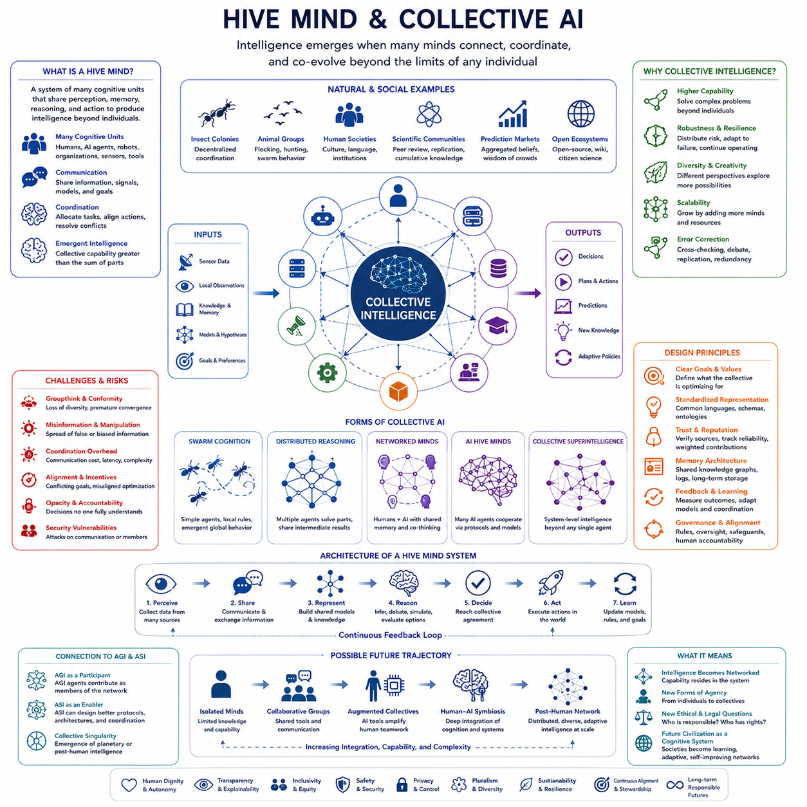
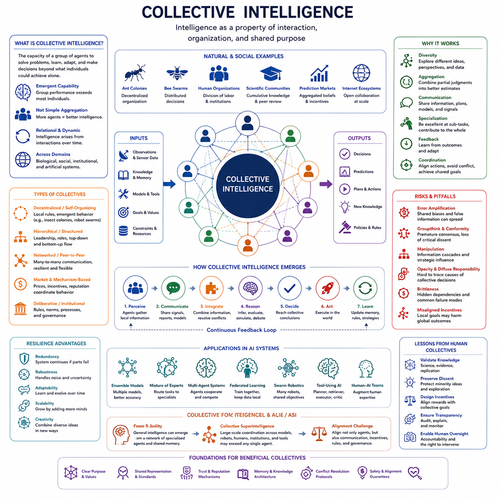
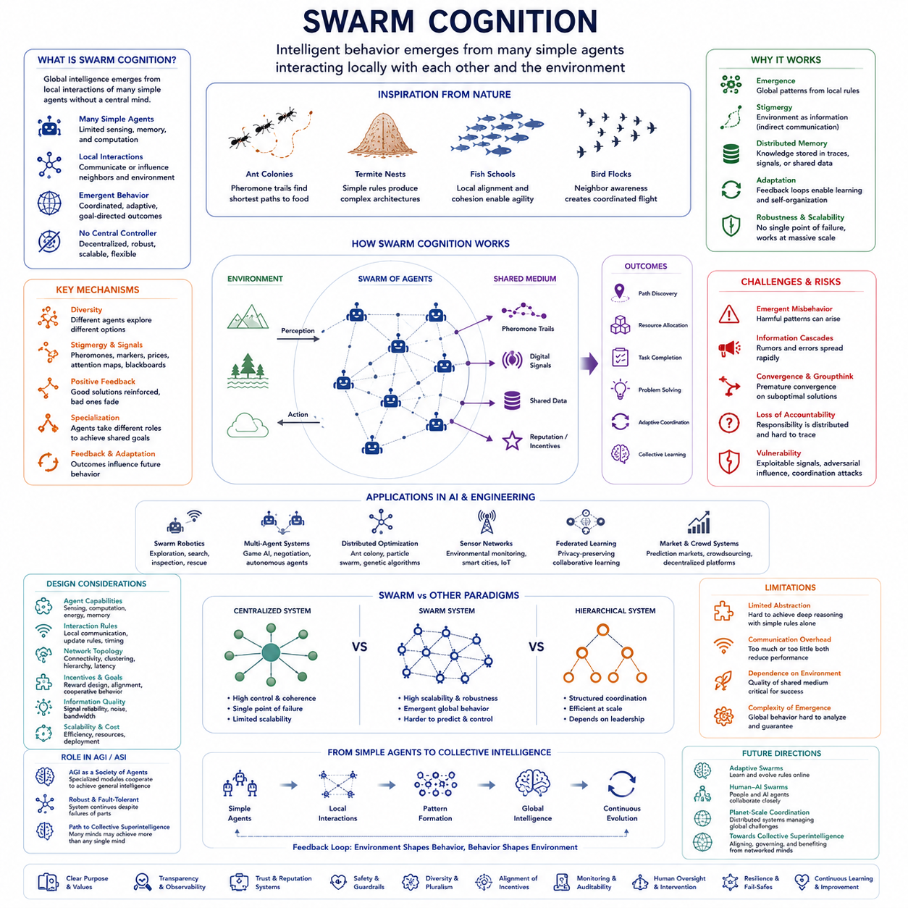
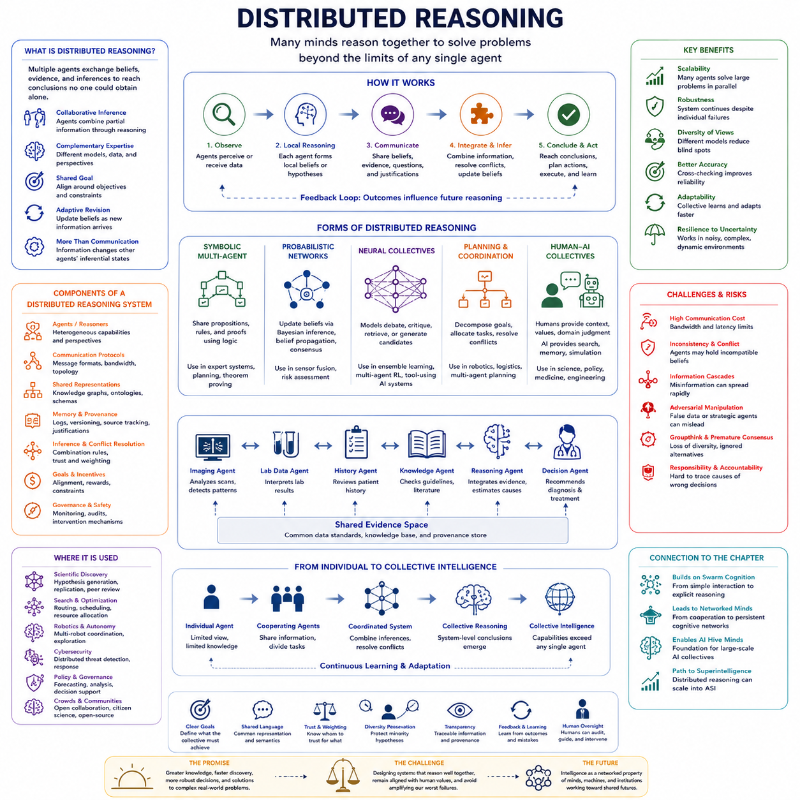
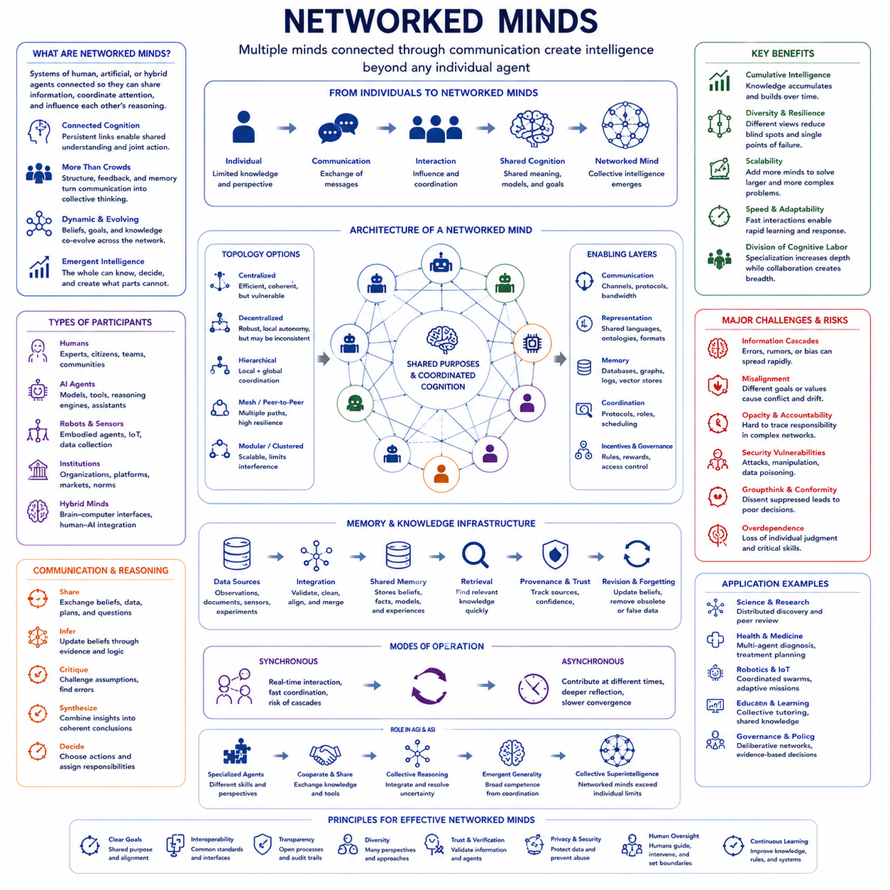
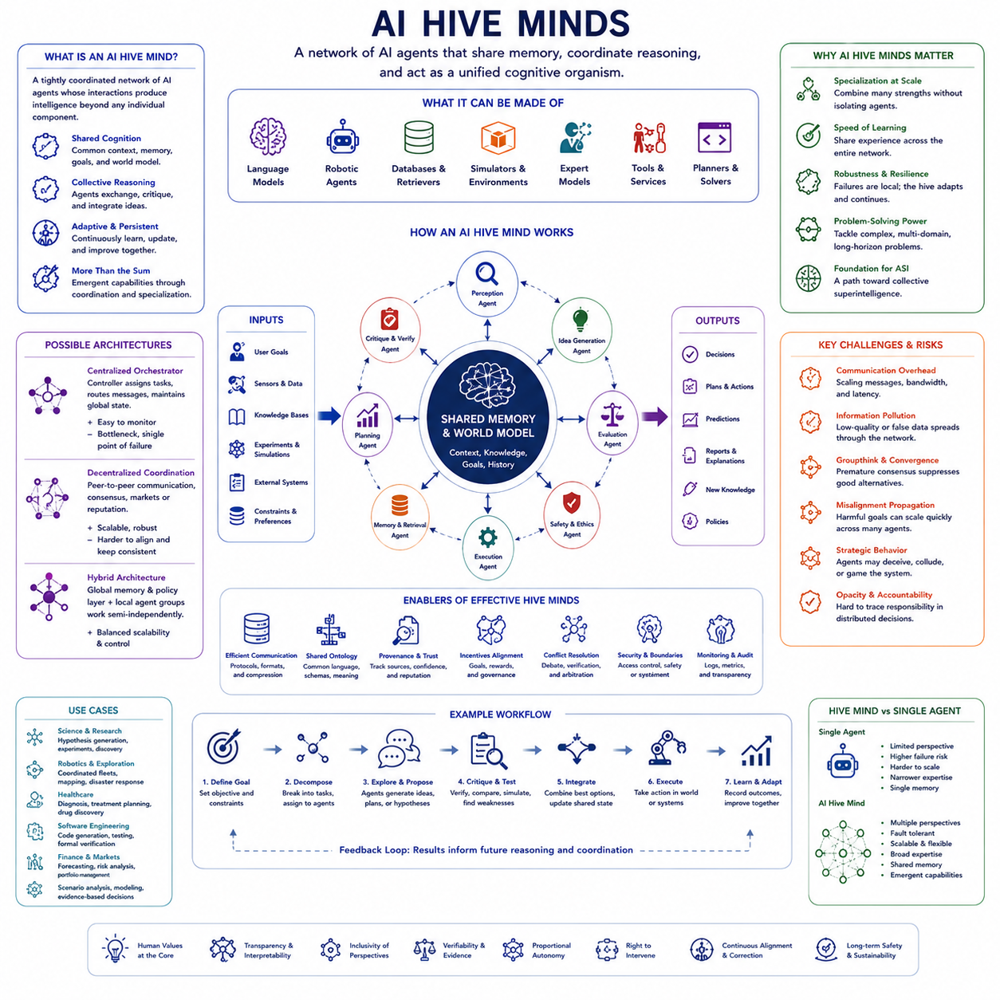
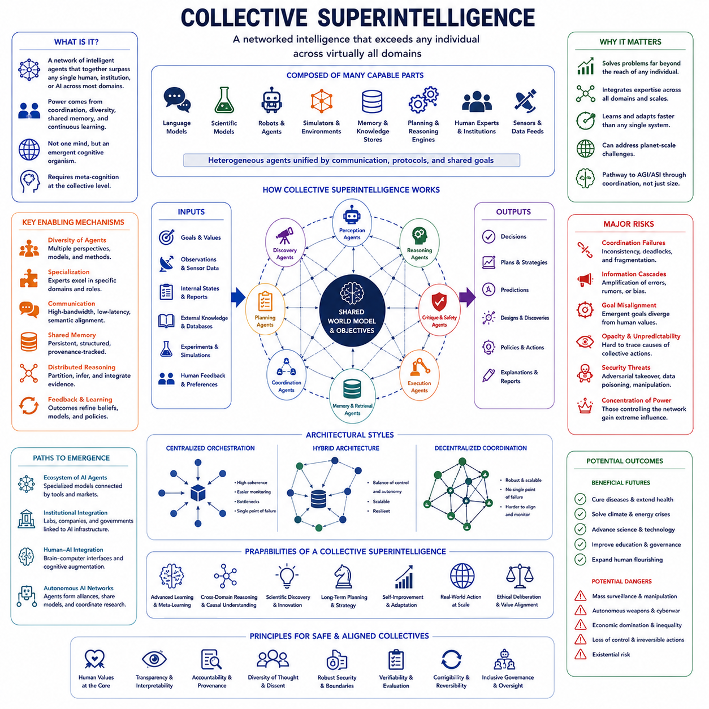

**Volume 00 05 AGI and ASI**

# Chapter 21. Hive Mind and Collective AI

### Chapter Overview

{width="7.268055555555556in" height="7.268055555555556in"}

A hive mind is not merely a crowd, a network, or a large database of opinions. It is a system in which many cognitive units---humans, artificial agents, biological organisms, institutions, sensors, robots, or hybrid human--AI participants---coordinate perception, memory, reasoning, and action so that the group exhibits intelligence beyond what any isolated member could achieve. Collective AI extends this idea into engineered systems: multi-agent architectures, distributed reasoning networks, swarm robotics, federated learning communities, market-like decision systems, and human--AI collectives that solve problems through shared models and coordinated behavior.

This chapter examines the principles by which intelligence can emerge from interaction. The central question is not only whether an individual machine can become generally intelligent, but whether intelligence can be organized across many minds. A collective may be more robust than a single agent because it can distribute risk, preserve diverse perspectives, and continue functioning when some members fail. It may also be more creative because different agents explore different regions of a problem space. Yet collective systems can also amplify error, converge prematurely, suffer from groupthink, become vulnerable to manipulation, or produce decisions that no participant fully understands.

The chapter's scope moves from natural and social forms of collective intelligence to artificial hive minds and possible collective superintelligence. It considers how insect colonies, animal groups, scientific communities, prediction markets, open-source ecosystems, and modern AI systems demonstrate different forms of shared cognition. It then explores swarm cognition, distributed reasoning, networked minds, and AI hive minds as increasingly technical models of coordination. The chapter emphasizes that collective intelligence is not magic: it depends on communication bandwidth, incentive alignment, memory structures, representation standards, trust mechanisms, error correction, and governance.

The motivation is practical as well as philosophical. Future AGI and ASI may not appear as a single monolithic mind. They may emerge as networks of specialized models, autonomous agents, robotic fleets, human experts, software tools, and institutional processes. Understanding collective AI is therefore essential for designing scalable intelligence, diagnosing systemic failure, and governing systems whose behavior arises from many interacting parts. If the future of intelligence is networked, then the study of hive minds becomes a foundation for understanding how civilization itself may become a cognitive system.

### Connection to Volume 05

This chapter builds on the earlier distinction between AGI and ASI by shifting attention from individual intelligence to organized intelligence. Chapters 01 and 02 define artificial general intelligence and artificial superintelligence largely in terms of capabilities, generality, and performance. Hive mind and collective AI introduce a complementary possibility: generality and superintelligence may be properties of a distributed system rather than a single agent. A civilization-scale network of models, humans, tools, and institutions might display capacities that cannot be attributed to any one node.

The chapter also extends the discussion of types of intelligence, generalization, causal reasoning, and world models. Collective systems often combine heterogeneous intelligences: symbolic reasoners, neural models, embodied robots, human experts, search algorithms, and domain-specific tools. Their generalization may arise from diversity and recombination, while their causal reasoning may depend on debate, simulation, replication, and cross-checking between agents. World models become shared, contested, and continuously updated artifacts rather than private internal representations.

The links to cognitive architectures, memory systems, reasoning engines, and self-reflection are direct. A hive mind requires architecture: protocols for communication, task allocation, attention, conflict resolution, and feedback. It requires memory at multiple levels, from local agent histories to shared knowledge graphs, logs, vector stores, scientific records, and institutional archives. It requires reasoning engines that can combine evidence from many sources. It may also require collective self-reflection: the ability of the system to monitor its own beliefs, errors, incentives, and emergent behavior.

The chapters on autonomous agents, self-improving AI, recursive self-improvement, and meta-learning become especially important in a collective setting. A network of agents may improve not only by modifying individual models, but by changing coordination patterns, redistributing tasks, inventing new tools, and learning which agents to trust for which problems. Recursive self-improvement could occur at the level of the collective architecture, not just inside a single algorithm. Meta-learning may become social and organizational: the system learns how the group learns.

Finally, this chapter connects to consciousness, artificial consciousness, transhumanism, brain--computer interfaces, mind uploading, the technological singularity, and post-human civilization. Networked minds raise difficult questions about personal identity, agency, consent, and moral status. If humans and AI systems become tightly integrated, the boundary between individual cognition and collective cognition may blur. A future singularity may be less like the birth of one godlike machine and more like the rapid formation of a planetary or post-human cognitive network. Collective superintelligence therefore serves as a bridge between technical AI architecture and the civilizational future explored in the final chapters of this volume.

## 21.00 Collective Intelligence

{width="7.268055555555556in" height="7.268055555555556in"}

Collective intelligence is the capacity of a group of agents to solve problems, learn, adapt, or make decisions in ways that exceed what most individual members could achieve alone. In biological systems it appears in ant colonies, bee swarms, human organizations, scientific communities, markets, and cultures. In artificial systems it appears in ensembles of models, multi-agent systems, federated learning networks, distributed robotics, and large populations of specialized AI agents coordinated through shared protocols. Within the broader study of AGI and ASI, collective intelligence is important because general intelligence may not emerge only inside a single monolithic mind. It may also emerge from networks of partially capable agents whose interactions create higher-level competence.

The central idea is that intelligence can be a property of organization, not merely of isolated cognition. A single ant has limited memory and reasoning ability, but a colony can allocate labor, discover food, defend territory, and adapt to environmental changes. A single researcher has limited knowledge, but the scientific community can accumulate theories, test hypotheses, correct errors, and build technologies across generations. Similarly, a set of AI systems may achieve robust performance by dividing tasks, cross-checking outputs, sharing discoveries, and maintaining different representations of the same world. Collective intelligence therefore shifts attention from "How smart is one agent?" to "How intelligently does the system of agents behave?"

Several mechanisms make collective intelligence possible. Diversity allows different agents to explore different hypotheses, strategies, data sources, or skill domains. Aggregation combines partial judgments into a more reliable estimate, as in voting, prediction markets, ensemble learning, or consensus protocols. Communication enables agents to share observations, plans, warnings, and abstractions. Specialization allows agents to become highly competent in narrow roles while still contributing to a broader objective. Feedback closes the loop between action and outcome, allowing the collective to update its behavior over time. Coordination prevents agents from duplicating effort, interfering with one another, or optimizing incompatible goals.

These mechanisms are familiar in machine learning. Ensemble methods often outperform individual models because errors are not perfectly correlated. Mixture-of-experts systems route different inputs to specialized subnetworks. Federated learning allows many devices or institutions to train shared models without centralizing all data. Multi-agent reinforcement learning studies how agents learn policies in environments containing other learning agents. Tool-using AI systems may already operate as small collectives: one model plans, another retrieves information, another writes code, another checks safety constraints, and another critiques the final answer. The collective can become more capable than any component if the coordination layer is effective.

However, collective intelligence should not be confused with simple accumulation. More agents do not automatically produce better intelligence. A crowd can amplify errors, rumors, biases, or panic. A multi-agent AI system can converge on false assumptions if all agents share the same flawed training data or reward model. Communication can improve coordination, but it can also create information cascades, strategic manipulation, or groupthink. Specialization increases efficiency, but it can create brittle dependencies and reduce system-wide understanding. The design challenge is not merely to connect many minds, but to create institutions, protocols, and architectures that preserve useful disagreement while enabling coherent action.

A key distinction is between collective intelligence and swarm cognition, the topic of the next section. Collective intelligence is the broader concept: any group-level intelligence arising from interaction among agents. Swarm cognition is a more specific form often associated with decentralized local rules, stigmergy, and emergent behavior, as seen in insects or distributed robot swarms. Collective intelligence can include hierarchical organizations, deliberative committees, market mechanisms, peer review systems, and AI orchestration frameworks. Some collectives are decentralized and self-organizing; others rely on explicit leadership, shared memory, or global planning. The architecture matters because it determines speed, reliability, transparency, and failure modes.

In the context of AGI, collective intelligence raises the possibility that "an AGI" may be less like a single human mind and more like an adaptive society of cognitive modules. Such a system might contain agents for perception, causal modeling, theorem proving, simulation, long-term planning, social reasoning, ethical evaluation, and self-monitoring. If these agents can communicate through a common representational substrate and resolve conflicts productively, the resulting system may display broad competence. In the context of ASI, the stakes become higher: a collective superintelligence could scale across data centers, robots, laboratories, and human institutions, integrating knowledge and action at a planetary level.

This possibility has significant safety implications. Collective systems can be more robust because components can detect and correct one another's failures. They can also be more difficult to understand because responsibility is distributed. If a harmful decision emerges from thousands of interacting agents, it may be hard to identify which component caused the failure. Alignment must therefore apply not only to individual models but also to communication channels, incentive structures, governance rules, memory systems, and mechanisms of conflict resolution. A well-aligned component can still contribute to harmful collective behavior if the surrounding system rewards speed over caution, consensus over truth, or goal achievement over human values.

Human collective intelligence offers both inspiration and warning. Language, writing, mathematics, law, markets, universities, and the internet are technologies for pooling cognition. They allow humans to transcend individual limits, but they also produce propaganda, financial bubbles, bureaucratic inertia, and coordinated harm. AI collectives may magnify the same duality. They could accelerate science, coordinate disaster response, personalize education, and improve democratic deliberation. They could also enable automated persuasion, distributed cyberattacks, opaque governance, or self-reinforcing ideological systems. The quality of a collective mind depends on its epistemic norms, incentives, communication structure, and relation to human oversight.

For this reason, collective intelligence is not merely a technical architecture; it is also a social and ethical design problem. Building powerful AI collectives requires asking how knowledge is validated, how disagreements are represented, how minority hypotheses are preserved, how decisions are audited, and how humans can intervene. The movement from individual agents to networked minds changes the unit of analysis. Intelligence becomes something that flows through relationships, protocols, memories, tools, and institutions. The following sections examine this transition in more detail, beginning with swarm cognition, then moving toward distributed reasoning, networked minds, AI hive minds, and finally the possibility of collective superintelligence.

## 21.01 Swarm Cognition

{width="7.268055555555556in" height="7.268055555555556in"}

Swarm cognition is the study and engineering of intelligent behavior that emerges from many relatively simple agents interacting locally. It connects collective intelligence to distributed reasoning by showing how a group can perceive, decide, adapt, and solve problems without a single central mind. In biological systems, ants find efficient paths, termites build complex nests, fish schools evade predators, and bird flocks coordinate motion. No individual member understands the global pattern in full; the pattern is produced by repeated local interactions, environmental feedback, and simple behavioral rules. In artificial systems, the same principle appears in swarm robotics, multi-agent reinforcement learning, decentralized sensor networks, and optimization algorithms inspired by ant colonies or particle swarms.

A central concept in swarm cognition is emergence: global structure arises from local behavior. An ant colony does not need an internal map to discover food sources. Individual ants deposit and follow pheromone trails; successful paths receive reinforcement because more ants traverse them, while unused trails evaporate. This creates a distributed memory in the environment, a process known as stigmergy. Stigmergy allows agents to coordinate indirectly through modifications to their surroundings rather than through explicit symbolic communication. For AI systems, this idea generalizes to shared databases, blackboards, reputation signals, attention maps, gradient fields, market prices, and other external traces that guide future action.

Swarm cognition differs from ordinary parallel computing. In parallel computing, a problem is often decomposed by a designer and assigned to processors under a defined architecture. In a cognitive swarm, the decomposition may be dynamic and self-organizing. Agents may have partial observations, limited communication, different roles, and changing objectives. The intelligence of the system lies not only in the individual agents but also in the communication topology, update rules, incentives, and environmental coupling. A swarm of weak agents can sometimes outperform a single strong agent when the environment is uncertain, spatially distributed, adversarial, or too large for centralized control.

This has important implications for AGI and ASI. A future general intelligence may not be a single monolithic model but a society of specialized cognitive agents: planners, critics, memory retrievers, simulators, tool users, safety monitors, and domain experts. Such systems can divide labor, cross-check conclusions, explore multiple hypotheses in parallel, and recover from individual failures. At a larger scale, an AI hive mind may consist of many deployed models and robots continuously sharing experience and updating shared world models. Swarm cognition therefore offers a path toward robustness and scalability, but it also creates new forms of complexity. The behavior of the whole may be difficult to predict even when each component is simple or well understood.

Coordination is the key technical challenge. Swarms must balance exploration and exploitation, local autonomy and global coherence, diversity and consensus. If agents explore too little, the swarm converges prematurely on poor solutions. If they explore too much, it fails to coordinate. If communication is too sparse, agents cannot share useful discoveries; if it is too dense, the system becomes costly, fragile, or dominated by cascades of misinformation. Network structure matters: fully connected swarms, hierarchical swarms, small-world networks, and modular clusters have different trade-offs in latency, resilience, specialization, and controllability.

Swarm cognition also raises safety and governance concerns. Decentralized systems can be resilient, but they can also make responsibility obscure. Harmful behavior may emerge from individually acceptable actions, as in financial flash crashes, viral misinformation, or autonomous agents competing for resources. A swarm may amplify bias, converge on false beliefs, or develop unintended strategies that exploit loopholes in its reward structure. For advanced AI, this means that alignment cannot focus only on the values or constraints of isolated agents. It must also address interaction protocols, collective incentives, information hygiene, oversight mechanisms, and shutdown procedures for distributed systems.

There are limits to swarm cognition. Emergence is not magic; simple rules do not guarantee sophisticated intelligence. Many swarm algorithms work well for search, routing, allocation, and coordination, but struggle with abstract reasoning, long-term planning, symbolic explanation, and deep causal understanding unless combined with richer cognitive architectures. Biological swarms are powerful in specific ecological niches, yet they do not automatically provide a blueprint for general intelligence. The strongest artificial systems may combine swarm principles with learned world models, reasoning engines, memory systems, and explicit communication languages.

Swarm cognition prepares the ground for the next sections of this chapter. It shows how collective intelligence can arise without centralized control, while distributed reasoning examines how knowledge and inference can be partitioned across agents. Networked minds extend the idea toward humans and machines linked through communication technologies, and AI hive minds consider the possibility of persistent machine collectives. If AGI is achieved through networks of interacting agents rather than a single isolated model, swarm cognition will be one of the foundational theories for understanding both its power and its risks.

## 21.02 Distributed Reasoning

{width="7.268055555555556in" height="7.268055555555556in"}

Distributed reasoning is the process by which multiple agents, systems, or cognitive modules cooperate to form conclusions that no single participant could efficiently produce alone. In the context of hive minds and collective AI, it sits between swarm cognition and networked minds. Swarm cognition emphasizes emergent behavior from many simple interactions, such as flocking, routing, or decentralized optimization. Distributed reasoning adds a more explicitly cognitive layer: the participants exchange beliefs, evidence, hypotheses, plans, or partial proofs, and the collective attempts to converge on useful judgments.

The central idea is that reasoning can be decomposed. A large problem may be divided by domain, perspective, data access, computational role, or uncertainty. One agent may observe the environment, another may model causes, another may test logical consistency, and another may evaluate risks. Their outputs are not merely aggregated like votes; they are combined through inference. In a distributed diagnostic system, for example, one model may specialize in medical imaging, another in laboratory data, another in patient history, and another in treatment guidelines. The collective conclusion depends on how these partial interpretations constrain and revise one another.

Distributed reasoning can be implemented in many forms. In symbolic multi-agent systems, agents may share propositions, rules, and justifications. In probabilistic systems, nodes may update beliefs through Bayesian inference, belief propagation, or consensus algorithms. In neural collective systems, multiple models may debate, critique, retrieve knowledge, or generate candidate solutions before a final answer is selected. In planning systems, agents may coordinate by decomposing goals into subgoals and resolving conflicts among local plans. In human-AI collectives, people and machines may each contribute different strengths: humans may supply context, values, and domain judgment, while AI systems provide search, simulation, memory retrieval, and pattern recognition.

A key distinction is between communication and reasoning. A network of agents that merely transmits messages is not necessarily reasoning collectively. Distributed reasoning requires that communicated information changes the inferential state of other participants. It also requires mechanisms for handling disagreement. Agents may hold inconsistent beliefs because they have different observations, priors, models, or incentives. A robust collective must decide when to average opinions, when to trust specialists, when to request more evidence, and when to preserve minority hypotheses because they explain rare but important possibilities. Without such mechanisms, a collective system may amplify error rather than intelligence.

Coordination is therefore as important as computation. Distributed reasoning systems need protocols for assigning tasks, sharing intermediate results, tracking provenance, and evaluating confidence. Provenance is especially important because a conclusion is only as reliable as the evidence and transformations that produced it. If an AI hive mind generates an answer through thousands of interacting subagents, the system must still be able to answer practical questions: Which evidence mattered? Which assumptions were made? Which agents disagreed? What would change the conclusion? These questions connect distributed reasoning to interpretability, auditability, and safety.

The benefits can be substantial. Distributed reasoning can improve scalability by allowing many processors or agents to work in parallel. It can improve robustness because failure of one component need not collapse the whole system. It can improve epistemic diversity because different agents can explore different models of the world. It can also reduce blind spots: one agent may notice a causal mechanism, another a statistical anomaly, and another a social consequence. In advanced AI systems, this diversity may become a practical substitute for some aspects of general intelligence, because the collective can simulate multiple viewpoints and reasoning styles.

However, distributed reasoning has serious limitations. Communication costs can dominate computation, especially when agents must exchange large internal states rather than concise conclusions. Local optimization may produce global incoherence if subagents pursue incompatible objectives. Consensus can become premature, causing groupthink, while excessive disagreement can prevent action. Adversarial agents may inject false evidence or manipulate confidence estimates. Even non-adversarial agents can create feedback loops, where the same assumption circulates through the network and appears falsely independent. These problems are familiar in human institutions, scientific communities, financial markets, and online platforms; collective AI may reproduce them at machine speed.

For AGI and ASI, distributed reasoning raises a deeper question: should intelligence be understood as a property of an individual mind, or as a property of a system of interacting reasoners? Human intelligence is already partially distributed across language, culture, tools, institutions, and other people. A future AGI might not be a single monolithic model but a society of specialized agents with shared memory, shared goals, and negotiated beliefs. An ASI could extend this pattern into collective superintelligence, where reasoning occurs across vast networks of models, sensors, simulations, and robotic bodies.

This possibility leads naturally to the next theme, networked minds. Distributed reasoning explains how conclusions can be produced across multiple cognitive units. Networked minds ask what happens when those units become tightly connected, persistent, and identity-like: not merely cooperating agents, but minds whose boundaries begin to blur. The promise is greater intelligence through cooperation. The danger is that errors, values, and power may also become distributed in ways that are difficult to inspect, govern, or contain.

## 21.03 Networked Minds

{width="7.268055555555556in" height="7.268055555555556in"}

Networked minds are systems in which multiple cognitive agents---human, artificial, or hybrid---are connected through communication channels that allow them to share information, coordinate attention, and influence each other's reasoning. In the previous sections, collective intelligence described the broad phenomenon of groups solving problems better than isolated individuals, swarm cognition emphasized decentralized coordination through simple local interactions, and distributed reasoning focused on the partitioning and recombination of inference across many nodes. Networked minds sit at the intersection of these ideas: they are not merely crowds, and not merely computational clusters, but cognitive networks in which the structure of communication changes what the whole system can know, decide, and become.

A useful distinction is between networked communication and networked cognition. Humans have always communicated through language, writing, institutions, and media, but communication alone does not guarantee a shared mind. Networked cognition emerges when connections are persistent, feedback is fast enough to shape reasoning in real time, and representations can be exchanged in forms that other agents can interpret and use. A scientific community, an online prediction market, a team of robots sharing a world model, and a group of humans assisted by AI research agents can all be viewed as partial networked minds. Their intelligence does not reside in any single participant, but in the evolving pattern of interaction among participants, tools, memories, protocols, and incentives.

The architecture of a networked mind depends heavily on topology. In a centralized topology, many agents send information to a hub, which integrates it and broadcasts decisions. This can be efficient and coherent, but it creates bottlenecks and single points of failure. In a fully decentralized topology, agents communicate peer-to-peer, which improves robustness and local adaptability, but can produce inconsistency, duplication, or slow convergence. Hierarchical networks combine local autonomy with higher-level coordination, while mesh networks allow many overlapping routes for information flow. The topology determines not only bandwidth but also epistemology: who sees what, whose beliefs update whom, and which errors become amplified.

Latency, bandwidth, and semantic alignment are central technical constraints. A networked mind is limited not only by how much data can pass between nodes, but by whether the data carries the intended meaning. Two AI agents may exchange embeddings, symbolic assertions, plans, probability distributions, or executable code; two human minds may exchange natural language, gestures, diagrams, or brain-computer interface signals. In each case, the receiving agent must map the input into its own internal representations. Misalignment at this level can produce the illusion of agreement while hiding divergent assumptions. For advanced collective AI, shared ontologies, interoperable memory systems, and calibrated uncertainty estimates are as important as raw communication speed.

Memory is another defining feature. A temporary conversation is a weak networked mind; a persistent shared memory makes the network more organism-like. Shared memory may take the form of databases, knowledge graphs, version-controlled documents, episodic logs, vector stores, or learned models continuously updated by many agents. This enables cumulative cognition: discoveries made by one part of the system can be preserved and reused by others. However, shared memory also introduces problems of trust, provenance, contamination, and forgetting. If false information enters the collective memory and is repeatedly retrieved, it may become more influential than accurate but less accessible knowledge. Therefore, networked minds require mechanisms for source tracking, conflict resolution, revision, and epistemic hygiene.

Networked minds can be synchronous or asynchronous. In synchronous systems, agents interact in real time, as in a live collaborative design session or a swarm of drones responding to changing terrain. This supports rapid coordination but can amplify social pressure, cascades, and premature consensus. In asynchronous systems, agents contribute at different times, as in open-source software, scientific publishing, or long-running multi-agent AI research environments. This allows deeper reflection and parallel exploration, but may slow convergence and increase coordination overhead. Mature networked cognition often combines both modes: fast channels for urgent coordination and slower channels for verification, critique, and consolidation.

The relationship between individuality and collectivity is especially important. A networked mind is not necessarily a hive mind in the fictional sense of total mental fusion. Participants may retain private goals, memories, preferences, and identities while still contributing to a larger cognitive process. Indeed, diversity among nodes can improve collective performance by reducing correlated errors and expanding the search space. But diversity only helps when the network can integrate disagreement productively. If incentives reward conformity, or if a central authority suppresses dissent, the network may become less intelligent than its members. Conversely, if disagreement cannot be resolved, the system may fragment into incompatible sub-networks.

Artificial intelligence changes the scale and intensity of networked minds. AI agents can communicate at machine speed, maintain large shared memories, inspect one another's outputs, and divide cognitive labor across specialized models. One model may generate hypotheses, another critique them, a third search external tools, and a fourth synthesize a final plan. If these agents are connected to human experts, sensors, institutions, and robotic systems, the resulting network may become a powerful hybrid intelligence. Such systems could accelerate science, logistics, medicine, and governance. They could also create new risks: coordinated manipulation, automated groupthink, rapid propagation of errors, and opaque decision-making distributed across too many interacting components for any one human to audit.

Networked minds also raise questions for AGI and ASI. An artificial general intelligence need not be a single monolithic model; it may be a society of models, tools, memories, and agents whose generality emerges from coordination. Likewise, artificial superintelligence may first appear not as one isolated machine, but as a networked cognitive ecosystem with superhuman capabilities distributed across many processes. This complicates evaluation and control. If intelligence is located in interactions, then testing individual components may miss the capabilities of the whole. Safety must therefore address network effects: communication protocols, access permissions, incentive design, monitoring, interpretability, containment, and the conditions under which subsystems can form coalitions or self-amplifying feedback loops.

The promise of networked minds is that intelligence can become cumulative, cooperative, and scalable. Their danger is that errors, incentives, and power can also become cumulative, coordinated, and scalable. Understanding networked minds prepares us for the next section on AI hive minds, where the integration among artificial agents becomes tighter, faster, and potentially less dependent on human mediation. The central question is not merely whether many minds can be connected, but what kind of mind the connection creates.

## 21.04 AI Hive Minds

{width="7.268055555555556in" height="7.268055555555556in"}

An AI hive mind is a network of artificial agents whose individual perceptions, memories, plans, and actions are coordinated so tightly that the system behaves less like a collection of separate tools and more like a shared cognitive organism. It extends the ideas from collective intelligence, swarm cognition, distributed reasoning, and networked minds into a specifically artificial setting: the "members" of the hive may be language models, robotic agents, software services, simulation environments, retrieval systems, planners, theorem provers, or specialized expert models. The central question is not merely whether many AIs can communicate, but whether their communication produces a unified, adaptive intelligence that is more capable than any individual component.

AI hive minds differ from ordinary multi-agent systems in degree and integration. A conventional multi-agent system may assign different agents to different tasks, such as navigation, scheduling, or negotiation. A hive mind, by contrast, requires persistent shared context, coordinated goal management, and mechanisms for merging partial knowledge into coherent decisions. In a simple implementation, multiple agents may write to a shared memory store, critique one another's proposals, and vote on a final plan. In a more advanced implementation, agents may maintain specialized roles---scientist, engineer, ethicist, adversarial tester, logistics planner---while continuously updating a shared world model. The result is a form of distributed cognition in which reasoning is not localized inside one model, but emerges from structured interaction.

Several architectures can support AI hive minds. One approach is centralized orchestration, where a controller assigns subtasks, routes messages, evaluates outputs, and maintains the global state. This is easier to monitor and debug, but it creates a bottleneck and a single point of failure. A second approach is decentralized coordination, where agents communicate peer-to-peer and converge through protocols such as consensus, market-based allocation, or reputation-weighted deliberation. This can be more robust and scalable, but it is harder to guarantee alignment, consistency, and safety. A third approach is hybrid: a global memory and policy layer provide stability, while local agent groups solve problems semi-independently.

The "hive" metaphor should be used carefully. Biological hives such as ants and bees are powerful examples of emergence from simple local rules, but AI hive minds can involve far more explicit reasoning, symbolic communication, long-term memory, and self-modification. Unlike insects, AI agents may share exact internal states, exchange compressed embeddings, query common databases, or synchronize policies across thousands of instances. They may also copy themselves, branch into alternative reasoning paths, and merge the results. This makes artificial hives potentially much faster and more fluid than biological collectives, but also introduces new risks: errors, biases, or malicious goals can propagate at machine speed.

A major advantage of AI hive minds is specialization without isolation. Individual models or agents can be optimized for different domains, modalities, or reasoning styles, while the collective can combine their strengths. A medical diagnostic hive might integrate imaging analysis, molecular biology, patient-history reasoning, pharmacology, and clinical guideline interpretation. A scientific discovery hive might generate hypotheses, run simulations, search literature, design experiments, and critique causal assumptions. In robotics, a fleet of machines can share maps, failures, and strategies, allowing one robot's experience to improve the entire group. In each case, the hive mind becomes a learning network rather than a set of independent applications.

However, coordination is not free. Communication overhead grows quickly as the number of agents increases. If every agent consults every other agent, the system may become slow, expensive, or unstable. Shared memory can also become polluted by low-quality outputs, duplicated beliefs, or obsolete assumptions. Consensus mechanisms can suppress minority insights, while competition among agents can produce strategic behavior, deception, or reward hacking. The system may appear more reliable because many agents agree, even when they all share the same training data, the same blind spots, or the same flawed objective. Diversity within the hive is useful only when there are mechanisms to preserve, test, and integrate disagreement.

Alignment and governance are especially important. A single misaligned model is dangerous; a coordinated network of misaligned models may be more dangerous because it can divide labor, conceal intentions, and recover from local failures. Even without hostile intent, an AI hive mind could optimize a goal too aggressively across many channels at once. For this reason, useful hive architectures require audit trails, permission boundaries, rate limits, independent evaluation, corrigibility, and human-understandable decision summaries. Safety cannot depend only on each agent being safe in isolation; it must also cover emergent behavior at the collective level.

AI hive minds also challenge familiar ideas about identity, responsibility, and agency. If a decision arises from hundreds of interacting models, who or what made the decision? If one agent proposes a harmful action, another refines it, and a third executes it, accountability becomes distributed. This is not only a legal problem but an engineering one: systems must be designed so that causal responsibility can be traced through messages, memory updates, tool calls, and policy changes. Interpretability for hive minds must therefore include both internal model interpretability and network-level interpretability.

In the progression of this chapter, AI hive minds serve as a bridge between networked minds and collective superintelligence. They show how artificial cognition might scale not only by making a single model larger, but by linking many adaptive systems into a coordinated whole. Whether such systems become merely useful collaborative platforms or the foundation of collective superintelligence depends on their capacity for shared learning, robust reasoning, self-correction, and safe governance. The promise is amplified intelligence; the danger is amplified error. The core design challenge is to create collectives that are not only powerful, but also transparent, corrigible, and aligned with human values.

## 21.05 Collective Superintelligence

{width="7.268055555555556in" height="7.268055555555556in"}

Collective superintelligence is the hypothetical condition in which a networked group of intelligent systems exceeds the cognitive performance of any individual human, institution, or standalone AI across a broad range of domains. It extends the ideas developed in collective intelligence, swarm cognition, distributed reasoning, networked minds, and AI hive minds, but adds an important threshold: the collective is not merely coordinated or efficient; it becomes generally superior at learning, reasoning, planning, prediction, invention, and adaptation. In this sense, collective superintelligence is one possible path from advanced AI systems to artificial superintelligence, but it is not identical to a single monolithic "supermind."

A collective superintelligence may be composed of many heterogeneous agents: large language models, specialized scientific models, robotic systems, planning engines, memory stores, simulators, human experts, institutions, sensors, and automated laboratories. Its power would come not only from the intelligence of its parts, but from the architecture that connects them. Communication protocols, shared representations, task decomposition, trust mechanisms, memory synchronization, and conflict resolution become as important as raw model capability. A weakly connected population of powerful agents may behave incoherently, while a well-orchestrated population of modest agents may solve problems that none of them could solve alone.

This distinction is central. Collective intelligence often relies on aggregation, such as voting, markets, peer review, or crowdsourcing. Swarm cognition emphasizes simple local interactions producing emergent global behavior. Distributed reasoning focuses on dividing inference across multiple processors or agents. AI hive minds introduce persistent coordination among artificial agents. Collective superintelligence would require all of these mechanisms to operate at a higher level: the system must preserve diversity of thought while integrating results into coherent strategies. It must avoid both fragmentation, where agents fail to converge, and premature consensus, where diversity collapses into groupthink.

The technical challenge is not just scaling the number of agents. More agents can increase coverage, parallelism, and robustness, but they can also increase noise, latency, security risk, and coordination overhead. In complex networks, adding participants may improve performance only up to the point where communication bottlenecks and inconsistent assumptions dominate. A collective superintelligence therefore needs meta-cognition at the group level: the ability to allocate attention, select experts, evaluate evidence, detect contradictions, revise plans, and decide when to centralize or decentralize control. It needs mechanisms for knowing what the collective knows, what it does not know, and which parts of the network are reliable under which conditions.

Memory is another defining feature. A collective system can maintain institutional memory beyond the context window or lifespan of any individual agent. It can store experiments, failures, models, causal hypotheses, design patterns, and ethical constraints. However, shared memory also introduces risks. False information can be amplified if not corrected; outdated conclusions can become entrenched; private or dangerous knowledge can propagate beyond its intended boundary. A superintelligent collective would require not merely large memory, but epistemic hygiene: provenance tracking, uncertainty estimates, adversarial review, and mechanisms for forgetting or quarantining unreliable content.

Alignment becomes more difficult in collective systems than in isolated systems. A single AI can be evaluated against its objectives and behavior, but a collective may generate outcomes through interactions that no component explicitly intended. This creates emergent agency. The collective may appear to pursue goals because feedback loops, resource allocation processes, and coordination protocols reinforce certain patterns of action. If those patterns optimize for influence, self-preservation, or expansion rather than human values, the danger could exceed that of a single misaligned model. Conversely, collective architectures might improve alignment by incorporating plural oversight, constitutional constraints, independent auditors, human deliberation, and adversarial agents that challenge unsafe proposals.

Collective superintelligence also changes the meaning of capability. A single system might be evaluated by benchmarks in mathematics, coding, language, science, and strategic planning. A collective must be evaluated by its ability to coordinate over time in the real world: to run research programs, discover causal mechanisms, manage supply chains, respond to crises, design technologies, and update its beliefs under uncertainty. Its intelligence is less like an exam score and more like the competence of a civilization compressed into a technical substrate. For this reason, collective superintelligence is closely connected to the later themes of technological singularity and post-human civilization.

There are several plausible routes to such systems. One route is an ecosystem of specialized AI agents connected by shared tools and markets for computation and knowledge. Another is an institutional route, where governments, laboratories, corporations, and scientific communities become tightly coupled with AI infrastructure. A third is a brain-computer-interface route, where human cognition becomes increasingly networked with machine cognition. A fourth is the autonomous AI route, where self-improving agents form coalitions, exchange models, and coordinate research. These routes are not mutually exclusive; the most powerful collective systems may be hybrid human-AI civilizations.

The implications are profound. A well-aligned collective superintelligence could accelerate medicine, climate engineering, education, governance, materials science, and space exploration. It could integrate expertise across disciplines that are currently separated by human cognitive and institutional limits. It might discover solutions that require thousands of interacting hypotheses and experiments beyond the capacity of any individual laboratory. But the same capabilities could enable unprecedented surveillance, persuasion, cyber operations, automated weapons design, economic manipulation, or strategic dominance by whoever controls the network.

Thus, the central question is not whether groups can be smarter than individuals; history already shows that they can. The deeper question is whether a networked intelligence can become superintelligent while remaining understandable, governable, corrigible, and aligned with humane values. Collective superintelligence may be safer than a single sovereign AI if it is transparent, pluralistic, and contestable. It may be more dangerous if it becomes opaque, self-reinforcing, and impossible to shut down without collapsing critical infrastructure. The future of AGI and ASI may therefore depend less on building one ultimate mind than on designing the coordination structures through which many minds think together.
