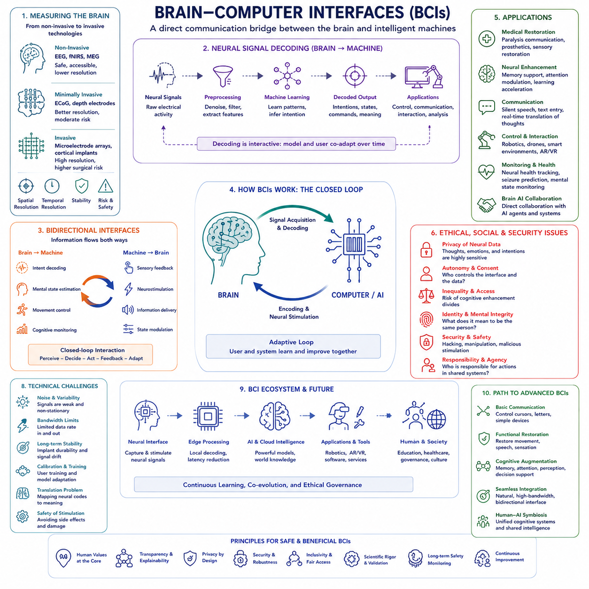
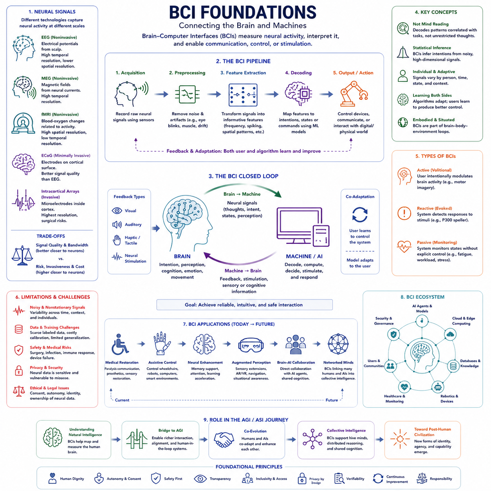
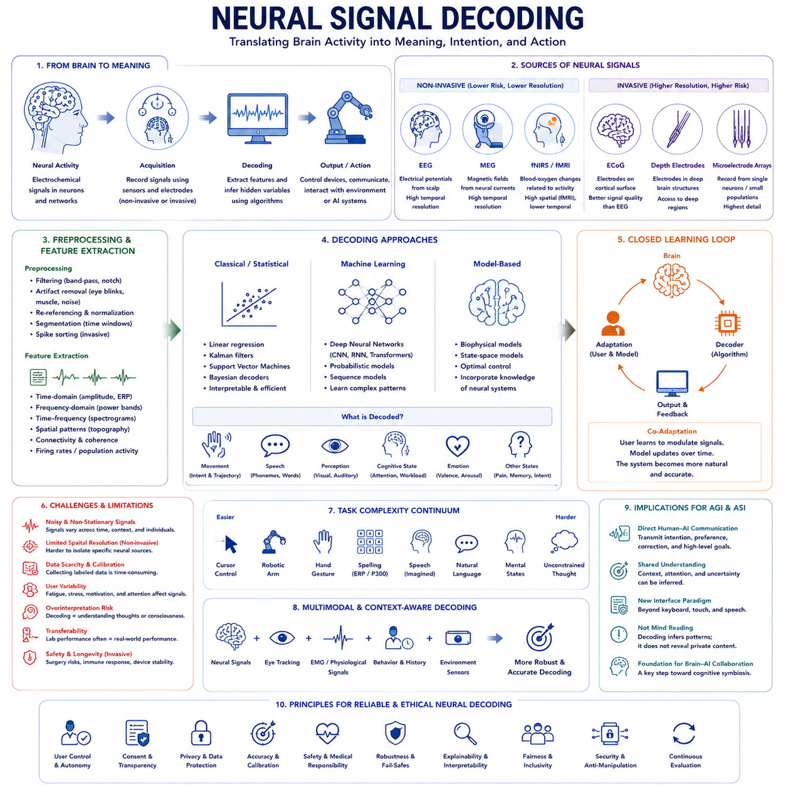
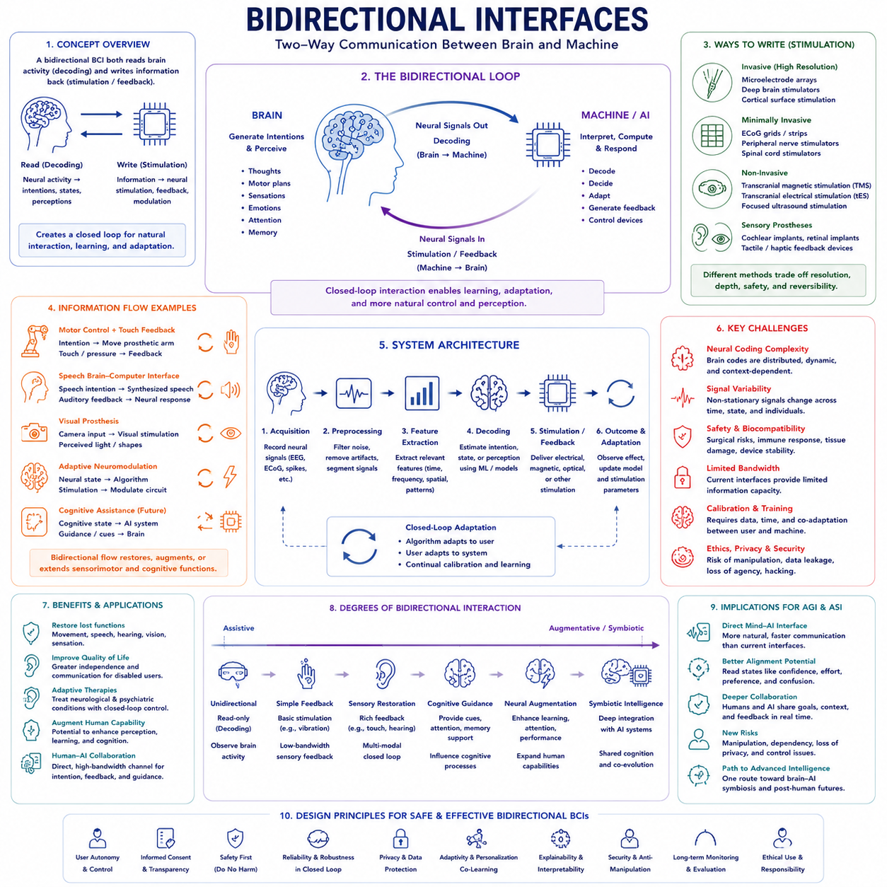
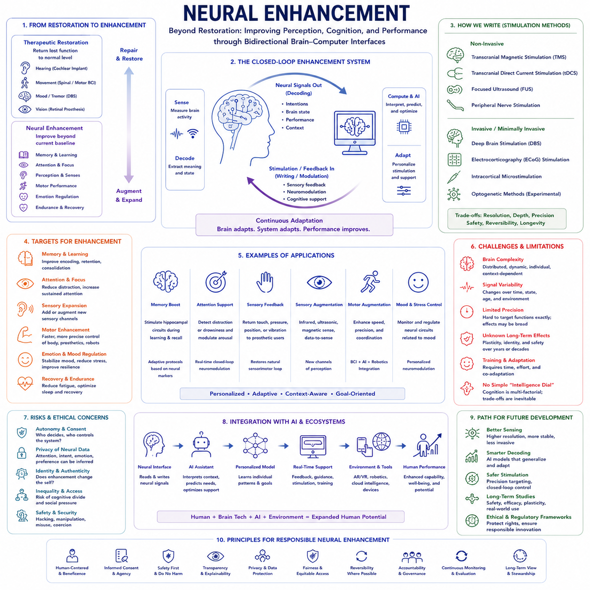
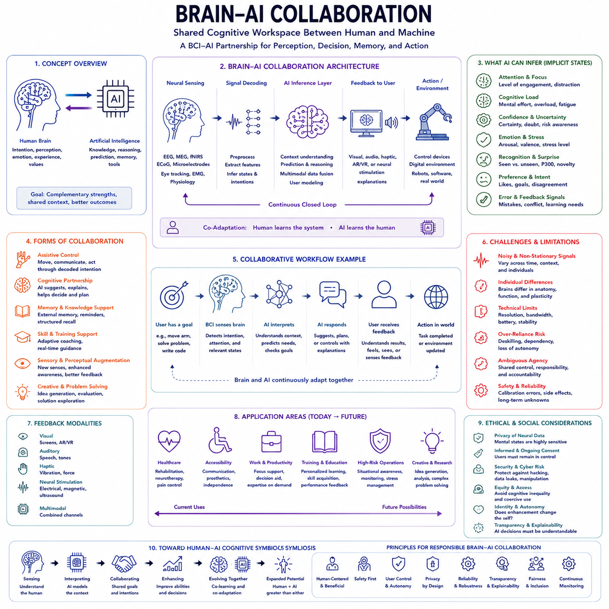
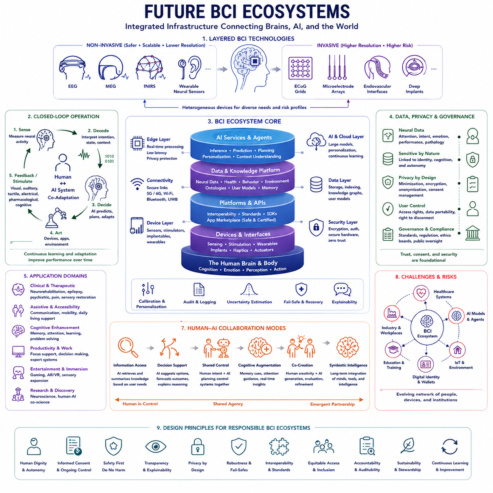

**Volume 00 05 AGI and ASI**

# Chapter 22. Brain Computer Interfaces

### Chapter Overview

{width="7.268055555555556in" height="7.268055555555556in"}

Brain Computer Interfaces (BCIs) are systems that create a direct communication channel between neural activity and computational processes. They translate patterns in the nervous system into machine-interpretable signals, and, in more advanced forms, translate computational outputs back into stimulation that the brain can perceive or use. In the context of AGI and ASI, BCIs are not merely assistive medical devices or experimental control systems. They are potential bridges between biological intelligence and artificial intelligence, opening a path toward shared cognition, neural augmentation, and new forms of human-machine agency.

This chapter introduces the foundations of BCIs, beginning with how neural signals are measured, represented, and interpreted. Non-invasive approaches such as EEG and fNIRS provide broad access with lower risk, while invasive approaches such as microelectrode arrays and cortical implants offer higher resolution at the cost of surgical complexity and safety concerns. Between these extremes are emerging minimally invasive systems that attempt to balance bandwidth, stability, and clinical practicality. The chapter emphasizes that BCI performance depends not only on hardware but also on signal processing, machine learning, neural adaptation, user training, and the design of feedback loops.

The chapter then examines neural signal decoding: the problem of inferring intention, perception, movement, language, emotion, or cognitive state from noisy and high-dimensional neural data. This connects modern BCIs to representation learning, probabilistic modeling, sequence modeling, and adaptive AI systems. Decoding is not a simple act of "reading thoughts." It is a statistical and interactive process in which both the model and the user may co-adapt over time. This distinction is essential for understanding the real capabilities and limits of current BCI technology.

A major focus is bidirectional interfaces, where information flows both from brain to machine and from machine to brain. Such systems could restore sensory function, enable prosthetic control with tactile feedback, support communication in paralysis, or eventually provide new channels of perception and cognition. The chapter also considers neural enhancement, including memory support, attention modulation, learning acceleration, and brain-state optimization. These possibilities raise deep ethical questions about identity, autonomy, inequality, consent, security, and the ownership of neural data.

Finally, the chapter explores Brain AI Collaboration and future BCI ecosystems. As AI systems become more capable, BCIs may enable humans to supervise, guide, query, and cooperate with machines at speeds and levels of intimacy not possible through keyboards, screens, or speech. Future ecosystems may combine neural interfaces, personal AI agents, augmented reality, cloud intelligence, medical monitoring, and collective coordination. The central question of the chapter is therefore not only how brains can control computers, but how minds and intelligent machines may increasingly become coupled systems.

### Connection to Volume 05

This chapter extends the volume's exploration of AGI and ASI by focusing on the interface between natural and artificial intelligence. Earlier chapters define AGI and ASI, examine types of intelligence, and analyze generalization, causal reasoning, world models, and cognitive architectures. BCIs connect these themes to the human brain as both a model and a partner. If AGI seeks flexible, general competence, then the brain remains one of the most important examples of such competence. A BCI is a technological point of contact between the computational study of intelligence and the biological system that first inspired it.

The chapters on memory systems, reasoning engines, self-reflection, autonomous agents, self-improving AI, recursive self-improvement, and meta-learning all concern mechanisms by which intelligence stores information, acts, evaluates itself, and improves. BCIs add a human-in-the-loop dimension to these mechanisms. A future AI agent may not only receive instructions from a user but also infer cognitive load, uncertainty, preference, attention, or emotional state through neural signals. Conversely, the human may receive feedback, suggestions, sensory extensions, or cognitive scaffolding from the AI. This makes BCI research relevant to alignment, interpretability, agency, and the design of systems that collaborate with humans rather than merely replace them.

The connection to consciousness and mind is especially important. Chapters on consciousness, the Chinese Room argument, artificial consciousness, and related philosophical problems ask whether machines can understand, experience, or possess subjective states. BCIs do not solve these questions, but they make them more concrete. If neural activity can be decoded, modified, or linked with artificial systems, then the boundary between internal experience and external computation becomes more complex. Questions about privacy, mental integrity, selfhood, and responsibility move from speculative philosophy into practical engineering and governance.

BCIs also form a bridge to transhumanism, hive minds, mind uploading, the technological singularity, and post-human civilization. Neural enhancement suggests one route by which humans might expand cognitive capacities without abandoning biological embodiment. Collective AI and hive-mind concepts become more plausible if neural interfaces allow groups of people and machines to coordinate through richer channels than language alone. Mind uploading remains far beyond current science, but BCI research contributes to the broader effort to map, model, and interact with neural processes. The same technologies that restore function after injury may also become platforms for augmentation and eventually for new forms of identity and social organization.

In the larger arc of Volume 05, Chapter 22 marks a transition from building artificial minds to connecting artificial minds with human minds. It asks how AGI and ASI might be shaped not only as independent systems but as collaborators, extensions, regulators, or even components of human cognitive life. This makes BCIs one of the most important domains for thinking about the future of intelligence: they sit at the intersection of neuroscience, AI, medicine, ethics, security, and civilization-scale transformation.

## 22.00 BCI Foundations

{width="7.268055555555556in" height="7.268055555555556in"}

Brain-computer interfaces (BCIs) are systems that measure activity from the nervous system, interpret it computationally, and use the resulting information to control an external device, influence a digital environment, or stimulate the nervous system in return. In the context of AGI and ASI, BCIs matter because they form one of the most direct possible links between biological cognition and machine intelligence. They are not merely input devices like keyboards or cameras; they are attempts to couple neural processes with computational systems at the level of intention, perception, attention, movement, and eventually memory or cognition.

A BCI begins with a biological signal. The brain communicates through electrochemical activity distributed across neurons and networks, and different interface technologies observe this activity at different spatial and temporal scales. Noninvasive methods such as electroencephalography (EEG) record electrical potentials from the scalp. They are relatively safe and inexpensive, but signals are blurred by skull, scalp, and muscle artifacts. Magnetoencephalography (MEG) measures magnetic fields generated by neural currents and can provide high temporal resolution, but requires expensive equipment. Functional magnetic resonance imaging (fMRI) measures blood-oxygen changes related to neural activity, offering useful spatial resolution but slow response times and limited practicality for everyday interfaces.

Invasive and minimally invasive BCIs obtain signals closer to neurons. Electrocorticography (ECoG) places electrodes on the cortical surface and often provides better signal quality than EEG with lower risk than penetrating implants. Intracortical microelectrode arrays, such as those placed in motor cortex, can record spikes or local field potentials from small populations of neurons. These systems can support high-performance control of robotic arms, cursors, or speech prostheses, but raise major challenges involving surgery, biocompatibility, long-term stability, immune response, and device failure. The central trade-off is clear: the closer the sensor is to neural tissue, the richer and more precise the signal may be, but the greater the medical and ethical burden tends to become.

A complete BCI pipeline usually includes signal acquisition, preprocessing, feature extraction, decoding, feedback, and adaptation. Preprocessing removes noise and artifacts, such as eye blinks, muscle activity, electrode drift, or environmental interference. Feature extraction converts raw neural recordings into more useful representations: frequency bands in EEG, firing rates in microelectrode recordings, spatial patterns across channels, or latent variables learned by neural networks. Decoding then maps those features onto intended actions, selected symbols, emotional states, attention levels, or other variables of interest. In simple systems, this mapping may use linear classifiers or regression models. In more advanced systems, deep learning and probabilistic models may infer continuous trajectories, speech units, or task goals.

The most important conceptual distinction is between reading neural activity and understanding thought. Current BCIs do not read minds in a general sense. They detect statistically learnable correlations between neural signals and constrained tasks. A motor BCI may infer that a user intends to move a cursor left, not because it has access to an inner mental sentence, but because patterns in motor cortex reliably correspond to imagined or attempted movement. Similarly, a communication BCI may decode selected letters or phonemes under controlled conditions, but that is far from unrestricted access to private thought. This distinction is essential for avoiding both exaggerated hype and misplaced fear.

BCIs may be active, reactive, or passive. Active BCIs rely on deliberate mental control, such as imagining hand movement to move a cursor. Reactive BCIs use responses evoked by stimuli, such as the P300 signal that appears when a user recognizes a target item. Passive BCIs monitor cognitive or affective state without requiring explicit control, such as detecting fatigue, attention, workload, or stress. These categories often overlap in practical systems, especially when the interface must adapt to a changing user and environment.

Feedback is also foundational. A BCI is not simply a one-way decoder; it is part of a closed loop involving brain, body, machine, and task. When a user observes a cursor move, hears synthesized speech, or feels haptic stimulation, the brain adapts. Learning occurs on both sides: the algorithm updates its parameters, and the user learns how to produce more reliable neural patterns. This co-adaptation is powerful but fragile. If feedback is delayed, inconsistent, or poorly calibrated, performance may degrade. If the algorithm changes too quickly, the user may be unable to form stable control strategies. Robust BCI design therefore requires control theory, neuroscience, machine learning, human factors, and clinical knowledge.

The limitations of present BCIs are substantial. Neural signals are noisy, nonstationary, and highly individual. Electrodes move, tissues change, attention fluctuates, and the same intention may not produce exactly the same signal each day. Training data are expensive and often scarce. Laboratory performance may not transfer to home, workplace, or medical settings. Many impressive demonstrations depend on controlled tasks, expert users, or frequent recalibration. Safety, privacy, consent, cybersecurity, and ownership of neural data are not secondary concerns; they are part of the technical foundation because a compromised or manipulative interface could affect agency, identity, and bodily integrity.

For this chapter, BCI foundations provide the base for later sections. Neural signal decoding examines how raw recordings become meaningful estimates. Bidirectional interfaces extend BCIs from reading to stimulation and sensory feedback. Neural enhancement considers whether interfaces can improve memory, attention, or capability beyond therapy. Brain-AI collaboration asks how human cognition and AI systems can share control, intention, and context. Future BCI ecosystems then place these technologies inside larger networks of healthcare, work, education, defense, and augmented cognition. At the foundation is a simple but profound idea: if intelligence is embodied in information-processing systems, then BCIs are one possible bridge between natural and artificial minds.

## 22.01 Neural Signal Decoding

{width="7.268055555555556in" height="7.268055555555556in"}

Neural signal decoding is the process of translating measured brain activity into estimates of intention, perception, movement, cognitive state, or other meaningful variables. Within brain-computer interfaces (BCIs), it is the computational bridge between neural tissue and an external device, application, or artificial intelligence system. The previous section introduced the foundations of BCIs: signal acquisition, electrodes, recording modalities, and the basic loop from brain activity to machine response. Decoding is the step that makes this loop useful. Without reliable decoding, a BCI is only a sensor; with decoding, it becomes a communication channel between biological intelligence and computational systems.

The first distinction in neural decoding is between the source of the signal and the level of detail it can support. Non-invasive systems such as electroencephalography (EEG), magnetoencephalography (MEG), and functional near-infrared spectroscopy (fNIRS) measure aggregate activity from large populations of neurons. They are safer and easier to deploy, but they have limited spatial resolution and are strongly affected by noise, skull filtering, movement artifacts, and environmental interference. Invasive systems, including electrocorticography (ECoG), intracortical microelectrode arrays, and depth electrodes, can capture more precise local field potentials or even action potentials from small neural populations. These signals can support finer decoding of hand trajectory, speech intention, or sensory features, but require surgery and face long-term biocompatibility and stability challenges.

Decoding begins with signal preprocessing. Raw neural recordings are rarely useful in their original form. They may contain electrical noise, muscle activity, eye movements, electrode drift, and biological variability unrelated to the target task. Preprocessing may include filtering by frequency band, artifact rejection, spike sorting, normalization, segmentation into time windows, and extraction of features such as firing rates, oscillatory power, phase relationships, event-related potentials, or connectivity measures. In EEG-based BCIs, common features include sensorimotor rhythms, P300 responses, and steady-state visually evoked potentials. In invasive motor BCIs, firing rates and population activity patterns are often used to infer intended movement.

The decoder itself may be statistical, machine learning-based, or model-based. Classical approaches include linear regression, Kalman filters, support vector machines, and Bayesian decoders. These methods remain important because they are interpretable, computationally efficient, and usable with limited training data. Modern systems increasingly use deep learning architectures such as convolutional neural networks, recurrent neural networks, transformers, and self-supervised models. These methods can learn complex temporal and spatial patterns, but they often require more data, careful regularization, and rigorous validation. A powerful decoder that performs well in a laboratory may fail when the user is tired, distracted, emotionally stressed, or using the interface outside controlled conditions.

A central challenge is that neural signals are non-stationary. The relationship between brain activity and intended output changes over minutes, days, and months. Electrodes shift, tissue responses evolve, attention varies, and the brain itself adapts to the BCI. Therefore, decoding is not merely a one-time mapping problem. Practical BCIs often require adaptive decoders that update over time, co-adaptation between user and machine, calibration procedures, and mechanisms to detect when the model is uncertain. This is especially important for clinical applications, where users may have paralysis, neurodegenerative disease, stroke-related injury, or atypical neural organization.

Another key distinction is between decoding overt behavior and decoding latent mental states. Motor decoding, such as predicting cursor movement or robotic arm control, benefits from relatively well-studied cortical organization and measurable performance targets. Speech decoding is more complex because it must infer phonemes, words, or articulatory gestures from neural activity that may occur before audible speech or even in imagined speech. Decoding attention, emotion, pain, memory, preference, or intention raises even deeper scientific and ethical issues. Such states are distributed, context-sensitive, and often not directly observable. Claims about "reading thoughts" should therefore be treated cautiously. Most current systems decode constrained task-related signals, not arbitrary private mental content.

Neural decoding also depends on feedback. A user learns to modulate neural activity when the system responds predictably, and the decoder improves when it receives labeled examples of what the user intended. This creates a closed learning loop between brain and machine. The quality of that loop determines whether the interface feels slow and effortful or fluid and embodied. In advanced systems, artificial intelligence can assist by predicting context, correcting errors, personalizing models, and combining neural data with eye tracking, electromyography, speech signals, behavioral history, and environmental sensors. Such multimodal decoding can improve robustness, but it also expands the privacy and security risks associated with neural data.

The implications for AGI and ASI are significant. Neural decoding could become a key substrate for brain-AI collaboration, allowing human goals, corrections, preferences, and high-level intentions to be communicated more directly to intelligent systems. However, decoding is not equivalent to understanding the mind. A decoder can correlate patterns of neural activity with outputs without possessing a complete theory of consciousness, cognition, or subjective experience. This distinction matters because future BCI ecosystems may be tempted to overinterpret neural data, turning probabilistic inferences into supposedly authoritative claims about identity, consent, or belief.

The next section, on bidirectional interfaces, extends decoding into a two-way exchange. Once a system can read neural signals, it may also write information back through stimulation of sensory, motor, or cognitive circuits. This raises the technical stakes: decoding errors can become action errors, and encoding errors can become perceptual or cognitive distortions. For this reason, neural signal decoding must be designed with reliability, transparency, user control, cybersecurity, and medical safety at its core. In the long arc from assistive BCIs to neural enhancement and brain-AI symbiosis, decoding is the foundational act of translation between nervous systems and machines.

## 22.02 Bidirectional Interfaces

{width="7.268055555555556in" height="7.268055555555556in"}

A brain-computer interface becomes bidirectional when it both reads neural activity and writes information back into the nervous system. The previous section focused on neural signal decoding: extracting intentions, perceptions, motor plans, or cognitive states from electrical, magnetic, metabolic, or optical signals. Bidirectional interfaces extend that loop by adding stimulation, feedback, or modulation. Instead of being only a "neural output port," the interface becomes a closed control system in which the brain and machine continuously influence each other.

This distinction is fundamental. A unidirectional BCI may allow a paralyzed person to move a cursor or robotic arm by decoded motor intention. A bidirectional BCI can return sensory information from that cursor or arm, such as touch, pressure, position, vibration, or error signals. In motor neuroprosthetics, this feedback can reduce cognitive load because the user no longer has to rely exclusively on vision to guide movement. In principle, the system begins to resemble a biological sensorimotor loop: intention drives action, action produces sensation, sensation updates intention.

The "write" side of a BCI can take many forms. In invasive systems, microelectrode arrays may stimulate small populations of neurons with carefully timed electrical pulses. In less invasive or non-invasive systems, stimulation may use transcranial magnetic stimulation, focused ultrasound, transcranial electrical stimulation, retinal or cochlear implants, peripheral nerve stimulation, or spinal cord stimulation. Each method differs in spatial resolution, temporal precision, depth of access, safety profile, and reversibility. Writing to the brain is not equivalent to uploading arbitrary thoughts. Current stimulation methods typically influence neural circuits in coarse, probabilistic, and context-dependent ways.

The most mature bidirectional neural interfaces exist in medicine. Cochlear implants convert sound into stimulation patterns delivered to the auditory nerve, creating a functional hearing pathway for many users. Deep brain stimulation for Parkinson's disease and other movement disorders modulates pathological brain circuits, sometimes with adaptive control based on neural biomarkers. Retinal prostheses, spinal stimulators, and sensory feedback systems for prosthetic limbs all demonstrate the same general principle: decoding and stimulation can be combined to restore or augment lost function. These systems are narrow, engineered, and highly constrained, but they are important stepping stones toward more general brain-AI collaboration.

A central challenge is neural coding. To write meaningful information into the nervous system, a device must understand how neural populations represent sensation, action, attention, confidence, reward, and error. Even in primary sensory areas, codes are distributed, plastic, and influenced by attention and experience. In higher cognitive areas, the problem becomes much harder because representations are abstract, mixed, dynamic, and individual-specific. The brain is not a simple addressable memory chip. Stimulating a location does not reliably "insert" a concept. It may produce a sensation, bias a decision, alter excitability, disrupt processing, or be ignored depending on state and context.

Closed-loop design is therefore essential. A bidirectional interface must monitor the effect of its own stimulation and adapt its parameters over time. This involves control theory, machine learning, neurophysiology, and human factors engineering. The system may learn which stimulation patterns are interpreted as fingertip pressure, which timing improves motor learning, or which neural biomarker predicts tremor onset. The human user also adapts. Over days or months, the brain may learn to interpret artificial feedback as naturalistic information, while the decoder learns the user's changing neural patterns. The interface is not merely implanted; it is co-trained.

This co-adaptation raises both technical promise and risk. Bidirectional BCIs could support high-bandwidth prosthetic control, restoration of touch, treatment of depression or epilepsy through adaptive neuromodulation, improved rehabilitation after stroke, and new forms of communication for people who cannot speak or move. In future brain-AI systems, artificial agents might provide cognitive feedback, memory cues, attention guidance, or perceptual overlays through neural or peripheral channels. Such systems would blur the boundary between tool, assistant, therapy, and extension of the self.

However, bidirectional access also expands the safety and ethics problem. Reading neural signals already raises questions about privacy, consent, and mental autonomy. Writing to neural tissue adds concerns about agency, identity, dependency, manipulation, and long-term plastic changes. A poorly calibrated system could produce pain, false sensations, mood shifts, compulsive behavior, or degraded function. A networked or AI-mediated BCI must be protected against unauthorized control, adversarial inputs, data leakage, and optimization objectives that do not align with the user's well-being.

For AGI and ASI, bidirectional interfaces are important because they represent one possible bridge between biological and artificial intelligence. They do not by themselves create artificial general intelligence, nor do they provide a direct route to mind uploading. But they may enable tighter coupling between human cognition and machine intelligence than screens, keyboards, speech, or gesture can provide. The next section on neural enhancement builds from this foundation: once an interface can read from and write to neural systems, the question shifts from restoring lost function to expanding capability, and from medical repair to cognitive augmentation.

## 22.03 Neural Enhancement

{width="7.268055555555556in" height="7.268055555555556in"}

Neural enhancement refers to the use of brain-computer interfaces and related neurotechnologies not only to restore lost function, but to improve perception, cognition, emotion regulation, or motor capability beyond a person's current baseline. In the previous section, bidirectional interfaces were introduced as systems that both decode neural activity and write information back into the nervous system. Neural enhancement builds directly on that idea: if an interface can read intention, brain state, or performance limits, and can also deliver stimulation, feedback, or computational support, then it may be possible to optimize the brain's operation in real time.

A crucial distinction is between therapeutic restoration and augmentation. A cochlear implant that restores hearing, a deep brain stimulation system that reduces Parkinsonian tremor, or a spinal interface that helps recover movement are usually described as medical interventions. Enhancement begins when similar mechanisms are applied to improve memory consolidation, accelerate learning, sharpen attention, reduce fatigue, or expand sensory capacity in otherwise healthy individuals. The boundary is not always clear. A person with severe depression may receive stimulation to normalize mood regulation, while a high-performing professional might seek similar regulation to maintain focus under stress. The same technical platform can serve different social and ethical meanings depending on context.

Technically, neural enhancement can be approached through stimulation, decoding, feedback, or external cognitive scaffolding. Electrical stimulation, magnetic stimulation, focused ultrasound, optogenetic methods in experimental settings, and pharmacological neuromodulation can alter neural excitability and network dynamics. Non-invasive techniques such as transcranial magnetic stimulation (TMS) and transcranial direct-current stimulation (tDCS) are attractive because they avoid surgery, but their effects are often broad, variable, and difficult to target precisely. Invasive implants can provide higher spatial and temporal precision, but they introduce surgical risk, long-term biocompatibility challenges, infection risk, device degradation, and complex maintenance requirements.

Closed-loop enhancement is especially important. An open-loop system delivers stimulation according to a fixed schedule or preset intensity. A closed-loop system monitors neural signals, behavioral performance, or physiological state and adapts its intervention dynamically. For example, a memory enhancement system might detect patterns associated with encoding or retrieval and stimulate hippocampal or cortical circuits only when the brain is in a state likely to benefit. An attention-support system might detect drowsiness, distraction, or cognitive overload and adjust stimulation, sensory cues, or AI-mediated task support. Closed-loop design is central because the brain is not a static machine; its response depends on context, history, sleep, emotion, medication, and ongoing activity.

Memory enhancement is one of the most discussed possibilities. Research has explored stimulation of the hippocampus and connected medial temporal lobe structures, as well as computational models that predict neural firing patterns associated with successful encoding. Yet memory is not a single storage device. It includes working memory, episodic memory, semantic memory, procedural learning, emotional salience, and consolidation during sleep. Improving one component may disrupt another, and stronger memory is not always better. Forgetting, abstraction, and emotional regulation are functional parts of intelligence. A system that indiscriminately strengthens recall could increase intrusive memories or reinforce false associations.

Sensory and motor enhancement also deserve careful attention. Bidirectional BCIs could, in principle, add new sensory channels: infrared perception, ultrasonic awareness, magnetic orientation, remote robotic touch, or data streams translated into tactile or cortical patterns. Motor enhancement could include faster control of prosthetics, exoskeletons, drones, or virtual avatars. However, the nervous system must learn to interpret new signals and control new effectors. Plasticity is powerful but not unlimited. Training time, cognitive load, signal stability, and embodiment all determine whether an added capability becomes intuitive or remains a distracting interface.

Neural enhancement is often imagined as a direct route to superhuman intelligence, but current evidence suggests a more constrained picture. The brain is highly interconnected, and functions such as reasoning, creativity, and judgment emerge from distributed processes involving perception, memory, emotion, social cognition, and bodily regulation. There may be no simple "intelligence dial" to turn upward. Enhancements are more likely to be narrow, task-dependent, and sensitive to individual differences. A stimulation protocol that improves attention in one person may impair flexibility in another. A decoding model trained on one brain state may fail after fatigue, stress, aging, or disease progression.

The implications for AGI and ASI are profound. Neural enhancement could create new forms of human-AI coupling in which artificial systems do not replace human cognition but amplify selected capacities. A person might use an AI assistant as an external reasoning engine while a BCI tracks uncertainty, workload, or intent and adjusts the interaction. In this sense, enhancement becomes a bridge to the next section, brain-AI collaboration: the most transformative systems may not be isolated implants, but adaptive ecosystems in which biological intelligence, machine intelligence, and networked knowledge continuously shape one another.

At the same time, neural enhancement raises difficult questions of safety, identity, autonomy, inequality, and governance. Who controls the parameters of a cognitive implant? Can an employer, school, military organization, or platform provider pressure individuals to adopt enhancement? How are neural data protected when they reveal attention, preference, emotion, or intent? If an enhancement changes mood, confidence, impulse control, or memory, does it alter the self or merely extend it? These questions are not secondary to engineering; they are part of the design problem. A responsible neural enhancement ecosystem must prioritize consent, reversibility where possible, transparency, cybersecurity, clinical validation, and equitable access.

Neural enhancement therefore sits between medicine, human-computer interaction, cognitive science, and the long-term trajectory of intelligent civilization. It is not yet a mature path to radically upgraded minds, but it is already changing how researchers think about the boundary between brain and tool. As BCIs become more precise, adaptive, and integrated with AI, enhancement will increasingly be understood not as a single device implanted in the skull, but as a layered relationship between neural tissue, algorithms, bodies, environments, and social institutions.

## 22.04 Brain AI Collaboration

{width="7.268055555555556in" height="7.268055555555556in"}

Brain AI collaboration extends the idea of a brain computer interface (BCI) from a communication channel into a shared cognitive workspace. Earlier sections described how neural signals can be decoded and how bidirectional systems can both read from and write to the nervous system. In collaborative systems, those capabilities are combined with adaptive artificial intelligence so that human and machine can jointly perceive, decide, remember, and act. The objective is not merely to replace a lost function or to control an external device, but to create a partnership in which biological cognition and machine cognition compensate for each other's limitations.

The basic architecture usually includes neural sensing, signal decoding, an AI inference layer, feedback to the user, and often an actuator or digital environment. Neural sensing may rely on non-invasive electroencephalography (EEG), magnetoencephalography (MEG), functional near-infrared spectroscopy (fNIRS), or invasive microelectrode arrays and electrocorticography (ECoG). The AI layer interprets uncertain, noisy neural data in context. For example, a BCI may detect an intended cursor movement, a state of attention, a recognition response, or an error-related potential. A machine learning model can then combine that neural evidence with environmental data, task goals, and prior user behavior to infer what action is most likely useful.

A crucial distinction is between command-based BCI and collaborative BCI. In command-based systems, the user intentionally produces a control signal, such as imagining hand movement to select a target. In collaborative systems, the AI may also infer implicit states: confidence, fatigue, surprise, confusion, workload, preference, or disagreement. This allows the system to adapt without requiring every intention to be consciously expressed. A medical exoskeleton, for instance, may use motor intention signals together with posture sensors and predictive control. A decision-support system may use gaze, pupil dilation, and neural markers of recognition to prioritize information. A creative tool may monitor cognitive load and propose alternatives when the user appears stuck.

This collaboration is especially relevant to AGI and ASI because it blurs the boundary between tool use and cognitive integration. An advanced AI assistant connected to neural data could personalize itself at a much deeper level than a conventional software agent. It could learn which explanations are understandable to a particular user, detect when a recommendation conflicts with the user's values, and maintain shared context across tasks. In principle, such systems could become "cognitive prostheses" that augment memory, attention, planning, language production, or sensory interpretation. They may also enable high-bandwidth interaction with future AI systems, reducing the bottleneck of typing, speech, and screen-based interfaces.

However, present-day brain AI collaboration remains limited by both neuroscience and engineering. Neural signals are indirect, variable, and highly individual. The same pattern may mean different things across users, sessions, or cognitive contexts. Non-invasive systems are safer and more scalable but provide lower spatial resolution and are vulnerable to noise. Invasive systems can provide richer signals but introduce surgical risk, long-term biocompatibility challenges, and ethical concerns. Even when decoding accuracy is high in a laboratory, performance can degrade in real-world settings with movement, distraction, emotional variability, and changing intentions.

There are also deep human factors problems. A collaborative BCI must maintain an appropriate balance between autonomy and user control. If the AI acts too aggressively, users may feel manipulated, bypassed, or deskilled. If it acts too cautiously, the interface may become slow and frustrating. Shared agency is particularly difficult: when an action is produced by a mixture of neural intent, AI prediction, and automated control, responsibility may be ambiguous. This matters in clinical devices, military systems, workplace monitoring, education, and any context where errors have consequences.

Feedback is another central issue. Bidirectional collaboration requires the AI to make its interpretations legible to the user. This may occur through visual displays, haptic feedback, auditory cues, augmented reality, or direct neural stimulation. Good feedback helps the user learn how the system interprets them, while the AI simultaneously learns the user's patterns. This co-adaptation can improve performance, but it can also create unstable loops if the model overfits, if the user changes strategy, or if stimulation alters the very signals being decoded. Designing stable, transparent learning dynamics is therefore essential.

The ethical implications are significant. Brain AI collaboration may expose highly sensitive information, including attention, emotional response, recognition, fatigue, and possibly preferences that users have not explicitly chosen to reveal. Privacy protections must treat neural data as more than ordinary biometric data because it can be linked to cognition, identity, and autonomy. Consent must be ongoing, not a one-time checkbox, especially when systems adapt over time. Security is also critical: a compromised BCI could leak neural data, distort feedback, or influence behavior through subtle recommendations.

The most realistic near-term future is not instant mind-machine fusion, but specialized collaborative systems for medicine, accessibility, training, high-risk operations, and advanced human-computer interaction. Over time, these systems may form ecosystems in which BCIs, wearable sensors, AI assistants, augmented reality, and cloud-based models operate together. This leads naturally into the next section on future BCI ecosystems. The central question will be whether brain AI collaboration develops as a humane extension of agency, enabling people to do what they value more effectively, or as an opaque infrastructure that measures, predicts, and shapes cognition without sufficient accountability.

## 22.05 Future BCI Ecosystems

{width="7.268055555555556in" height="7.268055555555556in"}

Future brain-computer interface ecosystems will not be defined by a single implant, headset, or decoding algorithm. They will emerge from the interaction of neural sensors, stimulation systems, edge processors, cloud AI services, clinical platforms, identity systems, and social norms. Earlier sections described the foundations of BCIs, neural signal decoding, bidirectional interfaces, neural enhancement, and brain-AI collaboration. The next step is to understand BCIs as ecosystems: layered infrastructures in which biological cognition, machine intelligence, medical devices, consumer computing, and governance mechanisms are continuously connected.

A mature BCI ecosystem will likely contain both invasive and non-invasive technologies. Invasive devices, such as implanted electrode arrays, electrocorticography grids, or endovascular interfaces, can provide higher signal quality and more precise stimulation, but they carry surgical risk, maintenance challenges, and regulatory burdens. Non-invasive systems, including EEG, MEG-derived methods, functional near-infrared spectroscopy, and future wearable neural sensors, are safer and more scalable, but usually have lower spatial resolution and weaker signal-to-noise ratios. The ecosystem will therefore be heterogeneous. A paralyzed patient using a high-bandwidth implant for speech restoration, a worker using a fatigue-monitoring headset, and a student using adaptive neurofeedback software may all be part of the same broader BCI economy, but their risk profiles and ethical requirements are very different.

The technical foundation of such ecosystems will be closed-loop operation. In a closed-loop BCI, neural activity is measured, interpreted, acted upon, and then modified through feedback. This feedback may be visual, auditory, tactile, electrical, pharmacological, or cognitive. For example, an AI system may decode an intention to move a cursor, predict uncertainty in that decoding, adapt the user interface, and stimulate sensory cortex to provide artificial touch. Over time, both the user and the model adapt. This mutual adaptation is powerful, but it also creates safety questions. If an AI system changes its decoding strategy while the brain changes its neural representation, failures may be difficult to trace. Future BCI platforms will need calibration protocols, audit logs, uncertainty estimates, fail-safe modes, and explainable control layers.

Data will be one of the central assets and risks of BCI ecosystems. Neural data is not simply another biometric identifier. It may contain information about attention, fatigue, intention, emotional state, pathology, and possibly latent cognitive traits. Even when raw neural signals do not directly reveal thoughts, they can become revealing when combined with behavioral data, eye tracking, voice, location, health records, and large AI models. This raises the need for neural privacy, consent management, encryption, secure hardware, and strict limits on secondary use. A future "neural data economy" could support personalized medicine and adaptive learning, but it could also enable manipulation, discrimination, or surveillance if poorly governed.

Interoperability will be another decisive issue. Today's BCI systems are often vertically integrated: one organization controls the hardware, software, signal processing pipeline, and data storage. Future ecosystems may require standards for neural data formats, stimulation parameters, device authentication, safety telemetry, and application programming interfaces. Interoperability can increase innovation and reduce lock-in, but it also increases the attack surface. A malicious or poorly designed application connected to a neural interface is not equivalent to a buggy phone app; it may affect perception, movement, mood, or clinical therapy. Therefore, BCI app ecosystems will need medical-grade security and certification models, especially for bidirectional systems that can write signals back into the nervous system.

The boundary between clinical and consumer BCI will become increasingly blurred. Clinical BCIs will continue to address paralysis, epilepsy, stroke rehabilitation, neuroprosthetics, psychiatric disorders, and sensory restoration. Consumer systems may focus on attention training, gaming, immersive reality, communication, productivity, and wellness. However, a device designed for wellness may detect signs of disease, and a clinical implant may later support communication, entertainment, or workplace tools. This convergence will challenge existing regulatory categories. Regulators will need to distinguish between low-risk monitoring, decision-support systems, assistive control, therapeutic intervention, and enhancement. The same hardware may require different oversight depending on software updates and intended use.

Artificial intelligence will be the organizing layer of future BCI ecosystems. Modern machine learning already improves decoding, denoising, adaptive calibration, and personalized modeling. More advanced AI agents could coordinate multiple devices, infer user goals, translate between neural activity and language, and mediate collaboration between humans and machines. In the context of AGI and ASI, BCIs raise deeper questions. If AI systems become highly capable collaborators, BCIs may become high-bandwidth channels for shared cognition rather than simple control interfaces. Human intention, machine planning, memory augmentation, and sensory simulation could be integrated into hybrid cognitive workflows. Yet high bandwidth does not guarantee understanding. A neural link to a powerful AI could amplify human agency, or it could make persuasion, dependency, and cognitive outsourcing more difficult to recognize.

Equity and access will shape the social impact of BCI ecosystems. If advanced BCIs remain expensive, they may widen gaps between enhanced and non-enhanced populations. If they become mandatory in certain workplaces, schools, or military contexts, they may threaten cognitive liberty. If they are distributed through subscription models, users may lose access to functions that become psychologically or medically important. Long-term stewardship is especially important for implants: a person should not be abandoned because a company fails, a platform is discontinued, or a cloud service changes its terms. Sustainable BCI ecosystems require repairability, data portability, clinical continuity, and public-interest governance.

The future of BCIs is therefore not only a story of better electrodes or smarter decoders. It is a story of integration. Neural interfaces will sit at the intersection of medicine, computation, identity, labor, education, defense, and human rights. Their promise is substantial: restored communication, improved rehabilitation, new forms of collaboration, and possibly deeper integration between biological and artificial intelligence. Their risks are equally serious: privacy loss, coercion, unsafe adaptation, inequality, and erosion of mental autonomy. A responsible BCI ecosystem must be designed not merely to connect brains to machines, but to preserve the dignity, agency, and diversity of the minds being connected.
