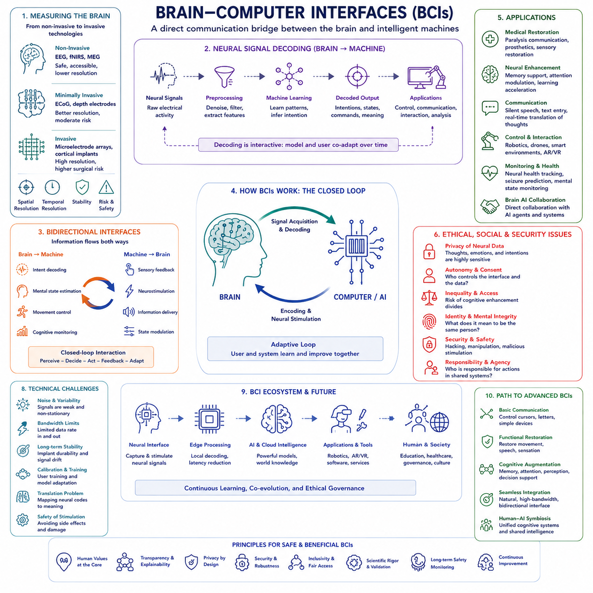
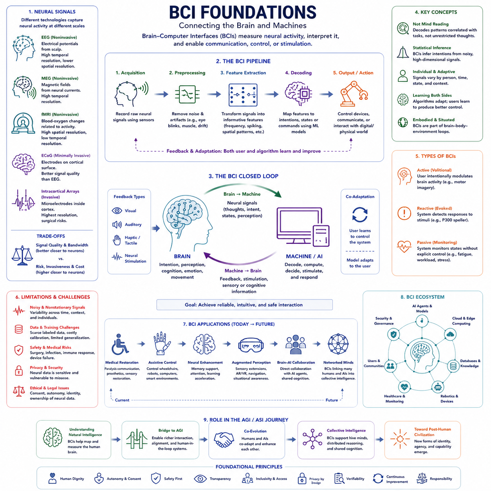
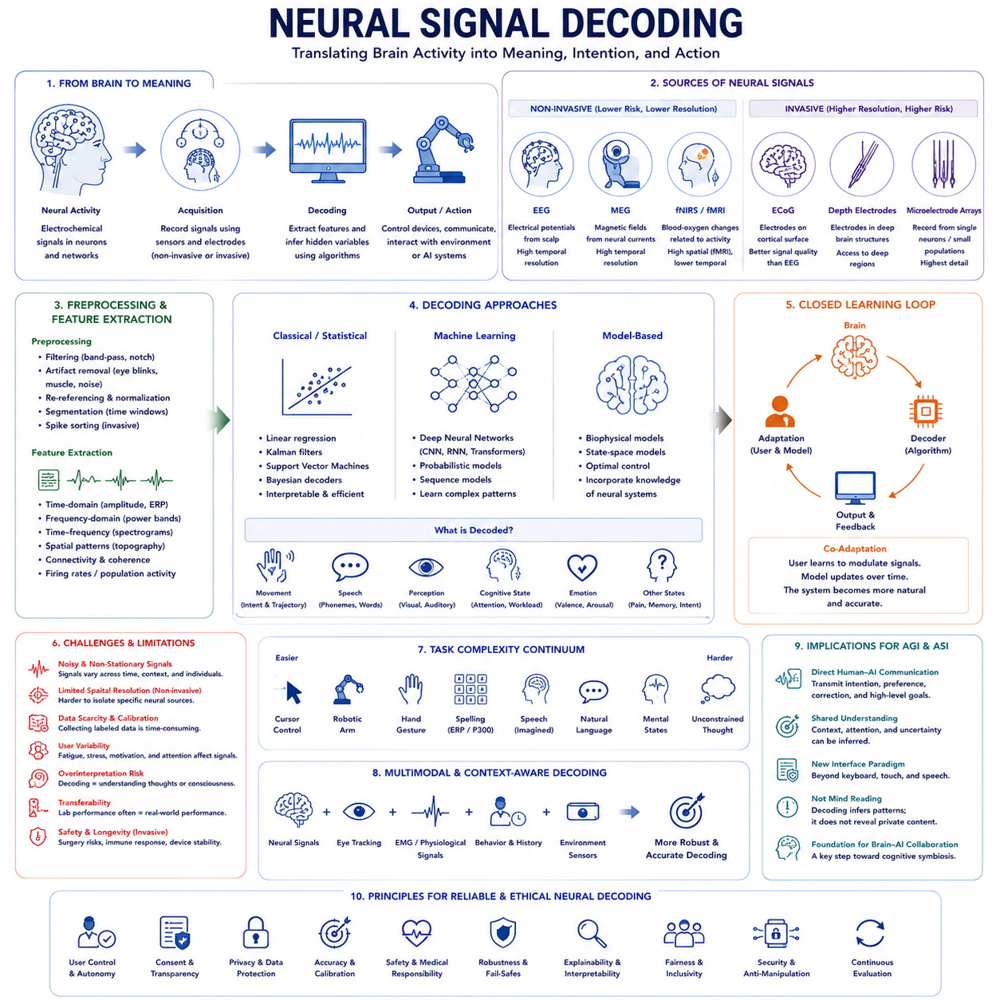
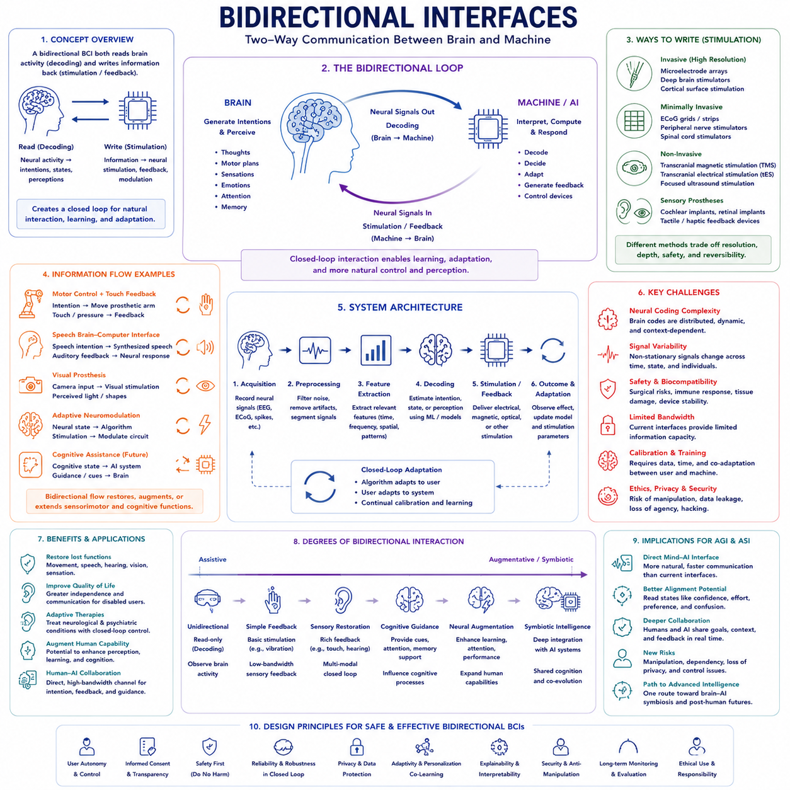
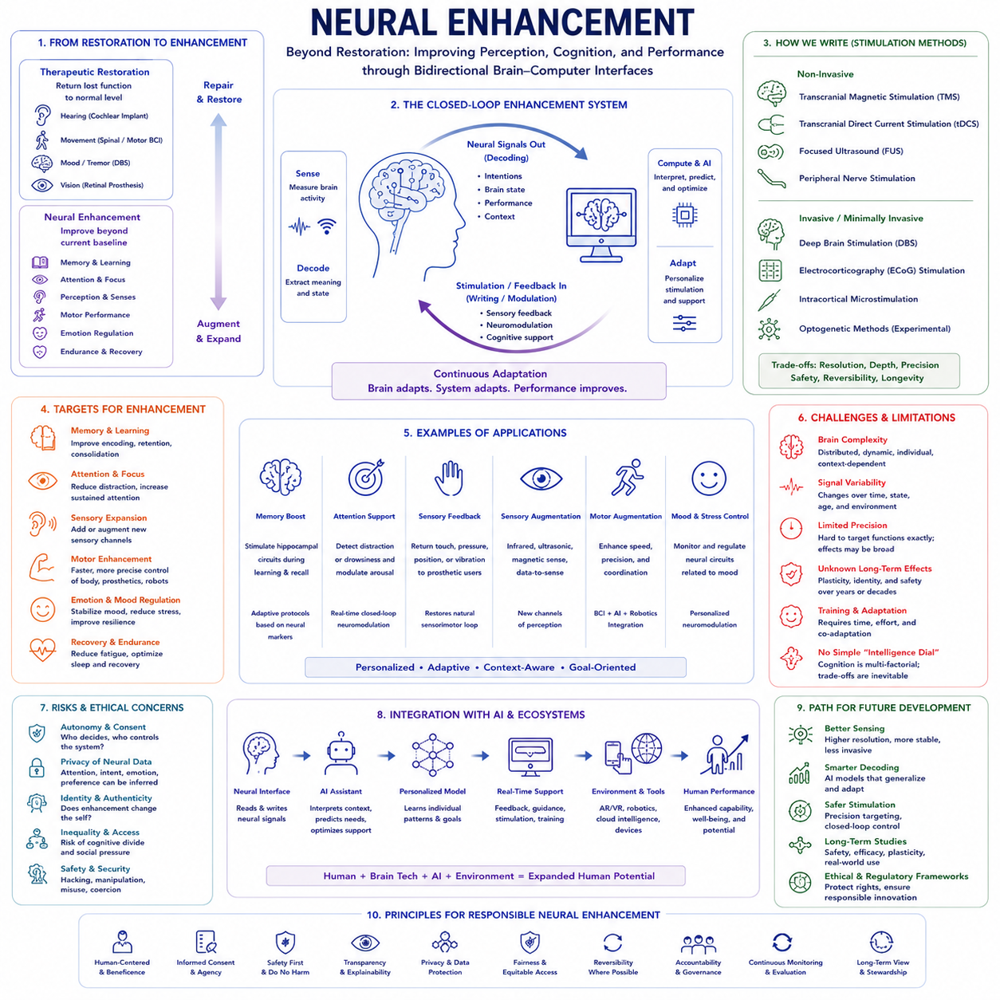
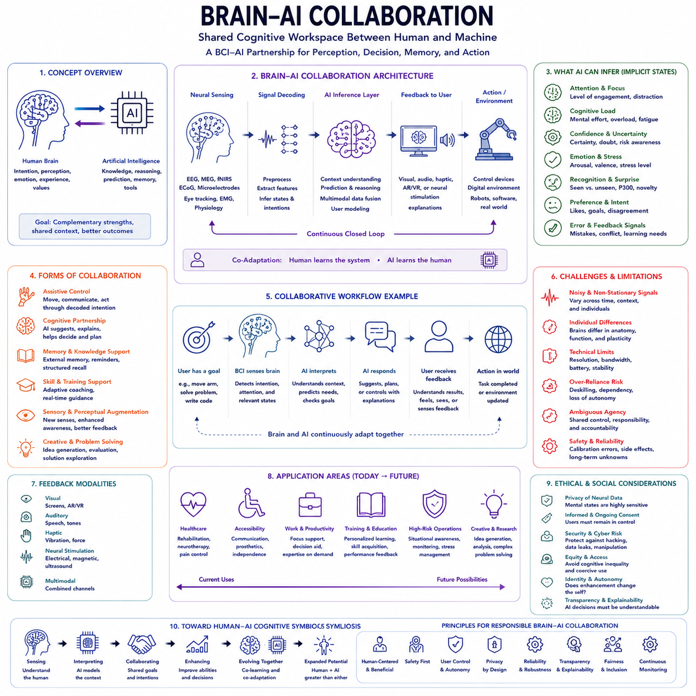
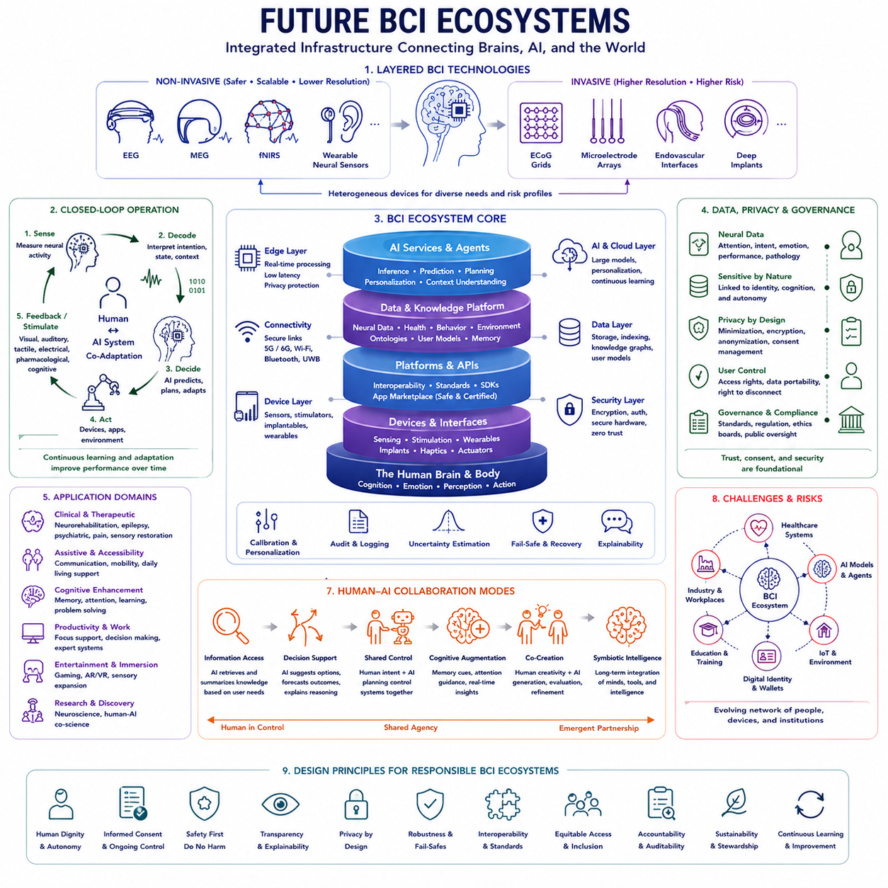

**Volume 00 05 AGI and ASI**

# Chapter 22. Brain Computer Interfaces

### Chapter Overview

{width="7.268055555555556in" height="7.268055555555556in"}

뇌-컴퓨터 인터페이스(Brain Computer Interfaces, BCI)는 신경 활동과 계산 과정을 직접 연결하는 통신 채널을 만드는 시스템이다. BCI는 신경계의 패턴을 기계가 해석할 수 있는 신호로 변환하며, 더 발전된 형태에서는 계산 시스템의 출력을 다시 뇌가 지각하거나 활용할 수 있는 자극으로 변환한다. AGI와 ASI의 맥락에서 BCI는 단순한 보조 의료기기나 실험적 제어 시스템이 아니다. 그것은 생물학적 지능과 인공지능을 잇는 잠재적 다리이며, 공유 인지, 신경 증강, 새로운 형태의 인간-기계 행위성을 향한 길을 연다.

이 장은 먼저 신경 신호가 어떻게 측정되고, 표현되며, 해석되는지 살펴보면서 BCI의 기초를 소개한다. EEG와 fNIRS 같은 비침습적(non-invasive) 접근법은 위험이 낮고 접근성이 넓지만 해상도에는 한계가 있다. 반면 미세전극 배열(microelectrode arrays)이나 피질 임플란트(cortical implants) 같은 침습적(invasive) 접근법은 더 높은 해상도를 제공하지만 수술의 복잡성과 안전성 문제를 동반한다. 이 양극단 사이에는 대역폭, 안정성, 임상적 실용성의 균형을 추구하는 최소 침습적(minimally invasive) 시스템들이 등장하고 있다. 이 장은 BCI의 성능이 하드웨어에만 달려 있지 않으며, 신호 처리(signal processing), 기계학습(machine learning), 신경 적응(neural adaptation), 사용자 훈련, 피드백 루프 설계에도 크게 의존한다는 점을 강조한다.

이어서 이 장은 신경 신호 해독(neural signal decoding)을 다룬다. 이는 잡음이 많고 고차원적인 신경 데이터로부터 의도, 지각, 움직임, 언어, 감정, 또는 인지 상태를 추론하는 문제다. 이 주제는 현대 BCI를 표현 학습(representation learning), 확률적 모델링(probabilistic modeling), 시퀀스 모델링(sequence modeling), 적응형 AI 시스템과 연결한다. 해독은 단순히 "생각을 읽는" 행위가 아니다. 그것은 모델과 사용자가 시간이 지나며 함께 적응할 수 있는 통계적이고 상호작용적인 과정이다. 이 구분은 현재 BCI 기술의 실제 능력과 한계를 이해하는 데 필수적이다.

이 장의 중요한 초점은 양방향 인터페이스(bidirectional interfaces)이다. 여기서는 정보가 뇌에서 기계로, 그리고 기계에서 뇌로 양방향으로 흐른다. 이러한 시스템은 감각 기능을 회복하고, 촉각 피드백을 갖춘 의수·의족 제어를 가능하게 하며, 마비 환자의 의사소통을 지원하거나, 장기적으로는 새로운 지각과 인지의 통로를 제공할 수 있다. 또한 이 장은 기억 지원, 주의 조절, 학습 가속, 뇌 상태 최적화와 같은 신경 증강(neural enhancement)을 검토한다. 이러한 가능성은 정체성, 자율성, 불평등, 동의, 보안, 신경 데이터의 소유권에 관한 깊은 윤리적 질문을 제기한다.

마지막으로 이 장은 뇌-AI 협력(Brain AI Collaboration)과 미래 BCI 생태계를 탐구한다. AI 시스템이 더 강력해질수록 BCI는 인간이 키보드, 화면, 음성으로는 불가능한 속도와 친밀도의 수준에서 기계를 감독하고, 안내하고, 질의하고, 협력할 수 있게 할지도 모른다. 미래의 생태계는 신경 인터페이스, 개인 AI 에이전트, 증강현실, 클라우드 지능, 의료 모니터링, 집단적 조정을 결합할 수 있다. 따라서 이 장의 핵심 질문은 뇌가 어떻게 컴퓨터를 제어할 수 있는가에 그치지 않는다. 그것은 마음과 지능형 기계가 점점 더 결합된 시스템이 될 때 어떤 일이 일어나는가를 묻는다.

### Connection to Volume 05

이 장은 자연 지능과 인공 지능 사이의 인터페이스에 초점을 맞춤으로써 AGI와 ASI에 대한 이 책의 탐구를 확장한다. 앞선 장들은 AGI와 ASI를 정의하고, 지능의 유형을 살피며, 일반화(generalization), 인과 추론(causal reasoning), 세계 모델(world models), 인지 아키텍처(cognitive architectures)를 분석한다. BCI는 이러한 주제들을 인간의 뇌와 연결한다. 여기서 뇌는 지능의 모델이자 파트너이다. AGI가 유연하고 일반적인 능력을 추구한다면, 뇌는 그러한 능력의 가장 중요한 사례 중 하나로 남아 있다. BCI는 지능에 대한 계산적 연구와 그것에 최초의 영감을 준 생물학적 시스템 사이의 기술적 접점이다.

기억 시스템, 추론 엔진, 자기 성찰, 자율 에이전트, 자기 개선 AI, 재귀적 자기 개선, 메타 학습을 다루는 장들은 모두 지능이 정보를 저장하고, 행동하고, 자신을 평가하며, 개선하는 메커니즘에 관한 것이다. BCI는 이러한 메커니즘에 인간-중심 루프(human-in-the-loop)의 차원을 더한다. 미래의 AI 에이전트는 사용자로부터 명령을 받는 데 그치지 않고, 신경 신호를 통해 인지 부하, 불확실성, 선호, 주의, 감정 상태를 추론할 수 있을지도 모른다. 반대로 인간은 AI로부터 피드백, 제안, 감각 확장, 인지적 발판을 받을 수 있다. 이 때문에 BCI 연구는 정렬(alignment), 해석 가능성(interpretability), 행위성(agency), 그리고 인간을 단순히 대체하는 것이 아니라 인간과 협력하는 시스템의 설계와 관련된다.

의식과 마음에 대한 연결은 특히 중요하다. 의식, 중국어 방 논증(Chinese Room argument), 인공 의식(artificial consciousness), 그리고 관련 철학적 문제를 다루는 장들은 기계가 이해하거나, 경험하거나, 주관적 상태를 가질 수 있는지를 묻는다. BCI가 이 질문들을 해결하는 것은 아니지만, 그것들을 더 구체적으로 만든다. 신경 활동이 해독되고, 수정되고, 인공 시스템과 연결될 수 있다면, 내적 경험과 외부 계산 사이의 경계는 더 복잡해진다. 프라이버시, 정신적 완전성, 자아성, 책임에 관한 질문은 사변적 철학에서 실제 공학과 거버넌스의 문제로 이동한다.

BCI는 또한 트랜스휴머니즘(transhumanism), 하이브 마인드(hive mind), 마인드 업로딩(mind uploading), 기술적 특이점(technological singularity), 포스트휴먼 문명(post-human civilization)으로 가는 다리 역할을 한다. 신경 증강은 인간이 생물학적 신체성을 포기하지 않고도 인지 능력을 확장할 수 있는 한 가지 경로를 제시한다. 신경 인터페이스가 사람들과 기계들이 언어만으로는 불가능한 더 풍부한 채널을 통해 조정할 수 있게 한다면, 집단 AI와 하이브 마인드 개념은 더 그럴듯해진다. 마인드 업로딩은 아직 현재 과학을 훨씬 넘어선 영역에 있지만, BCI 연구는 신경 과정을 지도화하고, 모델링하고, 상호작용하려는 더 넓은 노력에 기여한다. 손상 이후 기능을 회복하는 동일한 기술이 증강의 플랫폼이 되고, 결국에는 새로운 형태의 정체성과 사회 조직의 기반이 될 수도 있다.

Volume 05의 더 큰 흐름 속에서 22장은 인공적인 마음을 만드는 문제에서 인공적인 마음을 인간의 마음과 연결하는 문제로 전환하는 지점이다. 이 장은 AGI와 ASI가 독립적인 시스템으로만이 아니라, 인간 인지 생활의 협력자, 확장물, 조절자, 또는 구성 요소로 어떻게 형성될 수 있는지를 묻는다. 이 때문에 BCI는 지능의 미래를 생각하는 데 가장 중요한 영역 중 하나이다. 그것은 신경과학, AI, 의학, 윤리, 보안, 그리고 문명 규모의 변환이 교차하는 지점에 놓여 있다.

## 22.00 BCI Foundations

{width="7.268055555555556in" height="7.268055555555556in"}

뇌-컴퓨터 인터페이스(Brain-Computer Interface, BCI)는 신경계의 활동을 측정하고, 이를 계산적으로 해석한 뒤, 그 결과 정보를 사용해 외부 장치를 제어하거나 디지털 환경에 영향을 주거나 다시 신경계를 자극하는 시스템이다. AGI와 ASI의 맥락에서 BCI가 중요한 이유는 생물학적 인지와 기계 지능 사이를 연결할 수 있는 가장 직접적인 통로 중 하나이기 때문이다. BCI는 키보드나 카메라 같은 단순한 입력 장치가 아니다. 그것은 의도, 지각, 주의, 운동, 그리고 궁극적으로는 기억이나 인지 수준에서 신경 과정과 계산 시스템을 결합하려는 시도이다.

BCI는 생물학적 신호에서 시작된다. 뇌는 뉴런과 신경망 전반에 분포된 전기화학적 활동을 통해 소통하며, 다양한 인터페이스 기술은 서로 다른 공간적·시간적 규모에서 이 활동을 관찰한다. 뇌전도(electroencephalography, EEG)와 같은 비침습적 방법은 두피에서 전기 전위를 기록한다. EEG는 비교적 안전하고 비용이 낮지만, 신호가 두개골, 두피, 근육 잡음에 의해 흐려진다. 뇌자도(magnetoencephalography, MEG)는 신경 전류가 생성하는 자기장을 측정하며 높은 시간 해상도를 제공할 수 있지만 고가의 장비가 필요하다. 기능적 자기공명영상(functional magnetic resonance imaging, fMRI)은 신경 활동과 관련된 혈중 산소 변화량을 측정하여 유용한 공간 해상도를 제공하지만, 반응 시간이 느리고 일상적 인터페이스로 사용하기에는 실용성이 제한적이다.

침습적 및 최소침습적 BCI는 뉴런에 더 가까운 곳에서 신호를 얻는다. 피질전도(electrocorticography, ECoG)는 전극을 대뇌피질 표면에 배치하며, EEG보다 더 나은 신호 품질을 제공하면서도 관통형 임플란트보다 위험이 낮은 경우가 많다. 운동피질에 삽입되는 것과 같은 피질내 미세전극 배열(intracortical microelectrode array)은 작은 뉴런 집단에서 스파이크(spike)나 국소장전위(local field potential)를 기록할 수 있다. 이러한 시스템은 로봇 팔, 커서, 음성 보철 장치의 고성능 제어를 가능하게 할 수 있지만, 수술, 생체적합성, 장기 안정성, 면역 반응, 장치 고장과 관련된 중대한 과제를 동반한다. 핵심적인 절충은 분명하다. 센서가 신경 조직에 가까울수록 신호는 더 풍부하고 정밀해질 수 있지만, 의학적·윤리적 부담도 대체로 커진다.

완전한 BCI 파이프라인은 일반적으로 신호 획득(signal acquisition), 전처리(preprocessing), 특징 추출(feature extraction), 디코딩(decoding), 피드백(feedback), 적응(adaptation)을 포함한다. 전처리는 눈 깜박임, 근육 활동, 전극 드리프트, 환경 간섭과 같은 잡음과 아티팩트(artifact)를 제거한다. 특징 추출은 원시 신경 기록을 더 유용한 표현으로 변환한다. 예를 들어 EEG의 주파수 대역, 미세전극 기록의 발화율, 채널 간 공간 패턴, 또는 신경망이 학습한 잠재 변수(latent variable)가 이에 해당한다. 디코딩은 그런 특징을 의도된 행동, 선택된 기호, 감정 상태, 주의 수준, 또는 기타 관심 변수에 매핑한다. 단순한 시스템에서는 이러한 매핑에 선형 분류기나 회귀 모델을 사용할 수 있다. 더 발전된 시스템에서는 딥러닝(deep learning)과 확률 모델(probabilistic model)이 연속적인 궤적, 음성 단위, 또는 과제 목표를 추론할 수 있다.

가장 중요한 개념적 구분은 신경 활동을 읽는 것과 생각을 이해하는 것 사이의 차이다. 현재의 BCI는 일반적인 의미에서 마음을 읽지 않는다. 그것들은 제약된 과제와 신경 신호 사이에서 통계적으로 학습 가능한 상관관계를 탐지한다. 운동 BCI가 사용자가 커서를 왼쪽으로 움직이려 한다고 추론할 수 있는 것은 내부의 정신적 문장에 접근했기 때문이 아니라, 운동피질의 패턴이 상상되거나 시도된 움직임과 안정적으로 대응하기 때문이다. 마찬가지로 의사소통 BCI는 통제된 조건에서 선택된 글자나 음소를 디코딩할 수 있지만, 이는 사적인 생각에 제한 없이 접근하는 것과는 거리가 멀다. 이 구분은 과장된 기대와 잘못된 공포를 모두 피하기 위해 필수적이다.

BCI는 능동형(active), 반응형(reactive), 수동형(passive)으로 나눌 수 있다. 능동형 BCI는 손 움직임을 상상해 커서를 움직이는 것처럼 의도적인 정신적 제어에 의존한다. 반응형 BCI는 사용자가 목표 항목을 인식할 때 나타나는 P300 신호처럼 자극에 의해 유발된 반응을 사용한다. 수동형 BCI는 명시적 제어를 요구하지 않고 피로, 주의, 작업 부하, 스트레스와 같은 인지적 또는 정서적 상태를 모니터링한다. 실제 시스템에서는 이러한 범주가 종종 겹친다. 특히 인터페이스가 변화하는 사용자와 환경에 적응해야 할 때 더욱 그렇다.

피드백 또한 기초적인 요소이다. BCI는 단순한 일방향 디코더가 아니라 뇌, 몸, 기계, 과제가 얽힌 폐루프(closed loop)의 일부이다. 사용자가 커서가 움직이는 것을 보거나, 합성 음성을 듣거나, 촉각 자극을 느낄 때 뇌는 적응한다. 학습은 양쪽에서 일어난다. 알고리즘은 매개변수를 갱신하고, 사용자는 더 신뢰할 수 있는 신경 패턴을 생성하는 방법을 배운다. 이러한 공동 적응(co-adaptation)은 강력하지만 취약하다. 피드백이 지연되거나 일관성이 없거나 보정이 부정확하면 성능이 저하될 수 있다. 알고리즘이 너무 빠르게 변하면 사용자는 안정적인 제어 전략을 형성하지 못할 수 있다. 따라서 견고한 BCI 설계에는 제어 이론, 신경과학, 기계학습, 인간공학, 임상 지식이 모두 필요하다.

현재 BCI의 한계는 상당하다. 신경 신호는 잡음이 많고, 비정상적(nonstationary)이며, 개인차가 매우 크다. 전극은 움직이고, 조직은 변하며, 주의는 흔들리고, 같은 의도라도 매일 정확히 같은 신호를 만들지는 않는다. 훈련 데이터는 비싸고 대개 부족하다. 실험실 성능이 가정, 직장, 의료 환경으로 그대로 이전되지 않을 수 있다. 많은 인상적인 시연은 통제된 과제, 숙련된 사용자, 또는 빈번한 재보정에 의존한다. 안전, 프라이버시, 동의, 사이버보안, 신경 데이터의 소유권은 부차적인 문제가 아니다. 침해되거나 조작적인 인터페이스는 행위성(agency), 정체성(identity), 신체적 온전성에 영향을 줄 수 있기 때문에, 이것들은 기술적 기반의 일부이다.

이 장에서 BCI의 기초는 이후 절들의 토대를 제공한다. 신경 신호 디코딩(Neural Signal Decoding)은 원시 기록이 어떻게 의미 있는 추정치로 변환되는지를 다룬다. 양방향 인터페이스(Bidirectional Interfaces)는 BCI를 읽기에서 자극과 감각 피드백으로 확장한다. 신경 향상(Neural Enhancement)은 인터페이스가 치료를 넘어 기억, 주의, 능력을 향상시킬 수 있는지 검토한다. 뇌-AI 협업(Brain-AI Collaboration)은 인간 인지와 AI 시스템이 어떻게 제어, 의도, 맥락을 공유할 수 있는지 묻는다. 미래 BCI 생태계(Future BCI Ecosystems)는 이러한 기술을 의료, 업무, 교육, 국방, 증강 인지의 더 큰 네트워크 안에 배치한다. 그 기초에는 단순하지만 심오한 생각이 있다. 지능이 정보처리 시스템 안에 구현된 것이라면, BCI는 자연적 마음과 인공적 마음을 잇는 하나의 가능한 다리이다.

## 22.01 Neural Signal Decoding

{width="7.268055555555556in" height="7.268055555555556in"}

신경 신호 디코딩(Neural signal decoding)은 측정된 뇌 활동을 의도, 지각, 움직임, 인지 상태 또는 그 밖의 의미 있는 변수에 대한 추정으로 변환하는 과정이다. 뇌-컴퓨터 인터페이스(BCI, Brain-Computer Interface)에서 이는 신경 조직과 외부 장치, 애플리케이션, 또는 인공지능 시스템 사이를 잇는 계산적 다리 역할을 한다. 앞 절에서는 BCI의 기초, 즉 신호 획득, 전극, 기록 방식, 그리고 뇌 활동에서 기계 반응으로 이어지는 기본 루프를 소개했다. 디코딩은 이 루프를 실제로 유용하게 만드는 단계이다. 신뢰할 수 있는 디코딩이 없다면 BCI는 단지 센서일 뿐이다. 디코딩이 있을 때 BCI는 생물학적 지능과 계산 시스템 사이의 통신 채널이 된다.

신경 디코딩에서 첫 번째로 구분해야 할 것은 신호의 출처와 그것이 지원할 수 있는 세부 수준이다. 뇌전도(EEG, electroencephalography), 뇌자도(MEG, magnetoencephalography), 기능적 근적외선 분광법(fNIRS, functional near-infrared spectroscopy) 같은 비침습적 시스템은 많은 뉴런 집단의 집합적 활동을 측정한다. 이들은 더 안전하고 배치하기 쉽지만, 공간 해상도가 제한적이며 두개골에 의한 신호 필터링, 움직임 잡음, 환경 간섭, 기타 노이즈의 영향을 크게 받는다. 반면 피질뇌파(ECoG, electrocorticography), 피질 내 미세전극 배열(intracortical microelectrode arrays), 심부 전극(depth electrodes) 같은 침습적 시스템은 국소장전위(local field potentials)나 작은 신경 집단의 활동전위(action potentials)까지 더 정밀하게 포착할 수 있다. 이러한 신호는 손의 궤적, 말하기 의도, 감각 특징을 더 세밀하게 디코딩하는 데 도움이 되지만, 수술이 필요하며 장기적인 생체적합성(biocompatibility)과 안정성이라는 과제를 가진다.

디코딩은 신호 전처리(preprocessing)에서 시작된다. 원시 신경 기록(raw neural recordings)은 원래 형태 그대로는 거의 유용하지 않다. 여기에는 전기적 잡음, 근육 활동, 눈 움직임, 전극 드리프트, 목표 과제와 무관한 생물학적 변동성이 포함될 수 있다. 전처리에는 주파수 대역별 필터링, 잡음 제거, 스파이크 정렬(spike sorting), 정규화, 시간 창 단위의 분할, 발화율(firing rates), 진동 파워(oscillatory power), 위상 관계, 사건 관련 전위(event-related potentials), 연결성 지표와 같은 특징 추출이 포함될 수 있다. EEG 기반 BCI에서는 감각운동 리듬(sensorimotor rhythms), P300 반응, 정상상태 시각유발전위(steady-state visually evoked potentials)가 흔히 사용되는 특징이다. 침습적 운동 BCI에서는 의도된 움직임을 추론하기 위해 발화율과 집단 활동 패턴이 자주 사용된다.

디코더(decoder) 자체는 통계적 방식, 기계학습 기반 방식, 또는 모델 기반 방식일 수 있다. 고전적 접근법에는 선형 회귀(linear regression), 칼만 필터(Kalman filters), 서포트 벡터 머신(support vector machines), 베이지안 디코더(Bayesian decoders)가 포함된다. 이러한 방법들은 해석 가능하고 계산 효율적이며 제한된 학습 데이터로도 사용할 수 있기 때문에 여전히 중요하다. 현대 시스템에서는 합성곱 신경망(convolutional neural networks), 순환 신경망(recurrent neural networks), 트랜스포머(transformers), 자기지도 학습 모델(self-supervised models) 같은 딥러닝 구조가 점점 더 많이 사용된다. 이러한 방법들은 복잡한 시간적·공간적 패턴을 학습할 수 있지만, 더 많은 데이터, 신중한 정규화, 엄격한 검증을 필요로 하는 경우가 많다. 실험실에서 잘 작동하는 강력한 디코더라도 사용자가 피곤하거나, 주의가 산만하거나, 정서적으로 스트레스를 받거나, 통제된 조건 밖에서 인터페이스를 사용할 때는 실패할 수 있다.

핵심 과제는 신경 신호가 비정상적(non-stationary)이라는 점이다. 뇌 활동과 의도된 출력 사이의 관계는 몇 분, 며칠, 몇 달에 걸쳐 변한다. 전극은 위치가 미세하게 변하고, 조직 반응은 진화하며, 주의 상태는 달라지고, 뇌 자체도 BCI에 적응한다. 따라서 디코딩은 단순한 일회성 매핑 문제가 아니다. 실용적인 BCI에는 시간이 지나며 갱신되는 적응형 디코더(adaptive decoders), 사용자와 기계의 공동 적응(co-adaptation), 보정 절차(calibration procedures), 모델이 불확실할 때 이를 감지하는 메커니즘이 필요한 경우가 많다. 이는 마비, 신경퇴행성 질환, 뇌졸중 관련 손상, 또는 비전형적인 신경 조직을 가진 사용자를 대상으로 하는 임상 응용에서 특히 중요하다.

또 하나의 중요한 구분은 명시적 행동(overt behavior)의 디코딩과 잠재적 정신 상태(latent mental states)의 디코딩 사이에 있다. 커서 움직임이나 로봇 팔 제어를 예측하는 운동 디코딩은 비교적 잘 연구된 피질 조직과 측정 가능한 성능 목표의 이점을 가진다. 음성 디코딩은 더 복잡하다. 이는 들을 수 있는 말이 나오기 전, 또는 상상 속 발화(imagined speech)에서 발생하는 신경 활동으로부터 음소, 단어, 조음 동작을 추론해야 하기 때문이다. 주의, 감정, 통증, 기억, 선호, 의도를 디코딩하는 일은 더 깊은 과학적·윤리적 문제를 제기한다. 이러한 상태들은 분산되어 있고, 맥락에 민감하며, 직접 관찰할 수 없는 경우가 많다. 따라서 "생각을 읽는다"는 주장에는 신중해야 한다. 현재 대부분의 시스템은 임의의 사적인 정신 내용을 읽는 것이 아니라, 제한된 과제와 관련된 신호를 디코딩한다.

신경 디코딩은 또한 피드백(feedback)에 의존한다. 사용자는 시스템이 예측 가능하게 반응할 때 신경 활동을 조절하는 법을 배우고, 디코더는 사용자가 무엇을 의도했는지에 대한 라벨이 붙은 예시를 받을 때 향상된다. 이는 뇌와 기계 사이에 닫힌 학습 루프(closed learning loop)를 만든다. 그 루프의 품질은 인터페이스가 느리고 힘들게 느껴질지, 아니면 유동적이고 신체화된 것처럼 느껴질지를 결정한다. 고급 시스템에서는 인공지능이 맥락을 예측하고, 오류를 수정하며, 모델을 개인화하고, 신경 데이터와 시선 추적, 근전도(EMG, electromyography), 음성 신호, 행동 이력, 환경 센서를 결합함으로써 도움을 줄 수 있다. 이러한 다중모달 디코딩(multimodal decoding)은 견고성을 높일 수 있지만, 동시에 신경 데이터와 관련된 프라이버시 및 보안 위험도 확대한다.

AGI와 ASI에 대한 함의는 크다. 신경 디코딩은 인간의 목표, 수정 사항, 선호, 고수준 의도를 지능형 시스템에 더 직접적으로 전달할 수 있게 하여 뇌-AI 협력(brain-AI collaboration)의 핵심 기반이 될 수 있다. 그러나 디코딩이 마음을 이해하는 것과 동일한 것은 아니다. 디코더는 의식, 인지, 주관적 경험에 대한 완전한 이론을 갖지 않고도 신경 활동 패턴과 출력 사이의 상관관계를 학습할 수 있다. 이 구분은 중요하다. 미래의 BCI 생태계는 신경 데이터를 과도하게 해석하여 확률적 추론을 정체성, 동의, 신념에 대한 권위 있는 주장처럼 바꾸려는 유혹을 받을 수 있기 때문이다.

다음 절인 양방향 인터페이스(bidirectional interfaces)는 디코딩을 양방향 교환으로 확장한다. 시스템이 신경 신호를 읽을 수 있게 되면, 감각·운동·인지 회로를 자극하여 정보를 다시 써 넣을 수도 있다. 이는 기술적 부담을 크게 높인다. 디코딩 오류는 행동 오류가 될 수 있고, 인코딩 오류는 지각적 또는 인지적 왜곡이 될 수 있다. 이러한 이유로 신경 신호 디코딩은 신뢰성, 투명성, 사용자 통제, 사이버보안, 의료 안전을 핵심 원칙으로 삼아 설계되어야 한다. 보조적 BCI에서 신경 향상과 뇌-AI 공생으로 이어지는 긴 흐름 속에서, 디코딩은 신경계와 기계 사이의 번역을 가능하게 하는 foundational act, 즉 가장 기초적인 행위이다.

## 22.02 Bidirectional Interfaces

{width="7.268055555555556in" height="7.268055555555556in"}

뇌-컴퓨터 인터페이스(Brain-Computer Interface, BCI)는 신경 활동을 읽는 동시에 정보를 다시 신경계에 써 넣을 수 있을 때 양방향 인터페이스(bidirectional interface)가 된다. 앞 절은 신경 신호 해독(neural signal decoding), 즉 전기적, 자기적, 대사적, 광학적 신호로부터 의도, 지각, 운동 계획, 인지 상태를 추출하는 문제에 초점을 맞추었다. 양방향 인터페이스는 여기에 자극(stimulation), 피드백(feedback), 조절(modulation)을 추가하여 그 루프를 확장한다. 따라서 BCI는 단순한 "신경 출력 포트"가 아니라, 뇌와 기계가 지속적으로 서로에게 영향을 주는 폐쇄 제어 시스템(closed control system)이 된다.

이 구분은 근본적으로 중요하다. 단방향 BCI는 마비된 사람이 해독된 운동 의도를 통해 커서나 로봇 팔을 움직이게 할 수 있다. 반면 양방향 BCI는 그 커서나 로봇 팔로부터 촉각, 압력, 위치, 진동, 오류 신호 같은 감각 정보를 되돌려줄 수 있다. 운동 신경보철(motor neuroprosthetics)에서 이러한 피드백은 사용자가 움직임을 안내하기 위해 오로지 시각에만 의존하지 않아도 되게 하므로 인지적 부담을 줄일 수 있다. 원칙적으로 이 시스템은 생물학적 감각운동 루프(sensorimotor loop)와 닮아가기 시작한다. 의도가 행동을 만들고, 행동은 감각을 만들며, 감각은 다시 의도를 갱신한다.

BCI의 "쓰기" 측면은 여러 형태를 취할 수 있다. 침습적 시스템에서는 미세전극 배열(microelectrode array)이 정교하게 타이밍이 조절된 전기 펄스로 작은 뉴런 집단을 자극할 수 있다. 덜 침습적이거나 비침습적인 시스템에서는 경두개 자기 자극(transcranial magnetic stimulation), 집속 초음파(focused ultrasound), 경두개 전기 자극(transcranial electrical stimulation), 망막 또는 인공와우 이식(retinal or cochlear implants), 말초신경 자극(peripheral nerve stimulation), 척수 자극(spinal cord stimulation)을 사용할 수 있다. 각 방법은 공간 해상도, 시간 정밀도, 접근 가능한 깊이, 안전성, 가역성에서 차이가 있다. 뇌에 쓴다는 것은 임의의 생각을 업로드한다는 뜻이 아니다. 현재의 자극 방법은 대체로 신경 회로에 거칠고, 확률적이며, 맥락 의존적인 방식으로 영향을 준다.

가장 성숙한 양방향 신경 인터페이스는 의학 분야에 존재한다. 인공와우(cochlear implant)는 소리를 청각신경에 전달되는 자극 패턴으로 변환하여 많은 사용자에게 기능적인 청각 경로를 만들어준다. 파킨슨병과 기타 운동 장애에 사용되는 심부뇌자극(deep brain stimulation)은 병적인 뇌 회로를 조절하며, 때로는 신경 바이오마커(neural biomarker)에 기반한 적응형 제어(adaptive control)를 사용한다. 망막 보철, 척수 자극기, 의수·의족을 위한 감각 피드백 시스템도 모두 같은 일반 원리를 보여준다. 해독과 자극은 상실된 기능을 회복하거나 보강하기 위해 결합될 수 있다. 이러한 시스템은 좁고, 공학적으로 설계되었으며, 강하게 제약되어 있지만, 더 일반적인 뇌-AI 협력(brain-AI collaboration)을 향한 중요한 디딤돌이다.

핵심 과제는 신경 부호화(neural coding)이다. 의미 있는 정보를 신경계에 쓰려면 장치는 뉴런 집단이 감각, 행동, 주의, 확신, 보상, 오류를 어떻게 표현하는지 이해해야 한다. 일차 감각 영역에서조차 신경 코드는 분산되어 있고, 가소적이며, 주의와 경험의 영향을 받는다. 고차 인지 영역에서는 표현이 추상적이고, 혼합되어 있으며, 동적이고, 개인마다 다르기 때문에 문제가 훨씬 어려워진다. 뇌는 단순히 주소를 지정할 수 있는 메모리 칩이 아니다. 어떤 위치를 자극한다고 해서 하나의 개념이 안정적으로 "삽입"되는 것은 아니다. 상태와 맥락에 따라 자극은 감각을 만들 수도 있고, 결정을 편향시킬 수도 있으며, 흥분성을 바꾸거나, 처리를 방해하거나, 무시될 수도 있다.

따라서 폐쇄 루프 설계(closed-loop design)가 필수적이다. 양방향 인터페이스는 자신이 가한 자극의 효과를 감시하고 시간이 지나면서 매개변수를 조정해야 한다. 여기에는 제어 이론(control theory), 머신러닝(machine learning), 신경생리학(neurophysiology), 인간 요인 공학(human factors engineering)이 관여한다. 시스템은 어떤 자극 패턴이 손끝 압력으로 해석되는지, 어떤 타이밍이 운동 학습을 향상시키는지, 어떤 신경 바이오마커가 떨림의 시작을 예측하는지 학습할 수 있다. 인간 사용자 또한 적응한다. 며칠 또는 몇 달에 걸쳐 뇌는 인공 피드백을 자연스러운 정보로 해석하는 법을 배울 수 있고, 해독기는 사용자의 변화하는 신경 패턴을 학습한다. 인터페이스는 단순히 이식되는 것이 아니라, 함께 훈련(co-trained)된다.

이러한 공동 적응(co-adaptation)은 기술적 가능성과 위험을 동시에 제기한다. 양방향 BCI는 고대역폭 보철 제어, 촉각 회복, 적응형 신경조절(adaptive neuromodulation)을 통한 우울증 또는 간질 치료, 뇌졸중 후 재활 향상, 말하거나 움직일 수 없는 사람들을 위한 새로운 의사소통 방식을 지원할 수 있다. 미래의 뇌-AI 시스템에서는 인공 에이전트가 신경 채널 또는 말초 채널을 통해 인지 피드백, 기억 단서, 주의 안내, 지각적 오버레이(perceptual overlay)를 제공할 수도 있다. 이러한 시스템은 도구, 보조자, 치료, 자기 확장(extension of the self) 사이의 경계를 흐리게 만들 것이다.

그러나 양방향 접근은 안전과 윤리 문제도 확대한다. 신경 신호를 읽는 것만으로도 프라이버시, 동의, 정신적 자율성(mental autonomy)에 대한 질문이 제기된다. 신경 조직에 쓰는 것은 행위 주체성(agency), 정체성(identity), 의존성, 조작 가능성, 장기적인 가소적 변화에 대한 우려를 추가한다. 제대로 보정되지 않은 시스템은 통증, 잘못된 감각, 기분 변화, 강박적 행동, 기능 저하를 일으킬 수 있다. 네트워크에 연결되거나 AI가 매개하는 BCI는 무단 제어, 적대적 입력(adversarial input), 데이터 유출, 사용자의 안녕과 정렬되지 않은 최적화 목표로부터 보호되어야 한다.

AGI와 ASI의 관점에서 양방향 인터페이스는 생물학적 지능과 인공 지능 사이의 가능한 다리 중 하나를 나타내기 때문에 중요하다. 양방향 인터페이스가 그 자체로 인공 일반 지능(Artificial General Intelligence, AGI)을 만들지는 않으며, 마인드 업로딩(mind uploading)으로 가는 직접적인 경로를 제공하지도 않는다. 그러나 화면, 키보드, 음성, 제스처보다 인간 인지와 기계 지능 사이의 더 긴밀한 결합을 가능하게 할 수 있다. 다음 절인 신경 향상(neural enhancement)은 이 토대 위에서 이어진다. 인터페이스가 신경 시스템으로부터 읽고 신경 시스템에 쓸 수 있게 되면, 질문은 상실된 기능의 회복에서 능력의 확장으로, 의학적 수리에서 인지적 증강(cognitive augmentation)으로 이동한다.

## 22.03 Neural Enhancement

{width="7.268055555555556in" height="7.268055555555556in"}

신경 향상(Neural enhancement)은 뇌-컴퓨터 인터페이스(Brain-Computer Interface, BCI)와 관련 신경기술을 사용하여 상실된 기능을 회복하는 데 그치지 않고, 개인의 현재 기준선을 넘어 지각, 인지, 감정 조절, 운동 능력을 개선하려는 접근을 말한다. 이전 절에서는 신경 활동을 해독하고 동시에 신경계에 정보를 다시 기록하는 시스템으로서 양방향 인터페이스(bidirectional interface)를 소개했다. 신경 향상은 바로 그 아이디어 위에 구축된다. 인터페이스가 의도, 뇌 상태, 수행 한계를 읽을 수 있고, 동시에 자극, 피드백, 계산적 지원을 제공할 수 있다면, 뇌의 작동을 실시간으로 최적화할 가능성이 생긴다.

중요한 구분은 치료적 회복(therapeutic restoration)과 증강(augmentation)의 차이다. 청각을 회복시키는 인공와우, 파킨슨병성 떨림을 줄이는 심부뇌자극(deep brain stimulation) 시스템, 움직임 회복을 돕는 척수 인터페이스는 보통 의학적 개입으로 설명된다. 반면 향상은 유사한 메커니즘을 건강한 개인에게 적용하여 기억 공고화(memory consolidation)를 개선하고, 학습을 가속하며, 주의를 날카롭게 하고, 피로를 줄이거나, 감각 능력을 확장하려 할 때 시작된다. 이 경계가 항상 명확한 것은 아니다. 중증 우울증 환자는 기분 조절을 정상화하기 위해 자극을 받을 수 있고, 높은 성과를 내는 전문가는 스트레스 상황에서 집중을 유지하기 위해 유사한 조절을 원할 수 있다. 동일한 기술 플랫폼도 맥락에 따라 서로 다른 사회적, 윤리적 의미를 가질 수 있다.

기술적으로 신경 향상은 자극(stimulation), 해독(decoding), 피드백(feedback), 외부 인지 발판(external cognitive scaffolding)을 통해 접근할 수 있다. 전기 자극, 자기 자극, 집속 초음파, 실험적 환경의 광유전학(optogenetic) 방법, 약리학적 신경조절(pharmacological neuromodulation)은 신경 흥분성과 네트워크 역학을 변화시킬 수 있다. 경두개 자기 자극(transcranial magnetic stimulation, TMS)과 경두개 직류 자극(transcranial direct-current stimulation, tDCS) 같은 비침습적 기법은 수술을 피할 수 있어 매력적이지만, 효과가 넓고 가변적이며 정밀하게 표적화하기 어렵다. 침습적 임플란트는 더 높은 공간적, 시간적 정밀도를 제공할 수 있지만, 수술 위험, 장기 생체적합성 문제, 감염 위험, 장치 열화, 복잡한 유지관리 요구를 수반한다.

폐쇄 루프 향상(closed-loop enhancement)은 특히 중요하다. 개방 루프(open-loop) 시스템은 고정된 일정이나 사전 설정된 강도에 따라 자극을 전달한다. 폐쇄 루프 시스템은 신경 신호, 행동 수행, 생리적 상태를 감시하고 그 개입을 동적으로 조정한다. 예를 들어 기억 향상 시스템은 부호화(encoding)나 인출(retrieval)과 관련된 패턴을 감지하고, 뇌가 이득을 볼 가능성이 높은 상태일 때만 해마(hippocampus)나 피질 회로를 자극할 수 있다. 주의 지원 시스템은 졸림, 산만함, 인지 과부하를 감지하고 자극, 감각 단서, AI 매개 과제 지원을 조정할 수 있다. 뇌는 정적인 기계가 아니기 때문에 폐쇄 루프 설계는 핵심적이다. 뇌의 반응은 맥락, 이력, 수면, 감정, 약물, 진행 중인 활동에 따라 달라진다.

기억 향상은 가장 많이 논의되는 가능성 중 하나다. 연구에서는 해마와 연결된 내측 측두엽 구조의 자극, 그리고 성공적인 부호화와 관련된 신경 발화 패턴을 예측하는 계산 모델을 탐구해 왔다. 그러나 기억은 단일한 저장 장치가 아니다. 기억에는 작업 기억(working memory), 일화 기억(episodic memory), 의미 기억(semantic memory), 절차 학습(procedural learning), 정서적 현저성(emotional salience), 수면 중 공고화가 포함된다. 한 구성 요소를 개선하면 다른 구성 요소가 방해받을 수 있으며, 더 강한 기억이 항상 더 좋은 것도 아니다. 망각, 추상화, 감정 조절은 지능의 기능적 일부다. 회상을 무차별적으로 강화하는 시스템은 침투적 기억을 늘리거나 잘못된 연상을 강화할 수 있다.

감각 및 운동 향상도 신중히 다루어야 한다. 양방향 BCI는 원칙적으로 새로운 감각 채널을 추가할 수 있다. 예를 들어 적외선 지각, 초음파 인식, 자기 방향 감각, 원격 로봇 촉각, 촉각 또는 피질 패턴으로 변환된 데이터 스트림이 가능할 수 있다. 운동 향상은 보철, 외골격, 드론, 가상 아바타를 더 빠르게 제어하는 형태를 포함할 수 있다. 그러나 신경계는 새로운 신호를 해석하고 새로운 효과기(effector)를 제어하는 법을 배워야 한다. 가소성(plasticity)은 강력하지만 무한하지 않다. 훈련 시간, 인지 부하, 신호 안정성, 체화(embodiment)가 모두 추가 능력이 직관적인 능력이 되는지, 아니면 산만한 인터페이스로 남는지를 결정한다.

신경 향상은 종종 초인간적 지능으로 가는 직접 경로처럼 상상되지만, 현재의 증거는 더 제한된 그림을 제시한다. 뇌는 매우 상호연결되어 있으며, 추론, 창의성, 판단 같은 기능은 지각, 기억, 감정, 사회적 인지, 신체 조절을 포함하는 분산된 과정에서 출현한다. 단순히 위로 돌릴 수 있는 "지능 다이얼"은 없을 수 있다. 향상은 좁고, 과제 의존적이며, 개인차에 민감할 가능성이 더 크다. 어떤 자극 프로토콜은 한 사람의 주의를 향상시킬 수 있지만, 다른 사람에게는 유연성을 손상시킬 수 있다. 한 뇌 상태에서 훈련된 해독 모델은 피로, 스트레스, 노화, 질병 진행 이후 실패할 수 있다.

AGI와 ASI에 대한 함의는 깊다. 신경 향상은 인공지능 시스템이 인간 인지를 대체하는 것이 아니라 선택된 능력을 증폭하는 새로운 형태의 인간-AI 결합을 만들 수 있다. 사람은 AI 비서를 외부 추론 엔진(external reasoning engine)으로 사용하면서, BCI는 불확실성, 작업 부하, 의도를 추적하고 상호작용을 조정할 수 있다. 이런 의미에서 향상은 다음 절인 뇌-AI 협업(Brain-AI Collaboration)으로 이어지는 다리가 된다. 가장 변혁적인 시스템은 고립된 임플란트가 아니라, 생물학적 지능, 기계 지능, 네트워크화된 지식이 지속적으로 서로를 형성하는 적응형 생태계일 수 있다.

동시에 신경 향상은 안전, 정체성, 자율성, 불평등, 거버넌스에 관한 어려운 질문을 제기한다. 인지 임플란트의 매개변수는 누가 통제하는가? 고용주, 학교, 군 조직, 플랫폼 제공자가 개인에게 향상 도입을 압박할 수 있는가? 주의, 선호, 감정, 의도를 드러내는 신경 데이터는 어떻게 보호되는가? 향상이 기분, 자신감, 충동 조절, 기억을 변화시킨다면, 그것은 자아를 바꾸는 것인가 아니면 단지 확장하는 것인가? 이러한 질문은 공학의 부차적 문제가 아니라 설계 문제의 일부다. 책임 있는 신경 향상 생태계는 동의, 가능한 경우의 가역성, 투명성, 사이버보안, 임상적 검증, 공정한 접근을 우선해야 한다.

따라서 신경 향상은 의학, 인간-컴퓨터 상호작용, 인지과학, 지능 문명의 장기적 궤적 사이에 위치한다. 그것은 아직 급진적으로 업그레이드된 마음으로 가는 성숙한 경로는 아니지만, 연구자들이 뇌와 도구의 경계를 생각하는 방식을 이미 바꾸고 있다. BCI가 더 정밀하고 적응적이며 AI와 통합될수록, 향상은 두개골 안에 이식된 단일 장치가 아니라 신경 조직, 알고리즘, 신체, 환경, 사회 제도 사이의 층위적 관계로 점점 더 이해될 것이다.

## 22.04 Brain AI Collaboration

{width="7.268055555555556in" height="7.268055555555556in"}

뇌-AI 협업(Brain AI collaboration)은 뇌-컴퓨터 인터페이스(BCI, brain computer interface)를 단순한 통신 채널에서 공유된 인지 작업공간(shared cognitive workspace)으로 확장한다. 앞선 절들에서는 신경 신호(neural signal)를 어떻게 해독(decoding)할 수 있는지, 그리고 양방향 시스템(bidirectional system)이 신경계에서 정보를 읽고 동시에 신경계에 정보를 쓸 수 있는지를 설명했다. 협업형 시스템에서는 이러한 능력이 적응형 인공지능(adaptive artificial intelligence)과 결합되어 인간과 기계가 함께 지각하고, 결정하고, 기억하고, 행동할 수 있게 된다. 목표는 단지 상실된 기능을 대체하거나 외부 장치를 제어하는 것이 아니라, 생물학적 인지와 기계 인지가 서로의 한계를 보완하는 동반자 관계를 만드는 것이다.

기본 구조는 보통 신경 감지(neural sensing), 신호 해독(signal decoding), AI 추론 계층(AI inference layer), 사용자에게 제공되는 피드백, 그리고 종종 구동 장치(actuator)나 디지털 환경을 포함한다. 신경 감지는 비침습적 뇌전도(EEG, electroencephalography), 뇌자도(MEG, magnetoencephalography), 기능적 근적외선 분광법(fNIRS, functional near-infrared spectroscopy), 또는 침습적 미세전극 배열(microelectrode array)과 피질뇌전도(ECoG, electrocorticography)에 의존할 수 있다. AI 계층은 불확실하고 잡음이 많은 신경 데이터를 맥락 속에서 해석한다. 예를 들어 BCI는 의도된 커서 움직임, 주의 상태, 인식 반응, 또는 오류 관련 전위(error-related potential)를 감지할 수 있다. 그러면 기계학습 모델은 이러한 신경 증거를 환경 데이터, 과제 목표, 사용자의 과거 행동과 결합하여 어떤 행동이 가장 유용할 가능성이 높은지 추론할 수 있다.

중요한 구분은 명령 기반 BCI(command-based BCI)와 협업형 BCI(collaborative BCI)의 차이다. 명령 기반 시스템에서는 사용자가 특정 제어 신호를 의도적으로 만들어낸다. 예를 들어 손 움직임을 상상하여 목표를 선택하는 방식이 있다. 협업형 시스템에서는 AI가 확신도, 피로, 놀람, 혼란, 작업부하, 선호, 불일치와 같은 암묵적 상태(implicit state)도 추론할 수 있다. 이를 통해 모든 의도를 의식적으로 표현하지 않아도 시스템이 적응할 수 있다. 예를 들어 의료용 외골격(exoskeleton)은 운동 의도 신호를 자세 센서와 예측 제어(predictive control)와 함께 사용할 수 있다. 의사결정 지원 시스템은 시선, 동공 확장, 인식의 신경 표지를 이용해 정보를 우선순위화할 수 있다. 창작 도구는 인지 부하(cognitive load)를 모니터링하고 사용자가 막힌 것처럼 보일 때 대안을 제안할 수 있다.

이러한 협업은 AGI와 ASI에 특히 중요하다. 왜냐하면 도구 사용과 인지적 통합(cognitive integration)의 경계를 흐리기 때문이다. 신경 데이터와 연결된 고도화된 AI 보조자는 기존 소프트웨어 에이전트보다 훨씬 깊은 수준에서 개인화될 수 있다. 특정 사용자에게 어떤 설명이 이해하기 쉬운지 학습하고, 추천이 사용자의 가치와 충돌하는 순간을 감지하며, 여러 작업에 걸쳐 공유 맥락을 유지할 수 있다. 원칙적으로 이러한 시스템은 기억, 주의, 계획, 언어 생성, 감각 해석을 증강하는 "인지 보철(cognitive prosthesis)"이 될 수 있다. 또한 미래 AI 시스템과의 고대역폭 상호작용을 가능하게 하여 타이핑, 음성, 화면 기반 인터페이스의 병목을 줄일 수도 있다.

그러나 현재의 뇌-AI 협업은 신경과학과 공학 양쪽에서 모두 한계를 가진다. 신경 신호는 간접적이고, 변동성이 크며, 개인마다 매우 다르다. 동일한 패턴도 사용자, 세션, 인지적 맥락에 따라 다른 의미를 가질 수 있다. 비침습적 시스템은 더 안전하고 확장 가능성이 높지만 공간 해상도가 낮고 잡음에 취약하다. 침습적 시스템은 더 풍부한 신호를 제공할 수 있지만 수술 위험, 장기적 생체적합성(biocompatibility) 문제, 윤리적 우려를 동반한다. 실험실에서 해독 정확도가 높더라도, 실제 환경에서는 움직임, 산만함, 정서적 변동성, 변화하는 의도 때문에 성능이 저하될 수 있다.

또한 중요한 인간 요인(human factors) 문제가 있다. 협업형 BCI는 자율성(autonomy)과 사용자 통제(user control) 사이의 적절한 균형을 유지해야 한다. AI가 너무 공격적으로 행동하면 사용자는 조종당하거나, 우회되거나, 능력을 잃어가는 느낌을 받을 수 있다. 반대로 너무 조심스럽게 행동하면 인터페이스가 느리고 답답해질 수 있다. 공유 행위성(shared agency)은 특히 어렵다. 어떤 행동이 신경적 의도, AI 예측, 자동 제어가 섞여 만들어졌을 때 책임 소재가 모호해질 수 있기 때문이다. 이는 임상 장치, 군사 시스템, 직장 모니터링, 교육, 그리고 오류가 결과를 초래하는 모든 맥락에서 중요하다.

피드백 역시 핵심 문제다. 양방향 협업에서는 AI가 자신의 해석을 사용자에게 이해 가능한 형태로 제시해야 한다. 이는 시각 표시, 촉각 피드백(haptic feedback), 청각 신호, 증강현실(augmented reality), 또는 직접적인 신경 자극(direct neural stimulation)을 통해 이루어질 수 있다. 좋은 피드백은 사용자가 시스템이 자신을 어떻게 해석하는지 배우도록 돕고, 동시에 AI는 사용자의 패턴을 학습한다. 이러한 공동 적응(co-adaptation)은 성능을 향상시킬 수 있지만, 모델이 과적합(overfitting)하거나 사용자가 전략을 바꾸거나 자극이 해독 대상 신호 자체를 변화시키면 불안정한 순환을 만들 수도 있다. 따라서 안정적이고 투명한 학습 동역학(learning dynamics)을 설계하는 것이 필수적이다.

윤리적 함의도 크다. 뇌-AI 협업은 주의, 정서 반응, 인식, 피로, 그리고 사용자가 명시적으로 드러내기로 선택하지 않은 선호까지 포함하는 매우 민감한 정보를 노출할 수 있다. 신경 데이터(neural data)는 인지, 정체성, 자율성과 연결될 수 있으므로 일반적인 생체 데이터(biometric data)보다 더 엄격하게 보호되어야 한다. 동의(consent)는 일회성 체크박스가 아니라 지속적인 과정이어야 하며, 시스템이 시간이 지남에 따라 적응할수록 더욱 그렇다. 보안도 중요하다. 침해된 BCI는 신경 데이터를 유출하거나, 피드백을 왜곡하거나, 미묘한 추천을 통해 행동에 영향을 줄 수 있다.

가까운 미래의 가장 현실적인 모습은 즉각적인 정신-기계 융합이 아니라, 의료, 접근성, 훈련, 고위험 작업, 고급 인간-컴퓨터 상호작용을 위한 전문화된 협업 시스템이다. 시간이 지나면서 이러한 시스템은 BCI, 웨어러블 센서, AI 보조자, 증강현실, 클라우드 기반 모델이 함께 작동하는 생태계로 발전할 수 있다. 이는 자연스럽게 다음 절인 미래 BCI 생태계(future BCI ecosystems)로 이어진다. 핵심 질문은 뇌-AI 협업이 사람들이 자신이 가치 있게 여기는 일을 더 효과적으로 수행하도록 돕는 인간적인 행위성의 확장으로 발전할 것인지, 아니면 충분한 책임성 없이 인지를 측정하고 예측하며 형성하는 불투명한 인프라로 발전할 것인지이다.

## 22.05 Future BCI Ecosystems

{width="7.268055555555556in" height="7.268055555555556in"}

미래의 뇌-컴퓨터 인터페이스(Brain-Computer Interface, BCI) 생태계는 하나의 임플란트, 헤드셋, 또는 디코딩 알고리즘만으로 정의되지 않을 것이다. 그것은 신경 센서, 자극 시스템, 엣지 프로세서, 클라우드 AI 서비스, 임상 플랫폼, 신원 체계, 사회적 규범이 상호작용하면서 형성될 것이다. 앞선 절들에서는 BCI의 기초, 신경 신호 디코딩, 양방향 인터페이스, 신경 향상, 뇌-AI 협업을 다루었다. 다음 단계는 BCI를 생태계로 이해하는 것이다. 즉 생물학적 인지, 기계 지능, 의료기기, 소비자 컴퓨팅, 거버넌스 메커니즘이 지속적으로 연결되는 계층적 인프라로 보는 관점이다.

성숙한 BCI 생태계에는 침습적 기술과 비침습적 기술이 모두 포함될 가능성이 크다. 이식형 전극 배열, 피질뇌전도(electrocorticography) 그리드, 혈관 내 인터페이스와 같은 침습적 장치는 더 높은 신호 품질과 더 정밀한 자극을 제공할 수 있지만, 수술 위험, 유지관리 문제, 규제 부담을 동반한다. EEG, MEG 기반 방법, 기능적 근적외선 분광법(functional near-infrared spectroscopy), 미래의 착용형 신경 센서와 같은 비침습적 시스템은 더 안전하고 확장성이 높지만, 대체로 공간 해상도가 낮고 신호대잡음비(signal-to-noise ratio)가 약하다. 따라서 생태계는 이질적일 것이다. 언어 회복을 위해 고대역폭 임플란트를 사용하는 마비 환자, 피로 모니터링 헤드셋을 사용하는 근로자, 적응형 뉴로피드백 소프트웨어를 사용하는 학생은 모두 같은 광범위한 BCI 경제의 일부일 수 있지만, 이들의 위험 프로파일과 윤리적 요구사항은 매우 다르다.

이러한 생태계의 기술적 기반은 폐루프(closed-loop) 작동이 될 것이다. 폐루프 BCI에서는 신경 활동이 측정되고, 해석되고, 그에 따라 행동이 수행되며, 다시 피드백을 통해 수정된다. 이 피드백은 시각적, 청각적, 촉각적, 전기적, 약리학적 또는 인지적 형태일 수 있다. 예를 들어 AI 시스템은 커서를 움직이려는 의도를 디코딩하고, 그 디코딩의 불확실성을 예측하며, 사용자 인터페이스를 조정하고, 감각 피질을 자극하여 인공 촉각을 제공할 수 있다. 시간이 지나면서 사용자와 모델은 모두 적응한다. 이러한 상호 적응은 강력하지만 안전성 문제도 만든다. AI 시스템이 디코딩 전략을 바꾸는 동시에 뇌가 신경 표상을 바꾼다면, 실패 원인을 추적하기 어려울 수 있다. 미래의 BCI 플랫폼에는 보정 프로토콜, 감사 로그, 불확실성 추정, 안전 정지 모드, 설명 가능한 제어 계층이 필요하다.

데이터는 BCI 생태계의 핵심 자산이자 위험이 될 것이다. 신경 데이터는 단순한 또 하나의 생체식별자(biometric identifier)가 아니다. 그것은 주의, 피로, 의도, 정서 상태, 병리, 그리고 잠재적으로는 인지적 특성에 관한 정보를 포함할 수 있다. 원시 신경 신호가 생각을 직접 드러내지 않더라도, 행동 데이터, 시선 추적, 음성, 위치, 건강 기록, 대규모 AI 모델과 결합되면 매우 민감한 정보를 드러낼 수 있다. 이는 신경 프라이버시(neural privacy), 동의 관리, 암호화, 보안 하드웨어, 2차 사용에 대한 엄격한 제한의 필요성을 제기한다. 미래의 "신경 데이터 경제"는 개인 맞춤 의학과 적응형 학습을 지원할 수 있지만, 제대로 통제되지 않으면 조작, 차별, 감시를 가능하게 할 수도 있다.

상호운용성(interoperability)도 결정적인 문제가 될 것이다. 오늘날 BCI 시스템은 한 조직이 하드웨어, 소프트웨어, 신호 처리 파이프라인, 데이터 저장소를 모두 통제하는 수직 통합 형태인 경우가 많다. 미래 생태계에는 신경 데이터 형식, 자극 매개변수, 장치 인증, 안전 원격측정, 응용 프로그래밍 인터페이스(API)에 대한 표준이 필요할 수 있다. 상호운용성은 혁신을 촉진하고 종속(lock-in)을 줄일 수 있지만, 동시에 공격 표면(attack surface)을 넓힌다. 신경 인터페이스에 연결된 악의적이거나 부실하게 설계된 애플리케이션은 단순히 버그가 있는 스마트폰 앱과 같지 않다. 그것은 지각, 움직임, 기분, 임상 치료에 영향을 줄 수 있다. 따라서 BCI 앱 생태계에는 특히 신경계에 신호를 다시 기록할 수 있는 양방향 시스템의 경우 의료 등급의 보안과 인증 모델이 필요하다.

임상 BCI와 소비자 BCI의 경계는 점점 더 흐려질 것이다. 임상 BCI는 마비, 간질, 뇌졸중 재활, 신경보철, 정신질환, 감각 회복을 계속 다룰 것이다. 소비자 시스템은 주의력 훈련, 게임, 몰입형 현실, 의사소통, 생산성, 웰니스에 초점을 맞출 수 있다. 그러나 웰니스용으로 설계된 장치가 질병의 징후를 탐지할 수 있고, 임상 임플란트가 나중에 의사소통, 오락, 업무 도구를 지원할 수도 있다. 이러한 수렴은 기존 규제 범주에 도전할 것이다. 규제기관은 저위험 모니터링, 의사결정 지원 시스템, 보조 제어, 치료적 개입, 향상을 구분해야 한다. 동일한 하드웨어라도 소프트웨어 업데이트와 의도된 용도에 따라 서로 다른 감독이 필요할 수 있다.

인공지능은 미래 BCI 생태계의 조직화 계층이 될 것이다. 현대의 기계학습은 이미 디코딩, 잡음 제거, 적응형 보정, 개인화 모델링을 개선하고 있다. 더 발전된 AI 에이전트는 여러 장치를 조정하고, 사용자 목표를 추론하며, 신경 활동과 언어 사이를 번역하고, 인간과 기계 사이의 협업을 중재할 수 있다. AGI와 ASI의 맥락에서 BCI는 더 깊은 질문을 제기한다. AI 시스템이 매우 유능한 협력자가 된다면, BCI는 단순한 제어 인터페이스가 아니라 공유 인지를 위한 고대역폭 채널이 될 수 있다. 인간의 의도, 기계의 계획, 기억 증강, 감각 시뮬레이션이 하이브리드 인지 작업 흐름 속에 통합될 수 있다. 그러나 높은 대역폭이 곧 이해를 보장하지는 않는다. 강력한 AI와의 신경 연결은 인간의 행위성을 증폭할 수도 있지만, 설득, 의존, 인지적 외주화를 인식하기 더 어렵게 만들 수도 있다.

형평성과 접근성은 BCI 생태계의 사회적 영향을 형성할 것이다. 고급 BCI가 계속 비싸다면 향상된 집단과 그렇지 않은 집단 사이의 격차를 넓힐 수 있다. 특정 직장, 학교, 군사 환경에서 BCI 사용이 의무화된다면 인지적 자유(cognitive liberty)를 위협할 수 있다. 구독 모델을 통해 배포된다면 사용자는 심리적 또는 의학적으로 중요해진 기능에 대한 접근권을 잃을 수 있다. 임플란트의 경우 장기적 관리가 특히 중요하다. 회사가 실패하거나, 플랫폼이 중단되거나, 클라우드 서비스 약관이 바뀌었다는 이유로 사람이 방치되어서는 안 된다. 지속 가능한 BCI 생태계에는 수리 가능성, 데이터 이동성, 임상적 연속성, 공익 중심 거버넌스가 필요하다.

따라서 BCI의 미래는 더 나은 전극이나 더 똑똑한 디코더에 관한 이야기만이 아니다. 그것은 통합의 이야기이다. 신경 인터페이스는 의학, 계산, 정체성, 노동, 교육, 국방, 인권의 교차점에 놓일 것이다. 그 가능성은 크다. 의사소통 회복, 재활 개선, 새로운 협업 형태, 그리고 어쩌면 생물학적 지능과 인공지능의 더 깊은 통합이 가능해질 수 있다. 그 위험도 마찬가지로 심각하다. 프라이버시 상실, 강제, 안전하지 않은 적응, 불평등, 정신적 자율성의 침식이 발생할 수 있다. 책임 있는 BCI 생태계는 단지 뇌를 기계에 연결하도록 설계되어서는 안 되며, 연결되는 마음들의 존엄성, 행위성, 다양성을 보존하도록 설계되어야 한다.
