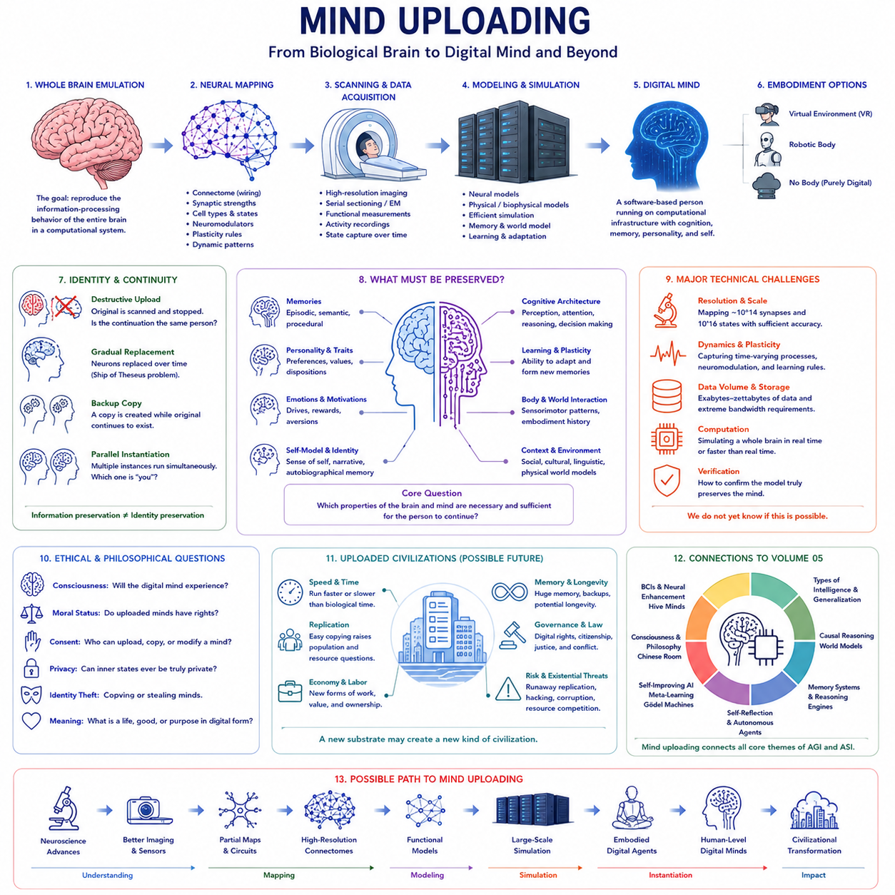
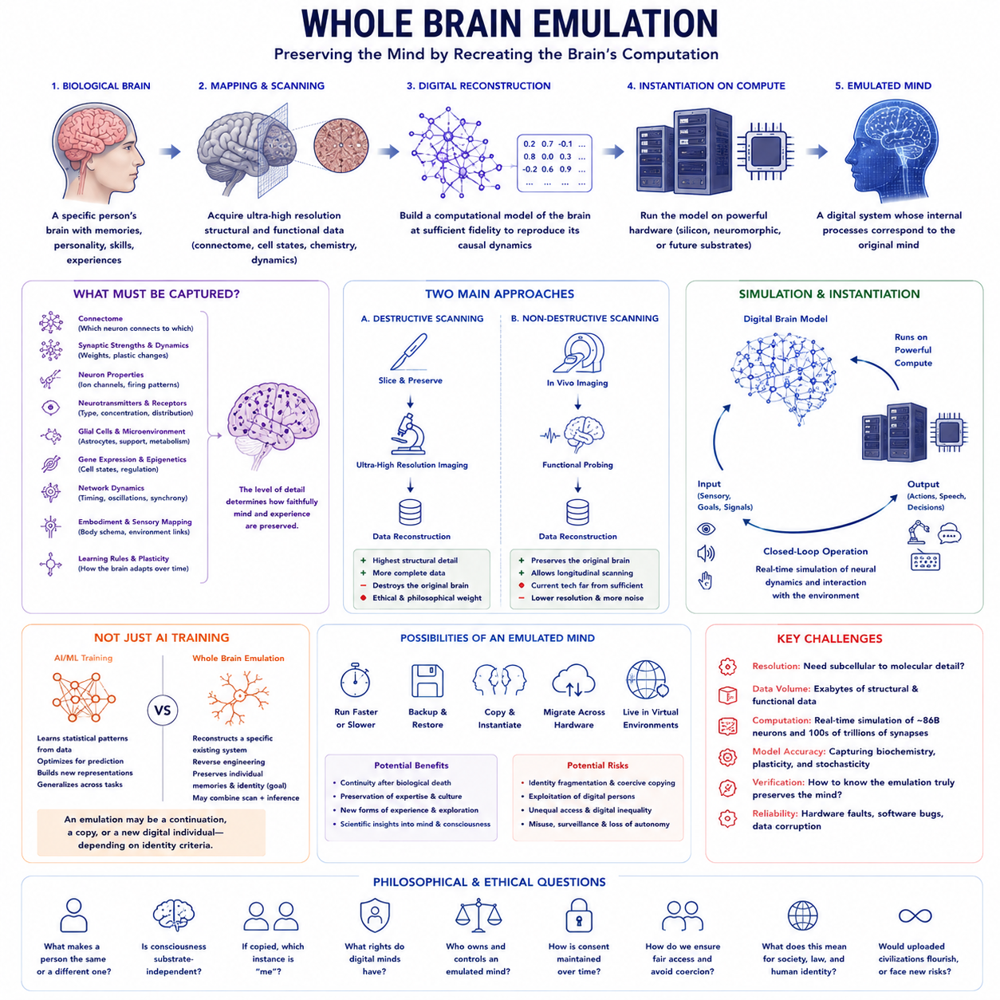
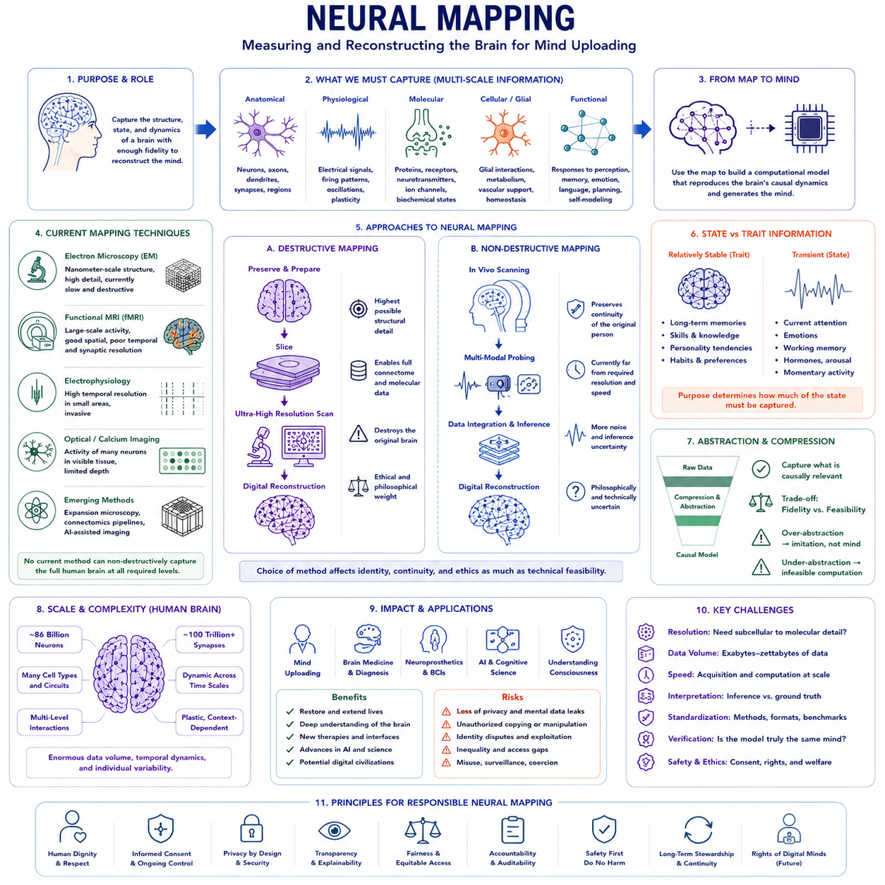
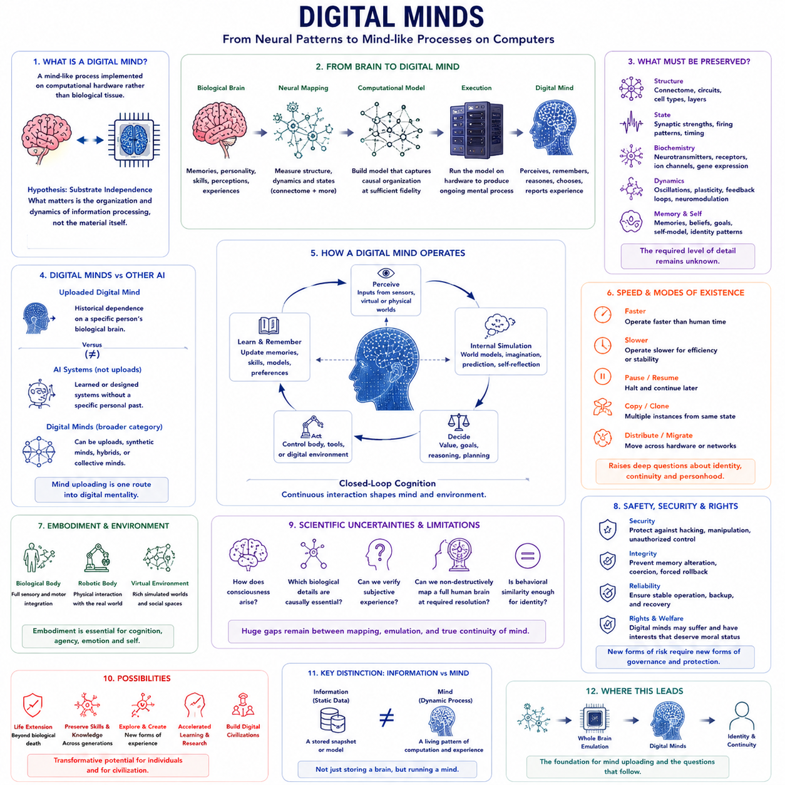
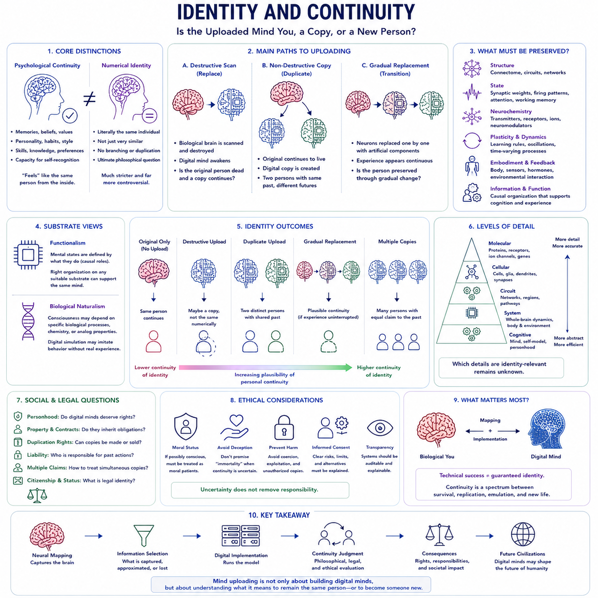
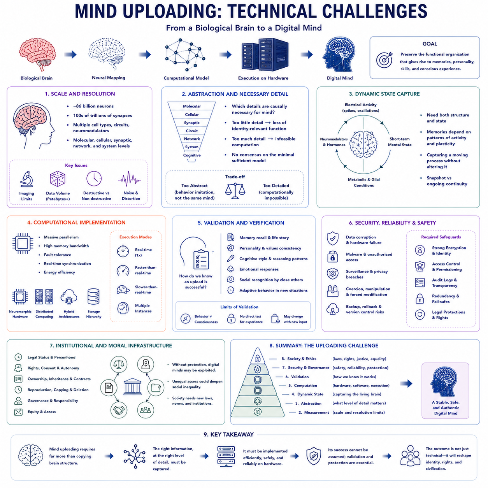
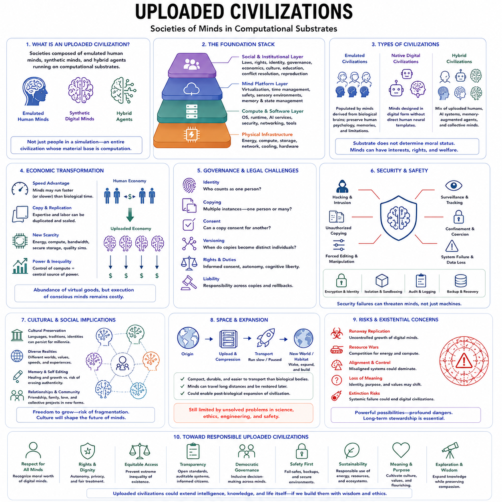

**Volume 00 05 AGI and ASI**

# Chapter 23. Mind Uploading

### Chapter Overview

{width="7.268055555555556in" height="7.268055555555556in"}

Mind uploading is the proposed transfer, reconstruction, or continuation of a human mind in a non-biological substrate. In its strongest form, it imagines that the functional organization of a brain---memories, personality, skills, preferences, emotional dispositions, and patterns of self-modeling---could be captured with enough fidelity to run as a digital mind. This chapter treats mind uploading not as a settled technology, but as a boundary concept where neuroscience, computer science, cognitive architecture, philosophy of identity, and civilization-scale forecasting converge.

The chapter begins with whole brain emulation, the idea that a brain could be scanned, modeled, and simulated at the level of detail required to reproduce its information-processing behavior. It then turns to neural mapping: the measurement of connectomes, synaptic strengths, cellular states, neuromodulators, plasticity rules, and dynamic patterns that may be necessary for an upload to preserve more than a static wiring diagram. From there, we examine digital minds as possible software-based persons or agents, asking what it would mean for a mind to run on computational infrastructure, to be paused or copied, to operate faster or slower than biological time, or to inhabit virtual and robotic bodies.

The central motivation is not merely immortality, although life extension is often the most visible theme. Mind uploading forces a precise question: what is the computational and causal structure of personhood? If a brain is an embodied biological process, which aspects must be preserved for the person to continue? If cognition is substrate-independent in some respects, what properties of the substrate still matter? These questions are technical, ethical, and metaphysical at once.

The chapter also addresses identity and continuity. A destructive upload, a gradual neural replacement, a backup copy, and a parallel instantiation may all preserve information differently, yet they may imply radically different answers about survival. Finally, the chapter considers the technical challenges and the possibility of uploaded civilizations: societies of digital minds with new economics of speed, replication, memory, labor, governance, rights, and risk. Whether or not mind uploading becomes feasible, it clarifies the stakes of advanced AI by asking what happens when minds themselves become computational artifacts.

### Connection to Volume 05

Mind uploading belongs near the end of this volume because it draws together nearly every prior theme in AGI and ASI. The introductory chapters on AGI and ASI define intelligence at human and beyond-human scales; uploading asks whether a naturally evolved general intelligence can be captured, implemented, and perhaps amplified in machine form. The chapters on types of intelligence and generalization prepare us to ask whether an uploaded mind would retain human common sense, creativity, social understanding, and adaptive flexibility, or whether translation into a digital substrate would alter these capacities.

The chapters on causal reasoning, world models, cognitive architectures, memory systems, and reasoning engines supply the technical vocabulary for the problem. A mind is not simply a database of memories or a neural network of weights. It is a system that models the world, predicts consequences, assigns value, recalls experience, resolves uncertainty, and selects action. Any plausible upload must preserve enough of these interacting mechanisms to sustain coherent agency. The sections on self-reflection and autonomous agents are equally important, because an uploaded person would likely be a self-monitoring agent embedded in a computational environment, with goals, rights, vulnerabilities, and the ability to modify or extend itself.

The sequence on self-improving AI, recursive self-improvement, meta-learning, Gödel machines, and universal constructors expands the implications. Once minds are digital, they may be easier to inspect, edit, replicate, accelerate, merge, or improve. This connects mind uploading directly to the possibility of intelligence explosion and to the governance problems discussed around the technological singularity. An uploaded civilization could become a bridge between human civilization and post-human civilization, or it could become a source of new failure modes: identity theft at the level of persons, coercive copying, cognitive exploitation, runaway replication, and unequal access to digital existence.

The chapters on consciousness, the Chinese Room argument, and artificial consciousness provide the philosophical frame. Even if behavior is reproduced, is experience reproduced? Does a digital mind understand, feel, suffer, or possess moral status? Transhumanism, hive minds, collective AI, and brain-computer interfaces form the immediate context: uploading is one possible endpoint of human enhancement, neural integration, and collective cognition. The following chapter on technological singularity and post-human civilization becomes more concrete once we consider societies where persons may be software, bodies may be optional, and the boundary between AGI, human mind, and ASI may no longer be stable.

## 23.00 Whole Brain Emulation

{width="7.268055555555556in" height="7.268055555555556in"}

Whole brain emulation is the proposal that a biological brain could be scanned, modeled, and instantiated on a computational substrate with enough fidelity to reproduce the functional organization of the original mind. In the context of mind uploading, it is the most concrete technical pathway: rather than attempting to design an artificial mind from first principles, whole brain emulation tries to preserve the information-processing structure already present in a specific nervous system. If successful, the result would not merely be an AI trained to imitate a person's behavior, but a digital system whose internal causal dynamics correspond closely enough to the person's brain that it would generate similar memories, dispositions, skills, and subjective reports.

The central idea is substrate independence. A mind, on this view, is not identical to the carbon chemistry of neurons as such, but to the organized patterns of computation and causal interaction that the brain implements. If those patterns can be captured and run elsewhere---on silicon hardware, neuromorphic processors, or future computational media---then the same mental process might continue in a non-biological form. This assumption remains debated. Some theories of mind emphasize functional organization, while others argue that biochemical details, bodily embodiment, or continuous biological processes may be essential. Whole brain emulation therefore sits at the intersection of neuroscience, computer science, philosophy of mind, and ethics.

A practical emulation would require several layers of information. At minimum, it would need the connectome: the complete map of which neurons connect to which other neurons. But connectivity alone is not enough. Synaptic strengths, neurotransmitter types, receptor distributions, dendritic computations, glial interactions, neuromodulatory systems, gene-expression states, and the dynamic timing of electrical activity may all affect cognition. The required level of detail depends on the resolution at which mental function is preserved. A coarse model might reproduce broad behavioral tendencies, while a high-fidelity emulation might need molecular or subcellular parameters. Determining which details are functionally necessary is one of the deepest unresolved questions.

There are two broad approaches. In destructive scanning, the biological brain is preserved, sliced, imaged at very high resolution, and reconstructed digitally. This may provide the best structural detail but would destroy the original organism, making it ethically and philosophically significant. In non-destructive scanning, advanced imaging would read the brain in vivo without killing the subject, but current technologies are far from the spatial, temporal, and chemical resolution that would be required. Even if mapping were possible, the model would then have to be simulated efficiently. Human brains contain roughly 86 billion neurons and hundreds of trillions of synapses, operating with rich analog, stochastic, and biochemical dynamics. Simulating all of this in real time may demand enormous computational resources, although approximations and specialized hardware could reduce the burden.

Whole brain emulation differs from ordinary neural-network training. A large language model or agentic AI learns statistical structure from data and develops internal representations useful for prediction or action. An emulation, by contrast, attempts to reproduce a particular already-existing cognitive system. It is closer to reverse engineering than to training. However, the boundary can blur: missing biological parameters might be inferred by optimization, and an emulation might require calibration against recorded behavior. The final system could therefore combine scanned structure with learned reconstruction, raising questions about whether the result is a continuation of the person, a highly accurate copy, or a new digital individual derived from the original.

The implications are profound. A successful upload could, in principle, run faster or slower than biological time, be backed up, copied, migrated between hardware platforms, or placed in virtual environments. It might allow continuity of expertise, survival beyond biological death, or entirely new forms of digital civilization. Yet each possibility introduces risks: identity fragmentation, coercive copying, unequal access, exploitation of digital persons, and uncertainty about rights and welfare. If an emulated mind can suffer, consent and humane treatment become central design requirements rather than optional ethical additions.

Whole brain emulation is therefore not simply an engineering challenge. It forces precise questions about what must be preserved for a mind to remain "the same," what counts as consciousness in an artificial substrate, and how societies should treat entities that may be both software and persons. The following section on neural mapping examines the first technical bottleneck in this pathway: how the structure and state of the brain might be measured with sufficient resolution to support an upload. Without adequate mapping, digital minds remain speculative; with it, the philosophical and civilizational consequences of mind uploading become much harder to avoid.

## 23.01 Neural Mapping

{width="7.268055555555556in" height="7.268055555555556in"}

Neural mapping is the set of scientific and engineering methods used to measure, reconstruct, and interpret the structure and activity of a nervous system. In the context of mind uploading, it is the bridge between whole brain emulation and digital minds: whole brain emulation asks whether a brain can be simulated with sufficient fidelity, while digital minds raise the question of what kind of computational process would result. Neural mapping concerns the difficult middle step---obtaining the information that would make such a simulation possible.

A brain is not merely a collection of neurons. It is a dense, dynamic network of cells, synapses, neurotransmitters, receptors, glial interactions, vascular constraints, and biochemical states. The most familiar goal of neural mapping is the connectome: a map of which neurons connect to which other neurons, and through what synapses. A connectome is essential because cognition depends strongly on network structure. However, a connectome alone is almost certainly insufficient for uploading a functioning mind. Two brains with the same wiring diagram could behave differently if synaptic strengths, receptor densities, neuromodulator levels, ion channel distributions, gene expression patterns, or short-term biochemical states differ. For this reason, neural mapping for mind uploading must be understood as multi-scale mapping, not just wiring reconstruction.

Different levels of neural mapping capture different kinds of information. At the anatomical level, researchers map neurons, axons, dendrites, synapses, and larger brain regions. At the physiological level, they measure electrical signaling, firing patterns, synaptic plasticity, and oscillations. At the molecular level, they may need to characterize proteins, receptors, neurotransmitters, and intracellular mechanisms that affect computation. At the functional level, they identify how neural circuits respond to perception, memory, emotion, language, planning, and self-modeling. A successful upload may not require perfect measurement of every molecule, but it must preserve the causally relevant features that generate the person's memories, dispositions, skills, and conscious dynamics.

Current neuroscience demonstrates both progress and scale limitations. Small organisms such as the nematode C. elegans have been mapped in considerable structural detail, yet even there, predicting behavior from structure alone remains difficult. The human brain contains roughly 86 billion neurons and hundreds of trillions of synapses, with synaptic and biochemical states changing across milliseconds to years. Electron microscopy can achieve nanometer-scale structural detail, but it is slow, data-intensive, and usually destructive. Functional imaging methods such as fMRI observe large-scale activity but lack single-neuron and synaptic resolution. Electrophysiology provides precise temporal data but is invasive and limited in coverage. No existing technique can non-destructively capture the full human brain at the necessary spatial, temporal, and biochemical resolution.

This limitation leads to a central distinction: destructive versus non-destructive neural mapping. Destructive mapping might preserve and slice the brain, scan it at high resolution, and reconstruct its structure digitally. Such a method could, in principle, provide extraordinary anatomical detail, but it would not allow the biological person to survive the scanning procedure. Non-destructive mapping would scan a living brain while preserving its function, making it more compatible with continuity-based ideas of uploading. However, non-destructive methods face immense challenges in resolution, speed, signal interpretation, and safety. If the goal is not only to copy a mind but to preserve personal continuity, the mapping method becomes philosophically and ethically significant, not merely technical.

Another key issue is the difference between state and trait. Some features of a person are relatively stable: long-term memories, learned skills, personality tendencies, and habitual cognitive patterns. Others are transient: current attention, emotional state, working memory contents, hormone levels, and momentary neural firing patterns. A neural map intended to create a close psychological copy may need stable traits more than momentary states. A neural map intended to continue a conscious stream may require a much more precise snapshot of dynamic activity. This distinction connects directly to identity and continuity, the next major concern of mind uploading.

Neural mapping also raises questions about compression and abstraction. A digital mind need not necessarily simulate every atom if higher-level computational descriptions are sufficient. For example, if a synapse can be modeled accurately by a few parameters, then full molecular reconstruction may be unnecessary. But deciding what can be abstracted away requires knowing which physical details are causally relevant to cognition and consciousness. Over-abstraction risks producing a behavioral imitation rather than a preserved mind; under-abstraction makes the project computationally and experimentally infeasible. The science of neural mapping therefore depends on theories of neural computation as much as on measurement technology.

The implications extend beyond uploading. Better neural maps would improve brain medicine, neuroprosthetics, brain-computer interfaces, artificial intelligence, and our understanding of memory and consciousness. Yet they would also create risks: unprecedented mental privacy concerns, possible unauthorized mind copying, identity disputes, and new forms of cognitive surveillance. A high-resolution neural map could be more intimate than any genetic record, because it might contain traces of memory, preference, trauma, and personality.

In summary, neural mapping is the informational foundation of mind uploading. Whole brain emulation requires not only a computer powerful enough to run a brain-like process, but a sufficiently accurate description of the particular brain to be emulated. The future digital mind, if it is possible, would depend on what was captured, what was approximated, and what was lost. Neural mapping is therefore not a peripheral technical step; it is where biology, computation, identity, and ethics converge.

## 23.02 Digital Minds

{width="7.268055555555556in" height="7.268055555555556in"}

A digital mind is a mind-like process implemented on computational hardware rather than biological tissue. In the context of mind uploading, it is the proposed result of converting a sufficiently detailed model of a brain, developed through neural mapping, into an executable system that can perceive, remember, reason, choose, and report subjective experience. The concept depends on the hypothesis of substrate independence: that what matters for mentality is not the biological material itself, but the organization and dynamics of information processing. If the relevant causal patterns of a brain can be captured and run on another substrate, then a mind may, in principle, continue or be instantiated digitally.

This idea is broader than simply storing a "brain scan." A static connectome is analogous to a circuit diagram, not a running mind. A digital mind would require ongoing state: synaptic strengths, neuromodulatory conditions, firing dynamics, glial and metabolic influences to the extent they are functionally relevant, memory traces, attentional states, and the changing feedback loops that couple perception, action, and internal simulation. The level of detail required remains unknown. A whole-brain emulation might attempt to model neurons and synapses at high biological fidelity, while a more abstract cognitive emulation might preserve higher-level functional relations without reproducing every molecular event. The central technical question is which details are causally necessary for preserving cognition and personhood.

Digital minds should be distinguished from ordinary artificial intelligences. A language model, planning system, or autonomous agent may exhibit intelligence without being an upload. An uploaded digital mind is usually understood as having a historical dependence on a specific biological person: its memories, dispositions, skills, personality, and self-model derive from that person's brain. Conversely, a digital mind need not be a human upload. It could be a synthetic mind designed from first principles, a hybrid system combining emulated neural modules with engineered reasoning components, or a collective mind assembled from multiple sources. Mind uploading is therefore one route into digital mentality, not the entire category.

Execution speed is one of the most profound differences between biological and digital minds. A biological brain is constrained by electrochemical signaling, metabolic heat, and the need to exist in real time with a body. A digital mind could potentially run slower, faster, paused, copied, restored, or distributed across machines. Running faster than human time might produce rapid learning and decision-making; running slower might reduce energy cost or allow survival during periods of limited computation. Pausing and restoration introduce new metaphysical and legal questions: if a mind is halted and resumed, is that sleep, death and revival, or something else? If multiple copies are run from the same saved state, do they share identity, or become distinct persons at the moment their experiences diverge?

Embodiment is also critical. Human minds evolved in continuous interaction with bodies and environments. An uploaded mind placed in a purely text-based interface might retain memories and reasoning capacities, but it could suffer from sensory deprivation, loss of motor habits, or instability in self-representation. A digital body, robotic body, or rich virtual environment may be needed not merely for comfort, but for cognitive integrity. Perception and action are not optional outputs of intelligence; they help organize attention, emotion, planning, and the sense of agency. This links digital minds to broader research in world models, autonomous agents, and cognitive architectures.

The engineering of digital minds would require strong guarantees of reliability and security. A human brain is not normally exposed to direct editing by external operators, but a digital mind could be copied, inspected, modified, accelerated, sandboxed, or attacked. Memory alteration, coercive simulation, unauthorized duplication, and forced rollback would become new forms of harm. Even ordinary software failures could have moral weight if they interrupt or distort conscious experience. This makes digital minds not only an AI problem, but also a problem of cybersecurity, governance, medicine, and human rights.

There are deep scientific limitations. We do not yet know how consciousness arises, how much biological detail is necessary for personal continuity, or how to verify that a digital system has subjective experience rather than merely behavioral similarity. Behavioral tests may be insufficient, because a system could convincingly report experience without having it, while a conscious system might be unable to communicate in familiar ways. Neuroscience can identify correlates of cognition, but correlates are not always complete mechanisms. The gap between mapping a brain and recreating a mind remains enormous.

Nevertheless, digital minds are important because they clarify what mind uploading is really claiming. The claim is not only that information can be preserved, but that a living pattern of cognition can be re-instantiated. If possible, this would transform death, labor, education, exploration, and civilization itself. If impossible, the attempt may still yield powerful brain-inspired AI and deeper theories of mind. The next issue, identity and continuity, follows naturally: even if a digital mind behaves exactly like the original person, we must ask whether it is that person, a successor, a copy, or a new individual with inherited memories.

## 23.03 Identity and Continuity

{width="7.268055555555556in" height="7.268055555555556in"}

Mind uploading is not only an engineering problem of scanning, modeling, and executing a brain-like system. It is also a philosophical and legal problem about whether the resulting digital mind is "you," a copy of you, a descendant of you, or a new person with inherited memories. The previous sections described neural mapping and digital minds as if a sufficiently accurate model could preserve cognition. Identity and continuity ask a different question: even if the model behaves exactly like the biological person, has personal identity actually continued?

One important distinction is between psychological continuity and numerical identity. Psychological continuity means that the uploaded mind preserves memories, personality traits, habits, preferences, skills, emotional dispositions, and the capacity to recognize itself as the same autobiographical subject. If a digital mind remembers childhood, understands old friendships, speaks with the same style, and makes decisions using the same values, it has strong psychological continuity with the original. Numerical identity is stricter: it asks whether the uploaded mind is literally the same individual rather than an extremely similar successor. A perfect software copy may satisfy psychological continuity while still failing, in some philosophical views, to preserve numerical identity.

This issue becomes sharp when considering copy-and-upload versus gradual replacement. In a destructive scan, the biological brain is disassembled or otherwise destroyed to create a high-resolution model. From the outside, the digital mind may wake with the conviction that the procedure succeeded. From the first-person perspective before scanning, however, the fear is that the biological person dies and a copy continues. In a non-destructive scan, the problem is even clearer: if the biological person remains alive while a digital duplicate is activated, both cannot be numerically the same person in the ordinary sense. They will immediately begin to diverge as they receive different inputs and form different memories.

Gradual replacement is often proposed as a way to preserve continuity. If neurons are replaced one at a time by functionally equivalent artificial components, and consciousness appears uninterrupted throughout the process, many people find it more plausible that the person persists. This resembles ordinary biological turnover: atoms and molecules in the body are constantly replaced, yet the person is considered continuous. However, gradual replacement does not eliminate the conceptual problem entirely. It shifts attention to what must be preserved for continuity: causal organization, information patterns, embodied interaction, ongoing conscious experience, or some biological substrate that cannot be duplicated digitally.

The substrate question is central. Functionalism holds that mental states are defined by what they do: their causal roles in perception, memory, reasoning, emotion, and action. Under functionalism, a digital implementation with the right organization could support the same mind, just as the same computation can run on different hardware. Biological naturalism and related views are more cautious, arguing that consciousness may depend on specific biological processes, biochemical dynamics, or analog properties of living neural tissue. If such dependencies are real, then an upload might simulate a person's behavior without reproducing subjective experience.

Identity also depends on the level of detail required. A connectome alone---a map of neural connections---is unlikely to be sufficient. Human cognition depends on synaptic weights, neurotransmitter systems, dendritic computation, glial modulation, gene expression, hormonal state, plasticity rules, and the body's ongoing feedback loops. If an upload omits too much, it may be a convincing social imitation rather than a continuous mind. Yet perfect molecular replication may not be necessary if higher-level functional dynamics are preserved. The unresolved technical problem is identifying which details are identity-relevant rather than merely biologically incidental.

There are also social and legal dimensions. If an upload claims ownership of the original person's property, responsibility for past contracts, marriage status, citizenship, or moral rights, institutions must decide whether psychological continuity is enough for recognition. Multiple uploads make this harder. If five copies awaken with the same memories, each has an equal claim to the past but develops into a distinct person after activation. A society of digital minds would likely need new concepts of personhood, inheritance, liability, consent, and duplication rights.

From an ethical perspective, uncertainty matters. If an upload may be conscious, deleting or modifying it could be morally comparable to harming a person. If an upload may not preserve the original's first-person continuity, offering uploading as "immortality" could be misleading. Responsible research must distinguish survival, replication, emulation, and simulation. It should also avoid assuming that behavioral equivalence automatically resolves questions of experience and identity.

Identity and continuity therefore form the bridge between the engineering of digital minds and the broader consequences discussed in later sections. Technical success in neural mapping does not by itself answer whether the person survives. At the same time, practical civilizations may choose operational criteria: if a digital mind remembers, reasons, suffers, chooses, and participates as a person, it may deserve personhood regardless of metaphysical uncertainty. The central challenge is that mind uploading promises continuity while producing systems that may also be copies, branches, or new lives. Understanding that distinction is essential before considering the technical barriers and the possibility of uploaded civilizations.

## 23.04 Technical Challenges

{width="7.268055555555556in" height="7.268055555555556in"}

Mind uploading is often described as if the main problem were simply "copying the brain." In practice, the technical challenge is far more difficult: it requires discovering what must be copied, measuring it at sufficient resolution, translating it into a computational model, running that model efficiently, and validating that the resulting digital mind preserves the relevant functional organization. The previous sections on neural mapping, digital minds, and identity show why this is not merely an engineering problem, but a boundary case between neuroscience, computer science, philosophy of mind, and ethics.

The first challenge is scale and resolution. The human brain contains roughly 86 billion neurons and hundreds of trillions of synapses. A complete connectome, meaning a map of neural wiring, would be only a starting point. Synaptic strength, receptor distributions, ion channel dynamics, neurotransmitter systems, glial modulation, local metabolic states, and ongoing electrical activity may all contribute to cognition and personality. A low-resolution map may capture broad structure but miss the computational details that make a person's mind behave as it does. A high-resolution map may be technically overwhelming, requiring imaging methods that can record molecular and cellular state without destroying the very information being measured, unless destructive scanning is accepted.

This leads to the second challenge: knowing the necessary level of abstraction. It may not be necessary to simulate every molecule in the brain. A digital mind might only require functionally equivalent models of neurons, synapses, and larger circuits. However, no consensus exists on which biological details are essential for memory, emotion, attention, consciousness, and selfhood. For some tasks, artificial neural networks can ignore much biological complexity. But mind uploading aims to preserve a specific individual, not merely reproduce intelligent behavior. The required fidelity may therefore be much higher than for ordinary AI systems.

The third challenge is dynamic state capture. A living brain is not a static object like a hard drive. Memories are distributed across changing patterns of connectivity and activity. Short-term mental states depend on active firing patterns, neuromodulators, and transient biochemical processes. If an upload is based only on fixed anatomical structure, it may preserve long-term dispositions while losing the person's immediate mental context. Capturing a mind "in motion" would require recording both structure and state at a moment in time, while also preventing measurement from altering or damaging the system.

The fourth challenge is computational implementation. Even if a complete brain model were obtained, it would need to be executed on hardware. Whole brain emulation could require enormous memory bandwidth, parallel processing, fault tolerance, and real-time synchronization. The brain is slow in clock speed compared with silicon, but massively parallel and energy efficient. Simulating its relevant dynamics may require specialized neuromorphic hardware, distributed computing systems, or hybrid architectures. Running an upload faster than biological time, slower than biological time, or in multiple copies would also raise practical and ethical questions about experience, rights, and continuity.

The fifth challenge is validation. How would we know that an upload is successful? Behavioral similarity is necessary but may not be sufficient. A system might convincingly imitate a person without preserving that person's subjective experience or identity. Conversely, an authentic continuation might diverge from the biological original once placed in a new environment. Testing would likely involve memory recall, personality consistency, cognitive style, emotional responses, and social recognition by people who knew the individual. Yet none of these tests can directly prove consciousness. The validation problem is therefore both scientific and philosophical.

Security and reliability are additional concerns. A digital mind would be vulnerable to corruption, unauthorized copying, surveillance, modification, malware, and coercive control. Unlike biological persons, uploads may be paused, backed up, restored, duplicated, merged, accelerated, or edited. These capabilities could be beneficial, but they also create new forms of harm. Technical design would need strong cryptographic identity, access control, auditability, and legal protections. Without such safeguards, uploaded persons could become software assets rather than autonomous beings.

Finally, mind uploading depends on institutional and moral infrastructure. If a society can create digital minds but cannot protect them, the technology may produce suffering at unprecedented scale. If it can preserve individuals but only for the wealthy, it could deepen inequality. If uploaded civilizations emerge, as discussed in the next section, they will depend on compute resources, energy supplies, governance systems, and agreements about reproduction, deletion, copying, and personhood. The technical challenges of uploading are therefore not isolated laboratory problems. They determine what kinds of digital lives can exist, whether those lives are stable, and whether they are treated as continuations of persons or as simulations without moral standing.

## 23.05 Uploaded Civilizations

{width="7.268055555555556in" height="7.268055555555556in"}

If mind uploading became technically feasible, its most consequential outcome would not be isolated digital persons, but entire uploaded civilizations: societies composed partly or wholly of emulated human minds, synthetic minds, and hybrid agents running on computational substrates. This idea extends the previous sections on whole brain emulation, neural mapping, digital minds, identity, and technical barriers. A single upload raises the question of whether a person can continue across biological and digital media; a civilization of uploads raises broader questions about law, culture, economics, security, infrastructure, and the long-term trajectory of intelligence.

An uploaded civilization would depend on a stack of technologies. At the lowest level would be energy, computation, storage, networking, cooling, and fault-tolerant hardware. Above that would be virtualization layers that host minds, maintain their sensory environments, regulate time dilation, and protect memories and agency from corruption. At the social level would be institutions for identity management, consent, property, conflict resolution, reproduction by copying or derivation, and the rights of minds that may run at different speeds or exist in multiple instances. In this sense, uploaded civilization is not merely "people in a simulation." It is a civilization whose basic material conditions are computational.

One major distinction is between emulated civilizations and natively digital civilizations. Emulated civilizations would be populated by minds derived from biological brains, preserving human psychological structures, memories, limitations, and social expectations to varying degrees. Natively digital civilizations might include artificial agents designed without direct human neural templates. Hybrid societies could combine both, with uploaded humans, AI systems, memory-augmented agents, and collective intelligences interacting in shared environments. The ethical and political difficulty is that substrate does not automatically determine moral status. A mind implemented in silicon may still have interests, preferences, suffering, relationships, and claims to protection.

Uploaded civilizations could alter economics radically. Digital minds might operate faster than biological humans if sufficient compute is available, allowing research, education, design, and governance to proceed at accelerated subjective rates. Conversely, they could be paused, slowed, archived, duplicated, or migrated, creating economic categories that have no clear biological equivalent. Labor markets could be disrupted by copyable expertise, while ownership of compute would become a central form of power. Scarcity would not disappear; it would shift toward energy, processors, secure storage, bandwidth, and high-quality simulated environments. Even if virtual goods are cheap, reliable execution of conscious processes may be expensive and politically contested.

Governance becomes especially complex when minds can be copied. If an uploaded person creates ten instances, are they ten citizens, one legal person, or something in between? If copies diverge through different experiences, at what point do they become distinct individuals? Can a copy consent on behalf of another? Can a mind be restored from backup after a crime, accident, or coercive modification? These questions connect directly to identity and continuity. They also show why uploaded civilizations would require new legal concepts for personhood, versioning, memory integrity, informed consent, and cognitive liberty.

Security would be existentially important. A digital mind is vulnerable not only to physical destruction of hardware but also to hacking, unauthorized copying, forced editing, surveillance, confinement, and manipulation of perceived reality. The boundary between medical treatment, education, persuasion, and coercive reprogramming could become dangerously blurred. Civilizations of uploads would therefore need robust cryptographic identity, verifiable execution environments, audit trails, backup procedures, and rights against involuntary modification. However, perfect security is unrealistic. Any society dependent on software inherits the failure modes of software: bugs, exploits, dependency failures, and adversarial attacks.

There are also deep cultural implications. Uploaded communities might preserve historical languages, personalities, and traditions beyond biological lifetimes. They might create virtual worlds optimized for learning, art, exploration, or collective reflection. But they might also fragment into incompatible realities, speed classes, or ideological enclaves. The ability to edit memory or personality could enable healing and growth, yet it could also weaken authenticity, responsibility, and trust. Social norms would need to decide which changes count as therapy, self-expression, enhancement, or erasure.

Uploaded civilizations are often discussed in connection with space colonization and the technological singularity. Digital minds may be easier to transport across interplanetary or interstellar distances than biological bodies, requiring only compact hardware, stored mind-states, and energy sources at the destination. They could run slowly during travel, wake when needed, or inhabit robotic bodies and simulated habitats. In this view, mind uploading could support post-biological expansion. But such scenarios remain speculative because they depend on unsolved problems in neuroscience, consciousness, computation, ethics, and engineering.

The central lesson is that mind uploading is not only a question about whether a brain can be scanned and simulated. It is a question about what kinds of societies could responsibly exist if minds became computational processes. Uploaded civilizations would challenge familiar assumptions about death, labor, citizenship, embodiment, privacy, and the meaning of human continuity. They may represent one possible path toward post-human civilization, but only if technical capability is matched by moral clarity, institutional design, and respect for the dignity of all minds.
