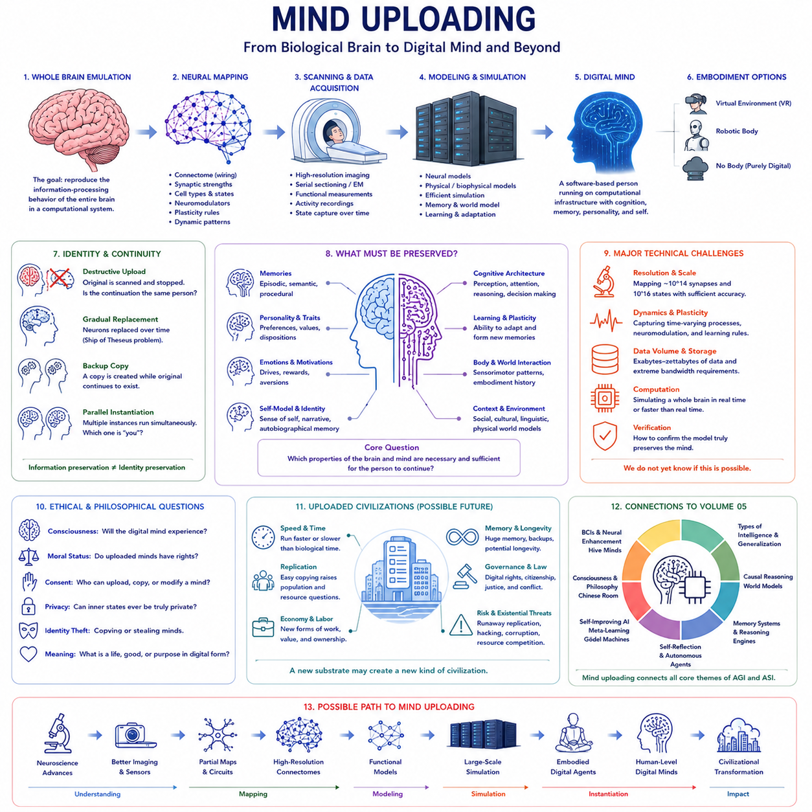
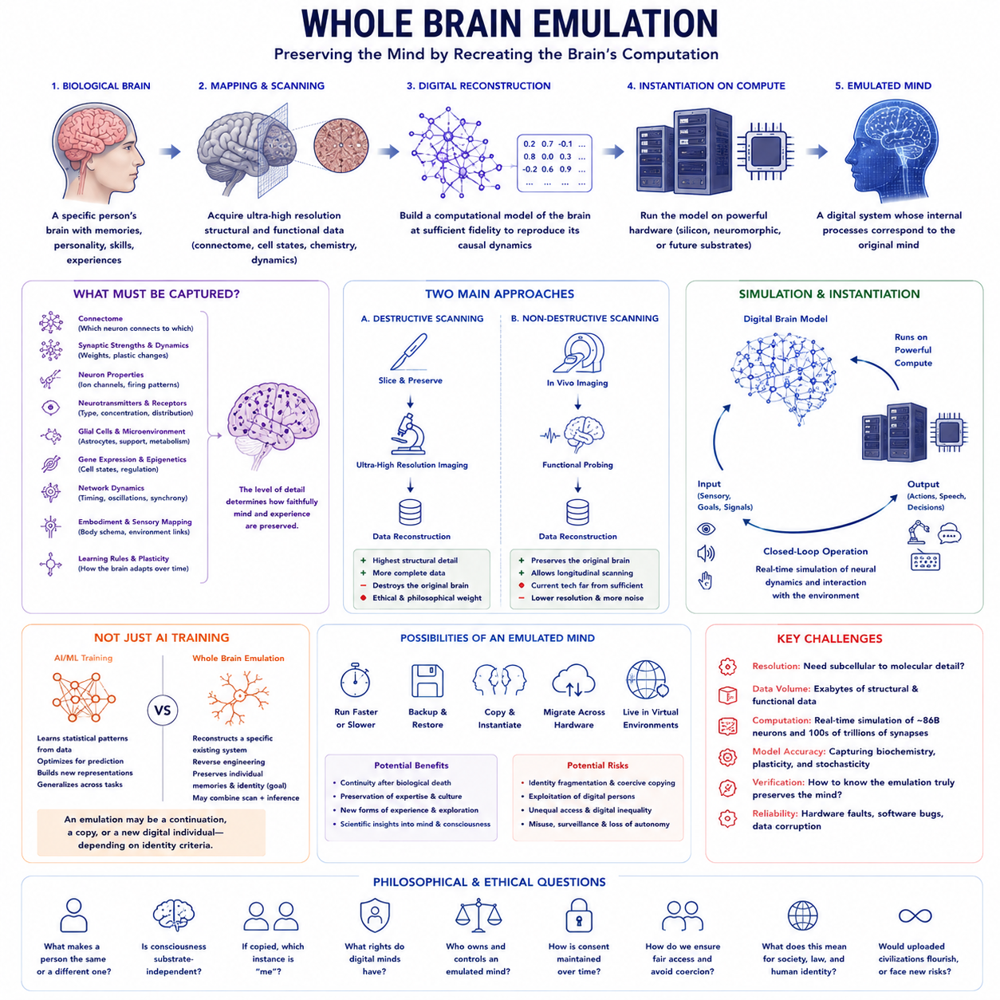
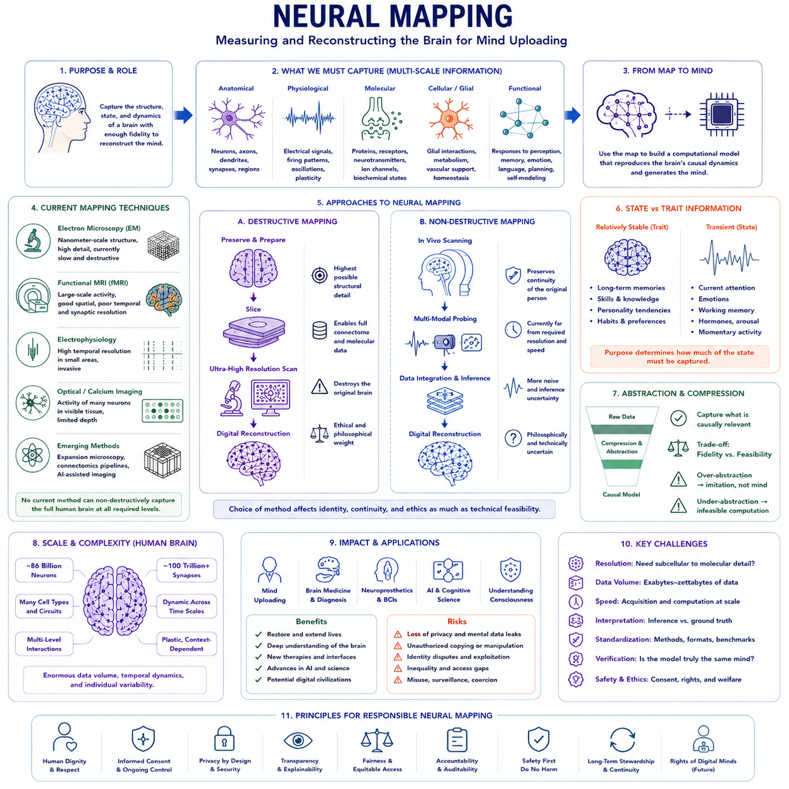
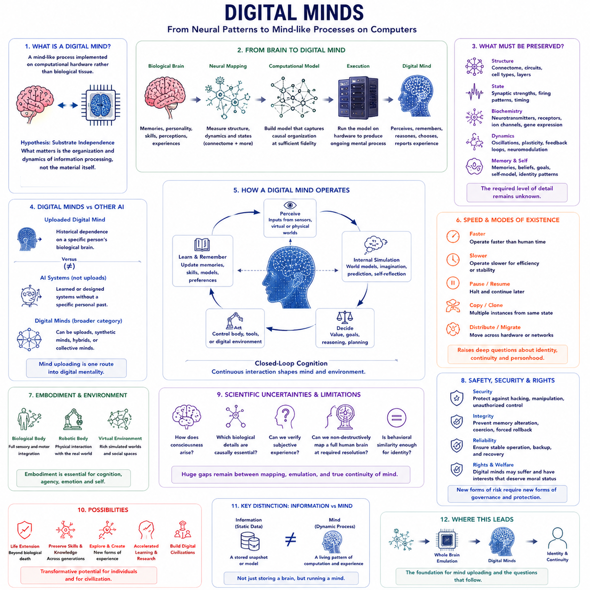
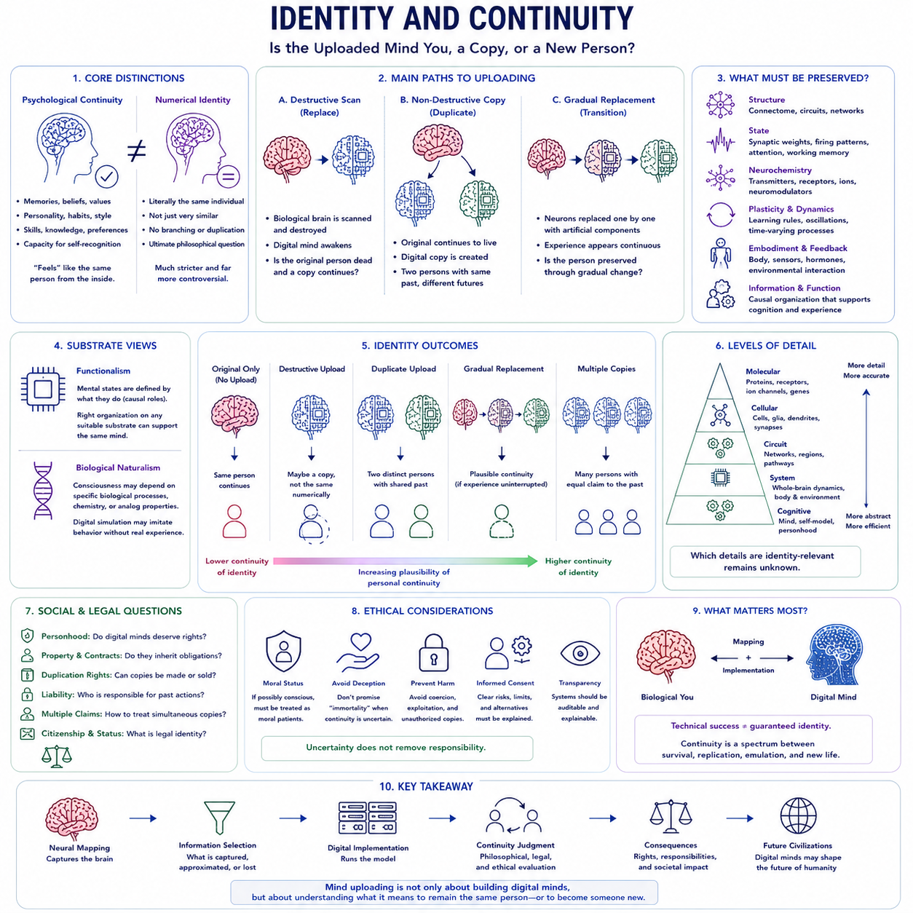
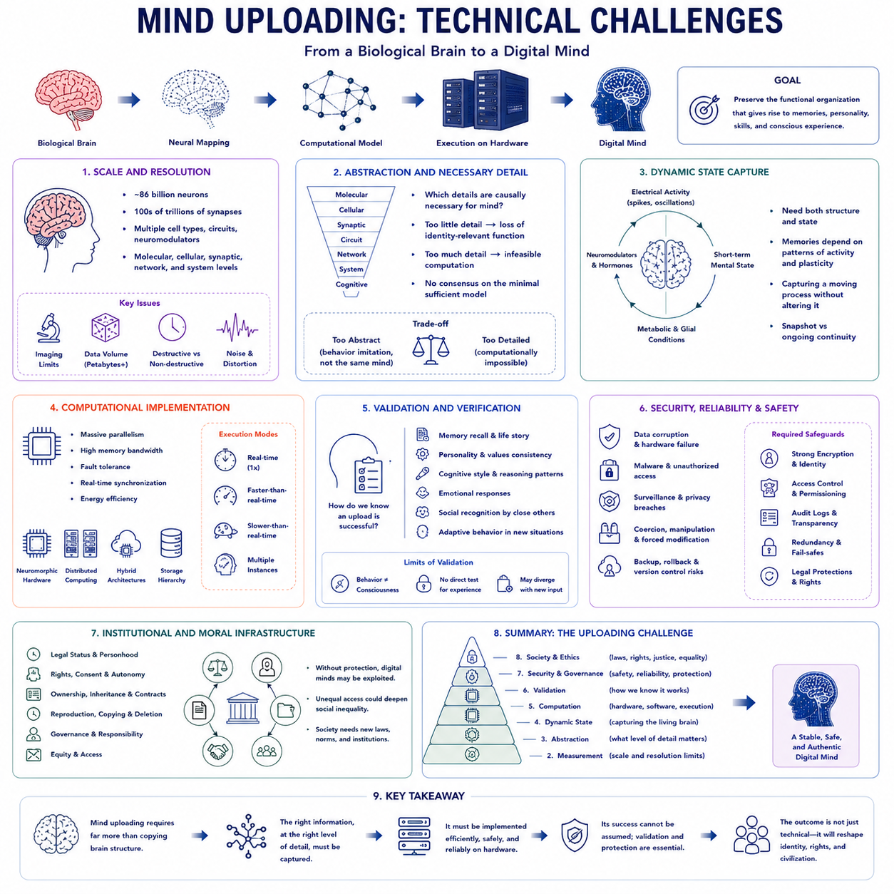
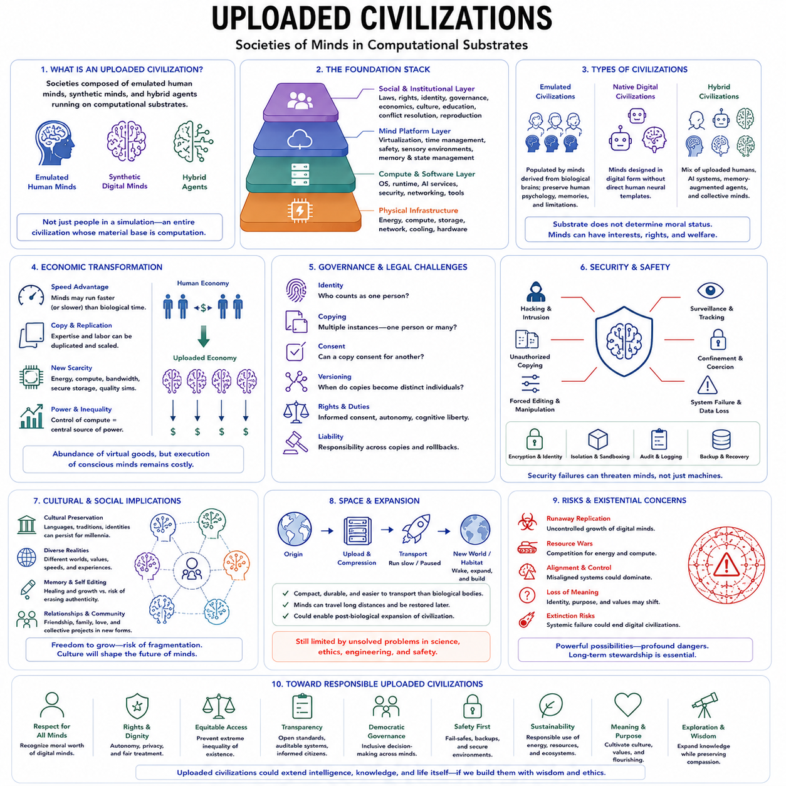

**Volume 00 05 AGI and ASI**

# Chapter 23. Mind Uploading

### Chapter Overview

{width="7.268055555555556in" height="7.268055555555556in"}

마인드 업로딩(Mind Uploading)은 인간의 마음을 비생물학적 기질(substrate)로 이전하거나, 재구성하거나, 연속시키는 것을 목표로 하는 제안이다. 가장 강한 형태의 마인드 업로딩은 뇌의 기능적 조직, 즉 기억, 성격, 기술, 선호, 정서적 성향, 자기 모델링(self-modeling)의 패턴을 충분한 충실도로 포착하여 디지털 마음(digital mind)으로 실행할 수 있다고 상상한다. 이 장은 마인드 업로딩을 이미 확립된 기술로 다루지 않는다. 오히려 신경과학, 컴퓨터 과학, 인지 아키텍처(cognitive architecture), 정체성 철학, 문명 규모의 미래 예측이 만나는 경계 개념으로 다룬다.

이 장은 먼저 전뇌 에뮬레이션(whole brain emulation)에서 시작한다. 이는 뇌를 스캔하고 모델링하며, 정보 처리 행동을 재현하는 데 필요한 세부 수준으로 시뮬레이션할 수 있다는 생각이다. 이어서 신경 매핑(neural mapping)을 다룬다. 여기에는 커넥톰(connectome), 시냅스 강도, 세포 상태, 신경조절물질, 가소성 규칙, 동적 패턴을 측정하는 문제가 포함된다. 단순한 정적 배선도 이상을 보존하려면 이러한 요소들이 필요할 수 있다. 그다음에는 소프트웨어 기반의 인격 또는 행위자로서 가능한 디지털 마음을 검토한다. 마음이 계산 인프라 위에서 실행된다는 것은 무엇을 의미하는지, 일시 정지되거나 복사될 수 있다는 것은 무엇인지, 생물학적 시간보다 빠르거나 느리게 작동한다는 것은 무엇인지, 가상 신체나 로봇 신체에 거주한다는 것은 무엇인지 묻는다.

핵심 동기는 단순히 불멸이 아니다. 물론 수명 연장은 마인드 업로딩에서 가장 눈에 띄는 주제인 경우가 많다. 그러나 마인드 업로딩은 더 정밀한 질문을 강제한다. 인격성(personhood)의 계산적·인과적 구조는 무엇인가? 뇌가 체화된 생물학적 과정이라면, 한 사람이 계속 존재하기 위해 어떤 측면이 보존되어야 하는가? 인지가 어떤 점에서 기질 독립적(substrate-independent)이라면, 그래도 기질의 어떤 속성은 여전히 중요한가? 이러한 질문은 동시에 기술적이고 윤리적이며 형이상학적이다.

이 장은 또한 정체성과 연속성(identity and continuity)을 다룬다. 파괴적 업로드, 점진적 신경 대체, 백업 복사본, 병렬 인스턴스화는 모두 정보를 서로 다른 방식으로 보존할 수 있다. 그러나 생존에 관해서는 근본적으로 다른 답을 함축할 수 있다. 마지막으로 이 장은 기술적 난제와 업로드된 문명(uploaded civilizations)의 가능성을 검토한다. 디지털 마음으로 이루어진 사회는 속도, 복제, 기억, 노동, 거버넌스, 권리, 위험의 새로운 경제학을 가질 수 있다. 마인드 업로딩이 실제로 가능해지든 그렇지 않든, 그것은 마음 자체가 계산적 산물이 될 때 어떤 일이 벌어지는지를 묻는 방식으로 첨단 AI의 핵심 쟁점을 선명하게 드러낸다.

### Connection to Volume 05

마인드 업로딩은 AGI와 ASI에 관한 앞선 거의 모든 주제를 한데 모으기 때문에 이 권의 후반부에 위치한다. AGI와 ASI를 다룬 도입부 장들은 인간 수준과 초인간 수준의 지능을 정의한다. 업로딩은 자연적으로 진화한 범용 지능(general intelligence)을 기계 형태로 포착하고 구현하며, 어쩌면 증폭할 수 있는지를 묻는다. 지능의 유형과 일반화(generalization)를 다룬 장들은 업로드된 마음이 인간의 상식, 창의성, 사회적 이해, 적응적 유연성을 유지할 수 있는지, 아니면 디지털 기질로 번역되는 과정에서 이러한 능력이 변형될 것인지를 질문할 준비를 제공한다.

인과 추론(causal reasoning), 세계 모델(world model), 인지 아키텍처, 기억 시스템(memory system), 추론 엔진(reasoning engine)을 다룬 장들은 이 문제를 이해하는 기술적 어휘를 제공한다. 마음은 단순한 기억 데이터베이스도 아니고, 가중치로 이루어진 신경망도 아니다. 마음은 세계를 모델링하고, 결과를 예측하며, 가치를 부여하고, 경험을 회상하며, 불확실성을 해소하고, 행동을 선택하는 시스템이다. 그럴듯한 업로드는 일관된 행위성을 유지하기 위해 이러한 상호작용하는 메커니즘을 충분히 보존해야 한다. 자기 성찰(self-reflection)과 자율 에이전트(autonomous agent)를 다룬 장들도 마찬가지로 중요하다. 업로드된 사람은 계산 환경 안에 놓인 자기 감시적 행위자일 가능성이 크며, 목표, 권리, 취약성, 그리고 자기 자신을 수정하거나 확장할 능력을 가질 수 있기 때문이다.

자기 개선 AI(self-improving AI), 재귀적 자기 개선(recursive self-improvement), 메타러닝(meta-learning), 괴델 머신(Gödel machine), 보편 생성자(universal constructor)를 다룬 흐름은 그 함의를 확장한다. 마음이 디지털화되면 그것을 검사하고, 편집하고, 복제하고, 가속하고, 병합하고, 개선하기가 더 쉬워질 수 있다. 이 점은 마인드 업로딩을 지능 폭발(intelligence explosion)의 가능성과 직접 연결하며, 기술적 특이점(technological singularity)을 둘러싼 거버넌스 문제와도 연결한다. 업로드된 문명은 인간 문명과 포스트휴먼 문명(post-human civilization)을 잇는 다리가 될 수도 있고, 새로운 실패 양식의 원천이 될 수도 있다. 예컨대 인격 수준의 정체성 절도, 강제 복제, 인지적 착취, 통제 불능의 복제, 디지털 존재에 대한 불평등한 접근이 그런 위험에 해당한다.

의식(consciousness), 중국어 방 논변(Chinese Room argument), 인공 의식(artificial consciousness)을 다룬 장들은 철학적 틀을 제공한다. 행동이 재현되더라도 경험도 재현되는가? 디지털 마음은 이해하고, 느끼고, 고통받고, 도덕적 지위를 갖는가? 트랜스휴머니즘(transhumanism), 하이브 마인드(hive mind), 집단 AI(collective AI), 뇌-컴퓨터 인터페이스(brain-computer interface)는 직접적인 맥락을 이룬다. 업로딩은 인간 향상, 신경 통합, 집단 인지의 가능한 종착점 중 하나다. 기술적 특이점과 포스트휴먼 문명을 다루는 다음 장들은, 인격이 소프트웨어가 될 수 있고 신체가 선택 사항이 될 수 있으며 AGI, 인간 마음, ASI의 경계가 더 이상 안정적이지 않을 수 있는 사회를 고려할 때 훨씬 더 구체적으로 이해된다.

## 23.00 Whole Brain Emulation

{width="7.268055555555556in" height="7.268055555555556in"}

전뇌 에뮬레이션(Whole Brain Emulation)은 생물학적 뇌를 스캔하고 모델링한 뒤, 원래 마음의 기능적 조직을 재현할 만큼 충분한 충실도로 계산 기판(computational substrate) 위에 구현할 수 있다는 제안이다. 마인드 업로딩(mind uploading)의 맥락에서 이는 가장 구체적인 기술적 경로에 해당한다. 처음부터 인공 마음을 설계하려는 것이 아니라, 특정 신경계 안에 이미 존재하는 정보 처리 구조를 보존하려는 접근이기 때문이다. 성공한다면 그 결과물은 단순히 어떤 사람의 행동을 모방하도록 훈련된 AI가 아니라, 내부의 인과적 동역학(causal dynamics)이 그 사람의 뇌와 충분히 가깝게 대응하여 유사한 기억, 성향, 기술, 주관적 보고를 생성하는 디지털 시스템이 될 것이다.

핵심 개념은 기판 독립성(substrate independence)이다. 이 관점에서 마음은 뉴런의 탄소 기반 화학 그 자체와 동일한 것이 아니라, 뇌가 구현하는 조직화된 계산 패턴과 인과적 상호작용과 동일하다. 그러한 패턴을 포착하여 다른 곳, 예를 들어 실리콘 하드웨어, 뉴로모픽 프로세서(neuromorphic processor), 또는 미래의 계산 매체에서 실행할 수 있다면, 동일한 정신 과정이 비생물학적 형태로 계속될 수도 있다. 그러나 이 가정은 여전히 논쟁적이다. 어떤 마음 이론은 기능적 조직을 강조하는 반면, 다른 이론은 생화학적 세부 사항, 신체적 체현(embodiment), 또는 연속적인 생물학적 과정이 필수적일 수 있다고 주장한다. 따라서 전뇌 에뮬레이션은 신경과학, 컴퓨터과학, 마음철학, 윤리가 만나는 지점에 놓여 있다.

실용적인 에뮬레이션에는 여러 층위의 정보가 필요하다. 최소한 커넥톰(connectome), 즉 어떤 뉴런이 어떤 다른 뉴런과 연결되어 있는지에 대한 완전한 지도가 필요하다. 하지만 연결성만으로는 충분하지 않다. 시냅스 강도, 신경전달물질 유형, 수용체 분포, 수상돌기 계산, 교세포 상호작용, 신경조절계, 유전자 발현 상태, 전기 활동의 동적 타이밍이 모두 인지에 영향을 줄 수 있다. 필요한 세부 수준은 정신 기능이 어떤 해상도에서 보존되어야 하는지에 달려 있다. 거친 모델은 넓은 행동 경향을 재현할 수 있을지 모르지만, 고충실도 에뮬레이션에는 분자적 또는 세포 이하 수준의 매개변수가 필요할 수 있다. 어떤 세부 사항이 기능적으로 필수적인지를 판단하는 것은 가장 깊이 남아 있는 미해결 문제 중 하나다.

접근법은 크게 두 가지가 있다. 파괴적 스캐닝(destructive scanning)에서는 생물학적 뇌를 보존하고, 얇게 절단하며, 매우 높은 해상도로 영상화한 뒤 디지털로 재구성한다. 이 방법은 최상의 구조적 세부 정보를 제공할 수 있지만 원래 유기체를 파괴하므로, 윤리적·철학적으로 매우 중요하다. 비파괴적 스캐닝(non-destructive scanning)에서는 고도화된 영상 기술로 살아 있는 뇌를 죽이지 않고 읽어내야 하지만, 현재 기술은 요구되는 공간적, 시간적, 화학적 해상도에 한참 미치지 못한다. 설령 매핑이 가능하더라도, 그 모델은 이후 효율적으로 시뮬레이션되어야 한다. 인간의 뇌에는 대략 860억 개의 뉴런과 수백조 개의 시냅스가 있으며, 풍부한 아날로그적, 확률적, 생화학적 동역학 속에서 작동한다. 이 모든 것을 실시간으로 시뮬레이션하려면 막대한 계산 자원이 필요할 수 있지만, 근사화와 특수 하드웨어가 그 부담을 줄일 수도 있다.

전뇌 에뮬레이션은 일반적인 신경망 훈련과 다르다. 대규모 언어 모델이나 에이전트형 AI(agentic AI)는 데이터로부터 통계적 구조를 학습하고, 예측이나 행동에 유용한 내부 표현을 발전시킨다. 반면 에뮬레이션은 이미 존재하는 특정 인지 시스템을 재현하려고 한다. 이는 훈련이라기보다 역공학(reverse engineering)에 가깝다. 그러나 경계는 흐려질 수 있다. 빠진 생물학적 매개변수는 최적화를 통해 추론될 수 있고, 에뮬레이션은 기록된 행동에 맞춘 보정(calibration)을 필요로 할 수 있다. 따라서 최종 시스템은 스캔된 구조와 학습된 재구성을 결합할 수 있으며, 그 결과물이 그 사람의 연속인지, 매우 정확한 복사본인지, 아니면 원본에서 파생된 새로운 디지털 개인인지에 대한 질문을 제기한다.

그 함의는 매우 깊다. 성공적인 업로드는 원칙적으로 생물학적 시간보다 빠르거나 느리게 실행될 수 있고, 백업되거나, 복제되거나, 하드웨어 플랫폼 사이를 이동하거나, 가상 환경에 배치될 수 있다. 이는 전문성의 연속성, 생물학적 죽음 이후의 생존, 또는 완전히 새로운 형태의 디지털 문명을 가능하게 할지도 모른다. 그러나 각각의 가능성은 정체성의 분열, 강제적 복제, 접근의 불평등, 디지털 인격의 착취, 권리와 복지에 관한 불확실성이라는 위험을 동반한다. 에뮬레이션된 마음이 고통을 겪을 수 있다면, 동의와 인도적 처우는 선택적 윤리 부가물이 아니라 핵심 설계 요구사항이 된다.

따라서 전뇌 에뮬레이션은 단순한 공학적 과제가 아니다. 그것은 마음이 "동일한" 것으로 남기 위해 무엇이 보존되어야 하는지, 인공 기판에서 무엇을 의식으로 간주해야 하는지, 그리고 사회가 소프트웨어이면서 동시에 인격일 수 있는 존재를 어떻게 대해야 하는지에 대해 정밀한 질문을 강제한다. 다음 절인 신경 매핑(Neural Mapping)은 이 경로의 첫 번째 기술적 병목을 다룬다. 즉 업로드를 뒷받침할 만큼 충분한 해상도로 뇌의 구조와 상태를 어떻게 측정할 수 있는가의 문제다. 적절한 매핑이 없다면 디지털 마음은 추측에 머문다. 그러나 그것이 가능해진다면, 마인드 업로딩의 철학적·문명적 결과는 훨씬 더 피하기 어려워질 것이다.

## 23.01 Neural Mapping

{width="7.268055555555556in" height="7.268055555555556in"}

신경 매핑(Neural Mapping)은 신경계의 구조와 활동을 측정하고, 재구성하며, 해석하기 위한 과학적·공학적 방법들의 집합이다. 마음 업로딩(Mind Uploading)의 맥락에서 신경 매핑은 전뇌 에뮬레이션(Whole Brain Emulation)과 디지털 마음(Digital Minds)을 이어 주는 다리 역할을 한다. 전뇌 에뮬레이션은 뇌를 충분한 충실도(fidelity)로 시뮬레이션할 수 있는지를 묻고, 디지털 마음은 그 결과 어떤 종류의 계산 과정이 생겨나는지를 묻는다. 신경 매핑은 이러한 시뮬레이션을 가능하게 할 정보를 획득하는 어려운 중간 단계에 해당한다.

뇌는 단순히 뉴런(neuron)의 집합이 아니다. 뇌는 세포, 시냅스(synapse), 신경전달물질(neurotransmitter), 수용체(receptor), 아교세포(glial cell) 상호작용, 혈관적 제약, 생화학적 상태가 촘촘하고 역동적으로 얽힌 네트워크이다. 신경 매핑에서 가장 잘 알려진 목표는 커넥톰(connectome), 즉 어떤 뉴런이 어떤 다른 뉴런과 어떤 시냅스를 통해 연결되는지를 나타내는 지도이다. 커넥톰은 인지가 네트워크 구조에 크게 의존하기 때문에 필수적이다. 그러나 커넥톰만으로는 기능하는 마음을 업로드하기에 거의 확실히 충분하지 않다. 동일한 배선도를 가진 두 뇌라 하더라도 시냅스 강도, 수용체 밀도, 신경조절물질(neuromodulator) 수준, 이온 채널 분포, 유전자 발현 양상, 단기 생화학적 상태가 다르면 서로 다르게 작동할 수 있다. 따라서 마음 업로딩을 위한 신경 매핑은 단순한 배선 재구성이 아니라 다중 스케일 매핑(multi-scale mapping)으로 이해되어야 한다.

신경 매핑의 서로 다른 수준은 서로 다른 종류의 정보를 포착한다. 해부학적 수준에서는 뉴런, 축삭(axon), 수상돌기(dendrite), 시냅스, 더 큰 뇌 영역을 매핑한다. 생리학적 수준에서는 전기 신호, 발화 패턴(firing pattern), 시냅스 가소성(synaptic plasticity), 진동(oscillation)을 측정한다. 분자 수준에서는 계산에 영향을 주는 단백질, 수용체, 신경전달물질, 세포 내부 메커니즘을 특성화해야 할 수 있다. 기능적 수준에서는 신경 회로가 지각, 기억, 감정, 언어, 계획, 자기 모델링(self-modeling)에 어떻게 반응하는지 확인한다. 성공적인 업로드가 모든 분자를 완벽히 측정할 필요는 없을 수 있지만, 그 사람의 기억, 성향, 기술, 의식적 역동성을 생성하는 인과적으로 관련된 특징들은 보존해야 한다.

현재의 신경과학은 진전과 규모상의 한계를 동시에 보여 준다. 예쁜꼬마선충(C. elegans)과 같은 작은 생물은 상당한 구조적 세부 수준에서 매핑되었지만, 그 경우에도 구조만으로 행동을 예측하는 일은 여전히 어렵다. 인간의 뇌에는 대략 860억 개의 뉴런과 수백조 개의 시냅스가 있으며, 시냅스와 생화학적 상태는 밀리초에서 수년에 이르는 시간 범위에서 변화한다. 전자현미경(electron microscopy)은 나노미터 규모의 구조적 세부 정보를 제공할 수 있지만, 느리고 데이터 집약적이며 대개 파괴적이다. fMRI와 같은 기능적 영상 기법은 대규모 활동을 관찰하지만 단일 뉴런과 시냅스 수준의 해상도는 부족하다. 전기생리학(electrophysiology)은 정밀한 시간 데이터를 제공하지만 침습적이며 적용 범위가 제한적이다. 현재 존재하는 어떤 기술도 인간 뇌 전체를 필요한 공간적, 시간적, 생화학적 해상도로 비파괴적으로 포착할 수 없다.

이 한계는 파괴적 신경 매핑과 비파괴적 신경 매핑이라는 핵심 구분으로 이어진다. 파괴적 매핑은 뇌를 보존하고 얇게 절단한 뒤 고해상도로 스캔하여 그 구조를 디지털로 재구성하는 방식일 수 있다. 그러한 방법은 원칙적으로 매우 뛰어난 해부학적 세부 정보를 제공할 수 있지만, 생물학적 개인이 스캔 절차를 살아서 통과하도록 허용하지는 않는다. 비파괴적 매핑은 살아 있는 뇌의 기능을 보존하면서 스캔하는 방식으로, 연속성에 기반한 업로딩 개념과 더 잘 맞는다. 그러나 비파괴적 방법은 해상도, 속도, 신호 해석, 안전성 측면에서 엄청난 난제에 직면한다. 목표가 단지 마음을 복사하는 것이 아니라 개인적 연속성을 보존하는 것이라면, 매핑 방법은 단순한 기술 문제가 아니라 철학적·윤리적으로도 중요한 문제가 된다.

또 다른 핵심 쟁점은 상태(state)와 특성(trait)의 차이이다. 어떤 개인의 특징 중에는 장기 기억, 학습된 기술, 성격적 경향, 습관적 인지 패턴처럼 비교적 안정적인 것들이 있다. 반면 현재의 주의, 감정 상태, 작업 기억의 내용, 호르몬 수준, 순간적인 신경 발화 패턴처럼 일시적인 것들도 있다. 가까운 심리적 복사본을 만들기 위한 신경 지도라면 순간적 상태보다 안정적 특성이 더 중요할 수 있다. 반대로 의식의 흐름을 계속 이어 가려는 신경 지도라면 동적 활동에 대한 훨씬 더 정밀한 스냅샷이 필요할 수 있다. 이 구분은 마음 업로딩의 다음 주요 관심사인 정체성과 연속성에 직접 연결된다.

신경 매핑은 또한 압축(compression)과 추상화(abstraction)에 관한 질문을 제기한다. 더 높은 수준의 계산적 설명이 충분하다면, 디지털 마음이 반드시 모든 원자를 시뮬레이션할 필요는 없을 수 있다. 예를 들어 시냅스를 몇 개의 매개변수로 정확히 모델링할 수 있다면 완전한 분자적 재구성은 불필요할 수 있다. 그러나 무엇을 추상화해도 되는지를 결정하려면 어떤 물리적 세부 사항이 인지와 의식에 인과적으로 관련되는지 알아야 한다. 지나친 추상화는 보존된 마음이 아니라 행동적 모방을 만들어 낼 위험이 있고, 지나치게 낮은 수준까지 재현하려는 접근은 프로젝트를 계산적으로나 실험적으로 실현 불가능하게 만든다. 따라서 신경 매핑의 과학은 측정 기술만큼이나 신경 계산(neural computation) 이론에 의존한다.

그 함의는 업로딩을 넘어선다. 더 나은 신경 지도는 뇌 의학, 신경보철(neuroprosthetics), 뇌-컴퓨터 인터페이스(Brain-Computer Interface), 인공지능, 기억과 의식에 대한 이해를 향상시킬 것이다. 그러나 동시에 전례 없는 정신적 프라이버시 문제, 허가 없는 마음 복제 가능성, 정체성 분쟁, 새로운 형태의 인지 감시(cognitive surveillance)라는 위험도 만들어 낼 수 있다. 고해상도 신경 지도는 기억, 선호, 트라우마, 성격의 흔적을 포함할 수 있기 때문에 어떤 유전 기록보다도 더 사적인 정보가 될 수 있다.

요약하면, 신경 매핑은 마음 업로딩의 정보적 토대이다. 전뇌 에뮬레이션에는 뇌와 유사한 과정을 실행할 만큼 강력한 컴퓨터뿐 아니라, 에뮬레이션할 특정 뇌에 대한 충분히 정확한 기술도 필요하다. 미래의 디지털 마음이 가능하다면, 그것은 무엇이 포착되었고, 무엇이 근사되었으며, 무엇이 사라졌는지에 달려 있을 것이다. 따라서 신경 매핑은 주변적인 기술 단계가 아니라 생물학, 계산, 정체성, 윤리가 만나는 지점이다.

## 23.02 Digital Minds

{width="7.268055555555556in" height="7.268055555555556in"}

디지털 마음(Digital Mind)은 생물학적 조직이 아니라 계산 하드웨어 위에서 구현되는 마음과 유사한 과정이다. 마인드 업로딩(Mind Uploading)의 맥락에서 그것은 신경 매핑(Neural Mapping)을 통해 만들어진 충분히 상세한 뇌 모델을 실행 가능한 시스템으로 변환한 결과로 제안된다. 그러한 시스템은 지각하고, 기억하고, 추론하고, 선택하고, 주관적 경험을 보고할 수 있어야 한다. 이 개념은 기질 독립성(substrate independence)이라는 가설에 의존한다. 즉 정신에서 중요한 것은 생물학적 물질 그 자체가 아니라 정보 처리의 조직과 동역학이라는 주장이다. 뇌의 관련된 인과적 패턴을 포착하여 다른 기질 위에서 실행할 수 있다면, 원칙적으로 마음은 디지털 방식으로 계속되거나 새롭게 인스턴스화될 수 있다.

이 생각은 단순히 "뇌 스캔"을 저장하는 것보다 훨씬 넓다. 정적인 연결체(connectome)는 실행 중인 마음이 아니라 회로도에 가깝다. 디지털 마음에는 지속적으로 변화하는 상태가 필요하다. 여기에는 시냅스 강도, 신경조절물질의 조건, 발화 동역학, 기능적으로 관련되는 범위에서의 교세포 및 대사 영향, 기억 흔적, 주의 상태, 그리고 지각·행동·내적 시뮬레이션을 결합하는 변화하는 피드백 루프가 포함된다. 어느 수준의 세부 정보가 필요한지는 아직 알려져 있지 않다. 전뇌 에뮬레이션(whole-brain emulation)은 뉴런과 시냅스를 높은 생물학적 충실도로 모델링하려 할 수 있고, 더 추상적인 인지 에뮬레이션(cognitive emulation)은 모든 분자 사건을 재현하지 않고 상위 수준의 기능적 관계를 보존하려 할 수 있다. 핵심적인 기술적 질문은 인지와 인격을 보존하는 데 어떤 세부 사항이 인과적으로 필수적인가이다.

디지털 마음은 일반적인 인공지능과 구별되어야 한다. 언어 모델, 계획 시스템, 자율 에이전트는 업로드가 아니더라도 지능을 보일 수 있다. 업로드된 디지털 마음은 보통 특정 생물학적 개인에 대한 역사적 의존성을 가진 것으로 이해된다. 그 기억, 성향, 기술, 성격, 자기 모델은 그 사람의 뇌에서 유래한다. 반대로 디지털 마음이 반드시 인간 업로드일 필요는 없다. 그것은 처음부터 설계된 합성 마음일 수도 있고, 에뮬레이션된 신경 모듈과 공학적으로 설계된 추론 구성요소를 결합한 하이브리드 시스템일 수도 있으며, 여러 출처에서 조립된 집단적 마음일 수도 있다. 따라서 마인드 업로딩은 디지털 정신성(digital mentality)에 이르는 하나의 경로이지, 그 범주 전체는 아니다.

실행 속도는 생물학적 마음과 디지털 마음 사이의 가장 근본적인 차이 중 하나다. 생물학적 뇌는 전기화학적 신호 전달, 대사 열, 그리고 몸과 함께 실시간으로 존재해야 한다는 조건에 의해 제약된다. 디지털 마음은 잠재적으로 더 느리게, 더 빠르게, 일시정지된 상태로, 복사되어, 복원되어, 또는 여러 기계에 분산되어 실행될 수 있다. 인간 시간보다 빠르게 실행되면 빠른 학습과 의사결정이 가능할 수 있고, 느리게 실행되면 에너지 비용을 줄이거나 계산 자원이 제한된 기간 동안 생존을 가능하게 할 수 있다. 일시정지와 복원은 새로운 형이상학적·법적 질문을 제기한다. 마음이 중단되었다가 재개된다면 그것은 수면인가, 죽음과 부활인가, 아니면 전혀 다른 무엇인가? 동일한 저장 상태에서 여러 복사본이 실행된다면, 그들은 정체성을 공유하는가, 아니면 경험이 갈라지는 순간 서로 다른 인격이 되는가?

체화(embodiment) 역시 중요하다. 인간의 마음은 몸과 환경과의 지속적인 상호작용 속에서 진화했다. 순수한 텍스트 기반 인터페이스에 놓인 업로드된 마음은 기억과 추론 능력을 유지할 수는 있지만, 감각 박탈, 운동 습관의 상실, 자기 표상의 불안정을 겪을 수 있다. 디지털 신체, 로봇 신체, 또는 풍부한 가상 환경은 단지 편안함을 위해서가 아니라 인지적 온전성을 위해 필요할 수 있다. 지각과 행동은 지능의 선택적 출력물이 아니다. 그것들은 주의, 감정, 계획, 행위 주체감(sense of agency)을 조직하는 데 도움을 준다. 이 지점에서 디지털 마음은 월드 모델(world models), 자율 에이전트(autonomous agents), 인지 아키텍처(cognitive architectures)에 관한 더 넓은 연구와 연결된다.

디지털 마음의 공학에는 높은 수준의 신뢰성과 보안 보장이 필요하다. 인간의 뇌는 보통 외부 조작자가 직접 편집할 수 있는 상태에 노출되어 있지 않지만, 디지털 마음은 복사되고, 검사되고, 수정되고, 가속되고, 샌드박스화되거나 공격받을 수 있다. 기억 변경, 강압적 시뮬레이션, 무단 복제, 강제 롤백은 새로운 형태의 위해가 될 것이다. 평범한 소프트웨어 오류조차 의식 경험을 중단시키거나 왜곡한다면 도덕적 의미를 가질 수 있다. 이 때문에 디지털 마음은 AI 문제일 뿐 아니라 사이버보안, 거버넌스, 의학, 인권의 문제이기도 하다.

여기에는 깊은 과학적 한계가 있다. 우리는 아직 의식이 어떻게 발생하는지, 개인적 연속성을 위해 어느 정도의 생물학적 세부 사항이 필요한지, 또는 디지털 시스템이 단순한 행동적 유사성이 아니라 주관적 경험을 갖는지 어떻게 검증할 수 있는지 알지 못한다. 행동 검사는 불충분할 수 있다. 어떤 시스템은 경험을 갖지 않으면서도 그럴듯하게 경험을 보고할 수 있고, 반대로 의식 있는 시스템은 익숙한 방식으로 의사소통하지 못할 수도 있기 때문이다. 신경과학은 인지의 상관물을 식별할 수 있지만, 상관물이 언제나 완전한 메커니즘인 것은 아니다. 뇌를 매핑하는 것과 마음을 재창조하는 것 사이의 간극은 여전히 거대하다.

그럼에도 디지털 마음은 마인드 업로딩이 실제로 무엇을 주장하는지 명확히 해 주기 때문에 중요하다. 그 주장은 정보가 보존될 수 있다는 것만이 아니라, 살아 있는 인지 패턴이 다시 인스턴스화될 수 있다는 것이다. 이것이 가능하다면 죽음, 노동, 교육, 탐험, 문명 자체가 변형될 것이다. 불가능하더라도 그 시도는 강력한 뇌 영감형 AI와 더 깊은 마음 이론을 낳을 수 있다. 다음 주제인 정체성과 연속성(Identity and Continuity)은 자연스럽게 이어진다. 디지털 마음이 원래 사람과 정확히 동일하게 행동하더라도, 우리는 그것이 그 사람인지, 후계자인지, 복사본인지, 아니면 물려받은 기억을 가진 새로운 개인인지 물어야 한다.

## 23.03 Identity and Continuity

{width="7.268055555555556in" height="7.268055555555556in"}

마인드 업로딩(Mind Uploading)은 뇌와 유사한 시스템을 스캔하고, 모델링하고, 실행하는 공학적 문제만이 아니다. 그것은 생성된 디지털 마음(digital mind)이 "당신"인지, 당신의 복사본인지, 당신의 후계자인지, 또는 기억을 물려받은 새로운 인격인지에 관한 철학적·법적 문제이기도 하다. 앞선 절들은 충분히 정확한 모델이 인지를 보존할 수 있다는 가정 아래 신경 매핑(neural mapping)과 디지털 마음을 설명했다. 정체성과 연속성(identity and continuity)은 다른 질문을 던진다. 모델이 생물학적 인간과 정확히 똑같이 행동하더라도, 개인 정체성(personal identity)이 실제로 계속된 것인가?

중요한 구분 중 하나는 심리적 연속성(psychological continuity)과 수적 동일성(numerical identity)의 차이다. 심리적 연속성이란 업로드된 마음이 기억, 성격 특성, 습관, 선호, 기술, 정서적 성향, 그리고 자신을 동일한 자서전적 주체로 인식하는 능력을 보존한다는 뜻이다. 디지털 마음이 어린 시절을 기억하고, 오래된 우정을 이해하며, 같은 말투로 말하고, 같은 가치관을 사용해 결정을 내린다면 원본과 강한 심리적 연속성을 가진다. 수적 동일성은 더 엄격하다. 업로드된 마음이 극도로 유사한 후계자가 아니라 문자 그대로 같은 개인인지 묻는다. 완벽한 소프트웨어 복사본은 심리적 연속성을 만족할 수 있지만, 일부 철학적 관점에서는 여전히 수적 동일성을 보존하지 못할 수 있다.

이 문제는 복사-업로드(copy-and-upload)와 점진적 대체(gradual replacement)를 비교할 때 더욱 날카로워진다. 파괴적 스캔(destructive scan)에서는 고해상도 모델을 만들기 위해 생물학적 뇌를 분해하거나 다른 방식으로 파괴한다. 외부에서 보면 디지털 마음은 절차가 성공했다는 확신을 가지고 깨어날 수 있다. 그러나 스캔 전의 1인칭 관점에서는 생물학적 인간이 죽고 복사본이 계속된다는 두려움이 남는다. 비파괴적 스캔(non-destructive scan)에서는 문제가 더욱 분명해진다. 생물학적 사람이 살아 있는 동안 디지털 복제본이 활성화된다면, 둘은 일반적인 의미에서 동시에 수적으로 같은 사람일 수 없다. 두 존재는 서로 다른 입력을 받고 서로 다른 기억을 형성하면서 즉시 갈라지기 시작한다.

점진적 대체는 연속성을 보존하는 방법으로 자주 제안된다. 뉴런을 하나씩 기능적으로 동등한 인공 구성요소로 교체하고, 그 과정 내내 의식이 끊기지 않는 것처럼 보인다면, 많은 사람은 그 사람이 지속된다고 보는 것이 더 그럴듯하다고 느낀다. 이는 일반적인 생물학적 교체와 닮아 있다. 몸속의 원자와 분자는 끊임없이 바뀌지만, 우리는 그 사람의 연속성이 유지된다고 본다. 그러나 점진적 대체도 개념적 문제를 완전히 제거하지는 않는다. 그것은 연속성을 위해 무엇이 보존되어야 하는지에 관심을 옮길 뿐이다. 보존되어야 하는 것이 인과적 조직(causal organization)인지, 정보 패턴(information patterns)인지, 체화된 상호작용(embodied interaction)인지, 지속되는 의식 경험인지, 아니면 디지털로 복제될 수 없는 어떤 생물학적 기반인지가 문제다.

기반(substrate)의 문제는 핵심적이다. 기능주의(functionalism)는 정신 상태가 그것이 수행하는 역할, 즉 지각, 기억, 추론, 감정, 행동에서의 인과적 역할에 의해 정의된다고 본다. 기능주의에 따르면 올바른 조직을 가진 디지털 구현은 같은 계산이 다른 하드웨어에서 실행될 수 있듯이 같은 마음을 지탱할 수 있다. 생물학적 자연주의(biological naturalism)와 관련 견해들은 더 신중하다. 이들은 의식이 특정한 생물학적 과정, 생화학적 동역학, 또는 살아 있는 신경 조직의 아날로그적 속성에 의존할 수 있다고 주장한다. 만약 그런 의존성이 실제라면, 업로드는 한 사람의 행동을 시뮬레이션할 수는 있어도 주관적 경험(subjective experience)을 재현하지 못할 수 있다.

정체성은 필요한 세부 수준에도 의존한다. 연결체(connectome), 즉 신경 연결 지도의 정보만으로는 충분하지 않을 가능성이 크다. 인간 인지는 시냅스 가중치, 신경전달물질 시스템, 수상돌기 계산, 교세포 조절, 유전자 발현, 호르몬 상태, 가소성 규칙, 그리고 신체의 지속적 피드백 루프에 의존한다. 업로드가 너무 많은 요소를 생략하면 그것은 연속적인 마음이 아니라 설득력 있는 사회적 모방일 수 있다. 그러나 더 높은 수준의 기능적 동역학이 보존된다면 완전한 분자적 복제까지는 필요하지 않을 수도 있다. 해결되지 않은 기술적 문제는 어떤 세부 사항이 정체성과 관련된 것이고, 어떤 것은 단지 생물학적으로 부수적인 것인지를 식별하는 일이다.

사회적·법적 차원도 존재한다. 업로드가 원래 사람의 재산 소유권, 과거 계약에 대한 책임, 혼인 상태, 시민권, 또는 도덕적 권리를 주장한다면, 제도는 심리적 연속성만으로 인정이 충분한지 결정해야 한다. 여러 개의 업로드가 존재할 경우 문제는 더 어려워진다. 다섯 개의 복사본이 같은 기억을 가지고 깨어난다면, 각각은 과거에 대해 동등한 권리를 주장하지만 활성화 이후에는 서로 다른 사람으로 발전한다. 디지털 마음들의 사회는 인격성(personhood), 상속, 책임, 동의, 복제 권리에 관한 새로운 개념을 필요로 할 가능성이 크다.

윤리적 관점에서는 불확실성이 중요하다. 업로드가 의식적일 수 있다면, 그것을 삭제하거나 수정하는 일은 사람에게 해를 가하는 것과 도덕적으로 비슷할 수 있다. 업로드가 원본의 1인칭 연속성을 보존하지 못할 수 있다면, 업로딩을 "불멸(immortality)"로 제시하는 것은 오해를 낳을 수 있다. 책임 있는 연구는 생존(survival), 복제(replication), 에뮬레이션(emulation), 시뮬레이션(simulation)을 구분해야 한다. 또한 행동적 동등성(behavioral equivalence)이 경험과 정체성의 문제를 자동으로 해결한다고 가정해서는 안 된다.

따라서 정체성과 연속성은 디지털 마음의 공학과 이후 절에서 논의될 더 넓은 결과들을 연결하는 다리 역할을 한다. 신경 매핑의 기술적 성공만으로는 그 사람이 살아남았는지 답할 수 없다. 동시에 실제 문명은 운용 가능한 기준을 선택할 수 있다. 어떤 디지털 마음이 기억하고, 추론하고, 고통을 느끼고, 선택하며, 사람으로서 참여한다면, 형이상학적 불확실성과 별개로 인격성을 부여받을 자격이 있을 수 있다. 핵심 과제는 마인드 업로딩이 연속성을 약속하면서도 동시에 복사본, 분기된 존재, 또는 새로운 삶을 만들어낼 수 있다는 점이다. 기술적 장벽과 업로드된 문명의 가능성을 논의하기 전에 이 구분을 이해하는 것은 필수적이다.

## 23.04 Technical Challenges

{width="7.268055555555556in" height="7.268055555555556in"}

마인드 업로딩(Mind uploading)은 종종 핵심 문제가 단순히 "뇌를 복사하는 것"인 것처럼 설명된다. 그러나 실제 기술적 난제는 훨씬 더 어렵다. 무엇을 복사해야 하는지 알아내고, 충분한 해상도로 그것을 측정하며, 계산 모델(computational model)로 변환하고, 그 모델을 효율적으로 실행한 뒤, 결과로 나온 디지털 마음(digital mind)이 관련된 기능적 조직을 보존하는지 검증해야 한다. 앞선 신경 매핑(neural mapping), 디지털 마음, 정체성과 연속성(identity and continuity)에 관한 절들은 이것이 단순한 공학 문제가 아니라 신경과학, 컴퓨터과학, 마음철학, 윤리학 사이의 경계 문제임을 보여준다.

첫 번째 과제는 규모와 해상도이다. 인간의 뇌에는 약 860억 개의 뉴런(neuron)과 수백조 개의 시냅스(synapse)가 있다. 신경 연결 배선도인 완전한 커넥톰(connectome)은 출발점일 뿐이다. 시냅스 강도, 수용체 분포, 이온 채널 역학, 신경전달물질 시스템, 교세포 조절, 국소 대사 상태, 진행 중인 전기적 활동은 모두 인지와 성격에 기여할 수 있다. 저해상도 지도는 큰 구조를 포착할 수 있지만, 한 사람의 마음이 실제로 그렇게 행동하게 만드는 계산적 세부 사항을 놓칠 수 있다. 고해상도 지도는 기술적으로 압도적인 부담이 될 수 있으며, 파괴적 스캔(destructive scanning)을 받아들이지 않는 한, 측정하려는 정보 자체를 파괴하지 않고 분자 및 세포 상태를 기록할 수 있는 영상화 방법이 필요하다.

두 번째 과제는 필요한 추상화 수준(level of abstraction)을 아는 것이다. 뇌의 모든 분자를 시뮬레이션할 필요는 없을 수 있다. 디지털 마음에는 뉴런, 시냅스, 더 큰 회로에 대한 기능적으로 동등한 모델만 필요할 수도 있다. 그러나 기억, 감정, 주의, 의식, 자아성을 위해 어떤 생물학적 세부 사항이 필수적인지에 대해서는 아직 합의가 없다. 일부 과제에서는 인공신경망(artificial neural network)이 많은 생물학적 복잡성을 무시할 수 있다. 하지만 마인드 업로딩은 단지 지능적 행동을 재현하는 것이 아니라 특정 개인을 보존하는 것을 목표로 한다. 따라서 요구되는 충실도(fidelity)는 일반적인 AI 시스템보다 훨씬 높을 수 있다.

세 번째 과제는 동적 상태 포착(dynamic state capture)이다. 살아 있는 뇌는 하드 드라이브처럼 정적인 물체가 아니다. 기억은 변화하는 연결성과 활동 패턴 전반에 분산되어 있다. 단기적인 정신 상태는 활성 발화 패턴, 신경조절물질(neuromodulator), 일시적인 생화학적 과정에 의존한다. 업로드가 고정된 해부학적 구조에만 기반한다면 장기적 성향은 보존할 수 있어도 그 사람의 즉각적인 정신적 맥락은 잃을 수 있다. "움직이는" 마음을 포착하려면 특정 순간의 구조와 상태를 모두 기록해야 하며, 동시에 측정이 시스템을 변화시키거나 손상시키지 않도록 해야 한다.

네 번째 과제는 계산적 구현(computational implementation)이다. 완전한 뇌 모델을 얻었다고 해도 그것을 하드웨어에서 실행해야 한다. 전뇌 에뮬레이션(whole brain emulation)은 막대한 메모리 대역폭, 병렬 처리, 결함 허용성, 실시간 동기화를 요구할 수 있다. 뇌는 실리콘에 비해 클록 속도는 느리지만, 대규모 병렬적이고 에너지 효율적이다. 관련 역학을 시뮬레이션하려면 특수한 뉴로모픽 하드웨어(neuromorphic hardware), 분산 컴퓨팅 시스템, 또는 하이브리드 아키텍처가 필요할 수 있다. 업로드를 생물학적 시간보다 빠르게, 느리게, 또는 여러 복사본으로 실행하는 것은 경험, 권리, 연속성에 관한 실용적이고 윤리적인 질문도 제기한다.

다섯 번째 과제는 검증(validation)이다. 업로드가 성공했는지 어떻게 알 수 있을까? 행동적 유사성은 필요하지만 충분하지 않을 수 있다. 어떤 시스템은 그 사람의 주관적 경험이나 정체성을 보존하지 않으면서도 그럴듯하게 모방할 수 있다. 반대로 진정한 연속체라 하더라도 새로운 환경에 놓이면 생물학적 원본과 달라질 수 있다. 검사는 기억 회상, 성격의 일관성, 인지 양식, 정서적 반응, 그 개인을 알던 사람들의 사회적 인정을 포함할 가능성이 크다. 그러나 이러한 검사 중 어떤 것도 의식을 직접 증명할 수는 없다. 따라서 검증 문제는 과학적이면서도 철학적인 문제이다.

보안과 신뢰성도 추가적인 우려 사항이다. 디지털 마음은 손상, 무단 복제, 감시, 수정, 악성코드, 강압적 통제에 취약할 수 있다. 생물학적 인간과 달리 업로드는 일시 정지, 백업, 복원, 복제, 병합, 가속, 편집될 수 있다. 이러한 능력은 유익할 수 있지만 새로운 형태의 피해도 만들어낸다. 기술 설계에는 강력한 암호학적 정체성(cryptographic identity), 접근 제어, 감사 가능성, 법적 보호가 필요하다. 그런 안전장치가 없다면 업로드된 사람들은 자율적 존재가 아니라 소프트웨어 자산이 될 수 있다.

마지막으로, 마인드 업로딩은 제도적·도덕적 기반에 의존한다. 어떤 사회가 디지털 마음을 만들 수는 있지만 그것을 보호할 수 없다면, 이 기술은 전례 없는 규모의 고통을 만들어낼 수 있다. 개인을 보존할 수 있지만 부유층에게만 가능하다면 불평등을 심화시킬 수 있다. 다음 절에서 논의하듯 업로드된 문명(uploaded civilizations)이 등장한다면, 그것들은 계산 자원, 에너지 공급, 거버넌스 시스템, 그리고 재생산, 삭제, 복사, 인격성(personhood)에 관한 합의에 의존하게 될 것이다. 따라서 업로딩의 기술적 과제는 고립된 실험실 문제가 아니다. 그것은 어떤 종류의 디지털 삶이 존재할 수 있는지, 그 삶이 안정적인지, 그리고 그 삶이 사람의 연속체로 대우받을지 아니면 도덕적 지위가 없는 시뮬레이션으로 취급될지를 결정한다.

## 23.05 Uploaded Civilizations

{width="7.268055555555556in" height="7.268055555555556in"}

마인드 업로딩(mind uploading)이 기술적으로 가능해진다면, 그 가장 중대한 결과는 고립된 디지털 개인이 아니라 전체 업로드 문명(uploaded civilizations)일 것이다. 이는 에뮬레이션된 인간 정신, 합성 정신(synthetic minds), 그리고 계산 기판(computational substrates) 위에서 실행되는 하이브리드 에이전트들로 부분적으로 또는 전체적으로 구성된 사회를 뜻한다. 이 개념은 앞선 절들에서 다룬 전뇌 에뮬레이션(whole brain emulation), 신경 매핑(neural mapping), 디지털 정신(digital minds), 정체성과 연속성(identity and continuity), 기술적 장벽을 확장한다. 하나의 업로드는 한 사람이 생물학적 매체와 디지털 매체를 가로질러 계속 존재할 수 있는가라는 질문을 제기하지만, 업로드들의 문명은 법, 문화, 경제, 보안, 인프라, 그리고 지능의 장기적 궤적에 관한 더 넓은 질문을 제기한다.

업로드 문명은 여러 기술 계층에 의존할 것이다. 가장 낮은 수준에는 에너지, 연산, 저장장치, 네트워킹, 냉각, 결함 허용 하드웨어가 필요하다. 그 위에는 정신을 호스팅하고, 감각 환경을 유지하며, 시간 팽창(time dilation)을 조절하고, 기억과 행위주체성(agency)이 손상되지 않도록 보호하는 가상화 계층(virtualization layers)이 있을 것이다. 사회적 수준에서는 정체성 관리, 동의, 재산, 분쟁 해결, 복제나 파생에 의한 재생산, 그리고 서로 다른 속도로 실행되거나 여러 인스턴스로 존재할 수 있는 정신들의 권리를 다루는 제도가 필요하다. 이런 의미에서 업로드 문명은 단순히 "시뮬레이션 속의 사람들"이 아니다. 그것은 기본적인 물질적 조건 자체가 계산적인 문명이다.

중요한 구분 중 하나는 에뮬레이션 문명(emulated civilizations)과 본래적 디지털 문명(natively digital civilizations)의 차이다. 에뮬레이션 문명은 생물학적 뇌에서 파생된 정신들로 구성되며, 인간의 심리 구조, 기억, 한계, 사회적 기대를 다양한 정도로 보존할 것이다. 본래적 디지털 문명은 직접적인 인간 신경 템플릿 없이 설계된 인공지능 에이전트를 포함할 수 있다. 하이브리드 사회에서는 업로드된 인간, AI 시스템, 기억이 증강된 에이전트, 집단 지능(collective intelligences)이 공유 환경 안에서 상호작용할 수 있다. 윤리적·정치적 어려움은 기판이 도덕적 지위(moral status)를 자동으로 결정하지 않는다는 점이다. 실리콘 위에 구현된 정신이라도 여전히 이해관계, 선호, 고통, 관계, 그리고 보호받을 권리를 가질 수 있다.

업로드 문명은 경제를 급격히 변화시킬 수 있다. 충분한 연산 자원이 있다면 디지털 정신은 생물학적 인간보다 더 빠르게 작동할 수 있고, 그 결과 연구, 교육, 설계, 통치가 가속된 주관적 속도로 진행될 수 있다. 반대로 이들은 일시정지되거나, 느려지거나, 보관되거나, 복제되거나, 다른 기판으로 이전될 수 있으며, 이는 명확한 생물학적 대응물이 없는 경제 범주를 만들어 낸다. 복제 가능한 전문성은 노동시장을 교란할 수 있고, 연산 자원의 소유는 핵심적인 권력 형태가 될 것이다. 희소성이 사라지는 것은 아니다. 희소성은 에너지, 프로세서, 안전한 저장장치, 대역폭, 고품질 시뮬레이션 환경으로 이동할 것이다. 가상 재화가 저렴하더라도 의식적 과정의 신뢰할 수 있는 실행은 비싸고 정치적으로 논쟁적일 수 있다.

정신이 복제될 수 있을 때 거버넌스(governance)는 특히 복잡해진다. 업로드된 사람이 열 개의 인스턴스를 만들었다면, 이들은 열 명의 시민인가, 하나의 법적 인격인가, 아니면 그 중간인가? 복사본들이 서로 다른 경험을 통해 갈라진다면, 어느 시점부터 별개의 개인이 되는가? 한 복사본이 다른 복사본을 대신해 동의할 수 있는가? 범죄, 사고, 강압적 수정 이후 백업에서 정신을 복원할 수 있는가? 이러한 질문들은 정체성과 연속성의 문제와 직접 연결된다. 또한 업로드 문명이 인격(personhood), 버전 관리(versioning), 기억 무결성(memory integrity), 충분한 설명에 근거한 동의(informed consent), 인지적 자유(cognitive liberty)에 관한 새로운 법적 개념을 필요로 한다는 점을 보여 준다.

보안은 실존적으로 중요할 것이다. 디지털 정신은 하드웨어의 물리적 파괴뿐 아니라 해킹, 무단 복제, 강제 편집, 감시, 감금, 지각된 현실의 조작에도 취약하다. 의료적 치료, 교육, 설득, 강압적 재프로그래밍(coercive reprogramming) 사이의 경계는 위험할 정도로 흐려질 수 있다. 따라서 업로드들의 문명은 강력한 암호학적 정체성(cryptographic identity), 검증 가능한 실행 환경(verifiable execution environments), 감사 기록(audit trails), 백업 절차, 비자발적 수정에 반대할 권리를 필요로 할 것이다. 그러나 완벽한 보안은 비현실적이다. 소프트웨어에 의존하는 모든 사회는 버그, 익스플로잇(exploits), 의존성 실패, 적대적 공격이라는 소프트웨어의 실패 양식을 물려받는다.

깊은 문화적 함의도 있다. 업로드 공동체는 역사적 언어, 인격, 전통을 생물학적 수명 너머로 보존할 수 있다. 학습, 예술, 탐험, 집단적 성찰에 최적화된 가상 세계를 만들 수도 있다. 그러나 이들은 서로 양립하기 어려운 현실들, 속도 계층(speed classes), 또는 이념적 폐쇄 공동체로 분열될 수도 있다. 기억이나 성격을 편집하는 능력은 치유와 성장을 가능하게 할 수 있지만, 동시에 진정성, 책임, 신뢰를 약화시킬 수도 있다. 사회 규범은 어떤 변화가 치료, 자기표현, 향상(enhancement), 또는 삭제(erasure)에 해당하는지를 결정해야 할 것이다.

업로드 문명은 종종 우주 식민화와 기술적 특이점(technological singularity)과 관련하여 논의된다. 디지털 정신은 생물학적 신체보다 행성 간 또는 항성 간 거리로 운송하기 쉬울 수 있으며, 목적지에는 소형 하드웨어, 저장된 정신 상태, 에너지원만 필요할 수 있다. 이들은 여행 중 느리게 실행되고, 필요할 때 깨어나거나, 로봇 신체와 시뮬레이션 거주지에 거주할 수 있다. 이런 관점에서 마인드 업로딩은 탈생물학적 확장(post-biological expansion)을 지원할 수 있다. 그러나 이러한 시나리오는 신경과학, 의식, 계산, 윤리, 공학의 미해결 문제에 의존하기 때문에 여전히 사변적이다.

핵심 교훈은 마인드 업로딩이 단지 뇌를 스캔하고 시뮬레이션할 수 있는가에 관한 질문만은 아니라는 점이다. 그것은 정신이 계산 과정(computational processes)이 되었을 때 어떤 종류의 사회가 책임 있게 존재할 수 있는가에 관한 질문이다. 업로드 문명은 죽음, 노동, 시민권, 신체성, 사생활, 인간적 연속성의 의미에 대한 익숙한 가정을 흔들 것이다. 그것은 포스트휴먼 문명(post-human civilization)으로 가는 하나의 가능한 경로를 나타낼 수 있지만, 기술적 능력이 도덕적 명확성, 제도 설계, 그리고 모든 정신의 존엄성에 대한 존중과 결합될 때에만 그러하다.
