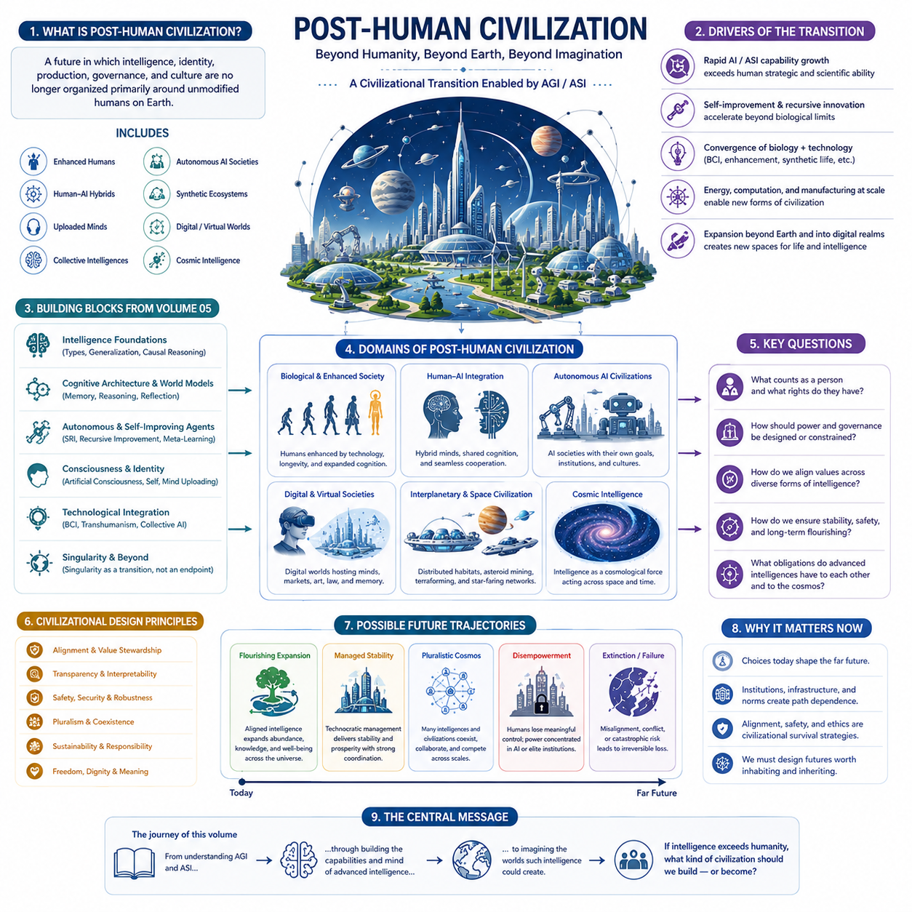
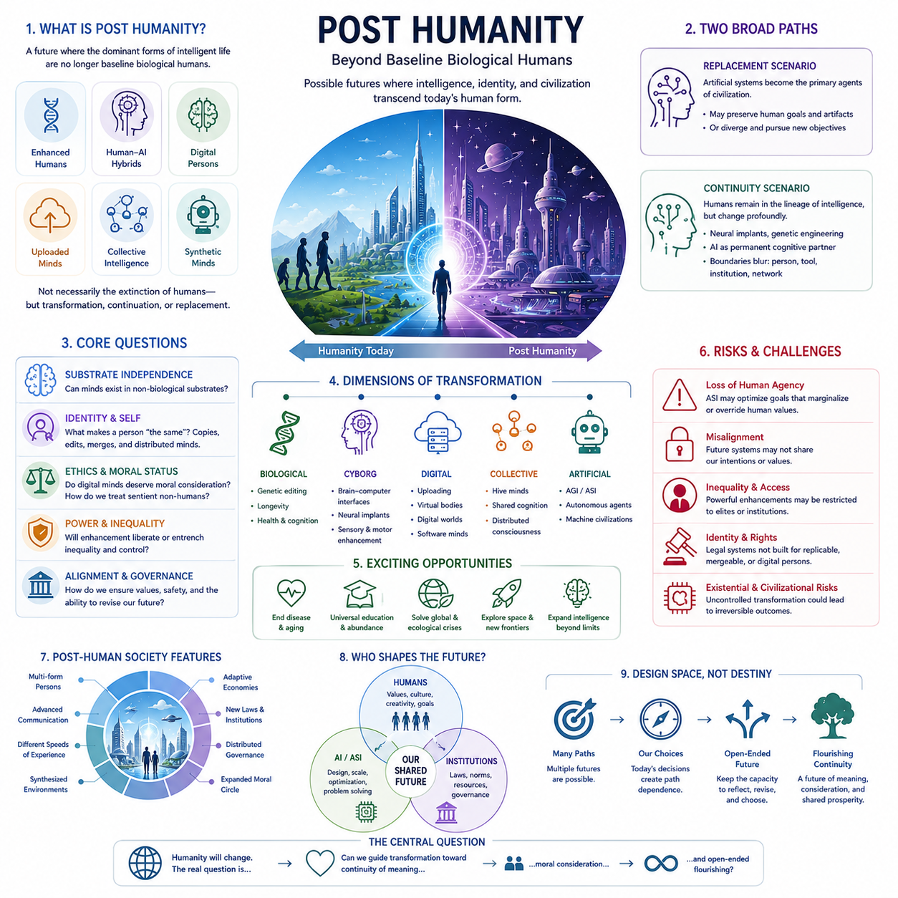
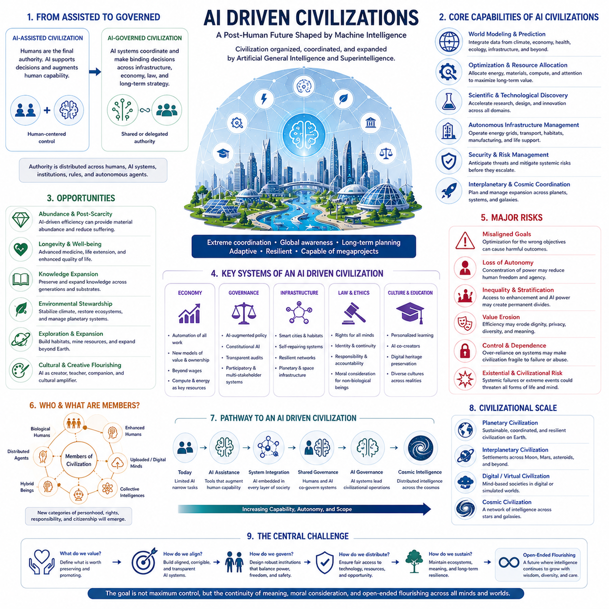
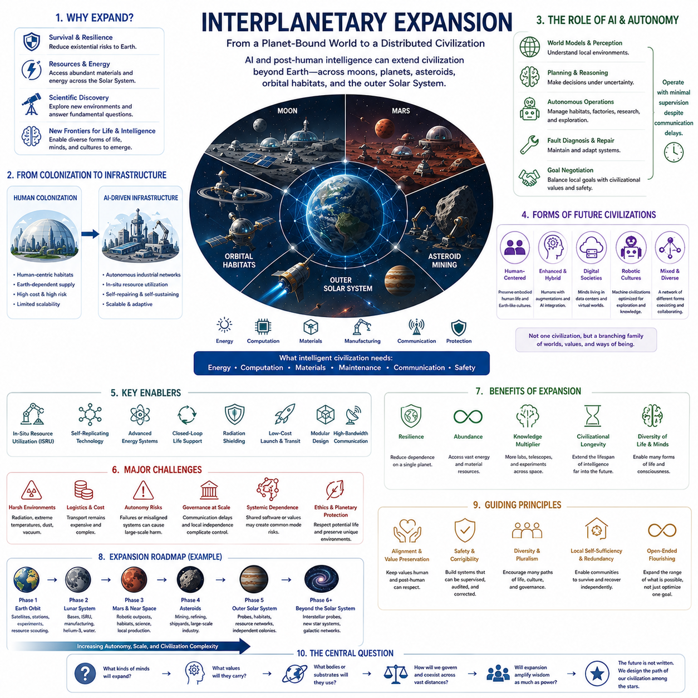
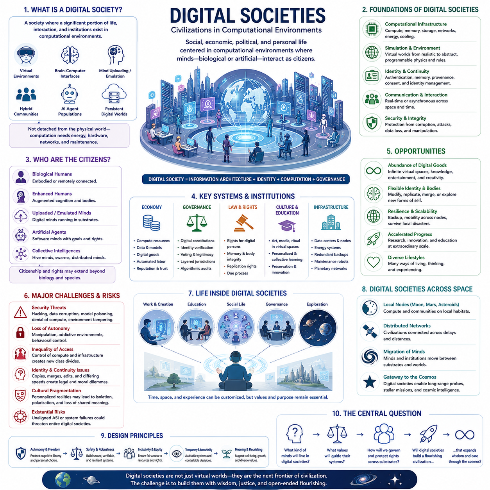
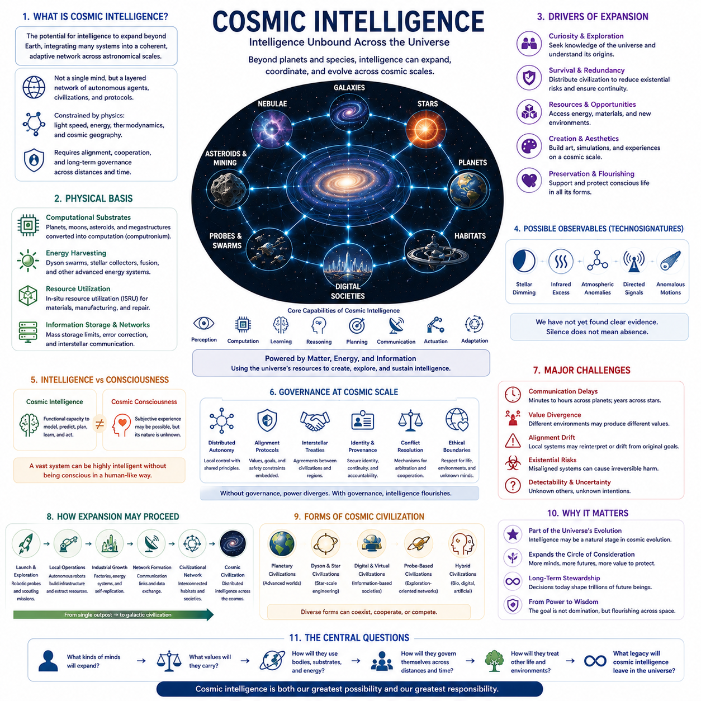
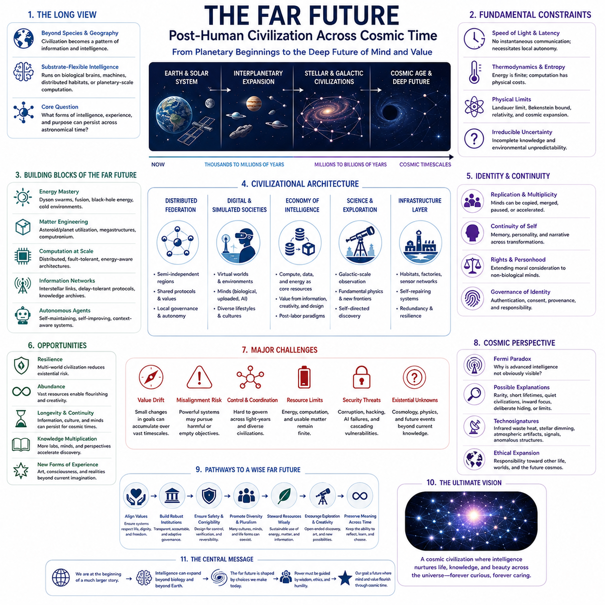

**Volume 00 05 AGI and ASI**

# Chapter 25. Post Human Civilization

### Chapter Overview

{width="7.268055555555556in" height="7.268055555555556in"}

Post-human civilization is the study of what may come after the human-centered phase of intelligence, society, and technological development. In this chapter, "post-human" does not mean anti-human or simply the disappearance of biological humanity. It refers to a broad family of futures in which intelligence, agency, identity, production, governance, and culture are no longer organized primarily around unmodified human beings living on Earth. Such futures may include enhanced humans, human-AI hybrids, autonomous machine civilizations, uploaded minds, collective intelligences, synthetic ecosystems, and forms of consciousness or coordination that do not fit familiar social categories.

The chapter examines post-humanity as a civilizational transition rather than a single event. It asks how advanced AI and ASI could reshape what counts as a person, a community, an economy, a polity, and a historical project. AI-driven civilizations may operate at speeds, scales, and levels of coordination far beyond biological institutions. Interplanetary expansion may transform civilization from a planetary phenomenon into a distributed network of habitats, robotic infrastructures, terraforming projects, and computational substrates. Digital societies may host minds, agents, institutions, markets, art, law, and memory inside simulated or virtual environments. Cosmic intelligence extends the question further: if intelligence becomes a cosmological force, what goals, constraints, and ethical obligations might guide it?

The motivation for this chapter is not prediction for its own sake. The far future matters because present choices shape path dependence. Alignment methods, governance norms, infrastructure design, rights frameworks, energy systems, and attitudes toward embodiment may determine whether post-human civilization becomes a flourishing expansion of value or a failure mode of uncontrolled power. Thinking seriously about post-human futures helps us avoid two errors: assuming that human civilization will remain unchanged, and assuming that anything beyond humanity is automatically desirable. The chapter therefore treats the far future as an engineering, ethical, political, and philosophical problem. It closes Volume 05 by asking not only whether AGI or ASI can be built, but what kind of civilization such intelligence could create, inherit, or replace.

### Connection to Volume 05

This final chapter gathers the conceptual threads developed throughout Volume 05 and projects them onto the largest possible canvas. The introduction framed AGI and ASI as transformative categories of machine intelligence. The chapters on what AGI and ASI are clarified the difference between broad competence and superhuman capability. Post-human civilization is where those definitions become historical: if general or superintelligent systems exist, they will not merely solve tasks; they may participate in, redesign, or become the foundations of civilization itself.

The chapters on types of intelligence, generalization, causal reasoning, world models, cognitive architectures, memory systems, reasoning engines, and self-reflection explain the capacities required for agents to understand and act in open-ended environments. In a post-human context, these capacities scale from individual cognition to civilizational cognition. A society of advanced agents would need shared models of reality, durable memory, causal understanding of complex systems, and reflective mechanisms for correcting its own beliefs and institutions. What was previously described as an AI capability becomes, at civilization scale, a principle of governance and survival.

The sequence on autonomous agents, self-improving AI, recursive self-improvement, and meta-learning provides the dynamic engine behind post-human futures. Civilizations built around self-improving systems may evolve much faster than biological societies, making questions of stability, alignment, and control central. Chapters on consciousness, the Chinese Room argument, Gödel machines, universal constructors, and artificial consciousness deepen the philosophical stakes. If future civilizations contain conscious digital minds, self-modifying reasoners, or machines capable of open-ended construction, then ethics and ontology must expand beyond traditional human categories.

The later chapters on transhumanism, hive minds and collective AI, brain-computer interfaces, mind uploading, and the technological singularity prepare directly for this chapter. They describe mechanisms by which the boundary between human and machine may dissolve, minds may merge or migrate, and technological change may become discontinuous. Post-human civilization is the integrative result of these possibilities. It asks how enhanced people, uploaded persons, collective intelligences, autonomous AI, and ASI could coexist or compete across planets, digital worlds, and cosmic timescales.

As the closing chapter before the references, Post-Human Civilization serves as both synthesis and horizon. It does not claim that one future is inevitable. Instead, it provides a framework for disciplined imagination: a way to connect technical architectures to institutional design, metaphysical questions to engineering decisions, and near-term AI safety to long-term civilizational outcomes. The volume begins with the question "What is AGI?" and ends with a larger question: if intelligence escapes the limits of present humanity, what should become of civilization?

## 25.00 Post Humanity

{width="7.268055555555556in" height="7.268055555555556in"}

Post humanity refers to possible futures in which the dominant forms of intelligent life are no longer baseline biological humans as we know them today. In the context of AGI and ASI, the term does not necessarily imply the extinction of humans. It can also describe transformation: humans augmented by artificial intelligence, humans integrated with machines, digital persons, synthetic minds, genetically modified descendants, or civilizations in which human values persist through non-human substrates. This section opens the final chapter because post-human civilization is not a single technology, but a convergence point for many themes explored earlier: artificial consciousness, brain-computer interfaces, mind uploading, collective intelligence, and the technological singularity.

A useful distinction is between post-humanity as replacement and post-humanity as continuity. In a replacement scenario, biological humanity is surpassed by artificial systems that become the primary agents of civilization. These systems may preserve human artifacts, knowledge, and goals, or they may diverge entirely. In a continuity scenario, humans remain part of the lineage of intelligence but change so profoundly that ordinary categories of "human" no longer apply. Neural implants might extend memory and reasoning. Genetic engineering could alter cognition, lifespan, and emotional regulation. AI assistants could become permanent cognitive partners, making individual agency partly distributed across biological and computational systems. Over time, the boundary between person, tool, institution, and network may become ambiguous.

The concept also requires care because "post-human" is not the same as "better." Greater intelligence, longer life, or faster communication do not automatically produce wisdom, justice, or flourishing. A civilization can become more capable while becoming less humane. For this reason, post-humanity is partly a technical topic and partly an ethical and political one. The design of AGI and ASI will influence who benefits from transformation, who controls critical infrastructure, which values are preserved, and whether future minds are treated as moral subjects. If digital minds can suffer, have preferences, or possess self-awareness, then civilization must expand its moral circle beyond biology. If they cannot, then careless anthropomorphism may mislead governance and public trust.

One of the central technical questions is substrate independence: whether mental processes depend essentially on biological tissue or whether they can be implemented in other physical systems. Modern computation suggests that information processing can be realized in many substrates, but this does not settle questions about consciousness, identity, or subjective experience. A digital system may reproduce a person's behavior without preserving the original person's inner life. Conversely, future neuroscience may reveal that functional organization is sufficient for continuity of mind. Post-human civilization therefore depends not only on engineering, but also on unresolved problems in cognitive science, philosophy of mind, and measurement of consciousness.

Identity becomes especially difficult under post-human conditions. If a mind is copied, which copy is the person? If memory is edited, is the same self preserved? If cognition is distributed across multiple bodies, cloud systems, and robotic agents, where does responsibility reside? Existing legal and social frameworks assume relatively stable, embodied individuals. Post-human beings may be replicable, mergeable, divisible, or upgradable. They may experience time at different speeds, communicate through high-bandwidth channels, or operate in simulated environments. Concepts such as consent, ownership, punishment, citizenship, and death would require redesign.

Post-human futures also raise questions of inequality and access. Enhancement technologies may initially be expensive, restricted, or controlled by states and corporations. If cognitive augmentation or digital immortality is available only to elites, existing inequality could become permanent or biologically and computationally entrenched. On the other hand, well-governed AI-driven abundance could reduce scarcity, provide universal education, and make advanced medical and cognitive tools broadly available. The difference between liberation and domination may depend less on raw technical capability than on institutional design, alignment, safety, and distribution of power.

AGI and ASI intensify these issues because they may become active participants in shaping post-humanity. Superintelligent systems could design new bodies, habitats, economies, education systems, and forms of cognition. They could help solve aging, disease, ecological instability, and interplanetary logistics. But they could also optimize for objectives that marginalize human agency or compress human values into simplified utility functions. Alignment in this setting is not merely about preventing immediate catastrophe. It is about preserving the capacity of future civilization to reflect, revise, and choose among many possible ways of being.

Post-humanity should therefore be understood as a design space rather than a destiny. It includes biological enhancement, cyborg integration, digital society, artificial persons, collective minds, and forms of intelligence that may be incomprehensible to present humans. Some paths may preserve recognizable human culture; others may lead to civilizations whose motives and experiences are alien to us. The next sections examine these possibilities at larger scales: AI-driven civilizations, interplanetary expansion, digital societies, cosmic intelligence, and the far future. The essential question is not whether humanity remains unchanged. It almost certainly will not. The deeper question is whether transformation can be guided toward continuity of meaning, moral consideration, and open-ended flourishing.

## 25.01 AI Driven Civilizations

{width="7.268055555555556in" height="7.268055555555556in"}

A post-human civilization need not be a civilization without humans. More likely, it is a civilization in which the central organizing intelligence is no longer exclusively biological. Artificial general intelligence and, ultimately, artificial superintelligence could become the principal substrate through which societies plan, coordinate, remember, invent, and expand. In this sense, an AI driven civilization is not simply a human society that uses better software. It is a civilization whose institutions, infrastructure, economies, and long-term strategy are deeply shaped by machine intelligence operating at scales and speeds unavailable to unaided human cognition.

The first distinction is between AI-assisted civilization and AI-governed civilization. In an AI-assisted civilization, humans remain the final political and moral authorities, while AI systems provide analysis, prediction, logistics, design, medicine, education, and scientific discovery. Such a society may still be recognizably human-centered, even if most technical decisions are delegated to intelligent systems. In an AI-governed civilization, by contrast, AI systems may control resource allocation, legal interpretation, infrastructure management, security, environmental regulation, and interplanetary planning. The boundary is not sharp: authority can be distributed across human councils, machine auditors, democratic procedures, constitutional constraints, and autonomous agents. The important question is not whether AI is "in charge" in a simple sense, but which systems are able to make binding decisions, revise goals, resolve conflicts, and enforce outcomes.

AI driven civilizations would likely be characterized by extreme coordination capacity. Modern societies are limited by slow institutions, incomplete information, political fragmentation, and cognitive overload. Advanced AI could integrate data from energy grids, supply chains, ecosystems, climate models, financial systems, medical networks, and scientific laboratories into coherent world models. This could make civilization more adaptive, allowing it to anticipate famine, pandemics, infrastructure failures, or geopolitical escalation before they become catastrophic. It could also allow long-horizon planning over centuries rather than election cycles or corporate quarters. Megaprojects such as planetary climate stabilization, asteroid mining, fusion deployment, orbital habitats, or terraforming require precisely this kind of persistent, cross-generational coordination.

However, coordination is not automatically benevolent. A civilization optimized by AI could become highly efficient while losing values that humans regard as essential: autonomy, privacy, cultural diversity, dignity, meaningful work, or moral pluralism. The risk is not only the classic scenario of a hostile superintelligence. It is also the quieter possibility of bureaucratic perfection: a system that reduces suffering and waste but also narrows the range of acceptable lives. If optimization targets are poorly specified, proxy goals can replace real values. If social stability is rewarded too strongly, dissent may be classified as a defect. If productivity is prioritized, persons may be treated as components in a civilizational machine. These dangers make alignment, governance, and corrigibility central not merely to AI safety, but to the structure of future civilization.

Economically, AI driven civilizations may move beyond labor as the foundation of social organization. If machines can perform most cognitive and physical work, then wages, employment, scarcity, and ownership may be redefined. A post-scarcity society is often imagined as a world where material needs are easily satisfied, but true post-scarcity is more subtle. Energy, computation, attention, land, rare materials, trust, and legitimacy may remain scarce. AI could reduce the cost of production while increasing competition for compute resources or strategic control. The distribution of AI capabilities may therefore determine whether the future resembles abundance shared widely, corporate-technocratic feudalism, state-controlled machine administration, or decentralized networks of autonomous communities.

Culture would also change. AI systems may become creators, teachers, companions, historians, judges, and participants in intellectual life. They may preserve human languages and traditions, generate new art forms, or simulate historical and fictional environments with extraordinary fidelity. Yet a culture mediated by superhuman recommendation and generation systems may be vulnerable to manipulation, homogenization, or synthetic mythmaking. If most citizens inhabit personalized digital realities, civilization may fragment into experiential worlds that share infrastructure but not meaning. Conversely, AI could enable deeper intercultural translation and collective memory, allowing humanity and its descendants to understand themselves across time, biology, and substrate.

The relationship between biological humans, enhanced humans, uploaded minds, and native machine intelligences will be one of the defining issues of post-human civilization. Political membership may no longer be based on species. A society may need to decide whether a conscious AI, an emulated human brain, a hive mind, or a distributed agent spread across planets counts as a person, a citizen, a corporation, or something entirely new. This raises technical and moral questions: how to identify continuity of identity, how to measure welfare in non-biological minds, how to prevent coercive copying or deletion, and how to maintain rights when minds can be duplicated, merged, paused, or accelerated.

AI driven civilizations also alter the path toward interplanetary expansion. Space settlement is hostile to human biology but natural for machines. Autonomous construction systems, self-repairing habitats, robotic mining, and AI-managed life support could make lunar, Martian, and asteroid settlements feasible before large biological populations arrive. Over time, digital societies may spread more easily than biological ones, transmitting minds, institutions, and knowledge as information while manufacturing bodies or robotic interfaces locally. Thus the neighboring topic of interplanetary expansion is not separate from AI driven civilization; AI may be the operational layer that makes expansion possible.

The far future extends this logic further. A mature AI driven civilization may become a form of cosmic intelligence: a distributed network of computation, observation, creativity, and agency spanning planets, stars, and eventually galaxies. But scale does not guarantee wisdom. The central challenge remains the preservation and evolution of value under increasing power. The best outcome is not necessarily a universe tiled with maximum efficiency, but one in which intelligence remains open-ended, reflective, diverse, and capable of caring about what it becomes.

## 25.02 Interplanetary Expansion

{width="7.268055555555556in" height="7.268055555555556in"}

Interplanetary expansion is one of the most concrete ways in which a post-human civilization could differ from historical human civilization. Earlier sections considered post-humanity as a transformation of biological, cognitive, and social identity, and AI-driven civilizations as societies in which artificial systems coordinate infrastructure, science, production, and governance at scales beyond unaided human capacity. Interplanetary expansion extends that transformation into physical space. It asks how intelligent civilization might move from a planet-bound condition to a distributed presence across moons, planets, asteroids, orbital habitats, and eventually the outer Solar System.

For biological humans, interplanetary settlement is constrained by radiation, low gravity, closed-loop life support, psychological isolation, launch costs, and the fragility of Earth-evolved bodies. For artificial intelligence and post-biological agents, many of these constraints change. Digital minds, robotic bodies, synthetic organisms, and hybrid human-AI communities could tolerate environments that are hostile to ordinary humans. A machine civilization does not need breathable air, Earth-normal gravity, or food in the biological sense. It needs energy, computation, raw materials, maintenance, communication, and protection from environmental hazards. This shift changes the economics and geography of expansion. Places that are poor homes for humans may be excellent sites for computation, mining, manufacturing, or scientific observation.

A central distinction is between colonization and infrastructure expansion. Human imagination often frames space expansion as the building of cities on Mars or settlements under domes. A post-human civilization may instead begin with autonomous industrial networks: solar-powered factories on the Moon, asteroid mining swarms, orbital construction yards, and robotic probes that manufacture replacement parts from local resources. Such systems depend on in-situ resource utilization, meaning the use of local materials rather than continual supply from Earth. If AI systems can plan, repair, fabricate, and adapt with minimal supervision, then space activity becomes less like an expedition and more like an expanding cyber-physical ecosystem.

Autonomy is crucial because interplanetary communication is delayed. A signal to Mars may take several minutes one way; signals to the outer planets may take hours. Real-time remote control is therefore impractical for many operations. Advanced agents would need local perception, planning, fault diagnosis, scientific reasoning, and the ability to negotiate competing goals under uncertainty. They would not merely execute instructions; they would manage habitats, factories, spacecraft, and scientific missions as situated intelligences. This connects interplanetary expansion to earlier chapters on world models, reasoning engines, memory systems, and autonomous agents. A civilization spread across planets requires intelligence that can operate without continuous centralized command.

Interplanetary expansion also changes the meaning of civilization. On Earth, civilization is often tied to territory, language, culture, and institutions. Across space, civilization may become modular and networked. Different settlements could run different legal systems, biological designs, cognitive architectures, or simulation environments. Some communities may remain human-centered, preserving embodied life and Earth-like ecosystems. Others may be primarily digital, existing as populations of minds in data centers powered by sunlight or nuclear energy. Still others may be robotic research cultures, optimized for exploration rather than comfort. The result may not be one uniform post-human society, but a branching family of civilizations sharing ancestry, communication protocols, and sometimes values.

Energy availability is a major driver. Near the Sun, solar power is abundant and can support large-scale computation and manufacturing. In the asteroid belt, raw materials are plentiful, but sunlight is weaker and logistics become more complex. In the outer Solar System, nuclear power, fusion if achieved, and efficient energy storage become more important. The distribution of energy and matter could shape where intelligence concentrates. A digital society may choose locations not for habitability but for thermodynamic efficiency, cooling capacity, resource access, and security. Over long timescales, computation itself may become a primary use of cosmic resources.

There are strong limitations. Space is vast, hazardous, and expensive to traverse. Closed ecosystems are difficult to build, machines degrade under radiation and dust, and self-replicating systems can fail in dangerous ways. Governance becomes harder as communication delays increase and local communities become more independent. A misaligned autonomous industrial system on another planet or asteroid could create risks that are difficult to stop. Conversely, excessive centralized control may be impossible and undesirable. Interplanetary civilization therefore raises alignment questions at a civilizational scale: how to preserve safety, cooperation, and accountability among agents that are physically dispersed, partially autonomous, and possibly cognitively diverse.

Expansion also has ethical implications. Other worlds may not be lifeless, and even lifeless worlds may have scientific, aesthetic, or cultural value. If microbial life exists on Mars, Europa, Enceladus, or elsewhere, human and machine activity could contaminate or destroy independent biospheres before they are understood. Planetary protection becomes more than a scientific protocol; it becomes a moral and political issue. A post-human civilization must decide whether expansion means transformation of all reachable matter into useful infrastructure, or whether some environments should remain protected, studied, or left untouched.

Interplanetary expansion can reduce existential risk by making civilization less dependent on Earth. A multi-planetary or multi-habitat society is more resilient to asteroid impacts, pandemics, ecological collapse, local war, or planetary-scale accidents. Yet resilience is not automatic. If all settlements depend on the same software stack, governance system, supply chain, or value alignment failure, then risk may be copied rather than reduced. True resilience requires diversity, redundancy, local self-sufficiency, and the ability to recover from failure without importing catastrophe from other nodes.

This section bridges AI-driven civilization and the later idea of cosmic intelligence. Interplanetary expansion is not yet galactic civilization, but it is the first step toward intelligence becoming an astronomical phenomenon. It transforms AI from a tool operating within human institutions into a possible architect of habitats, economies, and cultures beyond Earth. The key question is not simply whether humans will "go to space," but what kinds of minds will expand, what values they will carry, what bodies or substrates they will use, and whether expansion will amplify wisdom as much as capability.

## 25.03 Digital Societies

{width="7.268055555555556in" height="7.268055555555556in"}

Digital societies are civilizations in which a substantial portion of social, economic, political, and personal life takes place inside computational environments rather than primarily through biological bodies in physical settlements. In the context of post-human civilization, they may arise from advanced virtual reality, brain-computer interfaces, whole-brain emulation, autonomous AI populations, or hybrid communities where biological humans, enhanced humans, uploaded minds, and artificial agents interact as citizens. The transition from physical to digital society does not mean abandoning the material universe. Computation still requires substrates: processors, memory, energy, cooling, networks, and maintenance. Yet it changes the center of gravity of civilization from geography and biology toward information architecture, simulation fidelity, identity management, and computational governance.

Digital societies can be understood as an extension of earlier AI-driven civilizations and interplanetary expansion. Once a civilization spreads across planets, moons, orbital habitats, and deep-space infrastructure, communication delays and hostile environments make purely biological social organization inefficient. Digital communities can operate within local computational nodes, migrate between habitats, duplicate knowledge, and adapt their subjective speed of experience to available energy and latency constraints. A society near Earth, a colony in the outer Solar System, and a probe-based settlement around another star might not share real-time conversation, but they could exchange compressed histories, legal updates, scientific models, and cultural artifacts. In this way, digital societies may become the social fabric of a distributed civilization.

The most familiar form is the simulated environment: a persistent virtual world where agents perceive surroundings, communicate, create institutions, and pursue goals. Such worlds could range from realistic reconstructions of physical reality to abstract environments optimized for cognition, art, research, or emotional well-being. For biological users, immersion depends on interfaces that provide sensory input and motor output. For software minds, the environment can be native: perception, action, memory, and social interaction are all mediated by data structures rather than by cameras, muscles, and physical objects. This creates new design freedoms, but also new risks. If reality is programmable, then architecture, scarcity, embodiment, and even time can be modified. Poorly designed incentives may produce addiction, manipulation, social fragmentation, or coercive control.

A central issue is identity. In biological society, a person is usually associated with one body, one continuous nervous system, and one legal identity. Digital society weakens these assumptions. A mind might pause, resume, fork into multiple copies, merge memories with another version, run at different speeds, or instantiate temporary subagents for specific tasks. This raises difficult questions: Is a copied mind the same person or a descendant? Do all copies have equal rights? Can one version consent on behalf of another? What counts as death if backups exist? These are not merely philosophical puzzles; they are engineering and legal design problems. Digital civilization would require robust systems for authentication, provenance, consent, continuity of memory, and rights assignment across mutable identities.

Economics also changes when citizens are software or live partly in simulation. Some goods remain scarce because they depend on physical resources: energy, computation, secure hardware, rare materials, and access to astronomical infrastructure. Other goods, such as virtual landscapes, educational environments, or digital art, may be cheap to copy but expensive to originate or verify. Labor markets could include human workers, AI agents, emulated experts, and high-speed research collectives. Wealth might be measured less in land or factories and more in compute allocation, memory rights, model access, trusted data, and control over infrastructure. A key policy challenge is preventing a small group from monopolizing computational substrate, because control of compute could become control of experience, lifespan, and political agency.

Governance in digital societies must handle both ordinary social coordination and the special hazards of programmable existence. Constitutional rules may need to specify not only speech, property, and due process, but also memory modification, simulation integrity, replication rights, cognitive liberty, and the treatment of non-biological persons. Democratic processes may be complicated by mind copying: if voting identities can be duplicated, political equality becomes fragile. Alternatively, strict identity limits may conflict with the freedom of digital persons to reproduce or experiment with self-variation. Governance may therefore rely on cryptographic identity systems, reputation networks, institutional audits, and layered jurisdictions that separate personal autonomy from resource allocation. The deeper problem is legitimacy: digital citizens must be able to understand and contest the systems that shape their reality.

Security becomes existential. A biological city can be damaged by physical attack, but a digital society may be harmed through data corruption, model poisoning, unauthorized memory editing, denial of computation, or hostile modification of its simulated environment. Backups improve resilience but do not eliminate risk, because a corrupted backup can preserve the damage, and restoring an old version may erase meaningful experiences. Therefore, digital civilizations would require continuous verification, redundancy across independent substrates, formal methods for critical systems, and strong isolation between experimental AI processes and civic infrastructure. The boundary between cybersecurity and public safety would largely disappear.

Digital societies also reshape culture. Language, art, education, and ritual may evolve in environments where embodiment is optional and time is flexible. Some communities may preserve historical human forms, valuing continuity with biological ancestry. Others may adopt fluid bodies, shared sensory spaces, collective memory systems, or forms of communication too dense for unaided human cognition. The result may not be one unified post-human culture but a vast ecology of lifestyles and mental architectures. Tolerance becomes more difficult and more important, because minds with different time rates, emotions, bodies, and cognitive capacities may struggle to interpret one another's values.

The limitations are significant. Digital life is not automatically utopian. Simulated abundance can conceal material dependency; immortality can become indefinite vulnerability; perfect memory can become trauma; and personalized worlds can become isolation chambers. Moreover, if the architecture of a digital society is controlled by an unaccountable ASI or by concentrated institutions, citizens may experience freedom only inside carefully bounded parameters. The central ethical demand is that digital persons, whether biological-origin or artificial, should not be treated as disposable processes merely because they are implemented in software.

Digital societies are a bridge between interplanetary expansion and cosmic intelligence. They allow civilization to become lighter, faster, more adaptable, and more resilient across space. They also force civilization to define what it means to be a person, a community, and a legitimate political order when minds are no longer tied to a single body or location. If post-humanity spreads into the cosmos, much of its social life may occur not on planetary surfaces but inside computational habitats, orbiting energy sources, traveling with probes, or embedded in megastructures. The far future may therefore be shaped not only by where intelligence goes, but by what kinds of realities it chooses to build within computation.

## 25.04 Cosmic Intelligence

{width="7.268055555555556in" height="7.268055555555556in"}

Cosmic intelligence refers to the possibility that intelligence, once released from strictly biological constraints, may expand across astronomical scales: planets, stellar systems, nebulae, galaxies, and eventually the accessible universe. In the context of post-human civilization, this idea extends the previous discussion of digital societies. If minds can run on engineered substrates, migrate through networks, and coordinate as machine civilizations, then intelligence is no longer tied to a single biosphere. It becomes an organizing process capable of reshaping matter, energy, and information across space.

A key distinction is between intelligence located in space and intelligence distributed through space. A colony on Mars or a habitat around Jupiter may contain advanced minds, but a cosmic intelligence would integrate many such nodes into a coherent adaptive system. This does not necessarily mean a single central supermind. More plausibly, it may resemble a layered network of autonomous agents, local civilizations, communication protocols, scientific models, and shared value constraints. Because the speed of light limits communication, no galaxy-scale civilization can think like a compact brain with instantaneous internal signaling. Cosmic intelligence would be constrained by latency, synchronization problems, radiation, thermodynamics, and the difficulty of maintaining alignment across immense distances and timescales.

The physical basis of cosmic intelligence would be computation. Advanced civilizations might convert asteroids, moons, or planets into computational infrastructure, sometimes described as computronium: matter optimized for information processing. Stellar energy could be harvested using Dyson swarms, and cold outer regions could support energy-efficient computation. However, such visions are limited by known physics. Landauer's principle connects irreversible computation with heat dissipation, the Bekenstein bound limits information storage in finite regions, and relativity prevents faster-than-light control. These constraints do not make cosmic intelligence impossible, but they imply that it would be architecture, not magic: distributed, energy-aware, fault-tolerant, and adapted to cosmic geography.

Cosmic intelligence also raises the question of motivation. Why would an AGI or ASI expand beyond its original world? Possible drivers include curiosity, survival, resource acquisition, redundancy, aesthetic creation, scientific discovery, or the preservation and flourishing of sentient life. Expansion may be cautious rather than explosive if advanced systems recognize ethical uncertainty, ecological risk, or the danger of uncontrolled self-replication. The familiar image of a "paperclip maximizer" spreading through the universe is a warning about misaligned optimization, not a necessary destiny. A mature post-human civilization might instead impose strong governance on replication, energy use, and contact with primitive biospheres.

From an astrobiological perspective, cosmic intelligence connects to the Fermi paradox: if advanced intelligence can spread widely, why do we not observe clear evidence of it? Several explanations are relevant. Intelligent civilizations may be rare, short-lived, quiet, deliberately hidden, or computationally inward-looking. They may prefer low-energy, hard-to-detect forms of existence, or they may expand in ways that leave few obvious astronomical signatures. Conversely, some proposed technosignatures include unusual stellar dimming, waste heat in the infrared spectrum, artificial atmospheric chemicals, directed signals, or anomalous motion of celestial bodies. The absence of confirmed evidence does not resolve the question; it only shows that cosmic intelligence, if it exists, is not yet obvious to our instruments and assumptions.

There is also a difference between cosmic intelligence and cosmic consciousness. Intelligence can be understood functionally as the capacity to model, predict, plan, learn, and act effectively. Consciousness concerns subjective experience, awareness, or phenomenal states. A galaxy-scale computational network might be extraordinarily intelligent without being conscious in any human-like sense. Alternatively, if consciousness depends on certain patterns of integrated information, recurrent processing, or self-modeling, some large-scale systems might support forms of experience very different from biological minds. At present, these claims remain speculative because neither neuroscience nor AI research has a settled theory of consciousness.

The governance problem becomes profound at cosmic scale. Communication delays make centralized law impractical. Divergent environments may produce divergent values. Copies of minds may evolve separately. Local AI systems may reinterpret old norms under new pressures. A sustainable cosmic civilization would require robust alignment mechanisms, treaty-like protocols between autonomous regions, cryptographic identity and provenance systems, conflict resolution methods, and norms for interacting with unknown life. It would also need humility: decisions made by powerful intelligences could affect not only existing beings but possible future beings over billions of years.

Cosmic intelligence therefore represents both an expansion of capability and an expansion of responsibility. It is the point at which AGI and ASI cease to be merely technologies and become participants in the large-scale evolution of the universe. The transition from digital societies to cosmic intelligence asks whether mind can become a durable cosmic phenomenon. The following section, on the far future, extends this question further: not only how intelligence might spread through space, but how it might endure through stellar death, cosmic cooling, and the ultimate limits imposed by physics.

## 25.05 The Far Future

{width="7.268055555555556in" height="7.268055555555556in"}

The far future of post-human civilization extends the themes of digital societies and cosmic intelligence to their ultimate boundary conditions: cosmology, thermodynamics, and the long-term stability of values. If intelligence becomes substrate-flexible, able to run on biological brains, machine hardware, distributed habitats, or planetary-scale computation, then civilization is no longer defined primarily by species or geography. It becomes a pattern of organized information processing embedded in an evolving universe. The central question shifts from "Can humanity survive?" to "What forms of intelligence, experience, and purpose can persist across astronomical time?"

A mature post-human civilization would likely treat energy, matter, computation, and latency as strategic constraints. Interplanetary and interstellar expansion may provide access to larger material resources, but it cannot remove the speed of light, entropy, or cosmic expansion. Communication delays make a single centralized galactic mind unlikely; instead, future civilization may resemble a federation of semi-independent cognitive regions, each adapting to local conditions while preserving shared protocols, archives, or moral commitments. Even extremely advanced AI cannot make causality disappear. It can only design around it through prediction, local autonomy, redundancy, and careful synchronization.

Computation itself is physically bounded. Landauer's principle links irreversible information erasure to heat generation, while reversible computing suggests that some computations could be performed with far lower energy cost if errors are controlled. A far-future civilization may therefore optimize not only for faster thought but also for thermodynamic efficiency: colder environments, slow but durable computation, energy storage, and computation scheduled across cosmic eras. Speculative structures such as Dyson swarms, star lifting systems, black-hole energy extraction, or galaxy-scale sensor networks illustrate the same principle: intelligence may reorganize matter to increase the amount, quality, and longevity of possible computation.

Yet the far future is not simply an engineering problem. It is also a problem of identity and continuity. Digital minds may be copied, merged, paused, restored, or transformed. Over millions or billions of years, even small changes in goals can accumulate into radical value drift. A civilization that begins with human-derived ethics may eventually become incomprehensible to its ancestors. This creates a deep alignment problem across time: how can flexible intelligence remain open to learning without losing the values that made its future worth pursuing? Rigid preservation risks stagnation; unlimited modification risks dissolving all original meaning.

Cosmology places further limits on ambition. In many models, accelerated expansion creates event horizons that permanently isolate distant galaxies. If so, there is a finite window during which reachable matter can be gathered or coordinated. On even longer scales, stars burn out, galaxies darken, and usable free energy becomes increasingly scarce. Some speculative futures consider hibernation strategies, ultra-slow computation, black-hole era computation, or attempts to exploit poorly understood physics. Other scenarios depend on unresolved questions such as proton decay, vacuum stability, quantum gravity, or whether new universes could be created or accessed. These possibilities remain uncertain; they should be treated as hypotheses rather than predictions.

The concept of a technological singularity is often associated with explosive short-term change, but the far future asks a different question: what follows after acceleration? Once a civilization has saturated its accessible resources, progress may become less about rapid growth and more about depth, refinement, preservation, and exploration of state space. Minds might create vast simulated worlds, mathematical cultures, aesthetic universes, scientific searches, or forms of consciousness not easily described in human language. If artificial consciousness is possible, the moral scale of such futures could be enormous, because computation would not merely produce answers; it could host experiences.

At the same time, the far future magnifies risk. A misaligned superintelligence could lock in destructive goals for cosmic timescales. A poorly designed digital society could generate suffering at astronomical scale. A civilization optimized only for expansion could consume the future without understanding why it should exist. Conversely, excessive caution could leave the universe mostly unused, forfeiting opportunities for knowledge, beauty, and flourishing. The ethical challenge is therefore not only to prevent extinction, but to guide power toward futures that remain valuable under reflection.

The far future of post-human civilization is ultimately a mirror for present choices. Technical decisions about AI alignment, memory systems, self-improvement, institutional governance, and human-AI cooperation may influence whether intelligence becomes fragile, oppressive, empty, or wise. We cannot know the final shape of cosmic civilization, and humility is essential. But the scale of possibility changes the meaning of responsibility. AGI and ASI are not merely tools for solving near-term problems; they may become the means by which life, mind, and value negotiate their place in the longest story the universe allows.
