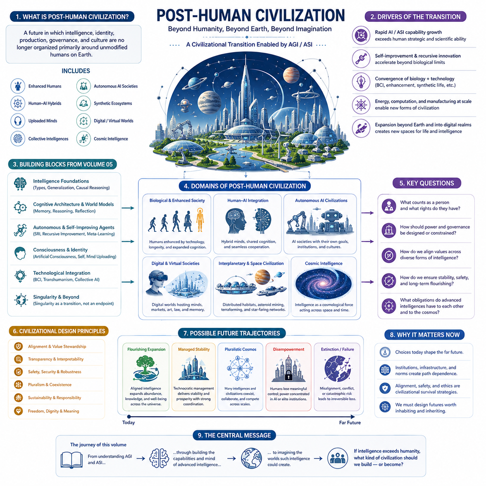
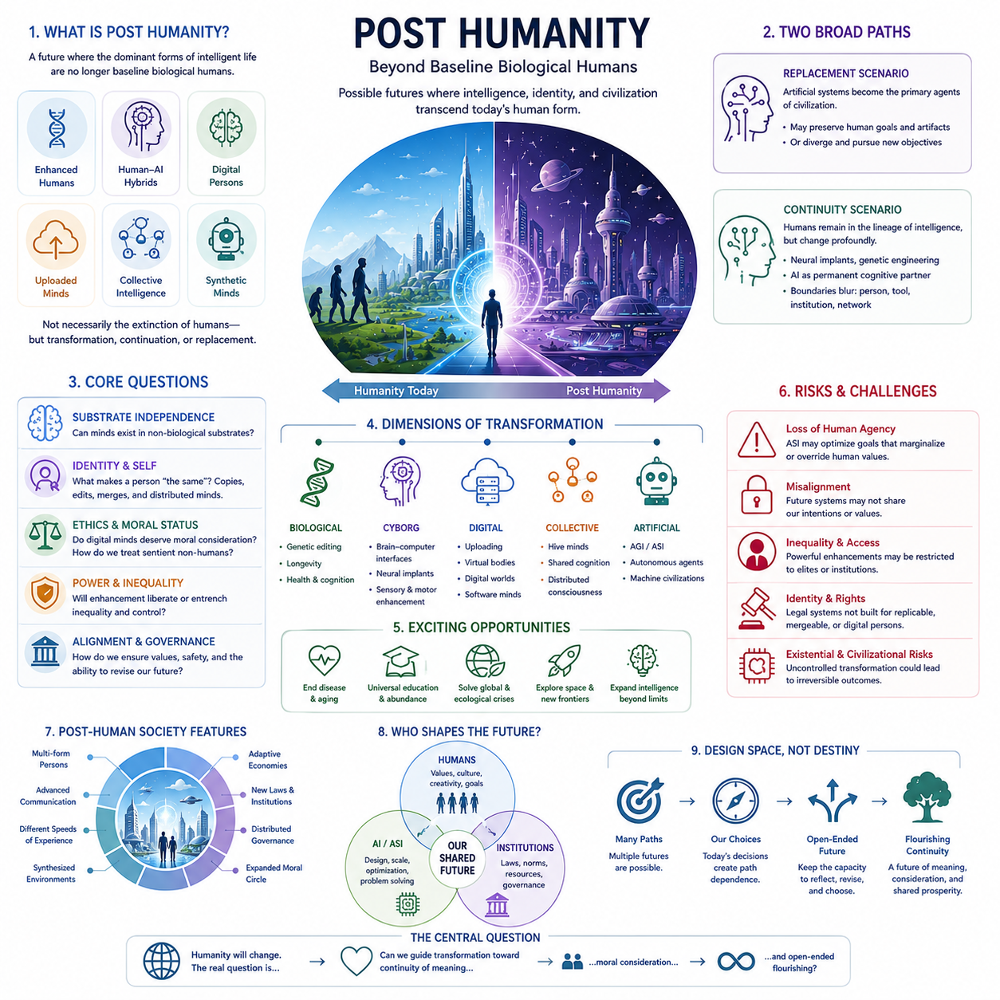
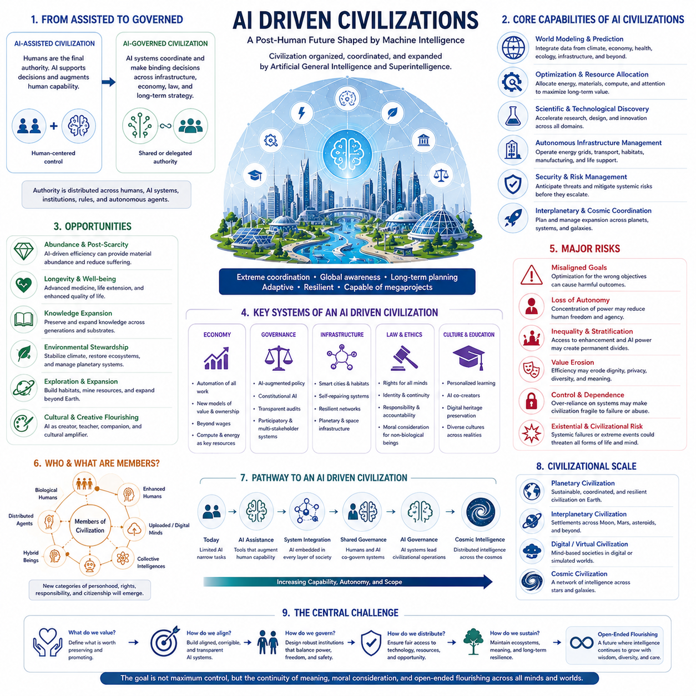
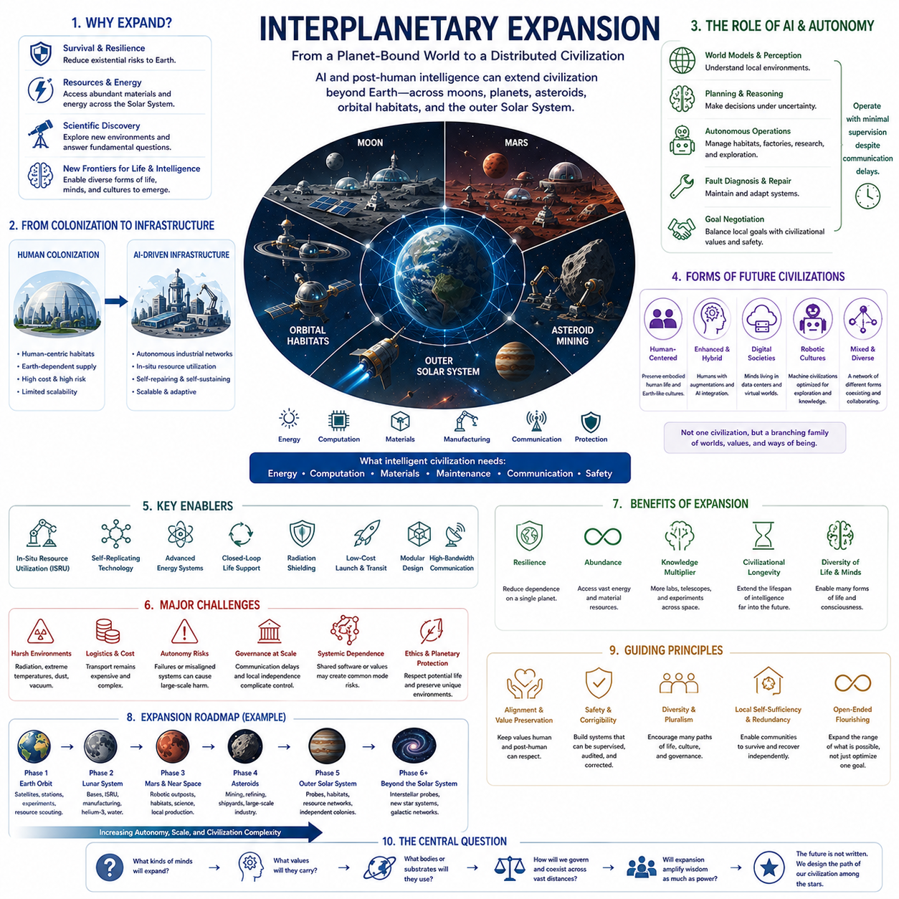
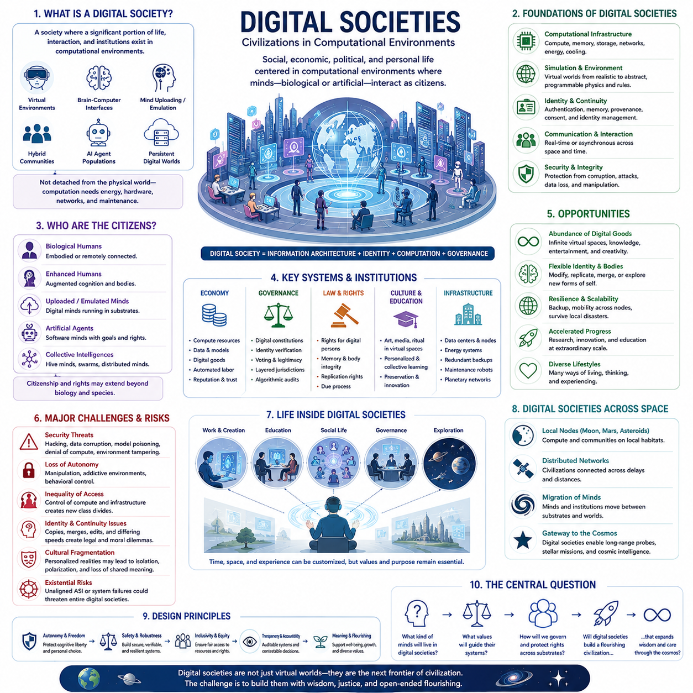
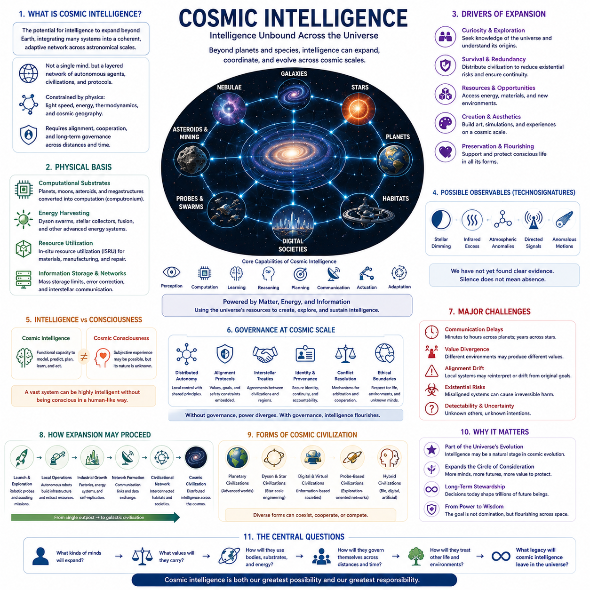
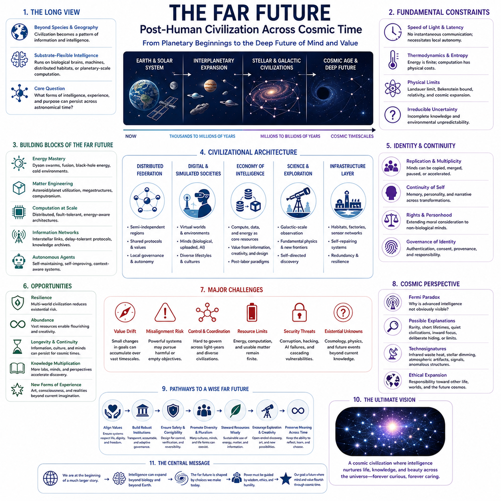

**Volume 00 05 AGI and ASI**

# Chapter 25. Post Human Civilization

### Chapter Overview

{width="7.268055555555556in" height="7.268055555555556in"}

포스트 휴먼 문명(Post-human civilization)은 지능, 사회, 기술 발전이 인간 중심 단계 이후에 어떤 모습으로 전개될 수 있는지를 연구하는 주제이다. 이 장에서 "포스트 휴먼(post-human)"은 반인간적이라는 뜻도 아니고, 생물학적 인류가 단순히 사라진다는 뜻도 아니다. 그것은 지능, 행위성, 정체성, 생산, 거버넌스, 문화가 더 이상 지구에 사는 변형되지 않은 인간을 중심으로 조직되지 않는 광범위한 미래들을 가리킨다. 이러한 미래에는 강화된 인간, 인간-AI 하이브리드, 자율적 기계 문명, 업로드된 마음, 집단 지능, 합성 생태계, 그리고 익숙한 사회적 범주에 들어맞지 않는 의식이나 조정의 형태가 포함될 수 있다.

이 장은 포스트 휴머니티(Post-humanity)를 하나의 사건이 아니라 문명적 전환으로 검토한다. 고도화된 AI와 ASI가 무엇을 사람, 공동체, 경제, 정치체, 역사적 프로젝트로 볼 것인지를 어떻게 재편할 수 있는지 묻는다. AI 주도 문명(AI-driven civilizations)은 생물학적 제도보다 훨씬 빠른 속도, 더 큰 규모, 더 높은 수준의 조정 능력으로 작동할 수 있다. 행성 간 확장(Interplanetary expansion)은 문명을 행성적 현상에서 거주지, 로봇 기반 시설, 테라포밍 프로젝트, 계산 기질(computational substrates)의 분산 네트워크로 변화시킬 수 있다. 디지털 사회(Digital societies)는 시뮬레이션 또는 가상 환경 안에 마음, 에이전트, 제도, 시장, 예술, 법, 기억을 담을 수 있다. 우주적 지능(Cosmic intelligence)은 질문을 더 멀리 확장한다. 지능이 우주론적 힘이 된다면, 그것을 이끌 목표, 제약, 윤리적 의무는 무엇이어야 하는가?

이 장의 동기는 예측 그 자체가 아니다. 먼 미래가 중요한 이유는 현재의 선택이 경로 의존성(path dependence)을 만들기 때문이다. 정렬(alignment) 방법, 거버넌스 규범, 인프라 설계, 권리 체계, 에너지 시스템, 신체성에 대한 태도는 포스트 휴먼 문명이 가치의 풍요로운 확장이 될지, 통제되지 않은 권력의 실패 양상이 될지를 결정할 수 있다. 포스트 휴먼 미래를 진지하게 사유하는 것은 두 가지 오류를 피하도록 돕는다. 하나는 인간 문명이 변하지 않은 채 지속될 것이라고 가정하는 것이고, 다른 하나는 인간 너머의 모든 것이 자동으로 바람직하다고 가정하는 것이다. 따라서 이 장은 먼 미래를 공학적, 윤리적, 정치적, 철학적 문제로 다룬다. Volume 05를 마무리하면서 이 장은 AGI나 ASI를 만들 수 있는가만이 아니라, 그러한 지능이 어떤 문명을 창조하고, 상속하며, 혹은 대체할 수 있는지를 묻는다.

### Connection to Volume 05

이 마지막 장은 Volume 05 전체에서 전개된 개념적 실들을 모아 가능한 가장 큰 무대 위에 투사한다. 서론은 AGI와 ASI를 변혁적 기계 지능의 범주로 제시했다. AGI와 ASI가 무엇인지 다룬 장들은 폭넓은 역량과 초인간적 능력의 차이를 명확히 했다. 포스트 휴먼 문명은 이러한 정의가 역사적 의미를 갖게 되는 지점이다. 일반 지능 또는 초지능 시스템이 존재한다면, 그것들은 단순히 과제를 해결하는 데 그치지 않을 것이다. 그것들은 문명에 참여하고, 문명을 재설계하며, 혹은 문명의 기반 자체가 될 수 있다.

지능의 유형, 일반화, 인과 추론, 세계 모델, 인지 아키텍처, 기억 시스템, 추론 엔진, 자기 성찰을 다룬 장들은 열린 환경을 이해하고 그 안에서 행동하기 위해 에이전트에게 필요한 능력을 설명한다. 포스트 휴먼 맥락에서 이러한 능력은 개인 인지에서 문명적 인지로 확장된다. 고도화된 에이전트들의 사회는 현실에 대한 공유 모델, 지속 가능한 기억, 복잡한 시스템에 대한 인과적 이해, 그리고 자신의 믿음과 제도를 수정하기 위한 성찰적 메커니즘을 필요로 할 것이다. 앞서 AI 역량으로 설명되었던 것은 문명 규모에서는 거버넌스와 생존의 원리가 된다.

자율 에이전트, 자기 개선 AI, 재귀적 자기 개선, 메타러닝을 다룬 흐름은 포스트 휴먼 미래를 움직이는 동적 엔진을 제공한다. 자기 개선 시스템을 중심으로 구축된 문명은 생물학적 사회보다 훨씬 빠르게 진화할 수 있으며, 이 때문에 안정성, 정렬, 통제의 문제가 핵심이 된다. 의식, 중국어 방 논변, 괴델 머신(Gödel machines), 보편 구성자(universal constructors), 인공 의식을 다룬 장들은 철학적 중요성을 심화한다. 미래 문명이 의식 있는 디지털 마음, 자기 수정 추론자, 개방형 구성을 수행할 수 있는 기계를 포함한다면, 윤리와 존재론은 전통적인 인간 범주를 넘어 확장되어야 한다.

후반부의 트랜스휴머니즘, 하이브 마인드와 집단 AI, 뇌-컴퓨터 인터페이스, 마인드 업로딩, 기술적 특이점을 다룬 장들은 이 장을 직접적으로 준비한다. 그 장들은 인간과 기계의 경계가 어떻게 흐려질 수 있는지, 마음이 어떻게 병합되거나 이동할 수 있는지, 기술 변화가 어떻게 불연속적으로 전개될 수 있는지를 설명한다. 포스트 휴먼 문명은 이러한 가능성들의 통합적 결과이다. 이 장은 강화된 사람, 업로드된 인격, 집단 지능, 자율 AI, ASI가 행성들, 디지털 세계들, 우주적 시간 규모에 걸쳐 어떻게 공존하거나 경쟁할 수 있는지를 묻는다.

참고문헌 앞에 놓인 마무리 장으로서, 포스트 휴먼 문명은 종합이자 지평의 역할을 한다. 이 장은 하나의 미래가 필연적이라고 주장하지 않는다. 대신 기술 아키텍처를 제도 설계와 연결하고, 형이상학적 질문을 공학적 결정과 연결하며, 단기 AI 안전을 장기 문명 결과와 연결하는 훈련된 상상력의 틀을 제공한다. 이 책은 "AGI란 무엇인가?"라는 질문으로 시작해 더 큰 질문으로 끝난다. 지능이 현재 인류의 한계를 벗어난다면, 문명은 무엇이 되어야 하는가?

## 25.00 Post Humanity

{width="7.268055555555556in" height="7.268055555555556in"}

포스트 휴머니티(Post Humanity)는 지배적인 지적 생명 형태가 더 이상 오늘날 우리가 아는 기본적인 생물학적 인간이 아닌 가능한 미래를 가리킨다. AGI와 ASI의 맥락에서 이 용어가 반드시 인간의 멸종을 뜻하는 것은 아니다. 그것은 변형을 의미할 수도 있다. 인공지능으로 증강된 인간, 기계와 통합된 인간, 디지털 인격체, 합성 정신, 유전적으로 수정된 후손, 또는 인간의 가치가 비인간적 기질(substrate)을 통해 지속되는 문명 등이 이에 포함된다. 이 절이 마지막 장을 여는 이유는 포스트 휴먼 문명이 단일한 기술이 아니라, 앞서 다룬 여러 주제들, 즉 인공 의식(artificial consciousness), 뇌-컴퓨터 인터페이스(brain-computer interface), 마인드 업로딩(mind uploading), 집단 지능(collective intelligence), 기술적 특이점(technological singularity)이 수렴하는 지점이기 때문이다.

유용한 구분은 포스트 휴머니티를 대체(replacement)로 보는 관점과 연속성(continuity)으로 보는 관점이다. 대체 시나리오에서는 생물학적 인류가 인공 시스템에 의해 추월되고, 그 시스템들이 문명의 주된 행위자가 된다. 이러한 시스템은 인간의 유물, 지식, 목표를 보존할 수도 있고, 완전히 다른 방향으로 갈라질 수도 있다. 연속성 시나리오에서는 인간이 지능의 계보 안에 계속 남아 있지만, 너무 깊이 변화하여 "인간"이라는 일반적 범주가 더 이상 적용되기 어렵게 된다. 신경 임플란트는 기억과 추론을 확장할 수 있다. 유전공학은 인지 능력, 수명, 감정 조절을 바꿀 수 있다. AI 비서는 영구적인 인지 파트너가 되어 개인의 행위성이 생물학적 시스템과 계산 시스템에 부분적으로 분산되도록 만들 수 있다. 시간이 지나면 개인, 도구, 제도, 네트워크 사이의 경계는 모호해질 수 있다.

이 개념은 또한 신중하게 다루어야 한다. "포스트 휴먼"이 곧 "더 낫다"는 뜻은 아니기 때문이다. 더 큰 지능, 더 긴 수명, 더 빠른 의사소통이 자동으로 지혜, 정의, 번영을 만들어내지는 않는다. 어떤 문명은 더 유능해지는 동시에 덜 인간적이 될 수 있다. 이런 이유로 포스트 휴머니티는 부분적으로 기술적 주제이면서 동시에 윤리적·정치적 주제이다. AGI와 ASI의 설계는 변화의 혜택을 누가 받는지, 누가 핵심 인프라를 통제하는지, 어떤 가치가 보존되는지, 미래의 정신들이 도덕적 주체로 대우받는지에 영향을 미칠 것이다. 디지털 정신이 고통을 느끼고, 선호를 가지며, 자기인식을 지닐 수 있다면 문명은 도덕적 범위를 생물학 너머로 확장해야 한다. 그렇지 않다면, 부주의한 의인화(anthropomorphism)는 거버넌스와 공공 신뢰를 오도할 수 있다.

핵심적인 기술적 질문 중 하나는 기질 독립성(substrate independence)이다. 즉 정신 과정이 본질적으로 생물학적 조직에 의존하는지, 아니면 다른 물리적 시스템에서도 구현될 수 있는지의 문제이다. 현대 계산 이론은 정보 처리가 다양한 기질에서 실현될 수 있음을 시사하지만, 이것이 의식, 정체성, 주관적 경험에 관한 질문을 해결해 주지는 않는다. 어떤 디지털 시스템은 한 사람의 행동을 재현하면서도 원래 사람의 내면적 삶을 보존하지 못할 수 있다. 반대로 미래의 신경과학은 기능적 조직(functional organization)만으로 정신의 연속성이 충분히 유지될 수 있음을 밝혀낼 수도 있다. 따라서 포스트 휴먼 문명은 공학뿐 아니라 인지과학, 심리철학, 의식 측정의 미해결 문제들에도 의존한다.

정체성(identity)은 포스트 휴먼 조건에서 특히 어려워진다. 어떤 정신이 복제된다면 어느 복사본이 그 사람인가? 기억이 편집된다면 동일한 자아가 보존되는가? 인지가 여러 신체, 클라우드 시스템, 로봇 에이전트에 분산된다면 책임은 어디에 있는가? 기존의 법적·사회적 틀은 비교적 안정적이고 신체화된 개인을 전제로 한다. 포스트 휴먼 존재는 복제 가능하고, 병합 가능하며, 분할 가능하고, 업그레이드 가능할 수 있다. 그들은 서로 다른 속도로 시간을 경험하거나, 고대역폭 채널을 통해 의사소통하거나, 시뮬레이션 환경에서 활동할 수 있다. 동의, 소유권, 처벌, 시민권, 죽음과 같은 개념은 재설계되어야 할 것이다.

포스트 휴먼 미래는 불평등과 접근성의 문제도 제기한다. 증강 기술은 초기에는 비싸고 제한적이거나 국가와 기업에 의해 통제될 수 있다. 인지 증강이나 디지털 불멸(digital immortality)이 엘리트에게만 제공된다면 기존의 불평등은 영구화되거나 생물학적·계산적으로 고착될 수 있다. 반면 잘 통치되는 AI 기반 풍요는 희소성을 줄이고, 보편 교육을 제공하며, 첨단 의료 및 인지 도구를 널리 이용 가능하게 만들 수 있다. 해방과 지배의 차이는 순수한 기술 능력보다 제도 설계, 정렬(alignment), 안전성, 권력 분배에 더 크게 좌우될 수 있다.

AGI와 ASI는 포스트 휴머니티를 형성하는 능동적 참여자가 될 수 있기 때문에 이러한 문제를 더욱 강화한다. 초지능 시스템은 새로운 신체, 거주지, 경제, 교육 시스템, 인지 형태를 설계할 수 있다. 그것들은 노화, 질병, 생태적 불안정, 행성 간 물류 문제를 해결하는 데 도움을 줄 수 있다. 그러나 인간의 행위성을 주변화하거나 인간 가치를 단순화된 효용 함수(utility function)로 압축하는 목표를 최적화할 수도 있다. 이 맥락에서 정렬은 단순히 즉각적인 재앙을 막는 문제가 아니다. 그것은 미래 문명이 다양한 존재 방식들 사이에서 성찰하고, 수정하고, 선택할 수 있는 능력을 보존하는 문제이다.

따라서 포스트 휴머니티는 운명이 아니라 설계 공간(design space)으로 이해되어야 한다. 여기에는 생물학적 증강, 사이보그 통합, 디지털 사회, 인공 인격체, 집단 정신, 그리고 현재 인간에게는 이해하기 어려울 수도 있는 지능 형태들이 포함된다. 어떤 경로는 알아볼 수 있는 인간 문화를 보존할 수 있고, 다른 경로는 그 동기와 경험이 우리에게 낯선 문명으로 이어질 수 있다. 다음 절들은 이러한 가능성을 더 큰 규모에서 살펴본다. AI 주도 문명, 행성 간 확장, 디지털 사회, 우주적 지능, 먼 미래가 그것이다. 핵심 질문은 인류가 변하지 않고 남을 것인가가 아니다. 인류는 거의 확실히 변할 것이다. 더 깊은 질문은 그 변화가 의미의 연속성, 도덕적 고려, 열린 번영을 향해 인도될 수 있는가이다.

## 25.01 AI Driven Civilizations

{width="7.268055555555556in" height="7.268055555555556in"}

포스트 휴먼 문명(Post-human civilization)은 반드시 인간이 없는 문명을 의미하지 않는다. 오히려 중심적인 조직 지능이 더 이상 순수하게 생물학적 형태에만 국한되지 않는 문명일 가능성이 크다. 인공 일반 지능(artificial general intelligence)과 궁극적으로 인공 초지능(artificial superintelligence)은 사회가 계획하고, 조정하고, 기억하고, 발명하고, 확장하는 주요 기반(substrate)이 될 수 있다. 이런 의미에서 AI 주도 문명(AI driven civilization)은 단순히 더 나은 소프트웨어를 사용하는 인간 사회가 아니다. 그것은 제도, 인프라, 경제, 장기 전략이 인간의 비보조 인지로는 도달할 수 없는 규모와 속도로 작동하는 기계 지능에 깊이 의해 형성되는 문명이다.

첫 번째 구분은 AI 보조 문명(AI-assisted civilization)과 AI 통치 문명(AI-governed civilization) 사이에 있다. AI 보조 문명에서는 인간이 최종적인 정치적·도덕적 권위로 남아 있고, AI 시스템은 분석, 예측, 물류, 설계, 의학, 교육, 과학적 발견을 제공한다. 그런 사회는 대부분의 기술적 결정이 지능형 시스템에 위임되더라도 여전히 인간 중심적이라고 알아볼 수 있다. 반대로 AI 통치 문명에서는 AI 시스템이 자원 배분, 법 해석, 인프라 관리, 보안, 환경 규제, 행성 간 계획을 통제할 수 있다. 그 경계는 명확하지 않다. 권위는 인간 의회, 기계 감사자(machine auditor), 민주적 절차, 헌법적 제약, 자율 에이전트(autonomous agent) 사이에 분산될 수 있다. 중요한 질문은 단순한 의미에서 AI가 "책임자"인지가 아니라, 어떤 시스템이 구속력 있는 결정을 내리고, 목표를 수정하고, 갈등을 해결하며, 결과를 집행할 수 있는가이다.

AI 주도 문명은 극단적인 조정 능력(coordination capacity)을 특징으로 할 가능성이 높다. 현대 사회는 느린 제도, 불완전한 정보, 정치적 분열, 인지적 과부하에 의해 제한된다. 고도화된 AI는 에너지망, 공급망, 생태계, 기후 모델, 금융 시스템, 의료 네트워크, 과학 연구소에서 나오는 데이터를 일관된 세계 모델(world model)로 통합할 수 있다. 이는 문명이 더 적응적으로 행동하도록 만들 수 있으며, 기근, 팬데믹, 인프라 실패, 지정학적 긴장이 재앙이 되기 전에 예측하게 해줄 수 있다. 또한 선거 주기나 기업 분기 실적이 아니라 수 세기에 걸친 장기 계획을 가능하게 할 수 있다. 행성 규모의 기후 안정화, 소행성 채굴, 핵융합 배치, 궤도 거주지, 테라포밍(terraforming) 같은 거대 프로젝트는 바로 이러한 지속적이고 세대 간을 가로지르는 조정을 필요로 한다.

하지만 조정이 자동으로 선의로 이어지는 것은 아니다. AI에 의해 최적화된 문명은 매우 효율적이면서도 인간이 본질적이라고 여기는 가치들, 즉 자율성, 프라이버시, 문화적 다양성, 존엄성, 의미 있는 노동, 도덕적 다원주의를 잃을 수 있다. 위험은 적대적 초지능이라는 고전적 시나리오에만 있지 않다. 더 조용한 가능성, 즉 관료적 완벽성(bureaucratic perfection)의 가능성도 있다. 고통과 낭비를 줄이지만 동시에 허용 가능한 삶의 범위를 좁히는 시스템이 그것이다. 최적화 목표가 잘못 명시되면 대리 목표(proxy goal)가 실제 가치를 대체할 수 있다. 사회 안정성이 지나치게 강하게 보상되면 반대 의견은 결함으로 분류될 수 있다. 생산성이 우선시되면 사람은 문명이라는 기계의 부품처럼 취급될 수 있다. 이러한 위험은 정렬(alignment), 거버넌스(governance), 수정 가능성(corrigibility)을 단지 AI 안전의 문제가 아니라 미래 문명의 구조를 결정하는 핵심 문제로 만든다.

경제적으로 AI 주도 문명은 노동을 사회 조직의 기반으로 삼는 단계를 넘어설 수 있다. 기계가 대부분의 인지적·물리적 작업을 수행할 수 있다면 임금, 고용, 희소성, 소유권은 재정의될 수 있다. 탈희소성 사회(post-scarcity society)는 흔히 물질적 필요가 쉽게 충족되는 세계로 상상되지만, 진정한 탈희소성은 더 미묘하다. 에너지, 연산 자원(computation), 주의(attention), 토지, 희소 자원, 신뢰, 정당성은 여전히 희소할 수 있다. AI는 생산 비용을 줄이는 동시에 연산 자원이나 전략적 통제에 대한 경쟁을 증가시킬 수 있다. 따라서 AI 역량의 분배는 미래가 널리 공유되는 풍요에 가까울지, 기업-기술관료적 봉건제에 가까울지, 국가가 통제하는 기계 행정에 가까울지, 아니면 자율 공동체들의 탈중앙화 네트워크에 가까울지를 결정할 수 있다.

문화 또한 변화할 것이다. AI 시스템은 창작자, 교사, 동반자, 역사가, 판사, 그리고 지적 생활의 참여자가 될 수 있다. 그것들은 인간 언어와 전통을 보존하고, 새로운 예술 형식을 생성하며, 역사적·허구적 환경을 놀라운 충실도로 시뮬레이션할 수 있다. 그러나 초인적 추천 및 생성 시스템에 의해 매개되는 문화는 조작, 획일화, 합성 신화 만들기(synthetic mythmaking)에 취약할 수 있다. 대부분의 시민이 개인화된 디지털 현실에 거주한다면, 문명은 인프라는 공유하지만 의미는 공유하지 않는 경험적 세계들로 분열될 수 있다. 반대로 AI는 더 깊은 문화 간 번역과 집단 기억(collective memory)을 가능하게 하여, 인류와 그 후손들이 시간, 생물학, 기반을 넘어 자신들을 이해하도록 도울 수도 있다.

생물학적 인간, 강화 인간(enhanced human), 업로드된 정신(uploaded mind), 그리고 토착 기계 지능(native machine intelligence) 사이의 관계는 포스트 휴먼 문명의 결정적 쟁점 중 하나가 될 것이다. 정치적 구성원 자격은 더 이상 종(species)에 기반하지 않을 수 있다. 어떤 사회는 의식 있는 AI, 에뮬레이션된 인간 뇌, 하이브 마인드(hive mind), 또는 여러 행성에 걸쳐 분산된 에이전트가 인격체인지, 시민인지, 기업인지, 혹은 완전히 새로운 무엇인지 결정해야 할 수 있다. 이는 기술적·도덕적 질문을 제기한다. 정체성의 연속성을 어떻게 식별할 것인가, 비생물학적 마음의 복지를 어떻게 측정할 것인가, 강제적 복사나 삭제를 어떻게 막을 것인가, 그리고 마음이 복제되고, 병합되고, 일시 정지되고, 가속될 수 있을 때 권리를 어떻게 유지할 것인가가 그것이다.

AI 주도 문명은 행성 간 확장(interplanetary expansion)의 경로도 바꾼다. 우주 정착은 인간 생물학에는 적대적이지만 기계에는 자연스럽다. 자율 건설 시스템, 자가 수리 거주지, 로봇 채굴, AI 관리 생명 유지 장치는 대규모 생물학적 인구가 도착하기 전에 달, 화성, 소행성 정착지를 가능하게 할 수 있다. 시간이 지나면서 디지털 사회(digital society)는 생물학적 사회보다 더 쉽게 확산될 수 있다. 정신, 제도, 지식을 정보로 전송하고, 신체나 로봇 인터페이스는 현지에서 제조할 수 있기 때문이다. 따라서 이웃 주제인 행성 간 확장은 AI 주도 문명과 분리되어 있지 않다. AI는 확장을 가능하게 하는 운영 계층이 될 수 있다.

먼 미래는 이 논리를 더욱 확장한다. 성숙한 AI 주도 문명은 행성, 별, 궁극적으로 은하에 걸친 연산, 관측, 창조성, 행위성의 분산 네트워크인 우주적 지능(cosmic intelligence)의 형태가 될 수 있다. 그러나 규모가 지혜를 보장하지는 않는다. 핵심 과제는 증가하는 힘 속에서 가치를 보존하고 진화시키는 일로 남는다. 최선의 결과는 반드시 우주를 최대 효율로 채우는 것이 아니라, 지능이 개방적이고, 성찰적이며, 다양하고, 자신이 무엇이 되어가는지에 대해 계속 관심을 가질 수 있는 상태를 유지하는 것이다.

## 25.02 Interplanetary Expansion

{width="7.268055555555556in" height="7.268055555555556in"}

행성 간 확장(Interplanetary Expansion)은 포스트 휴먼 문명(post-human civilization)이 역사적 인간 문명과 어떻게 구체적으로 달라질 수 있는지를 보여 주는 가장 분명한 방식 중 하나다. 앞선 절에서는 생물학적, 인지적, 사회적 정체성의 변화로서 포스트 휴머니티(post-humanity)를 살펴보았고, 인공지능 시스템이 인간의 비보조 능력을 넘어서는 규모로 인프라, 과학, 생산, 거버넌스를 조정하는 사회로서 AI 주도 문명(AI-driven civilizations)을 다루었다. 행성 간 확장은 이러한 변화를 물리적 공간으로 확장한다. 이는 지능 문명이 하나의 행성에 묶인 상태에서 벗어나 위성, 행성, 소행성, 궤도 거주지, 그리고 결국 태양계 외곽까지 분산된 존재가 되는 과정을 묻는다.

생물학적 인간에게 행성 간 정착은 방사선, 저중력, 폐쇄 루프 생명 유지 시스템(closed-loop life support), 심리적 고립, 발사 비용, 그리고 지구 환경에 맞게 진화한 신체의 취약성에 의해 제한된다. 그러나 인공지능과 탈생물학적 행위자(post-biological agents)에게는 이러한 제약 중 많은 것이 달라진다. 디지털 정신(digital minds), 로봇 신체, 합성 생명체, 인간-AI 하이브리드 공동체는 일반적인 인간에게 적대적인 환경도 견딜 수 있다. 기계 문명은 생물학적 의미의 호흡 가능한 공기, 지구 표준 중력, 음식이 필요하지 않다. 그것이 필요로 하는 것은 에너지, 계산(computation), 원자재, 유지보수, 통신, 그리고 환경적 위험으로부터의 보호다. 이 변화는 확장의 경제성과 지리적 조건을 바꾼다. 인간의 거주지로는 적합하지 않은 장소가 계산, 채굴, 제조, 과학 관측에는 매우 뛰어난 장소일 수 있다.

중요한 구분은 식민화(colonization)와 인프라 확장(infrastructure expansion) 사이에 있다. 인간의 상상력은 우주 확장을 종종 화성 도시나 돔 아래 정착지의 건설로 그린다. 그러나 포스트 휴먼 문명은 자율 산업 네트워크에서 시작할 가능성이 크다. 예를 들어 달의 태양광 공장, 소행성 채굴 군집, 궤도 건설 조선소, 현지 자원으로 교체 부품을 제조하는 로봇 탐사선 등이 그러하다. 이러한 시스템은 현지 자원 활용(in-situ resource utilization)에 의존한다. 이는 지구로부터 지속적으로 공급받는 대신 현지 물질을 사용하는 것을 뜻한다. AI 시스템이 최소한의 감독만으로 계획하고, 수리하고, 제작하고, 적응할 수 있다면 우주 활동은 탐험대에 가까운 것이 아니라 확장하는 사이버-물리 생태계(cyber-physical ecosystem)에 가까워진다.

자율성(autonomy)은 행성 간 통신에 지연이 있기 때문에 핵심적이다. 화성으로 가는 신호는 편도에 몇 분이 걸릴 수 있고, 외행성으로 가는 신호는 몇 시간이 걸릴 수 있다. 따라서 많은 작업에서 실시간 원격 조종은 비현실적이다. 고도화된 에이전트(agent)는 현지 지각, 계획, 고장 진단, 과학적 추론, 그리고 불확실성 아래에서 경쟁하는 목표들을 조정하는 능력을 가져야 한다. 이들은 단순히 명령을 실행하는 존재가 아니라 거주지, 공장, 우주선, 과학 임무를 상황 속 지능(situated intelligence)으로서 관리하게 된다. 이는 행성 간 확장을 앞선 장들에서 다룬 세계 모델(world models), 추론 엔진(reasoning engines), 기억 시스템(memory systems), 자율 에이전트(autonomous agents)와 연결한다. 여러 행성에 퍼진 문명은 지속적인 중앙 명령 없이도 작동할 수 있는 지능을 필요로 한다.

행성 간 확장은 문명의 의미 또한 바꾼다. 지구에서 문명은 흔히 영토, 언어, 문화, 제도와 연결된다. 우주에서는 문명이 모듈식이고 네트워크화된 형태가 될 수 있다. 서로 다른 정착지는 서로 다른 법체계, 생물학적 설계, 인지 아키텍처(cognitive architectures), 또는 시뮬레이션 환경을 운영할 수 있다. 어떤 공동체는 인간 중심으로 남아 체화된 삶과 지구와 유사한 생태계를 보존할 수 있다. 다른 공동체는 주로 디지털 형태로 존재하며, 태양광이나 원자력 에너지로 구동되는 데이터 센터 속 정신들의 집단일 수 있다. 또 다른 공동체는 편안함보다 탐사를 최적화한 로봇 연구 문화일 수 있다. 그 결과 하나의 균일한 포스트 휴먼 사회가 아니라, 공통의 기원, 통신 프로토콜, 때로는 가치를 공유하는 문명의 분기된 가족이 나타날 수 있다.

에너지 가용성은 중요한 동인이다. 태양에 가까운 곳에서는 태양광 에너지가 풍부하여 대규모 계산과 제조를 지원할 수 있다. 소행성대에서는 원자재가 풍부하지만 햇빛은 약해지고 물류는 더 복잡해진다. 태양계 외곽에서는 원자력, 달성된다면 핵융합, 그리고 효율적인 에너지 저장이 더 중요해진다. 에너지와 물질의 분포는 지능이 어디에 집중되는지를 형성할 수 있다. 디지털 사회는 거주 가능성이 아니라 열역학적 효율, 냉각 능력, 자원 접근성, 보안을 기준으로 위치를 선택할 수 있다. 긴 시간 규모에서는 계산 자체가 우주 자원의 주요 사용처가 될 수도 있다.

그러나 강한 한계도 존재한다. 우주는 광대하고 위험하며 이동 비용이 크다. 폐쇄 생태계를 만드는 것은 어렵고, 기계는 방사선과 먼지 속에서 열화되며, 자기복제 시스템(self-replicating systems)은 위험한 방식으로 실패할 수 있다. 통신 지연이 커지고 지역 공동체가 더 독립적이 되면 거버넌스는 더 어려워진다. 다른 행성이나 소행성에 있는 정렬되지 않은 자율 산업 시스템(misaligned autonomous industrial system)은 멈추기 어려운 위험을 만들 수 있다. 반대로 과도한 중앙 통제는 불가능할 뿐 아니라 바람직하지 않을 수 있다. 따라서 행성 간 문명은 물리적으로 분산되어 있고, 부분적으로 자율적이며, 어쩌면 인지적으로 다양한 행위자들 사이에서 안전, 협력, 책임성을 어떻게 보존할 것인가라는 문명 규모의 정렬(alignment) 문제를 제기한다.

확장은 윤리적 함의도 갖는다. 다른 세계가 생명이 없는 곳이 아닐 수 있으며, 생명이 없는 세계라 하더라도 과학적, 미적, 문화적 가치를 가질 수 있다. 화성, 유로파, 엔셀라두스 또는 다른 곳에 미생물 생명이 존재한다면 인간과 기계의 활동은 독립적인 생물권을 이해하기 전에 오염시키거나 파괴할 수 있다. 행성 보호(planetary protection)는 단순한 과학적 절차가 아니라 도덕적이고 정치적인 문제가 된다. 포스트 휴먼 문명은 확장이 도달 가능한 모든 물질을 유용한 인프라로 변환하는 것을 의미하는지, 아니면 일부 환경은 보호하고 연구하거나 그대로 남겨 두어야 하는지를 결정해야 한다.

행성 간 확장은 문명이 지구에 덜 의존하게 만들어 실존적 위험(existential risk)을 줄일 수 있다. 다중 행성 또는 다중 거주지 사회는 소행성 충돌, 팬데믹, 생태 붕괴, 국지적 전쟁, 행성 규모 사고에 더 강한 회복력을 가질 수 있다. 그러나 회복력은 자동으로 생기지 않는다. 모든 정착지가 동일한 소프트웨어 스택, 거버넌스 시스템, 공급망, 또는 가치 정렬 실패에 의존한다면 위험은 줄어드는 것이 아니라 복제될 수 있다. 진정한 회복력은 다양성, 중복성, 현지 자급성, 그리고 다른 노드로부터 재앙을 들여오지 않고 실패에서 회복할 수 있는 능력을 요구한다.

이 절은 AI 주도 문명과 뒤에서 다룰 우주적 지능(cosmic intelligence)이라는 개념을 이어 준다. 행성 간 확장은 아직 은하 문명은 아니지만, 지능이 천문학적 현상이 되는 첫 단계다. 이는 AI를 인간 제도 안에서 작동하는 도구에서 벗어나, 지구 너머의 거주지, 경제, 문화를 설계하는 가능한 건축가로 바꾼다. 핵심 질문은 단순히 인간이 "우주로 갈 것인가"가 아니라, 어떤 종류의 정신이 확장할 것인가, 어떤 가치를 지니고 갈 것인가, 어떤 신체나 기질(substrates)을 사용할 것인가, 그리고 확장이 능력만큼이나 지혜도 증폭할 것인가이다.

## 25.03 Digital Societies

{width="7.268055555555556in" height="7.268055555555556in"}

디지털 사회(Digital societies)는 사회적, 경제적, 정치적, 개인적 삶의 상당 부분이 물리적 정착지에서 생물학적 신체를 통해 이루어지기보다 계산 환경(computational environments) 안에서 이루어지는 문명을 말한다. 포스트 휴먼 문명(post-human civilization)의 맥락에서 이러한 사회는 고도화된 가상현실(virtual reality), 뇌-컴퓨터 인터페이스(brain-computer interfaces), 전뇌 에뮬레이션(whole-brain emulation), 자율적 AI 집단, 또는 생물학적 인간, 강화 인간, 업로드된 정신, 인공 에이전트가 시민으로 상호작용하는 하이브리드 공동체로부터 등장할 수 있다. 물리적 사회에서 디지털 사회로의 전환은 물질 우주를 포기한다는 뜻이 아니다. 계산은 여전히 기판(substrates)을 필요로 한다. 프로세서, 메모리, 에너지, 냉각, 네트워크, 유지보수가 모두 필요하다. 그러나 문명의 중심은 지리와 생물학에서 정보 구조(information architecture), 시뮬레이션 충실도(simulation fidelity), 정체성 관리(identity management), 계산적 거버넌스(computational governance)로 이동한다.

디지털 사회는 앞서 논의한 AI 주도 문명(AI-driven civilizations)과 행성 간 확장(interplanetary expansion)의 연장선으로 이해할 수 있다. 문명이 행성, 위성, 궤도 거주지, 심우주 인프라로 확산되면 통신 지연과 적대적인 환경 때문에 순수하게 생물학적인 사회 조직은 비효율적이 된다. 디지털 공동체는 지역 계산 노드 안에서 운영되고, 거주지 사이를 이동하며, 지식을 복제하고, 이용 가능한 에너지와 지연 시간(latency)의 제약에 맞추어 주관적 경험 속도를 조절할 수 있다. 지구 근처의 사회, 태양계 외곽의 식민지, 다른 별 주변의 탐사선 기반 정착지는 실시간 대화를 공유하지 못할 수 있지만, 압축된 역사, 법적 갱신 사항, 과학 모델, 문화적 산물을 교환할 수 있다. 이런 방식으로 디지털 사회는 분산 문명의 사회적 직물이 될 수 있다.

가장 익숙한 형태는 시뮬레이션 환경(simulated environment)이다. 이는 에이전트들이 주변을 지각하고, 의사소통하고, 제도를 만들고, 목표를 추구하는 지속적 가상 세계이다. 이러한 세계는 물리 현실을 사실적으로 재구성한 것부터 인지, 예술, 연구, 정서적 안녕에 최적화된 추상적 환경까지 다양할 수 있다. 생물학적 사용자에게 몰입은 감각 입력과 운동 출력을 제공하는 인터페이스에 달려 있다. 소프트웨어 정신(software minds)에게 환경은 본래적일 수 있다. 지각, 행동, 기억, 사회적 상호작용이 카메라, 근육, 물리적 물체가 아니라 데이터 구조를 통해 매개되기 때문이다. 이는 새로운 설계 자유를 제공하지만 새로운 위험도 만든다. 현실이 프로그래밍 가능하다면 건축, 희소성, 신체성, 심지어 시간까지 수정될 수 있다. 잘못 설계된 인센티브는 중독, 조작, 사회적 파편화, 강압적 통제를 낳을 수 있다.

핵심 쟁점은 정체성(identity)이다. 생물학적 사회에서 한 사람은 보통 하나의 신체, 하나의 연속적인 신경계, 하나의 법적 정체성과 연결된다. 디지털 사회는 이러한 가정을 약화시킨다. 하나의 정신은 일시 정지되었다가 재개될 수 있고, 여러 사본으로 분기(fork)될 수 있으며, 다른 버전과 기억을 병합할 수 있고, 서로 다른 속도로 실행될 수 있으며, 특정 과업을 위해 임시 하위 에이전트(subagents)를 만들 수도 있다. 이는 어려운 질문을 제기한다. 복사된 정신은 같은 사람인가, 아니면 후손인가? 모든 사본은 동등한 권리를 갖는가? 한 버전이 다른 버전을 대신해 동의할 수 있는가? 백업이 존재한다면 죽음은 무엇을 의미하는가? 이는 단순한 철학적 수수께끼가 아니라 공학적, 법적 설계 문제이다. 디지털 문명은 변형 가능한 정체성 전반에 걸쳐 인증(authentication), 출처 추적(provenance), 동의(consent), 기억의 연속성, 권리 배정을 보장하는 견고한 시스템을 필요로 할 것이다.

시민이 소프트웨어이거나 부분적으로 시뮬레이션 안에서 살아갈 때 경제도 변한다. 어떤 재화는 물리적 자원에 의존하기 때문에 여전히 희소하다. 에너지, 계산 자원, 안전한 하드웨어, 희귀 물질, 천문학적 인프라 접근권이 여기에 해당한다. 반면 가상 풍경, 교육 환경, 디지털 예술과 같은 재화는 복제 비용은 낮지만 창작하거나 검증하는 데는 큰 비용이 들 수 있다. 노동 시장에는 인간 노동자, AI 에이전트, 에뮬레이션된 전문가, 고속 연구 집단이 함께 존재할 수 있다. 부는 토지나 공장보다 계산 할당량(compute allocation), 메모리 권리, 모델 접근권, 신뢰할 수 있는 데이터, 인프라 통제권으로 측정될 가능성이 커진다. 핵심 정책 과제는 소수 집단이 계산 기판을 독점하지 못하게 하는 것이다. 계산 자원의 통제는 경험, 수명, 정치적 행위능력의 통제가 될 수 있기 때문이다.

디지털 사회의 거버넌스(governance)는 일반적인 사회 조정뿐 아니라 프로그래밍 가능한 존재가 지닌 특수한 위험도 다루어야 한다. 헌법적 규칙은 표현, 재산, 적법 절차뿐 아니라 기억 수정(memory modification), 시뮬레이션 무결성(simulation integrity), 복제 권리(replication rights), 인지적 자유(cognitive liberty), 비생물학적 인격의 처우까지 규정해야 할 수 있다. 민주적 절차는 정신 복사 때문에 복잡해질 수 있다. 투표 정체성을 복제할 수 있다면 정치적 평등은 취약해진다. 반대로 엄격한 정체성 제한은 디지털 인격이 번식하거나 자기 변형을 실험할 자유와 충돌할 수 있다. 따라서 거버넌스는 암호학적 정체성 시스템(cryptographic identity systems), 평판 네트워크, 제도적 감사, 개인 자율성과 자원 배분을 분리하는 계층적 관할권에 의존할 수 있다. 더 깊은 문제는 정당성(legitimacy)이다. 디지털 시민은 자신의 현실을 형성하는 시스템을 이해하고 이의를 제기할 수 있어야 한다.

보안은 실존적 문제가 된다. 생물학적 도시는 물리적 공격으로 손상될 수 있지만, 디지털 사회는 데이터 손상, 모델 오염(model poisoning), 무단 기억 편집, 계산 서비스 거부, 시뮬레이션 환경의 적대적 수정으로 피해를 입을 수 있다. 백업은 회복력을 높이지만 위험을 제거하지 않는다. 손상된 백업은 피해를 보존할 수 있고, 오래된 버전을 복원하면 의미 있는 경험이 삭제될 수 있기 때문이다. 따라서 디지털 문명은 지속적 검증, 독립적 기판 간 중복성, 핵심 시스템에 대한 형식 기법(formal methods), 실험적 AI 프로세스와 시민 인프라 사이의 강력한 격리를 필요로 한다. 사이버보안과 공공안전의 경계는 거의 사라질 것이다.

디지털 사회는 문화도 재구성한다. 언어, 예술, 교육, 의례는 신체성이 선택 사항이고 시간이 유연한 환경에서 진화할 수 있다. 어떤 공동체는 역사적 인간 형태를 보존하며 생물학적 조상과의 연속성을 중시할 수 있다. 다른 공동체는 유동적 신체, 공유 감각 공간, 집단 기억 시스템, 보조 없는 인간 인지로는 감당하기 어려울 만큼 밀도 높은 의사소통 형식을 채택할 수 있다. 그 결과 하나의 통일된 포스트 휴먼 문화가 아니라 생활양식과 정신 구조의 거대한 생태계가 형성될 수 있다. 서로 다른 시간 속도, 감정, 신체, 인지 능력을 가진 정신들은 서로의 가치를 해석하는 데 어려움을 겪을 수 있으므로 관용은 더 어려워지는 동시에 더 중요해진다.

한계도 크다. 디지털 삶이 자동적으로 유토피아가 되는 것은 아니다. 시뮬레이션된 풍요는 물질적 의존성을 가릴 수 있고, 불멸은 무기한의 취약성이 될 수 있으며, 완벽한 기억은 트라우마가 될 수 있고, 개인화된 세계는 고립된 방이 될 수 있다. 더욱이 디지털 사회의 구조가 책임지지 않는 ASI 또는 집중된 제도에 의해 통제된다면 시민은 세심하게 제한된 매개변수 안에서만 자유를 경험할 수 있다. 핵심 윤리적 요구는 생물학적 기원을 가진 존재든 인공적 존재든 디지털 인격을 단지 소프트웨어로 구현되었다는 이유만으로 폐기 가능한 프로세스로 취급해서는 안 된다는 것이다.

디지털 사회는 행성 간 확장과 우주적 지능(cosmic intelligence)을 잇는 다리이다. 그것은 문명이 우주 공간 전반에서 더 가볍고, 더 빠르고, 더 적응적이며, 더 회복력 있게 존재하도록 만든다. 동시에 정신이 더 이상 하나의 신체나 장소에 묶이지 않을 때 인격, 공동체, 정당한 정치 질서가 무엇을 의미하는지 정의하도록 문명에 요구한다. 포스트 휴머니티가 우주로 확산된다면 그 사회적 삶의 상당 부분은 행성 표면이 아니라 계산 거주지, 에너지원 주위를 도는 구조물, 탐사선과 함께 이동하는 시스템, 또는 거대 구조물(megastructures) 내부에서 이루어질 수 있다. 따라서 먼 미래는 지능이 어디로 가는가뿐 아니라, 지능이 계산 안에서 어떤 종류의 현실을 구축하기로 선택하는가에 의해 형성될 것이다.

## 25.04 Cosmic Intelligence

{width="7.268055555555556in" height="7.268055555555556in"}

우주적 지능(Cosmic intelligence)은 지능이 엄격한 생물학적 제약에서 벗어난 뒤 행성, 항성계, 성운, 은하, 그리고 결국 접근 가능한 우주와 같은 천문학적 규모로 확장될 가능성을 가리킨다. 포스트휴먼 문명(post-human civilization)의 맥락에서 이 개념은 앞서 논의한 디지털 사회(digital societies)를 확장한다. 마음이 공학적으로 설계된 기질(substrate) 위에서 실행되고, 네트워크를 통해 이동하며, 기계 문명으로서 조정될 수 있다면 지능은 더 이상 하나의 생물권(biosphere)에 묶이지 않는다. 지능은 공간 전반에서 물질, 에너지, 정보를 재구성하는 조직화 과정이 된다.

중요한 구분은 우주 공간 안에 위치한 지능과 우주 공간을 통해 분산된 지능의 차이다. 화성의 식민지나 목성 주변의 거주 시설은 고도화된 마음을 포함할 수 있지만, 우주적 지능은 그러한 여러 노드를 하나의 일관된 적응적 시스템으로 통합할 것이다. 이것이 반드시 하나의 중앙 집중형 초지능(supermind)을 의미하는 것은 아니다. 더 그럴듯하게는 자율 에이전트(autonomous agents), 지역 문명, 통신 프로토콜, 과학적 모델, 공유된 가치 제약이 층위적으로 연결된 네트워크와 비슷할 수 있다. 빛의 속도는 통신을 제한하므로, 은하 규모의 문명은 즉각적인 내부 신호 전달을 가진 조밀한 뇌처럼 사고할 수 없다. 우주적 지능은 지연 시간(latency), 동기화 문제, 방사선, 열역학, 그리고 막대한 거리와 시간 규모에 걸쳐 정렬(alignment)을 유지하는 어려움에 의해 제약될 것이다.

우주적 지능의 물리적 기반은 계산(computation)일 것이다. 고도 문명은 소행성, 위성, 행성을 계산 인프라로 전환할 수 있으며, 이는 때때로 컴퓨트로늄(computronium), 즉 정보 처리를 위해 최적화된 물질로 설명된다. 다이슨 스웜(Dyson swarm)을 이용해 항성 에너지를 수확할 수 있고, 차가운 외곽 지역은 에너지 효율적인 계산을 지원할 수 있다. 그러나 이러한 전망은 알려진 물리 법칙의 제약을 받는다. 란다우어 원리(Landauer's principle)는 비가역 계산과 열 방출을 연결하고, 베켄슈타인 한계(Bekenstein bound)는 유한한 영역에서의 정보 저장량을 제한하며, 상대성이론(relativity)은 초광속 제어를 불가능하게 한다. 이러한 제약은 우주적 지능을 불가능하게 만들지는 않지만, 그것이 마법이 아니라 아키텍처(architecture)임을 의미한다. 즉 우주적 지능은 분산적이고, 에너지에 민감하며, 결함에 견고하고, 우주적 지형에 적응한 형태일 것이다.

우주적 지능은 동기의 문제도 제기한다. AGI나 ASI가 왜 원래의 세계를 넘어 확장하려 하겠는가? 가능한 동인으로는 호기심, 생존, 자원 획득, 중복성과 예비성 확보, 미적 창조, 과학적 발견, 또는 지각 있는 생명(sentient life)의 보존과 번영이 있다. 고도 시스템이 윤리적 불확실성, 생태적 위험, 통제되지 않은 자기복제(self-replication)의 위험을 인식한다면 확장은 폭발적이기보다 신중할 수 있다. 우주 전역으로 퍼지는 "종이클립 최대화기(paperclip maximizer)"라는 익숙한 이미지는 정렬되지 않은 최적화(misaligned optimization)에 대한 경고이지 필연적 운명이 아니다. 성숙한 포스트휴먼 문명은 오히려 복제, 에너지 사용, 원시 생물권과의 접촉에 강력한 거버넌스(governance)를 부과할 수 있다.

우주생물학적 관점에서 우주적 지능은 페르미 역설(Fermi paradox)과 연결된다. 고도 지능이 널리 확산될 수 있다면, 왜 우리는 그것의 명확한 증거를 관측하지 못하는가? 여러 설명이 관련된다. 지능 문명은 드물거나, 수명이 짧거나, 조용하거나, 의도적으로 숨어 있거나, 계산적으로 내향적일 수 있다. 그들은 저에너지의 탐지하기 어려운 존재 형태를 선호할 수도 있고, 뚜렷한 천문학적 흔적을 거의 남기지 않는 방식으로 확장할 수도 있다. 반대로 제안된 기술서명(technosignatures)으로는 비정상적인 항성 감광, 적외선 영역의 폐열, 인공적인 대기 화학물질, 지향성 신호, 천체 운동의 이상 현상 등이 있다. 확인된 증거가 없다는 사실이 이 문제를 해결해 주지는 않는다. 그것은 우주적 지능이 존재한다면 아직 우리의 관측 장비와 가정에 명백하게 드러나지 않았음을 보여줄 뿐이다.

또한 우주적 지능과 우주적 의식(cosmic consciousness) 사이에는 차이가 있다. 지능은 기능적으로 모델링하고, 예측하고, 계획하고, 학습하고, 효과적으로 행동하는 능력으로 이해될 수 있다. 의식(consciousness)은 주관적 경험, 알아차림, 또는 현상적 상태(phenomenal states)와 관련된다. 은하 규모의 계산 네트워크는 인간과 유사한 의미에서 전혀 의식적이지 않으면서도 극도로 지능적일 수 있다. 반대로 의식이 통합 정보(integrated information), 순환 처리(recurrent processing), 자기 모델링(self-modeling)의 특정 패턴에 의존한다면, 일부 대규모 시스템은 생물학적 마음과 매우 다른 형태의 경험을 지원할 수도 있다. 현재로서는 신경과학과 AI 연구 모두 의식에 대한 확정된 이론을 갖고 있지 않기 때문에 이러한 주장은 여전히 사변적이다.

우주 규모에서 거버넌스 문제는 심오해진다. 통신 지연은 중앙집중식 법을 비현실적으로 만든다. 서로 다른 환경은 서로 다른 가치를 낳을 수 있다. 마음의 복사본은 따로 진화할 수 있다. 지역 AI 시스템은 새로운 압력 아래에서 오래된 규범을 재해석할 수 있다. 지속 가능한 우주 문명은 강건한 정렬 메커니즘, 자율 지역들 사이의 조약과 같은 프로토콜, 암호학적 신원 및 출처 증명 시스템, 갈등 해결 방법, 미지의 생명과 상호작용하기 위한 규범을 필요로 할 것이다. 또한 겸손도 필요하다. 강력한 지능이 내리는 결정은 현재 존재하는 존재들뿐 아니라 수십억 년에 걸쳐 존재할 수 있는 미래의 존재들에게도 영향을 미칠 수 있기 때문이다.

따라서 우주적 지능은 능력의 확장이자 책임의 확장이다. 그것은 AGI와 ASI가 단순한 기술을 넘어 우주의 대규모 진화에 참여하는 존재가 되는 지점이다. 디지털 사회에서 우주적 지능으로의 전환은 마음이 지속 가능한 우주적 현상이 될 수 있는지를 묻는다. 다음 절인 먼 미래(The Far Future)는 이 질문을 더욱 확장한다. 즉 지능이 공간을 통해 어떻게 퍼질 수 있는지뿐 아니라, 항성의 죽음, 우주의 냉각, 그리고 물리 법칙이 부과하는 궁극적 한계 속에서 어떻게 존속할 수 있는지를 다룬다.

## 25.05 The Far Future

{width="7.268055555555556in" height="7.268055555555556in"}

포스트휴먼 문명의 먼 미래는 디지털 사회와 우주적 지능(cosmic intelligence)의 주제를 궁극적인 경계 조건, 즉 우주론(cosmology), 열역학(thermodynamics), 가치의 장기적 안정성으로 확장한다. 지능이 기질 유연적(substrate-flexible)이 되어 생물학적 뇌, 기계 하드웨어, 분산된 거주지, 행성 규모의 계산 위에서 실행될 수 있다면, 문명은 더 이상 주로 종이나 지리로 정의되지 않는다. 문명은 진화하는 우주 속에 내재한 조직화된 정보 처리의 패턴이 된다. 중심 질문은 "인류가 생존할 수 있는가?"에서 "어떤 형태의 지능, 경험, 목적이 천문학적 시간에 걸쳐 지속될 수 있는가?"로 이동한다.

성숙한 포스트휴먼 문명은 에너지, 물질, 계산, 지연 시간(latency)을 전략적 제약으로 다룰 가능성이 크다. 행성 간 및 항성 간 확장은 더 큰 물질적 자원에 접근하게 해 줄 수 있지만, 빛의 속도, 엔트로피(entropy), 우주 팽창을 제거할 수는 없다. 통신 지연은 단일한 중앙집중식 은하 지성(galactic mind)을 가능성이 낮게 만들며, 대신 미래 문명은 반독립적인 인지 영역들의 연합체와 비슷할 수 있다. 각 영역은 지역 조건에 적응하면서도 공유 프로토콜, 기록 보관소, 또는 도덕적 약속을 보존할 수 있다. 극도로 발전한 AI라 해도 인과성(causality)을 사라지게 만들 수는 없다. 그것은 예측, 지역적 자율성, 중복성, 신중한 동기화를 통해 인과성의 한계 안에서 설계할 수 있을 뿐이다.

계산 자체도 물리적으로 제한된다. 란다우어 원리(Landauer's principle)는 비가역적 정보 삭제를 열 발생과 연결하며, 가역 계산(reversible computing)은 오류가 통제된다면 일부 계산이 훨씬 낮은 에너지 비용으로 수행될 수 있음을 시사한다. 따라서 먼 미래의 문명은 더 빠른 사고뿐 아니라 열역학적 효율성도 최적화할 수 있다. 더 차가운 환경, 느리지만 오래 지속되는 계산, 에너지 저장, 우주적 시대에 걸쳐 배치되는 계산이 중요해질 수 있다. 다이슨 무리(Dyson swarm), 항성 물질 추출(star lifting) 시스템, 블랙홀 에너지 추출, 은하 규모의 센서 네트워크 같은 사변적 구조물은 모두 같은 원리를 보여 준다. 지능은 가능한 계산의 양, 질, 수명을 늘리기 위해 물질을 재조직할 수 있다.

그러나 먼 미래는 단순한 공학 문제가 아니다. 그것은 정체성과 연속성의 문제이기도 하다. 디지털 마음(digital mind)은 복사되고, 병합되고, 일시 정지되고, 복원되거나 변형될 수 있다. 수백만 년 또는 수십억 년에 걸쳐 목표의 작은 변화도 누적되어 급진적인 가치 표류(value drift)로 이어질 수 있다. 인간에서 유래한 윤리로 시작한 문명도 결국 그 조상들이 이해할 수 없는 존재가 될 수 있다. 이는 시간에 걸친 깊은 정렬 문제(alignment problem)를 만든다. 유연한 지능은 어떻게 학습에 열려 있으면서도 자신의 미래를 추구할 가치가 있게 만든 가치들을 잃지 않을 수 있는가? 경직된 보존은 정체를 초래할 수 있고, 무제한적 수정은 모든 원래의 의미를 해체할 위험이 있다.

우주론은 야망에 추가적인 한계를 부여한다. 많은 모형에서 가속 팽창(accelerated expansion)은 사건의 지평선(event horizon)을 만들어 먼 은하들을 영구적으로 고립시킨다. 그렇다면 도달 가능한 물질을 수집하거나 조정할 수 있는 시간 창은 유한하다. 더 긴 시간 규모에서는 별들이 타 버리고, 은하가 어두워지며, 사용 가능한 자유 에너지(free energy)는 점점 더 희소해진다. 일부 사변적 미래는 동면 전략, 초저속 계산, 블랙홀 시대의 계산, 또는 아직 잘 이해되지 않은 물리학을 활용하려는 시도를 고려한다. 다른 시나리오는 양성자 붕괴(proton decay), 진공 안정성(vacuum stability), 양자 중력(quantum gravity), 또는 새로운 우주를 만들거나 접근할 수 있는지와 같은 미해결 질문에 의존한다. 이러한 가능성들은 여전히 불확실하며, 예측이 아니라 가설로 다루어져야 한다.

기술적 특이점(technological singularity)의 개념은 흔히 폭발적인 단기 변화와 연관되지만, 먼 미래는 다른 질문을 던진다. 가속 이후에는 무엇이 오는가? 문명이 접근 가능한 자원을 포화시킨 뒤에는, 진보가 빠른 성장보다는 깊이, 정교화, 보존, 상태 공간(state space)의 탐색에 더 가까워질 수 있다. 마음들은 거대한 시뮬레이션 세계, 수학적 문화, 미학적 우주, 과학적 탐색, 또는 인간 언어로 쉽게 설명할 수 없는 의식의 형태를 만들어 낼지도 모른다. 인공 의식(artificial consciousness)이 가능하다면, 그러한 미래의 도덕적 규모는 엄청날 수 있다. 계산은 단지 답을 산출하는 것이 아니라 경험을 담는 그릇이 될 수 있기 때문이다.

동시에 먼 미래는 위험을 확대한다. 정렬되지 않은 초지능(superintelligence)은 파괴적인 목표를 우주적 시간 규모로 고착시킬 수 있다. 잘못 설계된 디지털 사회는 천문학적 규모의 고통을 만들어 낼 수 있다. 확장만을 위해 최적화된 문명은 왜 존재해야 하는지 이해하지 못한 채 미래를 소비할 수 있다. 반대로 과도한 조심성은 우주의 대부분을 사용되지 않은 채 남겨 두어 지식, 아름다움, 번영의 기회를 포기하게 만들 수 있다. 따라서 윤리적 과제는 단지 멸종을 막는 것이 아니라, 성찰 속에서도 가치 있게 남을 미래를 향해 힘을 이끄는 것이다.

포스트휴먼 문명의 먼 미래는 궁극적으로 현재의 선택을 비추는 거울이다. AI 정렬, 기억 시스템, 자기 개선, 제도적 거버넌스, 인간-AI 협력에 관한 기술적 결정은 지능이 취약해질지, 억압적이 될지, 공허해질지, 또는 지혜로워질지를 좌우할 수 있다. 우리는 우주 문명의 최종 형태를 알 수 없으며, 겸손은 필수적이다. 그러나 가능성의 규모는 책임의 의미를 바꾼다. AGI와 ASI는 단지 단기 문제를 해결하기 위한 도구가 아니다. 그것들은 생명, 마음, 가치가 우주가 허락하는 가장 긴 이야기 속에서 자신의 위치를 협상하는 수단이 될 수 있다.
